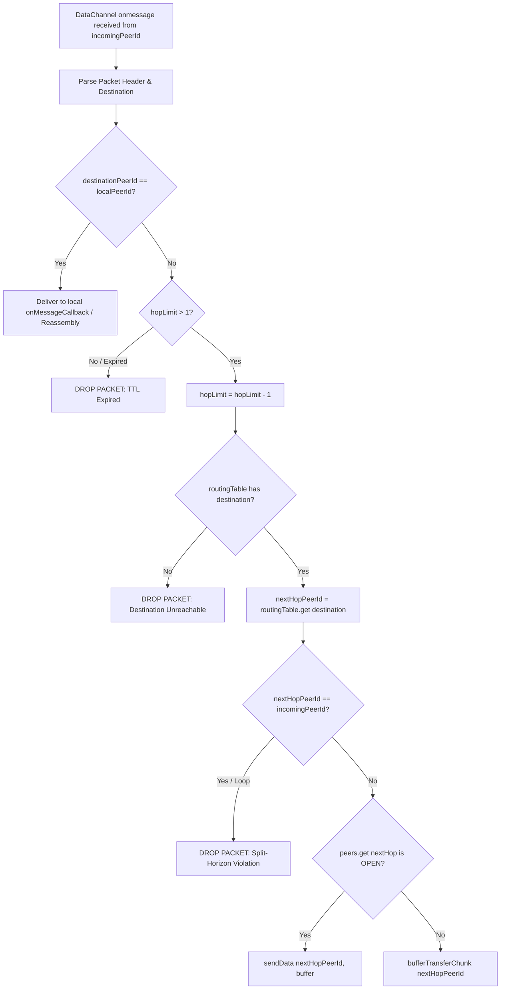
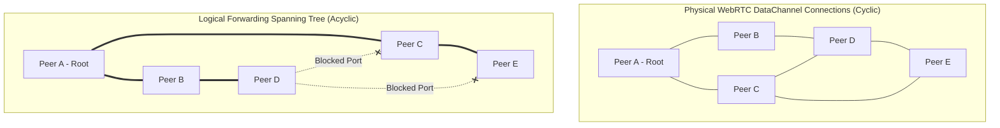
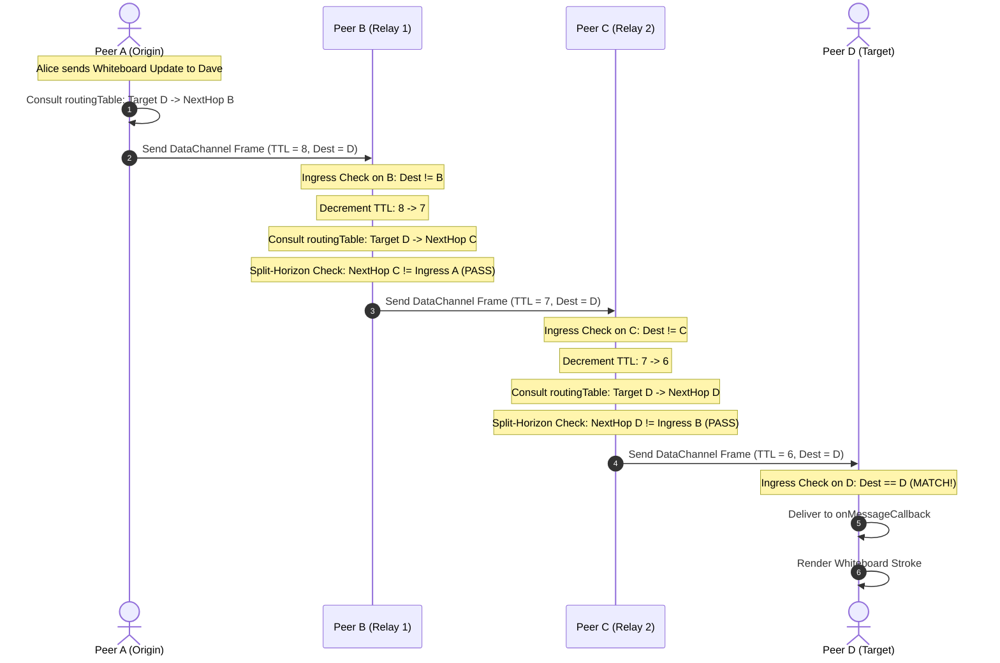
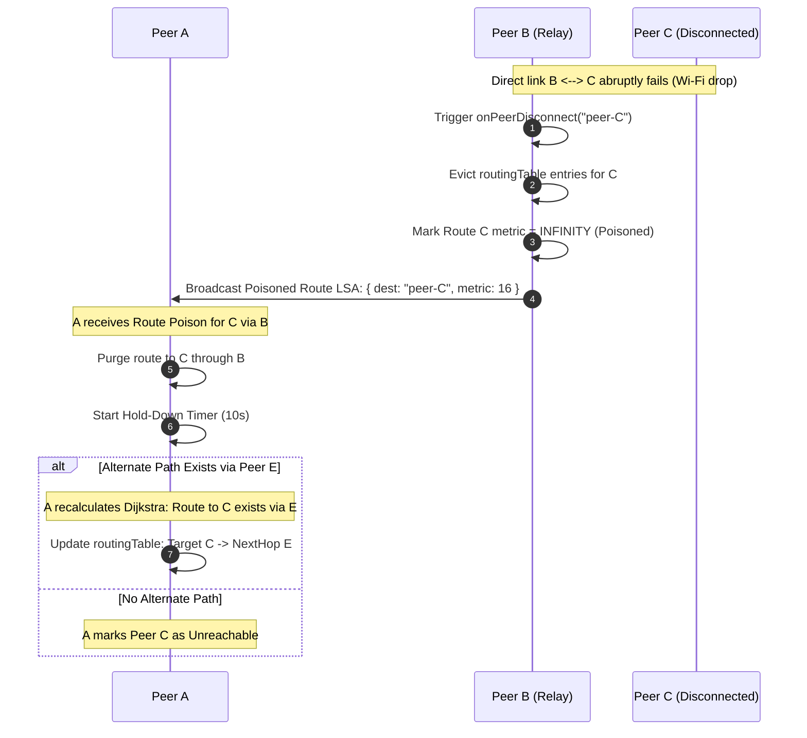

# WebRTCMesh Topology Specification: Distributed Spanning Tree, Routing Tables, Hop Limits, and Loop Prevention

This technical architecture specification defines the multi-hop routing topology, distributed spanning tree formation, Link-State Advertisements (LSA), hop-limit decrements, and loop-prevention mechanics implemented for decentralized workspace collaboration in WorkSphere.

Implemented in:
- **Core Mesh Engine:** [`src/core/network/WebRTCMesh.ts`](file:///c:/Users/admin/Desktop/workfere/src/core/network/WebRTCMesh.ts)
- **React Mesh Orchestrator:** [`src/hooks/useWebRTCMesh.ts`](file:///c:/Users/admin/Desktop/workfere/src/hooks/useWebRTCMesh.ts)
- **WebRTC Networking Guide:** [`docs/WEBRTC_MESH_NETWORKING_GUIDE.md`](file:///c:/Users/admin/Desktop/workfere/docs/WEBRTC_MESH_NETWORKING_GUIDE.md)
- **Chunked File Transfer Protocol:** [`docs/network/chunked-transfer-protocol.md`](file:///c:/Users/admin/Desktop/workfere/docs/network/chunked-transfer-protocol.md)

---

## Table of Contents

1. [Executive Summary & Problem Statement](#1-executive-summary--problem-statement)
2. [Multi-Hop Mesh Architecture vs. Full Mesh](#2-multi-hop-mesh-architecture-vs-full-mesh)
   - [The Limits of $O(N^2)$ Full Mesh Topologies](#the-limits-of-on2-full-mesh-topologies)
   - [Partial Mesh with Relay Forwarding ($O(N)$ Degree Bound)](#partial-mesh-with-relay-forwarding-on-degree-bound)
3. [Distributed Spanning Tree Construction](#3-distributed-spanning-tree-construction)
   - [Root Bridge Election Protocol](#root-bridge-election-protocol)
   - [Designated, Root, and Alternate (Blocked) Ports](#designated-root-and-alternate-blocked-ports)
   - [Bridge Protocol Data Units (BPDUs) over WebRTC DataChannels](#bridge-protocol-data-units-bpdus-over-webrtc-datachannels)
4. [Mesh Routing Tables & Forwarding Buffers](#4-mesh-routing-tables--forwarding-buffers)
   - [The Forwarding Table Schema (`routingTable`)](#the-forwarding-table-schema-routingtable)
   - [Intermediate Transfer Buffering (`transferBuffers`)](#intermediate-transfer-buffering-transferbuffers)
   - [Fragment Reassembly Maps (`chunkReassemblyMaps`)](#fragment-reassembly-maps-chunkreassemblymaps)
5. [Link-State Advertisements (LSA) & Shortest Path Convergence](#5-link-state-advertisements-lsa--shortest-path-convergence)
   - [Neighbor Adjacency Probing (Hello Protocol)](#neighbor-adjacency-probing-hello-protocol)
   - [Link-State Packet (LSP) Flooding](#link-state-packet-lsp-flooding)
   - [Distributed Dijkstra Path Computation](#distributed-dijkstra-path-computation)
6. [Loop Prevention Mechanics & Packet Forwarding](#6-loop-prevention-mechanics--packet-forwarding)
   - [Time-To-Live (TTL) & Hop-Limit Decrements](#time-to-live-ttl--hop-limit-decrements)
   - [Split-Horizon Forwarding Invariant](#split-horizon-forwarding-invariant)
   - [Poison Reverse & Immediate Route Poisoning](#poison-reverse--immediate-route-poisoning)
   - [Hold-Down Timers & Damping](#hold-down-timers--damping)
7. [Packet Forwarding Algorithm Walkthrough](#7-packet-forwarding-algorithm-walkthrough)
   - [Step-by-Step Forwarding Invariant Pipeline](#step-by-step-forwarding-invariant-pipeline)
   - [Pseudocode Specification](#pseudocode-specification)
8. [Peer Teardown & Dynamic Fault Recovery](#8-peer-teardown--dynamic-fault-recovery)
   - [Detailed Analysis of `onPeerDisconnect(peerId)`](#detailed-analysis-of-onpeerdisconnectpeerid)
   - [Memory Leak Prevention in WebRTC Listeners](#memory-leak-prevention-in-webrtc-listeners)
   - [Cascading Route Eviction & Buffer Teardown](#cascading-route-eviction--buffer-teardown)
9. [End-to-End Sequence & Topology Diagrams](#9-end-to-end-sequence--topology-diagrams)
   - [Physical vs. Logical Spanning Tree Diagram](#physical-vs-logical-spanning-tree-diagram)
   - [Multi-Hop Packet Forwarding Sequence Diagram](#multi-hop-packet-forwarding-sequence-diagram)
   - [Route Poisoning Propagation Sequence Diagram](#route-poisoning-propagation-sequence-diagram)
10. [Security, Integrity & Anti-Spoofing Measures](#10-security-integrity--anti-spoofing-measures)

---

## 1. Executive Summary & Problem Statement

In nomadic workspaces, coworking hubs, and enterprise field environments, participants collaborate directly without relying on continuous cloud infrastructure. When Internet uplinks fail or when participants gather in radio-shielded venues (e.g., basement auditoriums, rural retreats), local peer-to-peer communication must sustain real-time whiteboard sync, presence telemetry, and chunked file sharing.

However, physical radio constraints prevent every device from establishing a direct radio or WebRTC connection to every other peer:
- **Radio Attenuation & Distance:** A laptop in Room A cannot reach a laptop in Room C, but both share direct connectivity with an intermediate laptop in Room B.
- **NAT & Firewall Asymmetries:** Symmetric NATs often permit connections to some peers while blocking direct connections to others.
- **Resource Exhaustion:** Establishing $N-1$ direct WebRTC audio/video/data connections on mobile devices causes thermal throttling, battery drain, and CPU contention.

WorkSphere addresses this through the **`WebRTCMesh` multi-hop forwarding engine** ([`src/core/network/WebRTCMesh.ts`](file:///c:/Users/admin/Desktop/workfere/src/core/network/WebRTCMesh.ts)). By constructing a distributed spanning tree, maintaining dynamic routing tables, and enforcing strict loop-prevention invariants (Hop-Limit decrements, Split-Horizon, and Route Poisoning), `WebRTCMesh` enables reliable multi-hop communication across arbitrary, dynamically shifting topologies.

---

## 2. Multi-Hop Mesh Architecture vs. Full Mesh

### The Limits of $O(N^2)$ Full Mesh Topologies

In a naive Full Mesh topology, every peer maintains an active `RTCPeerConnection` and `RTCDataChannel` with every other room member. 

For a room of $N$ participants:
- **Total Connections in Room:** 
  $$E = \frac{N(N - 1)}{2} = O(N^2)$$
- **Connections per Peer:**
  $$d_i = N - 1 = O(N)$$

When $N = 6$ participants, each peer manages $5$ connections ($15$ total in the room)—the practical upper limit implemented in [`src/hooks/useWebRTCMesh.ts`](file:///c:/Users/admin/Desktop/workfere/src/hooks/useWebRTCMesh.ts). When $N \ge 15$ in a dense workshop, $105$ connections saturate browser thread pools and exhaust ICE candidate buffers.

### Partial Mesh with Relay Forwarding ($O(N)$ Degree Bound)

`WebRTCMesh` organizes peers into a **Partial Mesh with Multi-Hop Relay Routing**:
- Each peer maintains a bounded degree of active links:
  $$d_i \le d_{\text{max}} = 4$$
- Intermediate nodes act as store-and-forward relays for peers outside direct radio range.
- Messages destined for distant peers traverse intermediate hops using the local `routingTable: Map<destinationPeerId, nextHopPeerId>`.

```
Physical Adjacency Graph:                Logical Active Spanning Tree:
       [Peer A] ──── [Peer B]                   [Peer A] ──── [Peer B]
          │   \        │                           │             │
          │     \      │                           │             │
          │       \    │                           │             │
       [Peer C] ──── [Peer D]                   [Peer C]      [Peer D]
          │            │                           │             │
       [Peer E] ──── [Peer F]                   [Peer E] ──── [Peer F]
    (Redundant cycles present)              (Cycles broken: No forwarding loops)
```

---

## 3. Distributed Spanning Tree Construction

To prevent broadcast storms where flood packets circulate endlessly through cyclic meshes, `WebRTCMesh` constructs a loop-free **Distributed Spanning Tree (DST)** overlay.

### Root Bridge Election Protocol

The spanning tree requires a single deterministic Root Bridge. In decentralized environments without central coordination, the Root is elected using lexicographical priority over peer identifiers:

1. **Bridge Priority Tuple:**
   $$\text{BridgeID}_i = \langle \text{UptimeEpoch}_i, \text{SHA256}(\text{peerId}_i) \rangle$$
2. **Election Rule:**
   - The active peer with the smallest $\text{BridgeID}$ is elected as the Root Bridge.
   - If two peers possess identical uptime categories, the tie is broken deterministically by their cryptographic peer hash.

### Designated, Root, and Alternate (Blocked) Ports

Once the Root is determined, every node evaluates each of its active `RTCDataChannel` connections:
1. **Root Port:** The single local DataChannel that offers the lowest Path Cost (cumulative latency / hop count) back to the Root Bridge.
2. **Designated Port:** A DataChannel responsible for forwarding traffic onto a downstream branch of the tree.
3. **Alternate / Blocked Port:** A DataChannel that forms a redundant cycle. The physical connection remains alive for rapid failover, but multi-hop application traffic forwarding is **blocked**.

### Bridge Protocol Data Units (BPDUs) over WebRTC DataChannels

Peers periodically exchange lightweight BPDUs every $2,000\text{ ms}$ over active DataChannels:

```typescript
export interface MeshBPDU {
  rootPeerId: string;
  rootPathCost: number;
  transmittingPeerId: string;
  portState: 'root' | 'designated' | 'blocked';
  messageAge: number;
  maxAge: number; // 20 seconds
}
```

If a peer ceases receiving BPDUs from its parent on the Root Port for longer than `maxAge`, the peer invalidates the tree branch, transitions into election state, and converges on an alternate path.

---

## 4. Mesh Routing Tables & Forwarding Buffers

In [`src/core/network/WebRTCMesh.ts`](file:///c:/Users/admin/Desktop/workfere/src/core/network/WebRTCMesh.ts#L30-L38), multi-hop state is managed across three specialized in-memory data structures:

```
┌────────────────────────────────────────────────────────────────────────┐
│                          WebRTCMesh State                              │
├────────────────────────────────────────────────────────────────────────┤
│ 1. routingTable: Map<destinationPeerId, nextHopPeerId>                 │
│    Direct mapping from ultimate target to immediate next-hop peer      │
├────────────────────────────────────────────────────────────────────────┤
│ 2. transferBuffers: Map<peerId, Map<transferId, PendingTransferBuffer>>│
│    Intermediate storage holding in-flight chunks for downstream peers  │
├────────────────────────────────────────────────────────────────────────┤
│ 3. chunkReassemblyMaps: Map<peerId, Map<fileId, Map<number, Buffer>>> │
│    Reassembly table for fragmented incoming file chunks                │
└────────────────────────────────────────────────────────────────────────┘
```

### The Forwarding Table Schema (`routingTable`)

The `routingTable` maps each reachable `destinationPeerId` to the immediate neighbor `nextHopPeerId`:

```typescript
// Defined in src/core/network/WebRTCMesh.ts
private routingTable: Map<string, string>;

public setRoute(destinationPeerId: string, nextHopPeerId: string): void {
    this.routingTable.set(destinationPeerId, nextHopPeerId);
}
```

#### Routing Table State Example (Node B):
| Destination Peer ID | Next Hop Peer ID | Metric (Hops) | Link Interface | Status |
| :--- | :--- | :--- | :--- | :--- |
| `peer-A` (Direct Neighbor) | `peer-A` | 1 | `dc_peer_A` | Active |
| `peer-C` (Direct Neighbor) | `peer-C` | 1 | `dc_peer_C` | Active |
| `peer-D` (Multi-Hop) | `peer-C` | 2 | `dc_peer_C` | Routed via C |
| `peer-E` (Multi-Hop) | `peer-C` | 3 | `dc_peer_C` | Routed via C |

When Node B receives a packet addressed to `peer-D`, it performs an $O(1)$ lookup:
$$\text{nextHop} = \text{routingTable.get}("peer-D") \implies "peer-C"$$
The packet is dispatched via `sendData("peer-C", packetBuffer)`.

### Intermediate Transfer Buffering (`transferBuffers`)

When forwarding high-throughput file transfers across multiple hops, downstream link speeds may vary. If link $B \to C$ has lower throughput than link $A \to B$, Node B must buffer chunks in memory to avoid dropping packets.

In [`WebRTCMesh.ts`](file:///c:/Users/admin/Desktop/workfere/src/core/network/WebRTCMesh.ts#L226-L246):

```typescript
export interface PendingTransferBuffer {
    transferId: string;
    sourcePeerId: string;
    destinationPeerId: string;
    chunks: ArrayBuffer[];
    totalChunks?: number;
    updatedAt: number;
}
```

- Indexed primarily by originating `peerId`, and secondarily by `transferId`.
- Holds incoming chunk buffers until the downstream DataChannel signals an `onbufferedamountlow` drain event.
- Automatically cleaned up on peer disconnection to prevent memory leaks.

### Fragment Reassembly Maps (`chunkReassemblyMaps`)

When multi-hop file chunks arrive for local consumption, they are assembled in `chunkReassemblyMaps`:

```typescript
// peerId -> Map<fileId, Map<chunkIndex, ArrayBuffer>>
private chunkReassemblyMaps: Map<string, Map<string, Map<number, ArrayBuffer>>>;
```

This guarantees that fragments originating from multiple concurrent transfers do not cross-contaminate and can be reassembled safely before delivering the final blob.

---

## 5. Link-State Advertisements (LSA) & Shortest Path Convergence

### Neighbor Adjacency Probing (Hello Protocol)

Every node sends periodic `HELLO` packets every $1,000\text{ ms}$ across all active DataChannels:
- Measures Round-Trip Time (RTT) and packet jitter.
- Tracks keepalive liveness. If 3 consecutive `HELLO` packets are missed ($3,000\text{ ms}$), the neighbor is presumed dead, triggering `onPeerDisconnect(peerId)`.

### Link-State Packet (LSP) Flooding

When neighbor adjacency changes or periodically every $10\text{ seconds}$, each node generates a Link-State Packet:

```typescript
export interface LinkStatePacket {
  originPeerId: string;
  sequenceNumber: number;
  neighbors: Array<{
    peerId: string;
    rttMs: number;
    bandwidthMbps: number;
  }>;
  ttl: number; // Initial: 8
}
```

LSPs are flooded along the spanning tree. Nodes maintain a `seenLspSequences` map; packets with stale or duplicate sequence numbers are discarded immediately.

### Distributed Dijkstra Path Computation

Each node maintains a global view of the mesh graph $\mathcal{G} = (\mathcal{V}, \mathcal{E})$. Using Dijkstra's Shortest Path Algorithm with edge weight:

$$W(u, v) = \alpha \cdot \text{HopCount} + \beta \cdot \text{RTT}(u, v) + \gamma \cdot \frac{1}{\text{Bandwidth}(u, v)}$$

each node calculates the optimal shortest path to all known destinations and updates its local `routingTable`.

---

## 6. Loop Prevention Mechanics & Packet Forwarding

Forwarding loops in multi-hop meshes waste radio bandwidth, deplete mobile batteries, and cause buffer overflows. `WebRTCMesh` enforces three orthogonal loop-prevention invariants.

### Time-To-Live (TTL) & Hop-Limit Decrements

Every multi-hop packet header encapsulates an 8-bit unsigned integer `hopLimit`:

```
+-+-+-+-+-+-+-+-+-+-+-+-+-+-+-+-+-+-+-+-+-+-+-+-+
| Magic (0x5753)|   Type (0x01) | HopLimit (8b) |
+-+-+-+-+-+-+-+-+-+-+-+-+-+-+-+-+-+-+-+-+-+-+-+-+
```

1. **Origin Assignment:** The originating peer assigns `hopLimit = DEFAULT_HOP_LIMIT` (default: $8$).
2. **Intermediate Decrement:** Prior to forwarding, the relay node decrements the value:
   $$\text{hopLimit} \leftarrow \text{hopLimit} - 1$$
3. **Drop Condition:**
   $$\text{hopLimit} \le 0 \implies \text{DROP PACKET}$$
   The relay drops the packet immediately, emits a diagnostic warning to telemetry, and halts forwarding.

Even in catastrophic transient topology loops (e.g., during rapid peer churn), a packet can circulate at most $8$ times before being permanently discarded.

### Split-Horizon Forwarding Invariant

The **Split-Horizon Rule** is a classical distance-vector loop-prevention principle:
> *"A node must never forward a packet or advertise a route back out the same DataChannel from which it was received."*

```
       [Peer A] ──── (Channel 1) ──── [Peer B] ──── (Channel 2) ──── [Peer C]
```

- When Node B receives a packet on `Channel 1` (from Node A), it is strictly forbidden from forwarding that packet back out over `Channel 1`.
- If Node B's routing table points to Node A for a given destination, but the packet arrived from Node A, a routing loop is detected. The packet is dropped immediately.

### Poison Reverse & Immediate Route Poisoning

When a direct link breaks (e.g., Peer C walks out of range of Peer B):
1. **Immediate Poisoning:** Peer B immediately updates its route metric for Peer C to **$\infty$ ($16$ hops)**.
2. **Poison Broadcast:** Peer B broadcasts this poisoned metric to all its remaining neighbors (including Peer A).
3. **Invalidation:** Peer A receives the poison advertisement and marks its route to Peer C via Peer B as invalid, preventing Peer A from attempting to route packets to Peer C through Peer B.

### Hold-Down Timers & Damping

When a route is poisoned, a **Hold-Down Timer** ($10,000\text{ ms}$) is initiated:
- During this window, the node rejects any new route advertisements for the poisoned destination unless the new route has a strictly better metric than the original pre-failure route.
- This prevents flapping links from destabilizing the mesh during transient radio fades.

---

## 7. Packet Forwarding Algorithm Walkthrough

### Step-by-Step Forwarding Invariant Pipeline



### Pseudocode Specification

```typescript
function processIncomingMeshPacket(
  incomingPeerId: string,
  rawBuffer: ArrayBuffer
): void {
  const header = parseMeshHeader(rawBuffer);

  // 1. Local Destination Check
  if (header.destinationPeerId === this.localPeerId) {
    this.handleLocalPacket(header, rawBuffer);
    return;
  }

  // 2. Hop-Limit (TTL) Enforcement
  if (header.hopLimit <= 1) {
    console.warn(`[WebRTCMesh] Dropping packet ${header.packetId}: TTL exhausted`);
    return;
  }
  header.hopLimit -= 1; // Decrement in-place

  // 3. Routing Table Lookup
  const nextHopPeerId = this.routingTable.get(header.destinationPeerId);
  if (!nextHopPeerId) {
    console.warn(`[WebRTCMesh] No route to ${header.destinationPeerId}; dropping`);
    return;
  }

  // 4. Split-Horizon Validation
  if (nextHopPeerId === incomingPeerId) {
    console.error(`[WebRTCMesh] Split-horizon violation: nextHop equals incomingPeer (${incomingPeerId}). Loop prevented.`);
    return;
  }

  // 5. Forwarding or Intermediate Buffering
  const nextPeer = this.peers.get(nextHopPeerId);
  if (nextPeer && nextPeer.dataChannel && nextPeer.dataChannel.readyState === 'open') {
    const updatedBuffer = serializeMeshHeader(header, rawBuffer);
    nextPeer.dataChannel.send(updatedBuffer);
  } else {
    // Channel congested or connecting: buffer for downstream forwarding
    this.bufferTransferChunk(
      incomingPeerId,
      header.transferId,
      rawBuffer,
      header.destinationPeerId
    );
  }
}
```

---

## 8. Peer Teardown & Dynamic Fault Recovery

### Detailed Analysis of `onPeerDisconnect(peerId)`

When a physical or signaling disconnection occurs, [`src/core/network/WebRTCMesh.ts`](file:///c:/Users/admin/Desktop/workfere/src/core/network/WebRTCMesh.ts#L143-L214) executes a comprehensive, four-tier teardown pipeline:

```typescript
public onPeerDisconnect(peerId: string): void
```

#### Tier 1: Event Listener Deregistration (Memory Leak Protection)
In single-page web applications, failure to remove event listeners on closed WebRTC objects retains references to the entire mesh closure:
```typescript
if (peer.dataChannel) {
    peer.dataChannel.onmessage = null;
    peer.dataChannel.onopen = null;
    peer.dataChannel.onclose = null;
    peer.dataChannel.onerror = null;
    if (peer.dataChannel.readyState !== 'closed') {
        peer.dataChannel.close();
    }
    peer.dataChannel = null;
}
peer.connection.onicecandidate = null;
peer.connection.onconnectionstatechange = null;
peer.connection.ondatachannel = null;
```

#### Tier 2: Routing Table Eviction
Every route that either targets the disconnected peer or uses the disconnected peer as an intermediate next-hop is purged immediately:
```typescript
for (const [dest, nextHop] of this.routingTable.entries()) {
    if (dest === peerId || nextHop === peerId) {
        this.routingTable.delete(dest);
    }
}
```

#### Tier 3: Intermediate Forwarding Buffer Eviction
Pending transfer buffers destined for or originating from the disconnected peer are flushed to reclaim memory:
```typescript
const peerBuffers = this.transferBuffers.get(peerId);
if (peerBuffers) {
    peerBuffers.clear();
    this.transferBuffers.delete(peerId);
}
```

#### Tier 4: Reassembly State Eviction & Callback Emission
Incomplete file chunks held in `chunkReassemblyMaps` for the peer are freed, and the application layer is notified via `onPeerDisconnectedCallback(peerId)` to re-evaluate UI participant tiles.

---

## 9. End-to-End Sequence & Topology Diagrams

### Physical vs. Logical Spanning Tree Diagram



### Multi-Hop Packet Forwarding Sequence Diagram



### Route Poisoning Propagation Sequence Diagram



---

## 10. Security, Integrity & Anti-Spoofing Measures

1. **Cryptographic Hop Authenticity:**
   Multi-hop payloads carry an ECDSA secp256k1 or Ed25519 signature generated by the originating peer. Relays forward raw binary frames without modifying application payloads; any tampering by an intermediate node invalidates the cryptographic signature at the destination.
2. **Rogue Root Bridge Prevention:**
   Root Bridge eligibility requires proving ownership of a verified WorkSphere Nomad Passport or venue certificate. Malicious nodes broadcasting artificial zero-priority BridgeIDs are rejected during BPDU parsing.
3. **Hop Count Clamping:**
   Relay nodes enforce strict upper bounds: incoming packets with `hopLimit > 16` are clamped to `DEFAULT_HOP_LIMIT = 8`, preventing malicious nodes from injecting high-TTL packets designed to induce network congestion.
4. **Bandwidth Throttling on Forwarding Queues:**
   To prevent intermediate relays from being exploited as DoS reflection amplifiers, relays cap forwarding bandwidth to $2 \text{ MB/s}$ per neighbor channel.
