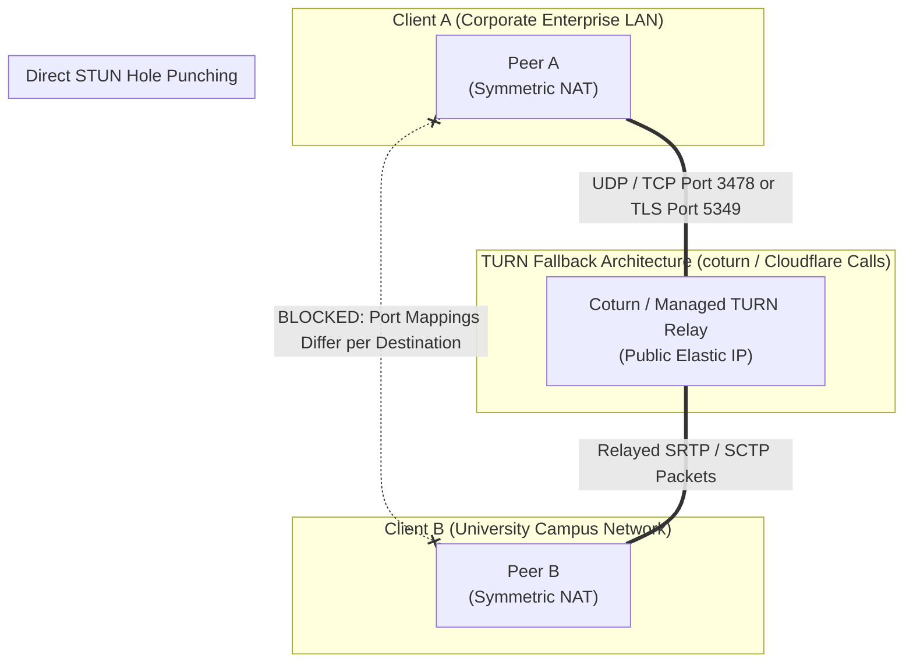

# WebRTC ICE Candidate Gathering and STUN/TURN Fallback Topology

This technical guide documents WorkSphere's Interactive Connectivity Establishment (ICE) architecture, Session Description Protocol (SDP) negotiation, candidate gathering stages, candidate exchange sequences, STUN discovery, TURN relay topology, timeout behavior, and enterprise firewall troubleshooting.

---

## 1. Overview and Architecture

WorkSphere uses decentralized WebRTC peer-to-peer (P2P) connections for low-latency collaborative workspaces, including spatial audio, collaborative code pairing, distributed CRDT state synchronization, and low-latency data streams.

### 1.1 The Role of ICE, STUN, and TURN

Direct browser-to-browser peer connections face challenges from Network Address Translation (NAT) gateways, stateful inspection firewalls, and carrier-grade NATs (CGNAT). The WebRTC connection framework addresses this using the IETF standard **Interactive Connectivity Establishment (ICE)** ([RFC 8445](https://datatracker.ietf.org/doc/html/rfc8445)):

1. **Session Description Protocol (SDP):** Peers exchange media capabilities, cryptographic DTLS fingerprints, and session parameters using an SDP offer/answer exchange through an out-of-band signaling service (PartyKit WebSocket rooms).
2. **Session Traversal Utilities for NAT (STUN):** Lightweight query/response protocol ([RFC 5389](https://datatracker.ietf.org/doc/html/rfc5389)) enabling a peer behind a NAT to discover its public-facing IP address and port (server-reflexive candidate, `srflx`). STUN assists in direct endpoint-to-endpoint punch-through but does **not** relay media or data payloads.
3. **Traversal Using Relays around NAT (TURN):** Relay protocol ([RFC 5766](https://datatracker.ietf.org/doc/html/rfc5766)) allocating a public relay address on a cloud proxy server. When symmetric NATs or enterprise packet filtering prevent direct peer connectivity, peers send packets to the TURN server, which relays them to the remote peer.
4. **ICE Candidate Gathering:** The local WebRTC stack queries host network interfaces and configured STUN/TURN servers to gather candidate endpoints, passing them to the remote peer to test bidirectional reachability.

### 1.2 WebRTC Architecture and Traffic Flow

```mermaid
flowchart TD
    subgraph SignalingPlane["Signaling Plane (Out-of-Band WSS)"]
        PA_SIG["Peer A (Browser)"] <-->|WSS: SDP Offers / Answers / ICE Candidates| SIG["PartyKit Signaling Server (src/party/*.room.ts)"]
        SIG <-->|WSS: SDP Offers / Answers / ICE Candidates| PB_SIG["Peer B (Browser)"]
    end

    subgraph DiscoveryPlane["Discovery & Traversal Plane"]
        PA_SIG -->|STUN Binding Request (UDP 19302)| STUN["Public STUN Servers (Google STUN)"]
        STUN -->|STUN Binding Response: srflx IP:Port| PA_SIG
        PB_SIG -->|STUN Binding Request (UDP 19302)| STUN
        STUN -->|STUN Binding Response: srflx IP:Port| PB_SIG
    end

    subgraph DataPlaneDirect["Data Plane: Direct Connectivity (Implemented)"]
        PA_SIG <===|Direct P2P: host-to-host (LAN) or srflx-to-srflx (Punched NAT)|===> PB_SIG
        style DataPlaneDirect fill:#e6fffa,stroke:#047857,stroke-width:2px
    end

    subgraph DataPlaneRelay["Data Plane: TURN Relay Fallback (Proposed Topology)"]
        PA_SIG -.->|UDP/TCP 3478 / TLS 5349: Relay Payload| TURN["Enterprise TURN Relay (coturn / Cloudflare Calls)"]
        TURN -.->|UDP/TCP 3478 / TLS 5349: Forward Relay Payload| PB_SIG
        style DataPlaneRelay fill:#fff1f2,stroke:#be123c,stroke-dasharray: 5 5,stroke-width:2px
    end
```

> **Architecture Boundary:** Signaling traffic flows over WebSockets via PartyKit, whereas media and data traffic flows directly between peer endpoints (or through a TURN relay when configured). PartyKit coordinates session setup and does not inspect, proxy, or decrypt peer audio or data channel payloads.

---

## 2. ICE Candidate Types

During the candidate gathering phase, the browser generates up to four types of ICE candidates depending on local interface availability and configured ICE servers.

### 2.1 Candidate Classification

| Candidate Type | Identifier | Discovery Mechanism | Address & Port Characteristics | Connectivity Use Case | Limitations & Caveats |
|---|:---:|---|---|---|---|
| **Host** | `host` | Local OS interface binding | Private RFC 1918 IPv4 (e.g., `192.168.x.x`, `10.x.x.x`) or local link-local/public IPv6 | Same-LAN, intra-VPC, or localhost connections | Unreachable across internet NAT boundaries or separate private subnets. |
| **Server Reflexive** | `srflx` | STUN Binding Request / Response | Public IP and mapped port allocated by the local NAT gateway | Cross-network peer-to-peer across standard full-cone, address-restricted, or port-restricted NATs | Fails when either peer sits behind a Symmetric NAT or restrictive outbound UDP filter. |
| **Peer Reflexive** | `prflx` | Discovered dynamically during ICE connectivity checks | Source IP and port observed by the receiving peer when STUN check arrives from a previously unannounced mapped port | Symmetric NAT traversal where NAT maps distinct ports per remote destination | Unpredictable; relies on successful inbound penetration during active connectivity checks. |
| **Relay** | `relay` | TURN `Allocate` Request / Response | Public IP and port allocated on the external TURN relay server | Traversal through Symmetric NATs, dual-enterprise firewalls, and UDP-restricted environments | Incurs cloud bandwidth costs, increased latency, and requires dedicated TURN infrastructure. |

### 2.2 WorkSphere Supported Candidate Types

In the current codebase:
- **`host` candidates:** Always gathered from local interfaces.
- **`srflx` candidates:** Gathered using default Google STUN servers (`stun:stun.l.google.com:19302` and `stun:stun1.l.google.com:19302`).
- **`prflx` candidates:** Generated by browsers during symmetric NAT connection checks.
- **`relay` candidates:** **Not currently gathered** because no TURN server (`turn:` or `turns:`) is configured by default.

---

## 3. Trickle ICE Sequence & Perfect Negotiation

WorkSphere implements **Trickle ICE** ([RFC 8838](https://datatracker.ietf.org/doc/html/rfc8838)) along with the **W3C Perfect Negotiation** pattern. In Trickle ICE, candidate gathering and transmission occur asynchronously alongside SDP negotiation rather than delaying the offer until all candidates have been gathered.

### 3.1 Signaling & Traversal Sequence

```mermaid
sequenceDiagram
    autonumber
    participant A as Peer A (Local)
    participant STUN as STUN Server
    participant SIG as PartyKit Signaling
    participant B as Peer B (Remote)

    Note over A, B: Phase 1: SDP Offer & Asynchronous Gathering Initiation
    A->>A: new RTCPeerConnection({ iceServers })
    A->>A: createDataChannel("worksphere-mesh") [if impolite]
    A->>A: setLocalDescription()
    A->>SIG: Send Offer { fromPeerId, toPeerId, description }
    SIG->>B: Forward Offer

    par Asynchronous Gathering (Peer A)
        A->>STUN: STUN Binding Request (UDP 19302)
        STUN-->>A: STUN Binding Response (Public srflx IP/Port)
        A->>A: onicecandidate event emitted
        A->>SIG: Send Candidate { fromPeerId, toPeerId, candidate }
        SIG->>B: Forward Candidate
    and Remote Description & Answer (Peer B)
        B->>B: getOrCreatePeer(fromPeerId)
        B->>B: setRemoteDescription(Offer)
        B->>B: setLocalDescription() (generates Answer)
        B->>SIG: Send Answer { fromPeerId, toPeerId, description }
        SIG->>A: Forward Answer
    end

    Note over A, B: Phase 2: Candidate Pairing & Connectivity Checks
    par Asynchronous Gathering (Peer B)
        B->>STUN: STUN Binding Request (UDP 19302)
        STUN-->>B: STUN Binding Response (Public srflx IP/Port)
        B->>SIG: Send Candidate { fromPeerId, toPeerId, candidate }
        SIG->>A: Forward Candidate
    and Candidate Application
        B->>B: addIceCandidate(candidateA)
        A->>A: setRemoteDescription(Answer)
        A->>A: addIceCandidate(candidateB)
    end

    Note over A, B: Phase 3: Direct DataChannel Connectivity
    A->>B: STUN Connectivity Checks (Binding Requests on candidate pairs)
    B-->>A: STUN Connectivity Checks Response
    Note over A, B: Viable candidate pair selected (e.g., srflx <-> srflx)
    A->>A: iceConnectionState -> "connected"
    B->>B: iceConnectionState -> "connected"
    A->>A: DataChannel.onopen()
    B->>B: DataChannel.onopen()
    A<-->>B: Direct P2P SCTP Data Transmission
```

### 3.2 Candidate Handling and Queueing Implementation

In `src/core/network/WebRTCMesh.ts`:
- Candidates arriving via `onicecandidate` are formatted using `candidate.toJSON()` and emitted over the signaling callback:
  ```typescript
  pc.onicecandidate = ({ candidate }) => {
      if (candidate) {
          void this.callbacks.onSendSignal({
              fromPeerId: this.localPeerId,
              toPeerId: remotePeerId,
              candidate: candidate.toJSON ? candidate.toJSON() : candidate,
          });
      }
  };
  ```
- Inbound candidates are received in `handleSignal`:
  ```typescript
  } else if (candidate) {
      try {
          await pc.addIceCandidate(candidate);
      } catch (err) {
          if (!session.ignoreOffer) {
              throw err;
          }
      }
  }
  ```
- **End-of-Candidates Indication:** When candidate gathering finishes, the browser invokes `onicecandidate` with `candidate: null`. In `src/hooks/useWebRTCMesh.ts`, this null candidate is transmitted to indicate gathering completion:
  ```typescript
  pc.onicecandidate = (ev) => {
    sendSignal({
      kind: "ice",
      to: peerId,
      candidate: ev.candidate ? ev.candidate.toJSON() : null,
    });
  };
  ```

---

## 4. ICE Gathering and Timeout Bounds

WebRTC connection setup involves two distinct state machines: `iceGatheringState` and `iceConnectionState`.

### 4.1 State Definitions

| State Machine | State Name | Meaning in WebRTC Specification | WorkSphere Behavior |
|---|---|---|---|
| **`iceGatheringState`** | `new` | Peer connection initialized; gathering has not started. | Initial state during `new RTCPeerConnection()`. |
| | `gathering` | The ICE engine is actively querying interfaces and STUN servers. | Inbound/outbound candidates emitted via `onicecandidate`. |
| | `complete` | All candidate sources (host and STUN) responded. | Final `candidate: null` sent; no more candidates generated. |
| **`iceConnectionState`** | `new` | The ICE agent is waiting for remote candidates. | Awaiting signaling exchange. |
| | `checking` | Evaluating candidate pairs via STUN binding requests. | Connectivity checks in flight. |
| | `connected` | A viable candidate pair has been selected and verified. | Media/DataChannel operational. |
| | `completed` | All checks completed and optimal pair selected. | Final stable state. |
| | `disconnected` | Transient network drop; packet checks failing temporarily. | **5000ms recovery grace period** in `useWebRTCMesh.ts`. |
| | `failed` | All candidate pairs failed connectivity checks. | **Triggers automatic ICE restart** (`restartIce()`). |
| | `closed` | Peer connection destroyed. | Handlers cleared, peer evicted from session maps. |

### 4.2 Verified Timeout and Recovery Parameters

WorkSphere defines specific timeout and retry behaviors in code:

1. **Transient Disconnection Grace Timer (5,000 ms):**
   In `src/hooks/useWebRTCMesh.ts` (lines 382–392):
   ```typescript
   } else if (state === "disconnected") {
     // "disconnected" is transient; give ICE 5s to recover before cleanup
     setTimeout(() => {
       if (
         pc?.iceConnectionState === "disconnected" ||
         pc?.iceConnectionState === "failed"
       ) {
         cleanupPeer(peerId);
       }
     }, 5000);
   }
   ```
2. **Automated ICE Restart on Failure:**
   When `pc.iceConnectionState === 'failed'`, both `WebRTCMesh.ts` and `useWebRTCMesh.ts` execute `restartIce()`:
   ```typescript
   pc.oniceconnectionstatechange = () => {
       if (pc.iceConnectionState === 'failed') {
           this.restartIce(remotePeerId);
       }
   };
   ```
   `restartIce()` invokes `pc.restartIce()` (or `createOffer({ iceRestart: true })`) to renegotiate credentials (`ice-ufrag` and `ice-pwd`) and re-gather candidates across changed network interfaces (such as switching from Wi-Fi to cellular).
3. **No Explicit Gathering Timeout:** The codebase does not impose an artificial timeout on candidate gathering itself; gathering duration is governed by browser platform timers and STUN server response latency.

---

## 5. STUN/TURN Topology and Fallback

### 5.1 WorkSphere Default STUN Configuration

In `src/core/network/WebRTCMesh.ts`:
```typescript
const DEFAULT_ICE_SERVERS: RTCIceServer[] = [
    { urls: 'stun:stun.l.google.com:19302' },
    { urls: 'stun:stun1.l.google.com:19302' },
];
```
In `src/hooks/useWebRTCMesh.ts`:
```typescript
const ICE_SERVERS: RTCIceServer[] = [{ urls: "stun:stun.l.google.com:19302" }];
```

### 5.2 Explicit Status: TURN is Not Currently Configured

> **Current Implementation Status:** WorkSphere **only** configures public STUN servers. **No TURN servers are configured in the current repository.**
> 
> **Operational Impact:**
> - Direct peer-to-peer connectivity succeeds across standard NATs (Full-Cone, Address-Restricted Cone, and Port-Restricted Cone NAT).
> - Direct peer-to-peer connectivity **fails** when both peers sit behind **Symmetric NATs** (common in corporate headquarters, university campuses, and 4G/5G mobile CGNAT).
> - Peer connectivity **fails** when corporate firewalls block outbound UDP traffic on non-standard ports.
> - **There is currently no automatic fallback to TURN relay.** When STUN hole-punching fails, the ICE connection transitions to `failed`. Application text state falls back to PartyKit WebSockets, but audio, video, and DataChannels disconnect.

### 5.3 Proposed TURN Relay Fallback Topology

To support restrictive corporate firewalls and Symmetric NATs, WorkSphere can be extended with a production TURN relay deployment:



### 5.4 Required Deployment Steps to Enable TURN

To introduce TURN relay support in WorkSphere:
1. **Deploy Coturn / Managed TURN Service:** Deploy a TURN server (such as `coturn` on AWS EC2 or Cloudflare Calls) configured with long-term credentials or a shared secret (`use-auth-secret`).
2. **Expose Secured Ports:** Open UDP/TCP port `3478` (STUN/TURN) and TLS port `5349` (`TURNS`) to bypass deep-packet inspection (DPI) firewalls.
3. **Inject Ephemeral Credentials via Next.js API:** Add an authenticated endpoint (e.g., `/api/webrtc/ice-servers`) using Clerk auth that generates short-lived HMAC-SHA-1 TURN credentials ([REST API for TURN](https://datatracker.ietf.org/doc/html/draft-uberti-behave-turn-rest-00)).
4. **Pass Configured Servers to `WebRTCMesh`:** Update `useWebRTCMesh.ts` to pass the dynamically retrieved `RTCIceServer[]` array into `new WebRTCMesh(localPeerId, callbacks, iceServers)`.

---

## 6. TURN Bandwidth and Latency Considerations

Because relayed data passes through a central server, TURN introduces significant operational, bandwidth, and latency trade-offs compared to direct P2P connections.

### 6.1 Capacity and Bandwidth Estimation Methodology

TURN server egress and ingress bandwidth scale directly with the number of concurrent relayed peer sessions.

#### Mathematical Bandwidth Formula
For a collaborative mesh with $N_{\text{relay}}$ active relayed peer connections:

$$\text{Bandwidth}_{\text{total}} = 2 \times \sum_{i=1}^{N_{\text{relay}}} \left( \text{Bitrate}_{\text{media}}(i) + \text{Bitrate}_{\text{data}}(i) \right) \times (1 + \text{Overhead}_{\text{protocol}})$$

Where:
- The factor of $2$ accounts for **bidirectional forwarding** (ingress from Peer A + egress to Peer B).
- $\text{Bitrate}_{\text{media}}$: Audio stream (~32–64 kbps Opus) + Video/Screen share (~500–2,500 kbps VP8/H.264).
- $\text{Bitrate}_{\text{data}}$: RTCDataChannel throughput for CRDT sync and file transfers.
- $\text{Overhead}_{\text{protocol}}$: ~5–8% accounting for IP, UDP, and TURN Framing headers (4-byte ChannelData or 20-byte Send/Data indications).

#### Theoretical Capacity Planning Example
For **100 concurrent relayed audio calls** (Opus at 48 kbps):
- Transmitted payload per call: $48\text{ kbps} \times 1.06 = 50.88\text{ kbps}$.
- Total relay bandwidth: $2 \times 100 \times 50.88\text{ kbps} \approx 10.18\text{ Mbps}$ continuous throughput (~3.3 TB per month).

For **50 concurrent relayed screen-sharing sessions** (720p 15fps at 1.0 Mbps):
- Total relay bandwidth: $2 \times 50 \times 1.06\text{ Mbps} \approx 106\text{ Mbps}$ (~34.3 TB per month).

### 6.2 Latency Trade-Offs

1. **Additional Network Hops:** Direct P2P latency corresponds to the direct internet path: $\text{RTT}_{\text{direct}} = \text{RTT}(A \leftrightarrow B)$. Relayed traffic traverses the TURN proxy: $\text{RTT}_{\text{relay}} = \text{RTT}(A \leftrightarrow \text{TURN}) + \text{RTT}(\text{TURN} \leftrightarrow B)$.
2. **Geographic Hairpinning:** If Peer A is in London and Peer B is in Paris, but the TURN server is deployed in North Virginia (`us-east-1`), packets travel across the Atlantic twice, adding ~150–200ms of latency.
3. **Transport Protocol Selection:**
   - **UDP Relay (Default):** Lowest latency; packet loss handled by WebRTC SRTP/SCTP jitter buffers without head-of-line blocking.
   - **TCP / TLS Relay (`TURNS`):** Bypasses strict firewalls blocking UDP, but introduces TCP head-of-line blocking and double retransmissions under lossy wireless conditions.

---

## 7. Enterprise Firewall Troubleshooting

When users encounter connection issues in corporate or educational environments, use the following diagnostic guide:

### 7.1 Diagnostic Matrix

| Symptom | Probable Cause | Diagnostic Check | Resolution / Workaround |
|---|---|---|---|
| **`iceConnectionState: "failed"`** | Symmetric NAT on both endpoints; no TURN server available. | Inspect `chrome://webrtc-internals/` or Firefox `about:webrtc`. Check candidate pairs. Only `srflx` and `host` present; zero `relay` candidates. | Deploy and configure TURN relay servers with credentials. |
| **`iceGatheringState: "gathering"` indefinitely** | Outbound UDP blocked; STUN requests timing out. | DevTools console shows `STUN binding request timed out`. Inspect firewall outbound UDP rule on port `19302`. | Ensure outbound UDP port `19302` or `3478` is permitted, or configure TURNS over TLS port `443` or `5349`. |
| **Audio/Video drops after ~30s** | NAT mapping table timeout on UDP port without keep-alive. | `RTCPeerConnection` ice connection state switches from `connected` to `disconnected`. | Ensure ICE ping / STUN keep-alive interval is $\le 20$ seconds. |
| **DataChannel never reaches `open`** | Glare during offer/answer or impolite peer failed to create channel. | Verify `polite` peer assignment in `isPolitePeer(localId, remoteId)`. Ensure impolite peer creates channel. | Handled in `WebRTCMesh.ts`: impolite peer creates `'worksphere-mesh'`. |

### 7.2 Browser Diagnostic Workflow

1. **Chrome / Edge (`chrome://webrtc-internals`):**
   - Open `chrome://webrtc-internals` in a separate tab.
   - Select the active `RTCPeerConnection`.
   - Scroll to the **ICE Candidate Pair** table.
   - Verify the `nominated` pair. Check `localCandidateType` and `remoteCandidateType`.
   - If no pair transitions to `state: succeeded`, direct traversal has failed.
2. **Firefox (`about:webrtc`):**
   - Navigate to `about:webrtc`.
   - Click **Show Details** under the active connection.
   - Inspect the **ICE Candidates** and **Trickle ICE** logs to observe gathered and discarded pairs.

---

## 8. Security Considerations

WebRTC enforces encryption for all media and data channels:

1. **Mandatory DTLS / SRTP Encryption:** WebRTC requires Datagram Transport Layer Security (DTLS). During SDP negotiation, peers exchange cryptographic DTLS certificates and SHA-256 fingerprints:
   - Media tracks are encrypted using Secure Real-time Transport Protocol (SRTP).
   - Data channels are encrypted using SCTP encapsulated in DTLS.
2. **Signaling Server Privacy:** Because DTLS key exchange occurs directly between peers, the PartyKit WebSocket signaling server cannot decrypt media, audio streams, or data channel packets.
3. **ICE Candidate IP Privacy:** Gathering `host` candidates can expose the local private IP address (RFC 1918) or public IP of a user. Modern browsers use **mDNS (Multicast DNS)** masking (e.g., `candidate:... 123456-abc.local ...`) to protect user privacy against local network enumeration.
4. **TURN Credential Protection:** When implementing TURN:
   - **Never hardcode static TURN credentials** into client JavaScript bundles.
   - Generate ephemeral, time-bounded credentials via an authenticated backend endpoint using the TURN REST API shared secret mechanism (`username: timestamp:userID`, `password: HMAC-SHA-1(secret, username)`).
   - Enforce rate-limiting and session quotas on TURN allocation to prevent bandwidth exhaustion attacks.

---

## 9. Operational Validation Checklist

Use this checklist to validate WebRTC ICE connectivity across environments:

- [ ] **Same-LAN Direct Connectivity:** Two devices on the same Wi-Fi connect using `host` candidate pairs.
- [ ] **Cross-NAT STUN Traversal:** Devices on different home internet connections (standard NAT) discover `srflx` candidates and establish direct P2P connection.
- [ ] **Symmetric NAT Handling:** Validate that symmetric NAT environments are identified and fail gracefully to PartyKit WebSocket text state when direct traversal is unavailable.
- [ ] **Automated ICE Restart:** In `WebRTCMesh.ts`, simulate Wi-Fi network disconnection; verify that `iceConnectionState === "failed"` triggers `restartIce()`.
- [ ] **DataChannel Lifecycle:** Verify the impolite peer creates `'worksphere-mesh'` and both peers receive `onopen` before transmitting messages.
- [ ] **Candidate Serialization:** Confirm candidates are correctly serialized using `.toJSON()` or fallback objects before transmitting over PartyKit signaling.

---

## 10. Source References

- [`src/core/network/WebRTCMesh.ts`](../../src/core/network/WebRTCMesh.ts) — WebRTCMesh connection manager, Google STUN configuration, and W3C Perfect Negotiation handlers.
- [`src/hooks/useWebRTCMesh.ts`](../../src/hooks/useWebRTCMesh.ts) — React hook managing peer connections, transient disconnect timers, and ICE restart recovery.
- [`src/lib/realtime/webrtc/meshConnection.ts`](../../src/lib/realtime/webrtc/meshConnection.ts) — DataChannel listener tracking, adaptive audio/video bitrate controllers, and telemetry.
- [`src/party/pairProgramming.room.ts`](../../src/party/pairProgramming.room.ts) — PartyKit signaling room for direct peer programming sessions.
- [`src/party/computeMesh.room.ts`](../../src/party/computeMesh.room.ts) — Compute mesh signaling with STUN configuration.
- [`docs/p2p/WEBRTC_SIGNALING_HANDSHAKE.md`](./WEBRTC_SIGNALING_HANDSHAKE.md) — Complete signaling handshake runbook, SDP offer/answer exchange, and DataChannel protocol.
