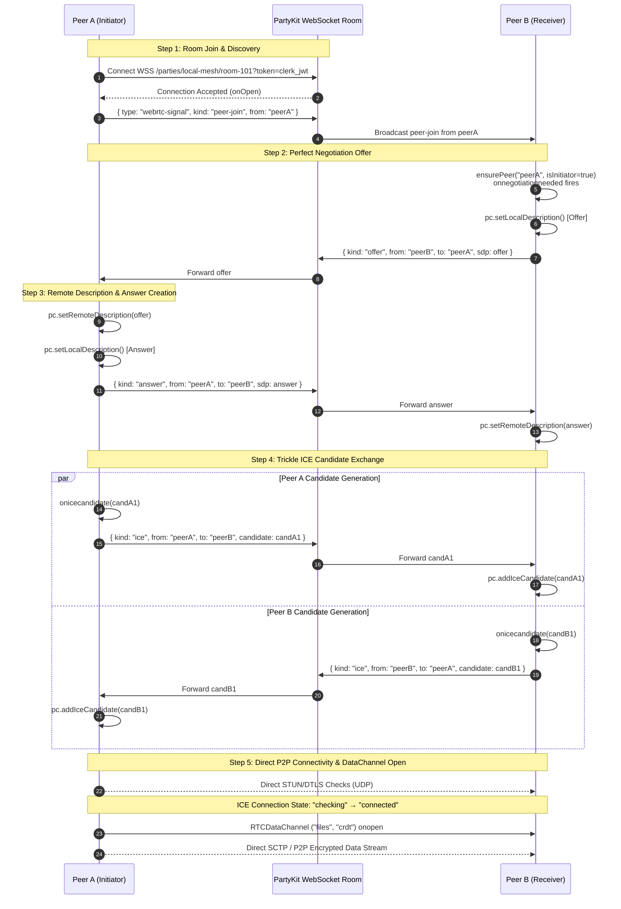
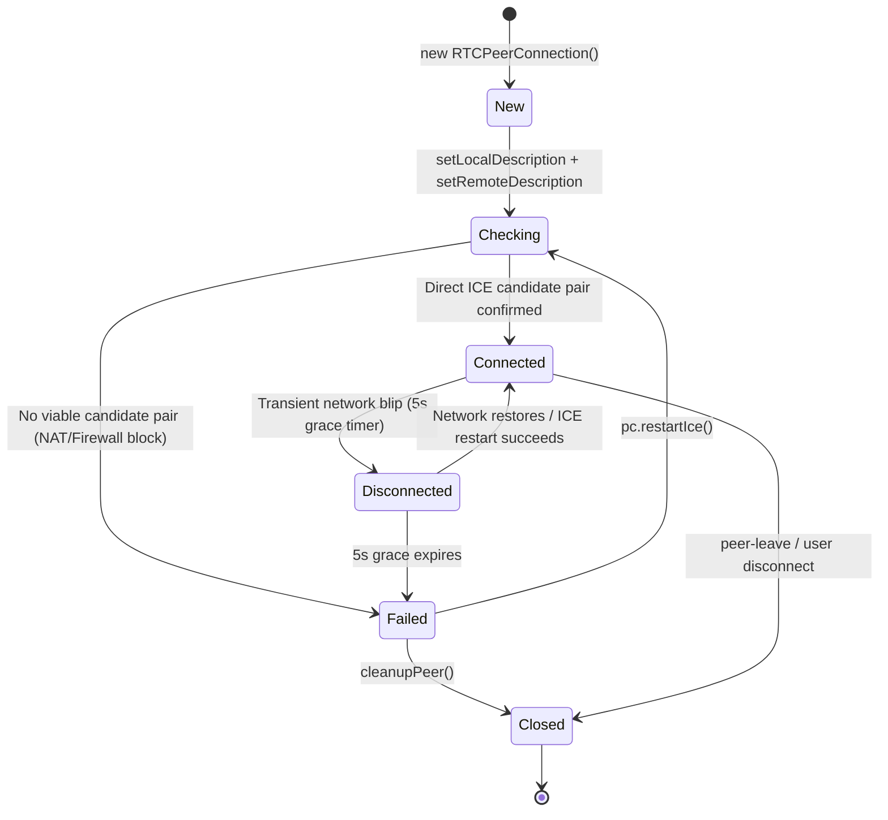

# WebRTC Signaling Handshake & ICE Candidate Negotiation Runbook

> **Technical Reference & Operational Runbook**  
> **Status:** Production Standard  
> **Target Subsystems:** PartyKit WebSockets (`src/party/`), WebRTC Mesh (`src/lib/webrtc/meshConnection.ts`, `src/core/network/WebRTCMesh.ts`, `src/hooks/useWebRTCMesh.ts`, `src/lib/realtime/webrtc/peerManager.ts`)  
> **Signaling Transports:** WSS via PartySocket (`partysocket/react`)  
> **Protocol Scope:** Session Description Protocol (SDP), Trickle ICE, STUN/TURN traversal, Perfect Negotiation, and RTCDataChannel lifecycles  

---

## 1. Architecture Overview

WorkSphere employs a hybrid peer-to-peer (P2P) mesh topology for collaborative workspace sessions (including spatial audio, interactive whiteboards, screen sharing, distributed CRDT state synchronization, and p2p file transfer). To establish direct browser-to-browser UDP connectivity across complex corporate networks and symmetric NATs, peers execute an out-of-band signaling exchange facilitated by **PartyKit WebSocket rooms**.

### Separation of Concerns: Signaling vs. P2P Transport

```
                                  ┌───────────────────────────────┐
                                  │      PartyKit WSS Server      │
                                  │   (Central Signaling Hub)     │
                                  │  src/party/pairProgramming    │
                                  │    src/party/localMesh        │
                                  └───────────▲───────▲───────────┘
                                              │       │
                     Signaling (WSS)          │       │  Signaling (WSS)
            (Offers, Answers, ICE Candidates) │       │ (Offers, Answers, ICE Candidates)
                                              │       │
                           ┌──────────────────┴┐     ┌┴──────────────────┐
                           │      Peer A       │     │      Peer B       │
                           │ (Browser Runtime) │     │ (Browser Runtime) │
                           └─────────▲─────────┘     └─────────▲─────────┘
                                     │                         │
                                     │   Direct P2P WebRTC     │
                                     └─── (DTLS / SRTP / SCTP) ─┘
                                         - RTCDataChannel ("files", "crdt")
                                         - Audio / Video Media Tracks
```

1. **PartyKit Signaling Plane:**
   - Transport: Secure WebSockets (`wss://`).
   - Role: Ephemeral message relay. The server routes SDP offers, SDP answers, trickle ICE candidates, and membership join/leave events.
   - Zero Decryption: The signaling server coordinates connection metadata but cannot inspect or decrypt peer payload contents.
2. **WebRTC Media & Data Plane:**
   - Transport: UDP (via ICE candidates) secured by DTLS 1.2/1.3 and SRTP/SCTP.
   - Channels:
     - **Media Tracks:** Encrypted SRTP audio and video streams.
     - **RTCDataChannel:** Multiplexed SCTP data channels (e.g. `files`, `crdt`, `chat`).
   - Direct: Once established, all collaborative traffic bypasses PartyKit entirely.

---

## 1.1 ICE Traversal & STUN/TURN Topology

For an in-depth reference on ICE candidate gathering, candidate types (`host`, `srflx`, `prflx`, `relay`), Google STUN server discovery, TURN relay topology, timeout bounds, and enterprise firewall troubleshooting, consult the companion guide:
- [`WEBRTC_ICE_TRAVERSAL.md`](./WEBRTC_ICE_TRAVERSAL.md) — WebRTC ICE candidate gathering and STUN/TURN fallback topology.

While this runbook details the signaling exchange and SDP offer/answer protocol, the ICE traversal guide documents how candidate pairs are tested, why WorkSphere currently relies on STUN without TURN relay fallback, and how to diagnose symmetric NAT and firewall blocks.

---

## 2. Signaling Protocol & Message Schemas

WorkSphere implements two primary signaling formats depending on the functional room:
1. **Mesh & Audio Signaling (`useWebRTCMesh.ts`, `src/lib/realtime/webrtc/types.ts`):** Structured envelopes under the `"webrtc-signal"` action type.
2. **Direct P2P Signaling (`pairProgramming.room.ts`, `computeMesh.room.ts`):** Direct message envelopes with explicit routing IDs.

### Primary Signaling Message Types

| Message Kind | Sender | Receiver | Purpose | Important Payload Fields |
|---|---|---|---|---|
| **`peer-join`** / **`signal-offer`** | Joining peer or initiator | Target peer (or broadcast) | Signals entry into room or initiates SDP offer | `from`, `to`, `type: "webrtc-signal"`, `kind: "peer-join"` |
| **`offer`** | Initiating peer | Responding peer | Delivers SDP offer containing codecs, DTLS fingerprint, ICE ufrag/pwd | `from`, `to`, `sdp: RTCSessionDescriptionInit`, `kind: "offer"` |
| **`answer`** | Responding peer | Initiating peer | Delivers matching SDP answer resolving media capabilities and session parameters | `from`, `to`, `sdp: RTCSessionDescriptionInit`, `kind: "answer"` |
| **`ice`** / **`signal-candidate`** | Either peer | Remote peer | Trickle ICE network candidate exchange | `from`, `to`, `candidate: RTCIceCandidateInit \| null`, `kind: "ice"` |
| **`peer-leave`** / **`signal-leave`** | Departing peer | All room peers | Notifies peers of teardown, triggering `cleanupPeer()` | `from`, `kind: "peer-leave"` |

### TypeScript Type References

From [`src/lib/realtime/webrtc/types.ts`](../../src/lib/realtime/webrtc/types.ts):

```typescript
export type SignalKind = "peer-join" | "offer" | "answer" | "ice" | "peer-leave";

export type SignalMessage = {
  type: "webrtc-signal";
  kind: SignalKind;
  from: string;
  to?: string;
  sdp?: RTCSessionDescriptionInit;
  candidate?: RTCIceCandidateInit | null;
};

export type PeerState = {
  makingOffer: boolean;
  ignoreOffer: boolean;
  polite: boolean;
  isSettingRemoteAnswerPending: boolean;
};
```

From [`src/party/pairProgramming.room.ts`](../../src/party/pairProgramming.room.ts):

```typescript
export interface SignalMessage {
  type: 'offer' | 'answer' | 'ice-candidate' | 'join' | 'leave';
  payload: any;
  senderId: string;
  targetId?: string;
}
```

### Representative Wire JSON Payloads

#### 1. SDP Offer (`kind: "offer"`)
```json
{
  "type": "webrtc-signal",
  "kind": "offer",
  "from": "user_2Y6eZ8kLmNoPqRs",
  "to": "user_7A3bC9dEfGhIjKl",
  "sdp": {
    "type": "offer",
    "sdp": "v=0\r\no=- 4829104829 2 IN IP4 127.0.0.1\r\ns=-\r\nt=0 0\r\na=fingerprint:sha-256 12:34:56:...\r\na=ice-ufrag:x89a\r\na=ice-pwd:secretpassword...\r\na=mid:0\r\n..."
  }
}
```

#### 2. SDP Answer (`kind: "answer"`)
```json
{
  "type": "webrtc-signal",
  "kind": "answer",
  "from": "user_7A3bC9dEfGhIjKl",
  "to": "user_2Y6eZ8kLmNoPqRs",
  "sdp": {
    "type": "answer",
    "sdp": "v=0\r\no=- 9182309182 2 IN IP4 127.0.0.1\r\ns=-\r\nt=0 0\r\na=fingerprint:sha-256 78:90:AB:...\r\na=ice-ufrag:z12b\r\na=ice-pwd:answersecret...\r\na=mid:0\r\n..."
  }
}
```

#### 3. Trickle ICE Candidate (`kind: "ice"`)
```json
{
  "type": "webrtc-signal",
  "kind": "ice",
  "from": "user_2Y6eZ8kLmNoPqRs",
  "to": "user_7A3bC9dEfGhIjKl",
  "candidate": {
    "candidate": "candidate:842163049 1 udp 1677729535 192.168.1.150 54128 typ host generation 0",
    "sdpMid": "0",
    "sdpMLineIndex": 0,
    "usernameFragment": "x89a"
  }
}
```

#### 4. End-of-Candidates Indicator
When local candidate gathering concludes, `onicecandidate` fires with `null`:
```json
{
  "type": "webrtc-signal",
  "kind": "ice",
  "from": "user_2Y6eZ8kLmNoPqRs",
  "to": "user_7A3bC9dEfGhIjKl",
  "candidate": null
}
```

---

## 3. Full WebRTC Handshake Sequence

The following diagram illustrates the complete end-to-end connection flow between two peers across PartyKit:



---

## 4. STUN & TURN Server Configuration

### Current Implementation Status

Inspection of the codebase reveals the following active configurations:
- [`src/hooks/useWebRTCMesh.ts`](../../src/hooks/useWebRTCMesh.ts):
  ```typescript
  const ICE_SERVERS: RTCIceServer[] = [{ urls: "stun:stun.l.google.com:19302" }];
  ```
- [`src/core/network/WebRTCMesh.ts`](../../src/core/network/WebRTCMesh.ts) & [`src/lib/realtime/webrtc/peerManager.ts`](../../src/lib/realtime/webrtc/peerManager.ts):
  ```typescript
  const DEFAULT_ICE_SERVERS: RTCIceServer[] = [
    { urls: 'stun:stun.l.google.com:19302' },
    { urls: 'stun:stun1.l.google.com:19302' },
  ];
  ```

### Candidate Types & Traversal Behavior

1. **Host Candidates (`typ host`):**
   - Direct local IP addresses (e.g. `192.168.1.5` or `10.0.0.12`).
   - Works when peers are on the exact same local Wi-Fi or subnet.
2. **Server-Reflexive Candidates (`typ srflx`):**
   - Public IP and port mapped by the Google STUN server (`stun.l.google.com:19302`).
   - Works across home routers, Full Cone NATs, Restricted Cone NATs, and Port-Restricted NATs.
3. **Relay Candidates (`typ relay`):**
   - Traversal via TURN relay servers using TURN credentials.
   - Required when at least one peer is behind a **Symmetric NAT** (common in corporate firewalls, mobile 4G/5G carrier grade NATs, and university networks) where the external port changes for each remote destination.

### TURN Traversal Limitation & Architecture Note

> [!IMPORTANT]
> **Production Limitation:** WorkSphere's current source code relies exclusively on public Google STUN servers. **No TURN servers are configured in production source code.**
> When two peers behind symmetric NATs attempt to connect, direct P2P ICE negotiation will transition to `"failed"`.
> 
> **Architectural Fallback:** As documented in `useWebRTCMesh.ts` (Section 3.2), critical presence, text chat, and state reconciliation fall back safely to PartyKit WebSocket relaying (`socketRef.current.send()`) when WebRTC data channels cannot traverse restricted firewalls.

#### Recommended TURN Production Configuration (Speculative/Future Reference)
To support relay connectivity in future deployments, `RTCPeerConnection` should be supplied with dynamic TURN credentials:

```typescript
const productionIceServers: RTCIceServer[] = [
  { urls: "stun:stun.l.google.com:19302" },
  {
    urls: [
      process.env.NEXT_PUBLIC_TURN_URL_UDP || "turn:turn.worksphere.io:3478?transport=udp",
      process.env.NEXT_PUBLIC_TURN_URL_TCP || "turn:turn.worksphere.io:3478?transport=tcp",
    ],
    username: process.env.NEXT_PUBLIC_TURN_USERNAME,
    credential: process.env.NEXT_PUBLIC_TURN_CREDENTIAL,
  },
];
```

---

## 5. Trickle ICE Candidate Negotiation & Buffering

### The Trickle ICE Race Condition
In standard WebRTC Trickle ICE, candidate gathering starts immediately when local descriptions are created. Candidates are dispatched asynchronously over PartyKit. Frequently, network latency variations cause a remote ICE candidate to reach the local client **before** the remote SDP offer/answer has been applied (`pc.remoteDescription === null`).

If a client calls `pc.addIceCandidate(candidate)` before `pc.setRemoteDescription()`, the WebRTC engine throws an `InvalidStateError`:
```text
DOMException: Failed to execute 'addIceCandidate' on 'RTCPeerConnection': The remote description was null.
```

### WorkSphere Candidate Buffering Implementation

In [`src/lib/webrtc/meshConnection.ts`](../../src/lib/webrtc/meshConnection.ts), WorkSphere implements an explicit **Candidate Queue FIFO buffer**:

```typescript
export class MeshConnection {
  public peerConnection: RTCPeerConnection;
  private candidateQueue: RTCIceCandidateInit[] = [];
  private isSettingRemoteDescription = false;

  public async setRemoteDescription(description: RTCSessionDescriptionInit): Promise<void> {
    this.isSettingRemoteDescription = true;
    try {
      await this.peerConnection.setRemoteDescription(description);
      // Flush buffered candidates once remote description is successfully applied
      await this.flushCandidateQueue();
    } finally {
      this.isSettingRemoteDescription = false;
    }
  }

  public async addIceCandidate(candidate: RTCIceCandidateInit): Promise<void> {
    // If remote description is not yet set or in-flight, buffer candidate in queue
    if (!this.peerConnection.remoteDescription || this.isSettingRemoteDescription) {
      this.candidateQueue.push(candidate);
      return;
    }

    try {
      await this.peerConnection.addIceCandidate(candidate);
    } catch (err) {
      console.warn("Skipped invalid or duplicate ICE candidate:", err);
    }
  }

  private async flushCandidateQueue(): Promise<void> {
    while (this.candidateQueue.length > 0) {
      const candidate = this.candidateQueue.shift();
      if (!candidate) continue;

      try {
        await this.peerConnection.addIceCandidate(candidate);
      } catch (err) {
        console.warn("Skipped queued ICE candidate addition error:", err);
      }
    }
  }
}
```

---

## 6. Race Conditions & Rapid Room Joins

Collaborative sessions frequently experience high churn (e.g. multiple users joining simultaneously, rapid tab refreshing, or unstable cellular roaming). WorkSphere mitigates these edge cases through deterministic guards:

### 1. Pre-negotiation Cleanup on `peer-join`
When a peer broadcasts `peer-join`, receivers invoke `cleanupPeer(msg.from)` **before** calling `ensurePeer(msg.from, true)`. This closes stale `RTCPeerConnection` instances and destroys obsolete stream tracks, preventing duplicate connections and resource leaks.

### 2. Disconnect Debouncing
In `useWebRTCMesh.ts`, transient network drops frequently report `iceConnectionState === "disconnected"`. Because temporary Wi-Fi drops or cellular handoffs often self-heal within seconds, cleanup is delayed by a 5-second debounce timer:
```typescript
else if (state === "disconnected") {
  setTimeout(() => {
    if (pc?.iceConnectionState === "disconnected" || pc?.iceConnectionState === "failed") {
      cleanupPeer(peerId);
    }
  }, 5000);
}
```

### 3. Immediate ICE Restart on Hard Failure
When `iceConnectionState === "failed"`, the client attempts `pc.restartIce()` to renegotiate fresh ICE credentials before tearing down the call (`Issue #1932`).

### 4. Bounded Mesh Capacity
To prevent CPU and bandwidth exhaustion from full-mesh N×(N-1) topologies, `ensurePeer()` limits peer connections to a maximum of 5 remote peers (6 participants total).

---

## 7. Perfect Negotiation & Glare Handling

### What is Glare?
WebRTC **glare** occurs when both Peer A and Peer B attempt to initiate an SDP offer simultaneously while both connections are in the `"stable"` signaling state. Without coordination, both peers enter `"have-local-offer"` and reject the incoming remote offer with an `InvalidStateError`.

### WorkSphere Perfect Negotiation Implementation

WorkSphere implements the official W3C **Perfect Negotiation pattern** across `useWebRTCMesh.ts` and `WebRTCMesh.ts`:

1. **Role Determination (Polite vs. Impolite):**
   - In [`src/core/network/WebRTCMesh.ts`](../../src/core/network/WebRTCMesh.ts), roles are assigned deterministically via lexicographical comparison of peer IDs:
     ```typescript
     export function isPolitePeer(localPeerId: string, remotePeerId: string): boolean {
       return localPeerId.localeCompare(remotePeerId) < 0;
     }
     ```
   - In [`src/hooks/useWebRTCMesh.ts`](../../src/hooks/useWebRTCMesh.ts), the initiator of `ensurePeer` defaults to polite.
2. **Offer Collision Detection:**
   ```typescript
   const offerCollision =
     description.type === "offer" &&
     (state.makingOffer || pc.signalingState !== "stable");
   ```
3. **Glare Resolution Logic:**
   - **Impolite Peer (`polite === false`):** Ignores the incoming remote offer (`state.ignoreOffer = true; return;`) and waits for the polite peer to process its offer.
   - **Polite Peer (`polite === true`):** Automatically rolls back its local offer and accepts the remote offer:
     ```typescript
     if (offerCollision) {
       await pc.setLocalDescription({ type: "rollback" });
     }
     await pc.setRemoteDescription(description);
     if (description.type === "offer") {
       await pc.setLocalDescription();
       sendSignal({
         kind: "answer",
         to: msg.from,
         sdp: pc.localDescription!,
       });
     }
     ```

---

## 8. Connection & DataChannel Lifecycle

### Lifecycle State Machine



### DataChannel Initialization & Configuration

In [`src/lib/realtime/webrtc/peerManager.ts`](../../src/lib/realtime/webrtc/peerManager.ts) and [`src/hooks/useMeshDataChannels.ts`](../../src/hooks/useMeshDataChannels.ts):

- **DataChannel Label:** `"files"` or `"crdt"`.
- **Options:** `{ ordered: true }` (ensures reliable, in-order packet delivery over SCTP).
- **Event Listeners:**
  - `onopen`: Triggers ready state callback, unblocking high-throughput transfers.
  - `onmessage`: Dispatches incoming buffer chunks to `DataChannelChunker` or CRDT store.
  - `onclose` & `onerror`: Removes channel references from active peer map.

---

## 9. Comprehensive Troubleshooting Guide

| Symptom / Error | Likely Root Cause | Diagnostic Step | Recommended Resolution |
|---|---|---|---|
| **ICE state remains `checking` indefinitely** | Candidate exchange incomplete or STUN server blocked by network | Inspect `chrome://webrtc-internals/`. Check ICE candidate grid for incoming remote candidates. | Confirm PartyKit signaling connection is open. Verify UDP port 19302 is not blocked by local router. |
| **ICE state transitions to `failed`** | Both peers are behind Symmetric NATs or enterprise UDP firewalls | Check candidate pair types in `webrtc-internals`. If both are `typ host` on different subnets or non-routable `typ srflx`, direct P2P is impossible without TURN. | Deploy and configure a TURN server (`turn:turn.worksphere.io:3478`). Fall back to PartyKit WebSocket sync. |
| **`InvalidStateError: remote description was null`** | Trickle ICE candidate received before `setRemoteDescription()` | Check console logs for `addIceCandidate` exceptions. | Verify that candidate buffering is active via `MeshConnection.addIceCandidate()` queue. |
| **DataChannel state remains `connecting`** | SCTP handshake incomplete; DTLS role conflict | Inspect `signalingState` and `iceConnectionState`. | Verify both peers agree on SDP offer/answer exchange and ICE state reaches `"connected"`. |
| **Ghost peers / duplicate audio streams** | Stale peer connection was not cleaned up on rejoin | Check `peersRef.current.size` and listen for duplicate `track` events. | Ensure `cleanupPeer()` executes upon receiving `peer-join` or `peer-leave`. |
| **Glaring offers causing signaling freeze** | Simultaneous offers colliding without Perfect Negotiation rollback | Check console for `InvalidStateError: Failed to set remote offer in state have-local-offer`. | Ensure `isPolitePeer()` correctly assigns polite roles and triggers `{ type: "rollback" }`. |

---

## 10. Local Development & Debugging Playbook

### Running the Local Environment

1. **Start the Next.js Application:**
   ```bash
   npm run dev
   ```
2. **Start the PartyKit Signaling Server (if running standalone):**
   ```bash
   npx partykit dev
   ```
3. **Simulate Two-Peer Collaborative Mesh:**
   - Open Browser Window 1: `http://localhost:3000/workspace/room-1` (Sign in as User A).
   - Open Browser Window 2 (Incognito): `http://localhost:3000/workspace/room-1` (Sign in as User B).
   - Observe WebSocket frames in DevTools **Network → WS → Messages**. Look for `webrtc-signal` payloads.

### Inspecting WebRTC Internals in Chrome

1. In a separate tab, open `chrome://webrtc-internals/`.
2. Inspect the active `RTCPeerConnection` instance:
   - **`signalingState`:** Tracks progression from `stable` → `have-local-offer` → `stable`.
   - **`iceConnectionState`:** Tracks `new` → `checking` → `connected`.
   - **`IceCandidatePair` Table:** Inspect the active connection pair (look for `nominated = true` and `state = succeeded`). Check whether candidates are `host`, `srflx`, or `relay`.

---

## 11. Security & Operational Considerations

1. **Signaling Room Authorization:**
   PartyKit connections must validate Clerk user authentication tokens passed in the WebSocket connection query string (`?token=...`). Unauthenticated sockets must be rejected to prevent unauthorized peers from observing SDP traffic or injecting spoofed offers.
2. **DTLS & SRTP Encryption:**
   All peer media and data channels are cryptographically encrypted using DTLS 1.2/1.3 and SRTP. Even if signaling traffic over PartyKit were intercepted, third parties cannot decrypt direct peer data channels.
3. **End-to-End Encryption (E2EE) with Insertable Streams:**
   For high-security rooms, [`src/lib/webrtc/meshConnection.ts`](../../src/lib/webrtc/meshConnection.ts) supports `encodedInsertableStreams`, executing frame-by-frame encryption using `InsertableStreamsEncryptionEngine`.
4. **IP Address Privacy:**
   Because WebRTC host candidates expose local private IP addresses (e.g. `192.168.x.x`), browser mDNS hostname masking is preserved to protect nomad user privacy on public cafe Wi-Fi networks.

---

## 12. References & Source Modules

- [WebRTC Mesh Connection Core (`src/lib/webrtc/meshConnection.ts`)](../../src/lib/webrtc/meshConnection.ts) — PeerConnection wrapper, E2EE insertable streams, and candidate FIFO queue.
- [WebRTC Mesh React Hook (`src/hooks/useWebRTCMesh.ts`)](../../src/hooks/useWebRTCMesh.ts) — PartyKit integration, audio monitoring, bitrate loops, and Perfect Negotiation handler.
- [WebRTCMesh Class (`src/core/network/WebRTCMesh.ts`)](../../src/core/network/WebRTCMesh.ts) — Deterministic polite role assignment and state tracking.
- [WebRTC Types (`src/lib/realtime/webrtc/types.ts`)](../../src/lib/realtime/webrtc/types.ts) — SignalKind and SignalMessage type definitions.
- [PartyKit Pair Programming Room (`src/party/pairProgramming.room.ts`)](../../src/party/pairProgramming.room.ts) — Signaling server broadcast and direct routing implementation.
- [PartyKit Local Mesh Room (`src/party/localMesh.room.ts`)](../../src/party/localMesh.room.ts) — Mesh signaling and CRDT reconciliation server.
- [GossipSub WebRTC Mesh Architecture](../architecture/GOSSIPSUB_WEBRTC_MESH.md) — Multi-hop epidemic gossip mesh router.
- [DataChannel Chunking Runbook](DATACHANNEL_CHUNKING_RUNBOOK.md) — SCTP framing, 16KB chunking, and backpressure.
