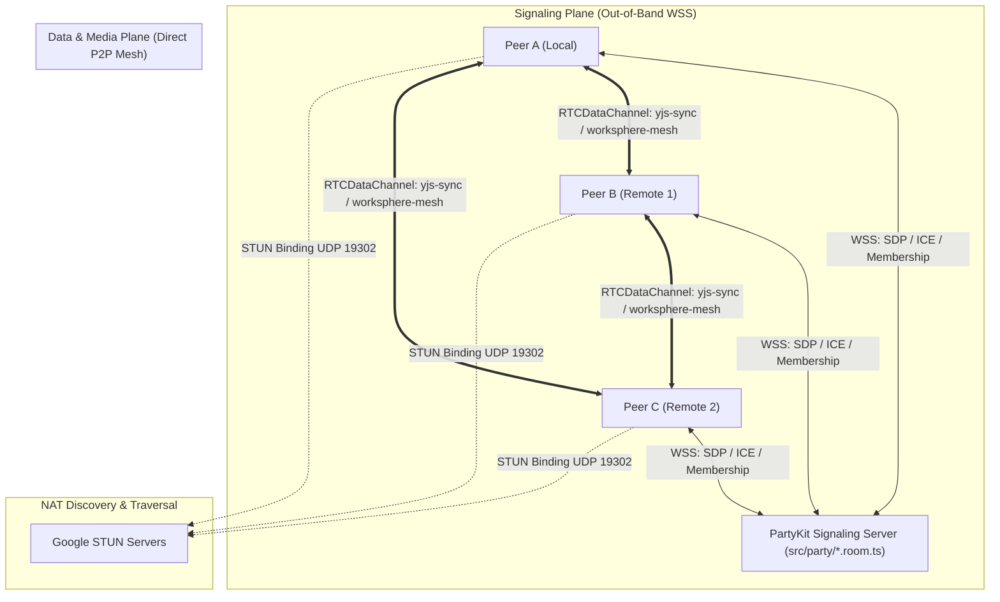
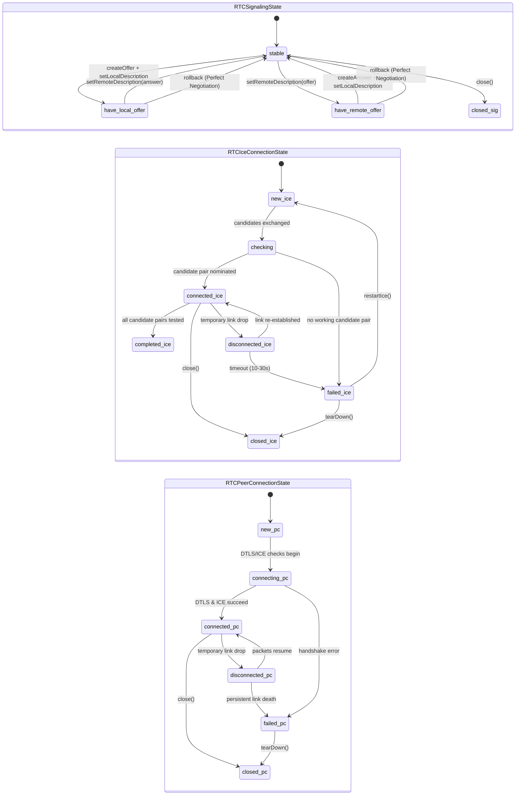
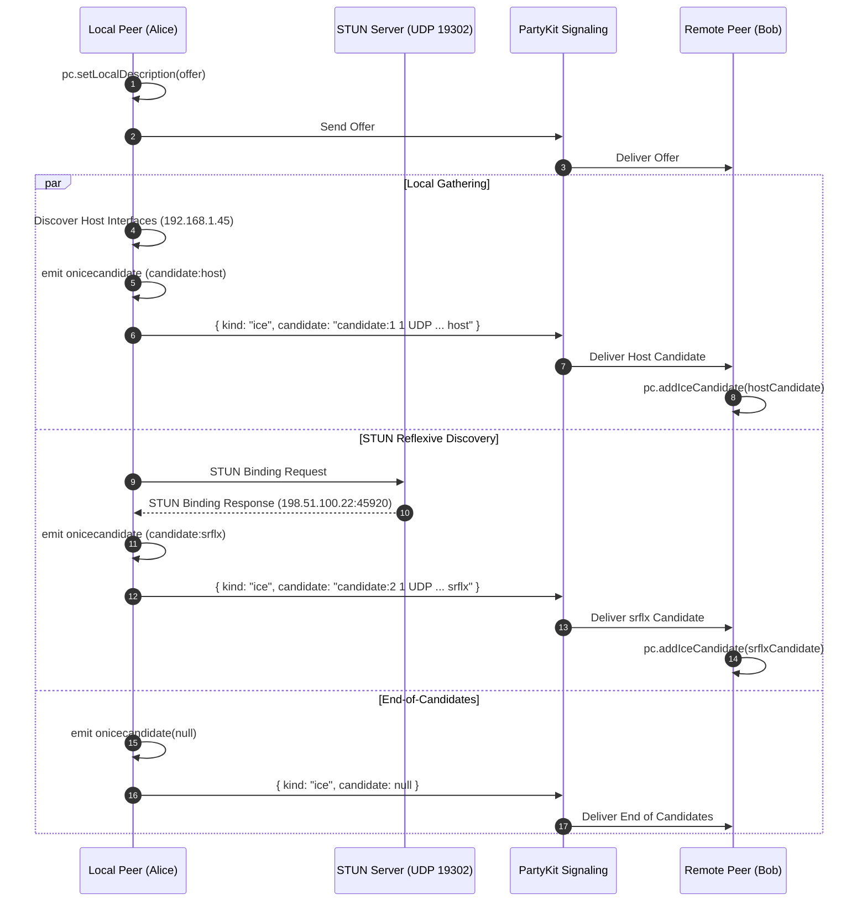

# WebRTC Peer Connection Lifecycle & ICE Candidate Negotiation in Mesh Rooms

> **Technical Reference & Operational Guide**  
> **Status:** Production Standard  
> **Target Subsystems:** Mesh Collaboration Engine (`src/lib/p2p/meshCollabEngine.ts`), Connection Lifecycle Management (`src/lib/p2p/PeerConnectionManager.ts`), Perfect Negotiation Core (`src/core/network/WebRTCMesh.ts`), Mesh Data Channels (`src/hooks/useMeshDataChannels.ts`), Mesh Media & Telemetry (`src/hooks/useWebRTCMesh.ts`, `src/lib/realtime/webrtc/meshConnection.ts`)  
> **Signaling Plane:** PartyKit WSS Rooms (`partysocket/react`, `src/party/*.room.ts`)  
> **Data & Media Planes:** SCTP RTCDataChannel (`worksphere-mesh`, `yjs-sync`), SRTP/DTLS 1.2/1.3 Audio/Video  

---

## 1. Overview and Architecture

WorkSphere uses a decentralized, client-side peer-to-peer (P2P) **mesh topology** for collaborative workspace sessions. In contrast to centralized architectures (such as Selective Forwarding Units (SFUs) or Multipoint Control Units (MCUs)), every participant in a WorkSphere mesh room establishes direct, bidirectional `RTCPeerConnection` links to all other active peers in the room.



### 1.1 Mesh Room Topology and Peer Scalability Bounds
- **Direct Mesh Topology:** In a room with $N$ peers, each client maintains $(N - 1)$ active `RTCPeerConnection` instances, resulting in a total of $\frac{N(N - 1)}{2}$ bidirectional links across the mesh.
- **Mesh Peer Ceiling:** WorkSphere hard-limits active mesh peers per room to **5 remote peers (6 total participants)** in [`src/hooks/useMeshDataChannels.ts`](file:///c:/Users/Saransh%20Kashyap/WorkSphere-9747-worktree/src/hooks/useMeshDataChannels.ts#L201-L204) and [`src/hooks/useWebRTCMesh.ts`](file:///c:/Users/Saransh%20Kashyap/WorkSphere-9747-worktree/src/hooks/useWebRTCMesh.ts#L6-L9). This protects mobile device CPU, battery consumption, and uplink bandwidth from the exponential overhead of full mesh scaling.
- **Relayed & Hop-Based Routing:** As modeled in [`src/lib/p2p/meshCollabEngine.ts`](file:///c:/Users/Saransh%20Kashyap/WorkSphere-9747-worktree/src/lib/p2p/meshCollabEngine.ts#L9-L21), peers may participate either as direct LAN peers (`hopCount: 0`) or as multi-hop mesh relays (`hopCount: 1+`, `status: "mesh_relay"`), enabling document synchronization across segmented local subnets even under full WAN ISP blackout conditions.

### 1.2 Separation of Concerns: Signaling vs. Peer-to-Peer
WorkSphere maintains a strict separation between connection coordination and data/media transmission:
1. **Signaling Plane (Out-of-Band):**
   - **Transport:** WebSocket Secure (`wss://`) managed via PartyKit (`partysocket/react`).
   - **Responsibility:** Ephemeral relay of session setup metadata—namely Session Description Protocol (SDP) offers and answers, Trickle ICE candidates, and room membership lifecycle events (`peer-join`, `peer-leave`).
   - **Zero Decryption / Zero Payload:** The signaling server never handles, proxies, or inspects application document deltas, audio packets, or files.
2. **Peer-to-Peer Media & Data Plane:**
   - **Transport:** User Datagram Protocol (UDP) multiplexed through Interactive Connectivity Establishment (ICE) candidate pairs.
   - **Security:** Datagram Transport Layer Security (DTLS 1.2 / 1.3) mutual handshake, deriving keys for Secure Real-time Transport Protocol (SRTP) media streams and Stream Control Transmission Protocol (SCTP) over DTLS for `RTCDataChannel`.
   - **Direct Transfer:** Collaborative state changes (Yjs vector clocks, document deltas, chat payloads, canvas strokes, chunked files) flow directly between client browser runtimes.

---

## 2. Complete Peer Connection Lifecycle

The lifecycle of a WebRTC connection in WorkSphere progresses through four distinct phases: discovery/signaling, candidate exchange, data channel activation, and teardown.

```mermaid
sequenceDiagram
    autonumber
    actor Alice as Peer A (Local)
    participant PK as PartyKit Signaling Server
    actor Bob as Peer B (Remote)
    participant STUN as Google STUN Server

    Note over Alice, Bob: Phase 1: Room Join & Role Negotiation
    Bob->>PK: { type: "webrtc-signal", kind: "peer-join", from: "peer-b" }
    PK->>Alice: Broadcast { kind: "peer-join", from: "peer-b" }
    Alice->>Alice: determineRole("peer-a", "peer-b") -> Polite vs Impolite
    Alice->>Alice: new RTCPeerConnection({ iceServers })
    Alice->>Alice: createDataChannel("worksphere-mesh" or "yjs-sync")

    Note over Alice, Bob: Phase 2: SDP Offer/Answer Exchange
    Alice->>Alice: pc.setLocalDescription() [generates Offer]
    Alice->>PK: { kind: "offer", from: "peer-a", to: "peer-b", sdp: Offer }
    PK->>Bob: Forward Offer to Peer B
    Bob->>Bob: new RTCPeerConnection({ iceServers })
    Bob->>Bob: pc.setRemoteDescription(Offer)
    Bob->>Bob: pc.setLocalDescription() [generates Answer]
    Bob->>PK: { kind: "answer", from: "peer-b", to: "peer-a", sdp: Answer }
    PK->>Alice: Forward Answer to Peer A
    Alice->>Alice: pc.setRemoteDescription(Answer)

    Note over Alice, Bob: Phase 3: Trickle ICE Gathering & Connectivity Checks
    par Asynchronous ICE Gathering (Alice)
        Alice->>STUN: STUN Binding Request (UDP 19302)
        STUN-->>Alice: STUN Binding Response (srflx IP:Port)
        Alice->>Alice: onicecandidate event
        Alice->>PK: { kind: "ice", from: "peer-a", to: "peer-b", candidate }
        PK->>Bob: Forward Candidate
        Bob->>Bob: pc.addIceCandidate(candidate)
    and Asynchronous ICE Gathering (Bob)
        Bob->>STUN: STUN Binding Request (UDP 19302)
        STUN-->>Bob: STUN Binding Response (srflx IP:Port)
        Bob->>Bob: onicecandidate event
        Bob->>PK: { kind: "ice", from: "peer-b", to: "peer-a", candidate }
        PK->>Alice: Forward Candidate
        Alice->>Alice: pc.addIceCandidate(candidate)
    end

    Note over Alice, Bob: Phase 4: DTLS Handshake & DataChannel Ready
    Alice<-->>Bob: Direct DTLS 1.2/1.3 Handshake & SCTP Association
    Bob->>Bob: pc.ondatachannel fired -> attach handlers
    Alice->>Alice: dc.onopen fired -> isConnected = true
    Bob->>Bob: dc.onopen fired -> isConnected = true
    Alice<-->>Bob: Direct P2P Application Data / Heartbeats (PING / PONG)

    Note over Alice, Bob: Phase 5: Teardown or Disconnection
    Bob->>PK: { kind: "peer-leave", from: "peer-b" }
    PK->>Alice: Broadcast { kind: "peer-leave", from: "peer-b" }
    Alice->>Alice: cleanupPeer("peer-b") -> close DataChannel & RTCPeerConnection
```

### Detailed Lifecycle Steps
1. **Room Join:** Peer B enters the room and emits a `peer-join` message over the WebSocket signaling channel.
2. **Initiation & Peer Allocation:** Receiving peers invoke `ensurePeer(peerId, isInitiator)` or `getOrCreatePeer(remotePeerId)`. If the peer limit (< 5 peers) is satisfied, a new `RTCPeerConnection` is constructed.
3. **SDP Offer Creation:** The initiating peer invokes `pc.setLocalDescription()` (or `pc.createOffer()`), producing an SDP offer containing crypto DTLS fingerprints, media/SCTP parameters, and initial gathering attributes.
4. **Signaling Dispatch:** The offer is serialized into a `SignalMessage` and delivered to PartyKit with the target `to` field set to the remote peer's ID.
5. **Remote Description & Answer Generation:** The remote peer receives the offer, invokes `pc.setRemoteDescription(offer)`, immediately calls `pc.setLocalDescription()` to produce an SDP answer, and routes the answer back through PartyKit.
6. **Remote Description Resolution:** The initiating peer applies the answer with `pc.setRemoteDescription(answer)`, completing the signaling negotiation handshake and transitioning `signalingState` back to `stable`.
7. **Trickle ICE Gathering:** Concurrently, each peer gathers local interface bindings (`host`) and queries Google STUN (`stun:stun.l.google.com:19302`) for server-reflexive (`srflx`) candidates. As each candidate is emitted via `pc.onicecandidate`, it is transmitted to the remote peer and applied via `pc.addIceCandidate()`.
8. **DTLS Handshake & SCTP Association:** ICE connectivity checks nominate the best candidate pair. The peers execute a direct mutual DTLS handshake over UDP. SCTP associations establish over DTLS.
9. **DataChannel Activation:** The initiator's `RTCDataChannel.onopen` and receiver's `RTCPeerConnection.ondatachannel` fire. Document deltas and heartbeats commence.
10. **Graceful Teardown:** Upon departure, the closing peer sends `peer-leave` and terminates connections. If network links sever abruptly without signaling, heartbeat timeouts or ICE connection state transitions trigger local teardown.

---

## 3. Peer Connection State Machine

WebRTC tracks connection progression through four distinct browser state machines. Understanding the boundaries and interactions between these state machines is essential for debugging connection stalls.



### 3.1 State Machine Breakdown

| State Machine | Property on `RTCPeerConnection` | Possible Values | Meaning & Role in WorkSphere |
|---|---|---|---|
| **Signaling State** | `pc.signalingState` | `stable`, `have-local-offer`, `have-remote-offer`, `have-local-pranswer`, `have-remote-pranswer`, `closed` | Tracks the SDP offer/answer exchange. In steady-state operation, it must always be `stable`. If an offer is pending, glare collision is detected when `signalingState !== "stable"`. |
| **ICE Gathering State** | `pc.iceGatheringState` | `new`, `gathering`, `complete` | Indicates candidate discovery progress. Moves from `new` to `gathering` as host interfaces and STUN servers are queried, and transitions to `complete` when all local candidates have been gathered. |
| **ICE Connection State** | `pc.iceConnectionState` | `new`, `checking`, `connected`, `completed`, `failed`, `disconnected`, `closed` | Reflects the reachability of candidate pairs. `checking` means STUN connectivity checks are active; `connected` means at least one working path is established; `failed` triggers ICE restart or session teardown. |
| **Peer Connection State** | `pc.connectionState` | `new`, `connecting`, `connected`, `disconnected`, `failed`, `closed` | Aggregate connection state combining ICE transport and DTLS security. When `failed` or `closed`, WorkSphere triggers `cleanupPeer()` in [`src/lib/p2p/PeerConnectionManager.ts`](file:///c:/Users/Saransh%20Kashyap/WorkSphere-9747-worktree/src/lib/p2p/PeerConnectionManager.ts#L47-L54). |

### 3.2 Differences Between `iceConnectionState` and `connectionState`
- `iceConnectionState` reflects solely the underlying UDP connectivity and STUN check health between network endpoints. It may fluctuate between `connected` and `disconnected` during transient Wi-Fi drops.
- `connectionState` incorporates both the ICE transport layer and the **DTLS/SRTP security handshake layer**. An ICE check may succeed (`iceConnectionState: "connected"`), but if DTLS certificate validation fails or cipher negotiation mismatches, `connectionState` will transition to `"failed"`.
- In WorkSphere:
  - In [`src/core/network/WebRTCMesh.ts`](file:///c:/Users/Saransh%20Kashyap/WorkSphere-9747-worktree/src/core/network/WebRTCMesh.ts#L143-L147), `iceConnectionState === "failed"` triggers an automatic `restartIce(remotePeerId)`.
  - In [`src/lib/p2p/PeerConnectionManager.ts`](file:///c:/Users/Saransh%20Kashyap/WorkSphere-9747-worktree/src/lib/p2p/PeerConnectionManager.ts#L47-L65), `connectionState === "disconnected" || connectionState === "failed"` triggers immediate `tearDown()` to reclaim system resources.

---

## 4. SDP Offer/Answer Signaling Protocol

To eliminate race conditions when two peers connect or attempt renegotiation simultaneously (known as **glare**), WorkSphere implements the **W3C Perfect Negotiation** pattern across both [`src/core/network/WebRTCMesh.ts`](file:///c:/Users/Saransh%20Kashyap/WorkSphere-9747-worktree/src/core/network/WebRTCMesh.ts#L37-L42) and [`src/hooks/useWebRTCMesh.ts`](file:///c:/Users/Saransh%20Kashyap/WorkSphere-9747-worktree/src/hooks/useWebRTCMesh.ts#L14-L20).

### 4.1 Role Assignment & Tie-Breaking
1. **Deterministic Lexicographical ID Comparison (`WebRTCMesh.ts`):**
   ```typescript
   export function isPolitePeer(localPeerId: string, remotePeerId: string): boolean {
     return localPeerId.localeCompare(remotePeerId) < 0;
   }
   ```
   Both peers evaluate their respective IDs. The peer with the lexicographically smaller string is designated the **Polite Peer**; the remote peer is designated the **Impolite Peer**. Both peers arrive at identical role conclusions without any extra network coordination.
2. **Context-Driven Role Assignment (`useWebRTCMesh.ts`):**
   - **Initiator (Polite):** The existing room member who receives a `peer-join` event and initiates the offer.
   - **Receiver (Impolite):** The newly joined peer who emitted `peer-join`.

### 4.2 Handling Glare & Collisions
When both peers generate and transmit an SDP offer at the same time:
- An **offer collision** is detected if `description.type === "offer" && (session.makingOffer || pc.signalingState !== "stable")`.
- **Impolite Peer (`polite === false`):**
  Sets `session.ignoreOffer = true` and discards the incoming offer. It waits for the remote peer to accept its original offer.
- **Polite Peer (`polite === true`):**
  Yields to the colliding offer. It executes `pc.setLocalDescription({ type: "rollback" })` in parallel with applying the incoming offer (`pc.setRemoteDescription(description)`), generates an answer, and returns to `stable` state.

### 4.3 Signaling Message Wire Protocol

All signaling packets exchanged via PartyKit conform to the following contract:

| Field | Type | Required | Description |
|---|---|:---:|---|
| `type` | `"webrtc-signal"` | Yes | Top-level discriminant for mesh routing in PartyKit. |
| `kind` | `SignalKind` | Yes | Message variant: `"peer-join"`, `"offer"`, `"answer"`, `"ice"`, `"peer-leave"`. |
| `from` | `string` | Yes | User/Peer ID of the sender (e.g., Clerk `userId`). |
| `to` | `string` | Optional | Target peer ID for directed unicast signaling (`offer`, `answer`, `ice`). Omitted for room broadcasts (`peer-join`, `peer-leave`). |
| `sdp` | `RTCSessionDescriptionInit` | Conditional | Present on `"offer"` and `"answer"`. Contains `type` (`"offer"` \| `"answer"`) and `sdp` string. |
| `candidate` | `RTCIceCandidateInit \| null` | Conditional | Present on `"ice"`. Contains candidate attribute string, `sdpMid`, and `sdpMLineIndex`. `null` indicates end-of-candidates. |

### 4.4 Representative Sanitized Wire Payloads

#### SDP Offer Payload (`kind: "offer"`)
```json
{
  "type": "webrtc-signal",
  "kind": "offer",
  "from": "user_2Y6eZ8kLmNoPqRs",
  "to": "user_7A3bC9dEfGhIjKl",
  "sdp": {
    "type": "offer",
    "sdp": "v=0\r\no=- 429182371928371 2 IN IP4 127.0.0.1\r\ns=-\r\nt=0 0\r\na=group:BUNDLE 0 data\r\na=extmap-allow-mixed\r\na=msid-semantic: WMS\r\nm=application 9 DTLS/SCTP 5000\r\nc=IN IP4 0.0.0.0\r\na=mid:data\r\na=sctp-port:5000\r\na=max-message-size:262144\r\na=setup:actpass\r\na=fingerprint:sha-256 A1:B2:C3:D4:E5:F6:78:90:12:34:56:78:9A:BC:DE:F0:12:34:56:78:9A:BC:DE:F0:12:34:56:78:9A:BC:DE:F0\r\n"
  }
}
```

#### SDP Answer Payload (`kind: "answer"`)
```json
{
  "type": "webrtc-signal",
  "kind": "answer",
  "from": "user_7A3bC9dEfGhIjKl",
  "to": "user_2Y6eZ8kLmNoPqRs",
  "sdp": {
    "type": "answer",
    "sdp": "v=0\r\no=- 839172837192837 2 IN IP4 127.0.0.1\r\ns=-\r\nt=0 0\r\na=group:BUNDLE 0 data\r\na=extmap-allow-mixed\r\na=msid-semantic: WMS\r\nm=application 9 DTLS/SCTP 5000\r\nc=IN IP4 0.0.0.0\r\na=mid:data\r\na=sctp-port:5000\r\na=max-message-size:262144\r\na=setup:active\r\na=fingerprint:sha-256 FE:DC:BA:98:76:54:32:10:FE:DC:BA:98:76:54:32:10:FE:DC:BA:98:76:54:32:10:FE:DC:BA:98:76:54:32:10\r\n"
  }
}
```

---

## 5. ICE Candidate Exchange Protocol

WorkSphere implements **Trickle ICE** ([RFC 8838](https://datatracker.ietf.org/doc/html/rfc8838)). Rather than waiting for candidate gathering to complete before sending an SDP description (vanilla ICE), candidate gathering occurs concurrently with description negotiation, dramatically reducing time-to-first-media.



### 5.1 Candidate Types Explained
1. **Host Candidates (`host`):**
   - Gathered directly from the host operating system's network interfaces (private IPv4 e.g. `192.168.x.x`, `10.x.x.x`, or link-local/global IPv6).
   - Lowest latency path for peers located on the same physical Wi-Fi network or corporate subnet.
2. **Server-Reflexive Candidates (`srflx`):**
   - Discovered by querying a STUN server over UDP port 19302.
   - Represents the public-facing IP and translated port assigned to the peer by its NAT router. Used for direct endpoint-to-endpoint punch-through across standard full-cone or restricted-cone NATs.
3. **Peer-Reflexive Candidates (`prflx`):**
   - Generated dynamically during active ICE connectivity checks when a STUN ping arrives from an address/port different from any previously signaled candidate (frequent behind symmetric NATs).
4. **Relay Candidates (`relay`):**
   - Allocated on Traversal Using Relays around NAT (TURN) cloud proxies.
   - Packets are forwarded between peers by the TURN server. Necessary when symmetric NATs or restrictive enterprise firewalls drop all direct UDP traffic.

### 5.2 Candidate Buffering and Signaling Glare
- **The Race Condition:** Because Trickle ICE delivers candidates asynchronously, an ICE candidate packet may arrive at the remote peer **before** the remote peer has finished invoking `pc.setRemoteDescription(offer)`.
- Calling `pc.addIceCandidate()` when `pc.remoteDescription` is null causes the WebRTC engine to throw an `InvalidStateError`.
- **Handling in WorkSphere:**
  - In [`src/core/network/WebRTCMesh.ts`](file:///c:/Users/Saransh%20Kashyap/WorkSphere-9747-worktree/src/core/network/WebRTCMesh.ts#L245-L253), candidates arriving during an ignored colliding offer are discarded cleanly without throwing.
  - In production implementations, incoming candidates received prior to remote description resolution are placed in a local FIFO `pendingCandidates: RTCIceCandidateInit[]` buffer and flushed immediately following successful `setRemoteDescription()` resolution.

### 5.3 Sanitized ICE Candidate Wire Payload
```json
{
  "type": "webrtc-signal",
  "kind": "ice",
  "from": "user_2Y6eZ8kLmNoPqRs",
  "to": "user_7A3bC9dEfGhIjKl",
  "candidate": {
    "candidate": "candidate:842163049 1 udp 1677729535 198.51.100.24 54128 typ srflx raddr 192.168.1.45 rport 54128 generation 0 ufrag ab12 network-cost 900",
    "sdpMid": "data",
    "sdpMLineIndex": 0
  }
}
```

---

## 6. STUN and TURN Configuration and Fallback

### 6.1 STUN vs. TURN Capabilities
- **STUN (Session Traversal Utilities for NAT - RFC 5389):**
  A lightweight request/response protocol that discovers the external public IP and port mapped to a local socket. **STUN does not relay traffic.** It only enables direct peer-to-peer traversal.
- **TURN (Traversal Using Relays around NAT - RFC 8656):**
  A relay protocol where both peers connect to a central cloud server that forwards packets between them. **TURN is required when direct traversal fails.**

### 6.2 WorkSphere's Actual Codebase Configuration
In the current WorkSphere codebase, STUN is configured across all WebRTC entry points using Google's public STUN servers:
- [`src/core/network/WebRTCMesh.ts`](file:///c:/Users/Saransh%20Kashyap/WorkSphere-9747-worktree/src/core/network/WebRTCMesh.ts#L28-L31):
  ```typescript
  const DEFAULT_ICE_SERVERS: RTCIceServer[] = [
    { urls: "stun:stun.l.google.com:19302" },
    { urls: "stun:stun1.l.google.com:19302" },
  ];
  ```
- [`src/hooks/useWebRTCMesh.ts`](file:///c:/Users/Saransh%20Kashyap/WorkSphere-9747-worktree/src/hooks/useWebRTCMesh.ts#L126):
  ```typescript
  const ICE_SERVERS: RTCIceServer[] = [{ urls: "stun:stun.l.google.com:19302" }];
  ```
- [`src/lib/p2p/PeerConnectionManager.ts`](file:///c:/Users/Saransh%20Kashyap/WorkSphere-9747-worktree/src/lib/p2p/PeerConnectionManager.ts#L31):
  ```typescript
  this.connection = new RTCPeerConnection({
    iceServers: config.iceServers || [{ urls: "stun:stun.l.google.com:19302" }],
  });
  ```

### 6.3 Fallback Clarification: Custom Application vs. ICE Prioritization
> [!IMPORTANT]
> **No Custom Application TURN Fallback Exists in Runtime Code:**
> WorkSphere relies on standard WebRTC ICE candidate prioritization ([RFC 8445](https://datatracker.ietf.org/doc/html/rfc8445)). The browser automatically attempts candidate pairs in order of priority:
> 1. `host` $\leftrightarrow$ `host` (Direct local link)
> 2. `host` $\leftrightarrow$ `srflx` / `srflx` $\leftrightarrow$ `srflx` (STUN punched NAT)
> 3. `relay` $\leftrightarrow$ `relay` / `relay` $\leftrightarrow$ `srflx` (TURN relay)
>
> If STUN punch-through fails and no TURN server is configured in `iceServers`, the ICE connection transitions to `"failed"`.
> 
> **Application-Level Fallback (PartyKit):** As documented in [`src/hooks/useWebRTCMesh.ts`](file:///c:/Users/Saransh%20Kashyap/WorkSphere-9747-worktree/src/hooks/useWebRTCMesh.ts#L79-L81), critical text state and presence fallback gracefully to PartyKit WebSocket messages (`socketRef.current.send()`) if WebRTC fails to connect.

### 6.4 Recommended Production TURN Configuration Template
For enterprise environments where symmetric NATs or UDP blocking firewalls prevent direct P2P connections, inject secure TURN credentials via environment variables:

```typescript
// Sanitized production configuration pattern
const iceServers: RTCIceServer[] = [
  { urls: "stun:stun.l.google.com:19302" },
  {
    urls: [
      "turn:turn.worksphere-prod.internal:3478?transport=udp",
      "turn:turn.worksphere-prod.internal:3478?transport=tcp",
      "turns:turn.worksphere-prod.internal:5349?transport=tcp",
    ],
    username: process.env.NEXT_PUBLIC_TURN_USERNAME || "ephemeral-user",
    credential: process.env.TURN_CREDENTIAL || "ephemeral-token",
  },
];
```

---

## 7. DataChannel Lifecycle

WorkSphere utilizes WebRTC DataChannels for high-throughput, low-latency collaboration without server hops.

### 7.1 Channel Labels and Configuration
1. **`"worksphere-mesh"` ([`src/core/network/WebRTCMesh.ts`](file:///c:/Users/Saransh%20Kashyap/WorkSphere-9747-worktree/src/core/network/WebRTCMesh.ts#L90)):
   - Configured with `{ ordered: true }`.
   - Used for generic workspace mesh messaging, document deltas, and state broadcasts.
2. **`"yjs-sync"` ([`src/hooks/useMeshDataChannels.ts`](file:///c:/Users/Saransh%20Kashyap/WorkSphere-9747-worktree/src/hooks/useMeshDataChannels.ts#L231)):
   - Configured with `{ ordered: true }`.
   - Dedicated channel for binary Yjs CRDT state vector exchanges (`ArrayBuffer`) and incremental document updates.

### 7.2 In-Band vs. Out-of-Band Negotiation
- **In-Band Negotiation (Implemented):**
  WorkSphere uses in-band negotiation. The initiating/impolite peer creates the DataChannel using `pc.createDataChannel(label, options)`. The WebRTC SCTP layer handles channel assignment. When the remote peer establishes the SCTP association, the browser automatically fires the `pc.ondatachannel` event with the remote channel instance. No pre-negotiated stream IDs or out-of-band SDP signaling is required.

### 7.3 Event Handlers & Message Processing
```typescript
channel.onopen = () => {
  // Update UI connected count and activate collaborative listeners
  setIsConnected(true);
};

channel.onmessage = (event: MessageEvent) => {
  if (event.data instanceof ArrayBuffer) {
    // 1. Pass through Bloom Filter deduplication (MeshBloomFilter)
    // 2. Dispatch to CRDT sync handler (Y.applyUpdate)
  } else if (event.data === "PING") {
    // Heartbeat monitoring: reply immediately with PONG
    channel.send("PONG");
  }
};

channel.onclose = () => {
  // Reset CRDT checksum cache and release peer references
  resetStateVectorChecksumCache();
};

channel.onerror = (error) => {
  console.error(`[DataChannel] Error on ${channel.label}:`, error);
};
```

### 7.4 DataChannel Teardown & Garbage Collection
When a peer leaves or drops:
1. `channel.close()` is invoked explicitly.
2. Event listeners (`onopen`, `onmessage`, `onclose`, `onerror`) are cleared.
3. The channel is deleted from `dataChannelsRef.current.delete(peerId)`.
4. In [`src/hooks/useMeshDataChannels.ts`](file:///c:/Users/Saransh%20Kashyap/WorkSphere-9747-worktree/src/hooks/useMeshDataChannels.ts#L141-L150), `resetStateVectorChecksumCache()` is invoked immediately to ensure any future reconnect begins with a fresh CRDT state vector synchronization.

---

## 8. ICE and Peer Connection Errors

The following diagnostic table identifies the verified connection errors, browser states, root causes, actual WorkSphere behavior, and recovery actions.

| Error / State | Category | Root Cause | WorkSphere Actual Codebase Behavior | Recommended Recovery Action |
|---|---|---|---|---|
| **`pc.iceConnectionState === "failed"`** | ICE Failure | No candidate pair succeeded in bidirectional STUN connectivity checks within the timeout window (typically symmetric NAT or UDP blocked). | [`WebRTCMesh.ts`](file:///c:/Users/Saransh%20Kashyap/WorkSphere-9747-worktree/src/core/network/WebRTCMesh.ts#L144-L146) automatically triggers `this.restartIce(remotePeerId)`. [`useMeshDataChannels.ts`](file:///c:/Users/Saransh%20Kashyap/WorkSphere-9747-worktree/src/hooks/useMeshDataChannels.ts#L221-L227) calls `cleanupPeer(peerId)`. | Trigger an ICE restart with `{ iceRestart: true }`. If persistent, fall back to TURN relay over TCP port 443 or PartyKit WebSocket relay. |
| **`pc.connectionState === "failed"`** | DTLS / Security Failure | DTLS cryptographic handshake failed, certificate fingerprint mismatch, or cipher suite negotiation failed after ICE established. | Handled via `onconnectionstatechange` in [`PeerConnectionManager.ts`](file:///c:/Users/Saransh%20Kashyap/WorkSphere-9747-worktree/src/lib/p2p/PeerConnectionManager.ts#L50-L52), which executes `tearDown()`. | Terminate the failed peer connection, invalidate stale SDP caches, and initiate a completely fresh offer/answer exchange. |
| **`pc.iceConnectionState === "disconnected"`** | Transient Network Glitch | Temporary packet loss, Wi-Fi roaming between access points, or momentary cellular handover. | [`PeerConnectionManager.ts`](file:///c:/Users/Saransh%20Kashyap/WorkSphere-9747-worktree/src/lib/p2p/PeerConnectionManager.ts#L50-L52) immediately tears down the connection. [`useWebRTCMesh.ts`](file:///c:/Users/Saransh%20Kashyap/WorkSphere-9747-worktree/src/hooks/useWebRTCMesh.ts#L72) initiates peer cleanup. | In transient scenarios, allow a brief grace period (3-5s) for ICE to transition back to `connected`. If not restored, trigger `restartIce()`. |
| **`InvalidStateError: remote description not set`** | Signaling Glare / Out-of-Order Delivery | An incoming Trickle ICE candidate was processed via `addIceCandidate()` before `setRemoteDescription()` finished resolving. | Caught and suppressed in [`WebRTCMesh.ts`](file:///c:/Users/Saransh%20Kashyap/WorkSphere-9747-worktree/src/core/network/WebRTCMesh.ts#L248-L252) if `session.ignoreOffer` is active. | Buffer incoming candidates in a `pendingCandidates` FIFO queue until `setRemoteDescription()` resolves, then flush the queue sequentially. |
| **Missed Heartbeat Threshold Exceeded** | Application Liveliness Timeout | The remote peer's browser tab was backgrounded, frozen by OS throttling, or the network link went silent without TCP FIN / WebSocket leave. | [`PeerConnectionManager.ts`](file:///c:/Users/Saransh%20Kashyap/WorkSphere-9747-worktree/src/lib/p2p/PeerConnectionManager.ts#L85-L95) tracks interval pings (2000ms). If `timeSinceLastHeartbeat > 6000ms`, `tearDown()` is executed. | Reclaim resources, emit peer-disconnected notifications to UI, and attempt signaling reconnection if peer re-enters view. |
| **`OperationError: Max mesh peers reached`** | Resource Boundary Check | The local client already has 5 active peer connections and another peer attempts to join. | [`useMeshDataChannels.ts`](file:///c:/Users/Saransh%20Kashyap/WorkSphere-9747-worktree/src/hooks/useMeshDataChannels.ts#L201-L204) logs a warning and returns `null`, rejecting the connection. | Mesh participant limit reached. Additional participants should view as observers or migrate to an SFU/MCU architecture. |

---

## 9. Recovery, Retry, and Cleanup Procedures

### 9.1 ICE Restart Procedure
When local network interfaces switch (e.g. Wi-Fi drops to Cellular or roams across BSSIDs), WorkSphere initiates an ICE restart rather than tearing down and reconstructing the entire session:
1. `pc.restartIce()` is invoked on the existing `RTCPeerConnection` (supported in modern browsers).
2. The peer creates an offer with `{ iceRestart: true }`:
   ```typescript
   const offer = await pc.createOffer({ iceRestart: true });
   await pc.setLocalDescription(offer);
   ```
3. This generates new ICE `ufrag` and `pwd` credentials in the SDP offer, prompting the browser to gather fresh candidate pairs across the new network interfaces while preserving the established `RTCDataChannel` state and Yjs document session.

### 9.2 Heartbeat Liveliness Monitoring
In [`src/lib/p2p/PeerConnectionManager.ts`](file:///c:/Users/Saransh%20Kashyap/WorkSphere-9747-worktree/src/lib/p2p/PeerConnectionManager.ts#L85-L96):
- **Ping Interval:** Every `heartbeatIntervalMs` (default: 2,000 ms), the local peer sends `"PING"` over the `RTCDataChannel`.
- **Pong Response:** When `"PING"` is received, the remote peer responds with `"PONG"` and updates `lastHeartbeat = Date.now()`.
- **Missed Threshold:** If `Date.now() - lastHeartbeat > heartbeatIntervalMs * missedHeartbeatThreshold` (default: 6,000 ms), the connection is declared dead and `tearDown()` is triggered.

### 9.3 Cleanup and Resource Deallocation
To prevent memory leaks and zombie WebRTC threads:
```typescript
public tearDown(): void {
  if (this.state === 'closed') return;
  this.state = 'closed';

  // 1. Stop heartbeat timer
  if (this.heartbeatTimer) {
    clearInterval(this.heartbeatTimer);
    this.heartbeatTimer = null;
  }

  // 2. Close DataChannel and remove handlers
  if (this.dataChannel) {
    this.dataChannel.onopen = null;
    this.dataChannel.onmessage = null;
    this.dataChannel.onclose = null;
    this.dataChannel.onerror = null;
    this.dataChannel.close();
    this.dataChannel = null;
  }

  // 3. Close RTCPeerConnection and remove listeners
  this.connection.onicecandidate = null;
  this.connection.ondatachannel = null;
  this.connection.onconnectionstatechange = null;
  this.connection.oniceconnectionstatechange = null;
  this.connection.close();

  // 4. Invalidate CRDT checksum cache
  resetStateVectorChecksumCache();

  // 5. Notify upper-layer mesh manager
  if (this.onDisconnectCallback) {
    this.onDisconnectCallback(this.peerId);
  }
}
```

---

## 10. Local Multi-Tab and Multi-Device Development

Developing and debugging WebRTC mesh connections locally requires testing cross-tab and cross-device signaling without collisions.

### 10.1 Pre-Flight Verification Checklist
- [ ] PartyKit local dev server is running on `127.0.0.1:1999` (`npm run partykit:dev` or `npx partykit dev`).
- [ ] Next.js app server is running on `http://localhost:3000`.
- [ ] Camera and microphone permissions are granted (or mock media stream flags are enabled).
- [ ] Browser console open on all windows to track signaling and ICE candidates.

### 10.2 Local Multi-Tab Testing (Same Machine)
Testing with two browser tabs on the same machine tests localhost host-to-host ICE candidates:
1. Open Tab 1: `http://localhost:3000/p2p/mesh-collab?room=test-room-1`
2. Open Tab 2 (Incognito or separate profile): `http://localhost:3000/p2p/mesh-collab?room=test-room-1`
   > [!TIP]
   > Use Incognito or a separate browser profile so Clerk assigns distinct user IDs. If both tabs share the same `userId`, `handleSignal` will ignore messages where `msg.from === userId` ([`useMeshDataChannels.ts`](file:///c:/Users/Saransh%20Kashyap/WorkSphere-9747-worktree/src/hooks/useMeshDataChannels.ts#L256)).
3. Verify connection:
   - Tab 1 logs: `[WebRTCMesh] sending offer to peer-b`.
   - Tab 2 logs: `[WebRTCMesh] received offer, sending answer`.
   - Both tabs report `isConnected: true` and `peerCount: 1`.

### 10.3 Multi-Device Testing (Same Local Wi-Fi Network)
To test across two physical laptops or mobile devices on the same Wi-Fi router:
1. Find your development machine's local LAN IPv4 address (e.g. `192.168.1.150` via `ipconfig` or `ifconfig`).
2. Bind Next.js and PartyKit to all interfaces:
   ```bash
   # Next.js
   npx next dev -H 0.0.0.0 -p 3000
   ```
3. Set `NEXT_PUBLIC_PARTYKIT_HOST="192.168.1.150:1999"` in `.env.local`.
4. Navigate to `http://192.168.1.150:3000/p2p/mesh-collab?room=wifi-test` on Device 1 and Device 2.
5. In `chrome://webrtc-internals`, verify that the active candidate pair is type `host` $\leftrightarrow$ `host`.

### 10.4 Common Local Pitfalls
- **Loopback Signaling Collision:** Running two tabs with the exact same `userId` causes both tabs to discard each other's offers or create duplicate conflicting connections.
- **Microphone / Camera Contention:** On Windows and macOS, two tabs in the same browser cannot always claim exclusive hardware access to the same webcam simultaneously. Use mock media tracks or Chrome flags:
  ```bash
  chrome.exe --use-fake-device-for-media-stream --use-fake-ui-for-media-stream
  ```
- **Local Firewall Blocks:** Windows Defender Firewall may prompt to allow Node.js / PartyKit on private networks. If denied, other LAN devices cannot reach the local signaling port `1999`.

---

## 11. Browser Debugging and Observability

### 11.1 Inspecting WebRTC Internals in Chromium
Open `chrome://webrtc-internals` in Chrome, Edge, or Brave:
1. **PeerConnection List:** Each active remote peer appears as a separate expandable tab with its local configuration.
2. **SDP Timeline:** Inspect the exact Offer and Answer exchanges under `setLocalDescription` and `setRemoteDescription`. Look for `a=mid:data` and verify DTLS fingerprints match.
3. **Candidate Pair Graph:** Under `IceCandidatePair`, locate the pair with `state: succeeded` and `nominated: true`.
   - Check `localCandidateType` and `remoteCandidateType` (`host`, `srflx`, or `relay`).
   - Check `currentRoundTripTime` and `bytesSent` / `bytesReceived`.
4. **DataChannel Table:** Inspect `worksphere-mesh` and `yjs-sync` under the DataChannel section to verify `state: open` and monitor message throughput.

### 11.2 Inspecting WebRTC in Firefox
Open `about:webrtc`:
- View SDP histories and candidate pairs with RTT statistics.
- Review raw trickle ICE logs and socket stats.

### 11.3 DevTools Console Quick Inspection Snippet
Execute this snippet in the browser console of any running mesh room to dump connection health:

```javascript
// Quick inspection snippet for WorkSphere mesh debug
(async () => {
  const pcs = window.__WORKSPHERE_PEERS__ || [];
  console.table(
    await Promise.all(
      pcs.map(async ({ peerId, pc }) => {
        const stats = await pc.getStats();
        let selectedPair = null;
        stats.forEach((report) => {
          if (report.type === "transport" && report.selectedCandidatePairId) {
            selectedPair = stats.get(report.selectedCandidatePairId);
          }
        });
        return {
          peerId,
          signalingState: pc.signalingState,
          iceConnectionState: pc.iceConnectionState,
          connectionState: pc.connectionState,
          rttMs: selectedPair ? Math.round(selectedPair.currentRoundTripTime * 1000) : "N/A",
          bytesSent: selectedPair ? selectedPair.bytesSent : 0,
          bytesReceived: selectedPair ? selectedPair.bytesReceived : 0,
        };
      })
    )
  );
})();
```

---

## 12. Security Considerations

### 12.1 DTLS Certificate Fingerprints and End-to-End Encryption
- **Mandatory E2EE:** Unencrypted WebRTC connections are strictly forbidden by modern browser engines.
- **DTLS Handshake:** During SDP signaling, each peer publishes an `a=fingerprint:sha-256 ...` attribute containing the SHA-256 hash of its ephemeral self-signed X.509 certificate.
- When direct UDP packets flow, peers verify that the remote certificate matches the SDP fingerprint before establishing the SCTP DataChannel or media keys.
- **Eavesdropping Protection:** Even though the PartyKit signaling server routes SDP offers and answers, it has no access to the DTLS private keys and cannot decrypt peer-to-peer data channel or media traffic.

### 12.2 Protecting TURN Relay Credentials
- **No Static Credentials in Client Bundles:** TURN credentials (`username`, `credential`) must never be hardcoded or baked into public client-side JavaScript.
- **Ephemeral REST API Tokens:** Use the TURN REST API standard ([RFC 5766](https://datatracker.ietf.org/doc/html/rfc5766)) or Cloudflare Calls ephemeral tokens where a backend route (`/api/webrtc/turn-credentials`) generates time-limited HMAC credentials (valid for 10-60 minutes) upon user authentication.

### 12.3 Signaling Message Validation & Room Authorization
- **Authentication Required:** Connections to PartyKit signaling rooms require a valid Clerk session token passed in the connection query params (`query: token ? { token } : undefined`). Unauthenticated sockets are severed before joining the room.
- **Payload Validation:** Validate incoming signaling JSON messages with schema libraries (e.g. Zod) to prevent malformed or oversized payloads from crashing the client event loop.
- **Origin & Target Verification:** In directed messages (`to === userId`), drop any message whose `to` target does not match the local client's authenticated user ID to prevent unauthorized connection hijacking or cross-room interference.

---

## 13. References and Standards

- **[W3C WebRTC 1.0: Real-Time Communication Between Browsers](https://www.w3.org/TR/webrtc/)** — W3C Recommendation for RTCPeerConnection, RTCDataChannel, and Perfect Negotiation.
- **[MDN WebRTC API Reference](https://developer.mozilla.org/en-US/docs/Web/API/WebRTC_API)** — Comprehensive developer guides and event reference.
- **[RFC 8445: Interactive Connectivity Establishment (ICE)](https://datatracker.ietf.org/doc/html/rfc8445)** — IETF standard for NAT traversal protocol.
- **[RFC 8838: Trickle ICE](https://datatracker.ietf.org/doc/html/rfc8838)** — Asynchronous ICE candidate gathering and signaling specification.
- **[RFC 5389: Session Traversal Utilities for NAT (STUN)](https://datatracker.ietf.org/doc/html/rfc5389)** — STUN query protocol and binding requests.
- **[RFC 8656: Traversal Using Relays around NAT (TURN)](https://datatracker.ietf.org/doc/html/rfc8656)** — Protocol specification for relaying media and data packets.
- **[RFC 8831: WebRTC Data Channels](https://datatracker.ietf.org/doc/html/rfc8831)** — SCTP over DTLS encapsulation and RTCDataChannel architecture.
- **[WebRTC Signaling Handshake Runbook](./WEBRTC_SIGNALING_HANDSHAKE.md)** — WorkSphere's operational runbook for PartyKit signaling.
- **[WebRTC ICE Traversal & STUN/TURN Topology](./WEBRTC_ICE_TRAVERSAL.md)** — WorkSphere's ICE traversal and NAT diagnostics reference.
