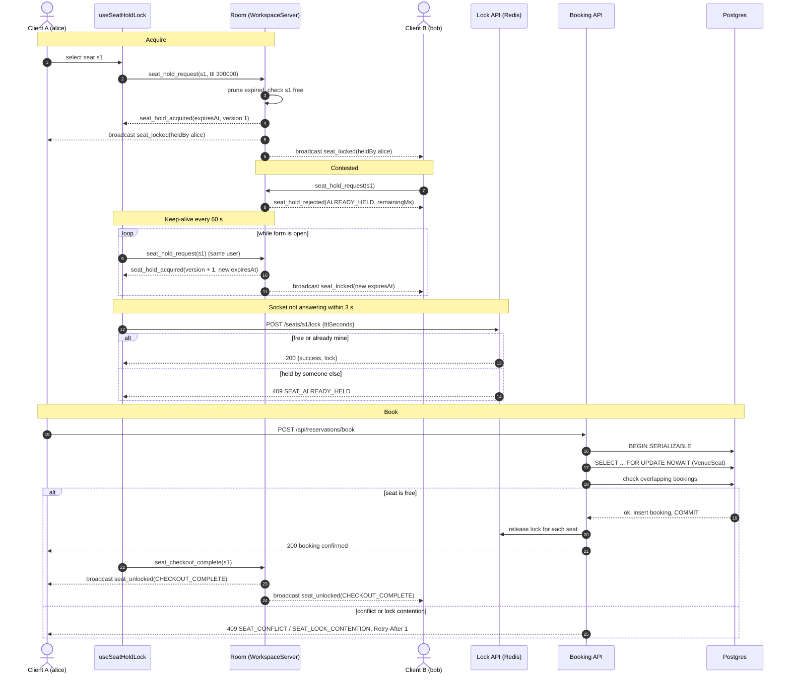
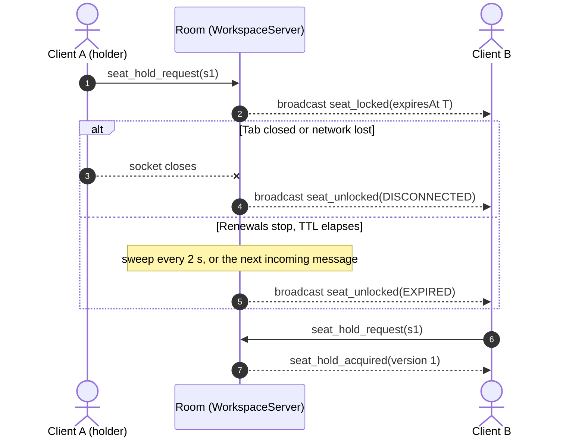

# Seat Hold Locking Protocol

This document specifies how WorkSphere prevents two people from reserving the same desk at the same time. It covers lock acquisition, lease (TTL) renewal, the messages the room broadcasts, the interaction with the database booking API, and every error a client can see.

It describes the code as it ships today. Where the implementation has gaps, they are listed in [Known gaps](#known-gaps) instead of being papered over.

Related reading: [PartyKit Architecture](../PARTYKIT_ARCHITECTURE.md) (rooms, sequence IDs, epochs, check-in flow).

## Contents

1. [Overview](#overview)
2. [Where each layer lives](#where-each-layer-lives)
3. [Lock acquisition](#lock-acquisition)
4. [TTL lease and keep-alive renewal](#ttl-lease-and-keep-alive-renewal)
5. [Release and expiry](#release-and-expiry)
6. [Room broadcast payloads](#room-broadcast-payloads)
7. [Sequence diagram](#sequence-diagram)
8. [Error code catalog](#error-code-catalog)
9. [Constants](#constants)
10. [Known gaps](#known-gaps)
11. [Tests that pin this behavior](#tests-that-pin-this-behavior)

## Overview

A seat hold is a short exclusive lease on one seat for one user. It exists so the person filling in the reservation form does not watch the seat disappear before they press "Book". A hold is **advisory UX state**. It is not the source of truth for who owns a desk. The database is.

There are three cooperating layers. Each one answers a different question:

| Layer                  | Question it answers                                                  | Authority |
| ---------------------- | -------------------------------------------------------------------- | --------- |
| PartyKit room          | "Who is looking at this seat right now?" Fast, broadcast to everyone | Advisory  |
| HTTP lock API (Redis)  | "Can this user hold this seat?" Works when the socket is down        | Advisory  |
| Booking API (Postgres) | "Is this seat actually free for this time slot?"                     | **Final** |

A client that holds a lock can still lose the booking race, and a client with no lock can still book a free seat. The hold only makes collisions rare and visible. The booking transaction makes them impossible.

## Where each layer lives

There are two PartyKit room implementations in `party/`. They speak different message vocabularies, so be careful which one you are reading.

| Class             | File                 | Deployed via `partykit.json` | Used by the reservation UI                                |
| ----------------- | -------------------- | ---------------------------- | --------------------------------------------------------- |
| `WorkspaceServer` | `party/server.ts`    | Yes (`"main"`)               | Yes, room `floorplan-<venueId>` through `useSeatHoldLock` |
| `VenueRoom`       | `party/venueRoom.ts` | No, not registered           | No. Used by `partykitRoomManager` and unit tests          |

Both implement the same idea (exclusive hold, TTL, renewal by re-sending the hold). The wire formats differ, and both are documented below. Sections are labelled **WorkspaceServer** or **VenueRoom** where they differ.

Other pieces:

- Client hook: `src/hooks/useSeatHoldLock.ts`
- HTTP lock library: `src/lib/locks/seatHoldLock.ts`
- HTTP lock route: `src/app/api/venues/[venueId]/seats/[seatId]/lock/route.ts`
- Booking route: `src/app/api/reservations/book/route.ts`
- Expiry events: `src/lib/redis/keyspaceNotifications.ts`

The room and the HTTP lock are **independent stores**. Nothing copies a Redis lock into the room or the other way round. The hook uses the room first and falls back to HTTP, so a client usually talks to only one of them for a given hold.

## Lock acquisition

### Atomicity in the room

PartyKit runs one room as a single JavaScript instance and handles messages one at a time. Acquisition is a check followed by a write with no `await` in between, so two `seat_hold` messages can never interleave. The first message processed wins, the second sees the hold and is rejected. There is no other mutex and none is needed.

Acquisition rules, in order:

1. Expired holds are pruned first (lazy sweep, see [Release and expiry](#release-and-expiry)).
2. If a live hold exists and belongs to a **different** user, reject.
3. If a live hold exists and belongs to the **same** user, treat it as a renewal (see below).
4. Otherwise create the hold, record the owning connection, bump the sequence ID, broadcast.

A rejected request produces **no broadcast** and does not consume a sequence number. Only the requester hears about it.

### Atomicity in Redis (HTTP path)

The HTTP lock uses a single Lua script (`SEAT_LOCK_ACQUIRE_LUA`) so check and set are one Redis operation:

- Key: `seat:hold:<venueId>:<seatId>`
- Key absent: create it with the TTL, `version = 1`.
- Key present, same user: renew. Keeps `heldAt`, increments `version`, resets the TTL.
- Key present, other user: return the current holder instead of writing.

Release uses `SEAT_LOCK_RELEASE_LUA`, a compare and delete, so a user can only delete their own lock. When Redis is not configured the library falls back to an in-memory map with the same rules. When a quorum of Redis nodes is configured, acquisition also needs a majority and returns a fencing token. A failed quorum surfaces as `reason: "QUORUM_FAILED"` (see the catalog for how the route reports it).

### Who counts as "the same user"

Both rooms compare the `userId` **in the message payload**. The server does not cross check it against the authenticated connection. See [Known gaps](#known-gaps).

## TTL lease and keep-alive renewal

A hold is a lease. If nobody renews it, it expires.

### There is no dedicated ping message

Renewal is done by sending the same acquisition message again. When the holder is the same user, the room extends the lease instead of rejecting:

|              | WorkspaceServer                           | VenueRoom                         |
| ------------ | ----------------------------------------- | --------------------------------- |
| Message      | `seat_hold_request`                       | `seat_hold`                       |
| New expiry   | `now + ttl`                               | `now + ttl`                       |
| Version      | `version + 1`                             | not tracked                       |
| Sequence ID  | consumed, new broadcast                   | consumed, new broadcast           |
| Direct reply | `seat_hold_acquired` with new `expiresAt` | none (the broadcast is the reply) |

A renewal is therefore visible to the whole room as a fresh `seat_locked` / `seat_update`. Other clients simply replace the old expiry.

### Client keep-alive

`useSeatHoldLock` runs the keep-alive:

- Interval: `heartbeatIntervalMs`, default **60 000 ms**.
- Turn it off with `autoRenewHeartbeat: false`.
- Each tick re-sends `seat_hold_request` with `ttlMs = 300000` for every hold the client owns.
- If the socket is not open, the tick falls back to `POST .../lock`.
- A 1 second local ticker drops holds from client state once `expiresAt` passes, even if no message arrives.

With a 5 minute TTL and a 60 second interval the client can miss four consecutive renewals before losing the seat.

### TTL bounds

The two rooms treat a bad TTL differently:

| Input `ttlMs`          | WorkspaceServer        | VenueRoom         | HTTP lock (`ttlSeconds`) |
| ---------------------- | ---------------------- | ----------------- | ------------------------ |
| missing, string, `NaN` | 300 000                | 300 000           | 300 s                    |
| `0` or negative        | 10 000 (clamped up)    | 300 000 (default) | 10 s                     |
| `1`                    | 10 000                 | **1**             | 10 s                     |
| `1e9` / too large      | 600 000 (clamped down) | **1e12 accepted** | 600 s                    |

WorkspaceServer and the HTTP lock clamp to 10 s through 10 min. VenueRoom does not clamp, which is listed under [Known gaps](#known-gaps).

## Release and expiry

A hold ends in one of five ways. All of them free the seat for other users.

| Trigger                              | WorkspaceServer reason  | VenueRoom event                 | Who can cause it                  |
| ------------------------------------ | ----------------------- | ------------------------------- | --------------------------------- |
| Explicit release                     | `RELEASED`              | `seat_release`                  | Holder only                       |
| TTL elapsed                          | `EXPIRED`               | `seat_release`                  | Time                              |
| Booking finished                     | `CHECKOUT_COMPLETE`     | `seat_checkout` / check-in      | Client after a successful booking |
| Holder's socket closed               | `DISCONNECTED`          | `seat_release`                  | Network                           |
| Another user takes over after expiry | `EXPIRED` then new lock | `seat_release` then `seat_hold` | Another user                      |

### How expiry is detected

Expiry is checked two ways so a stale hold never blocks a seat for long:

- **Lazy:** every incoming message (and every new connection) first prunes expired holds. WorkspaceServer also prunes before building a holds snapshot.
- **Sweep:** a timer prunes on its own. WorkspaceServer every **2 s**, VenueRoom every **10 s**.

A hold is expired when `now >= expiresAt`. At the exact expiry millisecond it is already gone.

For the HTTP lock, Redis expires the key. `registerDeskTimer` in `keyspaceNotifications.ts` listens for that and publishes `DESK_HOLD_EXPIRED` on the venue event bus.

### Disconnect handling

Each room remembers which connection created a hold. On close it releases only holds that connection **still owns**. If the same user re-held the seat from a second tab, ownership moved to that connection and the first tab closing does not release it.

### Duplicate delivery (WorkspaceServer)

A message that carries a `messageId` is processed once. A repeat gets `{ "type": "msg_ack", "status": "duplicate", ... }` and causes no second hold or broadcast. Clients that retry on a flaky socket should reuse the `messageId`.

## Room broadcast payloads

### WorkspaceServer (deployed)

Every state change is recorded with `epoch`, `sequenceId` and `messageId`, kept in a history of the last 500 events, and sent to **every** connection including the requester.

**Claimed: `seat_locked`** (broadcast)

```json
{
  "type": "seat_locked",
  "seatId": "s1",
  "venueId": "v1",
  "heldBy": "alice",
  "heldByName": "Alice",
  "expiresAt": 2300000,
  "version": 1,
  "epoch": 2000000,
  "sequenceId": 1,
  "messageId": "evt-2000000-1"
}
```

**Released / expired: `seat_unlocked`** (broadcast)

```json
{
  "type": "seat_unlocked",
  "seatId": "s1",
  "venueId": "v1",
  "reason": "EXPIRED",
  "timestamp": 2010000,
  "epoch": 2000000,
  "sequenceId": 2,
  "messageId": "evt-2000000-2"
}
```

`reason` is one of `RELEASED`, `EXPIRED`, `CHECKOUT_COMPLETE`, `DISCONNECTED`.

**Direct replies to the requester only**

```json
{
  "type": "seat_hold_acquired",
  "seatId": "s1",
  "venueId": "v1",
  "expiresAt": 2300000,
  "ttlMs": 300000,
  "version": 1
}
```

```json
{
  "type": "seat_hold_rejected",
  "seatId": "s1",
  "venueId": "v1",
  "reason": "ALREADY_HELD",
  "heldBy": "alice",
  "heldByName": "Alice",
  "expiresAt": 2360000,
  "remainingMs": 300000
}
```

**State on join: `request_seat_holds` then `seat_holds_snapshot`**

```json
{
  "type": "seat_holds_snapshot",
  "venueId": "v1",
  "holds": [
    {
      "seatId": "s1",
      "venueId": "v1",
      "heldBy": "alice",
      "heldByName": "Alice",
      "expiresAt": 2300000,
      "remainingMs": 300000
    }
  ]
}
```

The snapshot only contains holds for the venue named in the request.

**Client to server messages**

| Message                  | Fields                                     | Effect                   |
| ------------------------ | ------------------------------------------ | ------------------------ |
| `seat_hold_request`      | `seatId, venueId, userId, userName, ttlMs` | Acquire or renew         |
| `seat_release_request`   | `seatId, venueId, userId`                  | Release (owner only)     |
| `seat_checkout_complete` | `seatId, venueId, userId`                  | Clear hold after booking |
| `request_seat_holds`     | `venueId`                                  | Ask for the snapshot     |

### VenueRoom

Hold changes are wrapped in a `seat_update` envelope that also carries the event for replay:

```json
{
  "type": "seat_update",
  "epoch": 1000000,
  "sequenceId": 1,
  "event": {
    "sequenceId": 1,
    "epoch": 1000000,
    "type": "seat_hold",
    "seat": {
      "seatId": "s1",
      "userId": "alice",
      "userName": "Alice",
      "status": "HELD",
      "timestamp": 1000000,
      "sequenceId": 1
    },
    "timestamp": 1000000
  }
}
```

`event.type` is `seat_hold`, `seat_release`, `seat_checkin` or `seat_checkout`. A release or expiry has `status: "AVAILABLE"` and `userId: ""`.

Client messages are `seat_hold`, `seat_release`, `seat_checkin`, `seat_checkout` and `sync_request`. Reconnecting clients get `seat_snapshot`, `sync_replay`, `sync_ack` or `sync_fallback` (reason `epoch_mismatch` or `history_unavailable`), as described in the architecture doc.

## Sequence diagram

The happy path first: select a seat, keep it alive, book it.



Expiry and disconnect, where nobody sends a release:



## Error code catalog

### Room errors

**WorkspaceServer**

| Message              | Code / reason         | When                                                                                            | Client action                                                                                       |
| -------------------- | --------------------- | ----------------------------------------------------------------------------------------------- | --------------------------------------------------------------------------------------------------- |
| `seat_hold_rejected` | `ALREADY_HELD`        | A different user holds a live lock. Includes `heldBy`, `heldByName`, `expiresAt`, `remainingMs` | Show who holds it and for how long. Offer retry after `remainingMs`, or pick another seat           |
| `msg_ack`            | `status: "duplicate"` | `messageId` already processed                                                                   | Ignore. The first attempt succeeded                                                                 |
| (silence)            | none                  | Release by a non owner                                                                          | No reply and no broadcast. Treat the local hold as not yours if you did not receive `seat_unlocked` |

**VenueRoom**

| Message         | `reason`               | When                                                                                                                  | Client action                 |
| --------------- | ---------------------- | --------------------------------------------------------------------------------------------------------------------- | ----------------------------- |
| `seat_conflict` | `ALREADY_HELD`         | `seat_hold` or `seat_checkin` while another user holds a live lock. Message: "Seat is currently held by another user" | Same as above                 |
| `seat_conflict` | `ALREADY_OCCUPIED`     | `seat_hold` or `seat_checkin` on an occupied seat                                                                     | Pick another seat             |
| `seat_conflict` | `UNAUTHORIZED_RELEASE` | `seat_release` for a seat held by someone else. Message: "Cannot release a seat held by another user"                 | Drop the local hold state     |
| `error`         | none                   | Bad JSON or handler failure. Message: "Failed to parse or process room message"                                       | Do not retry the same payload |

`seat_conflict` is sent only to the requester. No broadcast, no sequence number.

### Lock acquisition timeouts

| Where                                 | Signal                                                                                                    | Meaning                                                     | Client action                                                                          |
| ------------------------------------- | --------------------------------------------------------------------------------------------------------- | ----------------------------------------------------------- | -------------------------------------------------------------------------------------- |
| Hook, WebSocket path                  | No `seat_hold_acquired` or `seat_hold_rejected` within **3 000 ms**                                       | Socket closed, slow or room unavailable                     | The hook falls back to `POST .../lock`. If that also fails the acquire returns `false` |
| Browser Web Locks (`withSeatWebLock`) | Error `Web Lock acquisition timed out after <N>ms for seat-hold:<venueId>:<seatId>`, default **5 000 ms** | Another tab of the same browser holds the per seat Web Lock | Retry or surface "seat is being selected in another tab"                               |
| Redis quorum (`QUORUM_FAILED`)        | Result reason from the lock library                                                                       | A majority of lock nodes could not be reached               | Retry. See the route caveat below                                                      |

### HTTP lock API

`POST|DELETE|GET /api/venues/:venueId/seats/:seatId/lock`

Errors use the shared `apiError` shape: `{ "success": false, "error": "<message>", "code": "<CODE>", ...extra }`.

| Status | `error`             | `code`         | When                             | Extra fields                                            |
| ------ | ------------------- | -------------- | -------------------------------- | ------------------------------------------------------- |
| 401    | `Unauthorized`      | `UNAUTHORIZED` | No signed in user (POST, DELETE) | none                                                    |
| 409    | `SEAT_ALREADY_HELD` | `CONFLICT`     | Another user holds the lock      | `heldBy`, `heldByName`, `expiresAt`, `remainingSeconds` |

Notes:

- Success is `200 { "success": true, "lock": { venueId, seatId, userId, userName, heldAt, expiresAt, version, fencingToken, ... } }`.
- Renewing your own lock is a success, `version` increases and `heldAt` is preserved.
- `DELETE` returns `200 { success, seatId, venueId }`. `success` is `false` when the lock was not yours or did not exist. It is not an error status.
- `GET` returns `{ isLocked, lock }` and needs no auth.
- Caveat: the route does not look at the failure `reason`, so `QUORUM_FAILED` and `ERROR` are also returned as `409 SEAT_ALREADY_HELD` with empty holder fields.

### Booking API

`POST /api/reservations/book`

| Status | Body                                                              | Header                             | Cause                                                                                                                    | Client action                                     |
| ------ | ----------------------------------------------------------------- | ---------------------------------- | ------------------------------------------------------------------------------------------------------------------------ | ------------------------------------------------- |
| 409    | `{ error, code: "SEAT_CONFLICT", seats, retryable: true }`        | `Retry-After: 1`                   | Overlapping active booking found, or the partial unique index rejected a concurrent insert (`P2002`)                     | Refresh availability, choose another seat or time |
| 409    | `{ error, code: "SEAT_LOCK_CONTENTION", seats, retryable: true }` | `Retry-After: 1`                   | Another transaction held the row lock (`55P03`), or serialization failed (`40001` / `P2034`), and 3 retries were used up | Retry after the header delay                      |
| 404    | `{ error: "Seat not found" }`                                     | none                               | Seat does not exist, is disabled, or is in another venue                                                                 | Reload the floor plan                             |
| 429    | `{ error: "Rate limit exceeded..." }`                             | `Retry-After`, `X-RateLimit-Reset` | More than 5 booking attempts in the window                                                                               | Wait for the header delay                         |
| 401    | `{ error: "Unauthorized" }`                                       | none                               | Not signed in                                                                                                            | Sign in                                           |
| 500    | `{ error: "Internal server error" }`                              | none                               | Anything else                                                                                                            | Show a generic failure                            |

Within one booking attempt the server retries retryable transaction errors up to 3 times with backoff (`2^(attempt+1) * 100 ms` plus up to 50 ms jitter, capped at 2 s) before returning `SEAT_LOCK_CONTENTION`. The request is also wrapped in the idempotency helper, so replaying the same idempotency key returns the first result.

### Database guarantees behind the 409s

Inside the booking transaction:

1. `SELECT ... FOR UPDATE NOWAIT` on the requested `VenueSeat` rows, ordered by `id` to avoid deadlocks. A competing transaction fails fast instead of queueing.
2. Transaction isolation is `Serializable`.
3. A partial unique index on active bookings is the last backstop. Two transactions that both pass the overlap check cannot both insert.

The booking route does **not** read the seat hold. It never asks "does this user hold the lock?". After commit it publishes `seat_reserved` on the venue event bus and releases the Redis lock for each seat.

### Lock library errors (server side)

| Error                    | Meaning                                                                        |
| ------------------------ | ------------------------------------------------------------------------------ |
| `QuorumFencingError`     | Could not collect a majority of Redis nodes for a fencing token                |
| `StaleFencingTokenError` | A token older than the newest one seen was presented                           |
| `LockValidityError`      | `assertLockLeaseValid` found the lease expired, after allowing for clock drift |

## Constants

| Name                           | Value                          | Where                                   |
| ------------------------------ | ------------------------------ | --------------------------------------- |
| `DEFAULT_SEAT_HOLD_TTL_MS`     | 300 000 (5 min)                | `party/server.ts`, `party/venueRoom.ts` |
| WorkspaceServer TTL clamp      | 10 000 to 600 000 ms           | `party/server.ts`                       |
| `DEFAULT_LOCK_TTL_SECONDS`     | 300                            | `src/lib/locks/seatHoldLock.ts`         |
| HTTP TTL clamp                 | 10 to 600 s                    | `src/lib/locks/seatHoldLock.ts`         |
| WorkspaceServer sweep          | 2 000 ms                       | `party/server.ts`                       |
| VenueRoom sweep                | 10 000 ms                      | `party/venueRoom.ts`                    |
| Event history                  | 500 events                     | both rooms                              |
| Hook `heartbeatIntervalMs`     | 60 000 ms (default)            | `useSeatHoldLock.ts`                    |
| Hook WebSocket acquire timeout | 3 000 ms                       | `useSeatHoldLock.ts`                    |
| Web Lock timeout               | 5 000 ms                       | `seatHoldLock.ts`                       |
| Redis key                      | `seat:hold:<venueId>:<seatId>` | `seatHoldLock.ts`                       |
| Booking retries                | 3                              | `book/route.ts`                         |
| Booking rate limit             | 5 per window per user          | `book/route.ts`                         |

## Known gaps

These are observed behaviors, verified against the code, that go beyond the happy path. They are documented here so integrators do not rely on guarantees that do not exist. None of them is changed by this document.

1. **Identity is self declared.** Both rooms use the `userId` in the message, not the authenticated connection. A second connection that sends `userId: "alice"` can renew or take over alice's hold, and in WorkspaceServer it also relabels `heldByName`.
2. **`seat_checkout_complete` is not owner checked.** In WorkspaceServer any connection can clear any hold, and a broadcast is sent even when the seat was not held. In VenueRoom `seat_checkout` clears a hold set by someone else.
3. **VenueRoom `seat_release` on an occupied seat with no hold** turns it to `AVAILABLE`.
4. **VenueRoom accepts a `seat_hold` with no `seatId`**, which stores and broadcasts an entry keyed by `undefined`.
5. **VenueRoom does not clamp `ttlMs`.** A 1 ms or 1e12 ms TTL is accepted.
6. **VenueRoom `getActiveSeatHolds()` does not prune**, so with no traffic an expired hold can be listed for up to one sweep interval (10 s).
7. **A non owner `seat_release_request` in WorkspaceServer is silent**, unlike VenueRoom which replies `UNAUTHORIZED_RELEASE`.
8. **VenueRoom is not registered in `partykit.json`**, although `partykitRoomManager` connects to `/parties/venueRoom/<room>`.
9. **The lock route reports every failure as `SEAT_ALREADY_HELD`**, including `QUORUM_FAILED`.
10. **The hook's HTTP fallback does not record the hold.** A successful fallback returns `true` but does not update local hold state or start the keep-alive, so that hold is not renewed and expires after its TTL.
11. **The booking route does not verify hold ownership.** A user can book a seat someone else is holding if the database says it is free.
12. **The room and Redis lock are not synchronized.** A hold in one is invisible to the other.
13. **`startSeatLockRenewalHeartbeat`**, a server side renewal helper in `seatHoldLock.ts`, has no non test callers.

Items 1, 2, 10 and 11 are the most likely to matter for correctness and are good candidates for follow-up issues.

## Tests that pin this behavior

| Area                  | File                                                 |
| --------------------- | ---------------------------------------------------- |
| VenueRoom holds       | `party/__tests__/venueRoomHold.test.ts`              |
| WorkspaceServer holds | `party/__tests__/seatHoldLock.test.ts`               |
| Hold ownership        | `party/__tests__/seatHoldOwnership.test.ts`          |
| HTTP lock library     | `src/__tests__/lib/seatHoldLock.test.ts`             |
| Redis lock            | `src/__tests__/lib/seatHoldLockRedis.test.ts`        |
| Redlock quorum        | `src/__tests__/lib/redlockManager.test.ts`           |
| Fencing tokens        | `src/__tests__/lib/redlockMonotonicFencing.test.ts`  |
| Client hook           | `src/__tests__/hooks/useSeatHoldLock.test.ts`        |
| Heartbeat sweep       | `src/__tests__/lib/partykitHeartbeatSweep.test.ts`   |
| Room manager          | `src/__tests__/realtime/partykitRoomManager.test.ts` |
