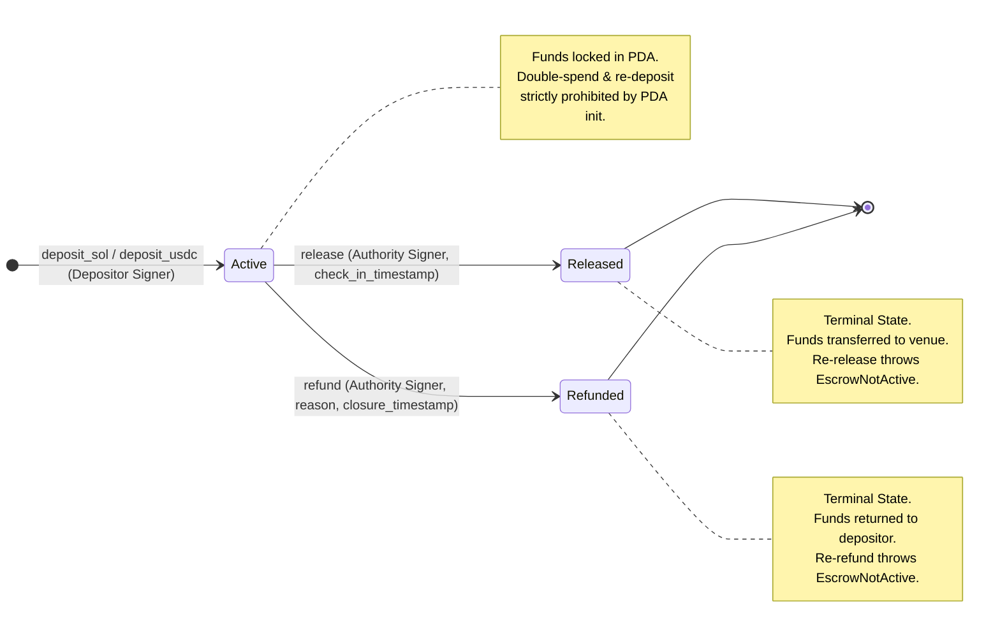
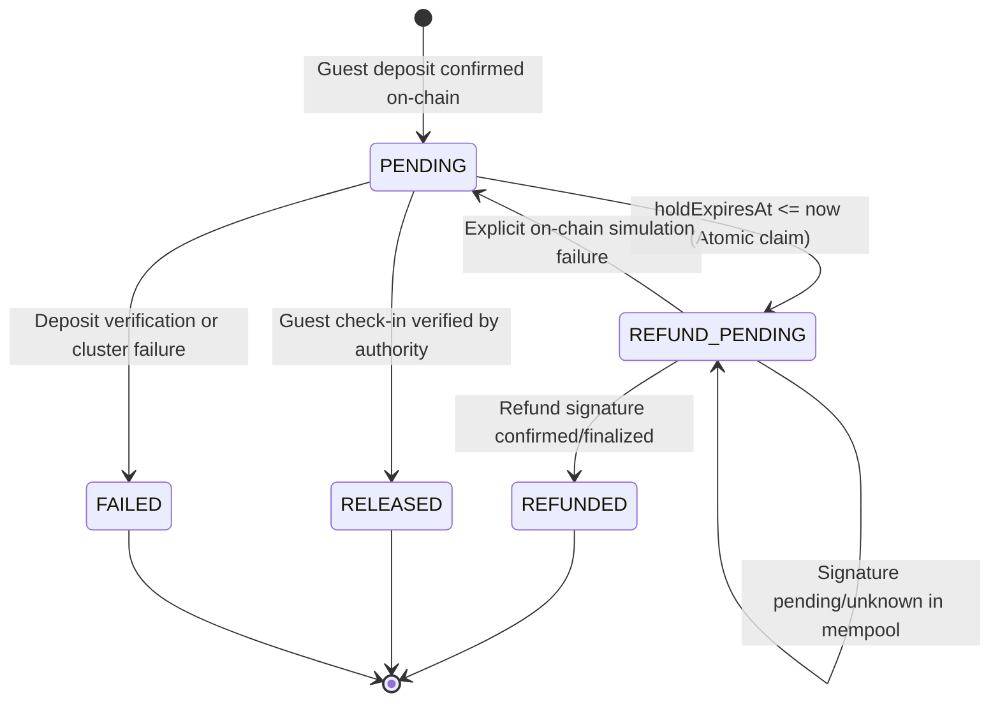
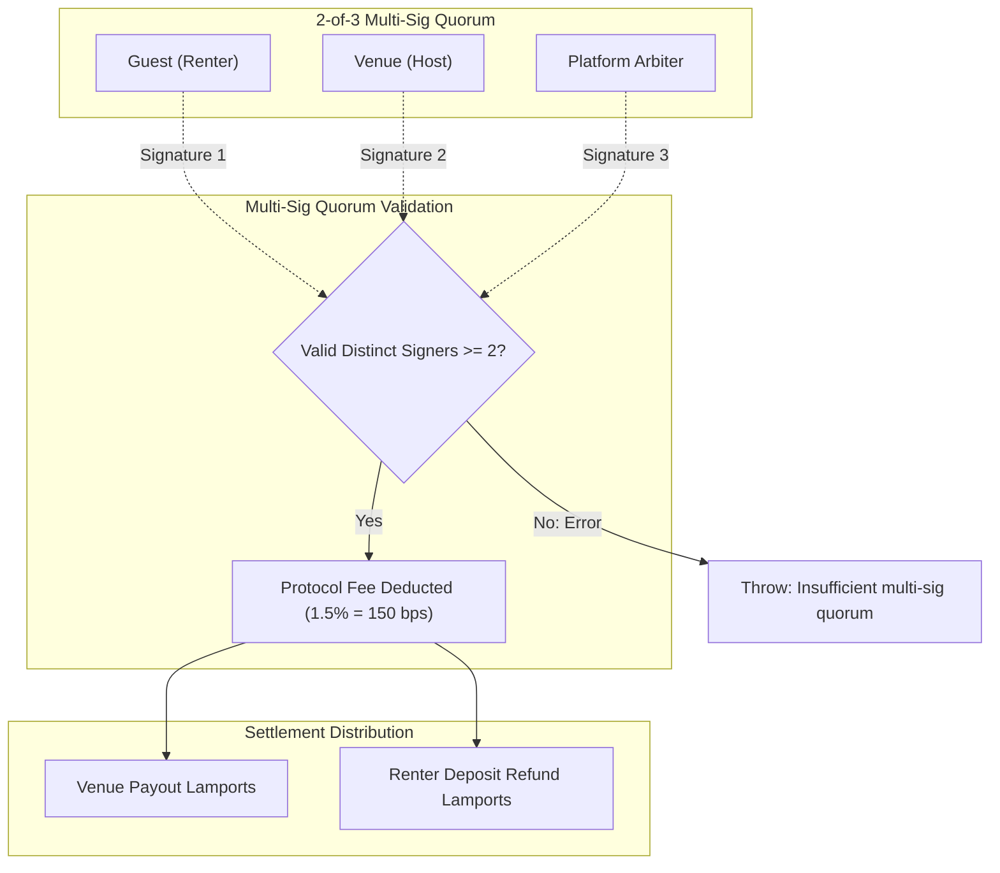
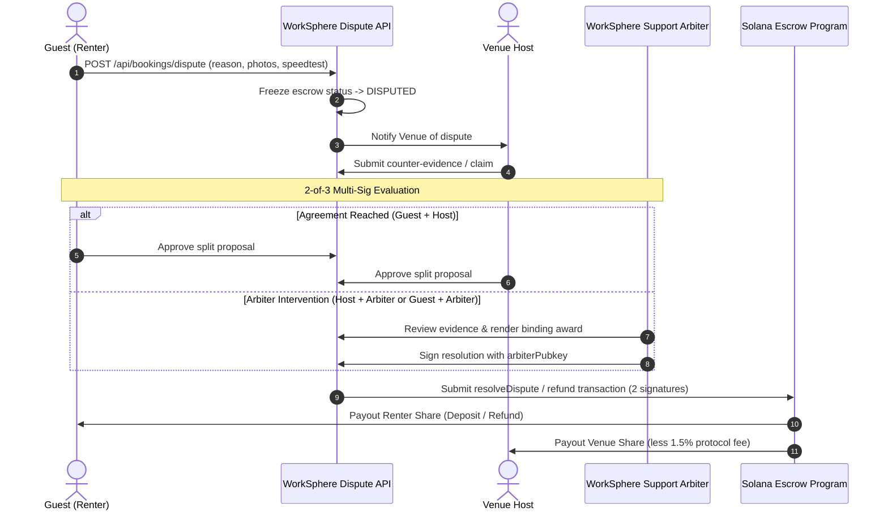

# Merchant Solana Escrow Settlement & Automated Refund Dispute Guide

> **Operational & Security Reference Specification**  
> **Target Subsystems:** WorkSphere Solana Escrow Client (`src/lib/solana/escrowClient.ts`), Confirmation & Optimistic State Manager (`src/lib/solana/solanaPayEscrow.ts`), Automated Expiry Refund Cron (`src/app/api/cron/escrow-refund/route.ts`), Transaction Retry Engine (`src/lib/solana/escrowTransactionRetry.ts`), On-Chain Anchor Program (`programs/worksphere-escrow/src/lib.rs`), and Rental State Machine (`src/core/solana/RentalEscrowStateMachine.ts`).  
> **On-Chain Program:** Anchor Program `worksphere_escrow` (`declare_id!("WsEscrow11111111111111111111111111111111111")` / configurable via `NEXT_PUBLIC_ESCROW_PROGRAM_ID`).  
> **Settlement Currencies:** Native SOL (Lamports, 9 decimals) and SPL USDC (`EPjFWdd5AufqSSqeM2qN1xzybapC8G4wEGGkZwyTDt1v`, 6 decimals).

---

## 1. Overview and Architecture

WorkSphere implements a non-custodial Solana escrow mechanism for nomad desk reservations. In standard booking workflows, guests reserve workspaces by locking either native SOL or SPL-USDC into a deterministic Program Derived Address (PDA). Funds remain cryptographically locked in the PDA vault until either:
1. **Settlement (Release):** The guest's physical check-in is verified by the WorkSphere platform authority, releasing funds directly to the merchant/venue wallet.
2. **Automated Refund:** A reservation hold expires without check-in confirmation, or the venue is verified closed/cancelled, triggering an automated refund back to the guest wallet.
3. **Dispute Resolution:** In contested bookings, off-chain platform arbitration or 2-of-3 multi-sig governance determines final fund distribution between the guest, venue, and platform.

```mermaid
flowchart TD
    subgraph ClientAndApp["Off-Chain Client & Application Layer"]
        G_WAL["Guest Wallet (Depositor)"]
        WS_APP["WorkSphere Web App / Booking Engine"]
        CRON["Automated Refund Cron (/api/cron/escrow-refund)"]
        AUTH_ORACLE["WorkSphere Platform Authority / Oracle Keypair"]
    end

    subgraph SolanaRPC["Solana RPC Cluster (Failover Pool)"]
        RPC_POOL["RPC Pool (Primary & Backup Nodes)"]
    end

    subgraph OnChain["On-Chain Solana Layer (Anchor: worksphere_escrow)"]
        PROG["Escrow Program (WsEscrow1111...)"]
        PDA_ACC["Escrow Account PDA [worksphere_escrow, booking_id]"]
        VAULT_ATA["Vault Associated Token Account (for USDC)"]
        SYS_PROG["System Program"]
        TOK_PROG["SPL Token Program"]
    end

    subgraph MerchantLayer["Destination & Settlement"]
        MERCH_WAL["Merchant / Venue Wallet (Recipient)"]
    end

    %% Interactions
    G_WAL -->|1. Sign & Submit Deposit (SOL / USDC)| RPC_POOL
    RPC_POOL -->|2. Invoke deposit_sol / deposit_usdc| PROG
    PROG -->|3. Initialize & Transfer Funds| PDA_ACC
    PROG -.->|Optional SPL ATA Transfer| VAULT_ATA

    WS_APP -->|4. Track Commitment: confirmed -> finalized| RPC_POOL
    AUTH_ORACLE -->|5a. Verified Check-in -> build & sign release| RPC_POOL
    CRON -->|5b. Expired Hold -> build & sign refund| RPC_POOL

    RPC_POOL -->|6a. Invoke release (Authority Signer)| PROG
    RPC_POOL -->|6b. Invoke refund (Authority Signer)| PROG

    PROG -->|7a. Release Funds to Venue| MERCH_WAL
    PROG -->|7b. Return Funds to Depositor| G_WAL
```

### 1.1 On-Chain vs. Off-Chain Responsibilities

| Subsystem / Operation | Execution Environment | Source File | Exact Responsibilities |
|---|---|---|---|
| **PDA Vault Storage** | On-Chain (Solana Runtime) | `programs/worksphere-escrow/src/lib.rs` | Holds native SOL lamports directly in the PDA account or SPL USDC in the PDA's associated token account. Enforces that only authorized instructions signed by `escrow.authority` can release or refund funds. |
| **Deposit Construction** | Off-Chain (Browser Client) | `src/lib/solana/escrowClient.ts` | Derives the escrow PDA, formats exact token amounts into `bigint` base units, adds dynamic compute budget and priority fee instructions, and builds unsigned transactions for the guest wallet. |
| **Commitment Tracking & Optimistic UI** | Off-Chain (Browser Client) | `src/lib/solana/solanaPayEscrow.ts` | Optimistically transitions booking state to `provisionally_reserved` upon wallet approval, subscribes to RPC WebSocket signatures, tracks `confirmed` $\to$ `finalized` progression, and triggers UI rollback on timeout (60s). |
| **Check-in Verification & Release** | Hybrid (Backend Oracle + On-Chain) | `src/lib/solana/escrowClient.ts` | Evaluates physical QR scans, Wi-Fi mesh proximity, or geofence check-ins off-chain; constructs and signs the on-chain `release` transaction using `SOLANA_ESCROW_AUTHORITY_SECRET_KEY`. |
| **Hold Expiry & Refund Automation** | Off-Chain Scheduled Cron | `src/app/api/cron/escrow-refund/route.ts` | Periodic server cron authenticated via `CRON_SECRET`. Atomically claims expired holds (`holdExpiresAt <= now`), signs `refund` transactions, persists signatures before broadcast, and reconciles confirmations. |

---

## 2. Escrow State Machine

WorkSphere enforces escrow progression through both on-chain Anchor smart contract state and off-chain application/database lifecycles.

### 2.1 On-Chain Anchor State Machine (`programs/worksphere-escrow/src/lib.rs`)

The on-chain program defines three explicit states in `enum EscrowState`:

```rust
#[derive(AnchorSerialize, AnchorDeserialize, Clone, Copy, PartialEq, Eq, InitSpace)]
pub enum EscrowState {
    Active = 0,
    Released = 1,
    Refunded = 2,
}
```



#### On-Chain Transition Contract

| Current State | Action / Instruction | Required Signer | Next State | Entry Conditions & Account Validations | Terminal / Reversible |
|---|---|---|---|---|:---:|
| `Uninitialized` | `deposit_sol` / `deposit_usdc` | Depositor (Guest) | `Active` (0) | `amount > 0`, `booking_id.len() <= 64`. PDA account initialized using seeds `[b"worksphere_escrow", booking_id.as_bytes()]`. | Irreversible |
| `Active` (0) | `release` | Platform Authority | `Released` (1) | `escrow.state == Active`, `ctx.accounts.authority.key() == escrow.authority`, `ctx.accounts.recipient.key() == escrow.recipient`. Transmits lamports or SPL tokens to `recipient`. | Terminal |
| `Active` (0) | `refund` | Platform Authority | `Refunded` (2) | `escrow.state == Active`, `ctx.accounts.authority.key() == escrow.authority`, `ctx.accounts.depositor.key() == escrow.depositor`. Transmits lamports or SPL tokens to `depositor`. | Terminal |

> [!CAUTION]
> **Prohibited On-Chain Transitions:**
> - `Released` $\to$ `Refunded` or `Refunded` $\to$ `Released`: Strictly forbidden. Both instructions enforce `require_eq!(escrow.state, EscrowState::Active, EscrowError::EscrowNotActive)`.
> - Re-entrant calls to `deposit_sol` on an existing PDA fail at the Solana runtime level with an account initialization collision (`0x0` already in use).

### 2.2 Off-Chain Database Status Lifecycle (`Prisma: SolanaEscrow`)

In the off-chain database (`src/app/api/cron/escrow-refund/route.ts`), the booking hold is tracked across five states:



### 2.3 Optimistic Seat UI State (`SolanaPayEscrowManager`)
In client memory (`src/lib/solana/solanaPayEscrow.ts`), seat reservations follow:
1. `available`: Initial seat state.
2. `provisionally_reserved`: Set immediately upon guest wallet signature approval before RPC confirmation.
3. `confirmed`: RPC confirmation received (`commitment: "confirmed"`).
4. `finalized`: RPC root slot reached (`commitment: "finalized"`).
5. Rollback: If transaction fails or drops after 60s (`DEFAULT_CONFIRMATION_TIMEOUT_MS`), seat reverts to `available`.

---

## 3. PDA Derivation and Account Validation

Program Derived Addresses (PDAs) are used to hold escrowed funds without requiring a private key. Only the on-chain program can sign on behalf of the PDA via `invoke_signed`.

### 3.1 Escrow PDA Specifications

| Account | Seeds (Exact Order) | Data Types & Encoding | Derived From | Program Owner | Purpose |
|---|---|---|---|---|---|
| **Escrow Account PDA** | `["worksphere_escrow", booking_id]` | `1. b"worksphere_escrow"` (ASCII string, 17 bytes)<br>`2. booking_id.as_bytes()` (UTF-8 bytes, $\le 64$ bytes) | `bookingId` | `WsEscrow1111...` (`ESCROW_PROGRAM_ID`) | Holds escrow state data, lamport balance (for SOL), and acts as SPL token vault authority. |
| **Vault Token ATA** | `[escrow_pda, token_program_id, usdc_mint]` | `1. Pubkey (32 bytes)`<br>`2. Pubkey (32 bytes)`<br>`3. Pubkey (32 bytes)` | `escrowVault` + `USDC_MINT` | Associated Token Account Program (`ATokenGPv...`) | Holds SPL-USDC token balance when deposit currency is USDC. |

### 3.2 PDA Derivation Code Reference

From [`src/lib/solana/escrowClient.ts`](file:///c:/Users/Saransh%20Kashyap/WorkSphere-9749-worktree/src/lib/solana/escrowClient.ts#L1180-L1207):

```typescript
const PDA_SEED_PREFIX = "worksphere_escrow";

export function deriveEscrowPDA(
  bookingId: string,
  programId: PublicKey = ESCROW_PROGRAM_ID,
): { address: PublicKey; bump: number } {
  if (!bookingId || typeof bookingId !== "string") {
    throw new Error("bookingId is required for PDA derivation");
  }

  // Exact 2-element seed buffer array: prefix bytes followed by UTF-8 booking ID bytes
  const [address, bump] = PublicKey.findProgramAddressSync(
    [Buffer.from(PDA_SEED_PREFIX), Buffer.from(bookingId)],
    programId,
  );

  return { address, bump };
}
```

### 3.3 Account Structure & Memory Layout

The on-chain `EscrowAccount` data structure spans 165 bytes (`8` bytes Anchor discriminator + `157` bytes field storage):

```rust
#[account]
#[derive(InitSpace)]
pub struct EscrowAccount {
    #[max_len(64)]
    pub booking_id: String,          // 4-byte prefix + up to 64 UTF-8 bytes
    pub depositor: Pubkey,            // 32 bytes (Guest wallet)
    pub recipient: Pubkey,            // 32 bytes (Venue wallet)
    pub authority: Pubkey,            // 32 bytes (Platform oracle keypair)
    pub amount: u64,                  // 8 bytes (Lamports or USDC micro-units)
    pub currency: Currency,           // 1 byte (0 = SOL, 1 = USDC)
    pub bump: u8,                     // 1 byte (Canonical bump seed)
    pub state: EscrowState,           // 1 byte (0 = Active, 1 = Released, 2 = Refunded)
    pub created_at: i64,              // 8 bytes (Unix timestamp seconds)
    pub check_in_verified_at: Option<i64>,      // 1 byte tag + 8 bytes timestamp
    pub venue_closed_verified_at: Option<i64>,  // 1 byte tag + 8 bytes timestamp
}
```

---

## 4. Deposit Transaction Walkthrough

WorkSphere supports both native SOL and SPL-USDC deposits. All decimal amounts are converted into integer base units (`BigInt`) to eliminate IEEE-754 floating-point rounding errors.

### 4.1 Step-by-Step Deposit Flow
1. **Quote Calculation:** `calculateEscrowBookingBaseUnits` prorates hourly desk rates into exact `bigint` base units (SOL: 9 decimals, USDC: 6 decimals).
2. **Pre-Flight Balance Check:** `assertSufficientEscrowBalance` verifies that the guest's wallet holds the required base units plus a 5,000 lamport fee reserve.
3. **PDA Derivation:** `deriveEscrowPDA(bookingId)` calculates the deterministic vault address and canonical bump.
4. **Compute Budget & Priority Fees:**
   - Adds `ComputeBudgetProgram.setComputeUnitLimit({ units: 250_000 })`.
   - Queries `PriorityFeeEstimator` for recent cluster percentiles and injects `ComputeBudgetProgram.setComputeUnitPrice({ microLamports })`.
5. **Instruction Construction:**
   - **SOL Deposit:** Emits `SystemProgram.transfer` from payer to `escrowVault`, accompanied by an Anchor instruction with discriminator `[108, 81, 78, 117, 125, 155, 56, 200]`.
   - **USDC Deposit:** Derives guest ATA and vault ATA via `getAssociatedTokenAddressSync`, injecting `createTransferInstruction` via Token Program.
6. **Wallet Signing & Submission:** The guest wallet signs the serialized transaction. The client dispatches the transaction to the Solana RPC pool with `skipPreflight: false`.
7. **Commitment Lifecycle:** `SolanaPayEscrowManager` transitions UI state from `provisionally_reserved` $\to$ `confirmed` $\to$ `finalized`.

### 4.2 TypeScript Implementation Example

```typescript
import { Connection, PublicKey } from "@solana/web3.js";
import {
  buildDepositTransaction,
  confirmTransaction,
  verifyDeposit,
} from "@/lib/solana/escrowClient";

async function executeDeskDeposit(
  payerWallet: string,
  bookingId: string,
  amount: number,
  currency: "SOL" | "USDC",
  rpcUrl: string,
  signTransaction: (txBase64: string) => Promise<string>,
) {
  // 1. Build unsigned deposit transaction with dynamic priority fees
  const depositResult = await buildDepositTransaction({
    payerWallet,
    bookingId,
    amount,
    currency,
    rpcUrl,
  });

  // 2. Request signature from connected guest wallet
  const signedTxBase64 = await signTransaction(depositResult.serializedTransaction);

  // 3. Submit raw transaction to Solana RPC
  const connection = new Connection(rpcUrl, "confirmed");
  const rawTx = Buffer.from(signedTxBase64, "base64");
  const signature = await connection.sendRawTransaction(rawTx, {
    skipPreflight: false,
    preflightCommitment: "confirmed",
  });

  // 4. Await confirmed status
  const confirmation = await confirmTransaction(signature, rpcUrl);
  if (!confirmation.confirmed) {
    throw new Error(`Deposit unconfirmed: ${confirmation.error}`);
  }

  // 5. Verify on-chain deposit logs and balances
  const verification = await verifyDeposit(
    signature,
    { bookingId, payerWallet, amount, currency },
    rpcUrl,
  );

  return { signature, escrowVault: depositResult.escrowVault, verified: verification.verified };
}
```

---

## 5. Fund Locking and Reservation Association

Funds deposited for a desk booking are held non-custodially:
- **Native SOL:** Lamports reside in the account balance of the `escrowVault` PDA itself (`**ctx.accounts.escrow_account.try_borrow_mut_lamports()?`).
- **SPL-USDC:** Tokens reside in the Associated Token Account owned by the `escrowVault` PDA (`vaultAta`). Because the ATA is owned by an off-curve PDA, tokens can only be transferred if the `worksphere_escrow` program signs the CPI transfer with `invoke_signed`.

### 5.1 Association & Double-Deposit Prevention
1. **One Booking, One Escrow:** The escrow PDA is seeded by `[b"worksphere_escrow", booking_id.as_bytes()]`. Because the `booking_id` seed is strictly unique per reservation, an escrow PDA is 1:1 bound to that specific booking.
2. **Double-Deposit Prevention:** The Anchor initialization macro `#[account(init, seeds = [...], bump)]` requires the target account to have zero lamports and zero data prior to execution. If an attacker or duplicate client sends a second deposit instruction for the same `booking_id`, the Solana runtime halts execution with `AccountAlreadyInitialized`.
3. **Program-Level vs. Frontend Checks:**
   - *Frontend Checks:* Validates positive finite amounts, wallet addresses, and RPC URL availability in `validateDepositParams`.
   - *Program-Level Guarantees:* Enforces account uniqueness, discriminator matching, byte length bounds ($\le 64$ characters), and immutable depositor/recipient pubkey assignments.

---

## 6. Check-in Confirmation and Settlement Eligibility

Settlement transfers funds from the escrow vault to the merchant/venue wallet.

### 6.1 Check-in Representation & Authority
- In the on-chain smart contract, check-in is represented by the `release` instruction:
  ```rust
  pub fn release(ctx: Context<ReleaseEscrow>, booking_id: String, check_in_timestamp: i64) -> Result<()>
  ```
- **Authorized Signer:** Check-in confirmation requires the signature of the **WorkSphere platform authority** (`escrow.authority`). Guests and hosts cannot unilaterally execute on-chain release without platform oracle attestation.
- **Physical Verification:** The platform authority issues this signature only after verifying physical check-in through:
  - Cryptographic QR scan match at the venue desk.
  - Bluetooth Low Energy (BLE) beacon RSSI proximity hook verification.
  - Zero-Knowledge Groth16 anonymous badge verification.

### 6.2 Settlement Eligibility Checklist
Prior to invoking `releaseEscrow`, the platform verifies:
- [x] Booking hold status in database is `PENDING` (not expired or cancelled).
- [x] Guest check-in timestamp is recorded and strictly $\ge$ reservation start time.
- [x] Escrow PDA on-chain account state is `Active` (0).
- [x] On-chain `escrow.recipient` matches designated venue payout wallet.
- [x] Authority keypair matches on-chain `escrow.authority`.

Settlement is **explicit, not automatic**: an off-chain coordinator (such as the WorkSphere booking service or check-in webhook) must assemble and broadcast the signed `release` transaction.

---

## 7. Merchant Multi-Signature Payouts

WorkSphere implements two distinct escrow settlement layers across the codebase:
1. **Production Anchor Program (`programs/worksphere-escrow`):** Uses an authorized platform authority oracle keypair (`SOLANA_ESCROW_AUTHORITY_SECRET_KEY`) for standard single-signature settlement.
2. **Multi-Sig Escrow Engine (`src/core/solana/RentalEscrowStateMachine.ts` & `docs/solana/MULTISIG_ESCROW_SPECIFICATION.md`):** Implements a verifiable **2-of-3 multi-signature governance state machine** for disputed or high-value desk leases.

### 7.1 2-of-3 Multi-Sig Governance Architecture

For high-tier merchant agreements, dispute settlements require at least 2 distinct cryptographic approvals from a 3-party quorum:
1. **Guest (Renter / Depositor)**
2. **Venue (Merchant / Host)**
3. **Platform Arbiter (WorkSphere Legal/Support Authority)**



### 7.2 Implementation in `RentalEscrowStateMachine.ts`

From [`src/core/solana/RentalEscrowStateMachine.ts`](file:///c:/Users/Saransh%20Kashyap/WorkSphere-9749-worktree/src/core/solana/RentalEscrowStateMachine.ts#L167-L174):

```typescript
// Check 2-of-3 multi-sig quorum
const validSigners = new Set([account.renterPubkey, account.venuePubkey, account.arbiterPubkey]);
const distinctSigners = new Set(signatures.filter((s) => validSigners.has(s)));

if (distinctSigners.size < 2) {
  throw new Error(`Insufficient multi-sig quorum: required 2 valid signatures, got ${distinctSigners.size}`);
}
```

> [!NOTE]
> **Implementation Clarification:**
> In standard automatic reservations, the single-authority Anchor program (`worksphere_escrow`) handles instantaneous check-in release. When a booking enters formal arbitration, the 2-of-3 state machine in `RentalEscrowStateMachine.ts` dictates the exact award split and fee deduction before executing settlement.

---

## 8. Automated Refund and Timeout Rules

WorkSphere prevents merchant funds from locking indefinitely by enforcing automated refunds on abandoned or expired reservations.

### 8.1 Refund Scenarios & Trigger Matrix

| Scenario | Trigger Condition | Required Signer | Refund Eligibility | Execution Mechanism |
|---|---|---|---|---|
| **No-Show Hold Expiry** | `holdExpiresAt <= now` (typically 30-60 mins past booking start without check-in). | Platform Authority Keypair | 100% of deposited SOL / USDC returned to guest. | `GET /api/cron/escrow-refund` via Vercel Cron. |
| **Verified Venue Closure** | Host marks desk unavailable, power outage detected, or geofence sensor down. | Platform Authority Keypair | 100% full refund to guest. | Admin / Venue closure webhook invoking `refundEscrow`. |
| **Guest Early Cancellation** | Cancelled within free cancellation window ($\ge 2$ hours prior to start). | Platform Authority Keypair | 100% full refund minus network transaction fees. | Booking cancellation handler invoking `buildRefundTransaction`. |
| **Disputed Desk Quality** | Substandard amenities verified by WorkSphere arbiter. | 2-of-3 Multi-Sig Quorum | Prorated split or 100% refund as arbitrated. | Multi-sig settlement via `resolveDispute`. |

### 8.2 Automated Expiry Refund Cron Architecture (`/api/cron/escrow-refund`)

The automated refund cron ensures zero human intervention is needed when guests fail to check in.

#### Idempotency & Safety Protocol:
1. **Bearer Authentication:** Protects the endpoint with `Authorization: Bearer $CRON_SECRET`.
2. **Atomic Database Claim:** Executes a conditional `prisma.solanaEscrow.updateMany` setting `status: "REFUND_PENDING"` where `status: "PENDING"` and `holdExpiresAt <= now`. Concurrent cron invocations can never claim the same row twice.
3. **Persist Before Broadcast:** The signed transaction signature is written to `refundTxSignature` in the database **prior** to broadcasting over the network (`sendRawTransaction`). If the server process crashes between broadcast and confirmation, subsequent runs reconcile the existing signature instead of double-paying.
4. **Fencing Token:** Every database update validates `refundAttemptedAt`, preventing stale or re-queued runs from overwriting newer transactions.
5. **Reconciliation Loop:** If a transaction status is `pending` or `unknown`, the cron retains `REFUND_PENDING` and polls cluster status across subsequent cycles until finalized.

---

## 9. Dispute Escalation and Resolution

When a guest or host contests a reservation (e.g. workspace occupied, Wi-Fi failure, or damage claims):



### 9.1 Dispute Decision Matrix

| Dispute Cause | Primary Evidence | Typical Outcome | Venue Payout | Guest Refund |
|---|---|---|:---:|:---:|
| **Desk Unavailable / Double Booked** | Geofence log + sensor unassigned | Full refund to guest | 0% | 100% |
| **Wi-Fi Outage (< 5 Mbps)** | Speedtest telemetry log in app | Full refund to guest | 0% | 100% |
| **Guest Late Departure (> 1 hr)** | Smart desk power draw telemetry | Venue awarded overtime fee | Overtime Rate | Remainder of deposit |
| **Late Cancellation (< 15 mins)** | Database booking timestamp | Host awarded 1-hour booking fee | 1 Hour Rate | Remainder of deposit |

---

## 10. Signature Verification and Security Requirements

WorkSphere enforces strict cryptographic validations across all escrow operations to defend against common Solana smart contract attack vectors.

### 10.1 Verified Security Controls

1. **Signer Verification:**
   - Deposit instructions enforce `#[account(mut)] pub depositor: Signer<'info>`.
   - Release and refund instructions enforce `pub authority: Signer<'info>`.
2. **Program Ownership & PDA Derivation Checks:**
   - The on-chain program uses `seeds = [ESCROW_SEED_PREFIX, booking_id.as_bytes()], bump = escrow_account.bump` to verify that `escrow_account` is owned strictly by the executing program and matches the derived address.
3. **Recipient & Depositor Destination Validation:**
   - In `release`: Enforces `require!(ctx.accounts.recipient.key() == escrow.recipient, EscrowError::InvalidRecipient)`. Funds cannot be redirected to an arbitrary address.
   - In `refund`: Enforces `require!(ctx.accounts.depositor.key() == escrow.depositor, EscrowError::InvalidDepositor)`.
4. **Replay & Double-Spend Protection:**
   - State checks (`require_eq!(escrow.state, EscrowState::Active)`) prevent double-release or re-refund.
   - Off-chain database tracks unique `refundTxSignature` with atomic conditional state transitions.
5. **No Floating-Point Operations:**
   - All token math uses `bigint` base units and Rust `u64`/`i64` integers, eliminating precision drift and rounding attacks.

---

## 11. Devnet Integration Test Setup

To test deposit, settlement, and refund flows on Solana Devnet:

### 11.1 Prerequisites & Toolchain
- Solana CLI $\ge 1.18.0$ (`solana --version`)
- Node.js $\ge 18.18.0$
- Anchor CLI $\ge 0.29.0$ (if compiling the on-chain program locally)

### 11.2 Environment Configuration
Create or update `.env.local`:
```bash
# Solana Cluster Configuration
NEXT_PUBLIC_SOLANA_NETWORK="devnet"
NEXT_PUBLIC_SOLANA_RPC_URLS="https://api.devnet.solana.com"
SOLANA_RPC_URLS="https://api.devnet.solana.com"

# Escrow Program Configuration (Devnet program ID)
NEXT_PUBLIC_ESCROW_PROGRAM_ID="WsEscrow11111111111111111111111111111111111"

# Devnet Platform Authority Keypair (Base58 or JSON array)
SOLANA_ESCROW_AUTHORITY_SECRET_KEY="[212,14,...]"

# Automated Cron Secret
CRON_SECRET="devnet-cron-secret-worksphere-test"
```

### 11.3 Devnet Safe CLI Commands
```powershell
# 1. Configure CLI for Devnet
solana config set --url https://api.devnet.solana.com

# 2. View active wallet address & balance
solana address
solana balance

# 3. Airdrop 2 Devnet SOL for testing
solana airdrop 2

# 4. Run automated Jest escrow tests in the worktree
npm test -- src/__tests__/lib/solana/escrowClient.test.ts
npm test -- src/__tests__/api/cronEscrowRefund.test.ts
```

### 11.4 Devnet Program Testing Script Example

```typescript
import { Connection, Keypair, LAMPORTS_PER_SOL } from "@solana/web3.js";
import { buildSolDepositTransaction, releaseEscrow } from "@/lib/solana/escrowClient";

async function runDevnetEscrowTest() {
  const rpcUrl = "https://api.devnet.solana.com";
  const connection = new Connection(rpcUrl, "confirmed");

  const guest = Keypair.generate();
  const venue = Keypair.generate();
  const testBookingId = `devnet-test-${Date.now()}`;

  console.log(`Generated Test Guest: ${guest.publicKey.toBase58()}`);
  console.log(`Generated Test Venue: ${venue.publicKey.toBase58()}`);

  // Note: Guest must be funded via faucet before submitting transactions
  const deposit = await buildSolDepositTransaction({
    payerWallet: guest.publicKey.toBase58(),
    bookingId: testBookingId,
    amount: 0.05,
    currency: "SOL",
    rpcUrl,
  });

  console.log(`Derived Escrow Vault: ${deposit.escrowVault} (bump: ${deposit.escrowBump})`);
}
```

---

## 12. Error Handling and Operational Troubleshooting

| Error Message / Symptom | Likely Cause | Diagnostic Steps | Operational Recovery |
|---|---|---|---|
| **`InsufficientFunds`** | Connected wallet balance is less than required base units + 5,000 lamport fee reserve. | Check wallet SOL balance via `connection.getBalance(payer)`. | Prompt guest to top up SOL balance or select a smaller booking duration. |
| **`EscrowNotActive` (`0x1772`)** | Escrow account is already in `Released` (1) or `Refunded` (2) state. | Inspect on-chain account data at `escrowVault` using Solana Explorer or `getAccountInfo`. | Transaction halted. Escrow has already been settled or refunded; update database to match on-chain terminal state. |
| **`BookingMismatch` (`0x1773`)** | The `bookingId` passed in instruction arguments does not match `escrow.booking_id`. | Verify string encoding and whitespace in client booking ID. | Ensure identical UTF-8 booking ID is used for PDA derivation and instruction arguments. |
| **`Unauthorized` (`0x1774`)** | The transaction signer does not match `escrow.authority`. | Check the public key of `SOLANA_ESCROW_AUTHORITY_SECRET_KEY` against on-chain authority. | Verify that the backend is signing with the configured platform authority keypair. |
| **`SolanaRpcPollTimeoutError`** | RPC node took longer than 5,000 ms to respond to signature status poll. | Check RPC status, latency, and rate limits in `escrowRpcFailover`. | The system automatically triggers RPC pool failover to secondary endpoints (`NEXT_PUBLIC_SOLANA_RPC_URLS`). |
| **HTTP 429 (`Too Many Requests`)** | Public RPC endpoint rate-limited incoming requests. | Check RPC response headers for `Retry-After`. | `isSolanaRpcRateLimitError` detects the condition and triggers exponential backoff with full jitter (up to 8,000 ms). |
| **Blockhash Not Found / Expired** | Transaction lingered in mempool longer than 150 slots (~60-90s) without inclusion. | Verify cluster congestion and priority fee settings. | Fetch a fresh blockhash using `fetchLatestBlockhashWithBackoff` and re-sign transaction. |

---

## 13. Audit and Production Readiness Checklist

Before enabling live escrow deposits on Solana Mainnet-Beta, verify the following:

- [ ] **Program ID Verification:** `NEXT_PUBLIC_ESCROW_PROGRAM_ID` is set to the verified, audited mainnet program address (not `11111111111111111111111111111111` or System Program).
- [ ] **Authority Key Protection:** `SOLANA_ESCROW_AUTHORITY_SECRET_KEY` is stored in a secure secret manager (e.g. AWS Secrets Manager or Vault) and never committed to version control.
- [ ] **PDA Seed Canonization:** Canonical bumps are derived off-curve using `findProgramAddressSync([b"worksphere_escrow", booking_id.as_bytes()])`.
- [ ] **Zero Float Math:** Token calculations utilize integer `BigInt` base units via `calculateEscrowBookingBaseUnits`.
- [ ] **Dynamic Priority Fees:** Priority fee estimator is enabled with compute unit limits set to 250,000 to prevent dropped transactions during peak network congestion.
- [ ] **Idempotent Refund Cron:** `CRON_SECRET` is configured in production, database atomic claims are active, and signatures are persisted prior to broadcast.
- [ ] **RPC Pool Redundancy:** Multiple fallback RPC URLs are supplied in `SOLANA_RPC_URLS` across different providers (e.g. Helius, Triton, QuickNode).
- [ ] **Rent Exemption:** Escrow PDA accounts and SPL Token ATAs hold sufficient lamports to meet Solana's rent-exemption threshold.

---

## 14. References and Standards

- **[Solana Documentation](https://solana.com/docs)** — Core concepts, accounts, transactions, and programs.
- **[Solana Program Derived Addresses (PDAs)](https://solana.com/docs/core/pda)** — Deterministic address derivation and off-curve signer seeds.
- **[Anchor Framework Documentation](https://www.anchor-lang.com/)** — Account macros, instruction discriminators, and CPI contexts.
- **[SPL Token Program](https://spl.solana.com/token)** — Token accounts, transfers, and Associated Token Account Program.
- **[Solana Pay Specification](https://solanapay.com/)** — Standard transaction request specifications for merchant commerce.
- **[WorkSphere Escrow Settlement Runbook](../solana/ESCROW_SETTLEMENT_RUNBOOK.md)** — Operational runbook for escrow settlement.
- **[Automated Solana Escrow Refunds Runbook](../solana/SOLANA_ESCROW_REFUND_CRON.md)** — In-depth guide on cron status lifecycles and idempotency.
- **[Multi-Sig Escrow Specification](../solana/MULTISIG_ESCROW_SPECIFICATION.md)** — 2-of-3 multi-sig dispute governance architecture.
