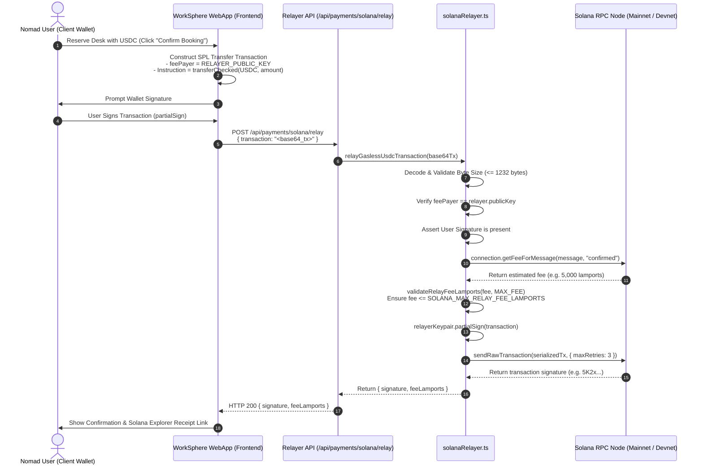

# Solana Gasless Relayer: Architecture, Fee Limits & RPC Configuration

This document specifies the architecture, environment configuration, fee validation ceilings, and cryptographic partial signing protocol for WorkSphere's Solana Gasless Relayer ([`src/lib/payments/solanaRelayer.ts`](file:///c:/Users/admin/Desktop/workfere/src/lib/payments/solanaRelayer.ts), [`src/lib/payments/solanaPay.ts`](file:///c:/Users/admin/Desktop/workfere/src/lib/payments/solanaPay.ts), and [`src/app/api/payments/solana/relay/route.ts`](file:///c:/Users/admin/Desktop/workfere/src/app/api/payments/solana/relay/route.ts)).

---

## 1. Executive Summary & Design Overview

Traditional Web3 onboarding presents severe UX friction: users must acquire native SOL tokens before paying for a workspace reservation or micro-booking, even when paying in USDC.

WorkSphere solves this by implementing a **Gasless Transaction Relayer (Fee Payer Co-Signing Pattern)**:
- **Zero-SOL User Experience:** Remote workers sign SPL USDC transfer instructions using their wallet (e.g., Phantom, Solflare), without needing SOL in their account.
- **Relayer as Dedicated Fee Payer:** WorkSphere's backend server signs the transaction as the designated `feePayer`, funding network fees (typically $5{,}000$ to $10{,}000$ lamports, or $<\$0.002$).
- **Anti-Drain Fee Ceilings:** Validates estimated network fees against `SOLANA_MAX_RELAY_FEE_LAMPORTS` before co-signing, preventing denial-of-service or malicious priority fee spikes from draining the relayer treasury.
- **High-Reliability RPC Infrastructure:** Routes preflight simulation and broadcast through low-latency Solana RPC nodes with retry policies.

---

## 2. Gasless Co-Signing Protocol & Architecture Flow

The gasless transaction lifecycle uses Solana's dual-signature capabilities:
1. **Client / DApp:** Builds the USDC transfer transaction with `feePayer = relayer.publicKey` and user signs their instruction (`partialSign(userKeypair)`).
2. **Relayer Service:** Verifies payload structure, ensures the transaction contains a valid user signature, checks the simulation fee against maximum limits, and co-signs as `feePayer`.
3. **Solana Cluster:** Broadcasts and commits the dual-signed transaction to the ledger.



---

## 3. Required Environment Variables & Setup

The relayer relies on strict configuration parameters defined in the server environment:

| Variable Name | Required | Default Value | Description |
| :--- | :---: | :---: | :--- |
| `SOLANA_RPC_URL` | **Yes** | — | Fully-qualified HTTPS RPC URL to Solana cluster (Mainnet-Beta or Devnet). |
| `SOLANA_RELAYER_PRIVATE_KEY` | **Yes** | — | JSON-serialized 64-byte secret key array `[12, 45, ...]` of the relayer wallet. |
| `SOLANA_MAX_RELAY_FEE_LAMPORTS` | No | `10000` | Maximum network fee in lamports ($0.00001\text{ SOL}$) allowed per relayed transaction. |

### 3.1 Relayer Keypair Generation & Setup

The relayer keypair must be formatted as a standard 64-byte array (compatible with `solana-keygen` output).

#### Generating a New Keypair via Solana CLI:
```bash
# Generate dedicated relayer keypair file
solana-keygen new --outfile relayer-keypair.json --no-bip39-passphrase

# View public address to fund with SOL
solana-keygen pubkey relayer-keypair.json

# Copy 64-byte array contents into .env
cat relayer-keypair.json
```

#### `.env.local` / Production Environment Example:
```env
# Solana RPC URL (Use dedicated node: Helius, Triton, QuickNode, or Alchemy)
SOLANA_RPC_URL="https://mainnet.helius-rpc.com/?api-key=YOUR_API_KEY"

# 64-byte secret key JSON array
SOLANA_RELAYER_PRIVATE_KEY="[214,12,89,173,194,52,22,190,...,43,101,23]"

# Maximum lamports relayer will sponsor per transaction (10,000 lamports = 0.00001 SOL)
SOLANA_MAX_RELAY_FEE_LAMPORTS="10000"
```

---

## 4. Anti-Drain Fee Ceilings & Security Guards

Because the relayer covers transaction costs on behalf of unauthenticated or external users, security safeguards prevent malicious wallet drain or resource exhaustion:

### 4.1 Maximum Serialized Payload Size
Solana MTU limits IPv6 packets to $1{,}280$ bytes, yielding a maximum serialized transaction size of **$1{,}232$ bytes**.
- In [`solanaRelayer.ts`](file:///c:/Users/admin/Desktop/workfere/src/lib/payments/solanaRelayer.ts#L11):
  ```typescript
  const MAX_SERIALIZED_TRANSACTION_BYTES = 1_232;
  ```
- Any base64 payload exceeding $1{,}232$ bytes is rejected immediately with `Transaction has an invalid size`.

### 4.2 Fee Validation (`validateRelayFeeLamports`)
Before attaching the relayer signature, the relayer queries the cluster for exact execution fees using `connection.getFeeForMessage()` and validates it via [`validateRelayFeeLamports`](file:///c:/Users/admin/Desktop/workfere/src/lib/payments/solanaPay.ts#L21-L35):

```typescript
export function validateRelayFeeLamports(
  feeLamports: number,
  maxFeeLamports = DEFAULT_MAX_RELAY_FEE_LAMPORTS, // 10,000 lamports
): number {
  if (!Number.isSafeInteger(feeLamports) || feeLamports < 0) {
    throw new RangeError("Relay fee must be a non-negative integer");
  }
  if (!Number.isSafeInteger(maxFeeLamports) || maxFeeLamports < 0) {
    throw new RangeError("Maximum relay fee must be a non-negative integer");
  }
  if (feeLamports > maxFeeLamports) {
    throw new RangeError("Transaction fee exceeds the relayer limit");
  }
  return feeLamports;
}
```

If an attacker constructs an excessively complex transaction or sets arbitrary priority fees above `SOLANA_MAX_RELAY_FEE_LAMPORTS`, the transaction is aborted prior to co-signing.

### 4.3 Mandatory User Signature Verification
The relayer inspects the decoded transaction's signatures array:
- Ensures `transaction.feePayer` matches the relayer public key.
- Ensures at least one non-relayer public key has already provided a non-null signature:
  ```typescript
  const hasUserSignature = transaction.signatures.some(
    ({ publicKey, signature }) =>
      !publicKey.equals(relayer.publicKey) && signature !== null,
  );
  if (!hasUserSignature) {
    throw new Error("Transaction must include a user signature");
  }
  ```

---

## 5. RPC Redundancy & Production Guidelines

For high-availability coworking checkout counters, reliance on the public `https://api.mainnet-beta.solana.com` endpoint is strictly discouraged due to harsh 429 rate limits.

### Recommended Multi-Endpoint RPC Strategy:
1. **Primary Dedicated Provider:** Helius, Triton One, or QuickNode with enhanced websocket support for commitment tracking.
2. **Commitment Level:** Set to `"confirmed"` for fast sub-second client feedback while avoiding unconfirmed rollbacks.
3. **Retry Strategy:** Set `maxRetries: 3` and `skipPreflight: false` during `sendRawTransaction` to catch simulation errors before broadcast.
4. **Relayer Treasury Health Monitoring:** Configure automated balance monitors alerting team operations whenever relayer balance drops below $0.5\text{ SOL}$.

---

## 6. API Route Specification (`POST /api/payments/solana/relay`)

### Request
```http
POST /api/payments/solana/relay
Content-Type: application/json

{
  "transaction": "<base64-encoded-partially-signed-solana-transaction>"
}
```

### Success Response (`200 OK`)
```json
{
  "signature": "5K2xMockTxSignature123ABCxyz...",
  "feeLamports": 5000
}
```

### Error Responses
- `400 Bad Request`: Invalid base64, missing user signature, or fee exceeds configured ceiling (`Transaction fee exceeds the relayer limit`).
- `503 Service Unavailable`: `SOLANA_RPC_URL` or `SOLANA_RELAYER_PRIVATE_KEY` not configured, or RPC node unable to estimate transaction fees.
