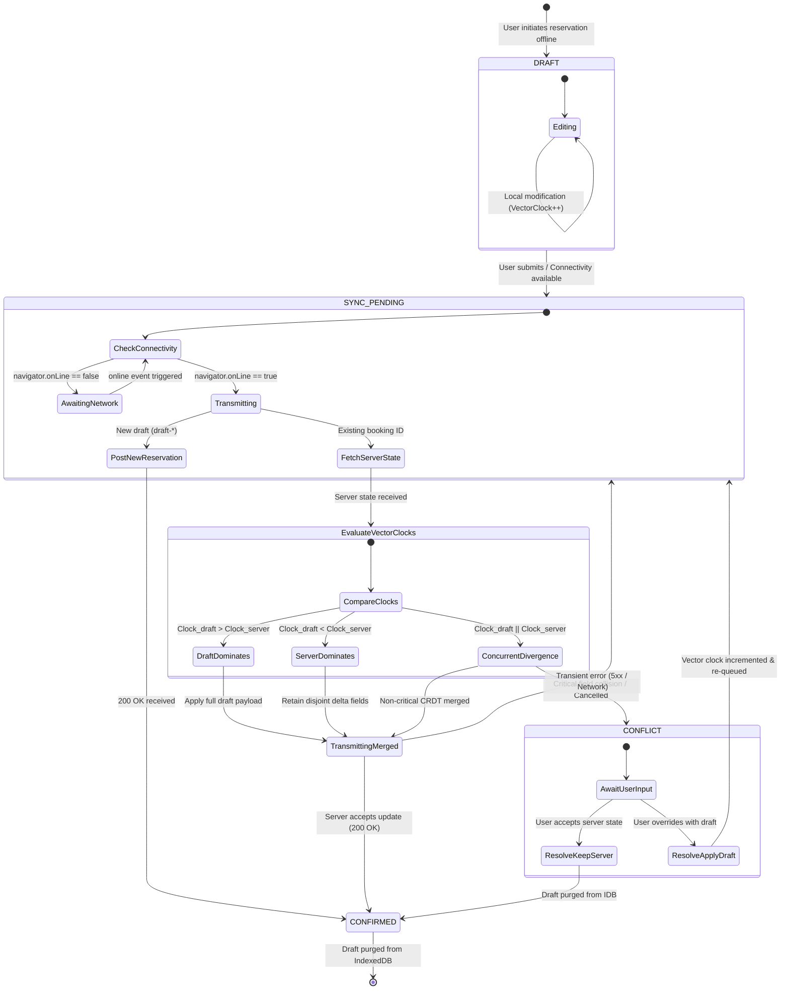

# Offline Booking Draft State Machine and Conflict Resolution Guide

This document specifies the technical architecture, finite state machine, client-side IndexedDB persistence, and conflict-resolution engine for offline booking drafts in WorkSphere. It details the mechanisms that ensure offline resilience, causal consistency via vector clocks, and deterministic state convergence when network connectivity transitions from offline to online.

---

## 1. Overview and Problem Statement

In distributed workspace environments, mobile and remote users frequently configure reservations in transit or under intermittent network conditions (e.g., underground subways, airplanes, or low-connectivity coworking zones). Without robust offline support, users face form data loss, session timeouts, or unhandled submission errors.

WorkSphere addresses this challenge through an offline-first draft synchronization architecture:
- **IndexedDB Local Persistence**: Reservation payloads are saved immediately to local storage on the client before network transmission is attempted.
- **Asynchronous Synchronization**: Mutations are enqueued locally and flushed automatically when connectivity is restored.
- **Client Draft vs. Confirmed Server Booking**: A clear semantic separation exists between an uncommitted local *draft* (speculative, unconfirmed, mutable locally) and an authoritative *server booking* (validated against global inventory constraints, confirmed, and persisted in PostgreSQL).
- **Causal Consistency**: Divergences between client-side offline modifications and concurrent server-side state changes are reconciled deterministically using Vector Clocks and Conflict-Free Replicated Data Type (CRDT) rules.

---

## 2. Architecture and Component Overview

The offline booking system is structured into four primary components running in the browser and Service Worker context, coordinating with the backend REST APIs:

```
+---------------------------------------------------------------------------------------+
|                                    Client Context                                     |
|                                                                                       |
|  +--------------------+         save/update        +-------------------------------+  |
|  | Booking UI / Modal | -------------------------> |          DraftStore           |  |
|  |   (React / PWA)    |                            |  (IndexedDB: WorkSphereDB)    |  |
|  +--------------------+                            +-------------------------------+  |
|            |                                                       ^                  |
|            | queueDraft()                                          | get / delete     |
|            v                                                       v                  |
|  +--------------------+   online event / trigger   +-------------------------------+  |
|  |     SyncQueue      | -------------------------> |  Queue Processor / Dispatcher |  |
|  +--------------------+                            +-------------------------------+  |
|            |                                                       |                  |
|            |                  +------------------------------------+                  |
|            |                  |                                                       |
|            v                  v                                                       |
|  +------------------------------------+                                               |
|  |          ConflictResolver          |                                               |
|  |   (Vector Clocks / CRDT Engine)    |                                               |
|  +------------------------------------+                                               |
+---------------------------------------------------------------------------------------+
                                |                             ^
       fetch / PUT / POST       |                             | HTTP 200 / 409
                                v                             |
+---------------------------------------------------------------------------------------+
|                               Server Context (Next.js / DB)                           |
|                                                                                       |
|  +---------------------------------------------------------------------------------+  |
|  | Endpoints: POST /api/bookings/confirm, POST /api/bookings/sync, PUT /api/...     |  |
|  | Engine: Optimistic Locking (version), Causal Buffer, Inventory Validation       |  |
|  +---------------------------------------------------------------------------------+  |
|                                         |                                             |
|                                         v                                             |
|                     +---------------------------------------+                         |
|                     | PostgreSQL Database (Authoritative)   |                         |
|                     +---------------------------------------+                         |
+---------------------------------------------------------------------------------------+
```

### Component Roles and Boundaries

| Component | Source File | Responsibilities | Execution Context |
| :--- | :--- | :--- | :--- |
| **`DraftStore`** | `src/worker/bookingSync/DraftStore.ts` | Promise-based IndexedDB wrapper for serializing, querying, mutating, and deleting local booking drafts. Manages vector clock initialization and in-memory fallback. | PWA Main Thread / Web Worker |
| **`ConflictResolver`** | `src/worker/bookingSync/ConflictResolver.ts` | Mathematical comparison of vector clocks, causal classification (`before`, `after`, `equal`, `concurrent`), CRDT LWW register resolution, Add-Wins set unions, and monotonic tombstone enforcement. | Web Worker / PWA Main Thread |
| **`SyncQueue`** | `src/worker/bookingSync/SyncQueue.ts` | Manages sequential background sync pipeline, network connectivity listeners (`online`), remote fetching, conflict resolution dispatch, and DOM event dispatching. | PWA Main Thread / Service Worker |
| **Remote Booking API** | `src/app/api/bookings/sync/route.ts` | Authenticates requests via Clerk, verifies user tenancy, enforces optimistic version locking, buffers out-of-order causal mutations, and persists committed state. | Next.js Serverless Route / Node.js |

---

## 3. Draft Lifecycle State Machine

A booking reservation passes through a well-defined lifecycle on the client and server.

### State Definitions

1. **`DRAFT`**:
   - The initial state created when a user opens a booking modal or modifies a reservation locally while disconnected or prior to submission.
   - Persisted immediately in IndexedDB with an initial vector clock `{"<clientId>": 1, "server": 0}`.
   - The user can modify draft fields arbitrarily without network interaction.

2. **`SYNC_PENDING`**:
   - The draft has been explicitly submitted by the user or marked for background synchronization.
   - Enqueued into `SyncQueue`. Awaiting network availability or background sync execution.
   - If connectivity is active, transition to server evaluation begins immediately.

3. **`CONFIRMED`**:
   - The reservation has been accepted by the authoritative server, inventory has been locked, and the transaction is committed to PostgreSQL.
   - The client removes the draft from IndexedDB and dispatches the `worksphere:booking-draft-synced` event to update the user interface.

4. **`CONFLICT`**:
   - A concurrent mutation was detected between the local draft and the server state (i.e. vector clocks are concurrent: $V_{\text{draft}} \parallel V_{\text{server}}$), or optimistic version mismatch occurred.
   - Non-critical fields are auto-resolved via CRDT heuristics. If a critical invariant or schedule collision occurs (e.g. seat already taken or cancelled booking), the state enters `CONFLICT`, dispatches `booking_sync_conflict`, and pauses sync awaiting user input.

### State Transition Matrix

| Source State | Trigger / Event | Target State | Actions & Side Effects |
| :--- | :--- | :--- | :--- |
| *(None)* | User opens modal / saves draft | `DRAFT` | `DraftStore.createDraft()` initializes IDB entry and vector clock. |
| `DRAFT` | User edits field locally | `DRAFT` | `DraftStore.updateDraftPayload()` increments client clock node by 1. |
| `DRAFT` | User clicks "Book" or sync triggers | `SYNC_PENDING` | `SyncQueue.queueDraft()` enqueues IDB record and checks `navigator.onLine`. |
| `SYNC_PENDING` | Network offline | `SYNC_PENDING` | Remains persisted in IndexedDB; awaits `window.ononline` event. |
| `SYNC_PENDING` | POST `/api/bookings/confirm` succeeds (200 OK) | `CONFIRMED` | Draft deleted from IndexedDB; event `worksphere:booking-draft-synced` emitted. |
| `SYNC_PENDING` | Remote draft exists; $V_{\text{draft}} > V_{\text{server}}$ | `CONFIRMED` | Server updated via PUT; draft purged from local store. |
| `SYNC_PENDING` | Concurrent divergence on non-critical fields ($V_d \parallel V_s$) | `CONFIRMED` | Automatic CRDT merge (LWW + Set Union); updated state pushed to server. |
| `SYNC_PENDING` | Critical field collision or terminal cancellation | `CONFLICT` | Draft preserved in IDB; `booking_sync_conflict` emitted; UI prompts user. |
| `CONFLICT` | User chooses server state | `CONFIRMED` | Local draft discarded or overwritten with server payload. |
| `CONFLICT` | User submits override / alternative slot | `SYNC_PENDING` | Draft updated with advanced vector clock and re-enqueued for synchronization. |
| `DRAFT` / `SYNC_PENDING` | User cancels booking offline | `CONFIRMED` (Cancelled) | CANCELLED tombstone applied monotonically; propagated upon reconnection. |

---

## 4. IndexedDB Client Persistence

Client-side persistence is implemented in `DraftStore.ts` using native browser `indexedDB` with a graceful in-memory map fallback for environments where IndexedDB is unavailable or blocked (such as non-DOM unit test environments or strict incognito containers).

### Storage Specifications

- **Database Name**: `WorkSphereBookingDB`
- **Current Version**: `1`
- **Object Store Name**: `booking_drafts`
- **Key Path**: `id` (string primary key, e.g., `"draft-1711234567890"` or server booking UUID)

### Schema Interface

```typescript
export interface BookingDraft {
  id: string;                               // Primary key identifier
  venueId: string;                          // Target venue identifier
  userId: string;                           // Client user identifier
  payload: Record<string, unknown>;         // Dynamic booking reservation parameters
  timestamp: number;                        // Unix epoch timestamp of creation
  serverVersion?: number;                   // Base server version when draft was branched
  vectorClock?: VectorClock;                // Distributed causal vector clock
  nodeId?: string;                          // Originating node ID (defaults to userId or client)
  updatedAt?: number;                       // Last local modification timestamp
  fieldClocks?: Record<string, {            // Optional fine-grained field tracking
    timestamp: number;
    clock: VectorClock;
    lamport: number;
    nodeId: string;
  }>;
}
```

### Transaction Boundaries and Durability

- **Read Operations (`getDraft`, `getAllDrafts`)**: Executed within `"readonly"` IDB transactions.
- **Write Operations (`saveDraft`, `deleteDraft`, `clearAll`)**: Executed within `"readwrite"` IDB transactions. The promise resolves only upon `transaction.oncomplete` or `request.onsuccess`.
- **Clock Increment Isolation**: `updateDraftPayload()` performs an atomic read-modify-write operation:
  1. Retrieves existing draft by key.
  2. Copies existing vector clock and increments the local node component: `clock[nodeId] = (clock[nodeId] || 0) + 1`.
  3. Updates payload and updates `updatedAt`.
  4. Commits back to `booking_drafts` store.

---

## 5. Causal Vector-Clock Synchronization

To maintain causal consistency across distributed clients and the server without relying on wall-clock time synchronization, WorkSphere utilizes vector clocks (`Record<string, number>`).

### Mathematical Definition of Causal Order

Let $V_a$ be the vector clock of state $A$ and $V_b$ be the vector clock of state $B$ over the universe of node keys $K = \text{keys}(V_a) \cup \text{keys}(V_b)$.

$$\begin{aligned}
V_a \le V_b &\iff \forall k \in K, \; V_a[k] \le V_b[k] \\
V_a < V_b &\iff (V_a \le V_b) \land (V_a \ne V_b) \quad \text{("before": } A \text{ causally precedes } B\text{)} \\
V_a > V_b &\iff (V_b \le V_a) \land (V_a \ne V_b) \quad \text{("after": } A \text{ causally dominates } B\text{)} \\
V_a = V_b &\iff \forall k \in K, \; V_a[k] = V_b[k] \quad \text{("equal": identical causal state)} \\
V_a \parallel V_b &\iff \neg(V_a \le V_b) \land \neg(V_b \le V_a) \quad \text{("concurrent": divergent independent mutations)}
\end{aligned}$$

### Vector Clock Supremum (Merge)

When reconciling concurrent states, the unified vector clock is calculated via the pairwise supremum (maximum) across all components, optionally incrementing the resolving node's component:

$$\text{merge}(V_a, V_b)[k] = \max(V_a[k] \mathbin{,} V_b[k]) \quad \forall k \in K$$

```typescript
public mergeVectorClocks(clockA: VectorClock, clockB: VectorClock, incrementNode?: string): VectorClock {
  const merged: VectorClock = {};
  const allKeys = new Set([...Object.keys(clockA), ...Object.keys(clockB)]);
  for (const key of allKeys) {
    merged[key] = Math.max(clockA[key] || 0, clockB[key] || 0);
  }
  if (incrementNode) {
    merged[incrementNode] = (merged[incrementNode] || 0) + 1;
  }
  return merged;
}
```

---

## 6. Conflict Resolution Engine and CRDT Semantics

The `ConflictResolver` implements deterministic conflict resolution across different data types and business rules.

```
+-------------------------------------------------------------------------------+
|                            ConflictResolver.resolve()                         |
+-------------------------------------------------------------------------------+
                                        |
                         Is either state CANCELLED?
                               /         \
                             YES          NO
                             /              \
           Apply TOMBSTONE Invariant         Evaluate Vector Clocks
        (Terminal status cannot be           (Draft Clock vs Server Clock)
       resurrected without user input)           /           |          \
                                                /            |           \
                                            before         after      concurrent
                                              /              |             \
                                     Server Dominates  Draft Dominates  CRDT Field Merging
                                    (Preserve disjoint  (Use Draft)      - Critical Fields -> SERVER_AUTHORITY
                                       delta fields)                     - Additive Sets  -> SET_UNION
                                                                         - General Fields -> LWW + Lamport tie-breaker
```

### Resolution Rules

1. **Terminal Tombstone Invariant (Monotonic Cancellation)**:
   - If a booking was marked `CANCELLED` or `CANCELLED_BY_OPERATOR` on the server, an offline draft cannot unilaterally revert it to active. `requiresUserInput` is set to `true` and the action resolves to `USE_SERVER`.
   - If the user explicitly cancelled the booking while offline, the `CANCELLED` status acts as a terminal tombstone that takes precedence over active server states.

2. **Strict Causal Dominance**:
   - **Draft dominates ($V_{\text{draft}} > V_{\text{server}}$)**: The client's offline edits were branched from the current server state with no intervening server updates. The draft payload is applied directly (`action: 'USE_DRAFT'`).
   - **Server dominates ($V_{\text{draft}} < V_{\text{server}}$)**: The server has progressed beyond the draft. The server state is adopted (`action: 'USE_SERVER'`), but any non-conflicting new delta fields present only in the draft are retained (`action: 'MERGED'`).

3. **Concurrent Divergence ($V_{\text{draft}} \parallel V_{\text{server}}$)**:
   When independent edits occurred on both sides, resolution is evaluated on a per-field basis:
   - **Critical Booking Fields** (`CRITICAL_BOOKING_FIELDS`):
     - Fields: `status`, `venueId`, `userId`, `date`, `startTime`, `endTime`, `seatId`, `deskId`, `roomId`.
     - Strategy: `SERVER_AUTHORITY`. Server values are preserved to protect capacity and avoid double-booking. Flags `requiresUserInput = true`.
   - **Additive Sets** (`ADDITIVE_SET_FIELDS`):
     - Fields: `amenities`, `equipment`, `tags`, `attendees`, `addOns`, `perks`, `specialRequirements`.
     - Strategy: `SET_UNION` (Observed-Remove/Add-Wins Set logic). Arrays are merged by identity key (`id`) or JSON serialization.
   - **Scalar Registers**:
     - Strategy: Field-level Last-Write-Wins (`LWW_DRAFT` or `LWW_SERVER`).
     - Tie-breaking hierarchy:
       1. Physical Unix timestamp (`draft.timestamp` vs `server.updatedAt`).
       2. Lamport logical clock ($\sum V_k$).
       3. Lexicographical node ID comparison (`draft.nodeId >= server.nodeId`).

---

## 7. Service Worker & Background Synchronization

WorkSphere uses standard PWA background synchronization and DOM events to guarantee reliable offline submission.

### Sync Pipeline Architecture

1. **Queueing**:
   When `SyncQueue.queueDraft(draft)` is invoked, the draft is persisted in `DraftStore`. If `navigator.onLine` is true, synchronization initiates immediately.
2. **Network Event Hooks**:
   The `SyncQueue` attaches an event listener to `window.addEventListener("online", () => this.processQueue())`. When the device re-establishes internet connectivity, `processQueue()` triggers automatically.
3. **Draft Differentiation**:
   - **New Reservation Drafts (`draft.id.startsWith("draft-")`)**: Dispatched to `POST /api/bookings/confirm` (or `/api/bookings`). Upon 200 OK, the draft is deleted from IndexedDB and a custom event is dispatched:
     ```javascript
     window.dispatchEvent(new CustomEvent("worksphere:booking-draft-synced", {
       detail: { draftId: draft.id, venueId: draft.venueId }
     }));
     ```
   - **Existing Booking Updates**: The worker performs a `GET /api/bookings/{id}` to fetch current authoritative state, passes draft and server records into `ConflictResolver.resolve()`, and pushes the merged state via `PUT /api/bookings/{id}`.
4. **Interactive Conflict Event**:
   If `mergeResult.requiresUserInput === true`, the draft is retained in IndexedDB, sync halts for that item, and the UI is alerted:
   ```javascript
   window.dispatchEvent(new CustomEvent("booking_sync_conflict", {
     detail: mergeResult
   }));
   ```

---

## 8. Retry, Backoff, and Server Optimistic Locking

To safeguard backend infrastructure from thundering herd problems when many mobile clients reconnect simultaneously, WorkSphere employs backoff scheduling and optimistic concurrency control.

### Server-Side Causal Buffering & Optimistic Locking

The endpoint `POST /api/bookings/sync` enforces server-side concurrency guarantees:

1. **Optimistic Version Verification**:
   The database update queries verify the version before applying writes:
   ```prisma
   prisma.booking.updateMany({
     where: { id: draftId, userId: authenticatedUser, version: clientServerVersion },
     data: { ...resolvedPayload, version: clientServerVersion + 1 }
   })
   ```
   If another transaction incremented `version` concurrently, `updateMany` returns `{ count: 0 }`, prompting the server to respond with `HTTP 409 Conflict`.

2. **Causal Dependency Buffering**:
   If an out-of-order mutation arrives (e.g. mutation with vector clock component $k=2$ arrives before predecessor $k=1$), the route buffers the mutation in memory/Redis and returns `action: "BUFFERED"`. When predecessor $k=1$ arrives, both mutations are cascaded and applied causally in order.

3. **Client Retry Backoff Parameters**:

$$\text{Delay}(n) = \min\left(T_{\text{max}}, \; T_{\text{initial}} \times 2^n\right) \pm \text{Jitter}$$

| Parameter | Implemented / Recommended Value | Description |
| :--- | :--- | :--- |
| **Initial Interval ($T_{\text{initial}}$)** | `1,000 ms` | Initial retry backoff period |
| **Multiplier** | `2.0` | Exponential scaling factor |
| **Maximum Delay ($T_{\text{max}}$)** | `30,000 ms` | Cap on backoff retry delay |
| **Maximum Retry Attempts ($N_{\text{max}}$)** | `5 attempts` | Maximum consecutive retries before user prompt |
| **Jitter Strategy** | Full Jitter (`Math.random() * Delay`) | Mitigates network wave resonance across reconnecting clients |

---

## 9. Mermaid State Machine Diagram



---

## 10. Failure Modes and Recovery Procedures

| Failure Scenario | Detection Mechanism | System Response | Recovery / Remediation |
| :--- | :--- | :--- | :--- |
| **Device Drops Offline During Submission** | `fetch` throws `TypeError: Failed to fetch` or `navigator.onLine === false` | Sync halts; draft remains securely persisted in IndexedDB `booking_drafts` store. | Queue automatically resumes when browser emits `window.online` event. |
| **IndexedDB Quota Exceeded** | `IDBTransaction` or `open` throws `QuotaExceededError` | Fallback to in-memory store; warning logged to telemetry. | Client prompts user to clear stale offline data or complete booking online. |
| **API Unavailable (500 / 502 / 503 / 504)** | HTTP response status $\ge 500$ | Item remains in `SyncQueue`; exponential backoff engaged. | Successive retries with randomized jitter until service recovers. |
| **Stale Optimistic Version (409 Conflict)** | Server returns `HTTP 409 Conflict` with `currentServerState` | Sync pipeline receives updated server record and invokes `ConflictResolver`. | Auto-merges non-critical fields; prompts user only if schedule collision occurs. |
| **Concurrent Booking Overlap** | Critical field mismatch on `seatId` / `startTime` | `ConflictResolver` flags `SERVER_AUTHORITY` and sets `requiresUserInput = true`. | Dispatches `booking_sync_conflict`; UI opens resolution modal allowing user to choose alternative desk/time. |
| **Authentication Expired Offline** | Server returns `HTTP 401 Unauthorized` | Sync paused; draft preserved in IndexedDB. | Next.js redirects to login / Clerk re-authenticates; queue resumes upon token refresh. |

---

## 11. Data Integrity and Security

1. **Client-Side Storage Isolation**:
   - IndexedDB databases are strictly sandboxed per origin (`https://worksphere.dev`). Other web applications cannot read or manipulate local booking drafts.
   - Sensitive payment credentials (e.g. raw credit card numbers or Solana private keys) are **never** stored in IndexedDB booking drafts. Escrow signatures and tokens are ephemeral and processed in secure memory.
2. **Idempotency and Anti-Replay**:
   - Draft records contain unique client-generated identifiers (`id: "draft-..."` or UUID).
   - The server deduplicates requests based on `draftId` and `mutationId`. Retransmitting an already-synced mutation yields an idempotent `DUPLICATE` or `MERGED` response without creating duplicate bookings or seat charges.
3. **Protected Server Fields**:
   - As validated in `src/__tests__/api/bookingSync.test.ts`, client drafts are prohibited from modifying authoritative billing and status fields (`price`, `status`, `userId`). Attempting to push modified security fields results in an immediate `HTTP 400 Bad Request`.

---

## 12. Limitations and Implementation Status

### Verified Implemented Features
- [x] IndexedDB persistence layer with memory fallback (`DraftStore.ts`).
- [x] Vector clock tracking with monotonic client-node increments (`DraftStore.ts`, `CrdtVectorClock.ts`).
- [x] Mathematical vector clock comparison (`before`, `after`, `equal`, `concurrent`).
- [x] Field-level CRDT Last-Write-Wins (LWW) register resolution with Lamport tie-breaking.
- [x] Add-Wins set union for additive collections (`amenities`, `equipment`, `attendees`).
- [x] Monotonic cancellation tombstone protection.
- [x] Automated background sync queue on `window.online` (`SyncQueue.ts`).
- [x] Server-side optimistic version locking and causal mutation buffering (`/api/bookings/sync`).
- [x] Custom DOM event notifications (`worksphere:booking-draft-synced`, `booking_sync_conflict`).

### Architectural Limitations & Proposed Enhancements
- **Multi-Device Draft Sync**: Currently, drafts stored in IndexedDB are local to the specific browser profile and device. A proposed enhancement involves syncing speculative drafts across devices using a lightweight peer-to-peer WebRTC DataChannel mesh prior to server confirmation.
- **Service Worker `SyncManager` API**: While `SyncQueue` handles `window.online` in the active browser tab, full native background sync via `registration.sync.register('booking-sync')` requires extended Service Worker registration to handle sync when the browser tab is closed.

---

## 13. References

1. **IndexedDB API**: [Mozilla Developer Network (MDN) — IndexedDB API Documentation](https://developer.mozilla.org/en-US/docs/Web/API/IndexedDB_API)
2. **Service Worker API**: [MDN — Service Worker API and Offline Storage](https://developer.mozilla.org/en-US/docs/Web/API/Service_Worker_API)
3. **Web Background Synchronization**: [W3C Web Incubator Community Group (WICG) — Web Background Synchronization Specification](https://wicg.github.io/background-sync/spec/)
4. **Vector Clocks in Distributed Systems**:
   - Fidge, C. J. (1988). *Timestamps in Message-Passing Systems That Preserve the Partial Ordering*. Proceedings of the 11th Australian Computer Science Conference.
   - Mattern, F. (1989). *Virtual Time and Global States of Distributed Systems*. Parallel and Distributed Algorithms.
5. **Conflict-Free Replicated Data Types (CRDTs)**:
   - Shapiro, M., Preguiça, N., Baquero, C., & Zawirski, M. (2011). *Conflict-free Replicated Data Types*. Symposium on Self-Stabilizing Systems (SSS 2011), Springer.
