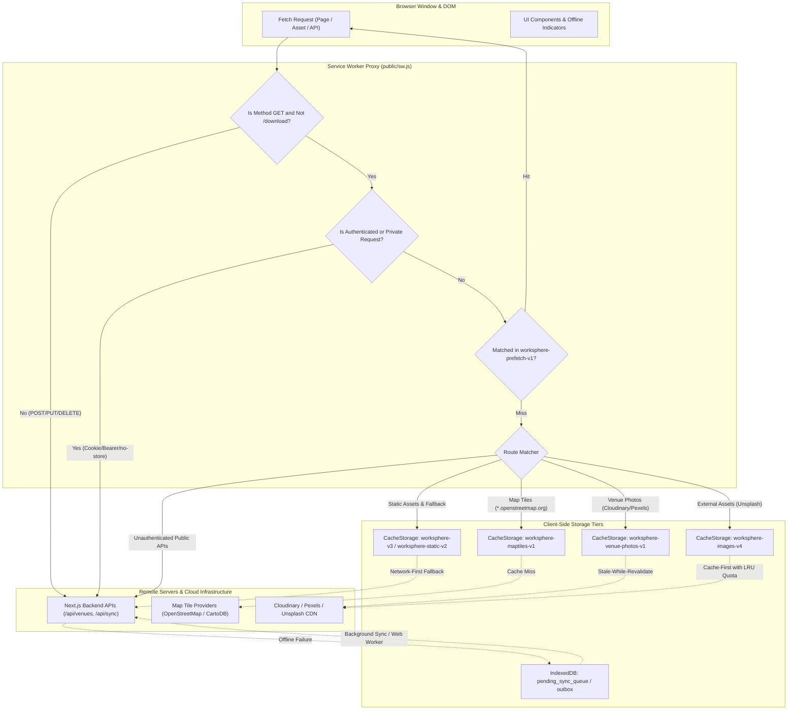
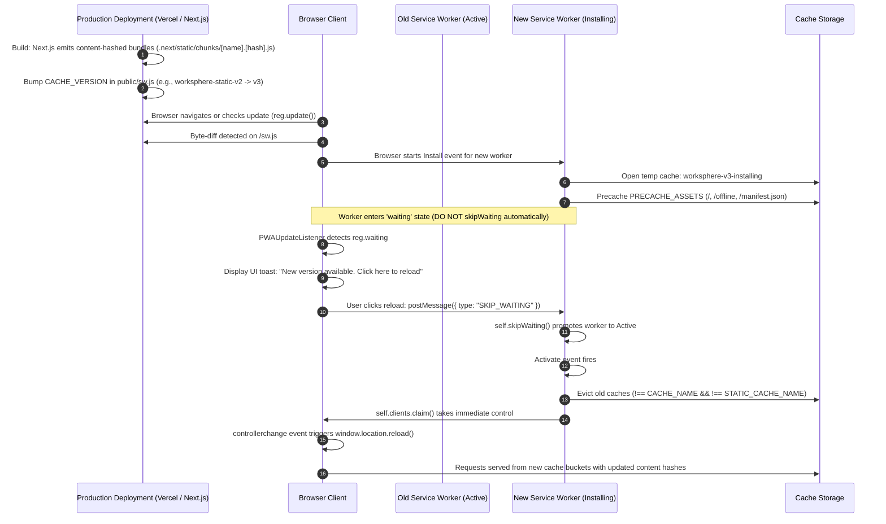
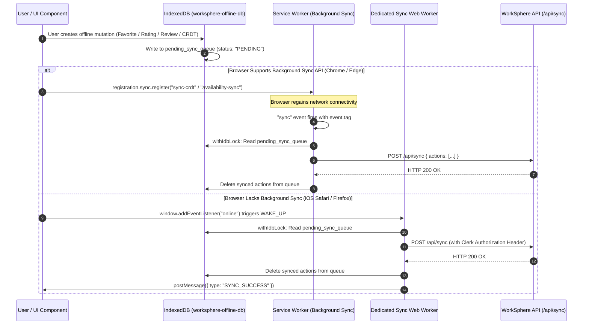

# Progressive Web App (PWA) Service Worker Caching Strategy & Invalidation Runbook

This technical runbook documents WorkSphere's Progressive Web App (PWA) service worker caching architecture, multi-tiered cache buckets, Workbox-equivalent strategies, deployment versioning, background synchronization queues, quota enforcement, and Chrome DevTools debugging workflows.

---

## 1. Overview and Architecture

WorkSphere is architected as an offline-capable Progressive Web App (PWA) designed to provide uninterrupted workspace booking, venue browsing, map inspection, and collaborative editing even during intermittent network connectivity or total offline conditions.

### 1.1 The Role of the Service Worker

The service worker (`public/sw.js`) operates as a client-side programmable network proxy running on a separate thread from the main DOM window. It intercepts outgoing HTTP/HTTPS `fetch` requests, queries local storage tiers, applies request-specific caching strategies, and coordinates background synchronization.

WorkSphere separates storage into three distinct tiers:
1. **Cache Storage API (`caches`):** Persists static application assets (HTML shell, icons, manifest), map raster tiles, and external imagery (Cloudinary, Pexels, Unsplash).
2. **IndexedDB:** Stores structured relational and document state, including offline mutation queues (`pending_sync_queue`, `queued-reviews`), LRU access timestamps for cache quota tracking, CRDT change logs, and availability deltas.
3. **HTTP Browser Cache:** Standard browser network cache governed by server-sent `Cache-Control` headers (e.g., Next.js immutable static chunk hashes).

### 1.2 Multi-Tier Interception Pipeline



---

## 2. Cache Buckets and Caching Tiers

WorkSphere partitions client cache storage into specialized cache buckets to enforce domain-specific eviction policies, byte budgets, and lifecycle invalidations without interfering with core application shell availability.

### 2.1 Cache Bucket Registry

| Cache Bucket Name | Actual Route Matcher | Configured Strategy | Storage Quota / Limit | Expiration Policy | Offline Behavior | Invalidation Trigger |
|---|---|---|---|---|---|---|
| **`worksphere-v3`** | Local origin assets, `/api/venues`, `/api/reservations/availability` | Network-First | Browser default quota | Stale entries retained until network success | Returns cached response; falls back to `{ venues: [], offline: true }` or `/offline` | Replaced on service worker cache name bump (e.g., `v3` $\to$ `v4`) |
| **`worksphere-static-v2`** | Pre-cached shell: `/`, `/offline`, `/icons/icon.svg`, `/manifest.json` | Cache-First | App shell (~2–5 MB) | Retained until service worker version upgrade | Serves offline fallback UI (`/offline`) immediately | Evicted during `activate` event when `CACHE_VERSION` changes |
| **`worksphere-runtime-public-v2`** | Public APIs: `/api/venues/public`, `/api/health` | Stale-While-Revalidate | Dynamic | Revalidated on each fetch; cached when `Cache-Control` allows | Serves stale JSON payload | Purged upon user sign-out (`SIGN_OUT` message) or version bump |
| **`worksphere-maptiles-v1`** | `*.tile.openstreetmap.org`, `basemaps.cartocdn.com` | Cache-First (with Abort safety) | Bounded by storage quota | Retained indefinitely unless evicted by browser | Serves cached tiles; returns HTTP 204 on intentional zoom abort, HTTP 503 if offline and uncached | Manual cache clear or origin eviction |
| **`worksphere-venue-photos-v1`** | `res.cloudinary.com`, `images.pexels.com` | Stale-While-Revalidate (LRU) | Max 100 entries (`MAX_VENUE_PHOTO_ENTRIES`) | 14-day TTL (`VENUE_PHOTO_MAX_AGE_SECONDS = 1209600s`) | Serves cached photo immediately while revalidating in background; HTTP 504 on offline miss | LRU trim upon insert; expired items evicted by `CacheExpirationPlugin` |
| **`worksphere-images-v4`** | `images.unsplash.com` | Cache-First with Byte Budget | Max 20 MB (`MAX_IMAGE_CACHE_BYTES`) | LRU access ordering tracked via IndexedDB | Serves cached asset; HTTP 503 on offline miss | Oldest entries deleted when total cache exceeds 20 MB; aggressive trim on `QuotaExceededError` |
| **`worksphere-video-tours-v1`** | Pre-fetched video tour URLs | Cache-First (Quota-Gated) | Pre-flight quota check (`hasSufficientStorageQuota`) | Retained while space permits | Serves pre-fetched video stream | Skipped if available quota $< 10$ MB; halted if individual video cannot fit 5 MB buffer |
| **`worksphere-prefetch-v1`** | High-probability next-route assets | Cache-First Priority | Ephemeral | Checked before `handleFetch` | Serves prefetched response instantly | Consumed by subsequent navigation |

---

## 3. Workbox Caching Strategies

WorkSphere implements the core caching primitives popularized by Google Workbox directly in native Service Worker code.

### 3.1 Strategy Comparison Matrix

| Strategy | Request Flow | Cache Mutation Flow | Offline Characteristics | Freshness Guarantee | WorkSphere Use Case |
|---|---|---|---|---|---|
| **CacheFirst** | Queries Cache Storage first. Only hits network if cache misses. | Stores network response into Cache Storage on miss. | **Optimal.** Instantaneous response without network roundtrips. | **Low.** Does not check server for updates until cache entry is deleted or expired. | Map tiles (`worksphere-maptiles-v1`), static image assets (`worksphere-images-v4`), video tours. |
| **NetworkFirst** | Sends fetch request to network immediately with timeout guard. | Clones successful HTTP 200 response into cache. | **Resilient.** Falls back to cache or structured offline JSON if network fails. | **Highest.** Users always receive latest server data when online. | Dynamic APIs (`/api/venues`, `/api/reservations/availability`), navigation pages. |
| **StaleWhileRevalidate** | Returns cached response immediately. Concurrently triggers background fetch. | Updates Cache Storage with background network response. | **High.** Instant UI render with background synchronization. | **Balanced.** Displays previous state; updates cache for next navigation. | Venue gallery photos (`worksphere-venue-photos-v1`), public search (`/api/venues/public`). |

### 3.2 Strategy Implementation in Code

#### A. Network-First with Offline JSON Fallback (`/api/venues`)
```javascript
// public/sw.js
if (isVenuesApi || isReservationsApi) {
  try {
    const response = await fetch(request);
    if (response.ok) {
      const cache = await caches.open(CACHE_NAME);
      cache.put(request, response.clone());
    }
    return response;
  } catch {
    const cached = await caches.match(request);
    if (cached) return cached;
    if (isVenuesApi) {
      return new Response(
        JSON.stringify({ venues: [], offline: true, cached: true }),
        { status: 200, headers: { "Content-Type": "application/json" } }
      );
    }
    return new Response("Offline", { status: 503 });
  }
}
```

#### B. Stale-While-Revalidate with Non-Blocking Revalidation (`worksphere-venue-photos-v1`)
```javascript
// public/sw.js
const cache = await caches.open(VENUE_PHOTO_CACHE_NAME);
const cached = await cache.match(request);
const revalidatePromise = fetch(request)
  .then(async (networkResponse) => {
    if (networkResponse && (networkResponse.status === 200 || networkResponse.status === 0)) {
      await cache.put(request, networkResponse.clone());
    }
    return networkResponse;
  })
  .catch(() => null);

if (cached) {
  if (event && event.waitUntil) {
    event.waitUntil(revalidatePromise); // Keep SW alive until revalidation completes
  }
  return cached;
}
const fresh = await revalidatePromise;
if (fresh) return fresh;
return new Response("Photo Offline", { status: 504 });
```

---

## 4. Cache Invalidation and Versioning

WorkSphere coordinates cache invalidation through content hashing, manual cache name versioning, installation staging, and explicit user-driven activation.

### 4.1 Deployment Invalidation Lifecycle Flowchart



### 4.2 Content Hashing vs Cache Name Versioning

1. **Content Hashing:** Next.js build scripts automatically generate unique content hashes in filenames (e.g., `_next/static/chunks/app/page-7f8b91.js`). When an asset changes, its URL changes, causing the browser to fetch the new file without being poisoned by HTTP cache.
2. **Explicit Cache Name Versioning:** Static cache buckets in `public/sw.js` maintain explicit version constants (`CACHE_NAME = "worksphere-v3"`, `CACHE_VERSION = "v2"`). During the `activate` event, the service worker iterates over all existing cache buckets and purges any bucket whose name does not match the current version constants:
   ```javascript
   const cacheKeys = await caches.keys();
   await Promise.all(
     cacheKeys
       .filter((key) => key !== STATIC_CACHE_NAME && key !== RUNTIME_PUBLIC_CACHE_NAME)
       .map((key) => caches.delete(key))
   );
   ```
3. **Safe Sign-Out Purging:** Shared coworking terminals present cross-user data leakage risks. When Clerk signs out, `serviceWorkerAuthSync.ts` transmits `SIGN_OUT` to the worker, triggering `purgeDynamicRuntimeCaches()` to destroy all runtime data while preserving static shell assets.

---

## 5. Production Deployment and Release Checklist

Before releasing a production build to users, execute this validation checklist:

- [ ] **Verify Content Hashes in Build Output:** Run `npm run build` and ensure Next.js emitted hashed static chunks in `.next/static/`.
- [ ] **Update Cache Constants in `public/sw.js`:** If breaking schema or application shell changes occurred, increment `CACHE_NAME` (e.g., `worksphere-v3` $\to$ `worksphere-v4`) or `CACHE_VERSION`.
- [ ] **Check PWA Asset Manifests:** Ensure `/manifest.json`, `/offline`, and `/icons/icon.svg` are valid and reachable.
- [ ] **Validate Update Listener (`PWAUpdateListener.tsx`):** Ensure `SKIP_WAITING` is sent only upon user confirmation to avoid infinite reload loops during active sessions.
- [ ] **Execute Service Worker Unit Tests:**
  ```bash
  # Validate service worker image quota and LRU eviction
  node --experimental-vm-modules node_modules/jest/bin/jest.js src/__tests__/lib/swCacheLru.test.ts
  # Validate push and video quota handlers
  npx jest src/__tests__/swPush.test.ts src/__tests__/swVideoQuota.test.ts
  ```
- [ ] **Test Rollback Safety:** Verify that if an old client with cached `worksphere-v3` connects to a rolled-back server, requests gracefully fall back to network without throwing unhandled promise rejections.

---

## 6. Background Sync & Offline Queue Lifecycle

WorkSphere incorporates a hybrid synchronization model:
1. **Service Worker Background Sync (`self.addEventListener("sync")`):** Intercepts standard browser sync events when supported.
2. **Dedicated Outbox Web Worker (`src/workers/sync.worker.ts`):** Client-side fallback that guarantees synchronization across browsers lacking the Background Sync API (e.g., iOS Safari).

### 6.1 Mutation Sync Sequence



### 6.2 Supported Sync Tags in `public/sw.js`

- **`sync-crdt`:** Replays collaborative whiteboard and document CRDT vectors.
- **`sync-favorites`:** Replays toggled favorite venues.
- **`sync-ratings` & `sync-reviews`:** Synchronizes submitted amenity ratings and venue reviews.
- **`sync-conversations`:** Transmits offline chat and messaging payloads.
- **`receipt-export-sync`:** Retries failed PDF receipt export generation jobs.
- **`availability-sync` / `workspace-availability`:** Periodic sync (every 15–30 min) comparing seat delta states.

### 6.3 Idempotency and Backoff Controls

- **Network Error Safety:** If a network error (`TypeError`) occurs, the action remains in IndexedDB; it is **not** deleted, guaranteeing zero data loss.
- **Circuit Breaker:** `sync.worker.ts` maintains an exponential backoff circuit breaker (`CIRCUIT_BREAKER_OPEN`). After 3 consecutive 5xx failures, sync pauses for 30 seconds to prevent battery exhaustion.
- **Idempotency Keys:** Every queued action generates a unique UUID `id`. Next.js API handlers check this ID against database event ledgers to prevent duplicate billing or multiple bookings.

---

## 7. Storage Quotas and Eviction Mechanics

Mobile browsers enforce strict storage quotas:
- **iOS Safari PWA:** Enforces an aggressive ~50 MB total origin quota. Exceeding this limit causes Safari to evict origin data or terminate PWA tabs.
- **Android Chrome:** Dynamically assigns quotas based on free device storage (typically 6% to 20% of free disk space).

### 7.1 Pre-Flight Storage Check (`hasSufficientStorageQuota`)

Before storing large assets (e.g., pre-fetching 5 MB venue video tours in `prefetchVideoTours`), `public/sw.js` queries the Storage API:

```javascript
async function hasSufficientStorageQuota(requiredBytes = 0) {
  if (typeof navigator !== "undefined" && navigator.storage?.estimate) {
    try {
      const estimate = await navigator.storage.estimate();
      const quota = estimate.quota;
      const usage = estimate.usage;
      if (quota > 0 && usage !== undefined) {
        const availableBytes = quota - usage;
        const minRequiredBuffer = Math.max(requiredBytes, 5 * 1024 * 1024);
        return availableBytes >= minRequiredBuffer;
      }
    } catch (err) {
      // iOS Safari Private Browsing rejects estimate() — treat as sufficient
    }
  }
  return true;
}
```

### 7.2 20MB Image Cache Quota (`worksphere-images-v4`)

In `src/lib/swCacheLru.ts`, WorkSphere caps the image cache at 20 MB (`MAX_IMAGE_CACHE_BYTES = 20 * 1024 * 1024`). When new images are saved:
1. `estimateResponseSize(response)` reads the `Content-Length` header or checks `arrayBuffer().byteLength`.
2. Opaque cross-origin responses default to an estimate of 400 KB (`OPAQUE_RESPONSE_SIZE_ESTIMATE`).
3. `trimCacheToMaxBytes()` iterates over cached keys and drops the oldest entries until total cache usage fits under 20 MB.

---

## 8. Chrome DevTools Debugging Guide

Use Chrome DevTools to inspect, simulate, and debug service worker behavior:

### 8.1 Inspecting Lifecycle and Registration
1. Open DevTools (`F12` or `Ctrl+Shift+I`).
2. Navigate to the **Application** tab $\to$ **Service Workers** (in the left sidebar).
3. **Inspect Active Status:** Verify that `/sw.js` is `Activated and is running`.
4. **Update on reload:** Check this box during local development to force the service worker to re-fetch and re-install on every page reload.
5. **Simulate Waiting State:** Uncheck *Update on reload*, modify a byte in `public/sw.js`, and reload. Verify that the new worker appears under **Waiting to activate** and triggers the UI update banner.

### 8.2 Inspecting Cache Storage
1. In the **Application** tab, expand **Cache Storage**.
2. Click on individual buckets:
   - `worksphere-v3`: Verify precached assets (`/`, `/offline`, `/manifest.json`).
   - `worksphere-maptiles-v1`: Confirm map raster tiles are populated when navigating the map.
   - `worksphere-venue-photos-v1`: Verify Cloudinary and Pexels URLs.
3. **Delete Cache:** Right-click any bucket and select **Delete** to test cold-start cache population.

### 8.3 Simulating Offline Mode
1. Open the **Network** tab.
2. Click the throttling dropdown (labeled *No throttling*) and select **Offline**.
3. Reload the application:
   - Verify that the app shell loads from `worksphere-v3`.
   - Navigate to `/offline`: Confirm the offline fallback view renders.
   - Trigger a search: Confirm `/api/venues` returns the fallback `{ venues: [], offline: true, cached: true }`.

### 8.4 Triggering Background Sync Manually
1. In **Application** $\to$ **Service Workers**, find the **Sync** input field.
2. Enter tag `sync-crdt` or `availability-sync` and click **Sync**.
3. Observe the **Console** tab for `[SW]` sync logs.

---

## 9. Troubleshooting Matrix

| Symptom | Probable Cause | Diagnostic Steps | Recommended Resolution |
|---|---|---|---|
| **Old app version remains visible after deploy** | New worker is in `waiting` state; client has not reloaded. | Check `reg.waiting` in DevTools Application tab. | Click "Click here to reload" toast or call `waitingWorker.postMessage({ type: "SKIP_WAITING" })`. |
| **Offline page fails to load when disconnected** | `/offline` route was not precached during `install`. | Inspect `worksphere-v3` cache; check for `/offline` entry. | Ensure `/offline` is included in `PRECACHE_ASSETS` in `public/sw.js`. |
| **Map tiles missing or blank offline** | Tile was never viewed online; or zoom prefetch was cancelled. | Check `worksphere-maptiles-v1` for matching tile coordinates (`/{z}/{x}/{y}.png`). | Pan over the desired map region while online before disconnecting. |
| **`QuotaExceededError` crashes mobile app** | Image or video cache exceeded device limits. | Inspect `navigator.storage.estimate()` usage vs quota. | Verify `hasSufficientStorageQuota` is called before caching; check 20 MB image cap in `src/lib/swCacheLru.ts`. |
| **Authenticated user sees another user's cached profile** | Private API route cached in shared runtime cache. | Inspect `worksphere-runtime-public-v2` for personalized `/api/` endpoints. | Ensure route is not in `PUBLIC_CACHEABLE_API_PREFIXES`; verify `isAuthenticatedOrPrivateRequest()` returns `true`. |
| **Background sync does not fire on iOS** | iOS Safari lacks the W3C Background Sync API. | Check `SyncManager` in window. | Expected behavior. WorkSphere automatically falls back to `sync.worker.ts` on window `online` events. |
| **Service worker infinite reload loop** | `skipWaiting()` called unconditionally on every install. | Check if `skipWaiting()` is invoked inside `install` event. | Never call `skipWaiting()` automatically; wait for explicit client message in `message` handler. |

---

## 10. Security and Data Consistency

1. **Authentication Isolation:** Under no circumstances are authenticated API routes (e.g., `/api/user/*`, `/api/bookings/*`, `/api/admin/*`) cached by the service worker. `isAuthenticatedOrPrivateRequest()` checks for `Authorization` and `Cookie` headers and skips Cache Storage entirely.
2. **Terminal Sign-Out Sanitization:** On shared coworking workstations, users signing out trigger `purgeServiceWorkerCachesOnSignOut()` (`serviceWorkerAuthSync.ts`), which wipes all dynamic cache buckets and IndexedDB runtime stores.
3. **Tile Provider Terms of Service:** Map tiles from OpenStreetMap are subject to tile usage policies. Tile caching is strictly limited to viewing sessions and must not bulk-scrape global zoom levels.
4. **Stale Booking Guard:** Seat reservations and availability deltas have strict expiration windows. Cached reservation responses are always marked `{ cached: true }` so UI components can display warning banners indicating data staleness.

---

## 11. Operational Validation Checklist

- [ ] **First-Time Install:** Load app on a clean browser profile; verify `worksphere-v3` precaches shell assets without errors.
- [ ] **Returning User Update:** Deploy updated service worker; confirm update toast appears and clicking reload activates the new worker.
- [ ] **Offline Navigation:** Disconnect network in DevTools; verify home page and `/offline` load successfully.
- [ ] **Search Fallback:** In offline mode, verify `/api/venues` returns empty fallback without unhandled network exceptions.
- [ ] **Map Tile Caching:** Pan and zoom map online, go offline, pan over the same area; verify tiles load from `worksphere-maptiles-v1`.
- [ ] **Quota Protection:** Confirm `hasSufficientStorageQuota` halts large video downloads when free storage is $< 10$ MB.
- [ ] **Sign-Out Cache Purge:** Sign out with Clerk; confirm `worksphere-runtime-public-v2` is deleted.

---

## 12. Source References

- [`public/sw.js`](../../public/sw.js) — Native service worker implementation, route handlers, quota checks, and sync events.
- [`src/sw.ts`](../../src/sw.ts) — CacheExpirationPlugin and venue photo Stale-While-Revalidate handlers.
- [`src/lib/swCacheLru.ts`](../../src/lib/swCacheLru.ts) — 20 MB image cache quota management, response size estimation, and storage quota checks.
- [`src/hooks/usePWA.tsx`](../../src/hooks/usePWA.tsx) — PWA registration hook, SyncManager, and periodic sync registrations.
- [`src/components/PWAUpdateListener.tsx`](../../src/components/PWAUpdateListener.tsx) — User-facing update prompt and `SKIP_WAITING` dispatcher.
- [`src/lib/pwa/serviceWorkerAuthSync.ts`](../../src/lib/pwa/serviceWorkerAuthSync.ts) — Dynamic runtime cache purging during Clerk sign-out.
- [`src/workers/sync.worker.ts`](../../src/workers/sync.worker.ts) — Client-side fallback outbox worker for background queue replay.
