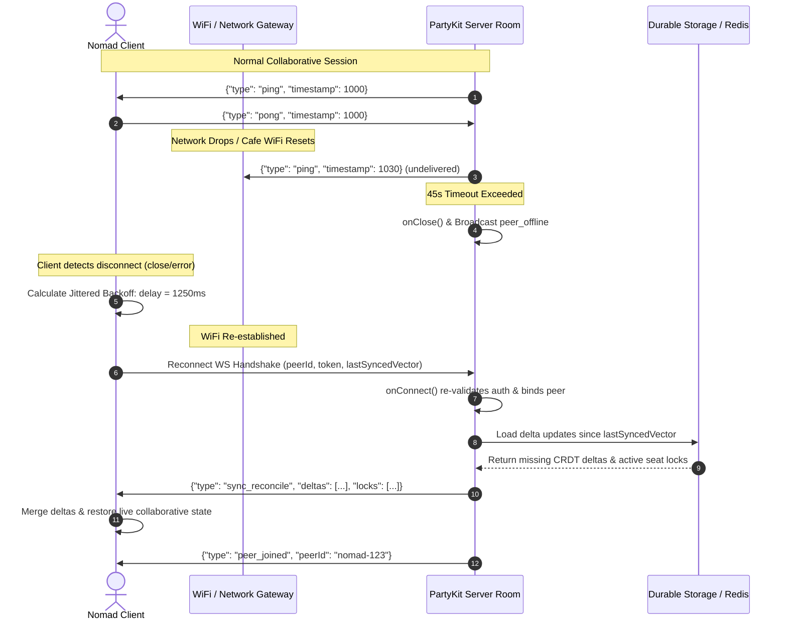

# PartyKit WebSocket Room Heartbeat & Peer Reconnection Protocol

## Overview & Scope

PartyKit powers real-time collaborative rooms, live whiteboard synchronization, presence tracking, and seat hold management in WorkSphere. Because remote nomads operate across unstable cellular, mobile hotspot, and cafe WiFi networks, the WebSocket connection requires an autonomous ping/pong heartbeat and an exponential backoff reconnection protocol with randomized jitter to prevent thundering herd spikes.

---

## Room Connection Lifecycle Hooks

On the PartyKit edge server (`partykit/server.ts`), each room instance executes standardized lifecycle hooks:

### 1. `onConnect(conn, ctx)`
- Invoked when a new client WebSocket handshake completes.
- Authenticates the user session token and assigns an ephemeral peer ID.
- Sends the initial room state snapshot (e.g. current presence roster, active seat locks, CRDT state vector).
- Starts a 30-second ping timer for the connection.

### 2. `onMessage(message, sender)`
- Handles incoming messages: user cursor movements, chat messages, whiteboard CRDT deltas, and heartbeat pong replies.
- Resets the peer's idle timeout deadline upon receiving a heartbeat reply (`pong`).
- Broadcasts mutations to other connected peers (`room.broadcast(data, [sender.id])`).

### 3. `onClose(conn)`
- Triggered on client socket termination, transport teardown, or missing heartbeat timeouts.
- Marks peer presence as disconnected in room state.
- Broadcasts a `peer-left` event to remaining room occupants.
- Cleans up ephemeral peer locks if no active leases remain.

---

## 30-Second Ping/Pong Heartbeat Protocol

To detect dead connections behind silent network drops (e.g. NAT timeouts, router dropouts without TCP FIN/RST):
1. **Server Ping**: The PartyKit server emits a JSON ping message every 30 seconds: `{"type": "ping", "timestamp": <server_time>}`.
2. **Client Pong**: The client immediately responds: `{"type": "pong", "timestamp": <server_time>}`.
3. **Dead Peer Eviction**: If no pong or message is received within a 45-second threshold (1.5x heartbeat interval), the server forcefully terminates the connection and executes `onClose`.

---

## Client-Side Reconnection Strategy with Exponential Jitter

When a connection drops or encounters an error, the client executes an exponential backoff algorithm with full randomized jitter to avoid synchronizing reconnect attempts across multiple disconnected peers:

$$\text{Backoff}(attempt) = \min(\text{maxDelay}, \text{baseDelay} \times 2^{attempt}) \times (0.5 + 0.5 \times \text{random}())$$

- **Base Delay**: 1,000 ms (1s)
- **Max Delay**: 30,000 ms (30s)
- **Max Retries**: Unlimited while user maintains active browser tab; pauses backoff when tab is hidden via Page Visibility API.

---

## Disconnect, Reconnect & State Reconciliation Flow

---

## Summary of Guarantees

- **Resilient Reconnection**: Clients recover gracefully without manual page reload.
- **Deduplication**: Message vector clocks and idempotency IDs prevent duplicate actions.
- **Resource Protection**: Stale locks held by abruptly disconnected peers are evicted cleanly.
