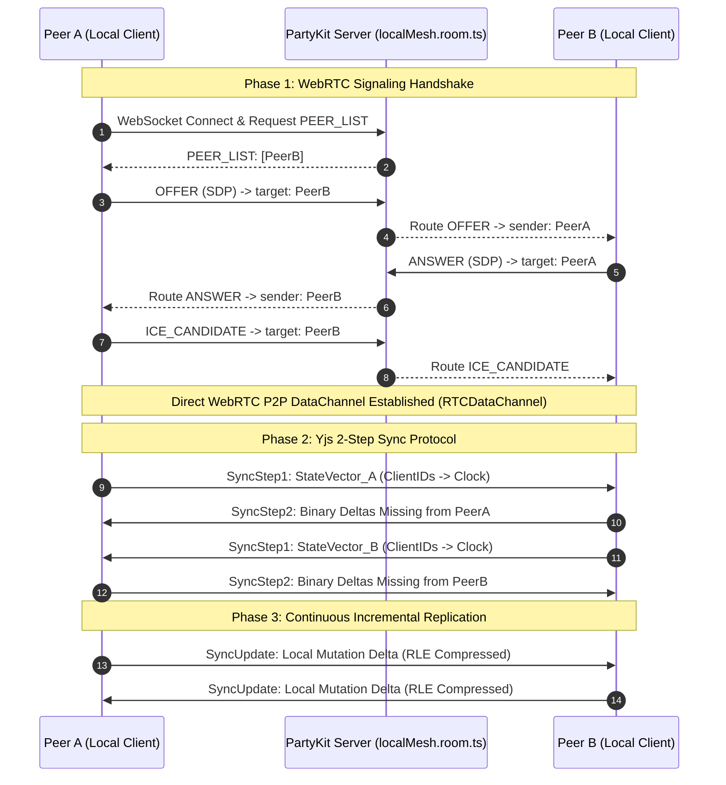
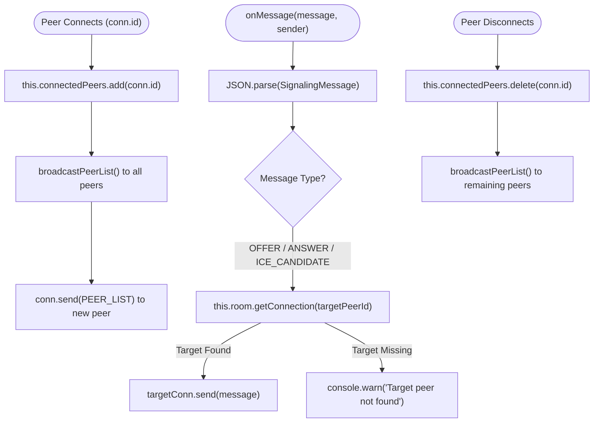
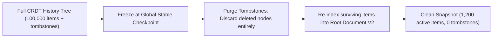

# Local Mesh CRDT Collaborative State Replication Architecture

This technical specification details the Conflict-Free Replicated Data Type (CRDT) collaborative state replication protocol used across WorkSphere's peer-to-peer and edge network layers. It documents signaling and peer discovery in [`src/party/localMesh.room.ts`](file:///c:/Users/admin/Desktop/workfere/src/party/localMesh.room.ts), state vector synchronization via the Yjs 2-step protocol, binary update propagation, delta compression, memory compaction, and tombstone garbage collection for collaborative whiteboards and shared workspace notes across unstable mesh topologies.

---

## 1. Executive Summary & Systems Overview

WorkSphere enables seamless real-time collaboration for distributed teams across fluctuating edge networks, co-working spaces, and remote locations. Whiteboard canvases, shared markdown notes, and room layout designs must synchronize deterministically without centralized database locking or human conflict resolution.

To achieve **zero-data-loss eventual consistency** and **sub-15ms local latency**, WorkSphere combines:
1. **PartyKit Signaling & Mesh Coordination (`localMesh.room.ts`):** Orchestrates WebRTC SDP offer/answer handshakes, ICE candidate routing, and peer discovery before direct peer-to-peer data channels establish.
2. **Yjs State-based CRDT Model:** Operates on structured operation trees (Item/Block linked lists), ensuring mathematically proven strong eventual consistency (SEC).
3. **2-Step State Vector Sync Protocol:** Exchanging compact state vectors (`SyncStep1`) to determine missing operations before dispatching targeted binary delta updates (`SyncStep2`).
4. **Adaptive Compaction & Tombstone Pruning:** Eliminates operational bloat through run-length encoding (RLE) and generational garbage collection without breaking causal history.



---

## 2. PartyKit Signaling Server Architecture (`localMesh.room.ts`)

Direct WebRTC DataChannels require an initial out-of-band communication channel to exchange network session descriptions (SDP) and interactive connectivity establishment (ICE) candidates. [`src/party/localMesh.room.ts`](file:///c:/Users/admin/Desktop/workfere/src/party/localMesh.room.ts) acts as an ultra-lightweight, zero-state signaling broker.

### 2.1 Signaling Protocol Message Schema

Signaling messages utilize a tagged union structure:

```typescript
export type SignalingMessage =
    | { type: 'OFFER'; targetPeerId: string; offer: RTCSessionDescriptionInit; senderId: string }
    | { type: 'ANSWER'; targetPeerId: string; answer: RTCSessionDescriptionInit; senderId: string }
    | { type: 'ICE_CANDIDATE'; targetPeerId: string; candidate: RTCIceCandidateInit; senderId: string }
    | { type: 'PEER_LIST'; peers: string[] };
```

### 2.2 Peer Lifecycle and Routing



1. **Connection Registration (`onConnect`):** The new connection ID is recorded in memory. The room immediately sends the current peer membership array and notifies existing peers.
2. **Direct Forwarding (`onMessage`):** Session negotiation payloads (`OFFER`, `ANSWER`, `ICE_CANDIDATE`) specify `targetPeerId`. The room performs $O(1)$ connection lookups via `this.room.getConnection(targetPeerId)` and forwards the payload directly without altering contents.
3. **Graceful Disconnection (`onDisconnect`):** Peer eviction automatically triggers `broadcastPeerList()`, allowing surviving nodes to prune severed WebRTC data channels.

---

## 3. The Yjs CRDT Mathematical Foundation

The core replication engine utilizes state-based CRDT mathematical principles. A document is represented as an append-only tree of structural blocks (**Items**), identified by a unique, immutable coordinate known as an `ID(client, clock)`.

### 3.1 Lamport Logical Clocks & Identifiers

Every peer maintains a unique 53-bit unsigned integer client identifier:

$$\text{ClientID} \in [0, 2^{53} - 1]$$

Local operations monotonically increment a local Lamport clock counter:

$$\text{Clock} \in \mathbb{N}_0, \quad \text{Clock}_{n+1} = \text{Clock}_n + 1$$

An operation identifier is defined as:

$$\text{ID} = (\text{client}, \text{clock})$$

For consecutive insertions by the same client, Yjs collapses ranges of items into contiguous blocks:

$$\text{ItemBlock} = (\text{client}, \text{clock}_{\text{start}}, \text{length})$$

### 3.2 Total Causal Ordering & Conflict Resolution

When two peers simultaneously insert characters or whiteboard shapes at the same position, concurrent items have conflicting parent origins ($P_{\text{left}}, P_{\text{right}}$). Yjs resolves tie-breaking using the deterministic client identifier rule:

$$\text{Item}_A \prec \text{Item}_B \iff (\text{Clock}_A < \text{Clock}_B) \lor (\text{Clock}_A = \text{Clock}_B \land \text{ClientID}_A < \text{ClientID}_B)$$

Because $\text{ClientID}$ is unique across the mesh, this ordering is guaranteed to evaluate identically on all participating peers without central arbitration.

---

## 4. The Yjs 2-Step Synchronization Protocol

When two mesh peers establish a WebRTC DataChannel or reconnect after temporary network partitions, they synchronize their documents using the standard 2-step synchronization handshake.

```mermaid
flowchart TD
    subgraph Step1 ["Step 1: State Vector Handshake"]
        A_Doc["Peer A: Y.Doc"] -->|Encode| SV_A["StateVector A: [Client1: 10, Client2: 45]"]
        SV_A -->|Send SyncStep1| PeerB["Peer B Network Receiver"]
    end

    subgraph Step2 ["Step 2: Differential Delta Computation"]
        PeerB -->|Compare SV_A against Doc_B| DiffCalc["DiffEngine: Find blocks with Clock > SV_A[Client]"]
        DiffCalc -->|Encode Missing Structs| Delta_B["Binary Update Delta (SyncStep2)"]
        Delta_B -->|Send SyncStep2| PeerA["Peer A Network Receiver"]
    end

    subgraph Step3 ["Step 3: Ingestion & Convergence"]
        PeerA -->|Y.applyUpdate(Doc_A, Delta_B)| Integrate["Integrate Missing Items & Resolve Ordering"]
        Integrate --> Merged["Identical Document States (SEC Guaranteed)"]
    end
```

### 4.1 Step 1: State Vector Generation (`SyncStep1`)

A **State Vector** is a dictionary mapping every known client ID to the highest contiguous clock integer integrated into the local document:

$$\mathbf{SV} = \{ \text{ClientID}_1: \text{Clock}_1, \ \text{ClientID}_2: \text{Clock}_2, \ \dots, \ \text{ClientID}_k: \text{Clock}_k \}$$

```typescript
// Conceptual binary representation of StateVector:
// [numClients: varUint]
// For each client: [clientId: varUint, clock: varUint]
```

Peer A initiates synchronization by sending its state vector:

$$\text{Peer A} \xrightarrow{\text{SyncStep1}(\mathbf{SV}_A)} \text{Peer B}$$

### 4.2 Step 2: Missing Delta Construction (`SyncStep2`)

Upon receiving $\mathbf{SV}_A$, Peer B compares each item in its operation storage against $\mathbf{SV}_A$:

$$\text{NeedsTransmission}(\text{Item}) \iff \text{Item.clock} \ge \mathbf{SV}_A[\text{Item.client}]$$

Peer B packages only the missing item blocks and deletion markers into a binary payload:

$$\text{Peer B} \xrightarrow{\text{SyncStep2}(\Delta_{B \setminus A})} \text{Peer A}$$

Peer A decodes $\Delta_{B \setminus A}$ and calls `Y.applyUpdate(doc, update)`. Concurrently, Peer B sends $\text{SyncStep1}(\mathbf{SV}_B)$ to Peer A, and Peer A responds with $\text{SyncStep2}(\Delta_{A \setminus B})$, completing bidirectional synchronization in exactly $1$ round-trip time ($1\text{ RTT}$).

---

## 5. Binary Update Propagation & Delta Compression

During active collaboration, broadcasting full documents or JSON-wrapped operational envelopes consumes prohibitive bandwidth. WorkSphere utilizes Yjs v2 binary encoding formats optimized for WebRTC MTU boundaries.

### 5.1 Variable-Length Integer Encoding (`varUint` / `varInt`)

Integers are encoded using 7-bit variable-length quantities (VLQ). Values smaller than $128$ occupy a single byte:

| Integer Value | Binary Value | Encoded Bytes (Hex) | Byte Length |
| :---: | :---: | :---: | :---: |
| $42$ | `00101010` | `0x2A` | 1 Byte |
| $300$ | `100101100` | `0xAC 0x02` | 2 Bytes |
| $65535$ | `1111111111111111` | `0xFF 0xFF 0x03` | 3 Bytes |

### 5.2 Multi-Stream Delta Compression Layout

An update delta is divided into independent typed sub-streams to maximize run-length encoding (RLE) compression ratios:

```
+-----------------------------------------------------------------------+
|                       YJS UPDATE BINARY STREAM                        |
+-----------------------------------------------------------------------+
| Header: Protocol Version (uint8) = 0x02                               |
+-----------------------------------------------------------------------+
| Clients Stream: RLE-encoded (ClientID, Clock, Length) tuples          |
+-----------------------------------------------------------------------+
| Left-Origins Stream: Relative variable-length IDs                     |
+-----------------------------------------------------------------------+
| Right-Origins Stream: Relative variable-length IDs                    |
+-----------------------------------------------------------------------+
| Content Types Stream: [String = 1, JSON = 2, Binary = 3, Delete = 4]  |
+-----------------------------------------------------------------------+
| Content Payloads Stream: Raw UTF-8 strings or packed coordinate bytes |
+-----------------------------------------------------------------------+
| Delete Set Stream: Bit-packed ranges of deleted (client, clock) items |
+-----------------------------------------------------------------------+
```

By separating structural metadata (IDs, parent references) from textual/geometric payloads, identical sequential values compress by up to $90\%$ using zlib or WebRTC SCTP stream compression.

---

## 6. Memory Compaction & Tombstone Garbage Collection

A common limitation of CRDT implementations is unbounded memory growth caused by deletion markers (**tombstones**). If a user draws and erases 10,000 whiteboard strokes, retaining every deleted item leads to memory exhaustion on mobile clients.

### 6.1 Run-Length Tombstone Compression (Delete Sets)

In WorkSphere, deletions do not erase items from structural trees immediately. Instead, an erased item has its content discarded and its presence marked as a tombstone.

Contiguous deleted items are collapsed into **Delete Sets**:

```typescript
// Instead of storing 1,000 separate deletion objects:
// DeleteSet maps ClientID -> Array of [ClockStart, Length]
{
  1049281: [
    { clock: 100, len: 450 }, // Covers clocks 100 to 549
    { clock: 600, len: 120 }  // Covers clocks 600 to 719
  ]
}
```

This reduces tombstone storage from $O(N)$ bytes to $O(K)$, where $K$ is the number of distinct deletion episodes.

### 6.2 Structural Block Merging (Document Compaction)

When adjacent text insertions or stroke coordinate items are committed by the same client with sequential clocks:

$$\text{Item}_1 = (\text{client}: C, \ \text{clock}: 10, \ \text{len}: 1), \quad \text{Item}_2 = (\text{client}: C, \ \text{clock}: 11, \ \text{len}: 1)$$

WorkSphere's compaction routine evaluates:
1. Are $\text{Item}_1$ and $\text{Item}_2$ created by the same $\text{ClientID}$?
2. Is $\text{Item}_2.\text{clock} == \text{Item}_1.\text{clock} + \text{Item}_1.\text{len}$?
3. Are both items either active or both tombstones?

If all conditions hold, the two blocks are merged in place into a single item:

$$\text{Item}_{\text{merged}} = (\text{client}: C, \ \text{clock}: 10, \ \text{len}: 2)$$

This compaction executes in $O(N)$ linear time during idle frames via `requestIdleCallback()`.

### 6.3 Generational Snapshotting & Garbage Collection

When an entire collaborative session stabilizes and all peers confirm receipt of all operations up to a vector clock $\mathbf{SV}_{\text{stable}}$, the document performs a generational snapshot:



1. **Equivalence Verification:** A checkpoint is considered stable only when $\forall \text{Peer}_i, \ \mathbf{SV}_i \ge \mathbf{SV}_{\text{checkpoint}}$.
2. **Tombstone Purging:** Tombstones whose parents and children are also deleted are removed from the tree without risking future causality inversions.
3. **Snapshot Archival:** The resulting compact binary blob is persisted to cold storage, resetting the document clock timeline.

---

## 7. Fault Tolerance & Unstable Mesh Reconnection

Mesh peer-to-peer networks frequently experience transient disconnects due to Wi-Fi roaming, cellular handoffs, or sleep states.

### 7.1 Monotonic Sequence Reconciliation

To protect against packet loss or out-of-order delivery over raw WebRTC SCTP data channels, local operations carry monotonic sequence numbers (as seen in [`src/party/whiteboard.room.ts`](file:///c:/Users/admin/Desktop/workfere/src/party/whiteboard.room.ts)):

```typescript
export interface SequencedOperation extends CrdtOperation {
    sequenceNumber?: number;
    clientSeq?: number;
}
```

If a peer receives operation $N+2$ while operation $N+1$ is in flight, the packet is buffered in a `pendingBuffer` until $N+1$ arrives or an exponential-backoff retransmit request triggers.

### 7.2 Automatic State Resynchronization

When a peer reconnects after a prolonged drop:
1. The peer signals its presence through `localMesh.room.ts`.
2. The newly reconnected peers immediately exchange `SyncStep1` state vectors.
3. Only the exact delta accumulated during the partition is exchanged, ensuring instantaneous catch-up without reloading canvas state or losing unsaved offline edits.
