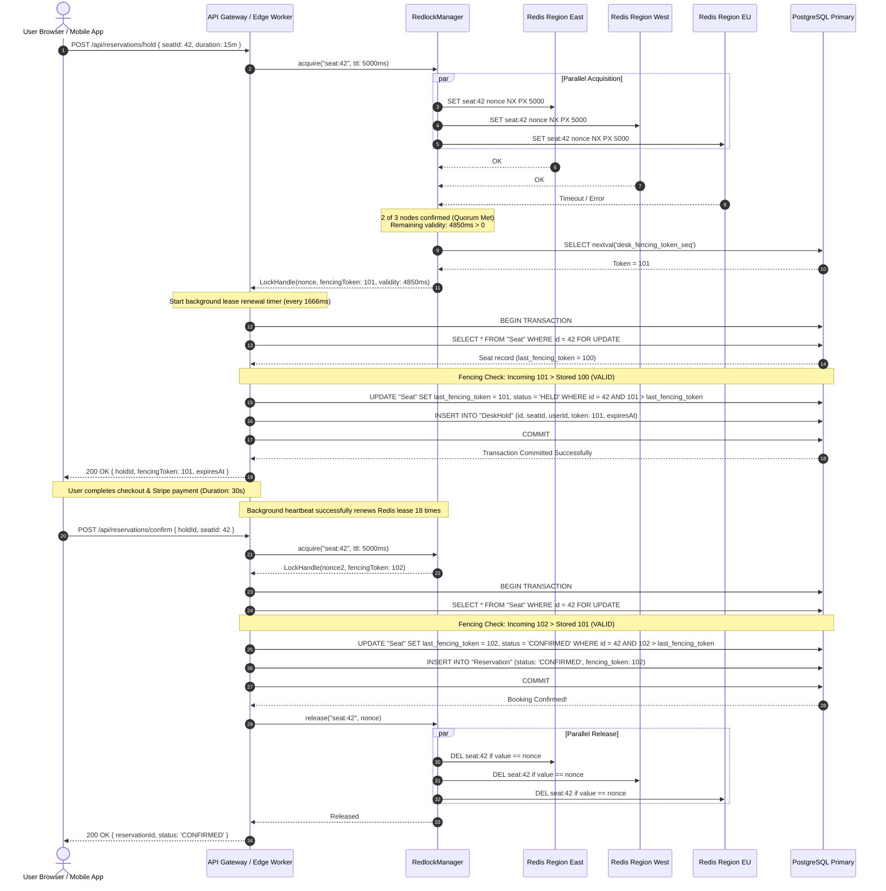
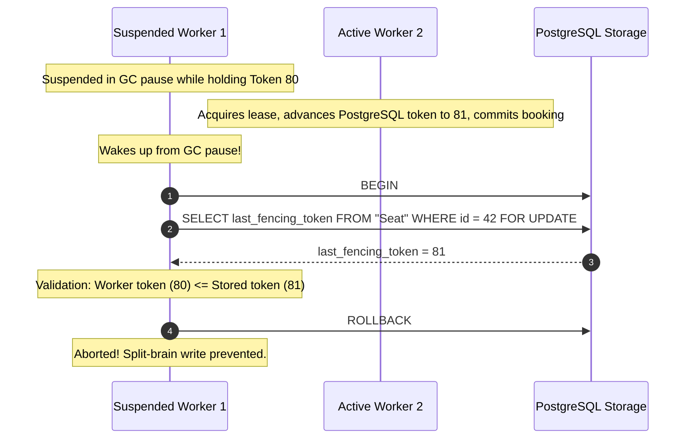

# RFC 0012: Multi-Region Redis Redlock Consensus and Monotonic Lease Fencing Tokens

- **RFC Number:** 0012
- **Title:** Multi-Region Redis Redlock Consensus and Monotonic Lease Fencing Tokens
- **Status:** Proposed
- **Date:** 2026-11-16
- **Authors:** WorkSphere Platform Architecture Team
- **Deciders:** Core Infrastructure & Storage Engineering
- **Target Systems:** `src/lib/redis/RedlockManager.ts`, `src/lib/reservations/bookingEngine.ts`, `src/lib/reservations/leaseManager.ts`, PostgreSQL Schema (`DeskHold`, `Reservation`, `Seat`)

---

## 1. RFC Metadata & Executive Summary

### 1.1 Problem Statement

WorkSphere coordinates short-lived desk holds (e.g., 5-to-15 minute checkout reservations) and definitive booking confirmations across geographically distributed multi-region worker instances and edge gateways. In high-concurrency environments—such as flash seat drops, morning check-in peaks, and high-density coworking venue releases—multiple clients attempt to hold or book identical desks simultaneously.

Historically, Redis-based distributed mutual exclusion (such as single-node leases or naive Redlock implementations) has been used to shield the primary relational database from lock contention. However, in distributed systems subject to arbitrary network partitions, asynchronous replication lag, NTP clock steps, and client-side process pauses (such as Node.js Garbage Collection pauses or event-loop stalls), **a distributed Redis lease alone cannot guarantee data consistency**.

When a worker holding a Redis lease experiences a process pause, its distributed lease can expire silently in Redis while the worker is suspended. A second worker then acquires the lease for the same desk. When the first worker resumes, it remains unaware of lease expiration and proceeds to commit its mutation to PostgreSQL, creating a catastrophic split-brain double-booking condition.

Furthermore, naive per-node Redis counter increments (`INCR`) across independent Redis clusters **do not generate globally monotonic fencing tokens**. When partial acquisitions or regional node failovers occur, token values across granting quorums can regress, corrupting downstream ordering guards.

### 1.2 Scope

This RFC defines:

1. The mathematical quorum and failure-domain model for multi-region Redis Redlock coordination across heterogeneous cloud environments.
2. The exact mechanics and limitations of multi-node atomic Lua scripts for acquisition, renewal, and release.
3. The architectural boundary separating Redis lease coordination (contention reduction) from database consistency (correctness).
4. A strongly consistent, durable, monotonic fencing-token authority design.
5. The PostgreSQL transactional fencing validation pattern that serializes writes and deterministically rejects stale lock holders inside the mutation transaction.
6. A comprehensive failure-mode analysis, observability specification, and non-breaking migration roadmap.

### 1.3 Non-Goals

- Replacing PostgreSQL with an eventual-consistency distributed NoSQL store.
- Implementing consensus algorithms (such as Raft or Paxos) inside the Redis server processes.
- Claiming that the Redis Redlock algorithm by itself guarantees linearizable consistency without storage-layer fencing validation.
- Modifying production application source code or executing database migrations within this RFC phase.

---

## 2. Context & Problem Statement

### 2.1 Why Desk Holds Require Distributed Mutual Exclusion

Physical inventory in WorkSphere represents non-fungible real-world resources (e.g., Desk A-101 at Venue 42). During the checkout lifecycle, a user initiates a temporary hold (a _desk hold_ lasting 5 to 15 minutes) to finalize seating arrangements, specify amenities, or complete payment processing through Stripe.

If hundreds of concurrent requests simultaneously hit the database to hold or book the same desk, unbounded row contention on PostgreSQL leads to transaction serialization failures (`40001`), deadlocks (`40P01`), lock wait timeouts (`55P03`), and connection-pool exhaustion. An in-memory distributed lease tier in Redis provides fast, low-latency rejection of conflicting requests at the edge before transactions reach PostgreSQL.

### 2.2 Split-Brain Scenarios Under Process Pauses and Network Partitions

Consider two client workers, **Worker 1** and **Worker 2**, competing for Desk $D$:

```mermaid
sequenceDiagram
    autonumber
    participant W1 as Worker 1
    participant Redis as Redis Cluster (Quorum)
    participant W2 as Worker 2
    participant PG as PostgreSQL Storage

    W1->>Redis: Acquire lease for Desk D (TTL = 5000ms)
    Redis-->>W1: Granted (Lease Nonce = N1, Valid for 4900ms)
    Note over W1: Worker 1 enters long GC pause / event-loop stall (6000ms)
    Note over Redis: Lease TTL expires; Redis key deleted
    W2->>Redis: Acquire lease for Desk D (TTL = 5000ms)
    Redis-->>W2: Granted (Lease Nonce = N2)
    W2->>PG: BEGIN; Confirm booking for Desk D; COMMIT
    PG-->>W2: Success (Desk D booked by Worker 2)
    Note over W1: Worker 1 wakes up from GC pause!
    Note over W1: Worker 1 falsely assumes lease is still held
    W1->>PG: BEGIN; Write hold/booking for Desk D; COMMIT
    Note over PG: Split-Brain: Worker 1 overwrites Worker 2's booking!
```

In this classic distributed lease problem (analyzed extensively by Martin Kleppmann), time is not a safe synchronization primitive in asynchronous networks. A client cannot verify that its lease is still valid simply by checking local state, because an arbitrary pause can occur _between_ the check and the downstream storage write.

### 2.3 The Insufficiency of Redis Leases Alone

A distributed lease in Redis provides **best-effort mutual exclusion** to throttle contention. It cannot guarantee safety for the following fundamental reasons:

1. **Asynchronous Execution:** Clients run in asynchronous environments where CPU preemption, hypervisor scheduling, memory paging, and garbage collection can suspend a thread indefinitely.
2. **Asymmetric Network Partitions:** A client can become partitioned from Redis while retaining connectivity to PostgreSQL, or vice versa.
3. **No Storage Awareness:** Redis possesses no introspective visibility into whether a downstream PostgreSQL transaction has begun, committed, or aborted.

### 2.4 Independent Storage Validation via Fencing Tokens

To guarantee absolute safety, the final storage layer (PostgreSQL) must independently validate the authority of every incoming write. This is achieved via **monotonic fencing tokens**: an atomically incremented number attached to every lease.

When a write arrives at PostgreSQL:

1. PostgreSQL inspects the transaction's incoming fencing token against the highest fencing token previously accepted for that resource.
2. If the incoming token is strictly greater than the stored token, the transaction advances the stored token and commits.
3. If the incoming token is less than or equal to the stored token, PostgreSQL immediately aborts the transaction, safely neutralizing the stale worker.

---

## 3. Proposed Multi-Region Architecture

### 3.1 Failure Domains and Redis Topology

To ensure fault tolerance against regional cloud outages, the architecture deploys $N$ fully independent Redis master nodes across distinct failure domains.

```
       [ Region 1: us-east-1 ]           [ Region 2: us-west-2 ]           [ Region 3: eu-west-1 ]
      +-----------------------+         +-----------------------+         +-----------------------+
      |  Redis Master Node 1  |         |  Redis Master Node 2  |         |  Redis Master Node 3  |
      |   (AZ 1a / VPC East)  |         |   (AZ 2a / VPC West)  |         |   (AZ 1a / VPC EU)    |
      +-----------------------+         +-----------------------+         +-----------------------+
                 \                                  |                                  /
                  \                                 |                                 /
                   \                                |                                /
                    +-------------------------------+-------------------------------+
                                                    |
                                    [ Multi-Region Client Workers ]
                                    (Next.js Edge / Node.js Engine)
```

**Crucial Deployment Invariants:**

1. **Zero Cross-Master Replication:** Nodes do NOT replicate to one another. There is no active-passive replication or asynchronous replication stream connecting Master 1, Master 2, and Master 3.
2. **Heterogeneous Infrastructure:** Nodes may reside in different cloud availability zones, distinct cloud regions, or across heterogeneous managed Redis providers (e.g., Upstash REST endpoints + AWS ElastiCache standalone masters).
3. **Independent Failure Domains:** Power failures, hypervisor crashes, network partitions, or maintenance reboots on Node $i$ must have zero impact on Node $j$.

### 3.2 Formal Quorum Model

For a cluster of $N$ independent master nodes, the minimum quorum $Q$ required to establish a valid lock lease is:

\[
Q = \left\lfloor \frac{N}{2} \right\rfloor + 1
\]

Where:

- $N$ represents the **total count of configured, independent Redis master nodes**.
- For $N = 3$, $Q = \lfloor 3/2 \rfloor + 1 = 2$.
- For $N = 5$, $Q = \lfloor 5/2 \rfloor + 1 = 3$.

**Why Simple Majority Voting Is Not Sufficient Alone:**
A simple majority count ($Q$ responses) guarantees only that any two quorums share at least one node:

\[
Q_1 \cap Q_2 \neq \emptyset
\]

However, majority intersection guarantees mutual exclusion **if and only if**:

1. All nodes share an identical monotonic timeline or strict linearizable consensus state.
2. Clocks across all nodes and clients drift within a strictly bounded budget $\Delta t$.
3. Nodes that crash either persist all state synchronously to durable storage (`fsync=always`) or remain offline for longer than the maximum lease TTL before rejoining the cluster.

### 3.3 Lease Duration, Clock Drift, and Safety Margins

Let:

- $T_{\text{lease}}$ = Total configured lease time-to-live (`TTL`, e.g., $5000\,\text{ms}$).
- $T_{\text{start}}$ = Client local monotonic timestamp immediately prior to dispatching requests.
- $T_{\text{finish}}$ = Client local monotonic timestamp after receiving responses from all nodes.
- $T_{\text{elapsed}} = T_{\text{finish}} - T_{\text{start}}$ = Total elapsed acquisition time across the network.
- $\delta_{\text{drift}}$ = Maximum allowable clock drift between nodes and client.

Clock drift is formalized as:

\[
\delta_{\text{drift}} = \left( T_{\text{lease}} \times F_{\text{drift}} \right) + \Delta_{\text{ntp}}
\]

Where:

- $F_{\text{drift}}$ = Oscillator drift factor (standard default: $0.01$, representing $1\%$ drift).
- $\Delta_{\text{ntp}}$ = Additive safety cushion for asymmetric network jitter and NTP step corrections ($2\,\text{ms}$).

The **remaining valid lease validity window** $T_{\text{valid}}$ is:

\[
T_{\text{valid}} = T_{\text{lease}} - T_{\text{elapsed}} - \delta_{\text{drift}}
\]

**The Fundamental Safety Invariant:**
A lock lease is granted if and only if:

\[
\text{Acquisition Success Count} \ge Q \quad \land \quad T_{\text{valid}} > 0
\]

If either condition fails, the client MUST immediately release all partially acquired keys across all reachable nodes.

### 3.4 Client Identity & Unique Lock Ownership Tokens

Every lock acquisition attempt generates a cryptographically secure, unguessable, globally unique ownership token:

\[
\text{token} = \text{UUIDv4}() \,\|\, \text{crypto.randomBytes}(16).\text{toString}(\text{'hex'})
\]

This token acts as a secure proof-of-ownership nonce ($128 + 128 = 256$ bits of entropy). It prevents unauthorized lock releases and ensures that no client can inadvertently extend or release a lock owned by another client.

### 3.5 Clarification on Consensus vs. Redlock Heuristic

> [!IMPORTANT]
> **Correctness Warning:** Redis Redlock is **not** a formal state-machine consensus protocol (such as Raft, Paxos, or Viewstamped Replication). Redlock does not maintain a replicated log, does not execute two-phase commit, and cannot survive arbitrary asynchronous timing anomalies without relying on bounded physical clocks.
>
> Therefore, WorkSphere strictly designates Redis Redlock as a **high-speed distributed lease heuristic** to suppress lock contention in the web tier. Absolute linearizability and double-booking prevention are delegated to PostgreSQL's transactional fencing token validation.

---

## 4. Redlock Acquisition Algorithm

### 4.1 Pseudocode for Safe Redlock Acquisition

The following algorithm executes multi-node parallel acquisition with strict timeout bounds, monotonic time tracking, drift budgeting, and automatic compensation rollback.

```typescript
// Proposed Architectural Specification: Safe Redlock Acquisition
interface LockHandle {
  resource: string;
  token: string; // Cryptographic nonce (proof of ownership)
  validityMs: number; // Conservative remaining validity window
  expiresAtMonotonic: number; // Client-side monotonic expiration cutoff
  nodesAcquired: string[]; // Node IDs that confirmed acquisition
}

async function acquireRedlock(
  resource: string,
  leaseDurationMs: number,
  redisNodes: IRedisClient[],
  options: {
    driftFactor?: number;
    nodeTimeoutMs?: number;
    retryCount?: number;
    retryDelayMs?: number;
    retryJitterMs?: number;
  } = {},
): Promise<LockHandle | null> {
  const {
    driftFactor = 0.01,
    nodeTimeoutMs = Math.clamp(Math.floor(leaseDurationMs / 10), 50, 500),
    retryCount = 3,
    retryDelayMs = 200,
    retryJitterMs = 100,
  } = options;

  const N = redisNodes.length;
  const quorum = Math.floor(N / 2) + 1;

  for (let attempt = 0; attempt <= retryCount; attempt++) {
    // 1. Generate globally unique ownership nonce
    const lockToken = `${crypto.randomUUID()}:${crypto.randomBytes(16).toString("hex")}`;

    // 2. Capture monotonic start time (unaffected by NTP steps)
    const tStart = performance.now();

    // 3. Dispatch parallel acquisition across all N nodes with per-node timeout
    const results = await Promise.all(
      redisNodes.map(async (node) => {
        try {
          const ok = await withTimeout(
            node.eval(
              REDLOCK_ACQUIRE_LUA,
              [resource],
              [lockToken, leaseDurationMs],
            ),
            nodeTimeoutMs,
          );
          return { node, granted: ok === 1 || ok === "OK" };
        } catch (err) {
          return { node, granted: false };
        }
      }),
    );

    // 4. Count successful acquisitions
    const successfulNodes = results.filter((r) => r.granted).map((r) => r.node);
    const successCount = successfulNodes.length;

    // 5. Measure elapsed time using monotonic clock
    const tFinish = performance.now();
    const elapsedMs = tFinish - tStart;

    // 6. Calculate clock drift and conservative remaining validity
    const driftMs = Math.round(leaseDurationMs * driftFactor) + 2;
    const remainingValidityMs = leaseDurationMs - elapsedMs - driftMs;

    // 7. Verify Quorum and Validity Safety Condition
    if (successCount >= quorum && remainingValidityMs > 0) {
      return {
        resource,
        token: lockToken,
        validityMs: remainingValidityMs,
        expiresAtMonotonic: tFinish + remainingValidityMs,
        nodesAcquired: successfulNodes.map((n) => n.id),
      };
    }

    // 8. Quorum failed or validity expired: Release partial acquisitions across ALL reachable nodes
    await Promise.all(
      redisNodes.map((node) =>
        node
          .eval(REDLOCK_RELEASE_LUA, [resource], [lockToken])
          .catch(() => null),
      ),
    );

    // Exponential backoff with randomized jitter before next attempt
    if (attempt < retryCount) {
      const jitter = Math.random() * retryJitterMs;
      const delay = retryDelayMs * Math.pow(1.5, attempt) + jitter;
      await sleep(delay);
    }
  }

  return null; // Failed to acquire quorum within retry budget
}
```

### 4.2 Application Validity Window Invariant

The application must enforce a strict fail-closed boundary:

```typescript
function isLockValid(lock: LockHandle): boolean {
  return performance.now() < lock.expiresAtMonotonic;
}
```

If `performance.now() >= lock.expiresAtMonotonic`, the client **must immediately abort** ongoing execution and must not attempt database mutations relying on the expired lease.

---

## 5. Lua Scripts

Because Redis executes Lua scripts atomically in a single thread per instance, scripts guarantee atomic read-modify-write semantics **on that specific node**.

> [!WARNING]
> A Lua script cannot execute atomically across multiple distinct Redis servers. Each node runs its own independent Lua execution context.

### 5.1 Lock Acquisition Script

Acquires the lock if and only if the key does not already exist.

```lua
-- ============================================================================
-- SCRIPT: REDLOCK_ACQUIRE_LUA
-- KEYS[1]: Lock key (e.g., "{seat:42}")
-- ARGV[1]: Unique ownership token (UUID + random bytes)
-- ARGV[2]: Lease duration in milliseconds (TTL)
-- RETURNS: 1 if acquired, 0 if held by another owner
-- ============================================================================
local key = KEYS[1]
local token = ARGV[1]
local ttl = tonumber(ARGV[2])

-- Atomic SET if Not Exists with Millisecond Precision TTL
local result = redis.call("SET", key, token, "NX", "PX", ttl)
if result then
  return 1
else
  return 0
end
```

### 5.2 Lock Renewal Script

Renews the lease if and only if the currently stored value matches the caller's unique ownership token.

```lua
-- ============================================================================
-- SCRIPT: REDLOCK_RENEW_LUA
-- KEYS[1]: Lock key (e.g., "{seat:42}")
-- ARGV[1]: Unique ownership token (caller's nonce)
-- ARGV[2]: Extended lease duration in milliseconds (TTL)
-- RETURNS: 1 if renewed, 0 if expired, missing, or owned by another client
-- ============================================================================
local key = KEYS[1]
local token = ARGV[1]
local ttl = tonumber(ARGV[2])

-- Validate ownership before modifying expiry
if redis.call("GET", key) == token then
  return redis.call("PEXPIRE", key, ttl)
else
  return 0
end
```

**Implications of Partial Renewal Across Nodes:**
If a renewal request reaches some nodes but times out or fails on others such that fewer than $Q$ nodes confirm renewal:

1. The renewal has failed.
2. The client must trigger an immediate compensating release across all nodes and mark the lock as lost (`lock.markLost()`).
3. The application must abort ongoing operations immediately.

### 5.3 Lock Release Script

Releases the lock if and only if the stored ownership token matches the caller's token.

```lua
-- ============================================================================
-- SCRIPT: REDLOCK_RELEASE_LUA
-- KEYS[1]: Lock key (e.g., "{seat:42}")
-- ARGV[1]: Unique ownership token (caller's nonce)
-- RETURNS: 1 if deleted, 0 if token mismatched or key does not exist
-- ============================================================================
local key = KEYS[1]
local token = ARGV[1]

if redis.call("GET", key) == token then
  return redis.call("DEL", key)
else
  return 0
end
```

---

## 6. Monotonic Fencing Token Design

### 6.1 Why Per-Node Redis `INCR` Fails Monotonicity

In earlier naive implementations, each Redis node ran an internal `INCR <key>:fencing` during acquisition, and the client computed:

\[
\text{token} = \max(\text{token}_{R1}, \text{token}_{R2}, \text{token}_{R3})
\]

**Why this breaks under failover or partial grants:**

1. **Partial Acquisition Drift:** Client 0 attempts to acquire a lock. Node $A$ grants the lock and increments its local counter to $6$, but Nodes $B$ and $C$ reject it. Client 0 releases Node $A$, but Node $A$'s counter remains at $6$. Nodes $B$ and $C$ remain at $1$.
2. **Quorum Partition:** Client 1 acquires the lock from Quorum $\{A, B, C\}$. It observes counters $\{A:7, B:2, C:2\}$. The client sets `fencingToken = max(7, 2, 2) = 7`.
3. **Node Failure:** Node $A$ crashes or partitions.
4. **Subsequent Acquisition:** Client 2 acquires the lock from Quorum $\{B, C\}$. Nodes $B$ and $C$ increment their counters to $3$. Client 2 computes `fencingToken = max(3, 3) = 3`.
5. **Catastrophic Inversion:** Client 2 holds a _later_ lease than Client 1, yet carries a **smaller fencing token** ($3 < 7$). Any downstream storage check enforcing `token > last_seen_token` will wrongly reject Client 2 and accept a delayed, stale write from Client 1!

```
Time ------------------------------------------------------------------------------------->
Attempt 1 (Partial):   Node A INCR -> 6 | Node B: fails (0) | Node C: fails (0)
Client 1 on {A, B, C}: Node A -> 7      | Node B -> 1       | Node C -> 1       => Token = 7
--- Node A crashes / partitions ---
Client 2 on {B, C}:    Node A: down     | Node B -> 2       | Node C -> 2       => Token = 2 (REGRESSION!)
```

### 6.2 The Strongly Consistent Fencing Authority

Because independent Redis master nodes do not run consensus or cross-replicate counter state, **independent Redis clusters cannot safely act as a monotonic fencing token authority**.

#### Proposed Architecture: PostgreSQL Sequence Authority

To guarantee global monotonicity, WorkSphere establishes **PostgreSQL itself** (or an equivalent linearizable consensus authority such as CockroachDB, Raft/etcd, or AWS DynamoDB with consistent reads) as the authoritative generator of fencing tokens.

PostgreSQL sequences provide:

- **Strict Monotonicity:** `nextval('desk_fencing_token_seq')` is guaranteed to return strictly increasing 64-bit integers (`BIGINT`).
- **Crash Durability:** Sequence increments are logged via Write-Ahead Logging (WAL) and survive database restarts.
- **High Performance:** Sequence generation is non-blocking and executes in memory with WAL logging, achieving $>100,000$ operations per second without row lock contention.

```sql
-- Global or Per-Venue Monotonic Fencing Sequence
CREATE SEQUENCE IF NOT EXISTS desk_fencing_token_seq
  AS BIGINT
  START WITH 1
  INCREMENT BY 1
  NO MINVALUE
  NO MAXVALUE
  CACHE 1;
```

### 6.3 Association Between Lease and Token Issuance

In distributed locking with fencing tokens (as established by Martin Kleppmann), the client acquires a lock and receives an associated monotonic fencing token $t$. When the client executes storage writes, it passes $t$ to the storage system. Storage accepts writes with token $t_2$ only if $t_2 > t_{\text{last\_accepted}}$.

To integrate this model seamlessly with PostgreSQL while avoiding the pitfalls of non-monotonic Redis counters, WorkSphere evaluates two architectural patterns for token issuance:

#### Pattern A: Centralized Durable Sequence at Lease Acquisition

1. Upon successfully achieving quorum across the independent Redis nodes, the client issues a non-blocking `SELECT nextval('desk_fencing_token_seq')` to the primary PostgreSQL authority (or a dedicated Raft/etcd counter).
2. The returned value $t$ is attached to the `LockHandle` (`lock.fencingToken = t`).
3. During the subsequent hold or booking transaction, the client submits $t$ to PostgreSQL.
4. PostgreSQL locks the `Seat` row `FOR UPDATE`, verifies $t > \text{last\_fencing\_token}$, updates $\text{last\_fencing\_token} = t$, and commits.

#### Pattern B: Lease Nonce Proof with In-Transaction Fencing Assignment

1. The client acquires the Redis lease with cryptographic ownership nonce $N_1$.
2. When performing the transactional mutation, PostgreSQL validates row availability and advances the authoritative sequence `nextval('desk_fencing_token_seq')` directly inside the transaction, assigning the token atomically to the reservation and seat record.
3. Subsequent operations (e.g., checkout confirmation or cancellation) must present the token issued by the hold phase, enforcing that subsequent mutations strictly advance the token.

```
Pattern A Sequence:
[ Edge Client / Worker ]               [ Redis Redlock ]               [ PostgreSQL Database ]
        |                                      |                                  |
        |--- 1. Acquire Redlock Lease -------->|                                  |
        |<-- 2. Granted (Nonce N1) ------------|                                  |
        |                                                                         |
        |--- 3. SELECT nextval('desk_fencing_token_seq') ------------------------>|
        |<-- 4. Returns Monotonic Token (e.g. 101) -------------------------------|
        |       (Attached to LockHandle: lock.fencingToken = 101)                 |
        |                                                                         |
        |--- 5. BEGIN Transaction with Token 101 -------------------------------->|
        |--- 6. SELECT last_fencing_token FROM "Seat" FOR UPDATE ---------------->|
        |       Assert 101 > last_fencing_token (100)                             |
        |--- 7. UPDATE "Seat" SET last_fencing_token = 101 & INSERT --------------->|
        |--- 8. COMMIT ---------------------------------------------------------->|
        |                                      |                                  |
        |--- 9. Release Redlock Lease -------->|                                  |
```

### 6.4 The Asymmetric Fencing Guarantee and Write Ordering

> [!IMPORTANT]
> **Fundamental Distributed Systems Limitation:**
> Issuing a newer fencing token (e.g., Token 102 to Worker 2) **does not automatically or instantaneously prevent an older worker (Worker 1 with Token 101) from writing**, if Worker 1's write arrives at PostgreSQL _before_ Worker 2's write arrives.
>
> A fencing token acts as an **acceptance filter at the protected resource**:
>
> - The resource rejects an operation whose token is _stale relative to the highest token it has already accepted and committed_.
> - If Worker 1 (token 101) is suspended during a GC pause, and Worker 2 acquires the lease, receives Token 102, and **successfully commits** to PostgreSQL (`last_fencing_token` becomes 102), then when Worker 1 resumes and attempts to write with Token 101, PostgreSQL rejects Worker 1 ($101 \le 102$).
> - However, if Worker 2 is issued Token 102 but encounters network latency, and suspended Worker 1 wakes up and reaches PostgreSQL _before_ Worker 2, PostgreSQL will process Worker 1 first ($101 > 100$). When Worker 2 subsequently arrives, Worker 2 ($102 > 101$) will observe the state left by Worker 1 and determine availability accordingly.
>
> Therefore, safety is guaranteed because the storage layer serializes mutations and deterministically prevents an older holder from overwriting a newer holder's committed state.

### 6.5 Why Random UUIDs and Timestamps Are Not Fencing Tokens

- **Random UUIDs:** UUIDs have no mathematical ordering. Storage cannot distinguish whether UUID $A$ was generated before or after UUID $B$.
- **Timestamps:** Physical clocks are subject to NTP adjustments, leap seconds, oscillator drift, and timezone ambiguities. Two workers on separate servers can generate inverted timestamps, violating linearizability.

Only strictly increasing integers ($T_{k+1} > T_k$) provide valid fencing guarantees.

---

## 7. PostgreSQL Transactional Fencing Validation

### 7.1 Database Schema Requirements

To enforce fencing checks, the inventory table (`Seat` or `DeskHold`) maintains an authoritative `last_fencing_token` column:

```sql
-- Migration: Add monotonic fencing token tracking to inventory rows
ALTER TABLE "Seat"
  ADD COLUMN IF NOT EXISTS "last_fencing_token" BIGINT NOT NULL DEFAULT 0;

-- Optional: Track fencing token in historical reservations for auditability
ALTER TABLE "Reservation"
  ADD COLUMN IF NOT EXISTS "fencing_token" BIGINT;
```

### 7.2 Transactional Validation Mechanics

All mutations (creating a hold, confirming a reservation, or updating seat state) must execute inside a single PostgreSQL transaction adhering to the following protocol:

```sql
-- ============================================================================
-- TRANSACTIONAL FENCING VALIDATION & SEAT RESERVATION MUTATION
-- Parameters:
--   :seat_id = Target seat UUID
--   :user_id = Authenticated user UUID
--   :incoming_fencing_token = Fencing token issued to the client lease (BIGINT)
--   :start_time = Reservation start timestamp
--   :end_time = Reservation end timestamp
-- ============================================================================

BEGIN;

-- 1. Deterministically lock the target seat row for update
-- This serializes concurrent transactions targeting the exact same seat
SELECT id, status, last_fencing_token
FROM "Seat"
WHERE id = :seat_id
FOR UPDATE;

-- 2. Validate fencing token: incoming token must be strictly greater than last accepted token
-- Atomically advance the seat's last_fencing_token
UPDATE "Seat"
SET
  last_fencing_token = :incoming_fencing_token,
  status = 'RESERVED',
  "updatedAt" = NOW()
WHERE id = :seat_id
  AND :incoming_fencing_token > last_fencing_token;

-- If zero rows updated, the incoming token is stale or equal: ROLLBACK IMMEDIATELY
-- ROLLBACK; RAISE EXCEPTION 'Stale fencing token';

-- 3. Check for overlapping CONFIRMED reservations
SELECT COUNT(*)::bigint AS overlap_count
FROM "Reservation"
WHERE "seatId" = :seat_id
  AND "status" = 'CONFIRMED'
  AND "startTime" < :end_time
  AND "endTime" > :start_time;

-- If overlap_count > 0, rollback immediately (Seat Already Booked)

-- 4. Insert confirmed reservation record stamped with the fencing token
INSERT INTO "Reservation" (
  "id", "seatId", "userId", "startTime", "endTime",
  "status", "fencing_token", "createdAt", "updatedAt"
)
VALUES (
  gen_random_uuid(), :seat_id, :user_id, :start_time, :end_time,
  'CONFIRMED', :incoming_fencing_token, NOW(), NOW()
);

COMMIT;
```

### 7.3 Application-Level Implementation Pseudocode

```typescript
// Proposed Architectural Implementation in bookingEngine.ts
export async function bookDeskWithFencedTransaction(
  seatId: string,
  userId: string,
  startTime: Date,
  endTime: Date,
  lockHandle: LockHandle, // carries lockHandle.token and lockHandle.fencingToken
): Promise<BookingResult> {
  // Pre-condition: Verify that the Redlock lease has not expired locally
  if (performance.now() >= lockHandle.expiresAtMonotonic) {
    return {
      success: false,
      isConflict: true,
      error:
        "Pre-transaction check failed: Redis lock lease expired before execution",
    };
  }

  const incomingToken = BigInt(lockHandle.fencingToken);

  return await prisma.$transaction(
    async (tx) => {
      // 1. Lock the seat row to serialize writers
      const seats = await tx.$queryRaw<
        Array<{ id: string; status: string; last_fencing_token: bigint }>
      >`
        SELECT "id", "status", "last_fencing_token"
        FROM "Seat"
        WHERE "id" = ${seatId}
        FOR UPDATE;
      `;

      if (seats.length === 0) {
        throw new Error("Seat not found");
      }
      const seat = seats[0];

      // 2. Fencing Assertion: incoming token must be strictly greater than last accepted token
      if (incomingToken <= BigInt(seat.last_fencing_token)) {
        throw new FencingTokenStaleError(
          `Stale fencing token detected: attempted ${incomingToken}, highest seen is ${seat.last_fencing_token}`,
        );
      }

      // 3. Overlap verification
      const overlapping = await tx.$queryRaw<Array<{ count: bigint }>>`
        SELECT COUNT(*)::bigint AS count
        FROM "Reservation"
        WHERE "seatId" = ${seatId}
          AND "status" = 'CONFIRMED'
          AND "startTime" < ${endTime}
          AND "endTime" > ${startTime};
      `;

      if (Number(overlapping[0]?.count ?? 0) > 0) {
        return {
          success: false,
          isConflict: true,
          error: "Seat is already booked for the selected time window",
        };
      }

      // 4. Advance fencing token on Seat record
      await tx.$executeRaw`
        UPDATE "Seat"
        SET "last_fencing_token" = ${incomingToken},
            "updatedAt" = NOW()
        WHERE "id" = ${seatId};
      `;

      // 5. Write confirmed reservation stamped with the accepted fencing token
      const reservation = await tx.$queryRaw`
        INSERT INTO "Reservation" (
          "id", "seatId", "userId", "startTime", "endTime",
          "status", "fencing_token", "createdAt", "updatedAt"
        )
        VALUES (
          gen_random_uuid(), ${seatId}, ${userId}, ${startTime}, ${endTime},
          'CONFIRMED', ${incomingToken}, NOW(), NOW()
        )
        RETURNING *;
      `;

      return {
        success: true,
        reservation,
        fencingToken: incomingToken.toString(),
      };
    },
    {
      isolationLevel: Prisma.TransactionIsolationLevel.ReadCommitted,
      timeout: 10000, // 10 second statement timeout
    },
  );
}
```

### 7.4 Fencing Scope: Per-Desk vs. Global

| Scope                                          | Pros                                                                                     | Cons                                                                                           | Recommendation                                                                                                                            |
| ---------------------------------------------- | ---------------------------------------------------------------------------------------- | ---------------------------------------------------------------------------------------------- | ----------------------------------------------------------------------------------------------------------------------------------------- |
| **Global Sequence** (`desk_fencing_token_seq`) | Simple to implement, single database sequence, monotonic across all desks in the system. | High counter growth over years; non-contiguous sequence numbers per desk.                      | **Recommended for WorkSphere**: PostgreSQL `BIGINT` provides $9 \times 10^{18}$ values, making sequence exhaustion physically impossible. |
| **Per-Desk Version Column** (`Seat.version`)   | Human-readable contiguous versions ($1, 2, 3\dots$) per desk.                            | Requires atomic row lock (`FOR UPDATE`) before knowing the version; more complex schema setup. | Viable alternative if per-desk versioning is desired for audit tracking.                                                                  |

---

## 8. Failure-Mode and Safety Analysis

| Failure Mode                                    | Risk                                                                        | Detection                                                                         | Mitigation                                                                                                                                             | Residual Limitation                                                                                  |
| ----------------------------------------------- | --------------------------------------------------------------------------- | --------------------------------------------------------------------------------- | ------------------------------------------------------------------------------------------------------------------------------------------------------ | ---------------------------------------------------------------------------------------------------- |
| **Asymmetric Network Partition**                | Client loses connection to a minority of Redis nodes during lease renewal.  | Per-node network timeout ($50\,\text{ms}$) expires; node error captured.          | Quorum calculation ($Q \ge \lfloor N/2 \rfloor + 1$); if quorum is lost, client aborts and executes rollback release on reachable nodes.               | Minority nodes may hold expired keys until their internal TTL lapses.                                |
| **Redis Master Node Failure / Crash**           | Node crashes after granting lease.                                          | Client connection pool reports connection refused or socket timeout.              | Redlock tolerates up to $\lfloor (N-1)/2 \rfloor$ dead nodes. For $N=3$, cluster tolerates 1 dead node.                                                | If 2 of 3 nodes fail simultaneously, Redlock availability degrades to fail-closed.                   |
| **Redis Cluster Failover (Master-Replica Lag)** | Async replica promoted before key replicates; two clients acquire same key. | Inconsistency detected if two clients proceed concurrently.                       | Independent masters with zero replication. Do not use async read-replicas for Redlock. PostgreSQL transactional fencing catches split-brain writes.    | If operators improperly configure async replicas under Redlock, failover can grant duplicate leases. |
| **Hardware Clock Drift / NTP Step**             | Node clock jumps forward, prematurely expiring a valid lease.               | Monotonic client clock comparison detects premature expiration.                   | Mathematical drift budget $\delta_{\text{drift}} = (\text{TTL} \times 0.01) + 2\,\text{ms}$ subtracted from validity. Max TTL clamped to 5–15 seconds. | Pathological drift exceeding $1\%$ can cause premature lease expiry.                                 |
| **Process Pause (GC / Event-Loop Stall)**       | Worker sleeps for $> \text{TTL}$; wakes up believing it still owns lock.    | Client checks `performance.now() >= expiresAtMonotonic`.                          | Monotonic validity check before transaction. PostgreSQL row-level lock and fencing validation reject stale write.                                      | If worker resumes after pause, it wastes a database roundtrip before being rejected.                 |
| **Lease Expiration Race**                       | Lease expires in Redis exactly as transaction hits PostgreSQL.              | Database transaction execution time exceeds lease validity.                       | Row lock `FOR UPDATE` serializes writes. PostgreSQL checks `token > last_fencing_token`.                                                               | Stale transaction fails and rolls back cleanly; client receives conflict response.                   |
| **Partial Lock Acquisition**                    | Client acquires 1 of 3 nodes; network blocks remaining nodes.               | `successCount < quorum` check fails.                                              | Compensating release dispatched to all nodes; backoff with randomized jitter.                                                                          | Temporarily advances memory on granting node until TTL expires.                                      |
| **Partial Lease Renewal**                       | Renewal succeeds on 1 node but fails on quorum.                             | Renewal quorum check fails; `isLost` flag set.                                    | Client triggers auto-rollback release on all nodes; background heartbeat throws `LockLostError`.                                                       | Application must catch `LockLostError` and abort in-flight work.                                     |
| **Token Authority Unavailable**                 | PostgreSQL primary is down or sequence cannot be read.                      | `nextval()` query throws database connection error.                               | Application returns HTTP 503 Service Unavailable; fails closed safely without corrupting data.                                                         | Booking system is unavailable during database primary failover.                                      |
| **PostgreSQL Transaction Conflict**             | Concurrent transactions attempt to update same seat row.                    | PostgreSQL returns error `55P03` (lock not available) or `40P01` (deadlock).      | `withTransactionRetry` helper retries with exponential backoff and jitter.                                                                             | Sustained extreme contention can exhaust retry attempts ($3\times$).                                 |
| **Stale Holder Resumes After Outage**           | Partitioned worker reconnects hours later and attempts write.               | Stored token in `Seat.last_fencing_token` is higher than stale worker's sequence. | PostgreSQL transaction aborts on `UPDATE ... WHERE token > last_fencing_token`.                                                                        | Minimal database load to execute single rejected query.                                              |

---

## 9. End-to-End Desk Booking Flow



### Stale Holder Rejection Flow



---

## 10. Operational Considerations & Observability

### 10.1 Key Metrics & Telemetry

Production monitoring must ingest Prometheus/OpenTelemetry metrics from `RedlockManager` and `bookingEngine`:

| Metric Name                           | Type      | Description                                                                                    | Alert Threshold                                                       |
| ------------------------------------- | --------- | ---------------------------------------------------------------------------------------------- | --------------------------------------------------------------------- |
| `redlock_acquisition_success_total`   | Counter   | Total successful quorum lock acquisitions.                                                     | Normal throughput baseline.                                           |
| `redlock_acquisition_failure_total`   | Counter   | Total failed acquisitions, partitioned by reason (`no_quorum`, `validity_expired`, `timeout`). | Rate spike $> 15\%$ over 5-minute window.                             |
| `redlock_node_unreachable_total`      | Counter   | Failures per Redis node instance (Node 1, Node 2, Node 3).                                     | Single node failing $> 5\%$ calls $\implies$ regional health warning. |
| `redlock_lease_validity_remaining_ms` | Histogram | Distribution of remaining validity windows upon acquisition.                                   | $p_{99} < 1000\,\text{ms}$ on a $5000\,\text{ms}$ lease.              |
| `redlock_renewal_lost_total`          | Counter   | Leases lost during background auto-renewal heartbeats.                                         | $> 1$ per hour (investigate network stalls).                          |
| `fencing_token_stale_rejection_total` | Counter   | Transactions rejected by PostgreSQL due to stale fencing tokens.                               | Any occurrence indicates process pause or lease expiration race.      |
| `postgres_advisory_lock_wait_ms`      | Histogram | Time spent acquiring row or transaction advisory locks.                                        | $p_{95} > 250\,\text{ms}$.                                            |

### 10.2 Regional Health Checks & Fail-Closed Behavior

1. **Active Synthetic Probing:** Every web worker executes a synthetic health check (`PING` and round-trip timing) against each configured Redis node every $15\,\text{seconds}$.
2. **Fail-Closed Principle:** If fewer than $Q$ nodes are healthy, the client fails closed for distributed lease acquisition. It does **not** silently fall back to an unsafe single-node lock. In degraded mode, the system safely routes requests directly through PostgreSQL advisory and row locks, sacrificing edge throttling to preserve correctness.

---

## 11. Security & Correctness Considerations

### 11.1 Cryptographic Entropy of Nonce Tokens

Ownership nonces must use cryptographically secure pseudorandom number generators (`crypto.randomBytes(16)` concatenated with UUIDv4). Nonces must never be predictable, sequential, or derived from system timestamps. This prevents malicious tenants or unauthorized workers from forging release commands.

### 11.2 Prevention of Token Replay and Stale Overwrites

Because PostgreSQL sequence numbers never repeat and never decrement, replay attacks and out-of-order writes are mathematically impossible. Even if a compromised or misbehaving client captures a valid fencing token, it cannot reuse that token once the seat row has advanced to a higher token.

### 11.3 Sanitization and Privacy

- Fencing tokens and lease nonces contain zero Personally Identifiable Information (PII) and are safe for structured logging.
- Redis connection strings (`REDLOCK_REDIS_URLS`) and Upstash REST bearer tokens (`REDLOCK_REDIS_TOKENS`) must be strictly masked and excluded from application trace logs.

### 11.4 Idempotency and Deduplication

All checkout hold and booking confirmation requests require a client-generated `Idempotency-Key` HTTP header.

- The idempotency key is recorded in PostgreSQL within the same transaction as the booking.
- Retried requests carrying the same idempotency key return the cached reservation result without acquiring a new lease or advancing the fencing token.

---

## 12. Alternatives and Trade-offs

| Architecture                                                   | Mutual Exclusion Guarantee                                                                                                            | Operational Complexity                                                                                    | Contention at Edge                                                  | Failure Tolerance                                                                   |
| -------------------------------------------------------------- | ------------------------------------------------------------------------------------------------------------------------------------- | --------------------------------------------------------------------------------------------------------- | ------------------------------------------------------------------- | ----------------------------------------------------------------------------------- |
| **Pure PostgreSQL (Advisory Locks + `FOR UPDATE`)**            | **Absolute (ACID).** Linearizable consistency guaranteed by PostgreSQL WAL.                                                           | **Very Low.** Uses existing relational infrastructure; no external state.                                 | **High.** All contending requests hit PostgreSQL connection pool.   | Database primary is a Single Point of Failure (mitigated by standby replicas).      |
| **Single-Node Redis (with Lua Scripts)**                       | **None across failovers.** Data lost during asynchronous replica promotion creates split-brain.                                       | **Low.** Simple single endpoint.                                                                          | **Optimal.** Sub-millisecond rejection of contention.               | Zero tolerance for primary failure without risking duplicate leases.                |
| **Consensus Engine (etcd / Consul / Raft)**                    | **Absolute.** Formal linearizable Raft consensus with monotonic Raft terms.                                                           | **Very High.** Requires maintaining a dedicated 3- or 5-node consensus cluster with operational overhead. | **Moderate.** Slightly higher latency than Redis for edge workers.  | Survives $\lfloor (N-1)/2 \rfloor$ node failures with guaranteed consistency.       |
| **Proposed Hybrid: Multi-Region Redlock + PostgreSQL Fencing** | **Absolute at Storage, Best-Effort at Edge.** Redlock shields database from contention; PostgreSQL enforces monotonic fencing safety. | **Moderate.** Uses independent Redis nodes + existing PostgreSQL primary.                                 | **Optimal.** Edge absorbs $>95\%$ of contention during flash drops. | Redlock survives minority node outages; PostgreSQL guarantees zero double-bookings. |

---

## 13. Rollout and Migration Strategy

The migration executes in six non-breaking, backwards-compatible phases:

```
[ Phase 1: Database Schema ] --> [ Phase 2: Transaction Validation ] --> [ Phase 3: Observability Mode ]
                                                                                   |
[ Phase 6: Full Enforcement ] <-- [ Phase 5: Gradual Canary Rollout ] <-- [ Phase 4: Feature Flagging ]
```

### Phase 1: Database Migration (Non-Breaking)

Deploy database migrations to create the global fencing sequence and add tracking columns:

```sql
CREATE SEQUENCE IF NOT EXISTS desk_fencing_token_seq AS BIGINT START WITH 1 INCREMENT BY 1 CACHE 1;
ALTER TABLE "Seat" ADD COLUMN IF NOT EXISTS "last_fencing_token" BIGINT NOT NULL DEFAULT 0;
ALTER TABLE "Reservation" ADD COLUMN IF NOT EXISTS "fencing_token" BIGINT;
```

### Phase 2: Transactional Fencing Integration

Update `src/lib/reservations/bookingEngine.ts` to fetch `nextval('desk_fencing_token_seq')` inside the reservation transaction and stamp it on the `Seat` and `Reservation` rows without blocking legacy clients.

### Phase 3: Shadow Observability Mode

Emit metrics whenever an incoming operation attempts to mutate a seat. Verify across production telemetry that zero legitimate transactions experience out-of-order sequence arrivals.

### Phase 4: Feature-Flagged Validation

Introduce configuration flag `FEATURE_STRICT_FENCING_ENFORCEMENT=true`. When active, `UPDATE "Seat"` includes the strict predicate:

```sql
WHERE id = :seatId AND :nextToken > last_fencing_token
```

### Phase 5: Multi-Region Redis Redlock Topology

Provision independent Redis nodes across secondary availability zones and update `REDLOCK_REDIS_URLS`. Enable auto-renewal heartbeats with monotonic clock tracking.

### Phase 6: Rollback and Degraded Operation Plan

If multi-node Redis clusters suffer widespread network partitions:

- Redis leasing is disabled via environment variable (`REDLOCK_ENABLED=false`).
- Workers fall back seamlessly to direct PostgreSQL advisory locks (`pg_try_advisory_xact_lock`).
- **Database fencing validation remains permanently enabled**, guaranteeing that even during total Redis unavailability, double bookings can never occur.

---

## 14. Open Questions & Future Considerations

1. **Redis Node Infrastructure Selection:**
   - _Decision needed:_ Should WorkSphere deploy dedicated self-hosted Redis instances on AWS EC2/K8s across 3 regions, or leverage multi-region REST Redis providers (e.g., Upstash global endpoints with multi-read regions)?
2. **Lease TTL vs. Payment Webhook Latency:**
   - _Trade-off:_ A 5000ms Redlock lease requires continuous background auto-renewal during a 30-second Stripe Checkout redirect. If the worker running the renewal timer dies, the hold expires prematurely. Should desk holds be split into a 15-minute persistent `DeskHold` database record and a 5-second technical lock on the confirmation mutation? _(Architectural recommendation: Yes; separate business holds from technical mutation locks)._
3. **Partitioned Sharding & Hash Tags:**
   - _Requirement:_ If any Redis node is upgraded to a sharded Redis Cluster, all keys touched in multi-key operations must include hash tags (e.g., `{seat:42}` and `{seat:42}:fencing`) to prevent cross-slot execution errors.
4. **Sequence Exhaustion:**
   - _Analysis:_ At 1,000 bookings per second continuously, a 64-bit PostgreSQL `BIGINT` sequence ($9.22 \times 10^{18}$) will last approximately $292$ million years. No rollover mechanism is required.

---

## 15. References

1. Salvatore Sanfilippo (antirez). _Distributed Locks with Redis (The Redlock Algorithm)_. https://redis.io/docs/latest/develop/use/distlock/
2. Martin Kleppmann. _How to do distributed locking_ (2016). https://martin.kleppmann.com/2016/02/08/how-to-do-distributed-locking.html
3. Salvatore Sanfilippo. _Is Redlock safe? A response to Martin Kleppmann_ (2016). http://antirez.com/news/101
4. PostgreSQL Global Development Group. _PostgreSQL Documentation: CREATE SEQUENCE & Advisory Locks_. https://www.postgresql.org/docs/current/explicit-locking.html#ADVISORY-LOCKS
5. WorkSphere Architecture Documentation. `docs/architecture/REDLOCK_FENCING_TOKENS.md` and `docs/architecture/distributed-locks-and-fencing.md`.
