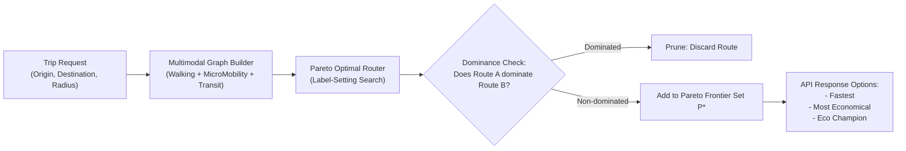

# Pareto Frontier Multi-Modal Route Trade-off Guide

This engineering guide explains the multi-objective optimization mathematical model, Pareto dominance criteria, and carbon calculation heuristics powering WorkSphere's eco-routing engine.

---

## 1. Executive Summary & Problem Formulation

When navigating between workspaces, digital nomads balance three fundamentally conflicting objectives:

1. **Travel Duration ($T$):** Total transit, dwell, and walking time (minutes/seconds).
2. **Transit Fare ($C$):** Financial expenditure on tickets, micro-mobility unlocking/per-minute fees, or rideshare fares (USD/fiat).
3. **Carbon Footprint ($E$):** Total greenhouse gas emissions generated ($\text{g CO}_2\text{e}$).

A single composite scalar metric (e.g., $w_1 T + w_2 C + w_3 E$) forces arbitrary trade-offs that fail across varied nomad priorities (e.g., a climate-conscious commuter walking in pleasant weather vs. a founder rushing to an investor pitch). Instead, WorkSphere employs a **Pareto Frontier Optimization Model** that filters out strictly dominated routes and presents only Pareto-optimal options: "Fastest", "Budget / Free", and "Greenest / Zero Emission".



---

## 2. Mathematical Definition of Pareto Dominance

Let a route option $A$ be represented by the objective vector:

$$\mathbf{r}_A = \begin{bmatrix} T_A \\ C_A \\ E_A \end{bmatrix}$$

Where all three objectives are to be minimized: $\min (T, C, E)$.

### Strict Dominance Criterion

Route $A$ **dominates** Route $B$ (written $\mathbf{r}_A \prec \mathbf{r}_B$) if and only if $A$ is no worse than $B$ across all objectives and strictly better in at least one objective:

$$\mathbf{r}_A \prec \mathbf{r}_B \iff \left( \forall i \in \{T, C, E\}, r_{A,i} \le r_{B,i} \right) \land \left( \exists j \in \{T, C, E\}, r_{A,j} < r_{B,j} \right)$$

In floating-point evaluations, an epsilon threshold $\varepsilon = 10^{-9}$ is enforced to protect against numerical imprecision:

$$r_{A,i} \le r_{B,i} + \varepsilon \quad \text{and} \quad \exists j \text{ s.t. } r_{A,j} < r_{B,j} - \varepsilon$$

### The Pareto Frontier ($\mathcal{P}^*$)

The Pareto Frontier is the set of all feasible candidate routes $\mathcal{R}$ that are not dominated by any other feasible route:

$$\mathcal{P}^* = \left\{ \mathbf{r} \in \mathcal{R} \;\middle|\; \nexists \mathbf{r}' \in \mathcal{R} \text{ such that } \mathbf{r}' \prec \mathbf{r} \right\}$$

---

## 3. Worked Example: Dominated vs. Non-Dominated Routes

Consider a nomad traveling $3.2\text{ km}$ from a central coliving hub to a quiet coworking cafe during peak hours:

| Route ID  | Modalities Used        | Duration ($T$)  | Cost ($C$) | Emissions ($E$) |      Status       | Classification & Justification                                                                                                  |
| :-------: | :--------------------- | :-------------: | :--------: | :-------------: | :---------------: | :------------------------------------------------------------------------------------------------------------------------------ |
| **$R_1$** | Walking                | $42\text{ min}$ |  $\$0.00$  |  $0\text{ g}$   | **Non-Dominated** | **Budget / Greenest:** Slowest, but completely free and zero emission.                                                          |
| **$R_2$** | E-Scooter              | $12\text{ min}$ |  $\$4.20$  |  $38\text{ g}$  | **Non-Dominated** | **Fastest:** Lowest duration, low carbon, moderate cost.                                                                        |
| **$R_3$** | Metro (Subway)         | $18\text{ min}$ |  $\$2.50$  | $112\text{ g}$  | **Non-Dominated** | **Balanced Transit:** Faster than walking, cheaper than scooter.                                                                |
| **$R_4$** | Gas Rideshare (Taxi)   | $16\text{ min}$ | $\$16.50$  | $550\text{ g}$  |   **DOMINATED**   | **Dominated by $R_2$:** Slower than $R_2$ ($16 > 12$), 4x more expensive ($16.50 > 4.20$), and 14x more emissions ($550 > 38$). |
| **$R_5$** | City Bus (2 Transfers) | $36\text{ min}$ |  $\$2.75$  | $192\text{ g}$  |   **DOMINATED**   | **Dominated by $R_3$:** Slower ($36 > 18$), more expensive ($2.75 > 2.50$), and more polluting ($192 > 112$).                   |

```
Emissions (g)
  ^
600 |                    [R4: Taxi] (Dominated by R2)
  |
400 |
  |
200 |         [R3: Metro]  [R5: Bus] (Dominated by R3)
  |            *
  |       [R2: E-Scooter]
  |          *
  0 +-------------------*-------------------------> Duration (min)
    0        12        18        42
            (Fast)   (Mid)     (Walk: R1)

    * = Points on the Pareto Frontier P*
```

---

## 4. Carbon Savings Baseline Calculations

Emissions avoided by taking an eco-route are calculated against an EPA/DEFRA-standard **Single-Occupancy Gasoline Passenger Vehicle** baseline ($172\text{ g CO}_2\text{e / km}$), as standardized in [`docs/analytics/CARBON_SAVINGS_GUIDE.md`](../analytics/CARBON_SAVINGS_GUIDE.md).

### Mode Emission Factors ($\text{EF}_m$)

| Mode ($m$)                          | Emission Factor ($\text{g CO}_2\text{e / km}$) | Primary Source                                      |
| :---------------------------------- | :--------------------------------------------: | :-------------------------------------------------- |
| `WALKING`                           |                      $0$                       | Human metabolic baseline (zero added Scope 1/2)     |
| `BICYCLING`                         |                      $0$                       | Mechanical human propulsion                         |
| `ELECTRIC_SCOOTER`                  |                      $12$                      | Battery charging lifecycle average                  |
| `PUBLIC_TRANSIT` (Metro/Light Rail) |                      $35$                      | Grid-powered passenger-kilometer average            |
| `ELECTRIC_VEHICLE` (EV)             |                      $48$                      | Clean energy mix charging average                   |
| **`GASOLINE_CAR` (Baseline)**       |                   **$172$**                    | **DEFRA Passenger Car (Single Occupancy Baseline)** |

### Avoided Emissions Formulation

For a trip of total distance $d_{\text{km}}$ composed of multimodal legs $L_1, \dots, L_k$ where each leg has distance $d_k$ and mode $m_k$:

$$\text{Emissions}_{\text{actual}} = \sum_{k=1}^K \left( d_k \times \text{EF}(m_k) \right)$$

$$\text{Emissions}_{\text{baseline}} = d_{\text{km}} \times \text{EF}(\text{GASOLINE\_CAR})$$

$$\Delta \text{Emissions}_{\text{avoided}} = \max\left(0, \text{Emissions}_{\text{baseline}} - \text{Emissions}_{\text{actual}}\right)$$

### Worked Example:

- Total trip distance: $5.0\text{ km}$
- Baseline gasoline car emissions: $5.0 \times 172 = 860\text{ g CO}_2\text{e}$
- Selected route: $1.0\text{ km}$ walking ($0\text{ g}$) + $4.0\text{ km}$ metro ($4.0 \times 35 = 140\text{ g}$)
- Actual emissions: $140\text{ g CO}_2\text{e}$
- **Avoided Carbon Savings:** $860 - 140 = 720\text{ g CO}_2\text{e}$ ($0.72\text{ kg}$)

---

## 5. Multi-Modal API Integration

The multi-modal routing matrix is exposed via [`src/app/api/routing/multimodal/route.ts`](../../src/app/api/routing/multimodal/route.ts).

### Endpoint Specification

- **Method:** `POST`
- **Path:** `/api/routing/multimodal`
- **Content-Type:** `application/json`

### Request Body Schema

```typescript
export interface MultimodalRouteRequest {
  startLat: number;
  startLng: number;
  endLat: number;
  endLng: number;
  /** Radius in meters to search for micro-mobility vehicles (defaults to 1000m) */
  radiusMeters?: number;
}
```

### Response Schema

```typescript
export interface MultimodalRouteResponse {
  success: boolean;
  route: {
    path: string[];
    totalDurationSeconds: number;
    totalCost: number;
    modes: Array<"walking" | "scooter" | "bike" | "transit">;
    isEstimated: boolean;
    fallbackReason?: string;
  };
  isEstimated: boolean;
  availableVehicles: Array<{
    id: string;
    type: "scooter" | "bike";
    lat: number;
    lng: number;
    batteryPercent?: number;
  }>;
}
```

### High-Availability Fallback Mechanism

If external graph providers (OSRM, Valhalla) fail with HTTP 503, 504, or network timeouts, [`src/lib/routing/ecoRoutingEngine.ts`](../../src/lib/routing/ecoRoutingEngine.ts) intercepts the failure and falls back to a deterministic direct Haversine walking calculation ($4.8\text{ km/h}$ average walking speed). The response flags `isEstimated: true` and includes `fallbackReason: "NO_GRAPH_PATH"`, guaranteeing that the client UI never experiences a blocking error.

---

## 6. Related Documentation

- [Commuter Carbon Savings Calculation and Emissions Offset Guide](../analytics/CARBON_SAVINGS_GUIDE.md) — Emission factor tables, Scope 3 methodology, and carbon footprint tracker.
- [Carbon Calculation Methodology](../analytics/CARBON_CALCULATION_METHODOLOGY.md) — EPA internal combustion engine baseline factors.
- [Transit Solver & Branch-and-Bound Specification](./transit-solver-branch-and-bound.md) — Multi-venue schedule optimization and time-window constraint pruning.
- [Spatial Geo-Query Guide](../search/SPATIAL_GEO_QUERY_GUIDE.md) — Coordinate validation, Haversine equations, and radius search geometry.
