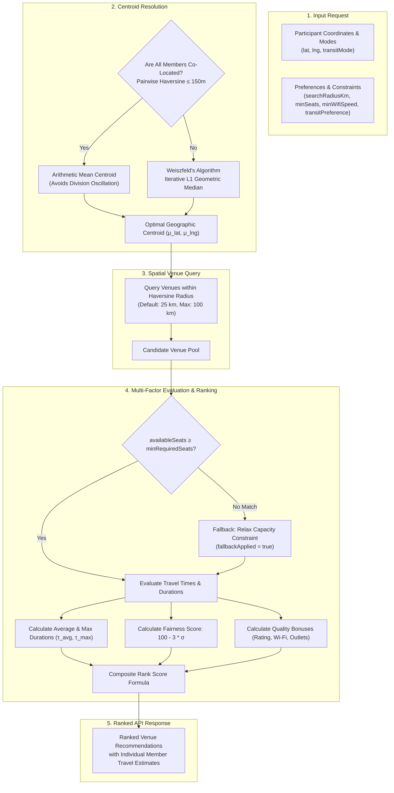

# Multi-Modal Meet Halfway Routing Algorithm & API Specification

Comprehensive documentation of the mathematical formulations, transit mode weighting algorithms, venue scoring criteria, and API contracts powering WorkSphere's **Meet Halfway** collaborative routing engine.

---

## 1. Overview & Core Architecture

The **Meet Halfway** service computes an equitable meeting location for distributed teams convening for ad-hoc collaborative sessions. Unlike naïve arithmetic center-of-mass calculations that penalize majority participants when an outlier is present, WorkSphere implements an $L_1$ Fermat-Weber Geometric Median combined with multi-modal transit friction weighting and commute fairness variance penalties.

### Architecture Workflow



---

## 2. Mathematical Formulations

### 2.1 Great-Circle Distance (Haversine Formula)

The spherical distance $d$ between two coordinate pairs $(\phi_1, \lambda_1)$ and $(\phi_2, \lambda_2)$ in radians is computed using Earth's volumetric mean radius $R = 6,371,000\text{ m}$:

$$\Delta\phi = \phi_2 - \phi_1, \quad \Delta\lambda = \lambda_2 - \lambda_1$$

$$a = \sin^2\left(\frac{\Delta\phi}{2}\right) + \cos(\phi_1)\cos(\phi_2)\sin^2\left(\frac{\Delta\lambda}{2}\right)$$

$$c = 2 \cdot \operatorname{atan2}\left(\sqrt{a}, \sqrt{1 - a}\right)$$

$$d = R \cdot c$$

### 2.2 Geometric Median ($L_1$ Fermat-Weber Problem)

The geometric median $x^*$ minimizes the sum of Euclidean distances to all $N$ participant locations $m_i = (\phi_i, \lambda_i)$:

$$x^* = \underset{x \in \mathbb{R}^2}{\operatorname{argmin}} \sum_{i=1}^N \|x - m_i\|_2$$

Because no closed-form analytic solution exists for $N \ge 3$, WorkSphere solves this convex optimization problem via **Weiszfeld's Algorithm**:

1. **Initialization:** Compute the arithmetic mean as the initial guess $x^{(0)}$:
   $$x^{(0)} = \frac{1}{N} \sum_{i=1}^N m_i$$

2. **Iterative Step:** At iteration $k+1$, update coordinates using inverse-distance weighting:
   $$w_i^{(k)} = \frac{1}{\max\left(\|x^{(k)} - m_i\|_2, \epsilon\right)}, \quad \text{where } \epsilon = 10^{-8}$$
   $$x^{(k+1)} = \frac{\sum_{i=1}^N w_i^{(k)} m_i}{\sum_{i=1}^N w_i^{(k)}}$$

3. **Termination:** Iterate until $\|x^{(k+1)} - x^{(k)}\|_2 < 10^{-6}$ or maximum iterations ($k_{\max} = 100$) are reached.

---

## 3. Multi-Modal Transit Modeling & Speeds

Door-to-door commute times are modeled with standard urban velocities, including an empirical **20% routing overhead factor** and a **2-minute fixed transfer/departure buffer**:

$$t_i = \max\left(1, \operatorname{round}\left(\frac{d(m_i, v)}{v_{\text{mode}}} \times 1.2 + 2\right)\right)$$

| Mode | Base Speed ($v_{\text{mode}}$) | Speed ($\text{m/min}$) | Modeling Description |
| :--- | :--- | :--- | :--- |
| **`walking`** | $4.8\text{ km/h}$ | $80.0\text{ m/min}$ | Pedestrian walking velocity |
| **`bicycling`** | $16.0\text{ km/h}$ | $266.67\text{ m/min}$ | Urban cycling / micro-mobility speed |
| **`transit`** | $25.0\text{ km/h}$ | $416.67\text{ m/min}$ | Mixed rail / bus with station access overhead |
| **`driving`** | $35.0\text{ km/h}$ | $583.33\text{ m/min}$ | Urban arterial vehicular speed with traffic |

### Transit Preferences

The team-level `transitPreference` dictates mode resolution:
- **`transit` (default):** Evaluates all participants using the public transit model ($25\text{ km/h}$).
- **`walking`:** Forces pedestrian travel duration for all members ($4.8\text{ km/h}$).
- **`balanced`:** Respects each participant's individual `transitMode` preference; falls back to `transit` when unspecified.

---

## 4. Commute Equity & Composite Ranking

WorkSphere evaluates venues based on aggregate duration, commute fairness, and physical amenities.

### 4.1 Fairness Score (Variance Penalty)

Let $t_1, t_2, \dots, t_N$ denote the estimated travel durations for all participants to venue $v$, and $\bar{t} = \frac{1}{N}\sum t_i$ denote average duration:

$$\sigma = \sqrt{\frac{1}{N} \sum_{i=1}^N (t_i - \bar{t})^2}$$

$$\text{FairnessScore} = \max\left(0, \operatorname{round}(100 - 3 \times \sigma)\right)$$

*Note:* When all participants are co-located, $\sigma = 0$ and the fairness score is locked to $100$.

### 4.2 Quality Bonuses

1. **Rating Bonus (up to 25 pts):**
   $$\text{Bonus}_{\text{rating}} = (\text{venue.rating} \mathbin{??} 3.5) \times 5$$
2. **Wi-Fi Speed Bonus (up to 15 pts):**
   $$\text{Bonus}_{\text{wifi}} = \min\left(15, \frac{\text{venue.wifiSpeed} \mathbin{??} 50}{100} \times 15\right)$$
3. **Power Outlets Bonus (5 pts):**
   $$\text{Bonus}_{\text{outlets}} = \begin{cases} 5, & \text{if } \text{hasOutlets} = \text{true} \\ 0, & \text{otherwise} \end{cases}$$

### 4.3 Composite Rank Score

$$\text{CompositeScore} = \max\left(0, \operatorname{round}\left(100 - 1.5 \bar{t} + 0.4 \times \text{FairnessScore} + \text{Bonus}_{\text{rating}} + \text{Bonus}_{\text{wifi}} + \text{Bonus}_{\text{outlets}}\right)\right)$$

Venues are ordered in descending order of `compositeRankScore`.

---

## 5. API Reference

### `POST /api/routing/meet-halfway`

Computes the geometric median centroid, queries matching workspaces, and returns ranked recommendations with individual commute estimates.

#### Request Headers
```http
Content-Type: application/json
```

#### Request Body Schema

```json
{
  "members": [
    {
      "id": "member-1",
      "name": "Alex Rivera",
      "latitude": 37.7749,
      "longitude": -122.4194,
      "transitMode": "transit"
    },
    {
      "id": "member-2",
      "name": "Jordan Lee",
      "latitude": 37.7891,
      "longitude": -122.4014,
      "transitMode": "bicycling"
    }
  ],
  "searchRadiusKm": 25,
  "minSeats": 4,
  "minWifiSpeed": 50,
  "hasOutlets": true,
  "transitPreference": "balanced",
  "category": "coworking"
}
```

#### Parameter Details

| Field | Type | Required | Default | Description |
| :--- | :--- | :--- | :--- | :--- |
| `members` | `Array<MemberLocation>` | **Yes** | — | Array of $\ge 2$ team members with distinct locations |
| `members[].id` | `string` | **Yes** | — | Unique participant identifier |
| `members[].name` | `string` | **Yes** | — | Participant display name |
| `members[].latitude` | `number` | **Yes** | — | Latitude coordinate $[-90, 90]$ |
| `members[].longitude` | `number` | **Yes** | — | Longitude coordinate $[-180, 180]$ |
| `members[].transitMode` | `enum` | No | `"transit"` | `"transit"`, `"driving"`, `"bicycling"`, or `"walking"` |
| `searchRadiusKm` | `number` | No | `25` | Search radius from centroid (Max: $100\text{ km}$) |
| `minSeats` | `number` | No | — | Minimum contiguous seating capacity required |
| `minWifiSpeed` | `number` | No | `0` | Minimum Wi-Fi download speed in Mbps |
| `hasOutlets` | `boolean` | No | `false` | Filter for verified power outlet availability |
| `transitPreference` | `enum` | No | `"transit"` | `"transit"`, `"walking"`, or `"balanced"` |
| `category` | `string` | No | — | Filter venue category (e.g. `"coworking"`, `"cafe"`) |

#### Response Schema (`200 OK`)

```json
{
  "success": true,
  "centroid": {
    "latitude": 37.7820,
    "longitude": -122.4104
  },
  "searchRadiusMeters": 25000,
  "isCoLocated": false,
  "fallbackApplied": false,
  "recommendedVenues": [
    {
      "venue": {
        "id": "venue-101",
        "name": "SoMa Coworking Collective",
        "latitude": 37.7815,
        "longitude": -122.4089,
        "category": "coworking",
        "rating": 4.8,
        "wifiSpeed": 180,
        "hasOutlets": true,
        "maxCapacity": 40,
        "currentOccupancy": 15,
        "availableSeatsCount": 25
      },
      "centroidDistanceMeters": 142,
      "averageDurationMinutes": 14,
      "maxDurationMinutes": 18,
      "fairnessScore": 92,
      "compositeRankScore": 128,
      "availableCapacity": 25,
      "memberEstimates": [
        {
          "memberId": "member-1",
          "memberName": "Alex Rivera",
          "distanceMeters": 1250,
          "durationMinutes": 12,
          "transitMode": "transit"
        },
        {
          "memberId": "member-2",
          "memberName": "Jordan Lee",
          "distanceMeters": 1420,
          "durationMinutes": 16,
          "transitMode": "bicycling"
        }
      ]
    }
  ]
}
```

---

## 6. Edge Cases & Boundary Policies

| Edge Case | Policy & System Behavior |
| :--- | :--- |
| **Co-located Participants ($\le 150\text{ m}$)** | Detected via `isTeamCoLocated(members, 150)`. Switches to arithmetic mean to avoid Weiszfeld zero-distance division oscillation. `fairnessScore` is pinned to $100$. |
| **Identical Coordinates** | Checked via `Zod` schema refinement. Requests with fewer than 2 unique coordinate pairs return `HTTP 400 Bad Request`. |
| **Extreme Geographic Distances ($> 100\text{ km}$)** | `searchRadiusKm` is bounded by `MAX_SEARCH_RADIUS_KM` ($100\text{ km}$). Inter-city cohorts beyond this radius cannot be matched to a common physical workspace. |
| **Insufficient Seat Capacity** | If zero venues satisfy `availableSeats >= minSeats`, the engine automatically relaxes the constraint (`fallbackApplied: true`) and returns candidate venues sorted by proximity and composite score. |
| **Empty or Single-Member Cohorts** | Handled gracefully: 1 member returns their exact coordinates; empty member lists return `{ latitude: 0, longitude: 0 }`. |
