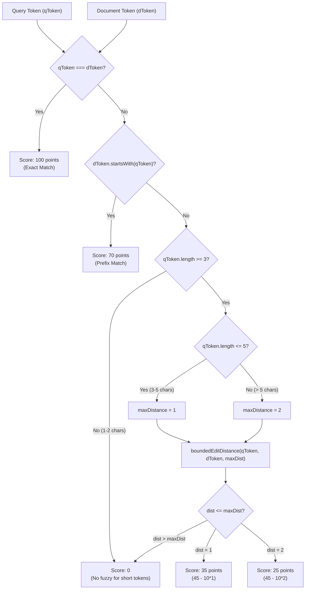

# Offline Venue Search Index: Normalization, Tokenization & Fuzzy Matching Rules

## 1. Executive Overview

WorkSphere is engineered with an **offline-first** design. Digital nomads frequently work in transit, on flights, or in locations with intermittent internet access. To ensure users can continue discovering coworking desks, meeting pods, and quiet focus venues without an active network connection, WorkSphere includes an in-memory client-side search index: **`OfflineVenueSearchIndex`** (`src/lib/search/offlineVenueSearchIndex.ts`).

The offline search index provides:

- Client-side full-text search with zero network latency
- Robust Unicode and diacritic normalization (e.g., matching `Café` with `cafe`)
- Tokenization across names, neighborhoods, amenities, and community tags
- Typo tolerance via length-bounded Levenshtein edit distance
- Multi-attribute facet filtering (minimum WiFi speed, maximum noise level, open seats)
- Deterministic, tiered relevance ranking with stable tiebreaking

---

## 2. Data Structures & Architecture

The offline search index is defined in `src/lib/search/offlineVenueSearchIndex.ts`:

```typescript
export interface SearchableVenue {
  id: string;
  name: string;
  neighborhood?: string;
  amenities?: readonly string[];
  tags?: readonly string[];
  wifiMbps?: number;
  noiseDb?: number;
  availableSeats?: number;
}

export interface VenueSearchFacets {
  minWifiMbps?: number;
  maxNoiseDb?: number;
  minAvailableSeats?: number;
}

export interface VenueSearchMatch {
  venue: SearchableVenue;
  score: number;
  matchedTokens: string[];
}
```

### Internal Index Storage:

- **`venuesById: Map<string, SearchableVenue>`**: Fast key-value document store keyed by venue ID.
- **`venueTokens: Map<string, string[]>`**: Inverted token list storing the normalized, deduplicated token array for each venue.

---

## 3. Query & Text Normalization Pipeline

Before indexing or searching, text strings pass through `normalizeSearchText(input)`:

```typescript
export function normalizeSearchText(input: string): string {
  if (typeof input !== "string") return "";
  return input
    .normalize("NFD")
    .replace(/[\u0300-\u036f]/g, "")
    .toLowerCase()
    .replace(/[^a-z0-9\s]/g, " ")
    .replace(/\s+/g, " ")
    .trim();
}
```

### Transformation Steps:

1. **Type Guard:** Ensures non-string values return an empty string (`""`).
2. **Unicode Canonical Decomposition (`NFD`):** Decomposes accented characters into base letters and combining diacritical marks (e.g., `é` becomes `e` + `\u0301`).
3. **Diacritic Stripping (`/[\u0300-\u036f]/g`):** Eliminates diacritical marks, converting accented characters to standard ASCII equivalents (`Café` $\to$ `Cafe`, `München` $\to$ `Munchen`).
4. **Lowercasing (`.toLowerCase()`):** Enforces case-insensitive comparison.
5. **Punctuation & Symbol Sanitization (`/[^a-z0-9\s]/g`):** Replaces punctuation, symbols, and hyphens with whitespace (`laptop-friendly!` $\to$ `laptop friendly `).
6. **Whitespace Collapsing (`/\s+/g`):** Reduces repeated spaces, tabs, and newlines to a single space.
7. **Trimming (`.trim()`):** Strips leading and trailing spaces.

### Normalization Example:

```text
Input:       "  Café Bandra — 24/7 (High-Speed!)  "
Step 1 NFD:  "  Cafe\u0301 Bandra — 24/7 (High-Speed!)  "
Step 2 Strip:"  Cafe Bandra — 24/7 (High-Speed!)  "
Step 3 Lower:"  cafe bandra — 24/7 (high-speed!)  "
Step 4 Alnum:"  cafe bandra   24 7  high speed   "
Step 5 Collapse & Trim: "cafe bandra 24 7 high speed"
```

---

## 4. Tokenization & Multi-Field Indexing

Tokens are extracted using `tokenizeSearchText(input)`:

```typescript
export function tokenizeSearchText(input: string): string[] {
  const normalized = normalizeSearchText(input);
  return normalized
    ? Array.from(new Set(normalized.split(" ").filter(Boolean)))
    : [];
}
```

### Venue Ingestion:

When `indexVenue(venue)` is invoked, the index combines searchable fields into a unified token set:
$$\text{Document Text} = \text{Name} + \text{Neighborhood} + \text{Amenities} + \text{Tags}$$

```typescript
this.venueTokens.set(
  venue.id,
  tokenizeSearchText(
    [
      venue.name,
      venue.neighborhood ?? "",
      ...(venue.amenities ?? []),
      ...(venue.tags ?? []),
    ].join(" "),
  ),
);
```

---

## 5. Bounded Levenshtein Edit Distance

Fuzzy matching is powered by `boundedEditDistance(a, b, maxDistance)`:

```typescript
export function boundedEditDistance(
  a: string,
  b: string,
  maxDistance = 2,
): number {
  if (a === b) return 0;
  if (!a.length) return b.length <= maxDistance ? b.length : maxDistance + 1;
  if (!b.length) return a.length <= maxDistance ? a.length : maxDistance + 1;
  if (Math.abs(a.length - b.length) > maxDistance) return maxDistance + 1;

  let prevRow = new Array<number>(b.length + 1);
  let currRow = new Array<number>(b.length + 1);
  for (let j = 0; j <= b.length; j += 1) prevRow[j] = j;

  for (let i = 1; i <= a.length; i += 1) {
    currRow[0] = i;
    let rowMin = currRow[0];
    for (let j = 1; j <= b.length; j += 1) {
      const val = Math.min(
        prevRow[j] + 1,
        currRow[j - 1] + 1,
        prevRow[j - 1] + (a[i - 1] === b[j - 1] ? 0 : 1),
      );
      currRow[j] = val;
      if (val < rowMin) rowMin = val;
    }
    if (rowMin > maxDistance) return maxDistance + 1;
    [prevRow, currRow] = [currRow, prevRow];
  }
  return prevRow[b.length];
}
```

### Performance & Early-Pruning Optimizations:

1. **Identical String Guard:** $O(1)$ fast return if $a == b$.
2. **Length Delta Check:** If $|a.\text{length} - b.\text{length}| > \text{maxDistance}$, edit distance is mathematically guaranteed to exceed the threshold. Evaluates in $O(1)$ without matrix allocation.
3. **Two-Row Space Optimization:** Only two rows ($O(|b|)$ space) are retained in memory rather than a full $(|a|+1) \times (|b|+1)$ matrix.
4. **Row Minimum Early Exit:** If the minimum value in `currRow` exceeds `maxDistance`, subsequent operations cannot produce a distance $\le \text{maxDistance}$, terminating execution immediately.

---

## 6. Scoring Weights & Ranking Rules

When a query is processed, each query token is compared against every document token in candidate venues:



### Scoring Hierarchy:

| Match Tier           | Condition                                   |      Score Awarded | Example                                     |
| -------------------- | ------------------------------------------- | -----------------: | ------------------------------------------- |
| **Exact Match**      | `dToken === qToken`                         |            **100** | Query `fiber` matches venue amenity `fiber` |
| **Prefix Match**     | `dToken.startsWith(qToken)`                 |             **70** | Query `ban` matches `bandra`                |
| **Fuzzy Distance 1** | $\text{dist} = 1$ and $\text{length} \ge 3$ | **35** ($45 - 10$) | Query `qiet` matches `quiet`                |
| **Fuzzy Distance 2** | $\text{dist} = 2$ and $\text{length} > 5$   | **25** ($45 - 20$) | Query `espreso` matches `espresso`          |

### Multi-Token Accumulation:

For multi-token queries, total score is the sum of the best match score for each query token:
$$\text{Total Score} = \sum_{q \in \text{queryTokens}} \max_{d \in \text{docTokens}} \text{Score}(q, d)$$

### Fallback Score for Facet-Only Searches:

When the query text is empty (`""`) but facet filters are active, venues passing facet criteria receive a baseline score based on WiFi speed and available desk capacity:
$$\text{Facet Score} = \text{round}\left(\left(\frac{\text{wifiMbps}}{1000} + \frac{\text{availableSeats}}{100}\right) \times 1000\right) / 1000$$

### Sorting Order & Tiebreaking:

Results are sorted primarily by **descending score**, with ties broken deterministically by **ascending venue ID**:

```typescript
results.sort(
  (a, b) => b.score - a.score || a.venue.id.localeCompare(b.venue.id),
);
```

---

## 7. Facet Filtering Rules

The index evaluates numerical attribute thresholds via `matchesVenueFacets(venue, facets)`:

```typescript
export function matchesVenueFacets(
  venue: SearchableVenue,
  facets?: VenueSearchFacets,
): boolean {
  if (!facets) return true;
  if (
    typeof facets.minWifiMbps === "number" &&
    Number.isFinite(facets.minWifiMbps) &&
    (venue.wifiMbps ?? 0) < facets.minWifiMbps
  )
    return false;
  if (
    typeof facets.maxNoiseDb === "number" &&
    Number.isFinite(facets.maxNoiseDb) &&
    (venue.noiseDb ?? Number.POSITIVE_INFINITY) > facets.maxNoiseDb
  )
    return false;
  if (
    typeof facets.minAvailableSeats === "number" &&
    Number.isFinite(facets.minAvailableSeats) &&
    (venue.availableSeats ?? 0) < facets.minAvailableSeats
  )
    return false;
  return true;
}
```

- **`minWifiMbps`:** Venue must meet or exceed bandwidth threshold (venues with undefined WiFi default to `0 Mbps`).
- **`maxNoiseDb`:** Venue acoustic level must not exceed decibel limit (venues with undefined noise default to $+\infty$).
- **`minAvailableSeats`:** Open seat capacity must meet or exceed required quantity.

---

## 8. Worked Examples

Given sample venues:

- `v-bandra`: `Café Bandra Studio`, amenities: `['fiber', 'quiet', 'power']`, wifi: `180 Mbps`, noise: `46 dB`, seats: `8`
- `v-powai`: `Powai Lake Desk`, amenities: `['24x7', 'fiber', 'power']`, wifi: `220 Mbps`, noise: `54 dB`, seats: `14`

### Example A: Exact Match

- **Query:** `"fiber"`
- `v-bandra`: matches token `fiber` $\to$ Score = **100**
- `v-powai`: matches token `fiber` $\to$ Score = **100**
- **Outcome:** Both returned; tie broken by ID (`v-bandra` then `v-powai`).

### Example B: Prefix Match

- **Query:** `"ban"`
- `v-bandra`: matches prefix of `bandra` $\to$ Score = **70**
- `v-powai`: no matching tokens $\to$ Score = **0**
- **Outcome:** `[v-bandra]` (score: 70).

### Example C: Typo Match (Distance 1)

- **Query:** `"qiet"` ($\text{length} = 4 \le 5 \implies \text{maxDistance} = 1$)
- `v-bandra`: distance between `qiet` and `quiet` is $1 \le 1$. Score = $45 - (1 \times 10) =$ **35**.
- `v-powai`: distance to `power` is $2 > 1$. Score = **0**.
- **Outcome:** `[v-bandra]` (score: 35).

### Example D: Facet-Gated Search

- **Query:** `"power"`, Facets: `{ minWifiMbps: 200, minAvailableSeats: 10 }`
- `v-bandra`: has `power`, but `wifiMbps: 180 < 200` $\implies$ Filtered out.
- `v-powai`: has `power`, `wifiMbps: 220 >= 200`, `availableSeats: 14 >= 10` $\implies$ Match.
- **Outcome:** `[v-powai]` (score: 100).

---

## 9. Related Architectural Documents & Source Files

- [OfflineVenueSearchIndex Implementation](file:///d:/Opensource/WorkSphere-Opensource/src/lib/search/offlineVenueSearchIndex.ts)
- [Offline Search Index Unit Tests](file:///d:/Opensource/WorkSphere-Opensource/src/__tests__/lib/search/offlineVenueSearchIndex.test.ts)
- [Hybrid Reciprocal Rank Fusion Guide](file:///d:/Opensource/WorkSphere-Opensource/docs/search/hybrid-rrf-tuning.md)
- [Spatial Geo Query Guide](file:///d:/Opensource/WorkSphere-Opensource/docs/search/SPATIAL_GEO_QUERY_GUIDE.md)
