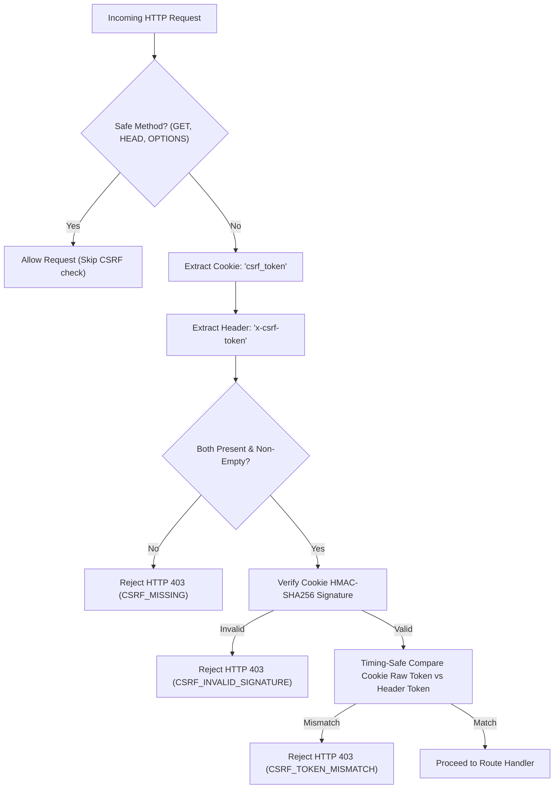

# CSRF Double-Submit Cookie Verification Specification

## Overview & Threat Model

Cross-Site Request Forgery (CSRF) allows malicious external origins to execute state-changing HTTP mutations on behalf of an authenticated user. WorkSphere enforces a signed double-submit cookie architecture with cryptographic 256-bit entropy, timing-safe validation, and subdomain isolation across all mutation endpoints (`POST`, `PUT`, `PATCH`, `DELETE`).

---

## Token Structure & Session Binding

### Cryptographic Entropy & HMAC-SHA256 Signature
A raw CSRF token consists of 32 cryptographically secure random bytes (256 bits of entropy) generated via `crypto.getRandomValues(new Uint8Array(32))`.

The signed token follows the format:
```
<raw_token_base64url>.<hmac_signature_base64url>
```
1. **Raw Token**: URL-safe Base64 encoded 256-bit random value.
2. **HMAC Signature**: An HMAC-SHA256 signature generated over the raw token using server secret `CSRF_SECRET`:
   $$\text{Signature} = \text{HMAC-SHA256}(\text{Key} = \text{CSRF\_SECRET}, \text{Data} = \text{RawToken})$$
3. **Session Binding**: Tokens are bound to the user session / device context. Tokens cannot be generated or forged by untrusted clients lacking access to `CSRF_SECRET`.

---

## Cookie Security Flags & Subdomain Isolation

The CSRF token is issued via an HTTP response cookie named `csrf_token` with strict defense-in-depth security attributes:

| Cookie Attribute | Configuration | Security Objective |
| :--- | :--- | :--- |
| **Name** | `csrf_token` | Standardized cookie identifier. |
| **HttpOnly** | `true` | Prevents Cross-Site Scripting (XSS) from reading the cookie storage handle. |
| **Secure** | `true` (in production) | Restricts transmission strictly over encrypted HTTPS channels. |
| **SameSite** | `Lax` | Blocks third-party cross-site request context on mutation queries while allowing top-level safe GET navigations. |
| **Path** | `/` | Scoped to application root. |
| **Domain** | Omitted (host-only) | **Subdomain Isolation**: By omitting the `Domain` attribute, the cookie is restricted exclusively to the issuing origin (e.g. `app.worksphere.io`), preventing malicious or compromised subdomains (e.g. `user-content.worksphere.io`) from reading or overwriting CSRF cookies. |
| **Max-Age / Expiration** | 86,400 seconds (24 hours) | Limits replay window; renewed on active session refresh. |

---

## Request Verification Pipeline

For all incoming state-changing HTTP methods (`POST`, `PUT`, `PATCH`, `DELETE`):



### Verification Pipeline Steps:
1. **Method Check**: Safe methods (`GET`, `HEAD`, `OPTIONS`) bypass CSRF checks.
2. **Extraction**:
   - Extract signed cookie `csrf_token` from request cookies.
   - Extract submitted token from request header `x-csrf-token`.
3. **Cryptographic Validation**:
   - Decouple signed cookie into raw token and signature.
   - Verify HMAC-SHA256 signature using constant-time comparison.
4. **Timing-Safe Comparison**:
   - Compares the verified raw token against the header token using `crypto.subtle.timingSafeEqual` (or constant-time byte iteration), preventing timing side-channel attacks.
5. **Execution**: If all checks succeed, the request proceeds to the mutation handler; otherwise, an immediate `403 Forbidden` response is returned.

---

## Client Integration Example

Frontend mutation requests must fetch the CSRF token on boot and provide it in request headers:

```typescript
// Fetch token on initialization
const { csrfToken } = await fetch("/api/auth/csrf-token").then(res => res.json());

// Attach to mutation requests
await fetch("/api/bookings/reserve", {
  method: "POST",
  headers: {
    "Content-Type": "application/json",
    "x-csrf-token": csrfToken,
  },
  body: JSON.stringify(bookingPayload),
});
```
