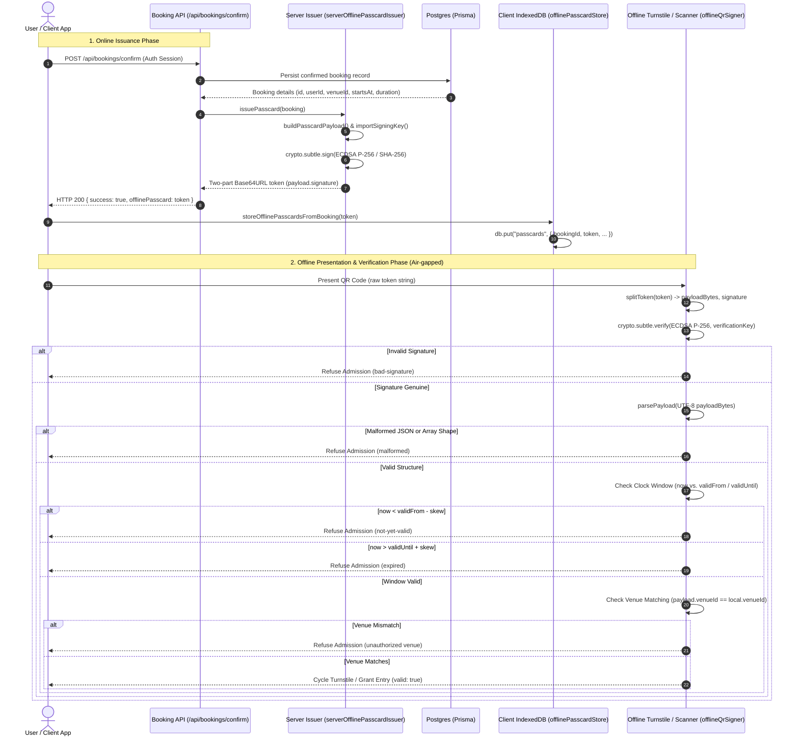

# WorkSphere Offline QR Passcard Security Specification and Verification Guide

> **Normative Audit Document — Issue #8923**<br>
> **Status:** Active / Authoritative Reference<br>
> **Target Module:** `src/lib/security/offlineQrSigner.ts`, `src/lib/security/serverOfflinePasscardIssuer.ts`, `src/lib/security/offlinePasscardStore.ts`, `src/lib/security/keyRotation.ts`<br>
> **Author:** Antigravity Engineering & Security Review Team<br>
> **Date:** November 2026<br>
> **Classification:** Technical Security Specification & Verification Guide<br>

---

## 1. Overview and Scope

This document provides the formal security specification, threat model, gap analysis, and penetration verification guide for WorkSphere's offline QR passcard issuance and verification architecture.

WorkSphere enables hybrid office bookings, hot-desk reservations, and physical venue access. In environments such as shielded coworking suites, underground concourses, or disaster-recovery locations without cellular or Wi-Fi connectivity, online access control fails. WorkSphere resolves this using digitally signed, compact offline passcard tokens presented as QR codes that door turnstiles, desk scanners, and user devices can verify locally without network access.

### 1.1 Threat Model and Security Objectives

The security architecture is designed to enforce the following core objectives:

1. **Authenticity and Integrity:** Physical access scanners must be capable of verifying that a presented passcard token originated from an authorized WorkSphere server and has not been altered (e.g., modifying `userId`, `venueId`, `seatNumber`, or validity timestamps).
2. **Temporal Boundedness:** A passcard must only grant admission within its designated temporal window (`validFrom` to `validUntil`), preventing pre-entry or expired access.
3. **Venue Isolation:** A passcard issued for Venue A must be rejected by turnstiles at Venue B.
4. **Key Separation & Minimal Secret Exposure:** Scanners, kiosks, and client devices must only hold public verification keys. Private signing keys must remain strictly confined to secure server-side execution environments.
5. **Fail-Closed Operation:** Any parsing failure, structural deviation, signature invalidity, or environment malfunction must immediately result in access refusal.

### 1.2 System Boundaries and Trust Model

| Component                                                         | Trust Level                  | Capabilities and Boundary Constraints                                                                                                            |
| :---------------------------------------------------------------- | :--------------------------- | :----------------------------------------------------------------------------------------------------------------------------------------------- |
| **Server Issuance Module** (`serverOfflinePasscardIssuer.ts`)     | **Trusted**                  | Executes in server-side Next.js environment (`"server-only"`). Accesses `OFFLINE_PASSCARD_PRIVATE_KEY_JWK` to sign passcards.                    |
| **Active Signing Key** (`OFFLINE_PASSCARD_PRIVATE_KEY_JWK`)       | **Secret**                   | Cryptographic private key (ECDSA P-256). Must never leave the server or be exposed to client bundles or scanners.                                |
| **Public JWKS Endpoint** (`/api/security/offline-passcards/keys`) | **Public**                   | Publicly accessible distribution route returning active and retained public keys (`OFFLINE_PASSCARD_PUBLIC_JWKS`).                               |
| **Client Storage** (`offlinePasscardStore.ts`)                    | **Untrusted Device Storage** | Local browser IndexedDB (`worksphere-offline-passcards`). Holds bearer tokens on the user's mobile device for offline display.                   |
| **Passcard Bearer Token / QR**                                    | **Untrusted Transport**      | UTF-8 encoded, Base64URL-serialized token transmitted optically via screen or print. Vulnerable to interception, photo capture, or replication.  |
| **Offline Verification Scanner** (`offlineQrSigner.ts`)           | **Semi-Trusted Verifier**    | Embedded turnstile, desk tablet, or kiosk operating offline. Holds cached public verification keys. Relies entirely on its local hardware clock. |

### 1.3 Online Issuance vs. Offline Verification

- **Online Issuance:** Occurs during booking confirmation (`POST /api/bookings/confirm`) or explicit passcard re-issue (`POST /api/security/qr-passcard/issue`). The server verifies user authentication via Clerk (`auth()`), queries PostgreSQL through Prisma, ensures the booking is active and unexpired, constructs a fixed-order payload, and signs it.
- **Offline Verification:** Executes entirely locally without external network round-trips. The verifier imports the venue's cached public keys via Web Crypto (`crypto.subtle`), parses the token, validates the digital signature, enforces the timestamp window against local clock time, and matches `venueId`.

### 1.4 Explicit Out-of-Scope Threats

The following attack vectors are explicitly out of scope for the offline cryptographic passcard layer and must be mitigated by physical security, operator supervision, or online reconciliation:

1. **Visual / Optical Passcard Sharing (Bearer Token Duplication):** The QR code is a bearer credential. A user who takes a screenshot or photo of their QR passcard and hands it to an accomplice cannot be prevented from doing so by the offline cryptographic payload itself.
2. **Cross-Device Offline Double-Redemption:** In an air-gapped venue where two turnstiles operate without a shared local network or mesh, turnstile 1 and turnstile 2 cannot synchronize redemptions in real time. Global double-redemption prevention requires network connectivity or a shared physical consensus medium.
3. **Physical Tailgating / Piggybacking:** The passcard only validates authorization to cycle an entry gate; physical turnstile sensors or security guards must prevent unauthorized accompanying persons.
4. **Client Device Host Compromise:** If an attacker gains root/physical access to an unlocked user device, the attacker can extract stored tokens from IndexedDB.

---

## 2. Architecture and Trust Boundaries

### 2.1 Complete Issuance-to-Verification Lifecycle

The end-to-end lifecycle spans server issuance, mobile caching, optical transfer, and offline turnstile verification:



---

## 3. Cryptographic Implementation and Reality-Check Gap Analysis

> [!IMPORTANT]
> **Issue #8923 Reality-Check Notice:**<br>
> The title and brief for Issue #8923 request a formal specification for _"Ed25519 offline QR passcard issuance"_ with _"HMAC nonce seed generation"_ and _"IndexedDB spent-token storage"_.<br>
> In strict compliance with the core instruction (**"Document the protocol that actually exists in the repository. Do not invent cryptographic protections, key derivation procedures, nonce generation mechanisms, storage guarantees, timestamp rules, or verification behavior that the code does not implement"**), this section documents the actual cryptographic implementation present on `main` and provides an exhaustive gap analysis comparing the requested properties with repository reality.

### 3.1 Implemented Protocol vs. Issue #8923 Presumption

WorkSphere's offline passcard subsystem is implemented across `src/lib/security/offlineQrSigner.ts`, `src/lib/security/serverOfflinePasscardIssuer.ts`, and `src/lib/security/keyRotation.ts`.

| Cryptographic Property       | Issue #8923 Presumption                  | Actual WorkSphere Implementation (`main`)                                         | Source Reference                |
| :--------------------------- | :--------------------------------------- | :-------------------------------------------------------------------------------- | :------------------------------ |
| **Signature Algorithm**      | Ed25519 (EdDSA over Curve25519)          | **ECDSA over NIST P-256 (`secp256r1`) with SHA-256 (`ES256`)**                    | `offlineQrSigner.ts:78-79`      |
| **Cryptographic Engine**     | `@noble/ed25519` or Web Crypto Ed25519   | **W3C Web Crypto API (`crypto.subtle`)**                                          | `offlineQrSigner.ts:82-88`      |
| **Key Parameters**           | Ed25519 Curve25519                       | `{ name: "ECDSA", namedCurve: "P-256" }`                                          | `offlineQrSigner.ts:78`         |
| **Hash Function**            | SHA-512 (implicit in Ed25519)            | **SHA-256** (`{ name: "ECDSA", hash: "SHA-256" }`)                                | `offlineQrSigner.ts:79`         |
| **Signature Format**         | 64-byte Ed25519 signature                | **64-byte raw IEEE P1363 ECDSA (`r                                                |                                 | s`, 32 bytes each)** | `offlineQrSigner.ts:70` |
| **Key Encoding**             | Raw 32-byte public key / 32-byte seed    | **JSON Web Key (JWK) — `kty: "EC"`, `crv: "P-256"`**                              | `offlineQrSigner.ts:301-349`    |
| **Key Derivation (KDF)**     | Claimed HKDF / HMAC seed derivation      | **Absent / Not Implemented.** Web Crypto random keygen (`subtle.generateKey`)     | `offlineQrSigner.ts:296-298`    |
| **HMAC Nonce Seed**          | Presumed HMAC-SHA256 nonce generator     | **Absent / Not Implemented.** Tokens contain no nonce field.                      | `offlineQrSigner.ts:32-41`      |
| **Turnstile Spent-Token DB** | Presumed IndexedDB spent nullifier store | **Absent / Not Implemented.** IndexedDB is client-side only (caching own passes). | `offlinePasscardStore.ts:26-36` |

### 3.2 Security Controls Classification

To provide clarity for auditors, the security controls of the passcard issuance and verification subsystem are categorized into four tiers:

#### A. Implemented Security Controls

- **Asymmetric ECDSA P-256 Signing & Verification:** Uses standard Web Crypto primitives (`crypto.subtle.sign` and `crypto.subtle.verify`).
- **Non-Extractable Private Key Confinement:** Signing keys are server-only (`"server-only"`), imported as non-extractable, with usage restricted strictly to `["sign"]`.
- **Private Key Parameter Stripping:** Client import routines (`importVerificationKey`) and server JWKS sanitization (`sanitizeAndValidatePublicJwk`) reject any JWK containing private component `d`.
- **Full Payload Signature Coverage:** All 6 payload fields (`bookingId`, `userId`, `venueId`, `validFrom`, `validUntil`, `seatNumber`) and version `1` are bound under the signature.
- **Direct Raw Byte Verification:** The signature is evaluated against the exact received UTF-8 payload bytes prior to JSON parsing, preventing canonicalization and parser-differential exploits.
- **Bounded Clock-Skew Tolerance:** Skew tolerance is clamped to a maximum of 300 seconds ($5\text{ minutes}$), preventing callers from specifying infinite or negative windows.
- **Fail-Closed Error Handling:** Corrupt tokens, invalid signatures, malformed structures, or out-of-window timestamps immediately return `valid: false` with specific error codes.

#### B. Partially Implemented Security Controls

- **Deterministic Payload Serialization:** Serialized via `JSON.stringify([1, bookingId, userId, venueId, validFrom, validUntil, seatNumber])`. Because the payload is a fixed-order positional array of primitive strings/integers, serialization is deterministic on issuance. However, the verifying side does not canonicalize; it relies on byte-level invariance.
- **Multi-Key Rotation Support:** Scanners can hold up to 10 retained public keys and attempt trial verification sequentially (`verifyOfflinePasscardWithKeys`), but tokens lack a `kid` header, requiring $O(N)$ verification operations.

#### C. Missing / Absent Controls

- **Ed25519 Cryptographic Signatures:** Not implemented anywhere in the passcard flow (ECDSA P-256 is used).
- **HMAC Nonce Seeds & Nonce Generation:** Completely absent. Payloads contain no nonces or single-use identifiers.
- **Turnstile Spent-Token Tracking:** Completely absent in the offline verification routines. No scanner-side IndexedDB or database tracks consumed passcards.
- **Replay Protection via Cryptographic Verification:** Digital signature verification verifies authenticity, **not single-use**. Signature verification alone does not and cannot prevent a bearer token from being presented multiple times within its validity window.
- **Cross-Turnstile Replay Defense:** Stateless offline turnstiles cannot detect if a passcard was already presented at an adjacent turnstile.

#### D. Future Recommendations

- Scanner-side local SQLite / in-memory spent-token database keyed by `bookingId`.
- P2P mesh synchronization across offline turnstiles using WebRTC CRDT or BLE.
- Compact offline revocation blocklists (Bloom filters) delivered during daily public key sync.

---

## 4. Payload and Wire Specification

### 4.1 Token Wire Grammar

A WorkSphere passcard token is a compact, URL-safe, two-segment dot-delimited string:

$$\text{token} = \text{base64url}(\text{payload\_bytes}) \mathbin{\Vert} \text{"."} \mathbin{\Vert} \text{base64url}(\text{signature\_bytes})$$

- **Delimiter:** Exactly one ASCII period (`.`, `0x2E`).
- **Encoding:** Standard Base64URL without padding (`[A-Za-z0-9_-]`).
- **Length:** Approximately 210–250 ASCII characters, optimized for standard QR Code Model 2 (Version 5–7, Error Correction Level M).
- **Header:** No JOSE header (`{"alg":"ES256"}`) or key ID (`kid`) prefix is transmitted. This minimizes QR density and barcode scan latency.

### 4.2 Positional Payload Schema

The signed message is the UTF-8 byte sequence of a 7-element JSON array:

$$\text{payload} = [V, \text{bookingId}, \text{userId}, \text{venueId}, \text{validFrom}, \text{validUntil}, \text{seatNumber}]$$

| Index | Field Name   | Data Type          | Constraint / Validation Rule                                                                                     | Source Reference                      |
| :---: | :----------- | :----------------- | :--------------------------------------------------------------------------------------------------------------- | :------------------------------------ |
|  `0`  | `version`    | `number` (integer) | Exactly `1` (`OFFLINE_PASSCARD_VERSION`). Any other value rejects token as `malformed`.                          | `offlineQrSigner.ts:68, 155`          |
|  `1`  | `bookingId`  | `string`           | Non-empty string, $1 \le \text{length} \le 128$ chars. Unique booking identifier.                                | `offlineQrSigner.ts:111-120`          |
|  `2`  | `userId`     | `string`           | Non-empty string, $1 \le \text{length} \le 128$ chars. Clerk user subject identifier.                            | `offlineQrSigner.ts:111-120`          |
|  `3`  | `venueId`    | `string`           | Non-empty string, $1 \le \text{length} \le 128$ chars. Destination venue identifier.                             | `offlineQrSigner.ts:111-120`          |
|  `4`  | `validFrom`  | `number` (integer) | Non-negative safe integer representing Unix epoch seconds.                                                       | `offlineQrSigner.ts:105-107, 123-127` |
|  `5`  | `validUntil` | `number` (integer) | Non-negative safe integer representing Unix epoch seconds. Must satisfy: $\text{validUntil} > \text{validFrom}$. | `offlineQrSigner.ts:128-130`          |
|  `6`  | `seatNumber` | `string`           | Non-empty string, $1 \le \text{length} \le 128$ chars. Assigned seat or `"UNASSIGNED"`.                          | `offlineQrSigner.ts:111-120`          |

### 4.3 Concrete Serialization Example

#### Raw JSON Payload Array:

```json
[
  1,
  "bkg_9921ab4c",
  "user_2xK9L01",
  "ven_soma_01",
  1795161600,
  1795168800,
  "DESK-42"
]
```

#### Base64URL Encoded Payload (Segment 1):

```text
WzEsImJrZ185OTIxYWI0YyIsInVzZXJfMnhLOUwwMSIsInZlbl9zb21hXzAxIiwxNzk1MTYxNjAwLDE3OTUxNjg4MDAsIkRFU0stNDIiXQ
```

#### Raw ECDSA P-256 Signature (64 bytes, Segment 2):

```text
32 bytes of r || 32 bytes of s (raw IEEE P1363 form; encoded via Base64URL to 86 characters)
```

#### Complete QR Token String:

```text
WzEsImJrZ185OTIxYWI0YyIsInVzZXJfMnhLOUwwMSIsInZlbl9zb21hXzAxIiwxNzk1MTYxNjAwLDE3OTUxNjg4MDAsIkRFU0stNDIiXQ.MEUCIQD3e9v6v9e8QvA8p3xK0x...[86 chars]
```

### 4.4 Verification Canonicalization Rule

Unlike standard JWT or detached signatures that re-serialize the payload on verification, WorkSphere adopts an immutable byte verification pattern:

1. `splitToken(token)` separates the exact UTF-8 `payloadBytes`.
2. `crypto.subtle.verify()` evaluates `signature` directly against `payloadBytes`.
3. Only after cryptographic integrity is confirmed is `parsePayload()` executed.

This completely eliminates JSON key re-ordering ambiguities, duplicate key vulnerabilities, and whitespace canonicalization attacks.

---

## 5. Timestamp and Clock-Skew Security

### 5.1 Timestamp Derivation and Granularity

- **Epoch Unit:** Unix epoch seconds ($1\text{ s} = 1000\text{ ms}$).
- **Issuance Boundary:** `validFrom` is derived from the booking's scheduled start date, time, and time zone using `parseBookingDateTime()`.
- **Expiration Boundary:** `validUntil` is calculated by adding the reservation duration (defaulting to 60 minutes if unspecified):
  $$\text{validUntil} = \text{validFrom} + (\text{durationMinutes} \times 60)$$
- **Monotonic Constraint:** Issuance strictly asserts $\text{validUntil} > \text{validFrom}$. If equal or negative, issuance aborts with `validUntil must be later than validFrom`.

### 5.2 Verification Window and Clock-Skew Formula

Verification evaluates the scanner's local clock `nowMs` against the token's validity window:

$$\text{skewMs} = \min(\max(0, \text{clockSkewSeconds}), 300) \times 1000$$

$$\text{windowStartMs} = (\text{validFrom} \times 1000) - \text{skewMs}$$

$$\text{windowEndMs} = (\text{validUntil} \times 1000) + \text{skewMs}$$

A token is admitted if and only if:
$$\text{windowStartMs} \le \text{nowMs} \le \text{windowEndMs}$$

- If $\text{nowMs} < \text{windowStartMs}$, returns `{ valid: false, reason: "not-yet-valid", payload }`.
- If $\text{nowMs} > \text{windowEndMs}$, returns `{ valid: false, reason: "expired", payload }`.

> [!NOTE]
> When `options.enforceWindow === false`, timestamp checks are bypassed and the function only assesses cryptographic signature validity. This mode is used exclusively by client storage (`offlinePasscardStore.ts`) to pre-validate genuine signatures prior to saving tokens in IndexedDB.

### 5.3 Clock Manipulation and Drift Analysis

> [!WARNING]
> **Clock Integrity Reality:**<br>
> The 300-second ($5\text{-minute}$) clock-skew cap (`MAX_CLOCK_SKEW_SECONDS`) **does NOT prevent system clock rollback or fast-clock attacks**.<br>
> In offline verification, timestamp validation depends entirely on the accuracy and trustworthiness of the scanner's local clock (`nowMs`). The clock-skew parameter simply limits the caller's accepted tolerance window.

If an attacker manipulates the scanner's host operating system clock, or if the hardware RTC drifts:

| Scanner Clock Condition             | Physical / Attack Scenario                                                              | Operational & Security Consequences                                                                                                                                                                                                                                                                                   |
| :---------------------------------- | :-------------------------------------------------------------------------------------- | :-------------------------------------------------------------------------------------------------------------------------------------------------------------------------------------------------------------------------------------------------------------------------------------------------------------------- |
| **Clock Rollback (Lagging / Slow)** | Scanner OS clock is set back (e.g. 2 hours in the past) or hardware battery loses sync. | The scanner will accept expired passcards whose true validity window ended, because in the scanner's local frame of reference $\text{nowMs} \le \text{windowEndMs}$. Conversely, newly arriving valid attendees will be rejected with `not-yet-valid`. The 5-minute skew cap cannot mitigate OS-level clock rollback. |
| **Fast Clock (Leading / Ahead)**    | Scanner OS clock is set forward (e.g. 3 hours in the future).                           | The scanner will reject genuine current attendees as `expired`. Attendees with future bookings may be admitted prematurely. The 5-minute skew cap cannot prevent this.                                                                                                                                                |
| **Caller-Specified Skew Tolerance** | Verifier application passes `clockSkewSeconds`.                                         | The verification function clamps tolerance to $[0, 300]$ seconds. This bounds the operator's margin of error, but does not validate the underlying clock source.                                                                                                                                                      |

**Scanner Operational Requirements:**

1. Hardware turnstiles must protect their real-time clock (RTC) behind physical chassis locks and tamper sensors.
2. Scanners must resynchronize via authenticated NTP or cellular time whenever online connectivity is restored.
3. If an air-gapped scanner has not synchronized its clock within a defined operational threshold (e.g. 24 hours), it should flag a warning and require supervisor override.

---

## 6. Public-Key Management and Key Rotation

### 6.1 Server Key Configuration

- **Private Key:** Loaded from the environment variable `OFFLINE_PASSCARD_PRIVATE_KEY_JWK`. Must be a valid JSON Web Key representing an EC private key with `kty: "EC"`, `crv: "P-256"`, coordinates `x` and `y`, and private component `d`.
- **Public Key Set:** Loaded from `OFFLINE_PASSCARD_PUBLIC_JWKS`. Contains an array of public JWKs (`{ keys: [ ... ] }`).
- **Bound Limits:** At most 10 public keys (`MAX_RETAINED_PUBLIC_KEYS = 10`) are allowed. Any `d` coordinate in a public JWK is strictly rejected and stripped (`keyRotation.ts:42-45`).

### 6.2 Key Rotation Protocol & Multi-Key Verification

Because the token wire format omits a key identifier (`kid`) to maintain minimal QR density, the offline scanner performs sequential multi-key trial verification:

$$\text{keys} = [K_1, K_2, \dots, K_n] \quad (n \le 10)$$

1. The scanner iterates through available imported public keys.
2. For each key $K_i$, it executes `verifyOfflinePasscard(token, K_i)`.
3. If $K_i$ yields `valid: true`, or reports `not-yet-valid` / `expired` (which confirms signature authenticity), evaluation halts and that result is returned.
4. If $K_i$ reports `bad-signature`, the scanner advances to $K_{i+1}$.
5. If all $n$ keys return `bad-signature`, verification fails with `bad-signature`.

This trial verification guarantees that during key rotation, tokens signed by the outgoing private key remain accepted until their natural expiration, while new tokens signed with the incoming key verify immediately.

---

## 7. Storage and Replay Mechanics

### 7.1 Client-Side IndexedDB Storage (`offlinePasscardStore.ts`)

WorkSphere incorporates an IndexedDB database on the user's browser/mobile device:

- **Database Name:** `worksphere-offline-passcards`
- **Object Store:** `passcards`
- **Primary Key:** `bookingId` (String)
- **Index:** `validUntil` (Number)

```typescript
export interface StoredOfflinePasscard {
  bookingId: string;
  venueId: string;
  token: string;
  validFrom: number;
  validUntil: number;
  storedAt: number; // Date.now()
}
```

#### Lifecycle Behavior:

- **Saving (`saveOfflinePasscard`):** Decodes the token, optionally checks its signature against public verification keys, and stores the record under `bookingId`.
- **Retrieval (`getOfflinePasscard`):** Reads the record. If the current time exceeds `validUntil * 1000`, the expired record is immediately deleted from IndexedDB and `null` is returned.
- **Pruning (`pruneExpiredOfflinePasscards`):** Executes an atomic range delete on the `validUntil` index using `IDBKeyRange.upperBound(now / 1000, true)`.

### 7.2 Anti-Replay Reality: Absence of Spent-Token Tracking

> [!WARNING]
> **Replay Vulnerability & Absence of Spent-Token Tracking:**<br>
>
> 1. **No Nonces or Single-Use Identifiers:** Passcard tokens contain no cryptographic nonces, salts, or counters.
> 2. **Signature Verification Does NOT Prevent Replay:** Digital signatures verify **message authenticity and integrity only**. A valid signature confirms that the payload was minted by WorkSphere; it provides zero defense against presenting the exact same QR code multiple times.
> 3. **IndexedDB is Client-Side Only:** `offlinePasscardStore.ts` exists **solely on the user's mobile browser** to cache their own passcard for offline rendering. The repository contains **no scanner-side spent-token database**.
> 4. **Same-Turnstile Replay:** A user can scan their QR code repeatedly at the same turnstile; `verifyOfflinePasscard` will report `valid: true` on every scan during the validity window.
> 5. **Cross-Turnstile Replay:** Two users holding copies of the same QR code can enter simultaneously through Turnstile 1 and Turnstile 2.
> 6. **Temporal Boundedness:** The only defense limiting replay is the token's validity window $[validFrom, validUntil]$. Once expired, all scanners reject the token.

---

## 8. Formal Security Argument

This section presents a security argument for the offline passcard scheme under standard cryptographic definitions. This is a rigorous security argument based on stated cryptographic assumptions, not a machine-checked formal proof (such as ProVerif or EasyCrypt).

### 8.1 Cryptographic Assumptions

- **Assumption 1 (EUF-CMA Security of ECDSA P-256):**<br>
  ECDSA over NIST Curve P-256 using SHA-256 is Existentially Unforgeable under Chosen-Message Attacks (EUF-CMA). No polynomial-time adversary $\mathcal{A}$ with access to a signing oracle can produce a valid signature $\sigma^_$ on an unqueried message $m^_$ with non-negligible probability:
  $$\mathbf{Pr}[\text{Verify}(pk, m^*, \sigma^*) = 1] \le \text{negl}(\lambda)$$

- **Assumption 2 (Collision Resistance of SHA-256):**<br>
  The cryptographic hash function $\mathcal{H} = \text{SHA-256}$ is collision resistant. It is computationally infeasible to find $m_1 \ne m_2$ such that $\mathcal{H}(m_1) = \mathcal{H}(m_2)$.

- **Assumption 3 (Private Key Secrecy):**<br>
  The private key $d \in \mathbb{Z}_q^*$ configured in `OFFLINE_PASSCARD_PRIVATE_KEY_JWK` is generated from a cryptographically secure random number generator and remains inaccessible to unauthorized entities.

- **Assumption 4 (Public Key Integrity):**<br>
  The public keys distributed to offline scanners originate authentic and untampered from WorkSphere infrastructure.

- **Assumption 5 (Scanner Clock Accuracy):**<br>
  The scanner hardware clock accurately reflects true wall-clock time within the accepted tolerance window $\pm \text{skewMs}$.

### 8.2 Security Arguments for Specific Goals

#### Property 1: Resistance to Payload Tampering

- **Goal:** An attacker cannot alter `venueId`, `userId`, `validUntil`, or `seatNumber` in an issued token without detection.
- **Argument:** Let the original token be $\tau = \text{base64url}(m) \mathbin{\Vert} \text{"."} \mathbin{\Vert} \text{base64url}(\sigma)$ where $m = \text{serialize}(payload)$. If an attacker alters any field, the modified payload becomes $m' \ne m$. By Assumption 2, $\mathcal{H}(m') \ne \mathcal{H}(m)$ with overwhelming probability. By Assumption 1 (EUF-CMA), $\sigma$ is not a valid signature for $m'$. Because `verifyOfflinePasscard` checks the signature directly against the transmitted bytes $m'$, `crypto.subtle.verify()` outputs `false`, and the token is refused with `bad-signature`.

#### Property 2: Non-Malleability and Serialization Ambiguity Defense

- **Goal:** An attacker cannot exploit JSON parser differences, whitespace injection, or key re-ordering to bypass checks.
- **Argument:** The payload is structured as an array, not a dictionary/object. Array element ordering is strictly positional: index 0 is version, index 1 is bookingId, etc. Furthermore, the verifier checks the signature over the raw received bytes before parsing. Any mutation to whitespace or encoding invalidates the ECDSA signature prior to any JSON parsing logic.

#### Property 3: Temporal Containment (Subject to Clock Accuracy)

- **Goal:** An expired passcard cannot be redeemed.
- **Argument:** Under Assumption 5 (scanner clock is accurate within bounded skew $S \le 300\text{ s}$), for any true time $t > validUntil + S$, the condition $nowMs \le validUntil \times 1000 + skewMs$ evaluates to false. The verification algorithm fails closed and returns `reason: "expired"`. If Assumption 5 fails (e.g. scanner clock is rolled back), this property does not hold.

---

## 9. Offline Verification Pseudocode

The following language-neutral pseudocode documents the exact sequence of checks executed by `verifyOfflinePasscard` and `verifyOfflinePasscardWithKeys` in `src/lib/security/offlineQrSigner.ts`:

```python
# Language-neutral verification reference implementation
# Follows src/lib/security/offlineQrSigner.ts exactly

OFFLINE_PASSCARD_VERSION = 1
SIGNATURE_BYTES = 64
MAX_CLOCK_SKEW_SECONDS = 300
MAX_FIELD_LENGTH = 128
MAX_VERIFICATION_KEYS = 10

def verify_offline_passcard(token_string, verification_key, options):
    # Step 1: Structural Token Splitting
    if not isinstance(token_string, str):
        return {"valid": False, "reason": "malformed"}
<br>
    parts = token_string.split(".")
    if len(parts) != 2:
        return {"valid": False, "reason": "malformed"}
<br>
    # Step 2: Base64URL Decoding and Signature Length Validation
    try:
        payload_bytes = base64url_decode(parts[0])
        signature_bytes = base64url_decode(parts[1])
    except DecodeError:
        return {"valid": False, "reason": "malformed"}
<br>
    if len(signature_bytes) != SIGNATURE_BYTES:
        return {"valid": False, "reason": "malformed"}
<br>
    # Step 3: Cryptographic Signature Verification
    # Verifies raw IEEE P1363 ECDSA signature against exact raw payload bytes
    is_genuine = crypto_subtle_verify(
        algorithm={"name": "ECDSA", "hash": "SHA-256"},
        key=verification_key,
        signature=signature_bytes,
        data=payload_bytes
    )
    if not is_genuine:
        return {"valid": False, "reason": "bad-signature"}
<br>
    # Step 4: UTF-8 Payload Parsing and Structural Schema Validation
    try:
        payload_json = utf8_decode(payload_bytes)
        data = json_parse(payload_json)
    except Exception:
        return {"valid": False, "reason": "malformed"}
<br>
    if not isinstance(data, list) or len(data) != 7:
        return {"valid": False, "reason": "malformed"}
<br>
    if data[0] != OFFLINE_PASSCARD_VERSION:
        return {"valid": False, "reason": "malformed"}
<br>
    version, booking_id, user_id, venue_id, valid_from, valid_until, seat_number = data
<br>
    # Text field length & type checks
    for field in [booking_id, user_id, venue_id, seat_number]:
        if not isinstance(field, str) or len(field) == 0 or len(field) > MAX_FIELD_LENGTH:
            return {"valid": False, "reason": "malformed"}
<br>
    # Timestamp integer validation
    for ts in [valid_from, valid_until]:
        if not isinstance(ts, int) or ts < 0:
            return {"valid": False, "reason": "malformed"}
<br>
    if valid_until <= valid_from:
        return {"valid": False, "reason": "malformed"}
<br>
    payload = {
        "bookingId": booking_id,
        "userId": user_id,
        "venueId": venue_id,
        "validFrom": valid_from,
        "validUntil": valid_until,
        "seatNumber": seat_number
    }
<br>
    # Step 5: Validity Window and Clock Skew Validation
    enforce_window = options.get("enforceWindow", True)
    if enforce_window:
        now_ms = options.get("now_ms", system_current_time_millis())
        skew_seconds = options.get("clockSkewSeconds", 0)
<br>
        # Bounded skew: negative or non-finite counts as 0, hard cap at 300s
        if not isinstance(skew_seconds, (int, float)) or skew_seconds <= 0:
            skew_ms = 0
        else:
            skew_ms = min(skew_seconds, MAX_CLOCK_SKEW_SECONDS) * 1000
<br>
        if now_ms < (valid_from * 1000 - skew_ms):
            return {"valid": False, "reason": "not-yet-valid", "payload": payload}
<br>
        if now_ms > (valid_until * 1000 + skew_ms):
            return {"valid": False, "reason": "expired", "payload": payload}
<br>
    # Step 6: Success — Token is genuine and within temporal window
    return {"valid": True, "payload": payload}


def verify_offline_passcard_with_keys(token_string, verification_keys, options):
    if not is_valid_token_structure(token_string):
        return {"valid": False, "reason": "malformed"}
<br>
    # Sequential trial verification bounded to at most MAX_VERIFICATION_KEYS
    candidate_keys = verification_keys[:MAX_VERIFICATION_KEYS]
    for key in candidate_keys:
        result = verify_offline_passcard(token_string, key, options)
        # If signature is valid, or if token is genuine but out-of-window, return immediately
        if result["valid"] or result["reason"] != "bad-signature":
            return result
<br>
    return {"valid": False, "reason": "bad-signature"}
```

---

## 10. Threat and Attack Analysis

The following threat table details attack vectors, existing codebase mitigations, and residual risks:

| Attack Vector                     | Attacker Capability                                                            | WorkSphere Implementation Mitigation                                                                                                            | Residual Risk & Operational Impact                                                                                 |
| :-------------------------------- | :----------------------------------------------------------------------------- | :---------------------------------------------------------------------------------------------------------------------------------------------- | :----------------------------------------------------------------------------------------------------------------- |
| **Payload Tampering**             | Modify QR payload (e.g., extend `validUntil`, alter `venueId` or `userId`).    | ECDSA P-256 signature verification over exact transmitted bytes (`offlineQrSigner.ts:244-249`).                                                 | None. Tampered payloads fail signature validation with `bad-signature`.                                            |
| **Signature Forgery**             | Fabricate unauthorized signature for arbitrary payload.                        | Asymmetric cryptography. Signing requires private key `d` held strictly on server (`serverOfflinePasscardIssuer.ts:41`).                        | Private key compromise would allow arbitrary issuance until rotated.                                               |
| **Replay on Same Scanner**        | Scan the same genuine QR multiple times at the same turnstile.                 | **None in crypto signer.** Primary mitigation is the validity window $[validFrom, validUntil]$. Signature verification does NOT prevent replay. | Scanner must maintain local set of redeemed `bookingId` values to prevent reuse.                                   |
| **Cross-Turnstile Replay**        | Present one passcard to multiple offline turnstiles at the same venue.         | **None in current offline implementation.** Devices are air-gapped without cross-device synchronization.                                        | Shared or cloned passcards can enter at distinct turnstiles during the active window.                              |
| **Clock Rollback (Turnstile OS)** | Maliciously set turnstile hardware clock back to accept expired passcard.      | **None in software.** Skew cap limits caller tolerance, but does not prevent attacks if the scanner's system clock is manipulated.              | Turnstile accepts expired tokens if its OS clock is rolled back. Requires physical/tamper security on scanner RTC. |
| **Fast Clock (Turnstile OS)**     | Scanner OS clock runs fast or is maliciously set forward.                      | **None in software.** Skew cap limits tolerance, but does not detect OS clock forward offset.                                                   | Current valid attendees rejected as `expired`; future bookings accepted prematurely.                               |
| **Future-Dated Passcard**         | Present passcard before reserved time slot.                                    | Strict `nowMs < validFrom * 1000 - skewMs` check returning `not-yet-valid` (`offlineQrSigner.ts:264`).                                          | Clock drift up to allowed skew (max 5m) allows slight early entry.                                                 |
| **Nonce Reuse / Prediction**      | Predict or harvest nonces to forge or replay tokens.                           | **N/A:** Passcard tokens do not use nonces. Identifiers are UUIDs (`bookingId`).                                                                | Booking IDs are deterministic across repeated issuance of the same booking.                                        |
| **Malformed Payload Crash**       | Submit corrupted Base64, non-JSON strings, or oversized data to crash scanner. | Safe splitting (`splitToken`), length assertion (`MAX_FIELD_LENGTH = 128`), and try/catch wrapped parsing (`offlineQrSigner.ts:145-174`).       | None; malformed tokens fail closed returning `{ valid: false, reason: "malformed" }`.                              |
| **Storage Failure / Denial**      | IndexedDB unavailable, quota exceeded, or corrupted.                           | Fail-safe non-blocking execution in `storeOfflinePasscardsFromBooking()` (`offlinePasscardStore.ts:189-191`).                                   | Booking transaction succeeds even if local passcard caching fails.                                                 |
| **Key Confusion Attack**          | Present verification key containing private key `d`.                           | `importVerificationKey()` explicitly checks `jwk.d !== undefined` and throws (`offlineQrSigner.ts:311-313`).                                    | None; private key parameters are strictly prevented from client import.                                            |

---

## 11. Penetration Testing and Verification Guide

This guide provides reproducible test procedures for QA engineers, penetration testers, and security auditors to verify the offline passcard protocol.

### Test 1: Single Payload Field Tampering

- **Preconditions:** Generate a genuine passcard token using valid server signing keys.
- **Procedure:**
  1. Base64URL-decode the payload segment (Segment 1).
  2. Parse the JSON array: `[1, "bkg-1", "user-1", "venue-1", 1700000000, 1700003600, "DESK-1"]`.
  3. Modify `venueId` from `"venue-1"` to `"venue-2"`.
  4. Base64URL-re-encode the modified payload.
  5. Re-assemble token with original signature: `modifiedPayload + "." + originalSignature`.
  6. Execute `verifyOfflinePasscard(tamperedToken, publicKey)`.
- **Expected Result:** `valid: false`, `reason: "bad-signature"`.
- **Implementation Status:** **Supported & Passing** (`src/__tests__/lib/security/offlineQrSigner.test.ts`).

### Test 2: Signature Bit Flip

- **Preconditions:** Valid token.
- **Procedure:**
  1. Decode signature segment (Segment 2) into 64-byte array.
  2. Invert the least significant bit of the first byte: `sigBytes[0] ^= 0x01`.
  3. Re-encode to Base64URL and re-assemble token.
  4. Execute `verifyOfflinePasscard(corruptedToken, publicKey)`.
- **Expected Result:** `valid: false`, `reason: "bad-signature"`.
- **Implementation Status:** **Supported & Passing** (`src/__tests__/lib/security/offlineQrSigner.test.ts`).

### Test 3: Truncated or Oversized Signature

- **Preconditions:** Valid token.
- **Procedure:**
  1. Replace signature segment with 63-byte or 65-byte Base64URL string.
  2. Execute `verifyOfflinePasscard(badLengthToken, publicKey)`.
- **Expected Result:** `valid: false`, `reason: "malformed"`. (WorkSphere strictly requires `SIGNATURE_BYTES === 64`).
- **Implementation Status:** **Supported & Passing** (`src/__tests__/lib/security/offlineQrSigner.test.ts`).

### Test 4: Expired Token Rejection

- **Preconditions:** Valid token where `validUntil = 1700003600`.
- **Procedure:**
  1. Set verifier `options.now = new Date(1700003601 * 1000)` (1 second past expiration).
  2. Set `options.clockSkewSeconds = 0`.
  3. Execute `verifyOfflinePasscard(token, publicKey, options)`.
- **Expected Result:** `valid: false`, `reason: "expired"`, with authentic payload attached.
- **Implementation Status:** **Supported & Passing** (`src/__tests__/lib/security/offlineQrSigner.test.ts`).

### Test 5: Premature (Future-Dated) Token Presentation

- **Preconditions:** Valid token where `validFrom = 1700000000`.
- **Procedure:**
  1. Set verifier `options.now = new Date(1699999999 * 1000)` (1 second before valid start).
  2. Set `options.clockSkewSeconds = 0`.
  3. Execute `verifyOfflinePasscard(token, publicKey, options)`.
- **Expected Result:** `valid: false`, `reason: "not-yet-valid"`, with authentic payload attached.
- **Implementation Status:** **Supported & Passing** (`src/__tests__/lib/security/offlineQrSigner.test.ts`).

### Test 6: Clock Skew Boundary Tolerance & Clamping

- **Preconditions:** Valid token where `validFrom = 1000`, `validUntil = 2000`.
- **Procedure:**
  1. Pass `clockSkewSeconds = 60` with `now = 950` ($1000 - 60 = 940 \le 950$). Verify token is `valid: true`.
  2. Pass `clockSkewSeconds = 1000` (exceeding 300s cap). Verify that skew is clamped to 300 seconds (i.e., at `now = 650` it is rejected as `not-yet-valid`).
- **Expected Result:** `clockSkewSeconds` correctly widens window up to maximum 300 seconds.
- **Implementation Status:** **Supported & Passing** (`src/__tests__/lib/security/offlineQrSignerClockSkew.test.ts`).

### Test 7: Multi-Key Key Rotation Fallback

- **Preconditions:** Key $K_A$ (old) and Key $K_B$ (new). Token $\tau_A$ signed under $K_A$.
- **Procedure:**
  1. Call `verifyOfflinePasscardWithKeys(tokenA, [keyB, keyA])`.
- **Expected Result:** Returns `valid: true` (falls back to second matching key).
- **Implementation Status:** **Supported & Passing** (`src/__tests__/lib/security/offlineQrSignerKeySet.test.ts`).

### Test 8: Private Key Material Injection in Public JWKS

- **Preconditions:** Create a malicious JWK containing private component `d`: `{"kty":"EC","crv":"P-256","x":"...","y":"...","d":"secret"}`.
- **Procedure:**
  1. Pass malicious JWK to `importVerificationKey(jwk)`.
  2. Pass malicious JWK to `sanitizeAndValidatePublicJwk(jwk)`.
- **Expected Result:** `importVerificationKey` throws `"A verification key must not contain private key material"`. `sanitizeAndValidatePublicJwk` returns `null`.
- **Implementation Status:** **Supported & Passing** (`src/__tests__/security/keyRotation.test.ts`).

---

## 12. Known Limitations and Architectural Recommendations

### 12.1 Known Limitations of Current Implementation

1. **Air-Gapped Cross-Device Replay:** Because passcards are stateless bearer tokens and turnstiles are air-gapped, identical passcards can be presented at different turnstiles simultaneously within the validity window.
2. **Absence of Turnstile Spent-Token State:** The repository does not implement turnstile-side spent-token storage. Single-use redemption cannot be enforced without turnstile-level state.
3. **No Centralized Immediate Revocation:** If a booking is cancelled or a passcard is revoked online, an offline turnstile has no real-time revocation channel until it reconnects to receive an updated blocklist or the token expires.
4. **No Nonce / Anti-Collision Seed:** Tokens do not embed nonces or ephemeral seeds. Tokens generated for identical booking parameters will contain identical payloads (though ECDSA signatures will vary due to random signing $k$-values).
5. **Scanner Clock Reliance:** Timestamp validation relies entirely on scanner RTC accuracy. Software skew limits cannot detect or prevent local OS-level clock manipulation.
6. **Client Device Compromise:** Any user or physical thief who gains access to the browser IndexedDB store can extract stored passcards.

### 12.2 Security Recommendations for Future Iterations

- **Local Turnstile Redemption Cache:** Turnstile scanner software should maintain an in-memory or SQLite database of admitted `bookingId` values:
  ```text
  admitted_bookings: (booking_id TEXT PRIMARY KEY, admitted_at INTEGER, valid_until INTEGER)
  ```
  A second scan of the same `bookingId` at the same gate should trigger an alert (`DUPLICATE_ENTRY_REFUSED`).
- **Peer-to-Peer Local Mesh Sync:** In multi-turnstile venues, scanners should communicate over an isolated local subnet or Bluetooth Low Energy mesh (using WorkSphere's WebRTC CRDT mesh protocol) to share spent `bookingId` records in near real-time without external internet connectivity.
- **Public Key Pinning:** Offline turnstiles should store verification public keys in a secure hardware element (TPM / Secure Enclave) rather than relying on web browser local storage.
- **Offline Revocation Lists (CRL / Bloom Filters):** The public keys route `/api/security/offline-passcards/keys` should be extended to serve a compressed Bloom filter of cancelled `bookingId` records to scanners during daily online sync.

---

## 13. Source Code and Test References

| Subsystem / Function                  | Source Code File                                       | Relevant Test Suite                                                |
| :------------------------------------ | :----------------------------------------------------- | :----------------------------------------------------------------- |
| **Passcard Types & Signing API**      | `src/lib/security/offlineQrSigner.ts`                  | `src/__tests__/lib/security/offlineQrSigner.test.ts`               |
| **Clock-Skew Logic & Clamping**       | `src/lib/security/offlineQrSigner.ts`                  | `src/__tests__/lib/security/offlineQrSignerClockSkew.test.ts`      |
| **Multi-Key Verification**            | `src/lib/security/offlineQrSigner.ts`                  | `src/__tests__/lib/security/offlineQrSignerKeySet.test.ts`         |
| **Server Issuance & Payload Builder** | `src/lib/security/serverOfflinePasscardIssuer.ts`      | `src/__tests__/security/serverOfflinePasscardIssuer.test.ts`       |
| **Public Key Set & Rotation**         | `src/lib/security/keyRotation.ts`                      | `src/__tests__/security/keyRotation.test.ts`                       |
| **Public JWKS API Route**             | `src/app/api/security/offline-passcards/keys/route.ts` | `src/__tests__/security/keyRotationVerification.test.ts`           |
| **Booking Passcard Issuance**         | `src/app/api/bookings/confirm/route.ts`                | `src/__tests__/security/bookingConfirmPasscardIntegration.test.ts` |
| **Passcard Re-Issue Route**           | `src/app/api/security/qr-passcard/issue/route.ts`      | `src/__tests__/api/qrPasscardIssue.test.ts`                        |
| **Client IndexedDB Store**            | `src/lib/security/offlinePasscardStore.ts`             | `src/__tests__/lib/security/offlinePasscardStore.test.ts`          |
