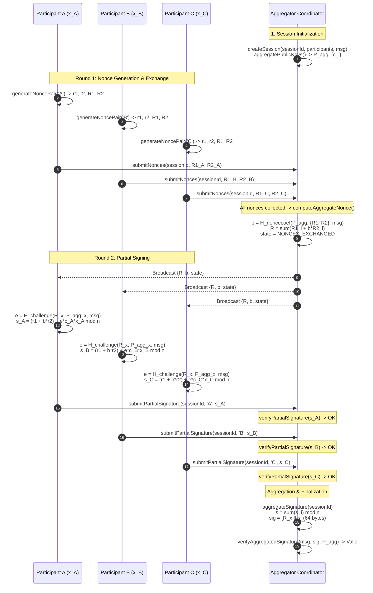
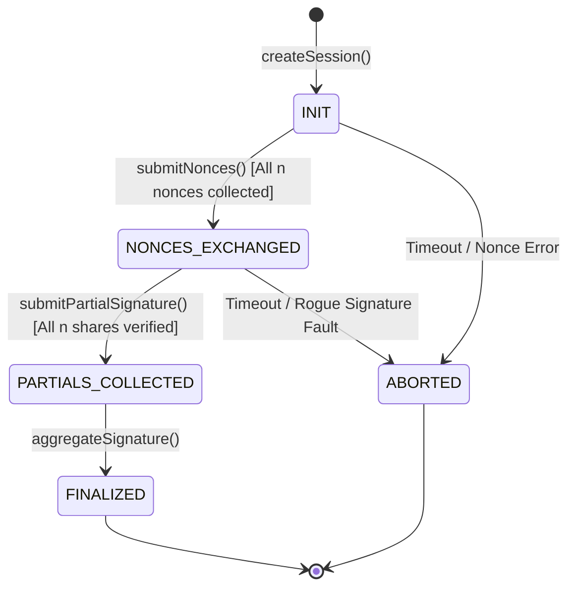

# Formal Security Specification: Schnorr Multi-Signature Aggregation & MuSig2 Co-Signing Protocol

> **Document Target:** `docs/security/SCHNORR_THRESHOLD_SPEC.md`  
> **Source Target:** [`src/core/crypto/SchnorrThresholdAggregator.ts`](../../src/core/crypto/SchnorrThresholdAggregator.ts)\
> **Test Target:** [`src/__tests__/crypto/SchnorrThresholdAggregator.test.ts`](../../src/__tests__/crypto/SchnorrThresholdAggregator.test.ts)\
> **Related Implementations:** [`src/core/crypto/ThresholdSchnorrMuSig.ts`](../../src/core/crypto/ThresholdSchnorrMuSig.ts), [`src/core/zkp/VerifiableThresholdSchnorrMuSig2.ts`](../../src/core/zkp/VerifiableThresholdSchnorrMuSig2.ts)\
> **Status:** Production Cryptographic Security Specification  
> **Issue Reference:** WorkSphere Issue #9183 (closing #9183)  

---

## 1. Overview and Security Goals

### 1.1 Purpose of Multi-Party Signature Aggregation
In the WorkSphere decentralized nomad infrastructure, high-value operations—including workspace escrow disbursements, multi-party dispute resolutions, smart contract deposit releases, and automated treasury settlements—must not rely on a single central signing authority or a single vulnerable private key. Compromising a single validator or escrow trustee must never lead to unauthorized fund drainage.

To secure these transactions, WorkSphere utilizes multi-party digital signatures. Multiple cosigners (e.g., nomad client, space operator, automated dispute arbiter) jointly authorize a payment transaction over an escrow agreement payload.

### 1.2 Distinguishing Signatures: Ordinary Schnorr vs. MuSig2 vs. Threshold Schnorr
Cryptographic accuracy requires strict distinction between three distinct multi-party signing concepts:

1. **Ordinary Schnorr Signatures (BIP 340):**
   A single signer holding secret key $x$ and public key $P = xG$ produces a 64-byte signature $(R_x, s)$ on message $m$. Verification requires checking $sG = R + eP$.
2. **$n$-of-$n$ Multi-Signatures (MuSig / MuSig2 / BIP 327):**
   A fixed set of $n$ participants, each with their own independent key pair $(x_i, P_i)$, combine their public keys into an aggregate public key $P_{\text{agg}}$. To sign, **all $n$ participants must participate**. If any single signer is absent or uncooperative, no valid signature can be generated. The resulting signature is a standard 64-byte Schnorr signature verifiable under $P_{\text{agg}}$ as if it were produced by a single signer.
3. **$t$-of-$n$ Threshold Schnorr Signatures (FROST / Shamir Secret Sharing):**
   Any subset of $t$ out of $n$ authorized participants can produce a valid group signature without requiring all $n$ participants. This requires Shamir secret sharing, verifiable secret sharing (Pedersen VSS), or distributed key generation (DKG) with Lagrange polynomial interpolation $\lambda_i(0) = \prod_{j \neq i} \frac{-x_j}{x_i - x_j}$.

> [!IMPORTANT]
> **Implementation Scope in `SchnorrThresholdAggregator.ts`:**
> Despite the file's naming convention (`SchnorrThresholdAggregator`), the production engine implements an **$n$-of-$n$ MuSig2 co-signing aggregation scheme** over `secp256k1`. It does **not** implement polynomial Shamir secret sharing, Lagrange interpolation coefficients, or $t$-of-$n$ threshold signing. All $n$ registered participants must exchange nonces and submit valid partial signatures to finalize an aggregate signature.

### 1.3 Security Goals
The primary security goals of `SchnorrThresholdAggregator` are:
- **Unforgeability Under Chosen-Message Attacks (EUF-CMA):** An adversary controlling up to $n-1$ malicious cosigners cannot forge an aggregate signature on an escrow message without the consent and valid partial signature of the honest participant.
- **Rogue-Key Attack Resistance:** An adversary cannot choose a malicious public key $P_{\text{adv}} = P_{\text{target}} - \sum P_i$ to cancel honest participants' keys and claim unilateral ownership of the aggregate public key.
- **Nonce Privacy & Single-Use Enforcement:** Ephemeral secret nonces $(r_{i,1}, r_{i,2})$ must remain strictly confidential to the generator and must never be reused across different messages or signing sessions.
- **Attributable Fault Identification:** If batch signature aggregation fails, the system must isolate and attribute the exact rogue or malformed partial signature share to its participant identifier.
- **Output Indistinguishability:** The aggregate signature $(R_x, s)$ conforms to BIP 340 format (64 bytes) and verifies against $P_{\text{agg}}$ under standard single-signer Schnorr verification equations, concealing participant rosters on-chain.

### 1.4 Trust Assumptions and Threat Model
- **Network Adversary:** The network may reorder, delay, replay, or inject arbitrary messages. All public nonces and partial signatures travel over untrusted channels.
- **Malicious Cosigners:** Up to $n-1$ cosigners may be actively malicious, collude with external attackers, submit invalid nonces or corrupted partial signatures, or attempt duplicate submissions.
- **Coordinator Trust:** The aggregator coordinator (hosting `SchnorrThresholdAggregator`) is assumed to be honest-but-curious for liveness. Even if the coordinator is compromised, it cannot forge signatures because it possesses none of the participants' private keys. However, an uncooperative coordinator can cause denial-of-service by dropping packets or refusing to finalize.
- **Side-Channel Boundaries:** Participants are responsible for generating secure random nonces and keys using cryptographically secure random number generators (CSPRNG) in side-channel resistant hardware or isolated runtimes.

---

## 2. Mathematical Foundations

### 2.1 Elliptic Curve Group Parameters
`SchnorrThresholdAggregator.ts` executes over the Koblitz curve **secp256k1**, defined over the finite prime field $\mathbb{F}_p$ by the short Weierstrass equation:

$$y^2 = x^3 + 7 \pmod p$$

The domain parameters are:
- **Base Field Modulus ($p$):**
  $$p = 2^{256} - 2^{32} - 977 = \text{0xFFFFFFFFFFFFFFFFFFFFFFFFFFFFFFFFFFFFFFFFFFFFFFFFFFFFFFFEFFFFFC2F}$$
- **Group Order ($n$ / $\ell$):**
  $$n = \text{0xFFFFFFFFFFFFFFFFFFFFFFFFFFFFFFFEBAAEDCE6AF48A03BBFD25E8CD0364141}$$
- **Base Point / Generator ($G$):**
  $$G = (G_x, G_y)$$
  $$\begin{aligned}
  G_x &= \text{0x79BE667EF9DCBBAC55A06295CE870B07029BFCDB2DCE28D959F2815B16F81798} \\
  G_y &= \text{0x483ADA7726A3C4655DA4FBFC0E1108A8FD17B448A68554199C47D08FFB10D4B8}
  \end{aligned}$$
- **Cofactor ($h$):** $h = 1$ (every non-zero curve point is a generator of the full prime-order group).
- **Identity Element ($\mathcal{O}$):** The point at infinity, represented as `POINT_AT_INFINITY = { x: 0n, y: 0n }`.

### 2.2 Algebraic Group Operations
- **Scalar Ring ($\mathbb{Z}_n$):** Private keys $x_i$, secret nonces $r_{i,1}, r_{i,2}$, challenge scalars $e$, key coefficients $c_i$, and signature shares $s_i$ reside in the scalar field modulo $n$.
- **Field Modulo ($\mathbb{F}_p$):** Point coordinates $(x, y)$ reside in the prime field modulo $p$.
- **Point Addition ($P_1 + P_2$):** Executed via affine coordinate formulas:
  - If $P_1 = \mathcal{O}$, return $P_2$. If $P_2 = \mathcal{O}$, return $P_1$.
  - If $x_1 = x_2$ and $y_1 \neq y_2$, return $\mathcal{O}$.
  - If $P_1 = P_2$ (Point Doubling): $\lambda = \frac{3x_1^2}{2y_1} \pmod p$.
  - If $P_1 \neq P_2$ (Point Addition): $\lambda = \frac{y_2 - y_1}{x_2 - x_1} \pmod p$.
  - Result coordinates: $x_3 = \lambda^2 - x_1 - x_2 \pmod p$, $y_3 = \lambda(x_1 - x_3) - y_1 \pmod p$.
- **Scalar Multiplication ($k \cdot P$):** Computed using double-and-add binary ladder:
  $$k \cdot P = \sum_{j=0}^{255} k_j 2^j P$$

---

## 3. Rogue-Key Defense and Key Aggregation

### 3.1 The Rogue-Key (Key-Cancellation) Attack
In naive Schnorr multi-signatures, the aggregate public key is the sum of participants' public keys:

$$P_{\text{agg}} = \sum_{i=1}^{m} P_i$$

An adversary controlling participant $m$ waits for honest participants $1, \dots, m-1$ to publish their public keys $P_1, \dots, P_{m-1}$. The adversary then publishes:

$$P_m = P_{\text{adv}} - \sum_{i=1}^{m-1} P_i$$

where $P_{\text{adv}} = x_{\text{adv}} G$ is a key pair for which the adversary knows the private key $x_{\text{adv}}$. The resulting naive aggregate key is:

$$P_{\text{agg}} = \sum_{i=1}^{m-1} P_i + \left( P_{\text{adv}} - \sum_{i=1}^{m-1} P_i \right) = P_{\text{adv}}$$

The adversary can now unilaterally sign any message on behalf of the group without involving any honest cosigner.

### 3.2 MuSig2 Key Coefficient Formulation ($c_i$ / $L_i$)
To defend against rogue-key attacks without requiring interactive zero-knowledge Proofs of Possession (PoP), MuSig2 weights each participant's public key by a cryptographically secure, domain-separated coefficient $c_i \in \mathbb{Z}_n$:

$$P_{\text{agg}} = \sum_{i=1}^{m} c_i P_i$$

In `SchnorrThresholdAggregator.aggregatePublicKeys()`, this is computed as follows:

1. **Canonical Lexicographical Sorting:**
   The participant list is sorted deterministically in ascending order based on the hex representation of the public key's affine $x$-coordinate:
   $$P_{\pi(1)} \le P_{\pi(2)} \le \dots \le P_{\pi(m)}$$
2. **Key List Hash ($L$):**
   A commitment over the entire sorted roster is computed using SHA-256 with domain tag `"BIP0327/keyagglist"`:
   $$L = \mathcal{H}_{\text{list}} = \text{SHA256} \Big( \text{"BIP0327/keyagglist"} \parallel \operatorname{encode}(P_1) \parallel \operatorname{encode}(P_2) \parallel \dots \parallel \operatorname{encode}(P_m) \Big)$$
   where $\operatorname{encode}(P) = P_x \text{ (32 bytes)} \parallel P_y \text{ (32 bytes)}$ (64-byte uncompressed coordinate concatenation).
3. **Participant Key Coefficient ($c_i$):**
   For each participant $i$, their individual coefficient is derived by hashing the domain tag `"BIP0327/keyaggcoef"`, the roster hash $L$, and the participant's public key:
   $$c_i = \text{SHA256} \Big( \text{"BIP0327/keyaggcoef"} \parallel L \parallel \operatorname{encode}(P_i) \Big) \bmod n$$
4. **Aggregate Group Public Key ($P_{\text{agg}}$):**
   Each public key is scaled by $c_i$ and accumulated on curve:
   $$P_{\text{agg}} = \sum_{i=1}^{m} (c_i \cdot P_i)$$

### 3.3 Security Invariants
- **Non-Linear Dependency:** Because $c_i$ is a random oracle output depending on all public keys including the adversary's, choosing $P_m$ to satisfy $\sum c_i P_i = P_{\text{adv}}$ requires finding a collision or preimage in SHA-256, reducing rogue-key attacks to the discrete logarithm problem over secp256k1.
- **Roster Binding:** Modifying, adding, or removing any participant alters $L$, completely scrambling every coefficient $c_i$ and the resulting $P_{\text{agg}}$.

---

## 4. MuSig2 Two-Round Signing Protocol

The protocol executes in two interactive phases across all $n$ participants and an Aggregator Coordinator.

### 4.1 Round 1: Nonce Generation and Commitment Exchange
In classical MuSig1, participants exchanged single nonces $R_i = k_i G$. However, an adversary opening their nonce after observing honest nonces can bias the aggregate nonce $R = \sum R_i$ (Wagner's generalized birthday attack), requiring a separate 3-round commitment phase.

MuSig2 eliminates the 3rd round by having each participant generate **two independent secret nonces**:

$$r_{i,1}, r_{i,2} \xleftarrow{\$} \mathbb{Z}_n^*$$

and compute their public points:

$$R_{i,1} = r_{i,1} G, \quad R_{i,2} = r_{i,2} G$$

The public nonce pair $(R_{i,1}, R_{i,2})$ is transmitted to the aggregator via `submitNonces()`.

### 4.2 Aggregate Nonce Construction
Once all $n$ public nonce pairs are registered, the aggregator evaluates the **nonce binding factor** $b \in \mathbb{Z}_n$:

$$b = \text{SHA256} \Big( \text{"BIP0327/noncecoef"} \parallel \operatorname{encode}(P_{\text{agg}}) \parallel \operatorname{encode}(R_{1,1}) \parallel \operatorname{encode}(R_{1,2}) \parallel \dots \parallel \operatorname{encode}(R_{n,1}) \parallel \operatorname{encode}(R_{n,2}) \parallel m \Big) \bmod n$$

The effective public nonce for participant $i$ is:

$$R_i = R_{i,1} + b \cdot R_{i,2}$$

The aggregate group nonce $R$ is the sum of effective nonces across all participants:

$$R = \sum_{i=1}^{n} R_i = \sum_{i=1}^{n} (R_{i,1} + b \cdot R_{i,2})$$

### 4.3 Round 2: Challenge Derivation and Partial Signing
The Schnorr challenge scalar $e \in \mathbb{Z}_n$ binds the aggregate nonce $x$-coordinate, the aggregate public key $x$-coordinate, and the message:

$$e = \text{SHA256} \Big( \text{"BIP0340/challenge"} \parallel R_x \text{ (32 bytes)} \parallel P_{\text{agg}, x} \text{ (32 bytes)} \parallel m \Big) \bmod n$$

Each participant computes their effective secret nonce $k_i \in \mathbb{Z}_n$:

$$k_i = r_{i,1} + b \cdot r_{i,2} \pmod n$$

and produces their partial signature share $s_i \in \mathbb{Z}_n$:

$$s_i = k_i + e \cdot c_i \cdot x_i \pmod n = (r_{i,1} + b \cdot r_{i,2}) + e \cdot c_i \cdot x_i \pmod n$$

The share $s_i$ is submitted to the coordinator via `submitPartialSignature()`.

---

## 5. Partial Signature and Final Signature Verification

### 5.1 Individual Partial Signature Verification
The aggregator verifies each incoming partial signature share $s_i$ before accepting it into the session accumulator:

$$s_i \cdot G \stackrel{?}{=} R_i + (e \cdot c_i \bmod n) \cdot P_i$$

#### Mathematical Proof of Correctness:
$$\begin{aligned}
s_i \cdot G &= \Big( k_i + e \cdot c_i \cdot x_i \Big) G \\
&= k_i G + e \cdot c_i \cdot (x_i G) \\
&= (r_{i,1} + b \cdot r_{i,2}) G + e \cdot c_i \cdot P_i \\
&= (r_{i,1} G + b \cdot r_{i,2} G) + e \cdot c_i \cdot P_i \\
&= (R_{i,1} + b \cdot R_{i,2}) + (e \cdot c_i \bmod n) P_i \\
&= R_i + (e \cdot c_i \bmod n) P_i
\end{aligned}$$

If the calculated curve point $s_i G$ does not match $R_i + (e \cdot c_i) P_i$, the submission is rejected with an error, preventing corrupted or malicious shares from poisoning the aggregate signature.

### 5.2 Randomized Batch Multiscalar Verification
When verifying multiple partial signatures simultaneously (e.g. high-throughput escrow finalization), verifying them individually requires $2k$ scalar point multiplications for $k$ cosigners.

`SchnorrThresholdAggregator.verifyBatchPartialSignatures()` performs a randomized batch verification in a single multiscalar equation. For $k$ submissions, random 128-bit weights $z_1, \dots, z_k \xleftarrow{\$} [1, 2^{128}-1]$ are sampled:

$$\left( \sum_{i=1}^{k} z_i \cdot s_i \bmod n \right) \cdot G \stackrel{?}{=} \sum_{i=1}^{k} z_i \cdot \Big( R_i + (e \cdot c_i \bmod n) P_i \Big)$$

- **Fault Isolation:** If the batched equality fails, the aggregator falls back to individual verification (`verifyPartialSignature`), accurately identifying and logging the exact `invalidParticipantIds`.
- **Attack Resistance:** Random weights $z_i$ prevent cancellation attacks where an adversary crafts two cancelling invalid signatures ($s_1 + s_2 = s_1^* + s_2^*$).

### 5.3 Signature Aggregation
When all $n$ verified shares are collected (`session.partialSignatures.size === session.participants.length`), the coordinator sums the scalars modulo $n$:

$$s = \sum_{i=1}^{n} s_i \pmod n$$

The final signature is serialized in standard BIP 340 64-byte format:

$$\sigma = \operatorname{Buffer.concat}\Big( [R_x \text{ (32 bytes)}, s \text{ (32 bytes)}] \Big)$$

### 5.4 BIP 340 Aggregate Signature Verification
Any external party (such as a blockchain node, Solana program, or escrow smart contract) verifies the signature against $P_{\text{agg}}$ without knowledge of the internal participants:

$$s \cdot G \stackrel{?}{=} R + e \cdot P_{\text{agg}}$$

In `SchnorrThresholdAggregator.verifyAggregatedSignature()`:
1. Parse $R_x = \sigma[0..31]$ and $s = \sigma[32..63]$. Verify $s < n$.
2. Compute $e = \text{SHA256}(\text{"BIP0340/challenge"} \parallel R_x \parallel P_{\text{agg}, x} \parallel m) \bmod n$.
3. Compute $s G$ and $e P_{\text{agg}}$.
4. Recover $R = s G - e P_{\text{agg}} = s G + (-e P_{\text{agg}})$, where $-e P_{\text{agg}} = (e P_x, -e P_y \bmod p)$.
5. Verify that $R_x \stackrel{?}{=} \text{recovered } R_x$.

---

## 6. Signing State Machine

### 6.1 State Transition Model
An aggregation session transitions through the following finite state machine:

### 6.2 Formal State Transition Table

| Current State | Transition Trigger | Guard Conditions | Action Taken | Next State |
|---|---|---|---|---|
| **None** | `createSession()` | $\ge 1$ participant; valid public keys | Compute $P_{\text{agg}}$ & $\{c_i\}$; store session | `INIT` |
| `INIT` | `submitNonces()` | Participant in roster; nonces not submitted | Record $(R_{i,1}, R_{i,2})$. If `nonces.size == n`, compute $b$ & $R$ | `INIT` (if $<n$) `NONCES_EXCHANGED` (if $=n$) |
| `INIT` | Timeout / Invalidation | Session expired or aborted | Clear session state | `ABORTED` |
| `NONCES_EXCHANGED` | `submitPartialSignature()` | Valid participant; not duplicate; `verifyPartialSignature()` is `true` | Record $s_i$. If `partialSignatures.size == n`, ready for aggregation | `NONCES_EXCHANGED` (if $<n$) `PARTIALS_COLLECTED` (if $=n$) |
| `NONCES_EXCHANGED` | Invalid Signature / Rogue Share | `verifyPartialSignature()` is `false` | Throw descriptive error; isolate participant | Retains state or transitions to `ABORTED` |
| `PARTIALS_COLLECTED` | `aggregateSignature()` | All $n$ signatures collected and verified | Compute $s = \sum s_i \bmod n$; construct 64-byte signature | `FINALIZED` |
| `FINALIZED` | Read operations | Read-only access | Return cached 64-byte signature | Terminal |
| `ABORTED` | Any mutation | Any call | Reject operations | Terminal |

---

## 7. Security Analysis & Threat Model

The following matrix documents potential attack vectors against the protocol, their prerequisites, impacts, mitigations in `SchnorrThresholdAggregator.ts`, and residual architectural limitations.

| # | Attack Vector | Prerequisites | Impact | Implemented Mitigation | Residual Limitations |
|:---:|:---|:---|:---|:---|:---|
| **1** | **Rogue-Key / Key-Cancellation** | Adversary chooses $P_{\text{adv}}$ based on honest cosigner public keys. | Total key compromise; adversary signs alone. | **Implemented.** Public keys are lexicographically sorted and weighted by $c_i = \mathcal{H}(\mathcal{H}_{\text{list}} \parallel P_i)$. | Keys must not be modified after session creation. |
| **2** | **Nonce Reuse Across Messages** | Signer reuses same $(r_{i,1}, r_{i,2})$ for different message $m'$. | **Catastrophic private key leakage:** $x_i$ extracted via 2 linear equations. | **Partially Mitigated.** Nonces are tied to session ID and consumed in state machine. | Library relies on caller to never reuse secret nonces across sessions. |
| **3** | **Wagner's ROS Nonce Bias Attack** | Concurrent sessions with single-nonce commitments. | Linear system solving enables unforgeability bypass. | **Implemented.** Two-round nonce binding $R_i = R_{i,1} + b R_{i,2}$ where $b = \mathcal{H}(\dots \parallel m)$. | Requires secure CSPRNG for both $r_1$ and $r_2$. |
| **4** | **Partial Signature Share Poisoning** | Adversary submits invalid $s_i$ to corrupt final aggregate. | Aggregate signature verification fails on-chain. | **Implemented.** Pre-aggregation verification ($s_i G \stackrel{?}{=} R_i + e c_i P_i$) rejects invalid shares immediately. | Malicious signer can still cause liveness failure (denial of service). |
| **5** | **Duplicate Share Overwrite Attack** | Malicious participant resubmits share to overwrite accumulator. | Session state corruption or denial of service. | **Implemented.** Reject duplicate signer submissions before verification (`Issue #8162`). | Duplicate submissions throw exceptions; session must handle retry logic. |
| **6** | **Batch Verification Cancellation Attack** | Adversary submits pair of invalid shares that sum to zero error. | Invalid aggregate signature accepted into session. | **Implemented.** 128-bit random scalar weights $z_i$ render cancellation probability negligible ($2^{-128}$). | Multiscalar point addition relies on software curve arithmetic. |
| **7** | **Replay Across Sessions** | Adversary resubmits public nonces or signatures to another session. | Signature replay or state desynchronization. | **Implemented.** Challenge $e$ binds aggregate nonce $R_x$, aggregate key $P_{\text{agg}, x}$, and message $m$. | Session IDs must be uniquely generated UUIDs by the host application. |
| **8** | **Curve Inversion / Non-Invertible Element** | Input coordinates or scalars that trigger point at infinity. | Execution crash / DoS. | **Implemented.** `modInverse()` checks $r > 1$ and handles zero/infinity checks. | Affine coordinates require field inversion ($p-2$) on every point addition. |
| **9** | **Side-Channel Timing on Scalar Ops** | Local side-channel access during private key scalar multiplication. | Leakage of private key bits. | **Not Implemented in JS.** Point multiplication uses standard double-and-add without constant-time branch masking. | High-security HSM or WASM constant-time bindings recommended for cold wallets. |
| **10** | **Participant Roster Impersonation** | Attacker registers public key under victim's identifier. | Identity misattribution. | **Out of Scope for Engine.** Aggregator binds keys to IDs but relies on transport-layer authentication. | Application layer must authenticate cosigner identity (e.g. mTLS or signed JWT). |

---

## 8. Implementation Mapping

The table below maps theoretical MuSig2 and Schnorr cryptographic concepts to their exact source implementations in `src/core/crypto/SchnorrThresholdAggregator.ts`:

| Theoretical Concept | Mathematical Definition | Implementation Function / Location | Observed Code Behavior |
|---|---|---|---|
| **Curve Modulo Arithmetic** | $a \bmod m$ | `SchnorrThresholdAggregator.mod()` | Standardizes BigInt modulo arithmetic to strictly positive residues $[0, m-1]$. |
| **Modular Inverse** | $a^{-1} \bmod p$ | `SchnorrThresholdAggregator.modInverse()` | Extended Euclidean algorithm computing inverse over prime field $\mathbb{F}_p$. |
| **Point Addition & Doubling** | $P_3 = P_1 + P_2$ | `SchnorrThresholdAggregator.pointAdd()` | Affine Weierstrass addition and doubling with point-at-infinity identity handling. |
| **Scalar Multiplication** | $k \cdot P$ | `SchnorrThresholdAggregator.pointMul()` | Binary double-and-add ladder modulo curve order $n$. |
| **Lexicographical Key Sorting** | $P_{\pi(1)} \le \dots \le P_{\pi(m)}$ | `aggregatePublicKeys()` | Sorts participants by hex $x$-coordinate string comparison. |
| **Roster Commitment Hash** | $L = \mathcal{H}(\text{"BIP0327/keyagglist"} \parallel \dots)$ | `aggregatePublicKeys()` | Hashes domain tag and uncompressed 64-byte points $(x \parallel y)$ via SHA-256. |
| **Key Weighting Coefficients** | $c_i = \mathcal{H}(\text{"BIP0327/keyaggcoef"} \parallel L \parallel P_i)$ | `aggregatePublicKeys()` | Computes 256-bit scalar modulo $n$ for each participant. |
| **Aggregate Public Key** | $P_{\text{agg}} = \sum c_i P_i$ | `aggregatePublicKeys()` | Scales each participant key by $c_i$ and accumulates on secp256k1. |
| **Secret Nonce Generation** | $r_1, r_2 \xleftarrow{\$} \mathbb{Z}_n^*$ | `generateNoncePair()` | Generates 32 random bytes via `crypto.randomBytes` for each nonce. |
| **Public Nonce Commitments** | $R_1 = r_1 G, R_2 = r_2 G$ | `generateNoncePair()` | Computes public curve points for exchange in Round 1. |
| **Nonce Binding Factor** | $b = \mathcal{H}(\text{"BIP0327/noncecoef"} \parallel \dots)$ | `computeAggregateNonce()` | Binds $P_{\text{agg}}$, all public nonces, and message payload via SHA-256. |
| **Aggregate Group Nonce** | $R = \sum (R_{i,1} + b R_{i,2})$ | `computeAggregateNonce()` | Evaluates effective nonces and sums them to form session group nonce. |
| **Fiat-Shamir Challenge** | $e = \mathcal{H}(\text{"BIP0340/challenge"} \parallel R_x \parallel P_x \parallel m)$ | `computeChallenge()` | Derives BIP 340 challenge using 32-byte $x$-only representations. |
| **Partial Signature Generation** | $s_i = (r_1 + b r_2) + e c_i x_i \bmod n$ | `signPartial()` | Participant evaluates linear share using private key $x_i$ and nonces. |
| **Individual Share Verification** | $s_i G \stackrel{?}{=} R_i + e c_i P_i$ | `verifyPartialSignature()` | Confirms authenticity of individual participant share before inclusion. |
| **Randomized Batch Verification** | $\sum z_i s_i G \stackrel{?}{=} \sum z_i (R_i + e c_i P_i)$ | `verifyBatchPartialSignatures()` | Evaluates multiscalar equation with 128-bit random weights; isolates faults. |
| **Duplicate Share Rejection** | Reject duplicate submissions | `submitPartialSignature()` | Rejects repeated submissions from same signer to prevent overwriting. |
| **Signature Aggregation** | $s = \sum s_i \bmod n$ | `aggregateSignature()` | Sums verified shares; packages $[R_x \parallel s]$ as 64-byte Buffer. |
| **BIP 340 Signature Verification** | $s G \stackrel{?}{=} R + e P_{\text{agg}}$ | `verifyAggregatedSignature()` | Recovers $R = s G - e P_{\text{agg}}$ and checks $R_x \stackrel{?}{=} \sigma_{R_x}$. |

---

## 9. Mismatches Between Implementation and BIP-327 Standard

While `SchnorrThresholdAggregator.ts` implements the core cryptographic mechanics of MuSig2, several intentional and unintentional design differences exist when compared to the normative **BIP-327** specification:

1. **Public Key Point Serialization:**
   - *BIP-327:* Requires 33-byte compressed point serialization (`0x02`/`0x03` prefix followed by $x$-coordinate) or 32-byte $x$-only serialization.
   - *WorkSphere Implementation:* Uses 64-byte uncompressed coordinate concatenation (`x` [32 bytes] $\parallel$ `y` [32 bytes]) when computing `keyagglist` and `keyaggcoef`.
2. **Key Sorting Representation:**
   - *BIP-327:* Sorts keys lexicographically based on their 33-byte compressed serialization.
   - *WorkSphere Implementation:* Sorts keys based on `x.toString(16).localeCompare()`, which ignores the $y$-coordinate parity.
3. **Second Key Optimization (BIP-327 KeyAgg):**
   - *BIP-327:* Sets $c_1 = 1$ for the "second unique public key" in the list to reduce one scalar multiplication during signing for that participant.
   - *WorkSphere Implementation:* Computes an independent hash coefficient $c_i = \mathcal{H}(\dots)$ for every participant uniformly.
4. **$y$-Coordinate Parity Normalization:**
   - *BIP-327 / BIP-340:* Requires negating the secret key $x_i$ or aggregate key $P_{\text{agg}}$ if the public point has an odd $y$-coordinate ("even $y$" rule).
   - *WorkSphere Implementation:* `verifyAggregatedSignature()` checks $R_x = \text{recovered } R_x$ directly across full affine $(x, y)$ coordinates without explicitly enforcing even-$y$ parity negation on $P_{\text{agg}}$.
5. **Session In-Memory Lifecycle:**
   - *BIP-327:* Recommends ephemeral state wiping from RAM.
   - *WorkSphere Implementation:* Stores active sessions in a JS `Map<string, AggregationSession>`, relying on garbage collection.

---

## 10. Operational Security and Escrow Integration

### 10.1 Escrow Transaction Signing Integration
When deploying `SchnorrThresholdAggregator` for multi-party nomad escrow:
1. **Contract Initialization:**
   The workspace client, venue host, and escrow arbiter register their public keys. The contract invokes `aggregatePublicKeys()` to generate and record $P_{\text{agg}}$ on the Solana or EVM escrow contract.
2. **Disbursement Authorization:**
   When booking conditions are satisfied (e.g. automated check-in verified via IoT geofence or QR signature), an agreement disbursement payload $m = \text{SHA256}(\text{"disburse:"} \parallel \text{escrowId} \parallel \text{amount})$ is broadcast.
3. **Nonce Coordination:**
   Participants exchange nonces. Any non-responsive participant triggers an escrow dispute timeout, aborting the automated session.
4. **On-Chain Settlement:**
   Once $s = \sum s_i \bmod n$ is formed, the single 64-byte signature is posted on-chain. The escrow smart contract verifies the transaction in $O(1)$ under $P_{\text{agg}}$, incurring minimal gas overhead and hiding the 3-party dispute roster from public ledger analysis.

### 10.2 Nonce Destruction Guidelines
> [!CAUTION]
> Reusing ephemeral nonces $(r_{i,1}, r_{i,2})$ across two distinct messages under the same private key allows any observer to solve for the participant's private key $x_i$ via simple modular arithmetic.

Cosigner clients must:
- Never persist secret nonces to persistent disk or browser `localStorage`.
- Zeroize / overwrite secret nonce memory immediately after invoking `signPartial()`.
- Abort and generate fresh nonces if a session is interrupted or re-keyed.

---

## 11. References & Normative Standards

1. **Nick, J., Ruffing, T., & Seurin, Y. (2020).** *MuSig2: Simple and Two-Round Multi-Signatures from Schnorr Signatures.* Advances in Cryptology – CRYPTO 2021, Lecture Notes in Computer Science, vol 12826, pp. 497–526. Springer. [https://eprint.iacr.org/2020/1261](https://eprint.iacr.org/2020/1261)
2. **Wuille, P., Nick, J., & Ruffing, T. (2022).** *BIP 327: MuSig2 for BIP340 Schnorr Signatures.* Bitcoin Improvement Proposals. [https://github.com/bitcoin/bips/blob/master/bip-0327.mediawiki](https://github.com/bitcoin/bips/blob/master/bip-0327.mediawiki)
3. **Wuille, P., & Poelstra, A. (2020).** *BIP 340: Schnorr Signatures for secp256k1.* Bitcoin Improvement Proposals. [https://github.com/bitcoin/bips/blob/master/bip-0340.mediawiki](https://github.com/bitcoin/bips/blob/master/bip-0340.mediawiki)
4. **Maxwell, G., Poelstra, A., Seurin, Y., & Wuille, P. (2019).** *Simple Schnorr multi-signatures with applications to Bitcoin.* Designs, Codes and Cryptography, 87(9), 2139–2164. [https://doi.org/10.1007/s10623-019-00608-x](https://doi.org/10.1007/s10623-019-00608-x)
5. **Certicom Research (2000).** *SEC 2: Recommended Elliptic Curve Domain Parameters.* Standards for Efficient Cryptography, Version 2.0.
6. **Bellare, M., & Neven, G. (2006).** *Multi-signatures in the plain public-key model and a general forking lemma.* In Proceedings of the 13th ACM Conference on Computer and Communications Security (CCS '06), pp. 390–399. ACM.
