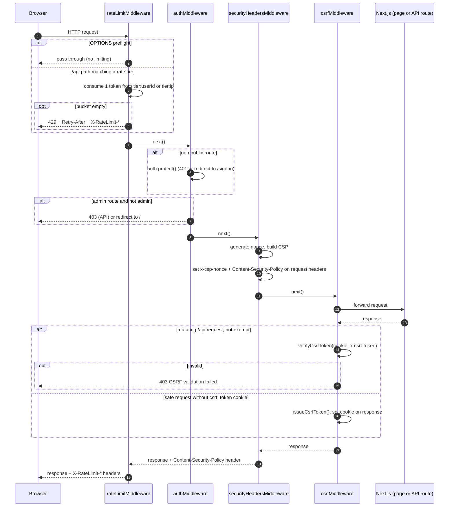
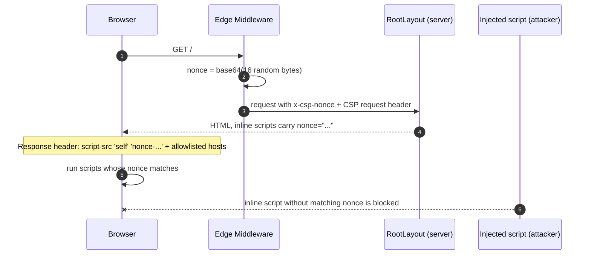
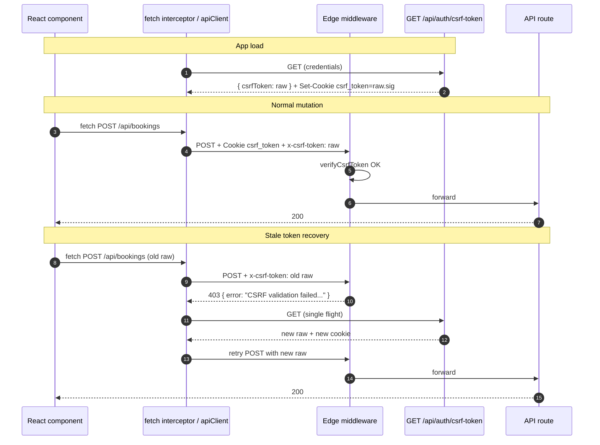
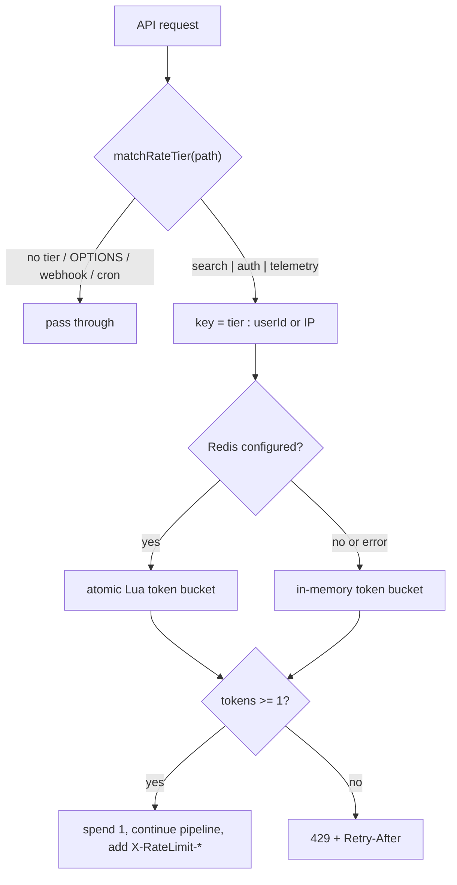

# WorkSphere Security Architecture Overview

This document is the end-to-end map of how WorkSphere defends against **XSS** (CSP with per-request nonces), **CSRF** (signed double-submit cookie with a self-healing fetch interceptor) and **API abuse** (multi-tier token bucket rate limiting). It explains how the three layers fit together in the Edge middleware pipeline. Each layer has a deeper specification, linked in [Related Documentation](#9-related-documentation).

## Table of Contents

1. [Defense Layers at a Glance](#1-defense-layers-at-a-glance)
2. [Request Pipeline](#2-request-pipeline)
3. [XSS Defense: CSP Nonces](#3-xss-defense-csp-nonces)
4. [CSRF Defense: Signed Double-Submit Cookie](#4-csrf-defense-signed-double-submit-cookie)
5. [API Abuse Defense: Token Bucket Rate Limiting](#5-api-abuse-defense-token-bucket-rate-limiting)
6. [Threat to Control Matrix](#6-threat-to-control-matrix)
7. [Operational Notes and Known Limits](#7-operational-notes-and-known-limits)
8. [Verification](#8-verification)
9. [Related Documentation](#9-related-documentation)

---

## 1. Defense Layers at a Glance

| Layer | Threat | Mechanism | Primary source |
| --- | --- | --- | --- |
| Rate limiting | Brute force, scraping, telemetry floods | Token bucket per tier, keyed by user ID or client IP | `src/lib/rateLimit/`, `src/lib/middleware/handlers/rateLimitHandler.ts` |
| Authentication | Unauthenticated or non-admin access | Clerk `auth.protect()` plus admin role check | `src/lib/middleware/handlers/authHandler.ts`, `src/lib/middleware/routes.ts` |
| Security headers | XSS, data exfiltration, clickjacking | Strict CSP with a fresh nonce on every request | `src/lib/security/csp.ts`, `src/lib/middleware/handlers/securityHeadersHandler.ts` |
| CSRF protection | Cross-site state changing requests | HMAC signed double-submit cookie, timing safe compare | `src/lib/security/csrf.ts`, `src/lib/middleware/handlers/csrfHandler.ts` |
| Client resilience | Stale token and 429 UX failures | Fetch interceptor, single flight token refresh, one shot retry | `src/hooks/useCsrfToken.ts`, `src/lib/apiClient.ts` |

`src/middleware.ts` is intentionally thin. It wraps `runMiddlewarePipeline` in Clerk's `clerkMiddleware` and re-exports the helpers used by tests. `src/lib/csrf.ts` and `src/lib/tokenBucketRateLimit.ts` are compatibility re-exports of `src/lib/security/csrf.ts` and `src/lib/rateLimit/index.ts`.

---

## 2. Request Pipeline

The pipeline is defined in `src/lib/middleware/chain.ts` as an ordered handler array. Order matters: abusive traffic is rejected before any auth or crypto work happens, and the CSRF handler wraps the response from everything downstream.

```ts
export const defaultMiddlewareChain = [
  rateLimitMiddleware,     // 1. CORS preflight bypass + token bucket
  authMiddleware,          // 2. Clerk protect + admin authorization
  securityHeadersMiddleware, // 3. CSP nonce + request header propagation
  csrfMiddleware,          // 4. verify (mutating) or issue (safe) CSRF cookie
];
```



Notes on the order of effects:

- The CSRF check runs **after** `next()` returns, because `csrfMiddleware` calls `await next()` first and then `applyCsrfProtection`. When the check fails, the downstream response is discarded and replaced with a 403.
- Rate limit headers are applied on the way back out, after the handlers further down the chain have produced the response.
- The Next.js matcher in `src/middleware.ts` skips static assets, `sw.js`, manifests and `robots.txt`, and always runs for `/api` and `/trpc`.

---

## 3. XSS Defense: CSP Nonces

### 3.1 Nonce generation

`generateCryptographicNonce()` in `src/lib/security/csp.ts` creates 16 random bytes with `crypto.getRandomValues` and base64 encodes them. It uses only Web Crypto, so it runs in the Edge runtime. A new nonce is generated on every request and is never reused or cached.

### 3.2 Propagation

`securityHeadersMiddleware` builds the policy with `generateCsp(nonce)` and then sets three things:

| Target | Header | Purpose |
| --- | --- | --- |
| Request headers (forwarded to Next.js) | `Content-Security-Policy` | Next.js reads the nonce from the policy and stamps it on its own inline bootstrap scripts |
| Request headers | `x-csp-nonce` | Lets server components read the nonce |
| Request headers | `x-pathname` | Pathname for server components |
| Response headers | `Content-Security-Policy` | Enforced by the browser |

`src/app/layout.tsx` reads `x-csp-nonce` with `await headers()` and passes it to its own inline script (the theme init script) as `nonce={nonce}`. Any new inline `<script>` added to a server component must do the same or the browser will block it.



### 3.3 Policy summary

The exact policy is assembled in `generateCsp()`. The directives that matter most for XSS and exfiltration:

| Directive | Value (summary) | Why |
| --- | --- | --- |
| `default-src` | `'self'` | Deny by default |
| `script-src` | `'self'`, the request nonce, Clerk hosts, Mapbox, Cloudflare Turnstile, plus `'unsafe-eval'` **only in development** | Inline scripts need the nonce, no `'unsafe-inline'` for scripts |
| `object-src` | `'none'` | No plugins |
| `base-uri` | `'self'` | Blocks `<base>` hijacking |
| `form-action` | `'self'` | Forms cannot post to other origins |
| `frame-ancestors` | `'self'` | Clickjacking protection |
| `connect-src` | `'self'`, Clerk, map and geocoding providers, Pexels, PartyKit (`https` and `wss`) | Limits where scripts can send data |
| `worker-src` | `'self' blob:` | Service worker and web workers |
| `upgrade-insecure-requests` | set | Forces HTTPS subresources |

Clerk and PartyKit origins are derived from environment variables (`NEXT_PUBLIC_CLERK_PUBLISHABLE_KEY`, `NEXT_PUBLIC_PARTYKIT_HOST`). In development the PartyKit host is also allowed over `http` and `ws`.

See [csp-nonce-architecture.md](./csp-nonce-architecture.md) for the full directive reference and threat analysis.

---

## 4. CSRF Defense: Signed Double-Submit Cookie

### 4.1 Token format

A CSRF token has two parts that travel separately:

| Part | Where it lives | Readable by JS |
| --- | --- | --- |
| Cookie `csrf_token` = `raw.signature` | Browser cookie jar | No (`httpOnly`) |
| Header `x-csrf-token` = `raw` | Sent by client code on mutating requests | Yes (the client receives `raw` in a JSON response) |

- `raw` is 32 random bytes (256 bits), base64url encoded. `generateCsrfRawToken` refuses to produce anything shorter.
- `signature` is `HMAC-SHA256(raw, secret)`, base64url encoded, computed with Web Crypto so it works in Edge and Node.
- The secret is `CSRF_SECRET`, falling back to `CLERK_SECRET_KEY` (see [Operational Notes](#7-operational-notes-and-known-limits)).
- Cookie attributes: `httpOnly`, `sameSite: "lax"`, `secure` in production, `path: "/"`.

### 4.2 Verification

`verifyCsrfToken(cookieValue, headerValue)` returns true only when all of these hold:

1. Both values are present and the cookie contains a `.` separator.
2. Both `raw` and the header value pass the 256-bit entropy check.
3. The cookie signature equals a freshly computed HMAC of `raw` (constant time comparison).
4. The header value equals `raw` (constant time comparison).

An attacker on another origin cannot read the `httpOnly` cookie, cannot forge a signature without the secret, and cannot set the custom `x-csrf-token` header on a cross-site form post. All of these checks are evaluated, and the results combined, with `timingSafeEqual` (a length check followed by an XOR accumulator over all bytes).

### 4.3 Where checks and issuance happen

`applyCsrfProtection` in `src/lib/middleware/handlers/csrfHandler.ts`:

| Request | Behavior |
| --- | --- |
| `POST`, `PUT`, `PATCH`, `DELETE` on `/api/*`, route not exempt | Verify cookie and header. Failure returns `403 { error: "CSRF validation failed. Please refresh and try again." }` |
| Any other request without a `csrf_token` cookie, route not exempt | Mint a token and set the cookie on the response |
| Exempt routes | Skipped |

`GET /api/auth/csrf-token` (`src/app/api/auth/csrf-token/route.ts`) always mints a **new** token, overwrites the cookie, and returns `{ csrfToken: raw }` in the body.

Exempt routes are declared in `ROUTE_PERMISSIONS` in `src/lib/middleware/routes.ts` with `isCsrfExempt: true`:

| Pattern | Reason |
| --- | --- |
| `/api/webhook(.*)`, `/api/webhooks/worker`, `/api/cron/(.*)` | Authenticated by their own signature or secret, not a browser session |
| `/api/auth/csrf-token` | Token issuance endpoint |
| `/api/auth/sso/saml` | SAML assertion consumer endpoint called by the identity provider |
| `/api/auth/session(.*)` | Session refresh and logout |
| `/api/venues/updates` | Server-sent events stream, cookies must not be rewritten mid stream |

### 4.4 Client side: fetch interceptor and auto retry

Two client paths attach the header and recover from stale tokens:

**`useCsrfToken` hook (`src/hooks/useCsrfToken.ts`)**

- On first mount it installs a one-time `window.fetch` interceptor and fetches a token.
- The interceptor adds `x-csrf-token` to every same-origin `/api` request using `POST`, `PUT`, `PATCH` or `DELETE`.
- It refetches the token when the i18n language changes and when the Clerk user changes (sign in, sign out, OAuth return).
- Token fetches are single flight: concurrent callers share one in-flight promise.
- If the token endpoint itself returns `429`, it honors `Retry-After` (capped at 60 seconds) or falls back to exponential delays of 500, 1000 and 2000 ms with up to 20% jitter, for at most 3 retries.

**`apiClient` (`src/lib/apiClient.ts`, `sendWithCsrf`)**

- Before a mutating request it calls `ensureCsrfToken()`, which refreshes proactively once the cached token is older than 20 minutes (`CSRF_REFRESH_THRESHOLD_MS`), also single flight.
- It also handles `401` with a silent session refresh and one retry, and optional automatic `429` retry (`retryOnRateLimit`).

Both paths use the same recovery rule: **if a mutating request gets a `403` whose JSON body mentions `csrf`, fetch a fresh token and retry the request exactly once.** `apiClient` additionally accepts `code: "CSRF_INVALID"`. If the retry fails too, the original failure is surfaced to the caller.



### 4.5 Behavior to be aware of: last issuer wins

Because `GET /api/auth/csrf-token` always mints a new token and replaces the shared cookie, any token cached earlier (by the other client path, or by another browser tab) no longer matches the cookie. The next mutation from that cache gets a 403 and is repaired by the one shot retry above. This is expected and invisible to users, but it explains why a CSRF 403 followed by a successful retry can appear in network logs.

---

## 5. API Abuse Defense: Token Bucket Rate Limiting

### 5.1 Tiers

Defined in `RATE_TIERS` in `src/lib/rateLimit/config.ts`, selected by `matchRateTier(pathname)`:

| Tier | Limit | Window | Matches |
| --- | --- | --- | --- |
| `telemetry` | 120 requests | 1 minute | `/api/telemetry*`, or a path segment equal to `telemetry`, `noise-metrics`, `wifi-prediction`, `wifiTelemetry` |
| `auth` | 5 requests | 1 minute | `/api/auth*` (except `/api/auth/csrf-token`), `/api/partykit/auth*`, `/api/user/verify-student` |
| `search` | 60 requests | 1 minute | `/api/venues*`, `/api/map*`, `/api/search*`, `/api/location*` |

Rules that keep the limits from misfiring:

- Tiers are checked in the order telemetry, auth, search, and the first match wins.
- `/api/webhook`, `/api/webhooks`, `/api/webhooks/worker` and `/api/cron*` are never limited.
- Telemetry matching uses exact path segments so a path like `/api/venues/telemetry-guide` is not pulled into the telemetry tier.
- Routes that match no tier are not limited by this middleware.
- `OPTIONS` requests bypass the limiter entirely.

### 5.2 Identity

The bucket key is `${tier.name}:${userId || clientIp}`.

- `userId` comes from Clerk (`ctx.auth()`), so signed in users get their own bucket per tier.
- If there is no user, or auth resolution throws, the client IP is used.
- `getClientIp` prefers a runtime provided `ip`, then `x-real-ip`, then `cf-connecting-ip`, then the first `x-forwarded-for` entry, then `127.0.0.1`. Direct proxy headers come before `x-forwarded-for` to reduce spoofing.

### 5.3 Algorithm

Each bucket holds up to `limit` tokens and refills continuously at `limit / windowMs` tokens per millisecond.

1. First sight of a key: the bucket starts full.
2. On each request, add `elapsed / windowMs * limit` tokens, capped at `limit`.
3. If at least 1 token is available, spend it and allow.
4. Otherwise reject and compute `retryAfter` as the time until the next whole token, in seconds, minimum 1.

This allows short bursts up to the limit while enforcing the average rate. A backward clock jump resets `lastRefill` to now instead of producing negative elapsed time.

### 5.4 Storage backends

`TokenBucketLimiter.consume` tries backends in order:

| Order | Backend | When used | Notes |
| --- | --- | --- | --- |
| 1 | Redis atomic Lua script | `UPSTASH_REDIS_REST_URL` and `UPSTASH_REDIS_REST_TOKEN` set | One round trip, check and spend are atomic, so concurrent edge instances cannot overspend. Keys look like `worksphere:ratelimit:<tier>:<identifier>` with an expiry of twice the window |
| 2 | `@upstash/ratelimit` token bucket | Redis script returned nothing | Same key prefix |
| 3 | In-memory store | No Redis configured, or Redis calls failed | Per instance state, capped at 10,000 entries with expired and idle entries cleaned up |

### 5.5 Responses

Allowed request, headers added on the way out:

```
X-RateLimit-Limit: 60
X-RateLimit-Remaining: 59
X-RateLimit-Reset: <unix seconds>
```

Rejected request:

```
HTTP/1.1 429 Too Many Requests
Retry-After: <seconds>
X-RateLimit-Limit / X-RateLimit-Remaining / X-RateLimit-Reset

{ "error": "Too many requests. Please slow down and try again.", "retryAfter": <seconds> }
```

On the client, `apiClient` can wait and retry on 429 using `Retry-After` (opt in with `retryOnRateLimit`), and `RateLimitBanner` surfaces the state to users.



The separate `TIER_CONFIGS` (anonymous, authenticated, public, admin, webhooks) in the same config file belong to the sliding window and tiered limiter helpers used by individual routes, not to this middleware. See [rate-limiting-strategies.md](../architecture/rate-limiting-strategies.md).

---

## 6. Threat to Control Matrix

| Threat | Control | Where enforced |
| --- | --- | --- |
| Reflected or stored XSS executing inline script | Nonce based `script-src`, no `'unsafe-inline'` for scripts | `generateCsp`, `securityHeadersMiddleware` |
| Injected content loading remote scripts or exfiltrating data | `default-src 'self'`, allowlisted `script-src` and `connect-src` | `generateCsp` |
| Clickjacking | `frame-ancestors 'self'` | `generateCsp` |
| Form hijacking or `<base>` rewriting | `form-action 'self'`, `base-uri 'self'` | `generateCsp` |
| Cross-site forged state changes | Signed double-submit cookie, SameSite Lax | `csrfMiddleware`, `verifyCsrfToken` |
| Token forgery or guessing | 256-bit raw token, HMAC-SHA256 signature | `src/lib/security/csrf.ts` |
| Timing side channels on token comparison | `timingSafeEqual` | `src/lib/security/csrf.ts` |
| Credential stuffing and OTP brute force | `auth` tier, 5 requests per minute | `rateLimitMiddleware` |
| Scraping of search and map APIs | `search` tier, 60 requests per minute | `rateLimitMiddleware` |
| Telemetry flooding | `telemetry` tier, 120 requests per minute | `rateLimitMiddleware` |
| Unauthenticated access to protected routes | Clerk `auth.protect()` | `authMiddleware` |
| Privilege escalation to admin routes | Role claim or `ADMIN_EMAILS` check | `authMiddleware`, `isAdminSession` |

---

## 7. Operational Notes and Known Limits

- **Set `CSRF_SECRET` in production.** If neither `CSRF_SECRET` nor `CLERK_SECRET_KEY` is set, `getSecret()` falls back to `VERCEL_GIT_COMMIT_SHA` or a fixed built-in string in production. That fallback keeps the app running but is not a secret, so treat a missing secret as a deployment misconfiguration.
- **Use Redis in production.** Without Upstash credentials the limiter uses per instance memory. Limits are then per server instance and reset on restart, so multi-instance deployments can allow more than the documented rate.
- **`style-src` still allows `'unsafe-inline'`** and `img-src` allows any `https:` source. Scripts are strict, styles and images are not.
- **The CSRF 403 body carries an `error` message but no `code` field.** Client retry logic therefore matches on the word `csrf` in the message. If you change that message, keep the word, or add a `code` and update both client paths.
- **Adding a mutating route that is called by a third party** (webhook, SSO callback): add it to `ROUTE_PERMISSIONS` with `isPublic` and `isCsrfExempt`, and make sure it verifies its own signature or secret.
- **Adding an inline script in a server component:** read `x-csp-nonce` via `headers()` and set `nonce` on the tag.
- **Adding an API route that needs a rate tier:** extend `matchRateTier` and, if it is a new tier, `RATE_TIERS` and `RateTierType`.
- **Adding a new third party origin** (analytics, maps, embeds): add it to the relevant directive in `generateCsp` rather than loosening `default-src`.

---

## 8. Verification

Automated tests that cover these layers:

| Area | Test files |
| --- | --- |
| CSRF | `src/__tests__/lib/csrf.test.ts`, `src/__tests__/security/csrfEntropy.test.ts`, `src/__tests__/api/csrfLifecycle.test.ts`, `src/__tests__/lib/useCsrfToken.test.tsx`, `src/__tests__/lib/csrfSseExemption.test.ts` |
| Rate limiting | `src/__tests__/lib/tokenBucketRateLimit.test.ts`, `src/__tests__/lib/rateLimitMiddleware.test.ts`, `src/__tests__/lib/rateLimitRedisOutageFallback.test.ts`, `src/__tests__/lib/apiClientRateLimit.test.tsx` |

```bash
npx jest src/__tests__/lib/csrf.test.ts src/__tests__/lib/tokenBucketRateLimit.test.ts
```

Manual checks against a running dev server:

```bash
# CSP header carries a nonce and it changes per request
curl -sI http://localhost:3000/ | grep -i content-security-policy

# Exceed the auth tier. Rate limiting runs first in the pipeline, so the 6th request
# within a minute returns 429 whatever the earlier responses were (401 or 403 here)
for i in $(seq 1 6); do
  curl -s -o /dev/null -w "%{http_code}\n" -X POST http://localhost:3000/api/auth/verify-otp
done
```

To see the CSRF rejection, send a mutating request to a non-exempt `/api` route from a signed in session (copy the session cookie from the browser) without the `x-csrf-token` header. Expect `403` with the `CSRF validation failed` message. Without a session, Clerk answers `401` first because authentication runs before the CSRF handler.

In the browser, the Network tab should show `x-csrf-token` on mutating `/api` calls, and the Console should stay free of CSP violations on normal page loads.

---

## 9. Related Documentation

- [CSP Nonce Architecture](./csp-nonce-architecture.md): full directive reference and XSS threat model
- [CSRF Protection Architecture](./csrf-protection-architecture.md): cookie policy, session refresh and token family rotation
- [CSRF Protection](../CSRF_PROTECTION.md) and [CSRF Rotation Architecture](../CSRF_ROTATION_ARCHITECTURE.md)
- [Rate Limiting](../RATE_LIMITING.md), [Rate Limiting Strategies](../architecture/rate-limiting-strategies.md) and [Redis Cache and Rate Limit](../REDIS_CACHE_AND_RATELIMIT.md)
- [Authentication Guide](../AUTH_GUIDE.md): Clerk middleware, public and protected routes
- [Cryptographic Security Architecture](../CRYPTOGRAPHIC_SECURITY_ARCHITECTURE.md)
