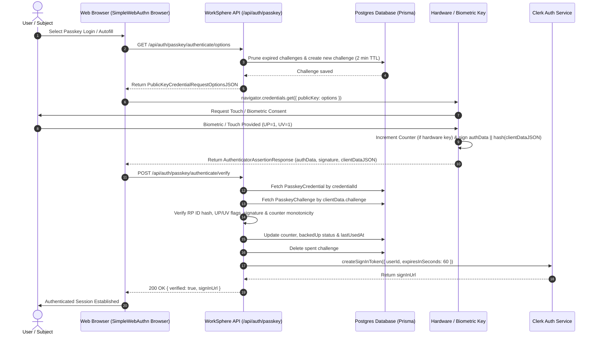

# WebAuthn Passkey Hardware Assertion and Credential Registration Runbook

## A. Overview and Architecture

### 1. WebAuthn Passkeys & FIDO2 Overview
WebAuthn (W3C Web Authentication Level 3) is a modern web standard enabling passwordless, phishing-resistant public-key authentication. Coupled with the FIDO2 Client-to-Authenticator Protocol (CTAP2), WebAuthn shifts authentication guarantees from shared secrets (passwords, OTPs, shared bearer tokens) to asymmetric cryptographic key pairs generated and stored inside hardware security boundaries.

In WebAuthn nomenclature:
- **Passkey**: A discoverable (resident) FIDO2 credential consisting of an asymmetric key pair. The private key never leaves the authenticator boundary, while the public key and credential ID are sent to the Relying Party (RP) during registration.
- **Hardware Security Keys**: Physical security tokens adhering to FIDO2/CTAP2 standards (e.g., YubiKey 5 Series, Google Titan) that communicate via USB, NFC, or BLE. These tokens offer tamper-resistant secure elements that prevent exfiltration of private keys even if the host computer is compromised.
- **Platform Authenticators**: Built-in biometric hardware authenticators integrated directly into client devices (e.g., Apple Touch ID / Face ID via Secure Enclave, Windows Hello via TPM, Android Biometrics via StrongBox/TEE).
- **Cross-Platform Authenticators**: Removable external tokens (USB/NFC/BLE keys) or mobile devices acting as roving authenticators via FIDO Cross-Device Authentication (hybrid transport / QR initiation).

### 2. Responsibilities Across Actors
The WebAuthn trust model delegates specific responsibilities across four distinct actors:

```
+---------------------------------------------------------------------------------------------------+
|                                 WebAuthn Architecture & Trust Boundaries                          |
|                                                                                                   |
|  +--------------------+        CTAP2 / HID        +--------------------------------------------+  |
|  | Hardware / Platform| <=======================> | Client Platform / User Agent               |  |
|  | Authenticator      |    (User verification,    | (Browser: SimpleWebAuthn client,           |  |
|  | (Secure Enclave /  |     biometrics, PIN,      |  navigator.credentials.create/get,         |  |
|  |  TPM / YubiKey)    |     keypair & signature)  |  Origin & RP ID validation)                |  |
|  +--------------------+                           +--------------------------------------------+  |
|                                                                         ^                         |
|                                                                         | HTTPS / TLS 1.3         |
|                                                                         | (JSON REST APIs)        |
|                                                                         v                         |
|  +--------------------+    Prisma ORM / Postgres  +--------------------------------------------+  |
|  | Storage Tier       | <=======================> | Relying Party Server (WorkSphere)          |  |
|  | (PasskeyCredential,|    (Nonce cache &         | (Options generation, SimpleWebAuthn server,|  |
|  |  PasskeyChallenge) |     credential store)     |  attestation & assertion verification)     |  |
|  +--------------------+                           +--------------------------------------------+  |
+---------------------------------------------------------------------------------------------------+
```

1. **Authenticator (Hardware/Platform)**:
   - Securely generates asymmetric key pairs (COSE algorithms such as ES256, RS256, Ed25519).
   - Enforces physical User Presence (`UP`) via capacitive touch, button press, or sensor contact.
   - Enforces User Verification (`UV`) via biometric matching (Touch ID, Face ID, Windows Hello) or on-device PIN.
   - Signs assertions and attestation payloads over the client data hash without exposing private keys.
   - Maintains monotonic signature counters (for single-device authenticators) to detect cloned authenticators.

2. **Client / Browser (User Agent)**:
   - Validates calling origin and isolates security contexts.
   - Enforces Permissions Policy (`publickey-credentials-get`, `publickey-credentials-create`).
   - Packages `clientDataJSON` containing the calling `origin`, `challenge`, and operation `type`.
   - Handles transport mediation with external authenticators (USB, NFC, BLE, hybrid).

3. **Relying Party Server (WorkSphere)**:
   - Generates cryptographically secure, high-entropy, transient nonces (challenges).
   - Supplies configuration parameters: RP Name, RP ID, allowed algorithms, authenticator selection criteria.
   - Validates returned assertions: challenge matching, exact origin verification, RP ID hash matching, signature verification over `authData || SHA256(clientDataJSON)`.
   - Verifies monotonic counter progression and flags anomalies.

4. **Storage Tier (PostgreSQL / Prisma)**:
   - Ephemeral challenge storage (`PasskeyChallenge` table) with short TTL (2 minutes) and single-use consumption.
   - Persistent credential storage (`PasskeyCredential` table) holding credential ID, COSE public key bytes, signature counter, transports, and backup state flags.

### 3. Credential Lifecycle
The passkey lifecycle in WorkSphere follows five primary stages:
1. **Enrollment / Registration**: User authenticates with an established session, generates registration options, authorizes biometric sensor, and stores the public key in `PasskeyCredential`.
2. **Active Authentication**: User presents credential in response to an authentication challenge; server verifies signature against stored public key and issues an authenticated session token.
3. **Step-Up Verification**: Elevated privilege operations (e.g., passkey rotation, deletion, sensitive settings) require immediate passkey re-assertion or email OTP step-up.
4. **Rotation / Renaming**: User updates friendly device nicknames or rotates an aging credential (90-day recommended rotation window) without account lockout.
5. **Revocation / Deletion**: Invalidation and deletion of compromised or decommissioned authenticators, accompanied by immutable security audit logging (`PasskeyAuditLog`).

### 4. WorkSphere Implementation References
WorkSphere implements WebAuthn using `@simplewebauthn/server` (v13.1.1) on the server tier and `@simplewebauthn/browser` (v13.1.0) on the client tier:
- Server endpoints: `src/app/api/auth/passkey/`
- Server verification library: `src/lib/auth/passkeys/server/`
- Browser credential manager: `src/lib/auth/passkeys/client/credentialManager.ts`
- Shared types and configuration: `src/lib/auth/passkeys/types.ts` and `src/lib/passkey/`

---

## B. Credential Registration Ceremony

### 1. Registration Initiation & Options Generation
Registration is an authenticated ceremony requiring an active session (e.g., Clerk session or authenticated user identity).

1. The client issues a `GET` request to `/api/auth/passkey/register/options` (handled in `src/app/api/auth/passkey/register/options/route.ts`).
2. The route extracts `userId` from the session via `auth()` and fetches the user record via `ensureUserExists(userId)`.
3. To prevent duplicate enrollment of the same authenticator on the same account, existing credentials for this user are retrieved from `prisma.passkeyCredential` and populated into `excludeCredentials`.
   - *Rotation Exception*: If the query parameter `?rotate=<credentialId>` is passed, the credential being replaced is omitted from `excludeCredentials` so the same physical authenticator can mint its successor.
4. `generateRegistrationOptions()` from `@simplewebauthn/server` constructs `PublicKeyCredentialCreationOptionsJSON`:
   - `rpName`: `"WorkSphere"` (defined in `RP_NAME`).
   - `rpID`: Resolved dynamically via `getRpId(req)` from the incoming `Host` header or `WEBAUTHN_RP_ID` environment variable.
   - `userID`: `new TextEncoder().encode(userId)`.
   - `userName`: User email or user ID.
   - `userDisplayName`: Full name or email.
   - `attestationType`: `"direct"`.
   - `authenticatorSelection`:
     - `residentKey: "preferred"` (requests discoverable credentials).
     - `userVerification: "preferred"`.
5. **Challenge Persistence**: The cryptographic challenge string (minimum 32 bytes entropy, Base64URL-encoded) is persisted in PostgreSQL:
   ```typescript
   await prisma.passkeyChallenge.create({
     data: {
       userId,
       challenge: options.challenge,
       expiresAt: new Date(Date.now() + 2 * 60 * 1000), // 2-minute TTL
     },
   });
   ```

### 2. Browser Execution (`navigator.credentials.create`)
The browser receives the options JSON and invokes the WebAuthn API:
1. `startPasskeyRegistration(options)` in `src/lib/auth/passkeys/client/credentialManager.ts` calls `startRegistration({ optionsJSON: options })` from `@simplewebauthn/browser`.
2. The browser validates that the document is not embedded in an unauthorized cross-origin iframe. If embedded, the iframe must have `allow="publickey-credentials-create"`.
3. The browser prompts the user to select an authenticator (platform biometric sensor or external USB/NFC security key).
4. The authenticator prompts for user presence and verification, generates an asymmetric key pair, and builds:
   - `clientDataJSON`: Contains `type: "webauthn.create"`, `challenge`, `origin`, and `crossOrigin`.
   - `attestationObject`: CBOR-encoded structure containing `authenticatorData` and `attStmt` (attestation statement).
5. The browser returns `RegistrationResponseJSON` to the client application.

### 3. Server Verification Ceremony (`verifyPasskeyRegistration`)
The client submits `registrationResponse` via `POST /api/auth/passkey/register/verify` (handled in `src/app/api/auth/passkey/register/verify/route.ts` and `src/lib/auth/passkeys/server/verifyAttestation.ts`).

1. **Cancellation Handling**: If the user cancels the client prompt (`cancelled: true`), active challenges for the user are immediately deleted via `prisma.passkeyChallenge.deleteMany({ where: { userId } })`.
2. **Challenge Retrieval**:
   - The server queries `prisma.passkeyChallenge` for the user's latest unexpired challenge (`expiresAt > now`).
   - If not found or expired, registration fails with `400 Bad Request`.
3. **Cryptographic Attestation Verification**:
   - `verifyRegistrationResponse()` from `@simplewebauthn/server` validates:
     - `clientDataJSON.type === "webauthn.create"`.
     - `clientDataJSON.challenge === expectedChallenge`.
     - `clientDataJSON.origin` matches `expectedOrigin` (validated by `getExpectedOrigin(req)`).
     - RP ID hash in `authData` matches `SHA256(expectedRPID)`.
     - Attestation statement matches supported formats (`packed`, `android-key`, `none`).
4. **Challenge Consumption**:
   - The spent challenge is immediately deleted: `prisma.passkeyChallenge.delete({ where: { id: challengeId } })`.
5. **Credential Persistence**:
   - The extracted credential details are stored in PostgreSQL:
     ```typescript
     await prisma.passkeyCredential.create({
       data: {
         userId,
         credentialId: credential.credentialId,
         publicKey: credential.publicKey, // COSE public key bytes
         counter: credential.counter,     // BigInt initial counter
         transports: credential.transports,
         deviceType: credential.deviceType, // "single_device" | "multi_device"
         backedUp: credential.backedUp,
         aaguid: credential.aaguid,
         name: assignedName,
         lastUsedAt: new Date(),
       },
     });
     ```
6. **Audit Logging**: `passkeyAuditLogService.log()` writes an audit record capturing `userId`, `credentialId`, IP address, user-agent, device type, and assigned nickname.

---

## C. Authentication Assertion Ceremony

### 1. Assertion Initiation & Options Generation
Authentication can occur either as a standard user-initiated login or via Passkey Conditional UI (autofill).

1. Client issues `GET` or `POST` to `/api/auth/passkey/authenticate/options` (in `src/app/api/auth/passkey/authenticate/options/route.ts`).
2. **Rate Limiting**: Throttles requests using `rateLimit("passkey-options:${userId || ip}", 20)` (20 requests per minute).
3. **Opportunistic Cleanup**: Server deletes expired challenges: `prisma.passkeyChallenge.deleteMany({ where: { expiresAt: { lt: new Date() } } })`.
4. **Allowed Credentials**:
   - If `userId` is present in session, `allowCredentials` is populated with the user's registered credential IDs and transports.
   - If unauthenticated (discoverable / resident key flow), `allowCredentials` is empty (`[]`), permitting the authenticator to identify the user handle.
5. `generateAuthenticationOptions()` produces `PublicKeyCredentialRequestOptionsJSON`:
   - `rpID`: Resolved via `getRpId(req)`.
   - `userVerification: "preferred"`.
6. **Challenge Storage**: Challenge is recorded in `prisma.passkeyChallenge` with a 2-minute expiration:
   ```typescript
   await prisma.passkeyChallenge.create({
     data: {
       userId: userId || null,
       challenge: options.challenge,
       expiresAt: new Date(Date.now() + 2 * 60 * 1000),
     },
   });
   ```

### 2. Browser Execution (`navigator.credentials.get`)
1. Client calls `startPasskeyAuthentication(options, useBrowserAutofill)` in `src/lib/auth/passkeys/client/credentialManager.ts`.
2. Browser displays the passkey selector or conditional autofill dropdown.
3. User selects credential and performs biometric verification or touches hardware key.
4. Authenticator verifies RP ID hash, increments internal signature counter (if single-device hardware key), and produces:
   - `authenticatorData`: 37+ bytes containing RP ID hash, flags (`UP`, `UV`, `BE`, `BS`), and signature counter.
   - `clientDataJSON`: Contains `type: "webauthn.get"`, `challenge`, and `origin`.
   - `signature`: Cryptographic signature over `authenticatorData || SHA256(clientDataJSON)`.
   - `userHandle`: User ID buffer (for resident credentials).
5. Returns `AuthenticationResponseJSON` to the client.

### 3. Server Verification Ceremony (`POST /api/auth/passkey/authenticate/verify`)
Handled in `src/app/api/auth/passkey/authenticate/verify/route.ts`:

1. **Rate Limiting**: Throttled per client IP (`rateLimit("passkey-verify:${ip}", 10)`).
2. **Credential Lookup**:
   - Queries `prisma.passkeyCredential.findUnique({ where: { credentialId: authenticationResponse.id }, include: { user: true } })`.
   - If not found, returns `404 Passkey credential not recognized`.
3. **Challenge Resolution**:
   - Parses `clientDataJSON` via `parseClientDataJSON(authenticationResponse.response.clientDataJSON)`.
   - Extracts `clientData.challenge` and fetches the exact challenge record:
     ```typescript
     const challengeRecord = await prisma.passkeyChallenge.findUnique({
       where: { challenge: clientData.challenge },
     });
     ```
   - *Security Check*: Ensures challenge exists, `expiresAt > now`, and if `challengeRecord.userId` is non-null, verifies `challengeRecord.userId === passkey.userId`.
4. **Signature & Counter Verification**:
   - Calls `verifyAuthenticationResponse()`:
     ```typescript
     const verification = await verifyAuthenticationResponse({
       response: authenticationResponse,
       expectedChallenge: challengeRecord.challenge,
       expectedOrigin: getExpectedOrigin(req, clientData?.origin),
       expectedRPID: getRpId(req),
       credential: {
         id: passkey.credentialId,
         publicKey: new Uint8Array(passkey.publicKey),
         counter: Number(passkey.counter),
         transports: passkey.transports as AuthenticatorTransportFuture[],
       },
     });
     ```
   - SimpleWebAuthn verifies:
     - `authData` RP ID hash equals `SHA256(expectedRPID)`.
     - `UP` (User Present) flag bit is set.
     - Signature validates against stored `publicKey` using COSE algorithm.
     - **Counter Monotonicity**: Checks `newCounter > storedCounter` (or both are `0` for multi-device sync keys). If `newCounter <= storedCounter` and both $> 0$, verification throws a cloned authenticator error.
5. **State Update & Challenge Invalidation**:
   - Updates `counter: BigInt(newCounter)`, `backedUp: credentialBackedUp`, `deviceType: credentialDeviceType`, and `lastUsedAt: new Date()`.
   - Deletes the spent challenge: `prisma.passkeyChallenge.delete({ where: { id: challengeRecord.id } })`.
6. **Session / Token Issuance**:
   - Creates a Clerk Sign-In Token via `clerk.signInTokens.createSignInToken({ userId: passkey.userId, expiresInSeconds: 60 })`.
   - Returns authentication payload with `signInUrl` to the browser.

### 4. Ceremony Sequence Diagram



---

## D. Challenge Security

### 1. Entropy & Cryptographic Randomness
- Challenges are generated using cryptographically secure pseudorandom number generators (CSPRNG via Node.js `crypto.randomBytes` or Web Crypto `crypto.getRandomValues`).
- Minimum challenge length is 32 bytes (256 bits), encoded in Base64URL.
- Challenges provide sufficient collision resistance to prevent guessing attacks across all concurrent sessions.

### 2. Challenge Expiration (TTL)
- Server-issued challenges have an explicit 2-minute time-to-live (`Date.now() + 2 * 60 * 1000`).
- Expired challenges are rejected immediately (`challengeRecord.expiresAt <= new Date()`).
- In addition to per-request validation, options endpoints run opportunistic cleanup to delete expired records: `prisma.passkeyChallenge.deleteMany({ where: { expiresAt: { lt: new Date() } } })`.

### 3. Single-Use Enforcement & Replay Prevention
- Every challenge record is strictly single-use.
- During verification, the challenge is looked up and deleted immediately upon successful assertion or attestation.
- In `verifyPasskeyRegistration` and `verifyPasskeyRegistrationOptions`, if verification fails or the client sends `cancelled: true`, pending challenges are purged via `prisma.passkeyChallenge.deleteMany()`.
- Replaying a previously captured assertion payload fails because the corresponding challenge record no longer exists in PostgreSQL.

### 4. Challenge-to-User Binding
- For authenticated operations (registration, step-up, authenticated sign-in), the challenge record explicitly stores `userId`.
- Verification enforces that `challengeRecord.userId === passkey.userId`. A challenge generated for User A cannot be redeemed by User B.
- For unauthenticated login options (resident key autofill), `userId` is `null`. The challenge is bound to the exact assertion matching `clientData.challenge`.

### 5. Origin and RP ID Validation
- WorkSphere validates Relying Party ID through `normalizeRpId` and `getRpId(req)`:
  - If `WEBAUTHN_RP_ID` is set, it is normalized and enforced.
  - Sibling subdomains share parent RP ID (e.g., `app.worksphere.com` normalizes to `worksphere.com`).
  - Local development environments allow `localhost`.
- Expected origin is verified via `getExpectedOrigin(req)`:
  - Default origin is constructed from `x-forwarded-proto` and `Host` header.
  - Recognized mobile webviews (`isMobileWebview(userAgent)`) allow the `clientDataOrigin` if matching registered patterns.
  - Whitelisted embedding origins in `ALLOWED_EMBED_ORIGINS` are accepted for framed contexts.

---

## E. Hardware Security Keys and Authenticators

### 1. FIDO2 Security Keys vs Platform Authenticators

| Dimension | FIDO2 Hardware Security Keys (YubiKey, Titan) | Platform Authenticators (Touch ID, Windows Hello) |
|---|---|---|
| **Form Factor** | External hardware token (USB-A, USB-C, NFC, Lightning) | Integrated internal biometric hardware / TPM |
| **Key Storage** | Secure Element / Crypto Chip inside the key | Apple Secure Enclave, Android StrongBox/TEE, PC TPM |
| **Mobility** | Portable across any computer or mobile device | Bound to the specific physical device or synced keychain |
| **Device Type Flag** | `single_device` (`BE=0`, `BS=0`) | `multi_device` (`BE=1`, `BS=1` if synced to cloud) |
| **Counter Behavior** | Strictly increments monotonic hardware counter on every use | Counter often returns 0 (multi-device synchronized) |
| **Lost Key Risk** | Physical loss locks out user unless backup key or kit exists | Recoverable via iCloud/Google/Microsoft account sync |

### 2. Resident (Discoverable) Credentials
- WorkSphere configures `residentKey: "preferred"` during registration.
- Discoverable credentials store the RP ID and User Handle (`userId`) directly inside the authenticator.
- Enables username-less login: the user initiates authentication without typing an email, touches the security key or biometric sensor, and the authenticator returns the associated user handle.

### 3. User Presence (UP) vs User Verification (UV)
- **User Presence (`UP` / Bit 0)**:
  - Requires physical user interaction (e.g., tapping a capacitive gold contact on a YubiKey).
  - Guarantees that malware cannot silently forge assertions in the background without user interaction.
  - **WorkSphere Requirement**: Mandatory for all assertions and registrations.
- **User Verification (`UV` / Bit 2)**:
  - Requires local authentication to the authenticator itself (biometric scan or PIN entry).
  - Guarantees that possession of a stolen physical token is insufficient without the biometric or PIN.
  - **WorkSphere Requirement**: Configured as `"preferred"` in registration and authentication options; verified and parsed in `parseAuthenticatorFlags()`.

### 4. Backup Eligibility (`BE`) and Backup State (`BS`) Flags
W3C WebAuthn Level 3 defines flags in `authData` byte 32:
- **`FLAG_BE` (`0x08`)**: Backup Eligibility. Indicates whether the credential is syncable across devices (e.g., Apple iCloud Keychain, Google Password Manager, 1Password).
- **`FLAG_BS` (`0x10`)**: Backup State. Indicates whether the credential is currently backed up to a cloud keychain.
- `src/lib/auth/passkeys/server/backupState.ts` inspects these flags:
  - If `!backupEligible && !backedUp`: Device is a single-device hardware key (e.g., YubiKey). The server assigns `deviceType: "single_device"`, sets `riskLevel: "medium"`, and recommends registering a backup key or generating an Emergency Recovery Kit.
  - If `backupEligible && backedUp`: Device is a synced passkey. Server assigns `deviceType: "multi_device"`, sets `riskLevel: "low"`.

---

## F. Backup Passkeys and Emergency Account Recovery

### 1. Multi-Device Synchronized Passkeys vs Single-Device Keys
- **Synchronized Passkeys (iCloud Keychain, Google Password Manager)**:
  - Provide continuous resilience against hardware loss: if a laptop is lost, the passkey syncs to the user's phone or replacement computer.
  - *Threat*: Account takeover of the user's Apple ID or Google account compromises the passkeys.
- **Single-Device Hardware Security Keys**:
  - Unmatched physical security: private keys cannot be extracted or copied.
  - *Risk*: Complete account lockout if the physical key is lost or damaged and no secondary authentication factor exists.

### 2. Multi-Passkey Enrollment Strategy
- WorkSphere encourages users to register at least two distinct passkeys (e.g., primary MacBook Touch ID + secondary YubiKey 5C NFC).
- The `excludeCredentials` parameter prevents enrolling the same key twice while allowing distinct credentials to coexist under the same `userId`.

### 3. WorkSphere Emergency Recovery Kit (Shamir's Secret Sharing)
WorkSphere implements a passkey recovery mechanism in `src/lib/auth/passkeys/server/recovery.ts`:
- **Shamir's Secret Sharing (2-of-3 Threshold)**:
  - A 256-bit passkey master secret is split into 3 mathematical shares over Galois Field $GF(2^8)$ using Rijndael polynomial $0x11B$:
    - Share 1: $(x=1, y_1)$
    - Share 2: $(x=2, y_2)$
    - Share 3: $(x=3, y_3)$
  - Any 2 valid shares reconstruct the master secret via Lagrange interpolation:
    $$s = y_1 \frac{x_2}{x_1 \oplus x_2} \oplus y_2 \frac{x_1}{x_1 \oplus x_2}$$
- **Encryption**: Shares are encrypted with AES-GCM (12-byte random IV) via Web Crypto (`encryptShare()`).
- **Emergency Kit Artifact**:
  - `buildEmergencyKitPayload()` builds an `EmergencyKitPayload` containing version, timestamp, and encrypted share.
  - `generateRecoveryQRCodeSVG()` renders a printable SVG QR code.
  - `generateEmergencyKitPDF()` produces a PDF emergency kit containing the QR code and Base64 ciphertext/IV.

### 4. Implementation Boundary: Recovery Seed Phrases
> [!IMPORTANT]
> **Implementation Clarification on Seed Phrases:**
> WorkSphere does **NOT** implement BIP-39 24-word recovery seed phrases for WebAuthn authentication. Any historical or informal references to "BIP-39 Passkey Recovery Seeds" represent theoretical design proposals, not actual application code.
> The implemented recovery mechanisms in WorkSphere are:
> 1. Multi-passkey enrollment (`PasskeyCredential` table).
> 2. Shamir's Secret Sharing (2-of-3) Emergency Kit (`src/lib/auth/passkeys/server/recovery.ts`).
> 3. Email OTP step-up verification for credential rotation and revocation (`src/lib/auth/passkeys/server/emailOtp.ts`).
> 
> Passkey recovery secrets must never be stored in plaintext. WorkSphere enforces cryptographic encryption (AES-GCM) on all recovery kit shares.

### 5. Credential Revocation and Session Invalidation
- **Individual Revocation**: An authenticated user can delete a specific passkey via `/api/auth/passkey/credentials/[id]` (guarded by email OTP step-up).
- **Atomic Rotation**: `/api/auth/passkey/rotation` invokes `rotatePasskey()` in a Prisma database transaction:
  1. Consumes email OTP token.
  2. Revokes and deletes old credential ID.
  3. Registers successor credential.
  If any step fails, the transaction rolls back, ensuring the user is never left with zero credentials.
- **Session Termination**: Revocation of all credentials or emergency account recovery invalidates existing Clerk sessions and requires re-authentication.

---

## G. Security Threat Model

The following threat model details WebAuthn attack scenarios, WorkSphere mitigations, and implementation statuses:

| Threat | Attack Scenario | Mitigation | Implementation Status |
|---|---|---|---|
| **Phishing & Origin Spoofing** | Attacker hosts `evil-worksphere.com` and tricks user into signing in. Attacker proxies credential prompt. | WebAuthn binds assertions cryptographically to browser origin. Browser sends real origin in `clientDataJSON`. Server verifies `expectedOrigin` and RP ID hash. | **Implemented**: Strictly enforced in `verifyAuthenticationResponse` and `verifyPasskeyRegistration` via `getExpectedOrigin()`. |
| **Relay Attacks (MitM / Reverse Proxy)** | Reverse proxy (e.g. Evilginx) intercepts user traffic and attempts real-time relay of WebAuthn ceremony. | The client browser hashes the exact TLS origin into `clientDataJSON`. The signature covers `SHA256(clientDataJSON)`. The attacker cannot alter the origin without invalidating the authenticator signature. | **Implemented**: Direct browser WebAuthn API cannot be coerced into signing an origin other than the browser address bar. |
| **Challenge Replay** | Attacker intercepts a completed assertion payload and attempts to replay it against `/api/auth/passkey/authenticate/verify`. | High-entropy 256-bit random challenges with 2-minute expiration. Challenges are deleted from PostgreSQL immediately upon first verification. | **Implemented**: Server matches exact challenge in `PasskeyChallenge` table and invokes `.delete()` within the verification handler. |
| **Credential Theft (Database Dump)** | Malicious insider or SQL injection dumps `PasskeyCredential` table. | Passkeys use asymmetric cryptography. The database only stores public keys and credential IDs; private keys remain inside user authenticators. | **Implemented**: Database schema stores `publicKey` bytes only. No private keys or passwords exist to leak. |
| **Session / Token Theft** | Attacker steals issued Clerk session token or intermediate sign-in ticket from client. | Intermediate Clerk sign-in tokens have a strict 60-second TTL (`expiresInSeconds: 60`). Cookies enforce `HttpOnly; Secure; SameSite=Strict`. | **Implemented**: Short TTL on ticket generation in `/api/auth/passkey/authenticate/verify`. Strict cookie policies in edge middleware. |
| **Compromised Authenticator (Cloned Key)** | Attacker creates a physical or memory clone of a hardware security key. | Monotonic signature counter checks. If incoming `counter <= storedCounter` (for single-device keys $> 0$), server detects clone and rejects request. | **Implemented**: `verifyAuthenticationResponse` verifies monotonic counter progression; stored counter updated in `prisma.passkeyCredential`. |
| **Account Recovery Abuse** | Attacker attempts to bypass passkey using unauthorized account recovery or rotation. | Credential rotation and deletion require email OTP step-up verification. Emergency kit shares are encrypted with AES-GCM (2-of-3 threshold). | **Implemented**: `rotatePasskey()` requires valid OTP in database transaction. Recovery shares encrypted via `encryptShare()`. |
| **Malicious Authenticator Registration** | Attacker with transient access registers their own hardware key on victim's active session. | Registration requires active authenticated session, prompts user biometric verification, records immutable audit log with IP/user-agent, and prompts for nickname. | **Implemented**: Session verified via Clerk `auth()`, audit logged via `passkeyAuditLogService.log()`, device details parsed in `detectDeviceDetails()`. |

### Deep-Dive: Relay & Token Theft Attack Dynamics

#### Relay Attacks (Adversary-in-the-Middle)
In a credential relay attack, an adversary positions a reverse proxy between the victim and the legitimate Relying Party. When the victim requests the login page, the proxy requests registration or assertion options from the real WorkSphere server and relays them to the victim:
1. The victim's browser invokes `navigator.credentials.get({ publicKey: options })`.
2. The browser automatically determines the origin from the address bar (e.g., `https://evil-worksphere.com`) and hashes it into `clientDataJSON`.
3. The authenticator signs over `authenticatorData || SHA256(clientDataJSON)`.
4. When the proxy forwards this assertion to WorkSphere's real API (`https://app.worksphere.com`), the server computes `SHA256(expectedOrigin)` (`https://app.worksphere.com`).
5. Because the signature was computed over the proxy's domain, the cryptographic signature check fails. The relay attack is thwarted by protocol design.

#### Token Theft and Post-Authentication Hijacking
Once WebAuthn assertion verification succeeds, the server issues a session token. Mitigating token theft requires layered defenses:
- **Clerk Sign-In Ticket Short TTL**: WorkSphere mints a Clerk sign-in ticket valid for only 60 seconds (`expiresInSeconds: 60`).
- **Transport Security**: TLS 1.3 encryption prevents wiretapping.
- **Cookie Flags**: Final session cookies are marked `HttpOnly`, `Secure`, and `SameSite=Strict` to prevent extraction via XSS or cross-site request hijacking.
- **CSP Nonce Enforcement**: Prevents script injection from executing unauthorized fetch calls against passkey APIs.

---

## H. Operational Troubleshooting

| Symptom / Error | Root Cause | Remediation Procedure |
|---|---|---|
| `Passkey challenge expired or missing` | User took longer than 120 seconds to complete biometric prompt, or challenge was already consumed. | Refresh the page to obtain a fresh challenge from `/api/auth/passkey/authenticate/options`. Check clock drift between web tier and database. |
| `Passkey assertion verification failed` (Origin Mismatch) | Client accessed the site via an unconfigured domain, port, or unsupported reverse proxy header. | Ensure `Host` and `X-Forwarded-Proto` headers are correctly forwarded by reverse proxies. Add custom embedding domains to `ALLOWED_EMBED_ORIGINS`. |
| `Passkey assertion verification failed` (RP ID Mismatch) | `WEBAUTHN_RP_ID` does not match the effective domain or is not a registrable suffix of the request host. | Verify `WEBAUTHN_RP_ID` environment variable. Sibling subdomains must share the parent apex domain (e.g., `worksphere.com`). |
| `Passkey credential not recognized` (HTTP 404) | Credential ID returned by authenticator does not exist in `prisma.passkeyCredential` (different account or revoked key). | Verify user is attempting login on the correct account. Ensure credential was not rotated or revoked. |
| User Cancellation (`NotAllowedError`) | User cancelled the biometric prompt, dismissed the OS dialog, or authenticator timed out. | Handled gracefully: client informs server via `cancelled: true` payload, triggering `prisma.passkeyChallenge.deleteMany()`. User can retry. |
| Iframe / Embedded Context Blocked | Document loaded inside an `<iframe>` lacking WebAuthn permission delegation. | Configure iframe with explicit permission policy: `allow="publickey-credentials-get; publickey-credentials-create"`. Avoid cross-origin framing where possible. |
| Cloned Authenticator Detected (Counter Reversal) | Received signature counter is less than or equal to stored counter for a single-device key. | Immediate security incident: flag credential for revocation. Prompt user to verify physical possession of security key and re-register. |
| Lost Physical Security Key | User lost their sole registered single-device hardware key. | Initiate Emergency Recovery: reconstruct master secret using 2-of-3 Emergency Kit shares or execute identity verification via administrative support. |
| Passkey Synchronization Delays | User created passkey on iOS but it has not appeared on macOS iCloud Keychain. | Verify Apple ID / iCloud Keychain sync status on both devices. Check Bluetooth connectivity if attempting cross-device hybrid login. |

---

## I. Source Code Cross-References

The following table provides verified, exact file paths and exported function/symbol references within the WorkSphere repository:

| Function / Component | Source File Path | Description |
|---|---|---|
| **Registration Options Generation** | `src/app/api/auth/passkey/register/options/route.ts` | `GET`: Authenticates user session, excludes existing credentials, generates creation options, saves challenge to DB. |
| **Registration Attestation Verification** | `src/app/api/auth/passkey/register/verify/route.ts` | `POST`: Receives registration response, calls `verifyPasskeyRegistration()`, saves new credential with nickname and audit log. |
| **Attestation Verification Helper** | `src/lib/auth/passkeys/server/verifyAttestation.ts` | `verifyPasskeyRegistration()`: Validates registration response against latest challenge using `@simplewebauthn/server`. |
| **Authentication Options Generation** | `src/app/api/auth/passkey/authenticate/options/route.ts` | `GET`/`POST`: Throttles requests, cleans expired challenges, generates assertion options, saves challenge to DB. |
| **Authentication Assertion Verification** | `src/app/api/auth/passkey/authenticate/verify/route.ts` | `POST`: Validates assertion response, checks challenge match, verifies signature and counter, creates Clerk ticket. |
| **RP ID & Origin Resolution** | `src/lib/auth/passkeys/server/rpConfig.ts` | `getRpId()`, `getExpectedOrigin()`, `normalizeRpId()`: Resolves effective RP ID and origin with mobile webview support. |
| **Authenticator Flags Parsing** | `src/lib/auth/passkeys/server/backupState.ts` | `parseAuthenticatorFlags()`: Decodes `UP`, `UV`, `BE`, `BS` bitmasks from `authData` buffer. |
| **Client Credential Operations** | `src/lib/auth/passkeys/client/credentialManager.ts` | `startPasskeyRegistration()`, `startPasskeyAuthentication()`: Wraps `@simplewebauthn/browser` client methods. |
| **Credential Rotation & OTP** | `src/lib/auth/passkeys/server/rotation.ts` | `rotatePasskey()`, `getPasskeyRotationStatus()`: Executes atomic transaction to revoke old key and enroll successor. |
| **Emergency Recovery & Shamir Secret Sharing** | `src/lib/auth/passkeys/server/recovery.ts` | `splitSecret()`, `recoverSecret()`, `encryptShare()`, `decryptShare()`, `generateEmergencyKitPDF()`: Implements 2-of-3 threshold recovery. |
| **Passkey Challenge Invalidation** | `src/lib/auth/passkeys/server/recovery.ts` | `invalidateRegistrationChallenge()`: Deletes spent or cancelled challenge records from database. |
| **Audit Logging Service** | `src/lib/auth/passkeys/server/auditLog.ts` | `passkeyAuditLogService.log()`: Records immutable audit events for passkey registration, authentication, and revocation. |
