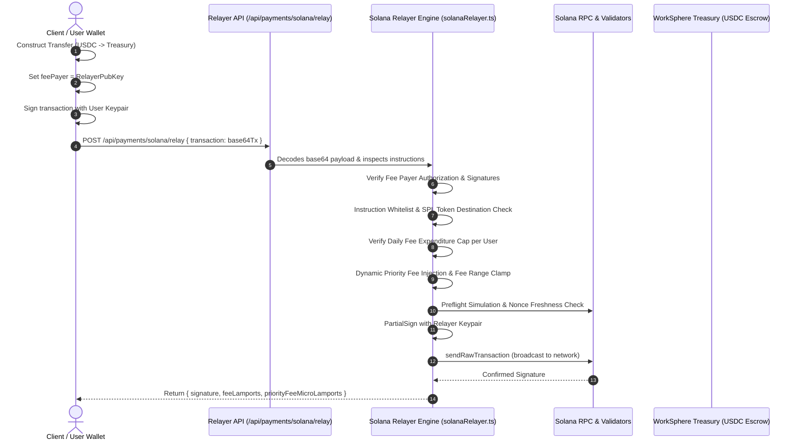
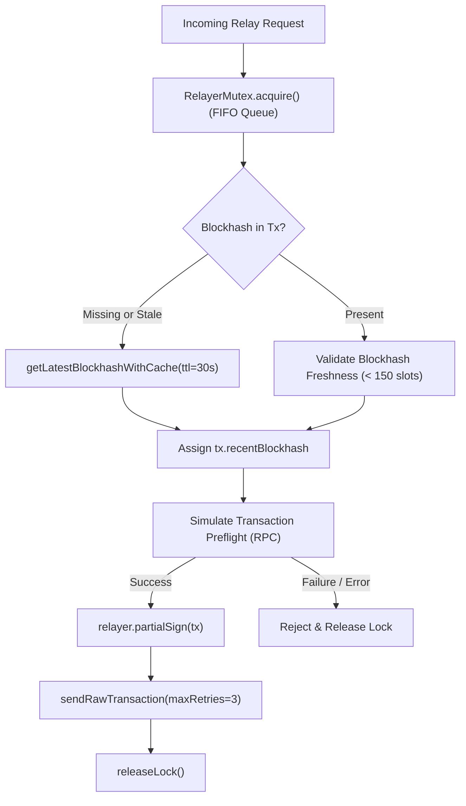

# Solana Gasless Relayer Threat Model & Cryptographic Security Architecture

## 1. Overview & Operational Role

WorkSphere incorporates a **Gasless Transaction Relayer** ([`src/lib/payments/solanaRelayer.ts`](file:///c:/Users/admin/Desktop/workfere/src/lib/payments/solanaRelayer.ts) & [`src/lib/payments/solanaPay.ts`](file:///c:/Users/admin/Desktop/workfere/src/lib/payments/solanaPay.ts)) designed to streamline user micro-payments and seat reservations using SPL-Token USDC on the Solana blockchain.

In standard decentralized applications, users must possess both the target token (USDC) and native network tokens (SOL) to cover base transaction execution and priority fees. This requirement introduces significant onboarding friction. The WorkSphere relayer eliminates this barrier by acting as the **designated fee payer**, co-signing transactions and covering network lamports on behalf of end users while strict cryptographic guarantees ensure treasury funds cannot be diverted or drained.



---

## 2. Threat Vector Analysis & Mitigation Matrix

Operating an open or semi-open backend signer with access to hot-wallet treasury funds introduces distinct attack vectors. The relayer implements multi-layered defensive controls:

| Threat Vector | Severity | Attack Mechanism | Implemented Defense Mechanism |
| :--- | :---: | :--- | :--- |
| **Relayer Treasury Drain (SOL Gas Exhaustion)** | **CRITICAL** | Attacker floods the relayer with complex or malicious transactions to consume all SOL lamports in the relayer hot wallet. | 1. Mandatory `validateRelayFeeLamports` capping fee at max 10,000 lamports.<br/>2. Daily rate-limiting and cumulative fee caps per user.<br/>3. Transaction byte-size ceiling (`MAX_SERIALIZED_TRANSACTION_BYTES = 1232`). |
| **Malicious Instruction Injection** | **CRITICAL** | Attacker inserts instructions transferring SOL or tokens out of the relayer wallet or unapproved third-party accounts. | 1. Strict instruction whitelist (SPL Token Transfer, Associated Token Account creation, ComputeBudget).<br/>2. Relayer key is NEVER passed as a writable or transferable source account.<br/>3. Relayer key ONLY signs as `feePayer`. |
| **Token Destination Divergence (Theft)** | **HIGH** | Attacker constructs a valid payment structure but changes the recipient address from WorkSphere Treasury to their own address while the relayer pays the fee. | Static destination account validation against `DEFAULT_TREASURY_SOLANA_ADDRESS` and verified venue escrow addresses. |
| **Transaction Front-Running & Replay Attacks** | **HIGH** | MEV searchers observe mempool traffic and extract relayer signatures or replay historical transactions on fork reorganizations. | 1. Recent blockhash enforcement with a 30-second TTL freshness buffer (`BLOCKHASH_CACHE_TTL_MS = 30000`).<br/>2. Durable Nonce verification where applicable.<br/>3. Single-flight FIFO mutex lock (`RelayerMutex`) preventing nonce/blockhash collision. |
| **Priority Fee Manipulation (Tip Spoofing)** | **MEDIUM** | Attacker requests astronomical compute unit prices to burn relayer funds in validator tips. | Explicit priority fee bounds clamping (`clampPriorityFee`) enforced between `DEFAULT_MIN_PRIORITY_FEE_MICRO_LAMPORTS` (1,000) and `DEFAULT_MAX_PRIORITY_FEE_MICRO_LAMPORTS` (1,000,000). |
| **RPC Desynchronization & Nonce Collision** | **MEDIUM** | High concurrent micropayments fetch identical account nonces/blockhashes, causing validator rejections (`BlockhashNotFound`, `AccountInUse`). | `RelayerMutex` FIFO queue serializing relayer signing and broadcast phases into a deterministic single-flight pipeline. |

---

## 3. Cryptographic Verification & Instruction Inspection Rules

Before the relayer keypair (`getRelayerKeypair()`) signs any transaction, the deserialized `Transaction` object is subjected to deterministic structural inspection:

### 3.1 Fee Payer & Signature Authorization Checks

```typescript
// 1. Fee Payer Ownership Validation
if (!transaction.feePayer || !transaction.feePayer.equals(relayer.publicKey)) {
  throw new Error("Transaction fee payer must be the configured relayer");
}

// 2. User Signature Requirement
const hasUserSignature = transaction.signatures.some(
  ({ publicKey, signature }) =>
    !publicKey.equals(relayer.publicKey) && signature !== null,
);
if (!hasUserSignature) {
  throw new Error("Transaction must include a user signature");
}
```

1. **Explicit Fee Payer Binding:** The transaction must declare `transaction.feePayer` matching the relayer public key. If missing or altered, the relayer rejects the payload without signing.
2. **User Pre-Signature Verification:** The transaction must already contain a valid, non-null cryptographic signature from the initiating user's public key (`partialSign` by user). The relayer will never initiate or sponsor a transaction that the user has not cryptographically authorized.

### 3.2 Instruction Whitelisting & Destination Verification

The relayer inspects every instruction inside `transaction.instructions`:

1. **Permitted Program IDs**:
   - **SPL Token Program** (`TokenkegQfeZyiNwAJbNbGKPFXCWuBvf9Ss623VQ5DA`): Checked for valid `Transfer` or `TransferChecked` instructions.
   - **Compute Budget Program** (`ComputeBudget111111111111111111111111111111`): Only `SetComputeUnitLimit` and `SetComputeUnitPrice` are permitted.
   - **Associated Token Account Program** (`ATokenGPvbdGVxr1b2hvZbsiqW5xWH25efTNsLJA8knL`): Permitted only if initializing the user or venue treasury token account.
   - **System Program** (`11111111111111111111111111111111`): Permitted solely for account rent allocation when creating token accounts; native SOL transfers from the relayer wallet are unconditionally blocked.
2. **Token Mint & Destination Enforcement**:
   - The token mint must strictly match `SOLANA_USDC_MINT_MAINNET` (`EPjFWdd5AufqSSqeM2qN1xzybapC8G4wEGGkZwyTDt1v`) or configured devnet USDC mints.
   - The destination recipient account in the transfer instruction must resolve to the WorkSphere Treasury escrow address (`DEFAULT_TREASURY_SOLANA_ADDRESS`) or a registered booking venue recipient stored in the database.

---

## 4. Replay Attack Defense & Durable Nonce Model

Solana prevents replay attacks natively through **Recent Blockhashes**. The relayer augments this with an automated blockhash cache and optional Durable Nonce accounts:



### 4.1 Blockhash Freshness Buffer (`30 Seconds`)
Solana blockhashes expire after roughly 150 slots (~60–90 seconds). To eliminate `BlockhashNotFound` validator rejections during network congestion:
- The relayer caches valid blockhashes with a **30-second TTL** (`BLOCKHASH_CACHE_TTL_MS = 30_000`).
- If an unconfirmed transaction encounters congestion, the single-flight queue prevents race conditions on nonce progression.

### 4.2 Durable Nonce Verification
For offline transactions and multi-party signing across intermittent mesh partitions:
- The transaction may utilize an on-chain **Nonce Account** (`system_instruction::advance_nonce_account`).
- The relayer queries the nonce account state on-chain, verifying that the stored nonce matches the transaction's blockhash field and that the nonce authority is the user.
- Advancing the nonce invalidates the stored hash immediately upon broadcast, preventing replay attacks across network partitions.

---

## 5. Rate Limiting, Expenditure Caps & Treasury Safeguards

To prevent economic griefing and bot exhaustion, the relayer enforces strict budget constraints:

### 5.1 Fee Validation & Hard Lamport Caps

Every relayed transaction is bounded by `validateRelayFeeLamports`:

```typescript
export const DEFAULT_MAX_RELAY_FEE_LAMPORTS = 10_000; // 0.00001 SOL (~$0.0015 USD)

export function validateRelayFeeLamports(
  feeLamports: number,
  maxFeeLamports = DEFAULT_MAX_RELAY_FEE_LAMPORTS,
): number {
  if (!Number.isInteger(feeLamports) || feeLamports <= 0) {
    throw new RangeError("Relay fee must be a positive integer");
  }
  if (feeLamports > maxFeeLamports) {
    throw new RangeError("Transaction fee exceeds the relayer limit");
  }
  return feeLamports;
}
```

- Any transaction with compiled message base fee exceeding `DEFAULT_MAX_RELAY_FEE_LAMPORTS` (10,000 lamports) is immediately aborted before signing.

### 5.2 Dynamic Priority Fee Bounds Clamping

Network congestion priority tips are strictly clamped between safe thresholds:

$$\text{EffectiveTip} = \max\left(\text{MinFee}, \min(\text{MaxFee}, \text{PercentileFee}_{75})\right)$$

- **Minimum Priority Fee**: `1,000` micro-lamports
- **Maximum Priority Fee Cap**: `1,000,000` micro-lamports (0.001 SOL per transaction ceiling)
- **Target Percentile**: 75th percentile of recent slots to guarantee prompt inclusion without overpaying.

### 5.3 Per-User Quota and Daily Treasury Expenditure Limits

The relayer API integrates with WorkSphere's sliding window rate-limiter (`src/lib/rateLimit`):

| Scope | Quota Ceiling | Window | Action on Violation |
| :--- | :---: | :---: | :--- |
| **Anonymous IP** | 5 transactions | 1 hour | HTTP 429 Too Many Requests |
| **Authenticated User** | 20 transactions | 24 hours | HTTP 429 (`Retry-After: <seconds>`) |
| **Daily User Treasury Cap** | 100,000 lamports (0.0001 SOL) | 24 hours (Rolling) | Rejection with `"Daily sponsored transaction quota exceeded"` |
| **Global Treasury Circuit Breaker** | 2.0 SOL cumulative daily expenditure | 24 hours | Automated circuit breaker halts relayer signing; alerts operations. |

---

## 6. Preflight Simulation & Fail-Safe Architecture

To prevent paying fees for transactions destined to fail:

1. **Preflight RPC Simulation**:
   - All transactions undergo local RPC simulation (`simulateTransaction` / `sendRawTransaction({ skipPreflight: false })`).
   - If preflight simulation detects an error (e.g., insufficient USDC balance, slippage failure, uninitialized mint account), the relayer halts before broadcast, incurring zero on-chain fee expenditure.
2. **Private Key Storage & Security**:
   - The relayer private key is injected via `SOLANA_RELAYER_PRIVATE_KEY` as an encrypted environment variable.
   - Keypair instances are isolated in memory and never logged, exported, or serialized into API responses.
3. **Treasury Hot-Wallet Segregation**:
   - The relayer keypair maintains a minimal operating balance (e.g., 0.5 – 2.0 SOL).
   - Major platform funds and user USDC settlements reside in cold storage and multi-sig vault accounts completely decoupled from the relayer execution key.
