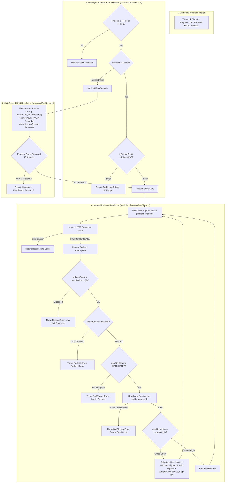

# Webhook SSRF Defense-in-Depth & Outbound Redirect Revalidation Specification

## 1. Executive Summary & Threat Model

WorkSphere provides an enterprise webhook delivery subsystem that dispatches event notifications (e.g., booking confirmations, desk cancellations, presence attestations, and noise telemetry alerts) to third-party customer endpoints.

Because webhook destinations are configured dynamically by end users and API integrators, outbound HTTP dispatchers are inherently exposed to **Server-Side Request Forgery (SSRF)** attacks:

```
[Attacker Configures Malicious Webhook]
                   |
                   v
[WorkSphere Dispatcher Server]
   |
   +---> (Target: 169.254.169.254) ----> Cloud Instance Metadata Service (AWS/GCP/Azure IAM Credentials)
   +---> (Target: 127.0.0.1:6379)  ----> Internal Redis Cache / Keyspace (Remote Code Execution / Data Corruption)
   +---> (Target: 10.0.0.0/8)      ----> Internal Microservices & Kubernetes API Servers (Unauthorized Actions)
   +---> (Target: DNS Rebinding)   ----> Resolves public at check-time, switches to 127.0.0.1 at connect-time
   +---> (Target: Open Redirect)   ----> Public endpoint redirects (HTTP 302) to internal private subnet
```

### 1.1 Primary Attack Vectors Mitigated

1. **Direct Private/Loopback IP Targeting**: Supplying IPv4/IPv6 loopback, local subnet, or link-local metadata addresses (`http://169.254.169.254/latest/meta-data/`, `http://localhost:5432`).
2. **Obfuscated & Ambiguous IP Representations**: Utilizing octal notation (`http://0177.0.0.1`), decimal integers (`http://2130706433`), hexadecimal IPs, or mixed formats to bypass naïve string regex filters.
3. **IPv6 and IPv4-Mapped Obfuscation**: Utilizing compressed IPv6 representations (`http://[::1]`, `http://[0:0:0:0:0:0:0:1]`), IPv4-mapped IPv6 addresses (`http://[::ffff:127.0.0.1]`), or deprecated site-local/6to4 prefixes.
4. **DNS Rebinding & Multi-IP Resolution**: Registering a custom DNS record that returns both a benign public IP and an internal private IP, or returns a short TTL record that flips to a private address between initial validation and HTTP connection.
5. **Outbound Open Redirect Traversal**: Registering an innocuous public endpoint (`https://example.com/webhook`) that issues an HTTP 301/302/307/308 redirect pointing to an internal resource (`http://10.0.0.1/admin`).
6. **Cross-Origin Credential Leakage**: Forwarding sensitive webhook signing headers or API keys across redirects to untrusted third-party origins.

To defeat these attack vectors, WorkSphere implements an uncompromising defense-in-depth model across [`src/lib/ssrfValidation.ts`](../../src/lib/ssrfValidation.ts), [`src/lib/notifications/httpClient.ts`](../../src/lib/notifications/httpClient.ts), and the webhook dispatch engine [`src/lib/notifications/channels/webhookChannel.ts`](../../src/lib/notifications/channels/webhookChannel.ts).

---

## 2. Multi-Layer SSRF Defense Architecture



---

## 3. Comprehensive Private IP Range Blocking

### 3.1 Strict IPv4 Filtering (`isPrivateIPv4`)

Defined in [`src/lib/ssrfValidation.ts`](../../src/lib/ssrfValidation.ts), `isPrivateIPv4` analyzes dot-decimal IPv4 addresses against all IANA, RFC, and cloud-provider reserved ranges.

#### Ambiguity & Octal/Hex Protection

Attackers frequently use leading zeros to trigger octal parsing in POSIX C runtimes (e.g., `0177.0.0.1` becomes `127.0.0.1`):

```typescript
if (
  rawParts.length !== 4 ||
  rawParts.some((p) => {
    const trimmed = p.trim();
    return trimmed === "" || !/^\d+$/.test(trimmed) || /^0\d+/.test(trimmed);
  })
) {
  return true; // Treat invalid, empty, or ambiguous octal notation as unsafe
}
```

#### Blocked IPv4 Subnet Matrix

| CIDR Block        | RFC / Purpose                        | Common Attack Surface                                   |
| :---------------- | :----------------------------------- | :------------------------------------------------------ |
| `0.0.0.0/8`       | RFC 1122 ("This network" / wildcard) | Binds to all local interfaces on Unix systems           |
| `10.0.0.0/8`      | RFC 1918 (Private Class A)           | Enterprise intranets, Kubernetes Pod IPs                |
| `100.64.0.0/10`   | RFC 6598 (Carrier-Grade NAT)         | Cloud VPC interconnects and internal load balancers     |
| `127.0.0.0/8`     | RFC 1122 (Loopback)                  | Local host services (Redis, PostgreSQL, Admin APIs)     |
| `169.254.0.0/16`  | RFC 3927 (Link-Local / Metadata)     | **AWS, GCP, Azure, OpenStack IMDS (`169.254.169.254`)** |
| `172.16.0.0/12`   | RFC 1918 (Private Class B)           | Docker bridge networks, VPC internal subnets            |
| `192.0.0.0/24`    | RFC 6890 (IETF Protocol Assignments) | IETF Reserved infrastructure                            |
| `192.0.2.0/24`    | RFC 5737 (TEST-NET-1)                | Documentation / non-routable                            |
| `192.168.0.0/16`  | RFC 1918 (Private Class C)           | SOHO / router management interfaces                     |
| `198.18.0.0/15`   | RFC 2544 (Benchmarking)              | Inter-network communication testing                     |
| `198.51.100.0/24` | RFC 5737 (TEST-NET-2)                | Documentation / non-routable                            |
| `203.0.113.0/24`  | RFC 5737 (TEST-NET-3)                | Documentation / non-routable                            |
| `224.0.0.0/4`     | RFC 1112 (Multicast)                 | Multicast group discovery                               |
| `240.0.0.0/4`     | RFC 1112 (Reserved / Broadcast)      | Former Class E reserved addresses                       |

---

### 3.2 Canonicalized IPv6 Filtering (`parseIPv6Hextets` & `isPrivateIPv6`)

IPv6 address representations feature extreme flexibility: zero-compression (`::`), embedded IPv4 notations, brackets, and scope zone indexes (`%eth0`). Attackers exploit these variations to bypass basic substring regexes.

WorkSphere first canonicalizes any IPv6 address into a strict array of **eight 16-bit integers** ($0$ to $65{,}535$) via `parseIPv6Hextets`:

1. Strips encapsulating URL brackets (`[::1]` $\to$ `::1`).
2. Strips zone indices (`fe80::1%eth0` $\to$ `fe80::1`).
3. Expands embedded dot-decimal IPv4 suffixes (`::ffff:192.168.1.1` $\to$ two final hextets `0xc0a8` and `0x0101`).
4. Reconstructs missing zero hextets across `::` with exact length verification.

#### Blocked IPv6 Subnet Matrix

| IPv6 Prefix / Range | RFC / Definition                      | Attack Vector Blocked                                            |
| :------------------ | :------------------------------------ | :--------------------------------------------------------------- |
| `::/128`            | RFC 4291 (Unspecified)                | Wildcard binding to local machine                                |
| `::1/128`           | RFC 4291 (Loopback)                   | Local host internal ports (`http://[::1]:3000`)                  |
| `fc00::/7`          | RFC 4193 (Unique Local Address - ULA) | Internal IPv6 enterprise subnets (`fc00::` – `fdff::`)           |
| `fe80::/10`         | RFC 4291 (Link-Local Unicast)         | Neighbor discovery & link-local services                         |
| `fec0::/10`         | RFC 3879 (Deprecated Site-Local)      | Legacy site-local internal subnets                               |
| `ff00::/8`          | RFC 4291 (Multicast)                  | Multicast node listeners                                         |
| `100::/64`          | RFC 6666 (Discard-Only)               | Routing blackholes                                               |
| `2001:db8::/32`     | RFC 3849 (Documentation)              | Non-routable documentation ranges                                |
| `2001:2::/48`       | RFC 5180 (Benchmarking)               | Benchmark testing prefix                                         |
| `::ffff:0:0/96`     | RFC 4291 (IPv4-Mapped IPv6)           | **Extracts embedded IPv4 and validates against `isPrivateIPv4`** |
| `::/96`             | RFC 4291 (IPv4-Compatible IPv6)       | **Extracts embedded IPv4 and validates against `isPrivateIPv4`** |
| `2002::/16`         | RFC 3056 (6to4 Tunneling)             | **Extracts embedded IPv4 from hextets 1 & 2 and validates**      |

---

## 4. DNS Rebinding & Dual-Stack Multi-Record Resolution

In a **DNS Rebinding** attack, an adversary configures a DNS authoritative nameserver for `attacker.com` to respond with dual IP addresses or alternate responses:

- Response 1 (Validation Time): `93.184.216.34` (Public Example IP - Passes checks).
- Response 2 (Connect Time): `127.0.0.1` or `169.254.169.254` (Private IP - Exploits connection).
- Dual-Record Response: Returns both IPv4 public `198.51.100.1` and IPv6 loopback `::1`.

WorkSphere neutralizes DNS rebinding via `resolveAllDnsRecords`:

```typescript
export async function resolveAllDnsRecords(
  hostname: string,
): Promise<string[]> {
  const ipSet = new Set<string>();

  if (net.isIP(hostname)) {
    return [hostname];
  }

  const [res4, res6, resLookup] = await Promise.allSettled([
    resolve4Async(hostname),
    resolve6Async(hostname),
    lookupAsync(hostname, { all: true }),
  ]);

  // Collect all IPv4 A records
  if (res4.status === "fulfilled" && Array.isArray(res4.value)) {
    for (const ip of res4.value)
      if (typeof ip === "string") ipSet.add(ip.trim());
  }

  // Collect all IPv6 AAAA records
  if (res6.status === "fulfilled" && Array.isArray(res6.value)) {
    for (const ip of res6.value)
      if (typeof ip === "string") ipSet.add(ip.trim());
  }

  // Query local getaddrinfo resolution
  if (resLookup.status === "fulfilled" && resLookup.value) {
    const lookupAddrs = Array.isArray(resLookup.value)
      ? resLookup.value
      : [resLookup.value];
    for (const entry of lookupAddrs) {
      if (typeof entry === "string") ipSet.add(entry.trim());
      else if (entry?.address) ipSet.add(entry.address.trim());
    }
  }

  return Array.from(ipSet);
}
```

### The "Zero-Tolerance" Evaluation Rule

When evaluating candidate addresses in `isSafeWebhookUrl`:

```typescript
for (const address of addresses) {
  const isIPv6 = address.includes(":") || net.isIPv6(address);
  const isPrivate = isIPv6 ? isPrivateIPv6(address) : isPrivateIPv4(address);
  if (isPrivate) {
    return {
      isSafe: false,
      reason: `Resolved IP (${address}) falls into a forbidden private network range.`,
    };
  }
}
```

If **any single resolved IP** falls into a forbidden range, the entire host is rejected immediately. Dual-homed or split-horizon DNS configurations cannot bypass validation.

---

## 5. Outbound Redirect Interception & Revalidation

Standard HTTP client libraries (such as default `fetch` or Axios) automatically follow HTTP 3xx redirects without invoking validation callbacks. An attacker can easily bypass pre-flight URL validation by presenting a benign public endpoint that issues:

```http
HTTP/1.1 302 Found
Location: http://169.254.169.254/computeMetadata/v1/
```

To eliminate this vulnerability, `NotificationHttpClient` ([`src/lib/notifications/httpClient.ts`](../../src/lib/notifications/httpClient.ts)) disables automated browser/runtime redirect handling (`redirect: "manual"`) and executes a custom resolution loop.

### 5.1 Step-by-Step Redirect Enforcement Rules

1. **Strict Hop Bounding (`maxRedirects`)**:
   - Caps total redirects to a configurable maximum (default $3$).
   - Exceeding the threshold throws `RedirectError("Maximum redirect limit exceeded")`.
2. **Cycle & Loop Detection**:
   - Tracks all visited URLs in a `Set<string> visitedUrls`.
   - Re-encountering an existing URL throws `RedirectError("Redirect loop detected")`.
3. **Protocol Whitelisting**:
   - Verifies the `Location` target URL protocol. Only `http:` and `https:` are permitted.
   - Disallowed protocols (e.g., `file:`, `ftp:`, `gopher:`, `data:`, `javascript:`) immediately throw `SsrfBlockedError`.
4. **Mandatory Pre-Hop Revalidation**:
   - Before following any redirect, the new target URL is subjected to the full `validator(nextUrlStr)` routine, executing fresh DNS resolution and IP verification.
   - If the redirected address points to a private subnet or loopback, the request is aborted with `SsrfBlockedError`.
5. **Cross-Origin Credential Stripping**:
   - If `nextUrl.origin !== currentOrigin`, all sensitive headers are stripped before transmitting the redirected request:
     ```typescript
     const SENSITIVE_HEADERS = [
       "authorization",
       "cookie",
       "proxy-authorization",
       "webhook-signature",
       "svix-signature",
       "webhook-timestamp",
       "svix-timestamp",
       "x-api-key",
     ];
     ```
   - This prevents signature theft or session token exfiltration to untrusted third-party hosts.
6. **HTTP Method Semantics (RFC 7231)**:
   - On HTTP 303 (See Other), the method is converted to `GET` and the request body is dropped.

---

## 6. Circuit Breaker & Infrastructure Safeguards

Beyond SSRF protection, `NotificationHttpClient` guards outbound dispatch workers against cascading resource exhaustion using an origin-partitioned circuit breaker:

- **Failure Threshold**: $5$ consecutive delivery failures trip the circuit to `OPEN`.
- **Reset Timeout**: Remains open for $30{,}000\text{ ms}$ (`30s`), instantly failing fast without opening network sockets to stalled destinations.
- **Half-Open Probing**: After the reset window, a single probe request is permitted to determine if the destination has recovered.
- **Request Timeouts**: Enforces hard timeouts via `AbortSignal.timeout(5000)` (default $5\text{s}$) to prevent hanging TCP sockets from starving Node.js connection pools.

---

## 7. Security Audit & Developer Checklist

When configuring or consuming webhook endpoints in WorkSphere:

- [ ] **Always Route Deliveries Through `NotificationHttpClient`**: Never use raw global `fetch` or Axios for user-provided URLs.
- [ ] **Validate URLs at Rest and at Runtime**: Validate endpoints when registered in settings, and re-validate immediately before each HTTP dispatch.
- [ ] **Enforce TLS for Production Endpoints**: Prefer `https:` URLs for production webhook endpoints.
- [ ] **Test with SSRF Fixtures**: Validate test suites against loopback (`127.0.0.1`, `[::1]`), cloud metadata (`169.254.169.254`), and octal notation (`0177.0.0.1`):
  ```bash
  npx jest src/__tests__/lib/ssrfValidation.test.ts
  ```
