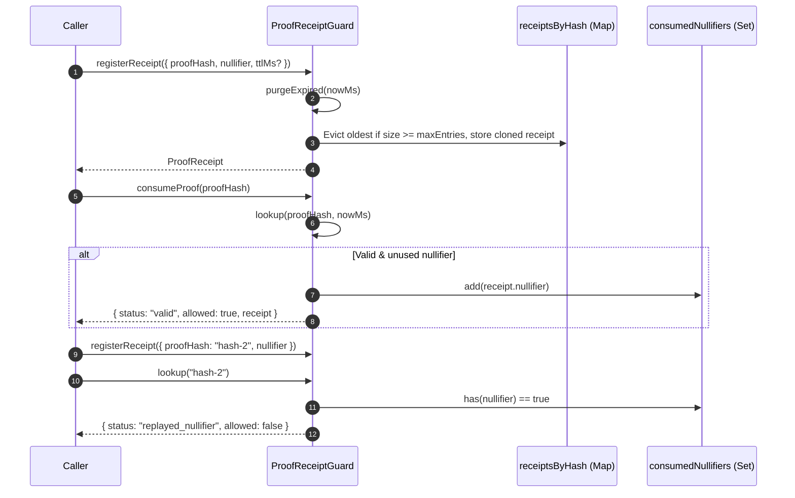

# ZKP Proof Receipt Guard Security Specification

This specification documents the replay-attack mitigation, nullifier lifecycle, TTL expiry semantics, and bounded-storage eviction guarantees of `ProofReceiptGuard` (`src/features/zkp/proofReceiptGuard.ts`).

---

## 1. Security Model & Threat Mitigation

Zero-Knowledge Proof (ZKP) verification proves possession of a valid witness without revealing underlying PII, but verified proof artifacts and receipts can still be replayed if an attacker resubmits the same proof or reuses a previously spent nullifier across a newly wrapped receipt.

`ProofReceiptGuard` mitigates these threats through two independent layers:

1. **Time-Bounded Receipt Caching (TTL Window)**: Verified proof receipts are valid only within `[verifiedAtMs, expiresAtMs)`. Once `nowMs >= expiresAtMs`, the receipt is treated as expired and evicted.
2. **Single-Use Nullifier Replay Protection**: When `singleUseNullifiers` is enabled (the default), consuming a proof records its `nullifier` in `consumedNullifiers`. Any subsequent verification or `lookup()` against either the original `proofHash` or a newly registered `proofHash` carrying the same `nullifier` is rejected with `status: "replayed_nullifier"` and `allowed: false`.

### Defensive Immutability

Both `registerReceipt()` and `lookup()` return shallow-cloned copies via `cloneReceipt()` (cloning top-level fields and `metadata`), preventing callers from mutating `expiresAtMs`, `nullifier`, or `metadata` inside internal guard state.

---

## 2. Configuration & Data Contracts

### `ProofReceiptGuardOptions`

| Option | Default | Validation / Bounds | Description |
| :--- | :--- | :--- | :--- |
| `defaultTtlMs` | `300000` (5 min) | Finite number `> 0`, floored | Fallback TTL when neither `ttlMs` nor `expiresAtMs` is supplied to `registerReceipt()`. |
| `maxEntries` | `500` | Finite number `> 0`, floored | Maximum number of cached `ProofReceipt` entries in `receiptsByHash`. |
| `singleUseNullifiers` | `true` | `boolean` | Enforces single-use nullifier consumption across `lookup()` and `consumeProof()`. |
| `nowFn` | `Date.now` | `() => number` | Deterministic or wall-clock millisecond timestamp provider. |

### `ProofReceipt` & `ProofReceiptCheckResult`

- **`ProofReceipt`**: `{ proofHash, nullifier, verifiedAtMs, expiresAtMs, metadata? }`
- **`ProofReceiptStatus`**: `'valid' | 'expired' | 'replayed_nullifier' | 'not_found'`
- **`ProofReceiptCheckResult`**: `{ status, allowed, receipt?, reason? }`

---

## 3. Nullifier & Receipt Lifecycle

### Lifecycle Guarantees

1. **Input Validation**: `registerReceipt()` throws immediately if `proofHash` or `nullifier` is empty/falsy.
2. **TTL Computation**:
   - `verifiedAtMs` defaults to `nowMs` (floored).
   - `ttlMs` defaults to `defaultTtlMs` unless a positive finite `input.ttlMs` is provided.
   - `expiresAtMs` uses explicit finite `input.expiresAtMs` (floored) or `verifiedAtMs + ttlMs`.
3. **Atomic Consumption**: `consumeProof(proofHash, nowMs)` delegates to `lookup(proofHash, nowMs)` and adds `check.receipt.nullifier` to `consumedNullifiers` only when `check.allowed` is `true` and `singleUseNullifiers` is enabled.
4. **Independent Nullifier Retention**: `consumedNullifiers` is independent of `receiptsByHash` capacity eviction and TTL purging, ensuring a consumed nullifier remains blocked even if its original receipt is evicted due to `maxEntries` pressure (until `clear()` is explicitly invoked).

---

## 4. TTL Expiry & Storage Eviction Guarantees

### 4.1 Expiration Semantics

`isExpired(receipt, nowMs)` evaluates `nowMs >= receipt.expiresAtMs` (half-open validity interval, so exact boundary equality is treated as expired).

### 4.2 Active & Lazy Eviction

- **Active Sweep (`purgeExpired(nowMs)`)**: Invoked automatically at the start of `registerReceipt()`, `lookup()`, and `size()`. Iterates `receiptsByHash` and deletes every entry where `isExpired(receipt, nowMs)` is `true`, returning the count of purged entries.
- **Bounded Memory (`maxEntries`)**: Before inserting a new receipt in `registerReceipt()`:
  1. Expired entries are purged first via `purgeExpired(nowMs)`.
  2. If `proofHash` already exists, its entry is deleted and re-inserted to refresh insertion order.
  3. While `receiptsByHash.size >= maxEntries`, the oldest entry (`receiptsByHash.keys().next().value`) is evicted in FIFO insertion order so memory never exceeds `maxEntries`.
- **Full Reset (`clear()`)**: Clears both `receiptsByHash` and `consumedNullifiers`.
