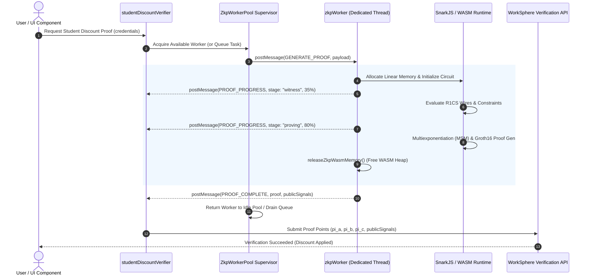

# Client-Side Circom Groth16 Witness Worker Pool Specification

This specification documents the cryptographic lifecycle, memory architecture, worker pool concurrency model, and privacy guarantees for client-side Zero-Knowledge Proof (ZKP) generation in WorkSphere (`src/workers/zkpWorker.ts` and `src/features/zkp/studentDiscountVerifier.ts`).

---

## 1. Overview & Cryptographic Motivation

WorkSphere provides privacy-preserving verification for student discounts, nomadic residency credentials, and venue access passes without exposing personally identifiable information (PII) such as university email addresses, student IDs, or passport numbers.

### Core Cryptographic Primitive

Using **Circom 2.1** and **SnarkJS** with the **Groth16 zk-SNARK** proof system over the **BN128 (alt_bn128)** elliptic curve:

- **Private Inputs**: Student ID secret, institutional enrollment salt, membership leaf path.
- **Public Inputs / Signals**: Merkle root hash, institution domain hash, ceremony nonce.
- **Proof Artifacts**: Elliptic curve points $\pi_A \in \mathbb{G}_1$, $\pi_B \in \mathbb{G}_2$, and $\pi_C \in \mathbb{G}_1$.

Witness generation (computing the intermediate wire values satisfying the circuit's Rank-1 Constraint System / R1CS) is computationally and memory intensive. Offloading witness calculation and scalar multiplications to dedicated Web Workers prevents main-thread event loop starvation and preserves 60 FPS UI responsiveness.

---

## 2. Worker Pool Architecture & Execution Flow



---

## 3. Worker Lifecycle & Memory Invariants

### 1. Pool Concurrency Invariants

- **Thread Ceiling**: Maximum worker instances bounded by $\min(\text{navigator.hardwareConcurrency} - 1, 4)$ to avoid CPU core thrashing.
- **Queueing Discipline**: Strict FIFO queueing when all worker threads are occupied.
- **Watchdog Timeout**: Enforced by `ZKP_WATCHDOG_TIMEOUT_MS` (30 seconds). If computation exceeds the watchdog ceiling, the worker is sent an `ABORT` message, forcefully terminated via `worker.terminate()`, and a fresh worker instance is spawned to replenish the pool.

### 2. Memory Recycling & Zero-Jank ArrayBuffer Transfers

Generating a Groth16 proof requires loading a compiled `.wasm` witness calculator (~2MB) and proving key `.zkey` (~4–16MB):

- **WASM Linear Memory Allocation**: The worker allocates an isolated `WebAssembly.Memory` buffer.
- **Immediate Cleanup**: Once proof points are computed, `releaseZkpWasmMemory()` zeroes out internal buffer references to facilitate immediate V8 garbage collection.
- **Transferable Objects**: Binary inputs and output payloads are passed via zero-copy `ArrayBuffer` transfer lists:
  ```typescript
  worker.postMessage({ type: "GENERATE_PROOF", payload: buffer }, [buffer]);
  ```
  This eliminates multi-megabyte serialization overhead on the main browser thread.

---

## 4. Security & Privacy Analysis

### Zero-Knowledge Proof Invariants

| Attribute                   | Guarantee                                       | Verification Mechanism                                                                        |
| :-------------------------- | :---------------------------------------------- | :-------------------------------------------------------------------------------------------- |
| **Zero Knowledge**          | Verifier learns nothing beyond statement truth. | Groth16 randomized blinding factors ($r, s \in \mathbb{F}_r^*$).                              |
| **Computational Soundness** | Malicious inputs cannot produce valid proofs.   | Discrete logarithm hardness over BN128 pairing groups.                                        |
| **Zero PII Leakage**        | `studentId` never leaves client browser memory. | `studentId` is strictly a private wire in R1CS; only domain hashes appear in `publicSignals`. |
| **Replay Protection**       | Same proof cannot be replayed across sessions.  | Session-specific public `nonce` bound inside the circuit constraints.                         |
| **Memory Erasure**          | Proof artifacts cleared from memory after emit. | Explicit nullification in `releaseZkpWasmMemory()`.                                           |

---

## 5. Memory Footprint Guidelines & Resource Budgets

| Execution Phase           | Main Thread RAM |   Worker Thread RAM    |        WASM Linear Memory         | Duration (Typical Mobile CPU) |
| :------------------------ | :-------------: | :--------------------: | :-------------------------------: | :---------------------------: |
| **Idle / Pool Ready**     | $< 1\text{ MB}$ |    $< 8\text{ MB}$     |           $0\text{ MB}$           |           Immediate           |
| **Witness Evaluation**    | $< 2\text{ MB}$ | $\approx 24\text{ MB}$ |          $16\text{ MB}$           |     $350 - 900\text{ ms}$     |
| **Groth16 Proving (MSM)** | $< 2\text{ MB}$ | $\approx 48\text{ MB}$ |          $32\text{ MB}$           |   $1,200 - 2,800\text{ ms}$   |
| **Post-Proof Teardown**   | $< 1\text{ MB}$ |    $< 10\text{ MB}$    | $0\text{ MB}$ (Garbage Collected) |       $< 50\text{ ms}$        |

---

## 6. Browser Compatibility Matrix

| Browser Engine                         | WebAssembly Support | Web Workers Support | Transferable ArrayBuffers |     Status      |
| :------------------------------------- | :-----------------: | :-----------------: | :-----------------------: | :-------------: |
| **Chromium 88+** (Chrome, Edge, Brave) |         Yes         |         Yes         |            Yes            | Fully Supported |
| **Firefox 84+**                        |         Yes         |         Yes         |            Yes            | Fully Supported |
| **WebKit / Safari 14.1+** (iOS 14.5+)  |         Yes         |         Yes         |            Yes            | Fully Supported |
| **Mobile Chrome (Android 10+)**        |         Yes         |         Yes         |            Yes            | Fully Supported |
| **Private Browsing / Incognito**       |         Yes         |         Yes         |            Yes            | Fully Supported |
