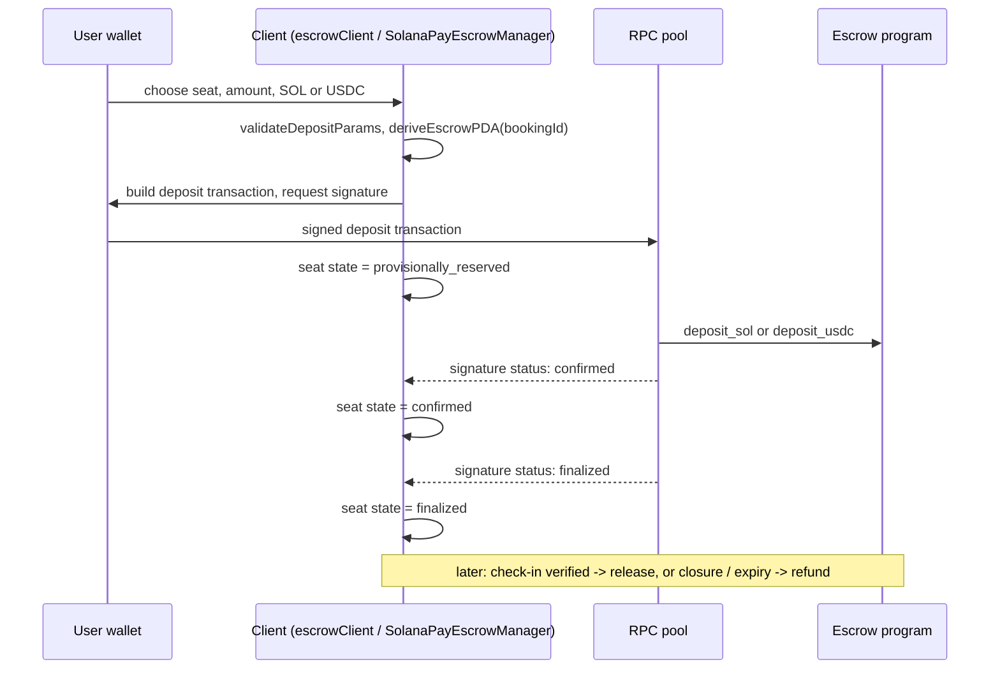
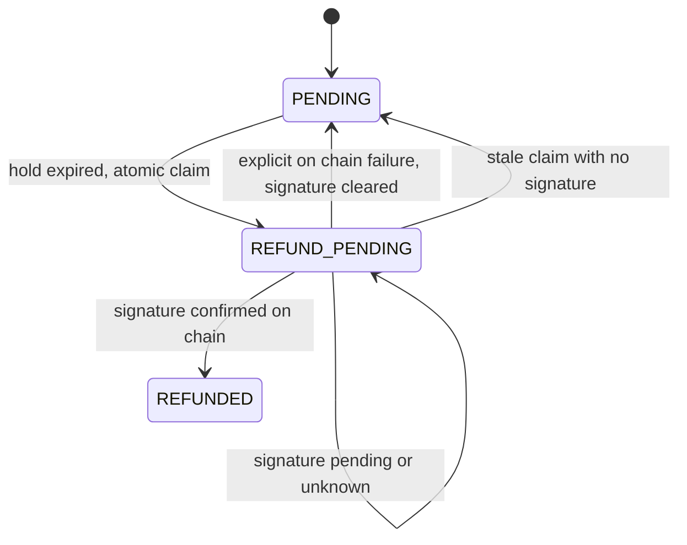

# Solana Escrow Settlement and Refund Runbook

Operational guide to the WorkSphere seat deposit escrow: how the escrow account
(a PDA) is derived, how deposit confirmation works, how settlement (release) and
refunds happen, and how RPC failover and retries behave.

**Source files**

- [`src/lib/solana/escrowClient.ts`](../../src/lib/solana/escrowClient.ts): PDA derivation, deposit, release and refund builders, RPC pool, refund submission
- [`src/lib/solana/solanaPayEscrow.ts`](../../src/lib/solana/solanaPayEscrow.ts): optimistic seat state and confirmation tracking (`SolanaPayEscrowManager`)
- [`src/lib/solana/escrowTransactionRetry.ts`](../../src/lib/solana/escrowTransactionRetry.ts): priority fee stepping and replacement retries
- [`programs/worksphere-escrow/src/lib.rs`](../../programs/worksphere-escrow/src/lib.rs): on-chain Anchor program
- [`src/app/api/cron/escrow-refund/route.ts`](../../src/app/api/cron/escrow-refund/route.ts): automated expiry refund cron

**Related guides**

- [`SOLANA_ESCROW_REFUND_CRON.md`](./SOLANA_ESCROW_REFUND_CRON.md): cron status lifecycle, idempotency, configuration
- [`OPTIMISTIC_ESCROW_STREAMING.md`](./OPTIMISTIC_ESCROW_STREAMING.md): WebSocket subscription and hook integration details

Note on scope: `solanaPayEscrow.ts` tracks seat state and confirmation in the
client. PDA derivation, settlement, and refund transactions live in `escrowClient.ts`
and the on-chain program.

---

## 1. Escrow account (PDA)

Each booking has one escrow PDA, derived deterministically from the booking id.

```ts
// escrowClient.ts
const PDA_SEED_PREFIX = "worksphere_escrow";

deriveEscrowPDA(bookingId, programId = ESCROW_PROGRAM_ID)
// seeds: [Buffer.from("worksphere_escrow"), Buffer.from(bookingId)]
// returns { address, bump }
```

The on-chain program uses the same seeds (`ESCROW_SEED_PREFIX = b"worksphere_escrow"`,
then `booking_id.as_bytes()`), so the client and program agree on the address.
`deriveEscrowPda()` is a tuple returning wrapper around the same function.

Key points:

- `bookingId` must be a non empty string, otherwise `deriveEscrowPDA` throws.
- The PDA depends on `ESCROW_PROGRAM_ID` (from `NEXT_PUBLIC_ESCROW_PROGRAM_ID`).
  Changing the program id changes every escrow address.
- Seats map to escrows through the booking: one booking, one escrow PDA.
- For SOL, lamports are held by the PDA account. For USDC, the vault is the PDA's
  associated token account (`getAssociatedTokenAddressSync(mint, escrowVault, ...)`).
- `isPlaceholderProgramId()` is true when the id is unset or the System Program.
  `releaseEscrow` and `refundEscrow` throw in that case, so nothing moves without a
  deployed program.

On chain state is `EscrowState`: `Active` (0), `Released` (1), `Refunded` (2). Both
`release` and `refund` require the escrow to be `Active`, so a finished escrow cannot be
settled twice.

## 2. Transaction lifecycle



Seat states in `SolanaPayEscrowManager`: `available`, `provisionally_reserved`,
`confirmed`, `finalized`. Payment stages: `pending`, `confirmed`, `finalized`,
`failed`, `timeout`. If the transaction fails, is dropped, or the 60 second
`DEFAULT_CONFIRMATION_TIMEOUT_MS` passes, `rollback()` returns the seat to `available`
and sets the error. Rollback is a UI and seat state change only. It does not move funds.

## 3. Confirmation levels and commitment strategy

| Level | Meaning | Where WorkSphere uses it |
|-------|---------|--------------------------|
| `processed` | Seen by the leader, can still be dropped or reorged | Optional intermediate event in `EscrowConfirmationStateMachine` (`onProcessed`). Never used to settle. |
| `confirmed` | Voted on by a supermajority | Default pool commitment, deposit build and preflight, `verifyDeposit`, and the first seat confirmation |
| `finalized` | Rooted, cannot be rolled back | Final seat state, and the target of the confirmation state machine (`commitment` defaults to `"finalized"`) |

Rules of thumb:

1. Show the user progress at `confirmed`, but treat money as final only at `finalized`.
2. Commitment only moves forward. The state machine rejects regressions such as a late
   `processed` after `confirmed`.
3. Prefer `getSignatureStatuses` polling for server side work. The refund path
   deliberately avoids `confirmTransaction` because its long lived WebSocket does not fit
   the pool request timeout.
4. A signature that is still `pending` or `unknown` after a timeout may still land. Do not
   assume failure. Only an explicit on chain error means the transaction failed.

When WebSocket subscriptions cannot be registered (for example rate limited RPC),
`SolanaPayEscrowManager` falls back to polling every `DEFAULT_POLL_INTERVAL_MS` (2,000 ms).
See `OPTIMISTIC_ESCROW_STREAMING.md` for the details.

## 4. Settlement (release)

Release pays the escrow to the recipient after a verified check-in.

1. `verifyCheckInForBooking()` checks the server side check-in record. Client supplied GPS
   is never trusted as proof.
2. `releaseEscrow(bookingId, authorityWallet, rpcUrl, options)` builds the release
   transaction with `buildReleaseTransaction`, using the PDA and the release instruction
   discriminator.
3. The platform authority signs. The program requires the signer to match the authority
   stored in the escrow account.
4. `releaseEscrow` records `RELEASED` in the in memory `escrowStateLedger` right after it
   builds the transaction. That ledger is a local cache, so confirm the on chain
   `EscrowState` before treating funds as settled.

## 5. Refunds and timeouts

Refunds return funds to the original depositor. The on chain `refund` instruction needs
the escrow to be `Active`, the booking id to match, the signer to be the stored authority,
and the depositor to match the stored depositor.

**The program has no on chain timer.** A timeout refund is always a transaction signed by
the platform authority. Triggers:

| Trigger | Path |
|---------|------|
| Booking hold expires (`holdExpiresAt <= now`) | Refund cron `/api/cron/escrow-refund` claims the row and calls `submitEscrowRefundTransaction` |
| Venue closed or cancelled by an authorized party | `verifyVenueClosureForBooking()` then `refundEscrow(bookingId, ...)`, with the `reason` recorded in the instruction |
| Helper check for grace periods | `isEscrowExpired(bookingDate, gracePeriodHours = 24)` |

### Cron refund flow



`submitEscrowRefundTransaction` is ordered on purpose:

1. Build the refund instruction and transaction (preflight phase).
2. Sign locally with the authority key.
3. Call `onSigned(signature)` so the cron persists the signature **before** broadcast.
4. `sendRawTransaction`, then poll `getSignatureStatuses` through the RPC pool until
   confirmed or finalized, or until `confirmationTimeoutMs`.

Failures are tagged by phase (`EscrowRefundSubmissionPhase`: `preflight`, `broadcast`,
`confirmation`) in `EscrowRefundSubmissionError`. Only a `preflight` failure is safe to
return to `PENDING`, because no signed transaction could have reached the cluster. After
broadcast the signature must be reconciled with `verifyEscrowRefundTransaction`, which
reports `confirmed`, `failed`, `pending`, or `unknown`. This prevents paying out twice.

### Operator checklist for a stuck refund

1. Find the booking row and its stored signature.
2. Run the reconcile step (see `SOLANA_ESCROW_REFUND_CRON.md`, manual trigger).
3. `confirmed`: nothing to do, the row moves to `REFUNDED`.
4. `pending` or `unknown`: wait. Do not clear the signature.
5. `failed`: the cron returns the row to `PENDING` and it is retried on the next run.
6. Required config: `NEXT_PUBLIC_ESCROW_PROGRAM_ID` and `SOLANA_ESCROW_AUTHORITY_SECRET_KEY`.
   Without them refunds are disabled and the cron returns `503`.

**Known gap to verify before relying on USDC refunds:** the program's `RefundEscrow`
accounts include optional `vault_token_account`, `depositor_token_account`, and
`token_program`, and the USDC branch fails with `MissingTokenAccount` or
`MissingTokenProgram` if they are absent. `createRefundInstruction` in the client passes
only four accounts (vault PDA, authority, depositor, System Program). Confirm USDC refunds
end to end on devnet before enabling them in production.

## 6. RPC failover and retry guidelines

`EscrowRpcConnectionPool` (from `getEscrowRpcPool()`) wraps a list of endpoints. Configure
the list with `NEXT_PUBLIC_SOLANA_RPC_URLS` or `SOLANA_RPC_URLS`, primary first and
secondary nodes after it.

| Constant | Default | Meaning |
|----------|--------:|---------|
| `ESCROW_RPC_REQUEST_TIMEOUT_MS` | 4,000 | per attempt timeout, slower attempts fail over |
| `ESCROW_RPC_MAX_RETRIES_PER_ENDPOINT` | 2 | retries on the same node before moving on |
| `ESCROW_RPC_BASE_BACKOFF_MS` | 250 | first backoff delay |
| `ESCROW_RPC_MAX_BACKOFF_MS` | 8,000 | backoff cap |
| `ESCROW_RPC_JITTER_RATIO` | 0.2 | random spread added to each delay |
| `ESCROW_RPC_HEALTH_CHECK_INTERVAL_MS` | 30,000 | endpoint health ping cadence |
| `ESCROW_POLL_INTERVAL_MS` | 2,000 | signature status poll cadence |
| `ESCROW_CONFIRMATION_TIMEOUT_MS` | 60,000 | optimistic confirmation window |

Behavior:

- Retryable errors (for example HTTP 429, 503, timeouts, connection failures) are retried
  with exponential backoff and jitter, then the pool moves to the next endpoint.
- When every endpoint fails the pool throws `EscrowRpcFailoverError` with a list of
  `attempts` (endpoint and error). Log this list when debugging.
- A single timed out call throws `EscrowRpcTimeoutError`.
- Always keep at least one secondary endpoint from a different provider. The built in
  default (`ESCROW_RPC_DEFAULT_ENDPOINT`) is public devnet and not for production.
- Use `withRpcPollTimeout` (default `ESCROW_RPC_POLL_TIMEOUT_MS` = 5,000) around single
  status polls so one slow node cannot stall a confirmation loop.

### Resubmitting a slow transaction

`EscrowTransactionRetryPipeline` (`escrowTransactionRetry.ts`) handles transactions that
are stuck because the priority fee is too low:

- up to `DEFAULT_MAX_ESCROW_RETRIES` = 3 attempts
- priority fee multiplied by `DEFAULT_FEE_BUMP_MULTIPLIER` = 1.5 each attempt
- `DEFAULT_ATTEMPT_CONFIRMATION_TIMEOUT_MS` = 15,000 before considering a replacement
- before replacing, it checks the previous transaction's status and blockhash expiry so a
  deposit is never executed twice

Never rebuild and resend a deposit or refund without first checking the earlier
signature's status.

## 7. Troubleshooting

| Symptom | Likely cause | Action |
|---------|--------------|--------|
| `deriveEscrowPDA` throws | empty or non string `bookingId` | validate the id before calling |
| Release or refund throws "requires a deployed on-chain escrow program" | `NEXT_PUBLIC_ESCROW_PROGRAM_ID` unset | set the program id |
| Refund cron returns 503 | missing program id or authority key | set both variables |
| Seat returns to `available` after 60 s | timeout or dropped transaction | check signature status before retrying the payment |
| `EscrowRpcFailoverError` | all endpoints failing or rate limited | inspect `attempts`, add or replace endpoints |
| Refund stuck in `REFUND_PENDING` | signature pending or unknown | reconcile, do not clear the signature |
| Program error `EscrowNotActive` | already released or refunded | read the escrow state, do not retry |
