# Automated Solana escrow refunds

`GET /api/cron/escrow-refund` settles expired desk-booking escrow holds on
Solana. Vercel Cron invokes it periodically with
`Authorization: Bearer $CRON_SECRET`. The route is server-only and returns
`401` when the bearer secret is missing or invalid.

## Status lifecycle

The Prisma enum contains five states: `PENDING`, `REFUND_PENDING`,
`REFUNDED`, `RELEASED`, and `FAILED`. The refund cron only claims expired
rows in `PENDING`; it does not process already released or terminally failed
escrows.

```mermaid
stateDiagram-v2
  [*] --> PENDING
  PENDING --> REFUND_PENDING: expired hold + atomic claim
  REFUND_PENDING --> REFUNDED: signature confirmed on-chain
  REFUND_PENDING --> REFUND_PENDING: signature pending or unknown
  REFUND_PENDING --> PENDING: explicit on-chain failure; signature cleared
  REFUND_PENDING --> PENDING: stale claim with no signature
  PENDING --> FAILED: terminal failure recorded by booking/escrow workflow
  PENDING --> RELEASED: escrow released by booking/settlement workflow
```



The cron's safety-critical refund path is `PENDING → REFUND_PENDING →
REFUNDED`. The `PENDING → FAILED` and `PENDING → RELEASED` transitions
belong to the broader escrow lifecycle; they are not performed by this cron
route. In particular, a signature that is still `pending` or `unknown` must
remain `REFUND_PENDING`, because the signed transaction may still land.

A hold is refundable once `holdExpiresAt <= now`. Claims older than
`ESCROW_REFUND_STALE_CLAIM_MS` that never produced a signature are re-queued,
because a refund can only be broadcast after its signature is persisted.

## Idempotency guarantees

1. **Atomic claim.** Each run moves a row out of `PENDING` with a conditional
   `updateMany`. Concurrent runs can only claim a row once.
2. **Persist before broadcast.** The signed signature is written to
   `refundTxSignature` before `sendRawTransaction`. A crash after broadcast can
   be reconciled instead of paid out again.
3. **Fencing token.** Every write after the claim also matches the claim's
   `refundAttemptedAt` timestamp, so a re-queued row cannot be finalized by an
   old worker.
4. **Reconcile, never re-refund.** Rows whose signature is `pending` or
   `unknown` stay `REFUND_PENDING`; only an explicit on-chain failure returns
   them to `PENDING` for a fresh transaction.

`REFUNDED` is written inside a Prisma transaction and includes
`refundTxSignature` and `refundedAt`.

## Configuration

| Variable                                          | Required | Purpose                                                     |
| ------------------------------------------------- | -------- | ----------------------------------------------------------- |
| `CRON_SECRET`                                     | yes      | Bearer token checked by `isAuthorizedCronRequest`.          |
| `NEXT_PUBLIC_ESCROW_PROGRAM_ID`                   | yes      | Deployed escrow program; refunds are disabled while unset.  |
| `SOLANA_ESCROW_AUTHORITY_SECRET_KEY`              | yes      | Base58 or JSON 64-byte authority key used to sign refunds.  |
| `NEXT_PUBLIC_SOLANA_RPC_URLS` / `SOLANA_RPC_URLS` | no       | RPC cluster used for failover.                              |
| `ESCROW_REFUND_CONFIRMATION_TIMEOUT_MS`           | no       | Per-transaction confirmation window (default `30000`).      |
| `ESCROW_REFUND_POLL_INTERVAL_MS`                  | no       | Signature-status poll cadence (default `2000`).             |
| `ESCROW_REFUND_STALE_CLAIM_MS`                    | no       | Unsigned claim age before re-queue (default `600000`).      |
| `ESCROW_REFUND_MAX_RUN_MS`                        | no       | Per-invocation budget, capped at `55000` (default `45000`). |

## Manual trigger

```bash
curl -H "Authorization: Bearer $CRON_SECRET" \
  "https://app.worksphere.io/api/cron/escrow-refund?limit=10"
```

The JSON response reports `reconciliation` counts, per-refund outcomes, stale
claims recovered, and whether the run stopped early because it reached the
function budget.

## Database

Apply the `20261114150000_solana_escrow_refund` migration before enabling the
cron. Rows are stored in `SolanaEscrow` with a unique `bookingId`, the
depositor wallet, `amountLamports`, hold expiry, status, and refund
signature/error bookkeeping.


## State and environment contract

The cron route requires `NEXT_PUBLIC_ESCROW_PROGRAM_ID` and
`SOLANA_ESCROW_AUTHORITY_SECRET_KEY`; it returns `503` with a missing-config
list when either is absent and refuses a placeholder program ID. The
`CRON_SECRET` value is checked by `isAuthorizedCronRequest`.

The supported RPC environment names referenced by the client/configuration
are `NEXT_PUBLIC_SOLANA_RPC_URLS` and `SOLANA_RPC_URLS`. Do not configure
`SOLANA_RPC_QUORUM_URLS` or `SOLANA_REFUND_CRON_SECRET` based only on older
issue wording; those names are not read by the current cron handler shown in
this repository.

The optional cron tuning values are:
- `ESCROW_REFUND_CONFIRMATION_TIMEOUT_MS` (default 30,000; capped at 60,000)
- `ESCROW_REFUND_POLL_INTERVAL_MS` (default 2,000; capped at 30,000)
- `ESCROW_REFUND_STALE_CLAIM_MS` (default 600,000; capped at 24 hours)
- `ESCROW_REFUND_MAX_RUN_MS` (default 45,000; capped at 55,000)

The optional `limit` query parameter defaults to 20 and is capped at 100.
Each write is guarded by the row status and claim timestamp so an older worker
cannot finalize a row after a newer attempt has taken ownership.

## Local test procedure

Run the focused cron route suite after changing this state machine:

```bash
npm test -- --runInBand src/__tests__/api/cronEscrowRefund.test.ts
```

The tests should cover unauthorized requests, missing configuration,
atomic-claim races, signature persistence before broadcast, confirmed
transactions, pending/unknown signatures, explicit on-chain failure,
recovery of claims without signatures, and the per-invocation time budget.

## Operational verification matrix

| Scenario | Expected state/result | Required evidence |
| --- | --- | --- |
| Hold has not expired | Row remains `PENDING`; no refund transaction is broadcast | Route response reports no eligible claim |
| Expired hold is atomically claimed | Row moves to `REFUND_PENDING` before signing/broadcast | Database row contains the current claim timestamp |
| Signature is confirmed on-chain | Row becomes `REFUNDED` with signature and timestamp | Signature-status response is confirmed and persisted row is terminal |
| Signature is pending or unknown | Row stays `REFUND_PENDING` | Subsequent run reconciles the existing signature instead of sending another refund |
| On-chain transaction definitively fails | Row returns to `PENDING` only after the failed signature is cleared | Failure status is explicit; a later run may claim a fresh attempt |
| Worker stops before a signature exists | Stale claim may be re-queued after the configured age | The claim timestamp is stale and signature is still absent |
| Required signer or program configuration is missing | Route returns `503`; no refund is attempted | Response identifies missing configuration without exposing secret values |

For incident review, correlate the booking ID, escrow row, persisted transaction signature, claim timestamp, and cron invocation. Never use a cron response that merely says an item was processed as proof of a refund; only a confirmed on-chain signature plus the persisted `REFUNDED` state establishes completion.
