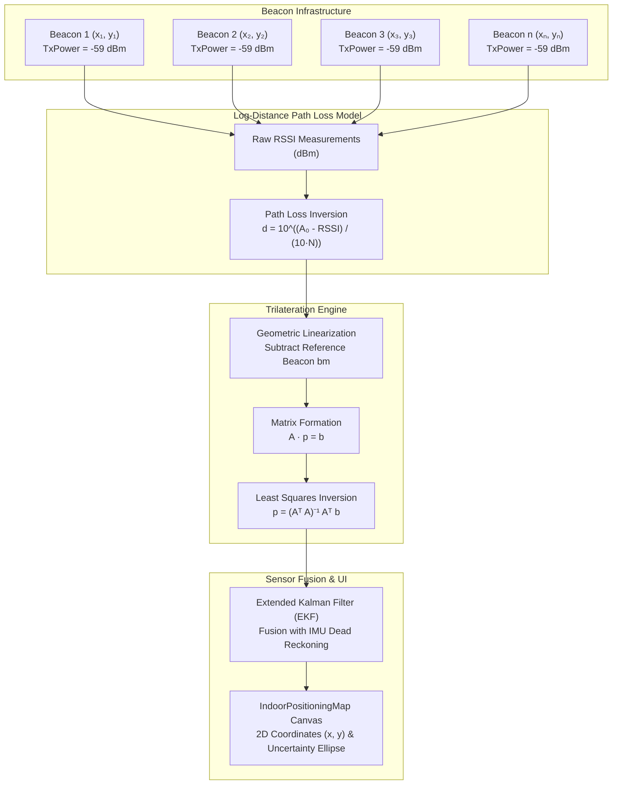

# BLE Beacon Indoor Trilateration: Log-Distance Path Loss & Matrix Inversion Guide

## 1. Overview & System Architecture

WorkSphere provides real-time indoor positioning, turn-by-turn floorplan navigation, and automated desk check-in detection using low-power Bluetooth Low Energy (BLE) beacons. In indoor environments where GPS signals are heavily attenuated or completely unavailable, mobile clients estimate their position on a 2D floorplan by measuring Received Signal Strength Indication (RSSI) from fixed BLE beacons and solving a geometric trilateration problem.

In WorkSphere, the indoor positioning pipeline integrates:

1. **BLE Beacon Telemetry & Diagnostic Scanning** ([`src/components/spatial/IndoorPositioningMap.tsx`](file:///C:/Users/hr720/Desktop/WorkSphere/src/components/spatial/IndoorPositioningMap.tsx) and [`src/components/spatial/VenueBeaconDiagnosticDrawer.tsx`](file:///C:/Users/hr720/Desktop/WorkSphere/src/components/spatial/VenueBeaconDiagnosticDrawer.tsx))
2. **Pedestrian Dead Reckoning (PDR) & Extended Kalman Filter (EKF)** ([`src/lib/spatial/indoorPdrEngine.ts`](file:///C:/Users/hr720/Desktop/WorkSphere/src/lib/spatial/indoorPdrEngine.ts))
3. **Sensor Fusion React Hook** ([`src/hooks/useIndoorSensorFusion.ts`](file:///C:/Users/hr720/Desktop/WorkSphere/src/hooks/useIndoorSensorFusion.ts))



---

## 2. Log-Distance Path Loss Model

Radio frequency signals attenuate logarithmically over distance due to free-space geometric spreading and environmental absorption.

### 2.1 The Forward Path Loss Equation

The received signal strength $\text{RSSI}(d)$ at distance $d$ (meters) from a transmitter is modeled by the log-distance path loss equation:

$$\text{RSSI}(d) = \text{TxPower}_{1\text{m}} - 10 \cdot N \cdot \log_{10}(d) + X_\sigma$$

Where:

- $\text{RSSI}(d)$: Received signal strength in $\text{dBm}$ at distance $d$.
- $\text{TxPower}_{1\text{m}}$ ($A_0$): Reference RSSI measured at exactly $1.0\text{ meter}$ from the beacon (typically $-58\text{ dBm}$ to $-65\text{ dBm}$ for standard $+0\text{ dBm}$ to $+4\text{ dBm}$ BLE transmission power).
- $N$ (or $n$): **Environmental Path Loss Exponent** (dimensionless), characterizing rate of signal decay.
- $d$: Euclidean distance in meters between beacon and receiver ($d \ge 0.1\text{ m}$).
- $X_\sigma$: Zero-mean Gaussian random variable modeling shadow fading and multipath constructive/destructive interference: $X_\sigma \sim \mathcal{N}(0, \sigma^2)$, with standard deviation $\sigma$ typically ranging between $2.0\text{ dB}$ and $6.0\text{ dB}$ indoors.

### 2.2 Distance Inversion Equation

To calculate distance $d$ from an observed $\text{RSSI}$:

$$10 \cdot N \cdot \log_{10}(d) = \text{TxPower}_{1\text{m}} - \text{RSSI}$$

$$\log_{10}(d) = \frac{\text{TxPower}_{1\text{m}} - \text{RSSI}}{10 \cdot N}$$

$$d = 10^{\frac{\text{TxPower}_{1\text{m}} - \text{RSSI}}{10 \cdot N}}$$

> [!NOTE]
> When $\text{RSSI} \ge \text{TxPower}_{1\text{m}}$, the physical client is within $1.0\text{ meter}$ of the beacon. The software clamps raw distance estimates to a minimum threshold (e.g., $0.1\text{ m}$) to prevent numerical instability in matrix calculations.

---

## 3. Environmental Attenuation Factor ($N$)

The Path Loss Exponent $N$ reflects how physical obstacles (walls, glass, metallic pillars, furniture, and human bodies) attenuate $2.4\text{ GHz}$ radio waves.

### 3.1 Attenuation Calibration Matrix

| Environmental Type              | Path Loss Exponent ($N$) | Typical WorkSphere Venue Context                                             | Multipath Severity |
| :------------------------------ | :----------------------: | :--------------------------------------------------------------------------- | :----------------: |
| **Free Space (Theoretical)**    |          $2.0$           | Outdoor terraces, unobstructed high-ceiling atriums                          |      Minimal       |
| **Open Coworking Lounge**       |       $2.2 - 2.5$        | Open-floor shared desks, hot-desk lounges, low dividers                      |        Low         |
| **Semi-Open Modern Office**     |       $2.5 - 3.0$        | Cubicles with glass partitions, drywall conference rooms                     |      Moderate      |
| **Cellular Office / Hallways**  |       $3.0 - 3.5$        | Drywall corridors, individual private phone booths                           |  Moderate to High  |
| **Dense Industrial / Concrete** |       $3.5 - 4.0+$       | Historic warehouses, thick load-bearing masonry, reinforced concrete pillars |       Severe       |

### 3.2 Dynamic Attenuation Factors

1. **Human Body RF Absorption:** The human body consists of $\sim 60\%$ water, which absorbs $2.4\text{ GHz}$ signals. A human body standing directly in the line-of-sight (LOS) path introduces an immediate signal drop of $3\text{ dB}$ to $6\text{ dB}$.
2. **Floor Reflections & Slant Range:** Beacons installed on ceilings introduce slant-range distortion. If a beacon is mounted at height $h = 3.0\text{ m}$ and the phone is held at $1.2\text{ m}$, the horizontal ground distance $d_{2\text{D}}$ relates to the 3D slant range $d_{3\text{D}}$ via:
   $$d_{2\text{D}} = \sqrt{\max(0, d_{3\text{D}}^2 - \Delta h^2)}, \quad \Delta h = h_{\text{beacon}} - h_{\text{device}}$$

---

## 4. Linearized Least-Squares Trilateration

Trilateration finds the unknown 2D user coordinate $\mathbf{p} = [x, y]^T$ given $m \ge 3$ fixed beacon anchors at $(x_i, y_i)$ with estimated distances $d_i$.

### 4.1 System of Circle Equations

Each beacon measurement forms a circle centered at $(x_i, y_i)$:

$$(x - x_i)^2 + (y - y_i)^2 = d_i^2 \quad \text{for } i = 1, 2, \dots, m$$

Expanding each equation:

$$x^2 - 2x_i x + x_i^2 + y^2 - 2y_i y + y_i^2 = d_i^2$$

### 4.2 Linearization by Reference Subtraction

The non-linear terms $x^2 + y^2$ are eliminated by subtracting the $m$-th equation (chosen as the reference beacon $\mathbf{b}_m = (x_m, y_m)$) from each of the first $m-1$ equations:

$$(x^2 - 2x_i x + x_i^2 + y^2 - 2y_i y + y_i^2) - (x^2 - 2x_m x + x_m^2 + y^2 - 2y_m y + y_m^2) = d_i^2 - d_m^2$$

Rearranging terms:

$$2(x_i - x_m) x + 2(y_i - y_m) y = (x_i^2 + y_i^2 - d_i^2) - (x_m^2 + y_m^2 - d_m^2)$$

This is a system of linear equations in matrix form:

$$A \mathbf{p} = \mathbf{b}$$

Where for $i = 1, 2, \dots, m-1$:

$$ A = \begin{bmatrix}
2(x_1 - x_m) & 2(y_1 - y_m) \\
2(x_2 - x_m) & 2(y_2 - y_m) \\
\vdots & \vdots \\
2(x_{m-1} - x_m) & 2(y_{m-1} - y_m)
\end{bmatrix}, \quad
\mathbf{p} = \begin{bmatrix} x \\ y \end{bmatrix}, \quad
\mathbf{b} = \begin{bmatrix}
(x_1^2 + y_1^2 - d_1^2) - (x_m^2 + y_m^2 - d_m^2) \\
(x_2^2 + y_2^2 - d_2^2) - (x_m^2 + y_m^2 - d_m^2) \\
\vdots \\
(x_{m-1}^2 + y_{m-1}^2 - d_{m-1}^2) - (x_m^2 + y_m^2 - d_m^2)
\end{bmatrix}$$

### 4.3 Matrix Inversion & Overdetermined Solutions

#### Case A: Exactly 3 Beacons ($m = 3$)
When $m = 3$, $A$ is a square $2 \times 2$ matrix. The exact solution is obtained via direct analytic inversion:

$$A^{-1} = \frac{1}{\det(A)} \begin{bmatrix} A_{22} & -A_{12} \\ -A_{21} & A_{11} \end{bmatrix}$$

$$\mathbf{p} = A^{-1} \mathbf{b} = \frac{1}{A_{11}A_{22} - A_{12}A_{21}} \begin{bmatrix} A_{22}b_1 - A_{12}b_2 \\ -A_{21}b_1 + A_{11}b_2 \end{bmatrix}$$

#### Case B: Overdetermined System ($m > 3$)
When $m > 3$, measurement noise makes the system overdetermined without an exact intersection. The Ordinary Least Squares (OLS) solution minimizes the sum of squared algebraic errors:

$$\mathbf{p} = (A^T A)^{-1} A^T \mathbf{b}$$

#### Case C: Weighted Least Squares (WLS)
Because RSSI measurement variance increases with distance ($\sigma_d \propto d$), closer beacons are significantly more reliable than distant ones. Weight matrix $W \in \mathbb{R}^{(m-1) \times (m-1)}$ assigns weights inversely proportional to distance variance:

$$W_{ii} = \frac{1}{d_i^2}$$

$$\mathbf{p}_{\text{WLS}} = (A^T W A)^{-1} A^T W \mathbf{b}$$

### 4.4 Degeneracy & Collinear Beacon Fallback
If beacons lie on a single straight line, $\det(A) \approx 0$ or condition number $\kappa(A) \to \infty$. In such singular geometries, matrix inversion fails. The algorithm falls back to a **weighted geometric centroid**:

$$\mathbf{p}_{\text{centroid}} = \frac{\sum_{i=1}^m w_i \mathbf{b}_i}{\sum_{i=1}^m w_i}, \quad w_i = \frac{1}{\max(0.1, d_i^2)}$$

---

## 5. Reference Implementations

### 5.1 TypeScript Reference Implementation

Production-grade implementation matching [`src/lib/spatial/indoorPdrEngine.ts`](file:///C:/Users/hr720/Desktop/WorkSphere/src/lib/spatial/indoorPdrEngine.ts):

```typescript
export interface BeaconNode {
  id: string;
  x: number; // Meters on floorplan
  y: number; // Meters on floorplan
  rssi: number; // Received dBm
  txPower?: number; // Calibrated RSSI at 1 meter (default: -59 dBm)
  pathLossExponent?: number; // N factor (default: 2.5)
}

export interface PositionFix {
  x: number;
  y: number;
  residualError: number;
  usedBeacons: number;
}

/**
 * Inverts RSSI to distance using the Log-Distance Path Loss model.
 */
export function rssiToDistance(
  rssi: number,
  txPower = -59,
  pathLossExponent = 2.5
): number {
  if (rssi >= 0 || !Number.isFinite(rssi)) return 0.1;
  const n = pathLossExponent > 0 ? pathLossExponent : 2.5;
  const exp = (txPower - rssi) / (10 * n);
  const rawDist = Math.pow(10, exp);
  return Math.max(0.1, Math.min(100.0, Math.round(rawDist * 100) / 100));
}

/**
 * Solves 2D position using Linearized Overdetermined Least Squares Trilateration.
 */
export function trilaterate(beacons: BeaconNode[]): PositionFix | null {
  // 1. Filter valid beacons
  const valid = beacons
    .filter((b) => Number.isFinite(b.x) && Number.isFinite(b.y) && b.rssi < 0)
    .map((b) => ({
      x: b.x,
      y: b.y,
      d: rssiToDistance(b.rssi, b.txPower ?? -59, b.pathLossExponent ?? 2.5),
    }));

  if (valid.length < 3) return null;

  const m = valid.length;
  const ref = valid[m - 1]; // Reference beacon bm

  // 2. Build A matrix and b vector: A * p = b
  // A has dimension (m - 1) x 2, b has dimension (m - 1) x 1
  const A: number[][] = [];
  const bVec: number[] = [];
  const refSq = ref.x ** 2 + ref.y ** 2 - ref.d ** 2;

  for (let i = 0; i < m - 1; i++) {
    const bi = valid[i];
    A.push([2 * (bi.x - ref.x), 2 * (bi.y - ref.y)]);
    bVec.push(bi.x ** 2 + bi.y ** 2 - bi.d ** 2 - refSq);
  }

  // 3. Compute A^T * A (2 x 2) and A^T * b (2 x 1)
  let ata00 = 0, ata01 = 0, ata10 = 0, ata11 = 0;
  let atb0 = 0, atb1 = 0;

  for (let i = 0; i < m - 1; i++) {
    const a0 = A[i][0];
    const a1 = A[i][1];
    const bi = bVec[i];

    ata00 += a0 * a0;
    ata01 += a0 * a1;
    ata10 += a1 * a0;
    ata11 += a1 * a1;

    atb0 += a0 * bi;
    atb1 += a1 * bi;
  }

  // 4. Invert 2 x 2 matrix (A^T * A)
  const det = ata00 * ata11 - ata01 * ata10;

  // Handle collinearity / degeneracy with inverse-distance weighted centroid fallback
  if (!Number.isFinite(det) || Math.abs(det) < 1e-5) {
    let sumWeight = 0;
    let wx = 0;
    let wy = 0;
    for (const beacon of valid) {
      const weight = 1.0 / Math.max(0.1, beacon.d ** 2);
      sumWeight += weight;
      wx += beacon.x * weight;
      wy += beacon.y * weight;
    }
    if (sumWeight <= 0) return null;
    return {
      x: Math.round((wx / sumWeight) * 100) / 100,
      y: Math.round((wy / sumWeight) * 100) / 100,
      residualError: 2.5,
      usedBeacons: valid.length,
    };
  }

  const invAta00 = ata11 / det;
  const invAta01 = -ata01 / det;
  const invAta10 = -ata10 / det;
  const invAta11 = ata00 / det;

  // 5. Solution: p = (A^T * A)^-1 * (A^T * b)
  const estX = invAta00 * atb0 + invAta01 * atb1;
  const estY = invAta10 * atb0 + invAta11 * atb1;

  if (!Number.isFinite(estX) || !Number.isFinite(estY)) return null;

  // 6. Calculate geometric residual error: mean |dist(p, bi) - di|
  let sumResidual = 0;
  for (const bi of valid) {
    const calcDist = Math.hypot(estX - bi.x, estY - bi.y);
    sumResidual += Math.abs(calcDist - bi.d);
  }
  const residualError = Math.round((sumResidual / valid.length) * 100) / 100;

  return {
    x: Math.round(estX * 100) / 100,
    y: Math.round(estY * 100) / 100,
    residualError,
    usedBeacons: valid.length,
  };
}
```

### 5.2 Python Reference Implementation

Python script with NumPy for offline evaluation, site surveys, and simulation benchmarks:

```python
#!/usr/bin/env python3
"""
WorkSphere Indoor Positioning Engine: BLE Trilateration Benchmark
Solves linear least squares for mobile coordinate estimation using BLE RSSI signals.
"""

from dataclasses import dataclass
from typing import List, Optional, Tuple
import numpy as np

@dataclass
class Beacon:
    id: str
    x: float  # meters
    y: float  # meters
    rssi: float  # dBm
    tx_power: float = -59.0  # RSSI at 1m
    path_loss_exp: float = 2.5  # N factor

def rssi_to_distance(rssi: float, tx_power: float = -59.0, n: float = 2.5) -> float:
    """Calculate distance in meters from RSSI using log-distance path loss."""
    if rssi >= 0:
        return 0.1
    exponent = (tx_power - rssi) / (10.0 * n)
    raw_d = 10.0 ** exponent
    return max(0.1, min(100.0, float(raw_d)))

def solve_trilateration(beacons: List[Beacon]) -> Optional[Tuple[float, float, float]]:
    """
    Solves 2D position (x, y) and residual error (meters) using overdetermined least squares.
    Returns (x, y, mean_residual_error) or None if unsolvable.
    """
    valid = [b for b in beacons if b.rssi < 0]
    if len(valid) < 3:
        return None

    # Calculate estimated distances
    dists = np.array([rssi_to_distance(b.rssi, b.tx_power, b.path_loss_exp) for b in valid])
    coords = np.array([[b.x, b.y] for b in valid])

    m = len(valid)
    ref_coord = coords[-1]
    ref_dist = dists[-1]

    # Formulate A matrix and b vector
    A = np.zeros((m - 1, 2))
    b = np.zeros(m - 1)

    ref_scalar = ref_coord[0]**2 + ref_coord[1]**2 - ref_dist**2

    for i in range(m - 1):
        A[i, 0] = 2.0 * (coords[i, 0] - ref_coord[0])
        A[i, 1] = 2.0 * (coords[i, 1] - ref_coord[1])
        b[i] = (coords[i, 0]**2 + coords[i, 1]**2 - dists[i]**2) - ref_scalar

    # Check rank / condition number to prevent collinear singularity
    ata = A.T @ A
    det = np.linalg.det(ata)
    if abs(det) < 1e-5:
        # Collinear fallback: weighted centroid
        weights = 1.0 / np.maximum(0.1, dists**2)
        pos = np.sum(coords * weights[:, np.newaxis], axis=0) / np.sum(weights)
        return float(pos[0]), float(pos[1]), 3.0

    # Solve least squares: p = (A^T A)^-1 A^T b
    pos = np.linalg.lstsq(A, b, rcond=None)[0]
    est_x, est_y = float(pos[0]), float(pos[1])

    # Calculate average geometric residual
    calc_dists = np.hypot(coords[:, 0] - est_x, coords[:, 1] - est_y)
    residuals = float(np.mean(np.abs(calc_dists - dists)))

    return round(est_x, 2), round(est_y, 2), round(residuals, 2)

# --- Verification & Self-Test ---
if __name__ == "__main__":
    # Simulated true target position
    true_x, true_y = 6.5, 7.2
    n_env = 2.5
    tx_p = -59.0

    # 4 Beacons distributed in a room
    test_beacons = [
        Beacon("beacon-1", 1.0, 1.0, 0.0),
        Beacon("beacon-2", 12.0, 2.0, 0.0),
        Beacon("beacon-3", 2.0, 14.0, 0.0),
        Beacon("beacon-4", 13.0, 13.0, 0.0),
    ]

    # Synthesize realistic RSSI values with path loss
    for b in test_beacons:
        d_actual = np.hypot(b.x - true_x, b.y - true_y)
        # RSSI = TxPower - 10 * N * log10(d)
        b.rssi = tx_p - 10.0 * n_env * np.log10(d_actual)
        b.path_loss_exp = n_env

    result = solve_trilateration(test_beacons)
    assert result is not None, "Trilateration solve failed"
    calc_x, calc_y, res = result

    print(f"True Position:      x={true_x:.2f} m, y={true_y:.2f} m")
    print(f"Estimated Position: x={calc_x:.2f} m, y={calc_y:.2f} m")
    print(f"Position Error:     {np.hypot(calc_x - true_x, calc_y - true_y):.3f} m")
    print(f"Geometric Residual: {res:.3f} m")
```

---

## 6. Beacon Floorplan Deployment Best Practices

Deploying beacons strategically is the single most critical factor determining positioning accuracy. Poor physical placement can cause severe geometric dilution of precision that algorithmic filtering cannot overcome.

### 6.1 Geometric Dilution of Precision (GDOP)

Trilateration accuracy depends directly on the angular spread of beacons relative to the receiver:

```
[BAD: Collinear Placement]             [GOOD: Convex Hull Perimeter]
B1 ------- B2 ------- B3               B1 ----------------------- B2
         x (Degenerate)                |                           |
High X-axis error, Y is unbounded!     |             x (Nomad)     |
det(A) -> 0                            |                           |
                                       B3 ----------------------- B4
                                       Balanced geometric angles!
```

> [!WARNING]
> **Avoid Collinear Alignment:** Never install beacons in a straight line down the center of a corridor or room. If beacons are collinear, the determinant $\det(A^T A) \approx 0$, collapsing positioning along the orthogonal axis.

### 6.2 Floorplan Placement Guidelines

1. **Convex Hull Coverage:**
   - Install beacons around the perimeter of the room/zone first, then infill the center.
   - Positioning accuracy is highest **inside the convex polygon** formed by the beacons. Extrapolating positions outside the beacon perimeter increases error exponentially.
2. **Spacing & Density Ratios:**
   - **Recommended density:** 1 beacon per $50 \text{ m}^2$ to $80 \text{ m}^2$ in open areas; 1 beacon per $30 \text{ m}^2$ in partitioned office suites.
   - **Grid Spacing:** Place beacons $8 \text{ to } 12 \text{ meters}$ apart. Distances beyond $15\text{ m}$ experience high shadow fading fluctuations ($>6\text{ dB}$).
3. **Mounting Altitude:**
   - Install beacons on ceilings or upper wall sections between $2.5\text{ m}$ and $3.5\text{ m}$ from the finished floor.
   - Mounting above head level avoids direct human body blocking while keeping slant-range Pythagorean distortion minimal.
4. **RF Interference & Metal Clearance:**
   - Keep beacons at least $1.0\text{ meter}$ away from large metal surfaces, HVAC ductwork, elevator shafts, and electrical distribution boxes.
   - Mount beacons at least $2.0\text{ meters}$ away from $2.4\text{ GHz}$ Wi-Fi access points to avoid co-channel receiver desensitization.
5. **Redundancy for Outlier Rejection:**
   - Ensure every target workstation maintains Line-of-Sight (LOS) to at least $4$ beacons. A 4th beacon provides degree-of-freedom redundancy for Mahalanobis innovation gating and outlier rejection.

---

## 7. Venue Calibration Checklist

Before launching indoor navigation in a new WorkSphere venue, complete this verification checklist:

- [ ] **Coordinate Alignment:** Measure and record beacon anchor coordinates $(x, y)$ in the venue coordinate system to within $\pm 0.1\text{ meter}$.
- [ ] **TxPower Calibration ($1\text{m}$ Reference):** Measure RSSI at exactly $1.0\text{ meter}$ along the primary radiation lobe using a reference mobile device. Record the average across 50 packets as `txPower` (default: $-59\text{ dBm}$).
- [ ] **Path Loss Exponent Tuning ($N$):** Perform a walk test recording RSSI at $1\text{m}, 3\text{m}, 5\text{m},$ and $8\text{m}$. Perform linear regression to calculate actual venue $N$ ($2.2$ for open lounge, $3.2$ for partitioned office).
- [ ] **Broadcasting Frequency:** Set beacon advertising interval to $100\text{ ms} - 200\text{ ms}$ ($5\text{--}10\text{ Hz}$). Intervals slower than $500\text{ ms}$ cause sluggish PDR fusion updates while walking.
- [ ] **Battery Telemetry Monitoring:** Ensure periodic battery voltage monitoring via [`VenueBeaconDiagnosticDrawer.tsx`](file:///C:/Users/hr720/Desktop/WorkSphere/src/components/spatial/VenueBeaconDiagnosticDrawer.tsx).
$$
