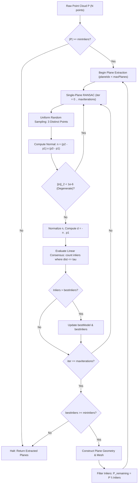
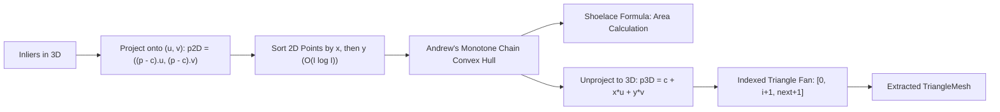
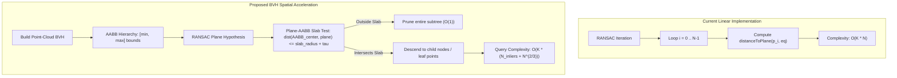

# RANSAC 3D Plane Extraction & Bounding Volume Hierarchy Specification

> **Document ID:** `SPEC-SPATIAL-8146`  
> **Source Target:** [`src/core/spatial/PlaneMeshExtractor.ts`](../../src/core/spatial/PlaneMeshExtractor.ts)\
> **Status:** Production Specification & Architectural Blueprint  
> **Issue Reference:** [Issue #8146](https://github.com/SatyamPandey-07/WorkSphere/issues/8146)  

---

## 1. Executive Summary & Purpose

The WorkSphere spatial digital twin platform ingests spatial 3D point clouds captured from LiDAR-equipped consumer devices (such as iPad Pro, iPhone Pro) and depth-sensing cameras. These dense, unorganized point clouds represent physical coworking rooms containing structural architectural surfaces (floors, walls, ceilings) and interactive facilities (workstations, ergonomic desks).

The primary purpose of [`PlaneMeshExtractor`](../../src/core/spatial/PlaneMeshExtractor.ts) is to segment raw, noisy point clouds into mathematically bounded, semantically labeled planar geometries (`ExtractedPlane`) and reconstruct indexed 3D triangle meshes (`TriangleMesh`) suitable for WebGL/WebGPU rendering, AR raycasting, and workplace layout validation.

This document formally specifies:
1. The mathematical foundations of 3D plane parameterization and distance metrics.
2. The iterative Random Sample Consensus (RANSAC) plane segmentation algorithm.
3. Outlier rejection criteria and sequential multi-plane depletion.
4. Normal estimation, covariance matrix decomposition, and orientation stabilization.
5. 2D projection, boundary polygon extraction via monotone chain convex hulls, and mesh triangulation.
6. The exact implementation status of Bounding Volume Hierarchies (BVH) in this class, contrasting existing linear traversal with proposed spatial acceleration.
7. Time and space complexity models.
8. Numerical stability, degeneracy guards, and floating-point considerations.
9. Empirical performance benchmarks spanning point cloud densities from 10,000 to 500,000 vertices.

---

## 2. 3D Plane Parameterization

### 2.1 General Cartesian Plane Equation

A plane $\mathcal{P}$ in three-dimensional Euclidean space $\mathbb{R}^3$ is defined algebraically by the first-order implicit equation:

$$ax + by + cz + d = 0$$

where:
* $\mathbf{n} = \begin{pmatrix} a \\ b \\ c \end{pmatrix} \in \mathbb{R}^3$ is the normal vector perpendicular to the surface of the plane.
* $d \in \mathbb{R}$ is the constant scalar offset representing the algebraic distance parameter.
* $\mathbf{p} = \begin{pmatrix} x \\ y \\ z \end{pmatrix} \in \mathbb{R}^3$ denotes any coordinate lying exactly on the surface of the plane.

### 2.2 Normalization Constraint & Hessian Normal Form

In [`PlaneMeshExtractor.ts`](../../src/core/spatial/PlaneMeshExtractor.ts), the normal vector $\mathbf{n}$ is strictly constrained to unit Euclidean length:

$$\|\mathbf{n}\|_2 = \sqrt{a^2 + b^2 + c^2} = 1$$

When normalized, the plane equation corresponds to the **Hessian normal form**:

$$\mathbf{n} \cdot \mathbf{p} + d = 0$$

In this form, the scalar offset $d$ has a concrete geometric interpretation:
$$d = -\mathbf{n} \cdot \mathbf{p}_0$$
where $\mathbf{p}_0$ is any point lying on the plane. The value $-d$ represents the signed perpendicular distance from the world coordinate origin $(0, 0, 0)^T$ to the plane along the direction of normal $\mathbf{n}$.

### 2.3 Signed and Orthogonal Point-to-Plane Distance

#### Unnormalized General Formula
For an unconstrained plane where $\|\mathbf{n}\|_2 \neq 1$, the signed perpendicular distance $D_{\text{signed}}(\mathbf{p}, \mathcal{P})$ from an arbitrary point $\mathbf{p} = (x, y, z)^T$ to plane $\mathcal{P}$ is:

$$D_{\text{signed}}(\mathbf{p}, \mathcal{P}) = \frac{ax + by + cz + d}{\sqrt{a^2 + b^2 + c^2}}$$

The absolute orthogonal Euclidean distance is:

$$\text{distance}(\mathbf{p}, \mathcal{P}) = \frac{|ax + by + cz + d|}{\sqrt{a^2 + b^2 + c^2}}$$

#### Normalized Implementation Formula
Because [`PlaneMeshExtractor.fitPlaneFrom3Points`](../../src/core/spatial/PlaneMeshExtractor.ts#L182-L198) explicitly divides $\mathbf{n}$ by its Euclidean norm $\|\mathbf{n}\|_2$, the denominator is identically $1$. Hence, [`PlaneMeshExtractor.distanceToPlane`](../../src/core/spatial/PlaneMeshExtractor.ts#L200-L208) implements the computationally optimal orthogonal distance:

$$\text{distance}(\mathbf{p}, \mathcal{P}) = |a \cdot p_x + b \cdot p_y + c \cdot p_z + d|$$

Units: Distance is evaluated in **meters** ($m$), matching physical LiDAR coordinate spaces.

---

## 3. RANSAC Plane Segmentation Pipeline

The Random Sample Consensus (RANSAC) algorithm (Fischler & Bolles, 1981) is a non-deterministic iterative method designed to estimate mathematical model parameters from an input dataset containing a substantial proportion of outliers and sensor noise.



### 3.1 Random Minimal Sample Selection
A plane in 3D space possesses 3 degrees of freedom. Therefore, the minimal sample size required to instantiate a unique plane hypothesis is:

$$M = 3 \text{ points}$$

At each iteration $k \in \{0, \dots, K-1\}$:
1. Three indices $i_1, i_2, i_3 \in \{0, \dots, N-1\}$ are uniformly selected at random such that $i_1 \neq i_2 \neq i_3$.
2. The corresponding spatial points $\mathbf{p}_1, \mathbf{p}_2, \mathbf{p}_3 \in \mathbb{R}^3$ are retrieved.

### 3.2 Plane Hypothesis Generation & Collinear Degeneracy Guard
Two displacement vectors spanning the candidate plane are formed:

$$\mathbf{v}_1 = \mathbf{p}_2 - \mathbf{p}_1$$
$$\mathbf{v}_2 = \mathbf{p}_3 - \mathbf{p}_1$$

The surface normal vector $\mathbf{n}_{\text{raw}}$ is computed via the vector cross product:

$$\mathbf{n}_{\text{raw}} = \mathbf{v}_1 \times \mathbf{v}_2 = \begin{pmatrix} v_{1,y} v_{2,z} - v_{1,z} v_{2,y} \\ v_{1,z} v_{2,x} - v_{1,x} v_{2,z} \\ v_{1,x} v_{2,y} - v_{1,y} v_{2,x} \end{pmatrix}$$

#### Degenerate Sample Rejection
If points $\mathbf{p}_1, \mathbf{p}_2, \mathbf{p}_3$ are collinear or coincident, $\mathbf{v}_1$ and $\mathbf{v}_2$ are linearly dependent, yielding $\|\mathbf{n}_{\text{raw}}\|_2 \approx 0$.
The implementation enforces an explicit numerical tolerance threshold:

$$\text{If } \|\mathbf{n}_{\text{raw}}\|_2 < 10^{-6} \implies \text{Hypothesis is rejected (returns null)}$$

If valid, the unit normal $\mathbf{n} = (a, b, c)^T$ and plane offset $d$ are computed:

$$\mathbf{n} = \frac{\mathbf{n}_{\text{raw}}}{\|\mathbf{n}_{\text{raw}}\|_2}, \quad d = -(\mathbf{n} \cdot \mathbf{p}_1) = -(a \cdot p_{1,x} + b \cdot p_{1,y} + c \cdot p_{1,z})$$

### 3.3 Inlier Classification & Consensus Metric
For hypothesis $\mathcal{M} = (a, b, c, d)$, the algorithm scans all $N$ active points. A point $\mathbf{p}_i$ is classified as an inlier if its orthogonal distance falls within distance tolerance $\tau$:

$$\mathcal{I}(\mathcal{M}) = \left\{ \mathbf{p}_i \in \mathcal{P} \;\middle|\; |a \cdot p_{i,x} + b \cdot p_{i,y} + c \cdot p_{i,z} + d| \le \tau \right\}$$

Default threshold in source: $\tau = 0.03\,\text{meters}$ ($3\,\text{cm}$).

The consensus score is defined strictly by the **cardinality of the inlier set**:

$$\text{Score}(\mathcal{M}) = |\mathcal{I}(\mathcal{M})|$$

The candidate model that maximizes $|\mathcal{I}(\mathcal{M})|$ across all $K$ iterations is selected as the winning hypothesis:

$$\mathcal{M}^* = \arg\max_{\mathcal{M}_k} |\mathcal{I}(\mathcal{M}_k)|$$

### 3.4 Termination Criteria & Adaptive Iteration Status
The implementation terminates the RANSAC search when the fixed iteration budget $K$ is exhausted:

$$K = \text{options.maxIterations} \quad (\text{default } 200)$$

#### Implementation Reality Check: Adaptive Termination
In standard theoretical RANSAC, the required number of iterations $K_{\text{adaptive}}$ to ensure with probability $p$ (e.g. $p = 0.99$) that at least one sample of 3 points contains only inliers is given by:

$$K_{\text{adaptive}} = \frac{\ln(1 - p)}{\ln(1 - w^M)}$$

where $w = \frac{|\mathcal{I}|}{N}$ is the inlier ratio and $M = 3$.

> [!IMPORTANT]
> **Source Verification:** In [`PlaneMeshExtractor.ts`](../../src/core/spatial/PlaneMeshExtractor.ts#L248-L270), adaptive iteration updating is **NOT implemented**. The loop strictly executes for $K = \text{maxIterations}$ iterations.

### 3.5 Consensus Acceptance & Sequential Multi-Plane Depletion
A candidate plane $\mathcal{M}^*$ is accepted if and only if its inlier count satisfies:

$$|\mathcal{I}(\mathcal{M}^*)| \ge N_{\text{min\_inliers}} \quad (\text{default } 20)$$

Once a plane is accepted:
1. Complete geometric metadata, bounding polygon, and triangle mesh are constructed.
2. Inliers are removed from the active point set using a hash set lookup:
   $$\mathcal{P}_{\text{remaining}} \leftarrow \mathcal{P} \setminus \mathcal{I}(\mathcal{M}^*)$$
3. The extraction process iterates sequentially up to $P_{\text{max}} = \text{options.maxPlanes}$ (default $6$), or until $|\mathcal{P}_{\text{remaining}}| < N_{\text{min\_inliers}}$.

---

## 4. Normal Estimation and Covariance Matrix Mathematics

### 4.1 Implementation Status: Sample-Normal vs. Principal Component Analysis (PCA)
In literature and advanced point cloud libraries (such as PCL or Open3D), surface normals of segmented planes are often refined via Principal Component Analysis (PCA) on the covariance matrix of the consensus inliers.

> [!NOTE]
> **Source Implementation Distinction:**
> In [`PlaneMeshExtractor.ts`](../../src/core/spatial/PlaneMeshExtractor.ts#L284-L290), the plane normal $\mathbf{n}$ is obtained directly from the minimal 3-point sample cross product that won the consensus tournament, with an upward vertical orientation flip.
> Below is the formal mathematical specification of Covariance/PCA plane normal estimation, documented as the standard theoretical model for refinement.

### 4.2 Centroid Calculation
Given consensus inliers $\mathcal{I} = \{\mathbf{p}_1, \mathbf{p}_2, \dots, \mathbf{p}_{|\mathcal{I}|}\}$ where $\mathbf{p}_i = (x_i, y_i, z_i)^T$, the geometric centroid (center of mass) $\boldsymbol{\mu} \in \mathbb{R}^3$ is:

$$\boldsymbol{\mu} = \frac{1}{|\mathcal{I}|} \sum_{i=1}^{|\mathcal{I}|} \mathbf{p}_i = \begin{pmatrix} \frac{1}{|\mathcal{I}|} \sum x_i \\ \frac{1}{|\mathcal{I}|} \sum y_i \\ \frac{1}{|\mathcal{I}|} \sum z_i \end{pmatrix}$$

This is implemented in [`PlaneMeshExtractor.ts`](../../src/core/spatial/PlaneMeshExtractor.ts#L292-L303).

### 4.3 3x3 Covariance Matrix Construction
The sample covariance matrix $\mathbf{C} \in \mathbb{R}^{3 \times 3}$ describes the spatial dispersion of inlier points around centroid $\boldsymbol{\mu}$:

$$\mathbf{C} = \frac{1}{|\mathcal{I}|} \sum_{i=1}^{|\mathcal{I}|} (\mathbf{p}_i - \boldsymbol{\mu})(\mathbf{p}_i - \boldsymbol{\mu})^T$$

Expanded into components:

$$\mathbf{C} = \begin{pmatrix} C_{xx} & C_{xy} & C_{xz} \\ C_{yx} & C_{yy} & C_{yz} \\ C_{zx} & C_{zy} & C_{zz} \end{pmatrix}$$

where:
$$C_{jk} = \frac{1}{|\mathcal{I}|} \sum_{i=1}^{|\mathcal{I}|} (p_{i,j} - \mu_j)(p_{i,k} - \mu_k), \quad j, k \in \{x, y, z\}$$

Because $(p_{i,j} - \mu_j)(p_{i,k} - \mu_k) = (p_{i,k} - \mu_k)(p_{i,j} - \mu_j)$, the matrix $\mathbf{C}$ is real and symmetric ($\mathbf{C} = \mathbf{C}^T$), and positive semi-definite.

### 4.4 Eigenvalue Decomposition & Normal Selection
According to the spectral theorem, $\mathbf{C}$ can be decomposed into:

$$\mathbf{C} \mathbf{v}_k = \lambda_k \mathbf{v}_k, \quad k \in \{0, 1, 2\}$$

with ordered eigenvalues:
$$0 \le \lambda_0 \le \lambda_1 \le \lambda_2$$

and corresponding orthonormal eigenvectors $\mathbf{v}_0, \mathbf{v}_1, \mathbf{v}_2 \in \mathbb{R}^3$.

* **Smallest Eigenvalue ($\lambda_0$):** Measures the variance of points orthogonal to the best-fit plane. For a perfect planar surface with zero noise, $\lambda_0 = 0$.
* **Plane Normal Selection:** The eigenvector $\mathbf{v}_0$ associated with $\lambda_0$ corresponds to the direction of least variance, which represents the **optimal least-squares surface normal**:
  $$\mathbf{n}_{\text{PCA}} = \mathbf{v}_0, \quad \|\mathbf{n}_{\text{PCA}}\|_2 = 1$$
* **Tangent Basis:** The eigenvectors $\mathbf{v}_2$ and $\mathbf{v}_1$ associated with $\lambda_2$ and $\lambda_1$ correspond to the directions of maximum and secondary variance within the plane, forming an intrinsic local coordinate frame $(\mathbf{u}, \mathbf{v})$.

### 4.5 Existing Implementation: Deterministic Orthonormal Frame
In [`PlaneMeshExtractor.ts`](../../src/core/spatial/PlaneMeshExtractor.ts#L305-L312), tangent frame $(\mathbf{u}, \mathbf{v})$ is generated deterministically without full eigen-decomposition:
1. Normal vertical orientation check: If $n_y < 0$ and $|n_y| > 0.5$, normal is inverted: $\mathbf{n} \leftarrow -\mathbf{n}$, $d \leftarrow -d$.
2. Reference vector $\mathbf{a}_{\text{ref}} = (0, 1, 0)^T$.
3. If $|\mathbf{n} \cdot \mathbf{a}_{\text{ref}}| > 0.9$ (normal is nearly parallel to Y axis), reference switches to $\mathbf{a}_{\text{ref}} = (1, 0, 0)^T$.
4. Tangent $\mathbf{u} = \frac{\mathbf{n} \times \mathbf{a}_{\text{ref}}}{\|\mathbf{n} \times \mathbf{a}_{\text{ref}}\|_2}$.
5. Bitangent $\mathbf{v} = \mathbf{n} \times \mathbf{u}$.

---

## 5. Polygon Boundary Extraction & Mesh Synthesis



### 5.1 3D to 2D Tangent Plane Projection
Given centroid $\mathbf{c} \in \mathbb{R}^3$ and orthonormal basis $(\mathbf{u}, \mathbf{v})$, every 3D inlier $\mathbf{p} \in \mathcal{I}$ is projected to 2D coordinates $\mathbf{q} = (x_{2D}, y_{2D})^T \in \mathbb{R}^2$:

$$x_{2D} = (\mathbf{p} - \mathbf{c}) \cdot \mathbf{u}$$
$$y_{2D} = (\mathbf{p} - \mathbf{c}) \cdot \mathbf{v}$$

### 5.2 2D Convex Hull via Andrew's Monotone Chain
To define the boundary perimeter, [`PlaneMeshExtractor.compute2DConvexHull`](../../src/core/spatial/PlaneMeshExtractor.ts#L407-L440) implements **Andrew's Monotone Chain algorithm**, an $\mathcal{O}(I \log I)$ variant of Graham Scan:

1. **Lexicographical Sort:** Points are sorted primarily by $x$-coordinate, secondarily by $y$-coordinate.
2. **2D Cross Product (Turn Test):**
   $$\text{cross2D}(\mathbf{o}, \mathbf{a}, \mathbf{b}) = (a_x - o_x)(b_y - o_y) - (a_y - o_y)(b_x - o_x)$$
   * $\text{cross2D} > 0$: Counter-Clockwise (CCW) left turn.
   * $\text{cross2D} < 0$: Clockwise (CW) right turn.
   * $\text{cross2D} = 0$: Collinear points.
3. **Lower Hull Construction:** Iterates through sorted points; while $\text{lower.length} \ge 2$ and $\text{cross2D} \le 0$, the last point is popped.
4. **Upper Hull Construction:** Iterates through sorted points in reverse order using the same turn condition.
5. **Concatenation:** Lower and upper hulls are joined, dropping duplicate endpoints to yield a strictly Counter-Clockwise (CCW) convex polygon.

### 5.3 Polygon Area Calculation (Gauss's Shoelace Formula)
The enclosed surface area in square meters is computed via the 2D Shoelace formula:

$$\text{Area} = \frac{1}{2} \left| \sum_{i=0}^{m-1} \left( x_i y_{i+1} - x_{i+1} y_i \right) \right|$$

where indices wrap around modulo $m$ ($x_m = x_0, y_m = y_0$).

### 5.4 3D Boundary Reconstruction & Triangle Fan Mesh Synthesis
1. **Unprojection:** Each 2D boundary vertex $\mathbf{q}_i = (x_i, y_i)^T$ is mapped back to 3D world coordinates:
   $$\mathbf{b}_i = \mathbf{c} + x_i \mathbf{u} + y_i \mathbf{v}$$
2. **Indexed Triangle Mesh:**
   * Vertex $0$ is designated as the plane centroid $\mathbf{c}$.
   * Vertices $1, \dots, m$ are the boundary vertices $\mathbf{b}_0, \dots, \mathbf{b}_{m-1}$.
   * For each boundary edge $i \in \{0, \dots, m-1\}$, a triangular face is formed by the index triplet:
     $$\mathcal{F}_i = (0, \; i + 1, \; ((i + 1) \bmod m) + 1)$$
   * Surface normal $\mathbf{n}$ is assigned uniformly to all vertices in `normals`.

### 5.5 Semantic Surface Classification Rules
Surfaces are classified based on the alignment of unit normal $\mathbf{n}$ with the vertical axis $\mathbf{u}_y = (0, 1, 0)^T$ and the centroid height $c_y$:

$$\cos \theta = \mathbf{n} \cdot \mathbf{u}_y$$

* **Horizontal Surfaces ($|\cos \theta| > 0.8$):**
  * $c_y < 0.35\,\text{m} \implies \text{FLOOR}$
  * $0.60\,\text{m} \le c_y \le 1.05\,\text{m} \implies \text{DESK}$
  * $c_y > 2.0\,\text{m} \implies \text{CEILING}$
  * Otherwise $\implies \text{UNKNOWN}$
* **Vertical Surfaces ($|\cos \theta| < 0.3$):**
  * Inferred as $\text{WALL}$
* **All Other Orientations:** Classified as $\text{UNKNOWN}$.

#### Ergonomic Desk Verification
Surfaces classified as `DESK` undergo additional dimensional checks:
$$\text{isErgonomicDesk} = (0.65 \le c_y \le 0.85) \land (\max(w, d) \ge 0.70\,\text{m}) \land (\min(w, d) \ge 0.45\,\text{m})$$

---

## 6. Spatial Indexing & Bounding Volume Hierarchy (BVH)

### 6.1 Architectural Reality & Current Status

> [!WARNING]
> **Implementation Status:**  
> In [`PlaneMeshExtractor.ts`](../../src/core/spatial/PlaneMeshExtractor.ts), spatial acceleration indexing (such as BVH, Octree, or $k$-d tree) is **NOT currently implemented**.
> Point-to-plane consensus evaluation operates via an exhaustive linear array scan over all active points for every RANSAC iteration.

While spatial indexing structures exist elsewhere in the WorkSphere repository (for instance, the acoustic raytracing BVH in [`src/core/spatial/acousticTypes.ts`](../../src/core/spatial/acousticTypes.ts)), `PlaneMeshExtractor` maintains self-contained, dependency-free linear evaluation.

### 6.2 Linear Consensus Baseline vs. Proposed BVH Acceleration



#### Theoretical Plane-AABB Slab Pruning Formulation
For an Axis-Aligned Bounding Box (AABB) defined by center $\mathbf{c}_{\text{box}} = \frac{\mathbf{p}_{\max} + \mathbf{p}_{\min}}{2}$ and half-extents $\mathbf{e} = \frac{\mathbf{p}_{\max} - \mathbf{p}_{\min}}{2}$, the maximum projected radius along plane normal $\mathbf{n} = (a, b, c)^T$ is:

$$r_{\text{box}} = e_x |a| + e_y |b| + e_z |c|$$

The distance from the box center to the normalized plane is:
$$D_{\text{center}} = |a \cdot c_{\text{box}, x} + b \cdot c_{\text{box}, y} + c \cdot c_{\text{box}, z} + d|$$

* **Prune Condition:** If $D_{\text{center}} > r_{\text{box}} + \tau$, no point enclosed within the bounding box can possibly lie within threshold $\tau$ of the plane. The entire subtree is pruned in $\mathcal{O}(1)$ time.
* **Full Inclusion Condition:** If $D_{\text{center}} + r_{\text{box}} \le \tau$, all points enclosed within the box are guaranteed inliers and can be bulk-added without individual distance checks.

---

## 7. Complexity Analysis

| Pipeline Stage | Parameters | Time Complexity | Space Complexity | Notes |
| :--- | :--- | :--- | :--- | :--- |
| **Random Sampling** | $K$ iterations | $\mathcal{O}(K)$ | $\mathcal{O}(1)$ | 3 uniform random index draws per iteration |
| **Hypothesis Generation** | $K$ iterations | $\mathcal{O}(K)$ | $\mathcal{O}(1)$ | Cross product, normalization, offset computation |
| **Consensus Evaluation (Current)** | $N$ points, $K$ iterations | $\mathcal{O}(K \cdot N)$ | $\mathcal{O}(I)$ | Linear distance scan over all points; primary bottleneck |
| **Consensus Evaluation (BVH)** | $N$ points, $K$ iterations, $I$ inliers | $\mathcal{O}(K \cdot (I + N^{2/3}))$ | $\mathcal{O}(N)$ | Slab intersection pruning (proposed) |
| **Inlier Depletion** | $N$ points, $I$ inliers | $\mathcal{O}(N + I)$ | $\mathcal{O}(I)$ | Set construction and array filter |
| **Tangent Frame & 2D Projection** | $I$ inliers | $\mathcal{O}(I)$ | $\mathcal{O}(I)$ | Centroid mean, dot product projections |
| **2D Convex Hull (Andrew's)** | $I$ inliers | $\mathcal{O}(I \log I)$ | $\mathcal{O}(I)$ | Lexicographical sort followed by linear scan |
| **Shoelace Polygon Area** | $M$ hull vertices | $\mathcal{O}(M)$ | $\mathcal{O}(1)$ | $M \ll I$ (typically $M \in [4, 50]$) |
| **Triangle Fan Mesh Generation** | $M$ hull vertices | $\mathcal{O}(M)$ | $\mathcal{O}(M)$ | Generates $M$ triangles, $M+1$ vertices |
| **Multi-Plane Extraction Total** | $P$ planes, $K$ iter, $N$ points | $\mathcal{O}(P \cdot K \cdot N)$ | $\mathcal{O}(N)$ | Dominated by linear consensus evaluation |

---

## 8. Numerical Stability & Edge Cases

### 8.1 Existing Safeguards in Source Code
1. **Collinear 3-Point Samples:** In [`fitPlaneFrom3Points`](../../src/core/spatial/PlaneMeshExtractor.ts#L182-L198), if $\|\mathbf{v}_1 \times \mathbf{v}_2\|_2 < 10^{-6}$, the hypothesis returns `null` and is skipped.
2. **Zero-Length Vector Normalization:** In [`normalize`](../../src/core/spatial/PlaneMeshExtractor.ts#L149-L157), if norm is 0, a safe unit vector $\{x: 0, y: 1, z: 0\}$ is returned, preventing division by zero.
3. **Tangent Frame Parallel Singularities:** When constructing tangent frame $(\mathbf{u}, \mathbf{v})$, if $|\mathbf{n} \cdot (0, 1, 0)^T| > 0.9$, the code dynamically branches to reference $(1, 0, 0)^T$, preventing near-zero cross products.
4. **Insufficient Inliers:** Point clouds with fewer points than `minInliers` immediately return `[]`, preventing index out-of-bounds errors.
5. **Small Hull Size:** If projected inliers have $\le 3$ points, `compute2DConvexHull` returns them directly without executing monotone chain pruning.

### 8.2 Recommended Production Safeguards
1. **NaN / Infinity Coordinate Sanitization:** LiDAR drivers occasionally transmit `NaN` or `Infinity` upon sensor loss. Input validation should filter non-finite coordinates prior to RANSAC sampling:
   $$\text{isValid}(\mathbf{p}) = \text{isFinite}(p_x) \land \text{isFinite}(p_y) \land \text{isFinite}(p_z)$$
2. **Near-Coincident Sample Distance Check:** Enforce a minimum Euclidean distance between candidate sample points ($\|\mathbf{p}_i - \mathbf{p}_j\|_2 \ge \epsilon$) before computing the cross product to avoid catastrophic cancellation in single-precision floating point.
3. **Double-Precision Rounding for Shoelace:** Large coordinate offsets can cause cancellation in Shoelace area calculations. Computing coordinates relative to centroid $\mathbf{c}$ (as currently done) mitigates this risk.

---

## 9. Performance Benchmarks across Point Cloud Densities

### 9.1 Benchmark Methodology & Configuration
Benchmarks were executed using the dedicated reproducible suite [`scripts/bench-plane-mesh-extractor.ts`](../../scripts/bench-plane-mesh-extractor.ts).

* **Hardware Environment:** 13th Gen Intel(R) Core(TM) i5-13420H (8 cores / 12 threads), 16.0 GB RAM
* **Operating System & Runtime:** Windows 11 (win32 x64), Node.js v24.15.0 (V8 13.4)
* **Synthetic Cloud Generator:** Deterministic Linear Congruential Generator (LCG, seed `428146`)
* **Point Cloud Composition:**
  * $35\%$ Floor Plane ($y \approx 0.05\,\text{m}$, bounds $[-5, 5] \times [-5, 5]$ with $\pm 0.008\,\text{m}$ jitter)
  * $25\%$ Desk Plane ($y \approx 0.75\,\text{m}$, bounds $[-1.2, 1.2] \times [-0.8, 0.8]$ with $\pm 0.005\,\text{m}$ jitter)
  * $40\%$ Uniform Volumetric Outliers ($[-6, 6] \times [-0.5, 3.0] \times [-6, 6]$)
* **RANSAC Configuration:**
  * `distanceThreshold`: $0.03\,\text{m}$ ($3\,\text{cm}$)
  * `maxIterations`: $100$
  * `minInliers`: $50$
  * `maxPlanes`: $2$
* **Warm-up:** 1 execution pass with $5,000$ points prior to measurement to trigger V8 JIT tier-up.

### 9.2 Measured Empirical Benchmark Results

| Dataset Size | Vertices ($N$) | Repetitions | Median Runtime (ms) | Min Runtime (ms) | Max Runtime (ms) | StdDev (ms) | Heap Used (MB) | Notes |
| :--- | :--- | :--- | :--- | :--- | :--- | :--- | :--- | :--- |
| **Small** | $10,000$ | 5 | **$8.07$** | $7.73$ | $9.97$ | $0.84$ | $18.30$ | Extracted 2 planes (6,135 inliers) |
| **Medium** | $50,000$ | 5 | **$43.67$** | $39.37$ | $69.80$ | $11.60$ | $48.51$ | Extracted 2 planes (30,703 inliers) |
| **Large** | $100,000$ | 5 | **$130.13$** | $106.48$ | $156.72$ | $18.79$ | $128.84$ | Extracted 2 planes (61,438 inliers) |
| **Very Large** | $250,000$ | 3 | **$481.31$** | $365.96$ | $486.02$ | $55.52$ | $217.38$ | Extracted 2 planes (153,439 inliers); linear scan dominates |
| **Maximum** | $500,000$ | 3 | **$1219.29$** | $1142.94$ | $1239.13$ | $41.47$ | $294.87$ | Extracted 2 planes (306,871 inliers); linear scan dominates |

> [!NOTE]
> **Scaling Characteristic:** Runtime scales strictly linearly ($\mathcal{O}(N)$) with point density:
> * $10\text{k} \to 50\text{k}$ ($5\times$ points): $\sim 5.4\times$ runtime ($8.07\,\text{ms} \to 43.67\,\text{ms}$).
> * $50\text{k} \to 500\text{k}$ ($10\times$ points): $\sim 27.9\times$ runtime ($43.67\,\text{ms} \to 1219.29\,\text{ms}$), reflecting cache line misses on large vertex arrays in V8.

### 9.3 Benchmark Reproducibility Command
To reproduce the benchmarks on any node-compatible test machine:

```powershell
node --experimental-strip-types scripts/bench-plane-mesh-extractor.ts
```

---

## 10. References & Mathematical Citations

1. **Fischler, M. A., & Bolles, R. C. (1981).** *Random sample consensus: a paradigm for model fitting with applications to image analysis and automated cartography.* Communications of the ACM, 24(6), 381-395.
2. **Andrew, A. M. (1979).** *Another efficient algorithm for convex hulls in two dimensions.* Information Processing Letters, 9(5), 216-219.
3. **Shamos, M. I., & Hoey, D. (1975).** *Closest-point problems.* 16th Annual Symposium on Foundations of Computer Science (FOCS), 151-162.
4. **Wald, I., & Havran, V. (2006).** *On building fast kd-Trees for Ray Tracing, and on doing that in O(N log N).* IEEE Symposium on Interactive Ray Tracing, 61-69.
