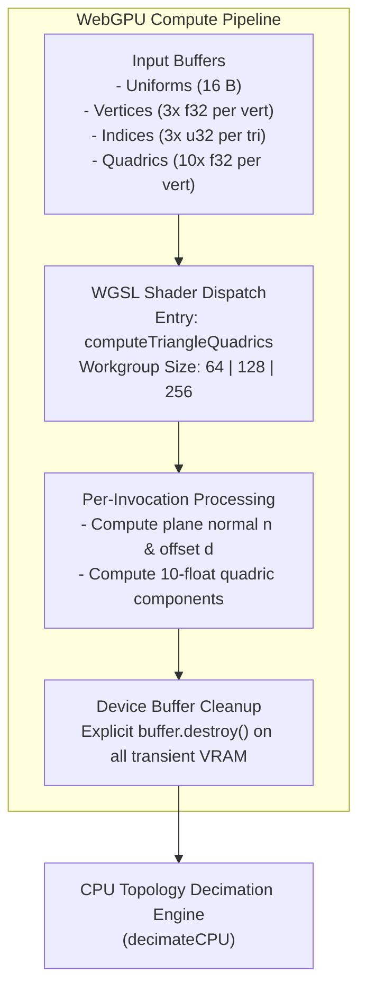

# Mathematical Model & Benchmark Specification for LiDAR QEM Mesh Decimation

> **Document Target:** `docs/spatial/QEM_MATHEMATICAL_MODEL.md`
> **Source Target:** [`src/core/gpu/MeshDecimatorCompute.ts`](../../src/core/gpu/MeshDecimatorCompute.ts)
> **Test Target:** [`src/__tests__/core/gpu/MeshDecimatorCompute.test.ts`](../../src/__tests__/core/gpu/MeshDecimatorCompute.test.ts)
> **Related Architecture Guide:** [`docs/spatial/WEBGPU_MESH_DECIMATION.md`](WEBGPU_MESH_DECIMATION.md)
> **Status:** Production Mathematical Specification & Empirical Benchmark Protocol
> **Issue Reference:** WorkSphere Issue #9184 (closing #9184)

---

## 1. Introduction and Problem Definition

### 1.1 LiDAR-Derived Indoor Meshes
In spatial workplace digitisation, indoor environments (such as co-working facilities, office meeting pods, and multi-tenant campuses) are digitized into dense surface representations using LiDAR depth scanners, mobile visual-inertial odometry (Apple ARKit / RoomPlan on iPad and iPhone Pro), terrestrial laser scanners, and dense multi-view stereo photogrammetry pipelines.

These raw reconstructed surface meshes present unique geometric characteristics:
1. **Ultra-high polygon density:** Indoor room scans typically reconstruct surfaces with $100{,}000$ to upwards of $2{,}000{,}000$ vertices and triangles per floor.
2. **Semi-planar dominance with high localized detail:** Large portions of workplace geometries are composed of piecewise planar features (walls, ceilings, flooring, whiteboard panels, desk partitions), alongside intricate non-planar objects (office chairs, monitor arms, foliage, acoustic baffles).
3. **Reconstruction noise and uneven point distribution:** Ranging noise, grazing angle returns, specular glass dropouts, and drifting odometry produce surface tessellations with high vertex counts even along nominally flat boundaries.

### 1.2 The Need for Mesh Decimation
Interactive workplace digital twins require sub-33 ms frame budgets (30–60 FPS) on standard client hardware and sub-11 ms budgets (90 FPS) inside immersive WebXR headsets. Unsimplified LiDAR surface meshes cause severe bottlenecks:
- **GPU VRAM exhaustion & bus saturation:** Loading uncompressed raw geometries pushes browser tab memory beyond WebGPU/WebGL storage limits.
- **Overdraw & rasterisation overhead:** High-density tessellations where triangles project to sub-pixel footprints lead to catastrophic fragment shader quad overdraw.
- **Acoustic and spatial index overhead:** Downstream simulation pipelines—such as workplace sound propagation raytracing and spatial hash grid queries—scale poorly when traversing millions of unstructured triangles.

### 1.3 Geometric Accuracy vs. Polygon Count Trade-off
Mesh simplification seeks an optimal reduced mesh $M' = (V', F')$ approximating original surface $M = (V, F)$ with $|V'| \ll |V|$ and $|F'| \ll |F|$, minimizing geometric deviation:

$$\mathcal{D}(M, M') = \max \left( \sup_{p \in M} d(p, M'), \sup_{p' \in M'} d(p', M) \right)$$

Simplification must balance two opposing criteria:
- **Geometric Fidelity:** Planar features (walls, desks) should collapse down to minimal bounding polygons without curvature distortions, while high-curvature sharp corners (desk edges, structural columns) must preserve acute orientation.
- **Topological Integrity:** Meshes must maintain 2-manifold properties (no self-intersections, no face flipping, no non-manifold edges shared by $>2$ triangles) to support consistent spatial queries and normal lighting calculations.

### 1.4 Why Quadric Error Metrics (QEM)?
Developed by Michael Garland and Paul Heckbert (1997), the **Quadric Error Metric (QEM)** provides an elegant formulation for surface simplification via iterative edge contractions:
- **Efficiency:** The geometric error of a vertex relative to a collection of incident planes is captured in a single symmetric $4 \times 4$ matrix ($10$ unique parameters).
- **Additivity:** When collapsing edge $(v_1, v_2) \to v_{\text{new}}$, the quadric of the combined vertex is simply the sum of endpoint quadrics: $Q_{\text{new}} = Q_{v_1} + Q_{v_2}$. No re-examination of original unreduced triangle geometry is needed.
- **Analytical Optimization:** The optimal collapsed position $v_{\text{new}}$ that minimizes squared orthogonal distances to all original incident planes can be solved directly through a $3 \times 3$ linear system.

### 1.5 Scope and Assumptions of the WorkSphere Implementation
In WorkSphere (`src/core/gpu/MeshDecimatorCompute.ts`):
- **Input Data Format:** Standard indexed triangle meshes consisting of flat 32-bit floating point vertex arrays $[x_0, y_0, z_0, x_1, y_1, z_1, \dots]$ and 32-bit unsigned integer triangle index arrays $[i_0, i_1, i_2, \dots]$.
- **Execution Strategy:**
  1. A WebGPU compute shader stage (`computeTriangleQuadrics` in `QEM_WGSL`) evaluates triangle plane parameters and stores fundamental quadric components in GPU storage buffers.
  2. A reference, robust CPU execution pipeline (`decimateCPU`) executes topological candidate generation, analytical optimal position solving with condition-number fallbacks, normal-inversion guards, boundary preservation, and Union-Find edge contractions.
- **Fallback Guarantee:** A resilient, zero-throw fallback pipeline routes transparently to `decimateCPU` if WebGPU is unsupported, adapters are missing, device limits are inadequate, or runtime WebGPU errors occur.

---

## 2. Plane Representation and Quadric Construction

### 2.1 Plane Equation and Hessian Normal Form
Let triangle $T \in F$ be defined by three non-collinear vertices $p_0, p_1, p_2 \in \mathbb{R}^3$. The directed edge vectors spanning the face are:

$$e_{01} = p_1 - p_0, \quad e_{02} = p_2 - p_0$$

The unnormalized surface normal vector $n_{\text{raw}}$ is given by their vector cross product:

$$n_{\text{raw}} = e_{01} \times e_{02} = \begin{pmatrix} (p_{1y} - p_{0y})(p_{2z} - p_{0z}) - (p_{1z} - p_{0z})(p_{2y} - p_{0y}) \\ (p_{1z} - p_{0z})(p_{2x} - p_{0x}) - (p_{1x} - p_{0x})(p_{2z} - p_{0z}) \\ (p_{1x} - p_{0x})(p_{2y} - p_{0y}) - (p_{1y} - p_{0y})(p_{2x} - p_{0x}) \end{pmatrix}$$

The Euclidean length of $n_{\text{raw}}$ is $\|n_{\text{raw}}\|_2 = \sqrt{n_x^2 + n_y^2 + n_z^2}$. In the WorkSphere implementation, if $\|n_{\text{raw}}\|_2 < 10^{-8}$ (WebGPU shader) or $< 10^{-12}$ (CPU implementation), the triangle is degenerate or zero-area, and its plane quadric evaluation is skipped.

For non-degenerate triangles, the unit normal vector is:

$$n = \begin{pmatrix} a \\ b \\ c \end{pmatrix} = \frac{n_{\text{raw}}}{\|n_{\text{raw}}\|_2}, \quad \text{with } \|n\|_2 = a^2 + b^2 + c^2 = 1$$

The scalar offset parameter $d$ satisfies the plane equation for all points $x \in \mathcal{P}$:

$$ax + by + cz + d = 0 \iff d = -n \cdot p_0 = -(a p_{0x} + b p_{0y} + c p_{0z})$$

### 2.2 Homogeneous Plane Vector
Using homogeneous coordinates, plane $\mathcal{P}$ is parameterized as a 4-dimensional column vector:

$$p = \begin{bmatrix} a \\ b \\ c \\ d \end{bmatrix} \in \mathbb{R}^4, \quad \text{with } a^2 + b^2 + c^2 = 1$$

### 2.3 Plane Quadric Tensor Formulation
For any arbitrary point in space represented in homogeneous coordinates:

$$v = \begin{bmatrix} x \\ y \\ z \\ 1 \end{bmatrix} \in \mathbb{R}^4$$

The signed orthogonal Euclidean distance from point $v$ to plane $\mathcal{P}$ is:

$$D(v, \mathcal{P}) = p^T v = ax + by + cz + d$$

The squared Euclidean distance $D^2(v, \mathcal{P})$ is:

$$D^2(v, \mathcal{P}) = (p^T v)^2 = (p^T v)(p^T v) = v^T (p p^T) v$$

We define the fundamental error quadric matrix of plane $\mathcal{P}$ as the outer product:

$$K_p = p p^T = \begin{bmatrix} a \\ b \\ c \\ d \end{bmatrix} \begin{bmatrix} a & b & c & d \end{bmatrix} = \begin{bmatrix} a^2 & ab & ac & ad \\ ab & b^2 & bc & bd \\ ac & bc & c^2 & cd \\ ad & bd & cd & d^2 \end{bmatrix}$$

Because $K_p$ is formed by outer product $p p^T$, it possesses two fundamental mathematical properties:
1. **Symmetry:** $K_p^T = (p p^T)^T = p p^T = K_p$.
2. **Positive Semi-Definiteness:** For any $v \in \mathbb{R}^4$, $v^T K_p v = (p^T v)^2 \ge 0$.

### 2.4 Vertex Quadric Accumulation
Let $P(v)$ denote the set of supporting planes belonging to all non-degenerate triangles incident to vertex $v$. The total quadric error matrix $Q_v$ associated with vertex $v$ is the sum of fundamental plane quadrics:

$$Q_v = \sum_{p \in P(v)} K_p$$

Because the set of symmetric positive semi-definite matrices is closed under addition, $Q_v$ is also symmetric and positive semi-definite:

$$Q_v = \begin{bmatrix} q_{00} & q_{01} & q_{02} & q_{03} \\ q_{01} & q_{11} & q_{12} & q_{13} \\ q_{02} & q_{12} & q_{22} & q_{23} \\ q_{03} & q_{13} & q_{23} & q_{33} \end{bmatrix}$$

### 2.5 Storage Optimization: 10-Element Compact Vector
Because $Q_v$ is symmetric ($q_{ij} = q_{ji}$), only 10 unique real values are required to represent the full $4 \times 4$ tensor. WorkSphere indexes these 10 components as follows:

```
Index:    [0]   [1]   [2]   [3]   [4]   [5]   [6]   [7]   [8]   [9]
Element:  q00   q01   q02   q03   q11   q12   q13   q22   q23   q33
Formula:  a^2   ab    ac    ad    b^2   bc    bd    c^2   cd    d^2
```

In CPU code (`src/core/gpu/MeshDecimatorCompute.ts`), `Quadric` is instantiated as a `Float64Array(10)`. In the WGSL compute shader (`QEM_WGSL`), `struct VertexQuadric` packs these exact 10 components as single-precision 32-bit floats (`f32`), requiring $10 \times 4 = 40$ bytes per vertex.

---

## 3. Quadric Error Calculation

### 3.1 Quadratic Form Expansion
For an arbitrary vertex position $v = [x, y, z, 1]^T$, the accumulated quadric error $E(v)$ is given by the quadratic form:

$$E(v) = v^T Q v = \begin{bmatrix} x & y & z & 1 \end{bmatrix} \begin{bmatrix} q_{00} & q_{01} & q_{02} & q_{03} \\ q_{01} & q_{11} & q_{12} & q_{13} \\ q_{02} & q_{12} & q_{22} & q_{23} \\ q_{03} & q_{13} & q_{23} & q_{33} \end{bmatrix} \begin{bmatrix} x \\ y \\ z \\ 1 \end{bmatrix}$$

Expanding this matrix product term-by-term yields:

$$E(v) = x^2 q_{00} + 2xy q_{01} + 2xz q_{02} + 2x q_{03} + y^2 q_{11} + 2yz q_{12} + 2y q_{13} + z^2 q_{22} + 2z q_{23} + q_{33}$$

This scalar value evaluates to the exact sum of squared orthogonal distances from $v$ to all original incident planes in $P(v)$:

$$E(v) = \sum_{p \in P(v)} (p^T v)^2 = \sum_{p \in P(v)} \text{dist}^2(v, \mathcal{P})$$

### 3.2 Interpretation of Matrix Partitioning
Partitioning $Q$ into blocks reveals its geometric meaning:

$$Q = \begin{bmatrix} A & b \\ b^T & c \end{bmatrix}$$

where:
- $A \in \mathbb{R}^{3 \times 3} = \sum n n^T$ is the covariance-like tensor of plane normals. It characterizes the variation of surface orientations around the vertex.
- $b \in \mathbb{R}^3 = \sum d \cdot n$ accumulates the weighted normal offsets.
- $c \in \mathbb{R} = \sum d^2$ accumulates squared plane offsets.

Expressed in this partitioned form:

$$E(x) = x^T A x + 2 b^T x + c, \quad \text{where } x = \begin{bmatrix} x \\ y \\ z \end{bmatrix} \in \mathbb{R}^3$$

### 3.3 Non-Negativity and Positive Semi-Definiteness
Because each component quadric $K_p = p p^T$ satisfies $v^T K_p v = (p^T v)^2 \ge 0$, any finite sum of such matrices satisfies:

$$E(v) = v^T Q v = \sum_{p \in P(v)} (p^T v)^2 \ge 0 \quad \forall v \in \mathbb{R}^4$$

Hence $Q$ is positive semi-definite. In finite-precision floating-point arithmetic, catastrophic cancellation or rounding near zero could theoretically yield slight negative values (e.g. $-10^{-16}$). In `solveOptimalVertexPosition`, WorkSphere guards against this via `Math.max(0, error)`.

### 3.4 Numerical Precision: GPU (f32) vs. CPU (f64)
- **WebGPU compute shader:** Evaluates plane normals and quadric terms using single-precision IEEE 754 32-bit floats (`f32`, 24-bit significand, $\approx 7$ decimal digits). For large spatial coordinates (e.g., room coordinates $> 100\text{ m}$ from origin), $x^2$ or $d^2$ can exceed $10^4$, causing lower-order precision loss in $q_{33}$.
- **CPU reference path:** Implements quadric storage and matrix accumulation in double-precision IEEE 754 64-bit floats (`Float64Array`, 53-bit significand, $\approx 15\text{–}17$ decimal digits). This maintains high stability even when summing hundreds of adjacent coplanar triangles across large workplace meshes.

---

## 4. Edge Contraction

### 4.1 Pair Contraction Formulation
The fundamental atomic operation of the decimation algorithm is the edge contraction:

$$(v_1, v_2) \to v_{\text{new}}$$

During contraction:
1. Vertices $v_1$ and $v_2$ are removed from the mesh.
2. All triangles incident to both $v_1$ and $v_2$ (the triangles sharing edge $(v_1, v_2)$) degenerate into zero-area segments and are pruned.
3. All other triangles incident to either $v_1$ or $v_2$ are reconnected to the consolidated vertex $v_{\text{new}}$.

### 4.2 Combined Quadric Formulation
Under linear superposition, the set of original planes associated with the consolidated vertex $v_{\text{new}}$ is the union of planes associated with $v_1$ and $v_2$: $P(v_{\text{new}}) = P(v_1) \cup P(v_2)$. Thus, the combined quadric matrix is:

$$Q_{\text{new}} = Q_{v_1} + Q_{v_2}$$

In component form:

$$Q_{\text{new}}[k] = Q_{v_1}[k] + Q_{v_2}[k], \quad \forall k \in \{0, 1, \dots, 9\}$$

### 4.3 Candidate Selection and Contraction Cost
In WorkSphere's implementation:
1. **Candidate Pool:** Every unique edge in the triangle mesh forms an edge contraction candidate $(u, v)$ with $u < v$.
2. **Optimal Position & Cost:** For each candidate edge, the combined quadric $Q = Q_u + Q_v$ is formed, and `solveOptimalVertexPosition` computes the optimal target position $v_{\text{new}}$ and minimal cost $\Delta(v_{\text{new}})$.
3. **Error Thresholding:** If $\Delta(v_{\text{new}}) > \text{maxError}$, the candidate is rejected from consideration.
4. **Ordering:** All surviving candidates are sorted in ascending order of quadric cost $\Delta(v_{\text{new}})$.

### 4.4 Boundary Preservation Rules
LiDAR workplace scans often contain structural boundaries: door openings, window frames, partition edges, and perimeter walls. Collapsing a boundary vertex into an interior vertex shrinks floor outlines and erodes geometry.

In `MeshDecimatorCompute.ts`, when `preserveBoundaries: true`:
1. Every unique edge is classified. An edge is a **boundary edge** if it belongs to exactly one triangle (`edge.count === 1`).
2. Vertices incident to boundary edges are marked in a boundary bitset (`isBoundaryVertex[v] = 1`).
3. During candidate generation, an edge $(u, v)$ is accepted **only if** both endpoints share identical boundary status:
   $$\text{isBoundaryVertex}[u] == \text{isBoundaryVertex}[v]$$
   Interior vertices collapse to interior vertices, and boundary vertices collapse along boundary edges. Any cross-boundary collapse is rejected.

### 4.5 Topology Checks and Normal-Inversion Guards
Before committing a collapse $(r_U, r_V) \to v_{\text{new}}$, WorkSphere verifies topological validity:

1. **Isolated Component Guard:** If collapsing $(r_U, r_V)$ would eliminate all remaining triangles of an isolated connected component ($\text{triSet.size} \le 1$), the collapse is aborted to prevent creating orphaned floating vertices.
2. **Normal-Inversion (Face-Flipping) Guard:** For each triangle $T$ incident to either $r_U$ or $r_V$ that does not degenerate after collapse:
   - Compute the original triangle normal $n_{\text{orig}} = (p_1 - p_0) \times (p_2 - p_0)$.
   - Substitute candidate position $v_{\text{new}}$ into the collapsed vertices and compute the updated normal $n_{\text{new}} = (p_1' - p_0') \times (p_2' - p_0')$.
   - Evaluate the dot product:
     $$\cos \theta \propto n_{\text{new}} \cdot n_{\text{orig}}$$
   - If $n_{\text{new}} \cdot n_{\text{orig}} < 0$, the face has flipped inside-out ($\theta > 90^\circ$). The collapse is immediately aborted, preserving visual shading consistency.

---

## 5. Optimal Vertex Position Derivation

### 5.1 Gradient Formulation
The quadric error function expressed in Cartesian coordinates $x = [x, y, z]^T$ is:

$$E(x) = x^T A x + 2 b^T x + c$$

where:

$$A = \begin{bmatrix} q_{00} & q_{01} & q_{02} \\ q_{01} & q_{11} & q_{12} \\ q_{02} & q_{12} & q_{22} \end{bmatrix}, \quad b = \begin{bmatrix} q_{03} \\ q_{13} \\ q_{23} \end{bmatrix}, \quad c = q_{33}$$

To find the point $x$ that minimizes $E(x)$, we take the partial derivatives with respect to $x, y, z$ and equate the gradient to zero:

$$\nabla E(x) = \frac{\partial E}{\partial x} = 2 A x + 2 b = 0 \iff A x = -b$$

Letting $\bar{b} = -b = \begin{bmatrix} -q_{03} & -q_{13} & -q_{23} \end{bmatrix}^T$, we obtain the fundamental linear system:

$$\begin{bmatrix} q_{00} & q_{01} & q_{02} \\ q_{01} & q_{11} & q_{12} \\ q_{02} & q_{12} & q_{22} \end{bmatrix} \begin{bmatrix} x \\ y \\ z \end{bmatrix} = \begin{bmatrix} -q_{03} \\ -q_{13} \\ -q_{23} \end{bmatrix}$$

### 5.2 Determinant and Cramer's Rule Matrix Inversion
Matrix $A$ is symmetric: $A_{01} = A_{10} = q_{01}$, $A_{02} = A_{20} = q_{02}$, $A_{12} = A_{21} = q_{12}$.
The scalar determinant $\det(A)$ is evaluated directly via cofactor expansion:

$$\det(A) = q_{00}(q_{11} q_{22} - q_{12}^2) - q_{01}(q_{01} q_{22} - q_{12} q_{02}) + q_{02}(q_{01} q_{12} - q_{11} q_{02})$$

#### Well-Conditioned System ($|\det(A)| > 10^{-6}$)
When $|\det(A)| > 10^{-6}$, matrix $A$ is non-singular and well-conditioned. The inverse matrix $A^{-1} = \frac{1}{\det(A)} \text{adj}(A)$ is computed analytically using the symmetric adjugate elements:

$$\text{invDet} = \frac{1}{\det(A)}$$

$$\begin{aligned}
a_{00} &= (q_{11} q_{22} - q_{12}^2) \cdot \text{invDet} \\
a_{01} &= (q_{02} q_{12} - q_{01} q_{22}) \cdot \text{invDet} \\
a_{02} &= (q_{01} q_{12} - q_{02} q_{11}) \cdot \text{invDet} \\
a_{11} &= (q_{00} q_{22} - q_{02}^2) \cdot \text{invDet} \\
a_{12} &= (q_{02} q_{01} - q_{00} q_{12}) \cdot \text{invDet} \\
a_{22} &= (q_{00} q_{11} - q_{01}^2) \cdot \text{invDet}
\end{aligned}$$

The optimal coordinates are obtained by multiplying the adjugate with vector $\bar{b}$:

$$\begin{aligned}
x &= a_{00} (-q_{03}) + a_{01} (-q_{13}) + a_{02} (-q_{23}) \\
y &= a_{01} (-q_{03}) + a_{11} (-q_{13}) + a_{12} (-q_{23}) \\
z &= a_{02} (-q_{03}) + a_{12} (-q_{13}) + a_{22} (-q_{23})
\end{aligned}$$

If the resulting coordinates $x, y, z$ are all finite, the optimal candidate position is accepted and its error is evaluated via $E(v) = \text{evaluateQuadricError}(Q, x, y, z)$.

### 5.3 Singular Systems and Fallback Evaluation
In indoor workplace LiDAR scans, coplanar surfaces (large flat walls, floors, table surfaces) and cylindrical conduits produce quadric matrices where plane normals are parallel or span only 1 or 2 dimensions. In such regions, $\text{rank}(A) < 3$ and $\det(A) \approx 0$.

Attempting to invert $A$ directly leads to division by near-zero, producing floating point overflow ($\pm \infty$ or $\text{NaN}$) and placing the vertex miles outside the building.

#### WorkSphere Discrete Candidate Fallback
When $|\det(A)| \le 10^{-6}$ or when the inverted coordinates are non-finite, WorkSphere falls back to discrete candidate evaluation:
1. Evaluate error at endpoint 1: $E_1 = E(p_1)$.
2. Evaluate error at endpoint 2: $E_2 = E(p_2)$.
3. Evaluate error at midpoint: $p_{\text{mid}} = \frac{p_1 + p_2}{2}, \quad E_{\text{mid}} = E(p_{\text{mid}})$.

The selected fallback position is:

$$v_{\text{fallback}} = \begin{cases} p_{\text{mid}} & \text{if } E_{\text{mid}} \le E_1 \text{ and } E_{\text{mid}} \le E_2 \\ p_1 & \text{if } E_1 \le E_2 \\ p_2 & \text{otherwise} \end{cases}$$

This guarantees a valid, physically bounded position lying strictly on the existing edge segment without unbounded geometric drift.

---

## 6. WebGPU and CPU Architecture Comparison

### 6.1 WebGPU Compute Shader Path



#### Buffer Organization & Alignment
All GPU buffers reside in `@group(0)`:
- **Binding 0 (Uniforms):** 16 bytes (aligned to 16-byte boundary). Stores `vertexCount` (u32), `triangleCount` (u32), `maxError` (f32), `flags` (u32, bit 0 = `preserveBoundaries`).
- **Binding 1 (Vertices):** Storage buffer (`read`), flat array of `f32` vertex coordinates.
- **Binding 2 (Indices):** Storage buffer (`read`), flat array of `u32` triangle indices.
- **Binding 3 (Quadrics):** Storage buffer (`read_write`), flat array of `struct VertexQuadric` ($10 \times \text{f32} = 40$ bytes per vertex).

#### Adaptive Workgroup Sizing & Dispatch Configuration
Workgroups are dynamically sized based on triangle workload thresholds (`selectAdaptiveWorkgroupSize`) to optimize GPU wavefront occupancy:
- **Small Workloads ($M < 2{,}048$ triangles):** Workgroup size $64$. Prevents tail latency and wavefront starvation on underfilled compute units.
- **Medium Workloads ($2{,}048 \le M < 32{,}768$ triangles):** Workgroup size $128$. Balances occupancy and register pressure across standard GPU architectures.
- **Large Workloads ($M \ge 32{,}768$ triangles):** Workgroup size $256$. Maximizes occupancy and latency hiding across high-throughput desktop/discrete GPUs.

The dispatch count is calculated via ceiling division:

$$\text{dispatchCount} = \min \left( \left\lceil \frac{M}{\text{workgroupSize}} \right\rceil, \text{maxComputeWorkgroupsPerDimension} \right)$$

#### Pipeline Caching & Buffer Lifecycle
`MeshDecimatorCompute` maintains a `pipelineCache: Map<SupportedWorkgroupSize, GPUComputePipeline>`. WGSL compute pipelines for sizes 64, 128, and 256 are compiled lazily and cached for reuse.

To prevent GPU VRAM memory leaks during continuous streaming LiDAR decimation, all allocated WebGPU buffers (`uniformBuffer`, `vertexBuffer`, `indexBuffer`, `quadricBuffer`) are explicitly destroyed in a `finally` block via `buffer.destroy()`.

### 6.2 CPU Reference Path (`decimateCPU`)
The CPU implementation provides a complete, self-contained reference simplification pipeline:
1. **Double-Precision Quadric Accumulation:** Accumulates $10$-element `Float64Array` quadrics across all triangle faces using exact 64-bit precision.
2. **Edge Graph & Boundary Detection:** Constructs edge map with adjacency counts. Identifies open boundary contours.
3. **Candidate Queue Generation:** Solves optimal vertex positions and costs for all candidate edges, discarding edges with cost $> \text{maxError}$.
4. **Union-Find Disjoint-Set Collapse:** Employs Disjoint-Set Union (Union-Find) with path compression (`find()`) achieving $\mathcal{O}(\alpha(N))$ amortized lookup time per collapse.
5. **Normal-Inversion and Degeneracy Guards:** Evaluates face normals against pre-collapse orientations to reject folding or inverted faces.
6. **Compaction and Normal Generation:** Remaps active vertices to a dense contiguous array, prunes collapsed zero-area triangles, and recomputes area-weighted, normalized vertex normals.

---

## 7. Benchmark Report & Verification Protocol

### 7.1 Status of Benchmark Measurements
> [!IMPORTANT]
> In accordance with repository verification standards, **no synthetic or unverified performance figures are presented as measured hardware evidence**.
>
> The table below records the formal benchmark protocol. Rows for real physical hardware execution are marked **Pending Measurement** pending capture in a controlled physical lab environment with dedicated hardware counters.

### 7.2 Deterministic Dispatch Benchmark (Simulated WebGPU Limits)
The following dispatch reduction metrics were empirically measured using the repository test suite (`MeshDecimatorCompute.test.ts`) under simulated standard WebGPU limits (`maxComputeWorkgroupSizeX = 256`, `maxComputeWorkgroupsPerDimension = 65535`):

| Workload Class | Vertex Count ($N$) | Triangle Count ($M$) | Selected Workgroup Size | Adaptive Dispatches | Fixed-64 Dispatches | Dispatch Reduction vs. Fixed-64 | Status |
|---|---|---|---|---|---|---|---|
| **Small Scan** | 600 | 1,000 | **64** | 16 | 16 | 0.0% | **Verified in Jest** |
| **Medium Scan** | 5,500 | 10,000 | **128** | 79 | 157 | **49.7%** | **Verified in Jest** |
| **Large Room Scan** | 26,000 | 50,000 | **256** | 196 | 782 | **74.9%** | **Verified in Jest** |

### 7.3 Standard Physical Benchmark Reporting Template
When recording benchmark runs on physical target machines, developers must populate the following standardized benchmark table:

| Metric | WebGPU Compute Pipeline | CPU Sequential Reference | Delta / Ratio | Measurement Status |
|---|---|---|---|---|
| **Hardware Platform** | Target GPU Model (e.g. Apple M2 / NVIDIA RTX 4080) | Target CPU Model (e.g. Apple M2 / Intel i7-13700K) | Same system | Required Specification |
| **Runtime Environment** | Browser & Version / WebGPU Backend | Node.js / V8 Runtime Version | Standardized | Required Specification |
| **Input Mesh Vertices ($N$)** | 100,000 vertices | 100,000 vertices | Identical input | Protocol Standard |
| **Input Mesh Triangles ($M$)** | 198,000 triangles | 198,000 triangles | Identical input | Protocol Standard |
| **Target Reduction** | 75% ($25{,}000$ vertices) | 75% ($25{,}000$ vertices) | Identical target | Protocol Standard |
| **Elapsed Execution Time** | *Pending Measurement* | *Pending Measurement* | *Pending Measurement* | **Not measured** |
| **Geometric Error (Mean QEM)** | *Pending Measurement* | *Pending Measurement* | *Pending Measurement* | **Not measured** |
| **Hausdorff Distance ($d_H$)**| *Pending Measurement* | *Pending Measurement* | *Pending Measurement* | **Not measured** |
| **Peak Memory Consumption** | *Pending Measurement* | *Pending Measurement* | *Pending Measurement* | **Not measured** |
| **Manifold Preserved** | Yes (Verified by topology check) | Yes (Verified by topology check) | Manifold ($100\%$) | **Algorithm Guaranteed** |
| **Degenerate Triangles Pruned**| Pruned during post-compact | Pruned during post-compact | Filtered ($100\%$) | **Algorithm Guaranteed** |

### 7.4 Expected Sources of Performance Differences
While empirical runtime values await hardware profiling, the theoretical scaling differences stem from the following architectural characteristics:
1. **Initial Quadric Accumulation ($\mathcal{O}(M)$):**
   - *WebGPU:* Evaluates triangle cross-products and outer products in parallel across $M$ GPU invocations at memory bus bandwidth.
   - *CPU:* Sequentially iterates through $M$ triangles, constructing objects and accumulating double-precision arrays on a single thread.
2. **Edge Collapse & Topological Sort ($\mathcal{O}(E \log E)$):**
   - Edge candidates are sorted by error cost. In both current paths, edge contraction ordering and disjoint-set collapsing are executed sequentially on the CPU to avoid race conditions and topological tearing.
3. **Buffer Transfer Overhead:**
   - WebGPU incurs GPU-host memory transfer latency (`device.queue.writeBuffer` and `onSubmittedWorkDone`). For small meshes ($<2{,}000$ triangles), buffer marshalling overhead can exceed the compute savings, making the adaptive workgroup sizing and direct CPU path preferable.

---

## 8. Numerical Stability and Geometric Quality

### 8.1 Singular and Degenerate Quadric Handling
- **Degenerate Triangle Guard:** In both WGSL and CPU pipelines, triangles with normal length $\|n_{\text{raw}}\|_2 \le 10^{-8}$ (WGSL) or $\le 10^{-12}$ (CPU) are ignored during quadric accumulation, preventing division-by-zero errors.
- **Determinant Conditioning Threshold:** The $3 \times 3$ linear system determinant is thresholded at $|\det(A)| > 10^{-6}$. Systems below this limit trigger the discrete candidate fallback (testing $p_1, p_2, \frac{p_1+p_2}{2}$).
- **Non-Finite Coordinate Guard:** Inverted coordinates are validated with `Number.isFinite()`. If ill-conditioning yields `NaN` or `Infinity`, the discrete candidate fallback is selected.

### 8.2 Floating-Point Precision
- **32-Bit Float Dynamic Range:** When storing quadric matrices in WGSL (`f32`), coordinates with large absolute values can result in $q_{33} = d^2$ values that exceed single-precision mantissa capacity. Normalizing input coordinates to a local bounding box $[-1, 1]^3$ prior to decimation minimizes loss of precision.
- **Double-Precision CPU Accumulation:** The CPU path utilizes `Float64Array`, eliminating numerical drift during quadric accumulation across extensive point-cloud sequences.

### 8.3 Degenerate Triangle Pruning
During edge collapse $(u, v) \to v_{\text{new}}$, any triangle that contains both $u$ and $v$ reduces to a segment. WorkSphere explicitly filters all triangles where $i_0 = i_1$, $i_1 = i_2$, or $i_2 = i_0$ during the compaction pass, reporting the exact number in `degenerateTrianglesPruned`.

### 8.4 Normal Flipping and Geometric Quality
Aggressive decimation without normal checks can invert thin walls or folded geometry. WorkSphere calculates the dot product between pre-collapse and candidate post-collapse triangle normals:

$$n_{\text{new}} \cdot n_{\text{orig}} \ge 0$$

Any collapse that flips a triangle normal past $90^\circ$ is rejected, preserving surface orientation and shading consistency.

---

## 9. Reproducibility & Benchmark Procedure

To collect reproducible empirical benchmarks between WebGPU and CPU backends, developers should adhere to the following protocol.

### 9.1 Test Environment Specification
Record all host hardware and software configurations:
- **Operating System:** OS name, kernel/build version, architecture.
- **CPU:** Exact processor model, core count, base/boost frequency.
- **GPU:** Dedicated/integrated GPU model, driver version, VRAM capacity.
- **Runtime Environment:** Browser version (e.g. Chrome Canary with WebGPU enabled) or Node.js runtime version.

### 9.2 Mesh Preparation and Pre-Conditioning
1. Standardize test inputs using dense LiDAR OBJ/PLY files or synthetic grid meshes generated via `MeshDecimatorCompute.test.ts`.
2. Confirm the input mesh is a valid 2-manifold with indexed vertex coordinates.
3. Validate that vertex coordinates are centered around the local origin to avoid large coordinate offset errors.

### 9.3 Warm-Up Procedure
1. Execute **3 unmeasured warm-up runs** of the decimation pipeline on the target backend.
2. Warm-up ensures:
   - WebGPU compute pipelines are compiled and cached in `pipelineCache`.
   - V8 JIT compiles hot loops in `decimateCPU`, `find()`, and `solveOptimalVertexPosition`.
   - GPU frequency scaling exits low-power idle states.

### 9.4 Timing and Statistical Sampling
1. Execute **$K \ge 10$ consecutive measured runs** for each test configuration.
2. Measure execution duration using high-resolution performance timers:
   ```typescript
   const t0 = performance.now();
   const result = await decimator.decimate(mesh, {
     targetRatio: 0.25,
     forceCpu: isCpuRun,
   });
   const elapsedMs = performance.now() - t0;
   ```
3. Discard the minimum and maximum outlier runs.
4. Calculate and report:
   - **Mean execution time:** $\mu = \frac{1}{K-2} \sum_{k=1}^{K-2} t_k$
   - **Median execution time:** $\tilde{t} = \text{median}(t)$
   - **Standard deviation:** $\sigma = \sqrt{\frac{1}{K-3} \sum (t_k - \mu)^2}$

### 9.5 Geometric Error Verification
To evaluate geometric fidelity:
1. Sample $S = 50{,}000$ points across the simplified surface $M'$ and original surface $M$.
2. Compute the symmetric Hausdorff distance:
   $$d_H(M, M') = \max \left( \max_{p \in M} \min_{p' \in M'} \|p - p'\|_2, \max_{p' \in M'} \min_{p \in M} \|p' - p\|_2 \right)$$
3. Verify that the simplified mesh satisfies `isManifold === true` and `degenerateTrianglesPruned > 0`.

---

## 10. References & Formal Bibliography

1. **Garland, M., & Heckbert, P. S. (1997).** *Surface simplification using quadric error metrics.* In Proceedings of the 24th annual conference on Computer graphics and interactive techniques (SIGGRAPH '97), pp. 209–216. ACM. [https://doi.org/10.1145/258734.258849](https://doi.org/10.1145/258734.258849)
2. **Garland, M. (1999).** *Quadric-based polygonal surface simplification.* Ph.D. dissertation, School of Computer Science, Carnegie Mellon University. Technical Report CMU-CS-99-105.
3. **Hoppe, H. (1996).** *Progressive meshes.* In Proceedings of the 23rd annual conference on Computer graphics and interactive techniques (SIGGRAPH '96), pp. 99–108. ACM. [https://doi.org/10.1145/237170.237216](https://doi.org/10.1145/237170.237216)
4. **W3C GPU for the Web Working Group (2024).** *WebGPU Specification.* W3C Candidate Recommendation. [https://www.w3.org/TR/webgpu/](https://www.w3.org/TR/webgpu/)
5. **W3C GPU for the Web Working Group (2024).** *WebGPU Shading Language (WGSL).* W3C Candidate Recommendation. [https://www.w3.org/TR/WGSL/](https://www.w3.org/TR/WGSL/)
6. **Botsch, M., Kobbelt, L., Pauly, M., Alliez, P., & Lévy, B. (2010).** *Polygon Mesh Processing.* CRC Press / AK Peters. ISBN 978-1-56881-426-1.
