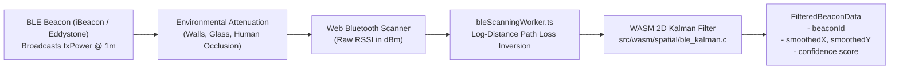

# BLE Proximity RSSI Distance Calibration & Path Loss Modeling

This technical document details the **Log-Distance Path Loss Model (LDPLM)**, reference transmission power calibration ($A_0$ / `txPower`), path loss exponent ($n$), environmental multi-path smoothing, and WebAssembly Kalman filtering used by [`src/lib/wasm-loader/ble-proximity.ts`](file:///c:/Users/admin/Desktop/workfere/src/lib/wasm-loader/ble-proximity.ts), [`src/workers/bleScanningWorker.ts`](file:///c:/Users/admin/Desktop/workfere/src/workers/bleScanningWorker.ts), and [`src/wasm/spatial/ble_kalman.c`](file:///c:/Users/admin/Desktop/workfere/src/wasm/spatial/ble_kalman.c).

WorkSphere utilizes BLE (Bluetooth Low Energy) iBeacon and Eddystone hardware beacons installed across cafes, coworking pods, and meeting rooms to provide micro-location check-ins, indoor wayfinding, and spatial desk proximity detection.

---

## 1. Executive Summary & Signal Processing Pipeline

Bluetooth Low Energy radio propagation inside physical buildings is subject to reflection, scattering, absorption, and multi-path fading. Uncalibrated Received Signal Strength Indication (RSSI) can fluctuate by $\pm 10\text{ dBm}$ to $\pm 15\text{ dBm}$, which translates to distance errors of $3\text{m} - 8\text{m}$.

To stabilize micro-location tracking, WorkSphere implements a 3-stage distance estimation pipeline:
1. **Log-Distance Path Loss Conversion:** Converts raw RSSI ($\text{dBm}$) into metric distance ($d$).
2. **Environmental Path Loss Exponent Tuning ($n$):** Calibrates attenuation for walls, glass, cubicles, and human bodies.
3. **Multidimensional WebAssembly Kalman Smoothing (`ble_kalman.c`):** Filters high-frequency RSSI jitter in linear WebAssembly memory.



---

## 2. Mathematical Propagation Model: Log-Distance Path Loss

The Log-Distance Path Loss Model describes signal power reduction over distance in indoor environments.

### 2.1 The Forward Path Loss Equation

$$\text{RSSI}(d) = \text{txPower} - 10 \cdot n \cdot \log_{10}(d) + X_\sigma$$

Where:
- $\text{RSSI}(d)$: Received signal strength in $\text{dBm}$ measured by the mobile client at distance $d$.
- $\text{txPower}$ ($A_0$): Measured reference RSSI at exactly $1.0\text{ meter}$ line-of-sight (LOS) from the beacon (typically between $-55\text{ dBm}$ and $-65\text{ dBm}$, standardized to $-59\text{ dBm}$ in [`bleScanningWorker.ts`](file:///c:/Users/admin/Desktop/workfere/src/workers/bleScanningWorker.ts#L37)).
- $n$: **Path Loss Exponent (PLE)**, quantifying the rate at which radio signal energy decays in the surrounding physical medium.
- $d$: Euclidean distance in meters between the beacon and client antenna.
- $X_\sigma$: Zero-mean Gaussian random variable modeling shadow fading and multipath interference ($X_\sigma \sim \mathcal{N}(0, \sigma^2)$ with shadow deviation $\sigma \approx 3\text{--}6\text{ dB}$).

### 2.2 RSSI to Metric Distance Inversion Formula

Solving for Euclidean distance $d$ yields:

$$d = 10^{\frac{\text{txPower} - \text{RSSI}}{10 \cdot n}}$$

As implemented in [`src/workers/bleScanningWorker.ts`](file:///c:/Users/admin/Desktop/workfere/src/workers/bleScanningWorker.ts#L36-L37):

```typescript
// Convert RSSI to approximate distance via log-distance path loss
const estimatedDistance = Math.pow(10, (txPower - reading.rssi) / (10 * n));
```

### 2.3 Distance Confidence Function
Closer beacons exhibit substantially lower variance than distant beacons. WorkSphere computes a normalized confidence metric:

$$\text{Confidence}(d) = \frac{1.0}{1.0 + d}$$

---

## 3. Path Loss Exponent ($n$) Tuning Matrix for Indoor Venues

The Path Loss Exponent ($n$) is heavily dependent on venue layout, architecture, and interior materials:

| Venue Environment Type | Path Loss Exponent ($n$) | Attenuation Profile | Recommended Indoor Venues |
| :--- | :---: | :--- | :--- |
| **Free Space / Anechoic** | $2.0$ | Theoretical inverse-square law; zero reflections | Outdoor terraces, unobstructed courtyards |
| **Open-Plan Coworking Lounge** | $2.2 - 2.6$ | Direct line-of-sight with wooden tables and sofa clusters | Open hot-desk floors, atrium coffee shops |
| **Commercial Café with Partitions** | $2.7 - 3.2$ | Glass dividers, espresso machinery, drywall partitions | Specialty coffee shops, booth seating zones |
| **Traditional Office with Cubicles** | $3.3 - 3.8$ | Fabric cubicle dividers, metal filing cabinets | Private corporate suites, team pod rooms |
| **Dense Concrete / Basement Pods** | $3.8 - 4.5$ | Thick reinforced concrete, steel doors, subterranean pillars | Underground meeting bunkers, soundproof booths |

```
Path Loss Exponent Effect on Calculated Distance (at txPower = -59 dBm, RSSI = -79 dBm):
- When n = 2.0 (Open Space):      d = 10^(( -59 - (-79) ) / 20) = 10^(20 / 20) = 10.0 meters
- When n = 2.5 (Open Coworking):  d = 10^(( -59 - (-79) ) / 25) = 10^0.80     = 6.31 meters
- When n = 3.0 (Partitioned Cafe): d = 10^(( -59 - (-79) ) / 30) = 10^0.67     = 4.64 meters
- When n = 4.0 (Concrete Bunker): d = 10^(( -59 - (-79) ) / 40) = 10^0.50     = 3.16 meters
```

---

## 4. Empirical Field Calibration Protocol for Venue Managers

To achieve sub-meter desk proximity accuracy, venue managers must calibrate $\text{txPower}$ and $n$ on site.

### Step-by-Step Calibration Procedure:

1. **Beacon Mounting:**
   - Mount beacons at an elevation of $2.2\text{m} - 2.5\text{m}$ (above head height) to minimize direct body shadowing.
   - Avoid mounting directly against metal beams or behind high-power electrical conduits.

2. **Measure `txPower` at 1.0 Meter ($A_0$):**
   - Position a test mobile device on a tripod at exactly $1.0\text{ meter}$ line-of-sight from the beacon.
   - Capture $100$ continuous RSSI samples over $30$ seconds.
   - Compute the trimmed mean (excluding top and bottom $10\%$):
     $$\text{txPower} = \frac{1}{M} \sum_{i=1}^M \text{RSSI}_{1\text{m}}[i]$$

3. **Measure Multi-Point Attenuation & Calculate $n$ via Linear Regression:**
   - Record $50$ RSSI samples at distances $d \in \{2\text{m}, 4\text{m}, 6\text{m}, 8\text{m}\}$.
   - Transform distances into logarithmic values $x_i = 10 \log_{10}(d_i)$.
   - Calculate signal drops $y_i = \text{txPower} - \overline{\text{RSSI}}(d_i)$.
   - Perform least-squares linear regression through the origin:
     $$n = \frac{\sum_{i=1}^K x_i \cdot y_i}{\sum_{i=1}^K x_i^2}$$

---

## 5. Environmental Jitter Smoothing: WebAssembly 2D Kalman Filter

Raw RSSI samples fluctuate due to human movement and multipath wave interference. Rather than simple moving averages (which introduce lag), [`src/wasm/spatial/ble_kalman.c`](file:///c:/Users/admin/Desktop/workfere/src/wasm/spatial/ble_kalman.c) runs a discrete two-dimensional Kalman filter.

### State Estimation Equations

Each tracked beacon maintains a `KalmanState2D`:
- **State Vector:** $[x, y]^T$
- **Measurement Noise Covariance ($R$):** $2.0$ (reflecting wireless sensor noise)
- **Process Noise Covariance ($Q$):** $0.1$ (reflecting client movement dynamics)

At each measurement update:
1. **Kalman Gain Computation:**
   $$K_x = \frac{P_{xx}}{P_{xx} + R}, \quad K_y = \frac{P_{yy}}{P_{yy} + R}$$
2. **State Estimate Update:**
   $$x \leftarrow x + K_x \cdot (x_{\text{measured}} - x), \quad y \leftarrow y + K_y \cdot (y_{\text{measured}} - y)$$
3. **Error Covariance Propagation:**
   $$P_{xx} \leftarrow (1 - K_x) \cdot P_{xx} + Q, \quad P_{yy} \leftarrow (1 - K_y) \cdot P_{yy} + Q$$

This filter eliminates high-frequency noise spikes while responding swiftly when a worker physically relocates between desks.
