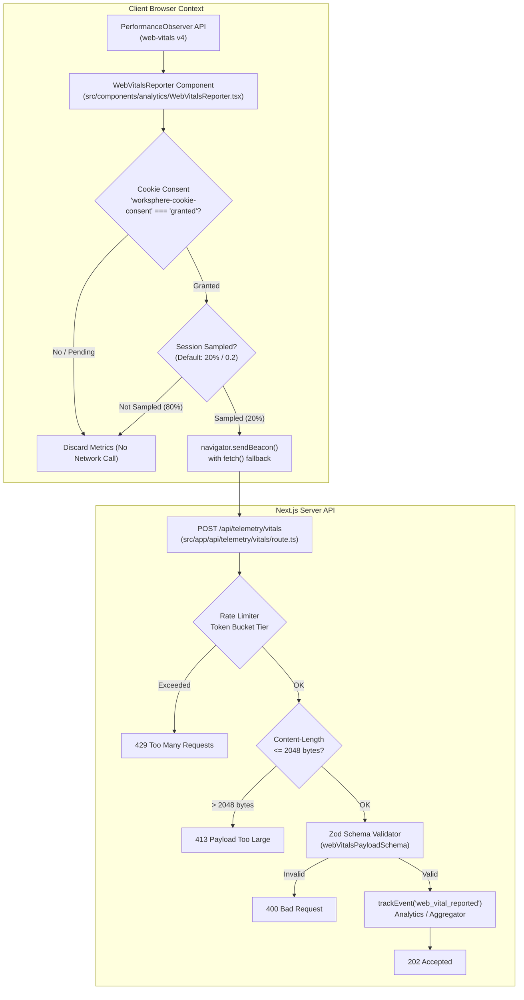

# Client-Side Core Web Vitals Telemetry Setup & Developer Guide

## 1. Overview

WorkSphere employs a privacy-first, client-side Real User Monitoring (RUM) telemetry pipeline to monitor the perceived performance, interactivity, and visual stability of our nomad coworking web application.

This guide serves as the practical developer handbook for:

- Understanding client-side metric collection via the official Google `web-vitals` library
- Configuring consent gating, sampling rates, and environment variables
- Ingesting metrics via the Next.js API endpoint (`POST /api/telemetry/vitals`)
- Testing the pipeline locally with cURL, browser DevTools, and Lighthouse audits

---

## 2. Architecture & Data Flow

The telemetry lifecycle moves from in-browser performance observers to server ingestion:



---

## 3. Metrics Collected

WorkSphere captures all five official Google Core Web Vitals and diagnostic timing metrics:

| Metric   | Full Name                 | Diagnostic Focus                                                                                             | Good Threshold       | Needs Improvement                 | Poor Threshold     |
| -------- | ------------------------- | ------------------------------------------------------------------------------------------------------------ | -------------------- | --------------------------------- | ------------------ |
| **LCP**  | Largest Contentful Paint  | Perceived loading speed; marks when the main content (e.g. hero banner, venue map) has rendered.             | $\le 2500\text{ ms}$ | $2500\text{ ms} - 4000\text{ ms}$ | $> 4000\text{ ms}$ |
| **INP**  | Interaction to Next Paint | Overall page responsiveness to user input (clicks, taps, key presses) throughout the session life.           | $\le 200\text{ ms}$  | $200\text{ ms} - 500\text{ ms}$   | $> 500\text{ ms}$  |
| **CLS**  | Cumulative Layout Shift   | Visual stability; measures unexpected layout shifts of visible elements as assets load asynchronously.       | $\le 0.1$            | $0.1 - 0.25$                      | $> 0.25$           |
| **FCP**  | First Contentful Paint    | Initial feedback; time from navigation until the browser renders the first DOM element (text or image).      | $\le 1800\text{ ms}$ | $1800\text{ ms} - 3000\text{ ms}$ | $> 3000\text{ ms}$ |
| **TTFB** | Time to First Byte        | Backend latency and network setup time; duration until the browser receives the first byte of response data. | $\le 800\text{ ms}$  | $800\text{ ms} - 1800\text{ ms}$  | $> 1800\text{ ms}$ |

> [!NOTE]
> Metrics are calculated by the underlying browser engine via `PerformanceObserver`. Not all metrics are supported across all browsers; for instance, older Safari releases do not expose INP or full layout shift attributions. Missing metrics are omitted gracefully rather than fabricated.

---

## 4. Privacy & Consent Requirements

Telemetry transmission is strictly gated behind user cookie consent:

- **LocalStorage Consent Key:** `worksphere-cookie-consent`
- **Required Value:** `"granted"`
- **Declined Value:** `"declined"`
- **Custom DOM Event:** `worksphere:cookie-consent` (dispatched on banner interactions to notify active listeners)

```typescript
// Example: Checking consent programmatically
const isConsentGranted =
  window.localStorage.getItem("worksphere-cookie-consent") === "granted";
```

If consent is absent, `null`, or `"declined"`, the client-side reporter registers no performance observers and transmits zero network packets.

---

## 5. Sampling Rate & Session Stickiness

To prevent telemetry storms from overwhelming application edge routes, WorkSphere applies deterministic session-based sampling:

- **Default Sampling Rate:** `0.2` (20% of sessions)
- **Environment Override:** `NEXT_PUBLIC_WEB_VITALS_SAMPLE_RATE` (floating point between `0.0` and `1.0`)
- **Session Stickiness:** Evaluated once per browser session and persisted in `sessionStorage` under key `worksphere:web-vitals:sample`:
  - `"sampled"`: The current tab/session emits all observed metrics.
  - `"not-sampled"`: The current tab/session emits no metrics.

```typescript
// Memory and sessionStorage sampling logic
const stored = window.sessionStorage.getItem("worksphere:web-vitals:sample");
// If unassigned:
const sampled = Math.random() < samplingRate;
window.sessionStorage.setItem(
  "worksphere:web-vitals:sample",
  sampled ? "sampled" : "not-sampled",
);
```

---

## 6. Ingestion API Endpoint Reference

- **Route:** `POST /api/telemetry/vitals`
- **Content-Type:** `application/json` (strictly required; returns `415 Unsupported Media Type` otherwise)
- **Maximum Body Size:** 2048 bytes (`MAX_VITALS_BODY_BYTES = 2048`; returns `413 Payload Too Large` if exceeded)
- **Transport Mechanism:** `navigator.sendBeacon()` with automatic fallback to `fetch()` (`keepalive: true`) on page unmount.

### 6.1 Request JSON Schema (Zod)

In `src/app/api/telemetry/vitals/route.ts`:

```typescript
export const webVitalsPayloadSchema = z
  .object({
    name: z.enum(["CLS", "INP", "LCP", "FCP", "TTFB"]),
    value: z.number().finite().min(0).max(1_000_000_000),
    rating: z.enum(["good", "needs-improvement", "poor"]),
    navigationType: z.enum([
      "navigate",
      "reload",
      "back-forward",
      "back-forward-cache",
      "prerender",
      "restore",
      "soft-navigation",
      "unknown",
    ]),
    deviceType: z.enum(["mobile", "tablet", "desktop", "unknown"]),
    metricId: z.string().min(1).max(128).optional(),
    timestamp: z.number().int().positive(),
  })
  .strict();
```

### 6.2 HTTP Status Codes

| Status Code                  | Description                          | Condition                                                        |
| ---------------------------- | ------------------------------------ | ---------------------------------------------------------------- |
| `202 Accepted`               | Telemetry accepted and enqueued      | Valid payload conforming to schema.                              |
| `400 Bad Request`            | Validation failure or malformed JSON | Missing required fields, invalid enum value, or negative number. |
| `413 Payload Too Large`      | Body exceeds byte quota              | Payload size $> 2048$ bytes.                                     |
| `415 Unsupported Media Type` | Content-Type header invalid          | Request header is not `application/json`.                        |
| `429 Too Many Requests`      | IP rate limit exceeded               | Burst request quota exceeded (includes `Retry-After` header).    |
| `500 Server Error`           | Ingestion failure                    | Unexpected server or event dispatcher error.                     |

---

## 7. Local Testing & Verification

### 7.1 Testing via cURL

You can test the endpoint directly against your local development server:

#### Valid Request Example (LCP metric)

```bash
curl -i -X POST http://localhost:3000/api/telemetry/vitals \
  -H "Content-Type: application/json" \
  -d '{
    "name": "LCP",
    "value": 1842.5,
    "rating": "good",
    "navigationType": "navigate",
    "deviceType": "desktop",
    "metricId": "v4-1710000000000-1234567890",
    "timestamp": 1710000000000
  }'
```

Expected Response:

```http
HTTP/1.1 202 Accepted
Content-Type: application/json; charset=utf-8

{"accepted":true}
```

#### Rejection Example (Invalid Enum)

```bash
curl -i -X POST http://localhost:3000/api/telemetry/vitals \
  -H "Content-Type: application/json" \
  -d '{
    "name": "INVALID_METRIC",
    "value": 500,
    "rating": "good",
    "navigationType": "navigate",
    "deviceType": "desktop",
    "timestamp": 1710000000000
  }'
```

Expected Response:

```http
HTTP/1.1 400 Bad Request
Content-Type: application/json; charset=utf-8

{"error":"Invalid Web Vitals payload","details":[{"path":["name"],"code":"invalid_enum_value"}]}
```

### 7.2 Testing in Browser DevTools

1. Launch the local dev server:
   ```bash
   npm run dev
   ```
2. Open Chrome, Edge, or Firefox at `http://localhost:3000`.
3. Open DevTools (`F12` or `Ctrl+Shift+I`) and navigate to the **Application** (or **Storage**) tab.
4. Set Local Storage consent:
   - Key: `worksphere-cookie-consent`
   - Value: `granted`
5. Set Session Storage sampling:
   - Key: `worksphere:web-vitals:sample`
   - Value: `sampled`
6. Switch to the **Network** tab and filter by `/api/telemetry/vitals`.
7. Reload the page (`Ctrl+R` or `F5`).
8. Observe initial metrics reported (`FCP`, `TTFB`, `LCP`).
9. Click or interact with an element to trigger `INP` on tab blur or page unmount.

### 7.3 Auditing with Google Lighthouse

Lighthouse provides synthetic lab data under simulated throttling conditions, whereas WorkSphere's telemetry endpoint collects real-user field data (RUM).

To run Lighthouse locally:

1. Open Chrome DevTools $\to$ **Lighthouse** tab.
2. Select **Desktop** or **Mobile** mode and check **Performance**.
3. Click **Analyze page load**.
4. Review the generated scores for LCP, FCP, and CLS.

> [!IMPORTANT]
> **Lab vs Field Data Differences:**
>
> - Lighthouse executes in a single simulated device profile with artificial network throttling.
> - Field metrics (`/api/telemetry/vitals`) represent actual device diversity, genuine Wi-Fi/cellular conditions, and multi-page user interactions over time.

---

## 8. Environment Variables Reference

| Variable                             | Type      | Default  | Description                                                                                   |
| ------------------------------------ | --------- | -------- | --------------------------------------------------------------------------------------------- |
| `NEXT_PUBLIC_WEB_VITALS_ENABLED`     | `boolean` | `"true"` | Global toggle for client-side reporter. Set to `"false"` to disable completely.               |
| `NEXT_PUBLIC_WEB_VITALS_SAMPLE_RATE` | `number`  | `0.2`    | Fraction of sessions to sample (e.g. `1.0` for 100% in staging, `0.2` for 20% in production). |

---

## 9. Documentation Reconciliation & References

This guide reconciles previous documentation contradictions:

- **Cookie Consent Key:** The canonical key is `worksphere-cookie-consent` in `localStorage` with value `"granted"` (as implemented in `webVitalsReporter.ts`), while `worksphere:cookie-consent` is the DOM Event identifier.
- **Sampling Rate:** The production default is `0.2` (20%), superseding older documentation notes mentioning 10%.

For related architecture and backend processing:

- [Canonical Core Web Vitals Specification](file:///d:/Opensource/WorkSphere-Opensource/docs/telemetry/CORE_WEB_VITALS_SPEC.md)
- [Web Vitals Architecture Guide](file:///d:/Opensource/WorkSphere-Opensource/docs/telemetry/web-vitals-guide.md)
- [Admin Vitals Export Pipeline](file:///d:/Opensource/WorkSphere-Opensource/docs/telemetry/vitals-export-pipeline.md)
