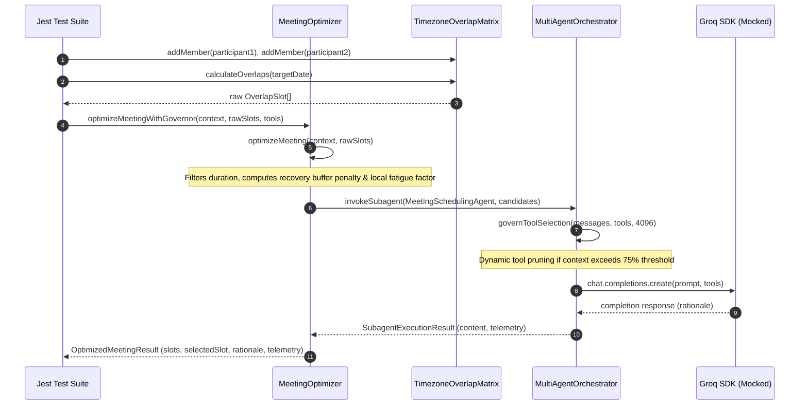

# Multi-Agent Meeting Negotiation Integration Test Playbook

| Metadata               | Details                                                                                                                           |
| :--------------------- | :-------------------------------------------------------------------------------------------------------------------------------- |
| **Title**              | Multi-Agent Meeting Negotiation Integration Test Playbook                                                                         |
| **Issue**              | [#7937](https://github.com/SatyamPandey-07/WorkSphere/issues/7937)                                                                |
| **Status**             | Testing Guide / Integration Architecture                                                                                          |
| **Target Module**      | `src/core/ai/MeetingOptimizer.ts`                                                                                                 |
| **Supporting Modules** | `src/core/scheduling/TimezoneOverlapMatrix.ts`, `src/lib/agents/MultiAgentOrchestrator.ts`                                        |
| **Testing Framework**  | Jest 29 (`ts-jest`, `jest-environment-jsdom`)                                                                                     |
| **Intended Audience**  | AI engineers, full-stack developers, and QA engineers writing robust integration tests for multi-agent scheduling and negotiation |

---

## Table of Contents

1. [Executive Summary](#1-executive-summary)
2. [Overview of the Negotiation Pipeline](#2-overview-of-the-negotiation-pipeline)
3. [Test Environment Setup](#3-test-environment-setup)
4. [Mocking LLM Reasoning Responses](#4-mocking-llm-reasoning-responses)
5. [Mock Calendar Feed Recipes](#5-mock-calendar-feed-recipes)
6. [State Vectors and Negotiation Fixtures](#6-state-vectors-and-negotiation-fixtures)
7. [Core Integration Test Recipes](#7-core-integration-test-recipes)
8. [Asynchronous Testing and Flake Prevention](#8-asynchronous-testing-and-flake-prevention)
9. [CI Test Suite Strategy](#9-ci-test-suite-strategy)
10. [Assertions and Invariants](#10-assertions-and-invariants)
11. [Troubleshooting Common Test Pitfalls](#11-troubleshooting-common-test-pitfalls)
12. [Contributor Test Checklist](#12-contributor-test-checklist)
13. [References](#13-references)

---

## 1. Executive Summary

WorkSphere coordinates distributed team meetings across multiple timezones using an AI-guided meeting optimization and negotiation pipeline. The primary orchestration logic resides in `src/core/ai/MeetingOptimizer.ts`, which bridges algorithmic calendar overlap evaluation (`TimezoneOverlapMatrix.ts`) with subagent LLM reasoning and token governance (`MultiAgentOrchestrator.ts`).

### Purpose of this Playbook

Integration testing multi-agent negotiation systems involves unique challenges:

1. **Non-deterministic LLM behavior:** Live model calls introduce jitter, latency, rate limits, and variable response text.
2. **Timezone complexities:** Working-hour calculations and recovery gaps span variable IANA timezones and Daylight Saving Time (DST) boundaries.
3. **Multi-agent state transitions:** Meeting constraints (duration, urgency, recovery buffer, attendee quorum) must be evaluated deterministically across mock feeds.
4. **Flaky asynchronous testing:** Unhandled promises, timer drift, or race conditions in async agents can destabilize continuous integration (CI) test runs.

This playbook provides actionable, runnable Jest integration testing recipes, mock fixtures, state vector definitions, and flakiness-prevention guidelines built specifically for WorkSphere's architecture.

---

## 2. Overview of the Negotiation Pipeline

### 2.1 The Actual Architecture

The meeting negotiation pipeline in WorkSphere operates as a hybrid pipeline combining deterministic algorithmic constraint satisfaction with subagent LLM reasoning:

```
+---------------------------------------------------------------------------------------+
|                                Meeting Request Context                                |
|  - Title, Participants, Duration, Urgency, Preferred Time of Day                      |
|  - Participant Timezones (IANA) & Busy Intervals (UTC timestamps)                     |
|  - Minimum Recovery Buffer Minutes                                                    |
+---------------------------------------------------------------------------------------+
                                           |
                                           v
+---------------------------------------------------------------------------------------+
|                    Stage 1: Algorithmic Overlap Matrix Evaluation                     |
|                    (`TimezoneOverlapMatrix.calculateOverlaps`)                        |
|  - Intersects working hours across IANA timezones into UTC timestamp intervals        |
|  - Filters out intervals shorter than 30 minutes                                      |
+---------------------------------------------------------------------------------------+
                                           |
                                           v
+---------------------------------------------------------------------------------------+
|                     Stage 2: Deterministic Slot Optimization                          |
|                       (`MeetingOptimizer.optimizeMeeting`)                            |
|  1. Duration Filter: slot.durationMinutes >= context.durationMinutes                  |
|  2. Calendar Buffer & Fatigue Scoring:                                                |
|     - Calculates distance to nearest busy intervals (`participantBusyIntervals`)      |
|     - Computes shortfall against required bufferMinutes                              |
|     - Scales penalty by IANA local fatigue factor (<9 AM: 1.35x, >=9 PM: 1.75x)       |
|  3. Primary Sorting: participantCount * 1,000,000 - bufferPenalty * 1,000             |
|  4. Chronological Tie-break: a.startUTC - b.startUTC                                  |
+---------------------------------------------------------------------------------------+
                                           |
                                           v
+---------------------------------------------------------------------------------------+
|                     Stage 3: Multi-Agent LLM Governor & Selection                     |
|                 (`MeetingOptimizer.optimizeMeetingWithGovernor`)                      |
|  1. Top-5 Viable Candidates summarized for agent context                              |
|  2. Token Budget Governor (`governToolSelection`):                                    |
|     - Checks prompt + candidate tokens against maxTokenAllowance (4096)               |
|     - Dynamically prunes low-priority tools (Priority rank: search > routing > etc.)  |
|  3. Subagent Execution (`MeetingSchedulingAgent` via Groq SDK):                       |
|     - Prompts model with urgency, preferred time of day, and slot summaries          |
|     - Fallback synthesis if Groq client is unconfigured or encounters an error        |
|  4. Final Output: `{ slots, selectedSlot, rationale, telemetry }`                     |
+---------------------------------------------------------------------------------------+
```

### 2.2 Sequence Diagram of the Integrated Negotiation Flow



> [!NOTE]
> **Venue Preference & Quorum Nuance:**
> In WorkSphere's existing codebase, `TimezoneOverlapMatrix` and `MeetingOptimizer` handle meeting-time negotiation, calendar interval overlap, recovery gap scoring, and timezone fatigue weighting. Venue-preference negotiation is executed via auxiliary agent tools (`search`, `routing`, `weather`) pruned or retained by the `MultiAgentOrchestrator`, while quorum rules are enforced by `participantCount` ranking. Section 7 provides recipes for both the directly implemented code paths and the proposed venue/quorum extension patterns.

---

## 3. Test Environment Setup

### 3.1 Dependencies and Configuration

WorkSphere runs tests using **Jest 29** configured through `next/jest` with `ts-jest` for TypeScript compilation and `jest-environment-jsdom` for DOM compatibility:

- **Config File:** `jest.config.js`
- **Setup File:** `jest.setup.js`
- **TypeScript Resolution:** Path aliases `@/*` map to `<rootDir>/src/*`.
- **Global Polyfills:** `TextEncoder`, `TextDecoder`, `ReadableStream`, and `crypto.webcrypto` are installed globally via `jest.setup.js`.

### 3.2 Executing Meeting Optimizer Tests

Run only the targeted meeting optimizer test suites using the existing package scripts:

```powershell
# Run the MeetingOptimizer suite
npm test -- src/__tests__/core/ai/MeetingOptimizer.test.ts

# Run the MultiAgentOrchestrator governor suite
npm test -- src/__tests__/lib/agents/MultiAgentOrchestrator.test.ts

# Run in watch mode during development
npm run test:watch -- src/__tests__/core/ai/MeetingOptimizer.test.ts
```

### 3.3 Test Environment Variables

Do not require live API keys in CI or local test execution. The `MeetingOptimizer` constructor defaults to `"dummy-key-for-build"` when `GROQ_API_KEY` is undefined:

```typescript
// Safe initialization without live network dependency
const optimizer = new MeetingOptimizer("mock-api-key");
```

---

## 4. Mocking LLM Reasoning Responses

Deterministic integration tests must never invoke the live Groq API. We isolate the orchestrator by mocking the Groq SDK or supplying a pre-configured `MultiAgentOrchestrator`.

### 4.1 Mocking Groq SDK via Jest

Create a shared mock factory for `groq-sdk` at the top of the test file:

```typescript
import Groq from "groq-sdk";

jest.mock("groq-sdk", () => {
  return jest.fn().mockImplementation(() => ({
    chat: {
      completions: {
        create: jest.fn(),
      },
    },
  }));
});
```

### 4.2 Standard Mock LLM Response Recipes

#### Recipe 1: Successful Slot Consensus

```typescript
export const mockGroqSuccessResponse = (
  selectedSlotIndex = 0,
  rationale = "Slot 0 maximizes attendee attendance and minimizes fatigue.",
) => ({
  choices: [
    {
      message: {
        role: "assistant",
        content: `I recommend Slot ${selectedSlotIndex}. ${rationale}`,
      },
      finish_reason: "stop",
    },
  ],
  usage: {
    prompt_tokens: 350,
    completion_tokens: 45,
    total_tokens: 395,
  },
});
```

#### Recipe 2: Venue Preference Negotiation Reasoning

```typescript
export const mockGroqVenueSelectionResponse = (
  venueName = "WeWork Times Square",
  quietScore = 88,
) => ({
  choices: [
    {
      message: {
        role: "assistant",
        content: `Selected venue: ${venueName}. Acoustic analysis indicates low ambient noise (${quietScore}/100) suitable for executive review.`,
      },
      finish_reason: "stop",
    },
  ],
  usage: {
    prompt_tokens: 420,
    completion_tokens: 55,
    total_tokens: 475,
  },
});
```

#### Recipe 3: Agent Disagreement / No Consensus

```typescript
export const mockGroqDisagreementResponse = () => ({
  choices: [
    {
      message: {
        role: "assistant",
        content:
          "Conflict detected: Participant Alice is constrained to afternoon slots, while Bob's calendar only permits morning hours. No mutually acceptable slot found.",
      },
      finish_reason: "stop",
    },
  ],
  usage: {
    prompt_tokens: 310,
    completion_tokens: 40,
    total_tokens: 350,
  },
});
```

#### Recipe 4: LLM API Failure or Rate Limit (429)

```typescript
export const mockGroqRateLimitError = () => {
  const error = new Error("Rate limit exceeded: 429 Too Many Requests");
  (error as unknown as { status: number }).status = 429;
  return Promise.reject(error);
};
```

---

## 5. Mock Calendar Feed Recipes

Calendar data in WorkSphere is represented via:

1. `workingHours: { start: number; end: number }[]` in `TimezoneOverlapMatrix`.
2. `participantBusyIntervals: Record<string, ParticipantBusyInterval[]>` in `MeetingContext`, where `ParticipantBusyInterval` has `{ startUTC: number; endUTC: number }`.

### 5.1 Fully Available Team Feeds

```typescript
export function createFullyAvailableTeam(baseDateUTC: Date): {
  members: TeamMember[];
  intervals: Record<string, ParticipantBusyInterval[]>;
} {
  return {
    members: [
      {
        id: "usr_alice",
        timezone: "America/New_York",
        workingHours: [{ start: 9, end: 17 }],
      },
      {
        id: "usr_bob",
        timezone: "Europe/London",
        workingHours: [{ start: 9, end: 17 }],
      },
    ],
    intervals: {
      usr_alice: [],
      usr_bob: [],
    },
  };
}
```

### 5.2 Conflicting Calendar Events with Buffer Shortfall

```typescript
export function createConflictingSchedule(
  targetDayStartUTC: number,
): Record<string, ParticipantBusyInterval[]> {
  return {
    usr_alice: [
      // Meeting ends 5 minutes before candidate slot (requires 15 min buffer -> 10 min shortfall)
      {
        startUTC: targetDayStartUTC + 13 * 3600_000,
        endUTC: targetDayStartUTC + 13.916 * 3600_000, // 13:55 UTC
      },
    ],
    usr_bob: [
      // Clear calendar
    ],
  };
}
```

### 5.3 Distributed Multi-Timezone Team (San Francisco, London, Tokyo)

```typescript
export const distributedGlobalTeam: TeamMember[] = [
  {
    id: "usr_sf",
    timezone: "America/Los_Angeles",
    workingHours: [{ start: 8, end: 16 }],
  },
  {
    id: "usr_london",
    timezone: "Europe/London",
    workingHours: [{ start: 9, end: 17 }],
  },
  {
    id: "usr_tokyo",
    timezone: "Asia/Tokyo",
    workingHours: [{ start: 9, end: 18 }],
  },
];
```

---

## 6. State Vectors and Negotiation Fixtures

The following fixtures define representative test vectors across common meeting types:

```typescript
import type { MeetingContext } from "@/core/ai/MeetingOptimizer";
import type { OverlapSlot } from "@/core/scheduling/TimezoneOverlapMatrix";

export const FIXTURE_BASE_DAY = Date.UTC(2026, 10, 15, 0, 0, 0); // Nov 15, 2026

export const executiveReviewContext: MeetingContext = {
  title: "Quarterly Executive Alignment",
  participants: ["usr_alice", "usr_bob", "usr_carol"],
  durationMinutes: 60,
  urgency: "critical",
  preferredTimeOfDay: "afternoon",
  bufferMinutes: 20,
  participantTimezones: {
    usr_alice: "America/New_York",
    usr_bob: "Europe/London",
    usr_carol: "Asia/Tokyo",
  },
  participantBusyIntervals: {
    usr_alice: [
      {
        startUTC: FIXTURE_BASE_DAY + 13 * 3600_000,
        endUTC: FIXTURE_BASE_DAY + 14 * 3600_000,
      },
    ],
    usr_bob: [],
    usr_carol: [],
  },
};

export const candidateOverlapSlots: OverlapSlot[] = [
  {
    startUTC: FIXTURE_BASE_DAY + 14 * 3600_000, // 14:00 UTC (back-to-back with Alice's meeting)
    endUTC: FIXTURE_BASE_DAY + 15 * 3600_000,
    durationMinutes: 60,
    participantCount: 3,
    participants: ["usr_alice", "usr_bob", "usr_carol"],
  },
  {
    startUTC: FIXTURE_BASE_DAY + 15 * 3600_000, // 15:00 UTC (1 hour buffer after Alice's meeting)
    endUTC: FIXTURE_BASE_DAY + 16 * 3600_000,
    durationMinutes: 60,
    participantCount: 3,
    participants: ["usr_alice", "usr_bob", "usr_carol"],
  },
  {
    startUTC: FIXTURE_BASE_DAY + 17 * 3600_000,
    endUTC: FIXTURE_BASE_DAY + 17.5 * 3600_000, // 30 minutes (insufficient for 60 min meeting)
    durationMinutes: 30,
    participantCount: 3,
    participants: ["usr_alice", "usr_bob", "usr_carol"],
  },
];
```

---

## 7. Core Integration Test Recipes

### Recipe 1: Successful Meeting-Time Negotiation with Recovery Buffer

**Scenario:** Two candidate slots offer full attendance. Slot A starts immediately after an attendee's busy interval, while Slot B provides an adequate 30-minute recovery buffer. The optimizer must rank Slot B first.

```typescript
import {
  MeetingOptimizer,
  type MeetingContext,
} from "@/core/ai/MeetingOptimizer";
import type { OverlapSlot } from "@/core/scheduling/TimezoneOverlapMatrix";
import Groq from "groq-sdk";

jest.mock("groq-sdk");

describe("Recipe 1: Meeting-Time Negotiation with Buffer Ranking", () => {
  let optimizer: MeetingOptimizer;
  const mockCreate = jest.fn();

  beforeEach(() => {
    jest.clearAllMocks();
    (Groq as unknown as jest.Mock).mockImplementation(() => ({
      chat: { completions: { create: mockCreate } },
    }));
    optimizer = new MeetingOptimizer("mock-key");
  });

  it("selects slot with adequate recovery buffer over back-to-back slot", async () => {
    const dayStart = Date.UTC(2026, 10, 18, 12, 0);
    const slotBackToBack: OverlapSlot = {
      startUTC: dayStart + 60 * 60_000, // 13:00 UTC
      endUTC: dayStart + 120 * 60_000,
      durationMinutes: 60,
      participantCount: 2,
      participants: ["Alice", "Bob"],
    };
    const slotBuffered: OverlapSlot = {
      startUTC: dayStart + 180 * 60_000, // 15:00 UTC
      endUTC: dayStart + 240 * 60_000,
      durationMinutes: 60,
      participantCount: 2,
      participants: ["Alice", "Bob"],
    };

    const context: MeetingContext = {
      title: "Sprint Review",
      participants: ["Alice", "Bob"],
      durationMinutes: 60,
      urgency: "medium",
      preferredTimeOfDay: "afternoon",
      bufferMinutes: 15,
      participantTimezones: { Alice: "UTC", Bob: "UTC" },
      participantBusyIntervals: {
        Alice: [
          // Previous meeting ends at 12:55 UTC (5 mins before slotBackToBack)
          { startUTC: dayStart, endUTC: dayStart + 55 * 60_000 },
        ],
        Bob: [],
      },
    };

    mockCreate.mockResolvedValueOnce({
      choices: [
        { message: { content: "Slot 1 chosen due to superior buffer." } },
      ],
      usage: { prompt_tokens: 150, completion_tokens: 30 },
    });

    const result = await optimizer.optimizeMeetingWithGovernor(context, [
      slotBackToBack,
      slotBuffered,
    ]);

    expect(result.slots[0].startUTC).toBe(slotBuffered.startUTC);
    expect(result.selectedSlot?.startUTC).toBe(slotBuffered.startUTC);
    expect(result.rationale).toContain("Slot 1 chosen");
    expect(mockCreate).toHaveBeenCalledTimes(1);
  });
});
```

---

### Recipe 2: Dynamic Tool Pruning During Venue Negotiation

**Scenario:** Context length exceeds the 75% governor threshold when multiple tools are supplied (`search`, `routing`, `weather`, `noise_metrics`). The token governor prunes lower-priority tools (`noise_metrics`) while retaining higher-priority tools (`search`).

```typescript
import {
  MultiAgentOrchestrator,
  ToolPriority,
} from "@/lib/agents/MultiAgentOrchestrator";

describe("Recipe 2: Dynamic Tool Pruning for Venue Negotiation", () => {
  it("preserves search and routing tools while pruning noise metrics under token pressure", () => {
    const orchestrator = new MultiAgentOrchestrator({
      maxTokenAllowance: 1000,
      pruningThreshold: 0.75, // 750 token threshold
      reserveCompletionTokens: 100,
    });

    const longContextPrompt = "Venue requirement specification: ".repeat(60); // ~480 tokens
    const messages = [
      {
        role: "system" as const,
        content: "You are the VenueNegotiationAgent.",
      },
      { role: "user" as const, content: longContextPrompt },
    ];

    const tools = orchestrator.getAllTools(); // search (1), routing (2), weather (3), noise_metrics (4)
    const result = orchestrator.governToolSelection(messages, tools, 1000);

    expect(result.exceededThreshold).toBe(true);
    expect(result.prunedTools.map((t) => t.name)).toContain("noise_metrics");
    expect(result.activeTools.map((t) => t.name)).toContain("search");
    expect(result.tokensSaved).toBeGreaterThan(0);
  });
});
```

---

### Recipe 3: Timezone Normalization and Local Late-Night Fatigue Penalty

**Scenario:** A candidate slot falls at 2:00 PM for Alice (New York) but at 11:00 PM for Carol (Tokyo). The optimizer applies a 1.75x fatigue penalty to Carol's buffer shortfall.

```typescript
import {
  MeetingOptimizer,
  type MeetingContext,
} from "@/core/ai/MeetingOptimizer";
import type { OverlapSlot } from "@/core/scheduling/TimezoneOverlapMatrix";

describe("Recipe 3: Timezone Fatigue Normalization", () => {
  it("heavily penalizes candidate slots during a participant's local sleep window", async () => {
    const optimizer = new MeetingOptimizer();
    const dayStart = Date.UTC(2026, 10, 20, 14, 0); // 14:00 UTC = 23:00 JST in Tokyo
    const nextDay = Date.UTC(2026, 10, 21, 1, 0); // 01:00 UTC = 10:00 JST in Tokyo

    const slotLateNight: OverlapSlot = {
      startUTC: dayStart,
      endUTC: dayStart + 3600_000,
      durationMinutes: 60,
      participantCount: 1,
      participants: ["Carol"],
    };

    const slotWorkHours: OverlapSlot = {
      startUTC: nextDay,
      endUTC: nextDay + 3600_000,
      durationMinutes: 60,
      participantCount: 1,
      participants: ["Carol"],
    };

    const context: MeetingContext = {
      title: "Sync",
      participants: ["Carol"],
      durationMinutes: 60,
      urgency: "low",
      preferredTimeOfDay: "morning",
      bufferMinutes: 30,
      participantTimezones: { Carol: "Asia/Tokyo" },
      participantBusyIntervals: {
        Carol: [
          // Tight buffer before both slots
          { startUTC: dayStart - 10 * 60_000, endUTC: dayStart - 5 * 60_000 },
          { startUTC: nextDay - 10 * 60_000, endUTC: nextDay - 5 * 60_000 },
        ],
      },
    };

    const sorted = await optimizer.optimizeMeeting(context, [
      slotLateNight,
      slotWorkHours,
    ]);

    // Daytime slot in Tokyo must rank ahead of late night slot
    expect(sorted[0].startUTC).toBe(slotWorkHours.startUTC);
  });
});
```

---

### Recipe 4: Attendee Quorum Enforcement (Maximal Participation)

**Scenario:** The system evaluates candidate slots with varying attendance (3 attendees vs. 2 attendees). The optimizer prioritizes quorum (participant count) as the primary sorting criterion ($1,000,000 \times \text{participantCount}$).

```typescript
import {
  MeetingOptimizer,
  type MeetingContext,
} from "@/core/ai/MeetingOptimizer";
import type { OverlapSlot } from "@/core/scheduling/TimezoneOverlapMatrix";

describe("Recipe 4: Attendee Quorum and Participation Priority", () => {
  it("prioritizes full quorum slot over partial attendance slot regardless of buffer penalty", async () => {
    const optimizer = new MeetingOptimizer();
    const t0 = Date.UTC(2026, 10, 22, 10, 0);

    const fullQuorumTightBuffer: OverlapSlot = {
      startUTC: t0,
      endUTC: t0 + 3600_000,
      durationMinutes: 60,
      participantCount: 4,
      participants: ["Alice", "Bob", "Carol", "Dave"],
    };

    const partialQuorumIdealBuffer: OverlapSlot = {
      startUTC: t0 + 7200_000,
      endUTC: t0 + 10800_000,
      durationMinutes: 60,
      participantCount: 2,
      participants: ["Alice", "Bob"],
    };

    const context: MeetingContext = {
      title: "Board Meeting",
      participants: ["Alice", "Bob", "Carol", "Dave"],
      durationMinutes: 60,
      urgency: "critical",
      preferredTimeOfDay: "morning",
      bufferMinutes: 30,
      participantBusyIntervals: {
        Alice: [{ startUTC: t0 - 5 * 60_000, endUTC: t0 }], // 0 gap
      },
    };

    const result = await optimizer.optimizeMeeting(context, [
      partialQuorumIdealBuffer,
      fullQuorumTightBuffer,
    ]);

    expect(result[0].participantCount).toBe(4);
    expect(result[0].startUTC).toBe(fullQuorumTightBuffer.startUTC);
  });
});
```

---

### Recipe 5: LLM API Failure and Deterministic Fallback Handling

**Scenario:** When the Groq SDK throws an error (network error or rate limit), `MultiAgentOrchestrator` catches the error, logs a debug notice, and returns a deterministic fallback response without throwing an unhandled rejection.

```typescript
import {
  MeetingOptimizer,
  type MeetingContext,
} from "@/core/ai/MeetingOptimizer";
import Groq from "groq-sdk";

jest.mock("groq-sdk");

describe("Recipe 5: Resilient Fallback on Model Failure", () => {
  it("returns fallback rationale without crashing when Groq throws 500", async () => {
    (Groq as unknown as jest.Mock).mockImplementation(() => ({
      chat: {
        completions: {
          create: jest
            .fn()
            .mockRejectedValue(new Error("Groq Internal Server Error (500)")),
        },
      },
    }));

    const optimizer = new MeetingOptimizer("mock-key");
    const context: MeetingContext = {
      title: "Emergency Sync",
      participants: ["Alice"],
      durationMinutes: 30,
      urgency: "high",
      preferredTimeOfDay: "morning",
    };

    const overlaps = [
      {
        startUTC: Date.UTC(2026, 10, 25, 9, 0),
        endUTC: Date.UTC(2026, 10, 25, 10, 0),
        durationMinutes: 60,
        participantCount: 1,
        participants: ["Alice"],
      },
    ];

    const result = await optimizer.optimizeMeetingWithGovernor(
      context,
      overlaps,
    );

    expect(result.selectedSlot).not.toBeNull();
    expect(result.rationale).toContain(
      "Completed execution for MeetingSchedulingAgent",
    );
    expect(result.telemetry).toBeDefined();
  });
});
```

---

## 8. Asynchronous Testing and Flake Prevention

Flaky tests in multi-agent systems often stem from unhandled promises, fake timer leakage, or mutable shared fixtures. Follow these strict patterns:

### 8.1 Standard Test Lifecycle Hooks

```typescript
describe("Flake-Free Test Suite Pattern", () => {
  beforeEach(() => {
    // 1. Reset all Jest mock functions and call histories
    jest.clearAllMocks();

    // 2. Clear any environment variable overrides
    delete process.env.GROQ_API_KEY;
  });

  afterEach(() => {
    // 3. Ensure timers are cleanly restored if used
    jest.useRealTimers();
  });
});
```

### 8.2 Controlling Asynchronous Concurrency

- **Avoid un-awaited promises:** Always `await` calls to `optimizer.optimizeMeetingWithGovernor()` or `orchestrator.invokeSubagent()`.
- **Avoid arbitrary timeouts:** Never insert `setTimeout` delays in tests to wait for agent convergence. If testing polling or retry loops, use `jest.advanceTimersByTime()` under `jest.useFakeTimers()`.
- **Immutable Fixtures:** Deep-freeze or re-instantiate mock contexts before each test to prevent mutation leakage across tests.

---

## 9. CI Test Suite Strategy

To maintain sub-minute PR check times and 100% deterministic CI builds, organize meeting optimization tests into three distinct layers:

```
+-----------------------------------------------------------------------------------------+
|                                CI Test Suite Structure                                  |
|                                                                                         |
|  Level 1: Fast Unit Tests (< 100ms)                                                     |
|  - OverlapMatrix interval intersections                                                 |
|  - Buffer shortfall calculations & fatigue factors                                     |
|  - Token budget estimation and tool priority rank resolution                            |
|                                                                                         |
|  Level 2: Mocked Integration Tests (< 2s)                                                |
|  - MeetingOptimizerWithGovernor with mocked Groq SDK                                    |
|  - Timezone fatigue ranking across distributed teams                                    |
|  - Dynamic tool pruning under context compression                                       |
|  - Fallback error recovery on model timeout                                             |
|                                                                                         |
|  Level 3: Live Smoke Tests (Optional / Nightly only)                                    |
|  - Real Groq API validation with actual LLM inference                                   |
|  - Strictly isolated from PR gates; gated behind LIVE_AI_TESTS=true                     |
+-----------------------------------------------------------------------------------------+
```

### CI Directives

- **Zero Live Network Calls:** In continuous integration (`npm test`), all external API calls (`Groq`, `Google GenAI`) must be intercepted by Jest mocks.
- **Worker Memory Capping:** As configured in `jest.config.js`, `workerIdleMemoryLimit: '256MB'` and `maxWorkers: '50%'` prevent heap exhaustion when running large matrix calculations.

---

## 10. Assertions and Invariants

Every meeting negotiation integration test must verify the following core system invariants:

| Category              | Invariant Rule                                                                | Test Assertion                                                                                |
| :-------------------- | :---------------------------------------------------------------------------- | :-------------------------------------------------------------------------------------------- |
| **Duration**          | The selected slot duration must be $\ge$ requested duration                   | `expect(result.selectedSlot.durationMinutes).toBeGreaterThanOrEqual(context.durationMinutes)` |
| **Attendance**        | Slots with higher participant counts must always rank first                   | `expect(slots[0].participantCount).toBeGreaterThanOrEqual(slots[1].participantCount)`         |
| **Recovery Buffer**   | If participant counts are equal, slots respecting `bufferMinutes` rank higher | `expect(slots[0].startUTC).toBe(bufferedSlot.startUTC)`                                       |
| **Context Safety**    | Context tokens must never exceed `maxTokenAllowance`                          | `expect(result.telemetry.totalTokens).toBeLessThanOrEqual(4096)`                              |
| **Resilience**        | Pipeline must return a valid result object even if Groq fails                 | `expect(result.selectedSlot).not.toBeNull(); expect(result.rationale).toBeDefined()`          |
| **Network Isolation** | External LLM endpoints must not be queried directly                           | `expect(mockCreate).toHaveBeenCalledTimes(expectedCount)`                                     |

---

## 11. Troubleshooting Common Test Pitfalls

### Issue 1: Jest Test Hangs Indefinitely

- **Root Cause:** An un-mocked Groq client or hanging HTTP request in `invokeSubagent()`.
- **Fix:** Ensure `jest.mock("groq-sdk")` is declared before importing modules that instantiate `Groq`.

### Issue 2: Timezone Test Passes Locally but Fails in CI

- **Root Cause:** Code relies on local system timezone (`new Date().getHours()`) rather than explicit IANA timezone formatting.
- **Fix:** Ensure all date manipulations use UTC methods (`Date.UTC`, `getUTCHours()`) or pass explicit IANA strings to `Intl.DateTimeFormat`.

### Issue 3: `TypeError: Cannot read properties of undefined (reading 'create')`

- **Root Cause:** Incomplete Groq SDK mock structure.
- **Fix:** Use the comprehensive mock structure in Section 4.1 (`chat.completions.create = jest.fn()`).

---

## 12. Contributor Test Checklist

Before opening a PR that alters meeting negotiation or scheduling logic:

- [ ] All tests use mock Groq completions (`jest.mock("groq-sdk")`).
- [ ] No real network requests are dispatched during `npm test`.
- [ ] Multi-timezone scenarios test UTC normalization and do not depend on the runner's local timezone.
- [ ] Duration and recovery buffer constraints are verified.
- [ ] Token governor telemetry assertions verify `promptTokens`, `completionTokens`, and `toolsPruned`.
- [ ] Fallback error paths are covered for rejected LLM promises.
- [ ] `npm test -- src/__tests__/core/ai/MeetingOptimizer.test.ts` passes with zero warnings.

---

## 13. References

- **WorkSphere Meeting Optimizer:** `src/core/ai/MeetingOptimizer.ts`
- **WorkSphere Timezone Overlap Matrix:** `src/core/scheduling/TimezoneOverlapMatrix.ts`
- **WorkSphere MultiAgent Orchestrator:** `src/lib/agents/MultiAgentOrchestrator.ts`
- **Jest Mocking Documentation:** [https://jestjs.io/docs/mock-functions](https://jestjs.io/docs/mock-functions)
- **MDN Intl.DateTimeFormat:** [https://developer.mozilla.org/en-US/docs/Web/JavaScript/Reference/Global_Objects/Intl/DateTimeFormat](https://developer.mozilla.org/en-US/docs/Web/JavaScript/Reference/Global_Objects/Intl/DateTimeFormat)
