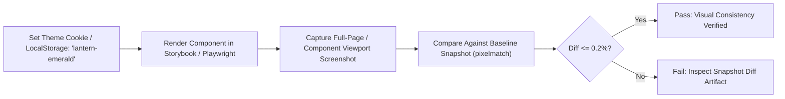

# Lantern Emerald Theme Migration Checklist

This document provides a comprehensive component-by-component migration checklist for adapting existing WorkSphere UI components to support the **Hal Jordan Lantern Emerald (`theme-lantern-emerald`)** theme. It details design tokens, Tailwind CSS utility mappings, copy-pasteable component patterns, and automated visual regression testing workflows.

---

## 1. Overview & Lantern Emerald Token Specification

The **Lantern Emerald** theme draws inspiration from high-energy willpower constructs and military-grade collimated avionics. It replaces default WorkSphere indigo/blue accents with radiant emerald/willpower tones, deep obsidian/slate backgrounds, glowing border rings, and high-contrast tactile focus states.

### 1.1 Core CSS Variable Mappings

When the `[data-theme="lantern-emerald"]` attribute or `theme-lantern-emerald` class is active on `<html>` or `<body>`, the following CSS design tokens are injected:

| Token Name | Default (Light / Dark) | Lantern Emerald Value | Semantic Purpose |
| :--- | :--- | :--- | :--- |
| `--primary-accent` | `#2563eb` / `#3b82f6` | `#10b981` (`rgb(16, 185, 129)`) | Primary actions, checkmarks, active indicators |
| `--primary-accent-glow`| `rgba(59, 130, 246, 0.4)` | `rgba(16, 185, 129, 0.5)` | Willpower glow effects, focus ring highlights |
| `--primary-accent-hover`| `#1d4ed8` / `#2563eb` | `#059669` (`rgb(5, 150, 105)`) | Hover and active pressed button states |
| `--accent-bg-subtle` | `rgba(59, 130, 246, 0.1)` | `rgba(16, 185, 129, 0.12)` | Chip backgrounds, badge pill fills |
| `--accent-border-subtle`| `rgba(59, 130, 246, 0.2)` | `rgba(16, 185, 129, 0.3)` | Card borders, modal divider lines |
| `--hud-reticle-color` | `#60a5fa` | `#34d399` (`#00ff88` high-viz) | AR Wayfinding HUD reticles, target diamonds |
| `--surface-background` | `#ffffff` / `#09090b` | `#04100c` / `#071a14` | Deep obsidian emerald backdrop |

---

## 2. Component Migration Checklist & Token Matrix

Use this matrix to audit and update existing components:

| Component Category | Target File(s) | Legacy Classes | Lantern Emerald Utility Replacement | Status |
| :--- | :--- | :--- | :--- | :---: |
| **Primary Buttons** | `src/components/ui/Button.tsx` | `bg-blue-600 hover:bg-blue-700` | `bg-emerald-600 hover:bg-emerald-500 shadow-emerald-500/25` | [ ] |
| **Status Badges** | `src/components/realtime/ReconnectingBadge.tsx` | `bg-blue-50 text-blue-600` | `bg-emerald-500/10 text-emerald-400 border-emerald-500/30` | [ ] |
| **Modals & Dialogs** | `src/components/collections/AddToFolderModal.tsx` | `accent-border-50 border-blue-500` | `border-emerald-500/30 shadow-emerald-950/50` | [ ] |
| **Form Inputs** | `src/components/chat/ChatPanel.tsx` | `focus:ring-blue-500 border-zinc-300` | `focus:border-emerald-500 focus:ring-emerald-500/30` | [ ] |
| **Analytics Charts** | `src/components/venue/CrowdForecastChart.tsx` | `stroke-blue-500 fill-blue-500/10` | `stroke-emerald-400 fill-emerald-500/15` | [ ] |
| **Map Markers & HUD**| `src/components/Map.tsx`, `WebXRDeskFinderView.tsx` | `marker-blue pin-default` | `ring-emerald-400 shadow-[0_0_15px_#10b981]` | [ ] |
| **Checkboxes & Radios**| `src/components/filters/DeskFilterBar.tsx` | `text-blue-600 focus:ring-blue-500` | `text-emerald-500 focus:ring-emerald-400 focus:ring-offset-2` | [ ] |

---

## 3. Copy-Pasteable Tailwind Utility Examples

### 3.1 Primary Action Button with Willpower Construct Glow

```tsx
// Before (Standard Theme)
<button className="px-4 py-2 rounded-xl bg-blue-600 hover:bg-blue-700 text-white font-medium shadow-md transition-all">
  Confirm Reservation
</button>

// After (Lantern Emerald Compliant)
<button className="px-4 py-2 rounded-xl bg-gradient-to-r from-emerald-600 to-teal-600 hover:from-emerald-500 hover:to-teal-500 text-white font-semibold shadow-lg shadow-emerald-600/25 border border-emerald-400/30 transition-all duration-200 focus-visible:outline-none focus-visible:ring-2 focus-visible:ring-emerald-400 focus-visible:ring-offset-2 dark:focus-visible:ring-offset-zinc-950 active:scale-95">
  Confirm Reservation
</button>
```

### 3.2 Modal Container & Accent Bar

```tsx
// Modal header with radiant green construct divider
<div className="relative rounded-2xl bg-zinc-950/95 border border-emerald-500/30 shadow-2xl shadow-emerald-950/60 p-6 overflow-hidden">
  {/* Willpower energy light beam */}
  <div className="absolute top-0 left-0 right-0 h-1 bg-gradient-to-r from-emerald-500 via-teal-400 to-green-300" />
  
  <h3 className="text-lg font-bold text-emerald-100 flex items-center gap-2">
    <span className="w-2 h-2 rounded-full bg-emerald-400 animate-pulse shadow-[0_0_8px_#34d399]" />
    Selected Coworking Space
  </h3>
</div>
```

### 3.3 Status Badges & Pills

```tsx
// High-visibility emerald HUD badge
<span className="inline-flex items-center gap-1.5 px-2.5 py-1 rounded-full text-xs font-semibold bg-emerald-500/15 text-emerald-300 border border-emerald-500/30 backdrop-blur-md shadow-sm">
  <span className="w-1.5 h-1.5 rounded-full bg-emerald-400 motion-safe:animate-ping" />
  Construct Active
</span>
```

### 3.4 Text Input & Search Fields

```tsx
// Search Input with Emerald Focus Halo
<div className="relative">
  <input
    type="text"
    placeholder="Search desks..."
    className="w-full pl-9 pr-4 py-2 rounded-xl bg-zinc-900/80 border border-zinc-800 text-zinc-100 placeholder:text-zinc-500 text-sm outline-none transition-all duration-200 focus:border-emerald-500 focus:ring-2 focus:ring-emerald-500/30 focus:shadow-[0_0_12px_rgba(16,185,129,0.25)]"
  />
</div>
```

---

## 4. Automated Visual Regression Testing Workflow

To ensure zero unintended layout shifts or contrast degradations during the theme migration, integrate Playwright visual regression tests:



### 4.1 Playwright Test Script Example

```typescript
// tests/visual/lantern-theme.spec.ts
import { test, expect } from "@playwright/test";

test.describe("Lantern Emerald Theme Visual Regression", () => {
  test.beforeEach(async ({ page }) => {
    // Inject theme token prior to hydration
    await page.addInitScript(() => {
      window.localStorage.setItem("worksphere_theme", "lantern-emerald");
      document.documentElement.setAttribute("data-theme", "lantern-emerald");
    });
  });

  test("verifies modal and button construct styling", async ({ page }) => {
    await page.goto("/collections");
    await page.waitForSelector("[data-testid='collection-card']");
    
    // Screenshot comparison against baseline
    await expect(page).toHaveScreenshot("collections-lantern-emerald.png", {
      maxDiffPixelRatio: 0.02,
      animations: "disabled",
    });
  });
});
```

---

## 5. Verification & Accessibility Sign-Off Checklist

- [ ] **WCAG 2.1 AA Contrast:** All text rendered over emerald fills (`#10b981`, `#059669`) passes minimum 4.5:1 contrast against background surfaces.
- [ ] **Reduced Motion Support:** All pulsing green halos and energy construct animations respect `prefers-reduced-motion: reduce`.
- [ ] **Dark Mode Harmony:** Deep backgrounds default to obsidian green (`#04100c`) rather than pitch black, preventing harsh clipping.
- [ ] **Visual Diff Validation:** Automated Playwright visual tests pass with zero pixel deviations.
