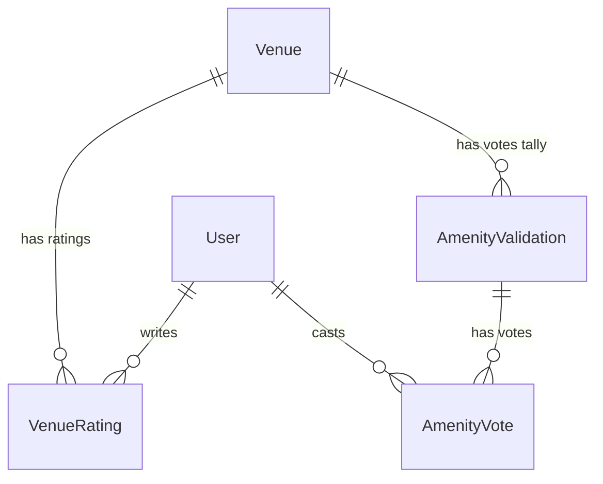

# Venue Power Outlet Standards

How WorkSphere describes, collects and aggregates power outlet data for venues. It documents the data model and rules the code uses today, and marks where the issue's wording differs from it.

## Where the code lives

| Concern | File |
| --- | --- |
| Venue and rating columns | [`prisma/schema.prisma`](../../prisma/schema.prisma) (`Venue`, `VenueRating`, `AmenityValidation`, `AmenityVote`) |
| Rating input validation | [`src/lib/validations.ts`](../../src/lib/validations.ts) |
| Rating form (powerTypes, outletLocations, outletDensity) | [`src/components/VenueRatingDialog.tsx`](../../src/components/VenueRatingDialog.tsx) |
| Review aggregation | [`src/lib/reviews/ratingAggregator.ts`](../../src/lib/reviews/ratingAggregator.ts) |
| Outlet density filter | [`src/lib/filters.ts`](../../src/lib/filters.ts) and [`src/app/api/venues/route.ts`](../../src/app/api/venues/route.ts) |
| Amenity voting and verification | [`src/app/api/venues/amenity-vote/route.ts`](../../src/app/api/venues/amenity-vote/route.ts) |
| Socket telemetry engine | [`src/lib/telemetry/powerGridEngine.ts`](../../src/lib/telemetry/powerGridEngine.ts) |
| Socket telemetry route | [`src/app/api/telemetry/outlets/route.ts`](../../src/app/api/telemetry/outlets/route.ts) |

## Two separate systems

Outlet information reaches users from two places that do not share a schema:

1. **Crowdsourced venue data.** Nomads rate a venue and vote on amenities. This is stored in the database and drives filters and venue cards.
2. **Socket telemetry.** A typed model of individual sockets (wattage, voltage, health). It is a calculation engine, and the route that serves it returns fixed sample data today.

Read the sections below with that split in mind.

## Outlet classification

### Crowdsourced taxonomy

Ratings use three outlet fields. All values are plain strings, validated by the schema only for density.

| Field | Values | Meaning |
| --- | --- | --- |
| `hasOutlets` | `true`, `false` | Any outlets available |
| `outletDensity` | `every_table`, `some_tables`, `wall_seats`, `none` | How widely outlets are available |
| `powerTypes` | `usb_c`, `ac_wall`, `wireless` | What kind of power is on offer |
| `outletLocations` | `under_tables`, `wall_mounted`, `center_island`, `bar_counter` | Where outlets are |

| `powerTypes` value | Label in the form |
| --- | --- |
| `usb_c` | USB-C PD ports |
| `ac_wall` | Standard AC wall plug |
| `wireless` | Wireless charging pads |

`outletDensity` is validated as an enum. `powerTypes` and `outletLocations` are `z.array(z.string())`, so the server does not reject unknown values. The form only offers the values above.

### Socket telemetry taxonomy

`powerGridEngine.ts` defines a richer socket model:

| `PowerSocketType` | Meaning |
| --- | --- |
| `USB_C_140W_PD` | USB-C Power Delivery, 140 W |
| `USB_C_100W_PD` | USB-C Power Delivery, 100 W |
| `USB_C_65W` | USB-C, 65 W |
| `AC_UNIVERSAL_WALL` | Universal AC wall socket |
| `WIRELESS_MAGSAFE` | Wireless pad |

| `OutletHealthStatus` | Meaning |
| --- | --- |
| `OPERATIONAL_OPTIMAL` | Working as rated |
| `THROTTLED_LOW_WATTAGE` | Working, delivering less than rated |
| `DEAD_NO_POWER` | No power |
| `LOOSE_PHYSICAL_FAULT` | Loose or damaged |

Telemetry locations are `UNDER_DESK`, `DESK_GROMMET`, `WALL_MOUNTED` and `FLOOR_BOX`. These are not the same strings as the crowdsourced `outletLocations`.

### Not in the code

- **Plug types (Type A, C, G).** There is no plug type field anywhere in the schema or code. `AC_UNIVERSAL_WALL` and `ac_wall` do not say which plug shape a venue uses.
- **Shared power strips.** There is no separate category. A power strip would be reported as `ac_wall`.

## Density filter semantics

The density filter is cumulative, so a stricter value includes the stricter levels above it. The filter in `filters.ts` and the database query in `venues/route.ts` agree.

| Filter value | Venues matched |
| --- | --- |
| `every_table` | `every_table` |
| `some_tables` | `every_table`, `some_tables` |
| `wall_seats` | `every_table`, `some_tables`, `wall_seats` |
| `none` (default) | no density filter applied |

The separate `outlets` filter matches venues where `hasOutlets` is true.

## Schema relationships

| Model | Outlet fields |
| --- | --- |
| `Venue` | `hasOutlets` (boolean, default false), `outletDensity` (string, optional), `powerTypes` (string array), `outletLocations` (string array), `crowdsourced` (boolean) |
| `VenueRating` | `hasOutlets` (required), `outletDensity` (optional), `powerTypes`, `outletLocations` |
| `AmenityValidation` | one row per venue and amenity (for example `"outlets"`), with `upvotes` and `downvotes`; unique on `(venueId, amenity)` |
| `AmenityVote` | one vote per user and validation, with `isUpvote`; unique on `(userId, validationId)` |

The issue mentions an `Amenity` model. There is none. Amenity verification uses `AmenityValidation` and `AmenityVote`, and the amenity name is a free string.

## How ratings become a venue summary

`RatingAggregator` turns all ratings for a venue into one summary. There are **no weights**: every rating counts equally.

| Output | Rule |
| --- | --- |
| `hasOutlets` | true when more than 50 percent of ratings say `hasOutlets` |
| `outletDensity` | the most common value among ratings; defaults to `none` when there are none |
| `powerTypes` | the union of every type any rating reported |
| `outletLocations` | the union of every location any rating reported |

Details that matter:

- **Majority is strict.** Exactly 50 percent gives `false`.
- **Ties in density** go to the value counted first, because the dominant value is only replaced by a strictly larger count.
- **The union never shrinks.** One rating that reports `wireless` adds it to the venue permanently, even if every other rating disagrees.
- **Empty values are skipped** when counting density.

Worked example, 5 ratings: 3 say `hasOutlets: true`, density votes are `some_tables`, `some_tables`, `every_table`, `none`, `none`, and the reported power types are `usb_c`, `ac_wall` and `usb_c, wireless`.

- `hasOutlets`: 3 of 5 is 60 percent, so `true`.
- `outletDensity`: `some_tables` (2 votes, tied with `none` at 2, but counted first).
- `powerTypes`: `usb_c`, `ac_wall`, `wireless`.

I did not find code that writes this summary back to the `Venue` outlet columns. Check before relying on `Venue.outletDensity` matching the aggregated value.

## Review verification

Verification is done by amenity voting, not by the rating itself.

| Rule | Value |
| --- | --- |
| Confidence | `round(upvotes / total * 100)`, or 100 with no votes |
| Hide an amenity | at least 5 votes and confidence below 60 |
| Consensus | at least 5 votes and confidence at least 80 |
| Credit for accurate votes | users on the consensus side get an `accurate_<validationId>` badge, once |
| Verified Explorer badge | 10 accurate votes |

Worked example: 6 upvotes and 1 downvote is 7 votes and `round(6 / 7 * 100)` = 86, so the amenity is visible and in consensus. 2 upvotes and 3 downvotes is 5 votes and 40, so the amenity is hidden.

The code that copies a vote tally onto `Venue` only covers `dogFriendly`, `catsAllowed` and `petsAllowedIndoors` (at 5 or more upvotes). An `outlets` validation is stored and shown, but it does not change `Venue.hasOutlets`.

## Socket telemetry scoring

`computeVenuePowerGridSummary` scores a list of socket nodes.

| Output | Rule |
| --- | --- |
| `workingSocketsCount` | nodes with status `OPERATIONAL_OPTIMAL` |
| `overallGridHealthScore` | average of `reliabilityScorePct`, rounded |
| `fastChargingCoveragePct` | working nodes with `maxWattageW` of 65 or more, divided by all nodes, rounded |
| `gridStatus` | `OUTAGE` if no node works; `DEGRADED_VOLTAGE` if any node is throttled and fewer than half work; otherwise `ONLINE_MAINS` |

Worked example from the sample nodes in the route (5 nodes: 140 W, 100 W, a dead 45 W AC socket, 100 W, a throttled 15 W wireless pad):

- Working: 3 of 5.
- Health: `round((99 + 96 + 20 + 98 + 78) / 5)` = 78.
- Fast charging: 3 working nodes at 65 W or more, so `round(3 / 5 * 100)` = 60.
- Status: `ONLINE_MAINS`, since 3 of 5 is at least half.

Be aware that `GET /api/telemetry/outlets` builds those five sample nodes in code and does not read them from a database, and `POST` returns a fake report id without storing anything. The telemetry is a model, not live data.

## Guidelines for contributors

- Use the existing value sets exactly. Adding a value means updating the form, the validation and this guide.
- Do not assume `Venue` columns reflect the latest ratings. Read the aggregated summary.
- Treat `powerTypes` as a set of reported options, not a measured fact.
- Never describe a venue as having a specific plug type. The data does not hold it.
