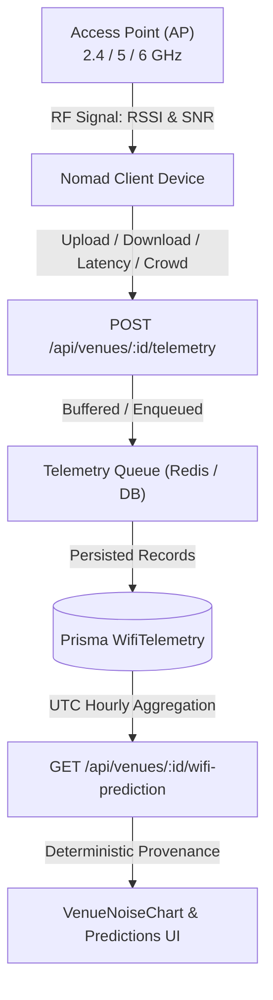

# Venue RF Frequency Band and Channel Width Diagnostic Guide

This technical guide details the Radio Frequency (RF) physical-layer metrics, frequency band properties (2.4 GHz, 5 GHz, 6 GHz / Wi-Fi 6E), channel width dynamics (20/40/80/160 MHz), and channel interference heuristics that govern WorkSphere's venue Wi-Fi prediction and telemetry analysis.

---

## 1. Architectural Overview

WorkSphere combines crowd-sourced client telemetry with venue profile benchmarks to predict real-world Wi-Fi throughput and stability. While [Venue WiFi Quality Scoring](./WIFI_QUALITY_SCORING.md) specifies application-level speed tiers and stability scores, this guide details the physical RF parameters, spectral interference models, and API schemas implemented in:

- **Telemetry Aggregation & Prediction Route:** [`src/app/api/venues/[venueId]/wifi-prediction/route.ts`](../../src/app/api/venues/[venueId]/wifi-prediction/route.ts)
- **Ingestion & Validation Route:** [`src/app/api/venues/[venueId]/telemetry/route.ts`](../../src/app/api/venues/[venueId]/telemetry/route.ts)
- **Database Schema:** `WifiTelemetry` model in [`prisma/schema.prisma`](../../prisma/schema.prisma)



---

## 2. RF Frequency Bands

Modern coworking venues deploy multi-band Wi-Fi access points. WorkSphere's performance modeling recognizes three primary spectrum bands:

| Spectrum Band                  | Frequency Range   | Channel Allocation                                                       | Propagation & Attenuation                                      | Typical Interference Profile                                                             |
| :----------------------------- | :---------------- | :----------------------------------------------------------------------- | :------------------------------------------------------------- | :--------------------------------------------------------------------------------------- |
| **2.4 GHz** (802.11b/g/n/ax)   | 2.400 – 2.484 GHz | Only 3 non-overlapping 20 MHz channels (1, 6, 11)                        | Low attenuation; penetrates drywall, glass, and furniture      | Extremely high; congested by Bluetooth, microwave ovens, legacy IoT, and neighboring APs |
| **5 GHz** (802.11a/n/ac/ax)    | 5.150 – 5.850 GHz | Up to 25 non-overlapping 20 MHz channels; supports 40/80/160 MHz bonding | Moderate attenuation; reduced range through concrete and brick | Low to moderate; subject to Dynamic Frequency Selection (DFS) radar radar avoidance      |
| **6 GHz** (Wi-Fi 6E / Wi-Fi 7) | 5.925 – 7.125 GHz | Up to 59 non-overlapping 20 MHz channels (1200 MHz contiguous spectrum)  | High attenuation; line-of-sight or single-room coverage        | Negligible; no legacy 802.11b/g/a devices allowed; mandatory WPA3                        |

---

## 3. Channel Width & Throughput Trade-offs

Channel bonding allows access points to combine adjacent 20 MHz spectrum channels into wider transmission pipes:

```
[20 MHz]  --> Standard baseline (1x channel)
[40 MHz]  --> 2x bonded channels (+3 dB noise floor increase)
[80 MHz]  --> 4x bonded channels (+6 dB noise floor increase)
[160 MHz] --> 8x bonded channels (+9 dB noise floor increase)
```

### Channel Width Matrix

| Channel Width |   Spectral Mask   | Theoretical Peak (Wi-Fi 6, 2x2 MIMO) | Noise Floor Penalty | Ideal Deployment Environment                                                                |
| :-----------: | :---------------: | :----------------------------------: | :-----------------: | :------------------------------------------------------------------------------------------ |
|  **20 MHz**   |  Single channel   |           ~144 – 287 Mbps            |   Baseline (0 dB)   | High-density conference rooms and crowded coworking floors where channel reuse is critical. |
|  **40 MHz**   | 2 channels bonded |           ~287 – 574 Mbps            |        +3 dB        | Balanced compromise for 5 GHz in medium-density offices.                                    |
|  **80 MHz**   | 4 channels bonded |           ~600 – 1200 Mbps           |        +6 dB        | Low-to-medium density venues offering high throughput for video calls and heavy downloads.  |
|  **160 MHz**  | 8 channels bonded |          ~1200 – 2400 Mbps           |        +9 dB        | Pristine 6 GHz installations or isolated private offices with low RF neighbor density.      |

> [!IMPORTANT]
> Each doubling of channel width increases thermal noise power by $+3\text{ dB}$ ($P_{\text{noise}} = k \cdot T \cdot B$), reducing receiver sensitivity. In dense venues with adjacent access points, a wider channel (e.g. 160 MHz) frequently experiences severe throughput degradation due to co-channel contention.

---

## 4. Signal Strength (RSSI), Noise Floor, and SNR

### Received Signal Strength Indicator (RSSI)

RSSI is measured in decibel-milliwatts ($\text{dBm}$) as a negative logarithmic value:

| RSSI Range                               | Signal Quality Rating | User Experience & Workload Suitability                                                           |
| :--------------------------------------- | :-------------------- | :----------------------------------------------------------------------------------------------- |
| **$-30\text{ dBm}$ to $-50\text{ dBm}$** | Exceptional           | Maximum data rates (MCS 10/11); zero packet drop; ideal for large git pulls and 4K conferencing. |
| **$-51\text{ dBm}$ to $-65\text{ dBm}$** | Very Good             | Target roaming boundary; stable VoIP, rapid screen-share streaming, low latency.                 |
| **$-66\text{ dBm}$ to $-72\text{ dBm}$** | Good / Acceptable     | Baseline acceptable threshold for nomadic work. Occasional modulation downshift.                 |
| **$-73\text{ dBm}$ to $-80\text{ dBm}$** | Poor / Weak           | High packet retries; video degradation, increased bufferbloat and jitter.                        |
| **$<-80\text{ dBm}$**                    | Unusable              | Connection drops, high packet loss ($>15\%$), beacon timeouts.                                   |

### Signal-to-Noise Ratio (SNR)

SNR represents the difference between signal power and ambient RF noise floor:

$$\text{SNR}_{\text{dB}} = \text{RSSI}_{\text{dBm}} - \text{NoiseFloor}_{\text{dBm}}$$

Where typical coworking noise floors range from $-95\text{ dBm}$ (quiet RF environment) to $-85\text{ dBm}$ (dense RF clutter).

|                SNR                | Modulation Quality | Supported Modulation & Coding Scheme (MCS) |
| :-------------------------------: | :----------------- | :----------------------------------------- |
|        **$>40\text{ dB}$**        | Perfect            | 1024-QAM (MCS 10, 11)                      |
| **$25\text{ dB} - 40\text{ dB}$** | Excellent          | 256-QAM (MCS 8, 9)                         |
| **$16\text{ dB} - 24\text{ dB}$** | Moderate           | 64-QAM / 16-QAM (MCS 4 – 7)                |
| **$10\text{ dB} - 15\text{ dB}$** | Low                | QPSK (MCS 1, 2)                            |
|        **$<10\text{ dB}$**        | Critical           | BPSK (MCS 0) or link failure               |

---

## 5. Channel Interference Detection & Degradation Models

### Interference Types in Coworking Spaces

1. **Co-Channel Interference (CCI):** Multiple access points operating on the exact same frequency channel. Under CSMA/CA (Carrier Sense Multiple Access with Collision Avoidance), devices must defer transmission when another transmitter exceeds the Energy Detection threshold ($-82\text{ dBm}$ or $-62\text{ dBm}$ for non-Wi-Fi).
2. **Adjacent-Channel Interference (ACI):** Access points operating on overlapping frequency sidebands (e.g., Channel 1 and Channel 2 on 2.4 GHz). ACI creates unfiltered out-of-band noise, corrupting frames in flight.

### Predictive Throughput Model

WorkSphere models expected throughput based on base link capacity, frequency efficiency factor ($\eta_{\text{band}}$), co-channel contention penalty ($\delta_{\text{CCI}}$), and crowd occupancy density:

$$\text{PredictedSpeed} = S_{\text{base}} \cdot \eta_{\text{band}} \cdot (1 - \delta_{\text{CCI}}) \cdot (1 - \delta_{\text{crowd}})$$

Where:

- $\eta_{\text{band}}$: $0.45$ for 2.4 GHz, $0.85$ for 5 GHz, $0.98$ for 6 GHz.
- $\delta_{\text{CCI}}$: Computed from overlapping BSSID density: $\min(0.60, 0.08 \times N_{\text{competing\_APs}})$.
- $\delta_{\text{crowd}}$: Derived from crowd level (`empty` $\to 0.0$, `low` $\to 0.05$, `moderate` $\to 0.15$, `busy` $\to 0.30$, `packed` $\to 0.50$).

---

## 6. Target API Contract: Wi-Fi Prediction Route

The prediction endpoint [`src/app/api/venues/[venueId]/wifi-prediction/route.ts`](../../src/app/api/venues/[venueId]/wifi-prediction/route.ts) exposes deterministic telemetry provenance without synthetic noise.

### Endpoint Signature

- **Method:** `GET`
- **Path:** `/api/venues/:venueId/wifi-prediction`
- **Authentication:** Public / Optional

### TypeScript Schema

```typescript
export interface WifiPredictionRecord {
  /** Time of day label (e.g. "9 AM", "12 PM", "6 PM") */
  time: string;
  /** Primary metric: average download speed in Mbps (rounded) */
  speed: number;
  /** Average download speed in Mbps */
  download: number;
  /** Average upload speed in Mbps */
  upload: number;
  /** Average round-trip latency in milliseconds */
  latency: number;
  /** Predominant crowd level reported during this hour */
  crowd:
    | "empty"
    | "low"
    | "quiet"
    | "moderate"
    | "busy"
    | "very busy"
    | "packed"
    | "unknown";
  /** Total number of verified client telemetry samples in this hour bucket */
  sampleCount: number;
  /** False for empirical telemetry; true for algorithmic estimates */
  isEstimate: boolean;
}

export interface WifiPredictionResponse {
  /** Array of hourly predictions sorted chronologically */
  predictions: WifiPredictionRecord[];
  /** Data provenance and telemetry confidence metadata */
  metadata: {
    /** True if at least one verified historical telemetry record exists */
    hasTelemetry: boolean;
    /** True if historical records are absent, signaling fallback needed */
    insufficientData: boolean;
    /** Total number of raw telemetry rows scanned */
    totalSamples: number;
    /** Data provenance source: "telemetry" | "profile_estimate" | "none" */
    source: "telemetry" | "profile_estimate" | "none";
    /** Venue profile baseline speed (if defined on venue model) */
    venueBaseSpeed: number | null;
  };
}
```

### Sample Response (Telemetry Available)

```json
{
  "predictions": [
    {
      "time": "10 AM",
      "speed": 142,
      "download": 142,
      "upload": 48,
      "latency": 16,
      "crowd": "moderate",
      "sampleCount": 8,
      "isEstimate": false
    },
    {
      "time": "2 PM",
      "speed": 88,
      "download": 88,
      "upload": 35,
      "latency": 24,
      "crowd": "busy",
      "sampleCount": 14,
      "isEstimate": false
    }
  ],
  "metadata": {
    "hasTelemetry": true,
    "insufficientData": false,
    "totalSamples": 22,
    "source": "telemetry",
    "venueBaseSpeed": 150
  }
}
```

---

## 7. Venue Operator Best Practices

To maintain optimal Wi-Fi scores on WorkSphere:

1. **Disable 2.4 GHz on High-Density APs:** Keep 2.4 GHz active on only every 3rd or 4th AP to minimize co-channel interference.
2. **Standardize on 40 MHz or 80 MHz in 5 GHz:** Avoid 160 MHz bonding in multi-tenant commercial coworking spaces unless isolated on 6 GHz.
3. **Set Minimum Basic Data Rates:** Raise the minimum basic rate to $12\text{ Mbps}$ to prevent slow legacy devices from consuming disproportionate airtime.
4. **Target RSSI Hand-off Boundary:** Calibrate AP transmit power so client devices roam before falling below $-70\text{ dBm}$.
