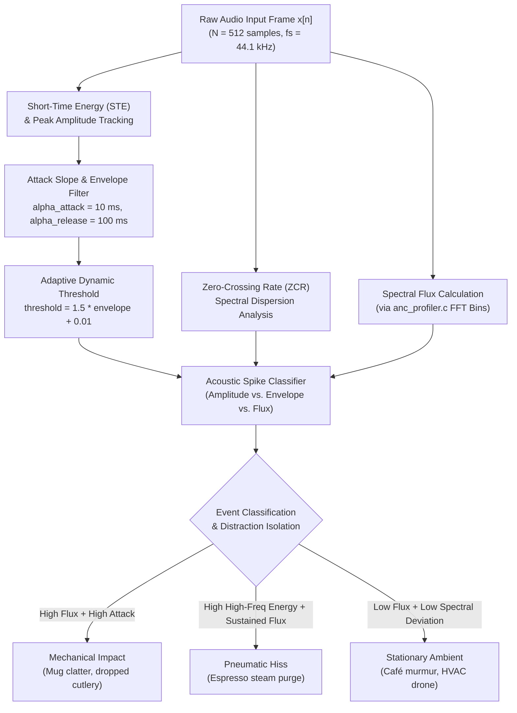

# Transient Acoustic Event Classification & DSP Architecture

This document specifies the digital signal processing (DSP) architecture, mathematical foundations, attack-slope profiling, and event classification thresholds implemented in [`src/wasm/audio/transient_detector.c`](file:///c:/Users/admin/Desktop/workfere/src/wasm/audio/transient_detector.c) and [`src/wasm/audio/anc_profiler.c`](file:///c:/Users/admin/Desktop/workfere/src/wasm/audio/anc_profiler.c).

WorkSphere operates in noisy, unpredictable remote environments—such as specialty espresso bars, airport departure lounges, and shared open desks. This DSP engine isolates sharp acoustic distractions (espresso steam wands, dropped ceramic mugs, door slams, keyboard hammering) from stationary café background ambiance (HVAC hum, continuous conversational murmur, distant street traffic).

---

## 1. Executive Summary & Processing Pipeline

The WorkSphere transient detection system executes in high-efficiency, zero-copy WebAssembly running inside an audio worker thread (`src/workers/soundscapeProfilerWorker.ts`). The engine processes incoming audio frames of length $N = 512$ samples (at $f_s = 44.1\text{ kHz}$, yielding $\approx 11.61\text{ ms}$ analysis frames) and classifies sudden energetic impulses.



---

## 2. Mathematical DSP Foundations

### 2.1 Short-Time Energy (STE)

Short-Time Energy measures instantaneous signal power within a localized window. For a discrete audio signal $x[n]$ and a rectangular or Hamming window $w[m]$ of length $N$:

$$E_n = \sum_{m=0}^{N-1} \left( x[n + m] \cdot w[m] \right)^2$$

In normalized decibel scale ($\text{dBFS}$):

$$E_{\text{dBFS}} = 10 \log_{10}\left( \frac{E_n}{N \cdot x_{\text{ref}}^2} \right), \quad \text{where } x_{\text{ref}} = 1.0$$

In [`src/wasm/audio/transient_detector.c`](file:///c:/Users/admin/Desktop/workfere/src/wasm/audio/transient_detector.c#L45-L50), the peak amplitude $A_{\max}$ across the analysis window is extracted as the instantaneous envelope driver:

$$A_{\max} = \max_{0 \le i < N} |x[i]|$$

### 2.2 Zero-Crossing Rate (ZCR)

The Zero-Crossing Rate calculates the rate at which the audio signal changes algebraic sign. High ZCR values indicate energy concentrated at high frequencies (frictional air noise, steam wands, metallic clinking), whereas low ZCR values characterize tonal fundamentals and low-frequency rumble:

$$\text{ZCR} = \frac{1}{2(N-1)} \sum_{n=1}^{N-1} \left| \operatorname{sgn}(x[n]) - \operatorname{sgn}(x[n-1]) \right|$$

where:
$$\operatorname{sgn}(x) = \begin{cases} 1, & x \ge 0 \\ -1, & x < 0 \end{cases}$$

### 2.3 Spectral Flux

Spectral Flux quantifies the positive rate of change in the spectral magnitude across consecutive short-time Fourier frames. Transients and abrupt acoustic onsets exhibit dramatic spikes in spectral flux:

$$\Phi(t) = \sum_{k=0}^{K-1} H\left( |X_t[k]| - |X_{t-1}[k]| \right)$$

where $H(x) = \frac{x + |x|}{2}$ is the half-wave rectifier function ensuring that only positive onset energy increments contribute, and $|X_t[k]|$ is the STFT magnitude at bin $k$ and frame $t$.

As implemented in [`src/wasm/audio/anc_profiler.c`](file:///c:/Users/admin/Desktop/workfere/src/wasm/audio/anc_profiler.c#L58-L63):
```c
float diff = mag - prev_mag;
if (diff > 0.0f) {
  total_flux += diff;
}
```

---

## 3. Asymmetric Envelope Tracking & Attack Slope Profiling

Audio transients are characterized by **rapid rise times (attacks)** followed by **slower logarithmic decays (releases)**. To avoid false triggers caused by slow volume swells, [`transient_detector.c`](file:///c:/Users/admin/Desktop/workfere/src/wasm/audio/transient_detector.c#L13-L34) employs a dual one-pole leaky integrator with independent attack and release time constants:

- **Attack Time:** $\tau_{\text{attack}} = 10.0\text{ ms}$
- **Release Time:** $\tau_{\text{release}} = 100.0\text{ ms}$

### Time Constant Discrete Formulations

The continuous-time lowpass filter coefficients $\alpha$ for sample rate $f_s$ are discretized via bilinear/exponential mapping:

$$\alpha_{\text{attack}} = \exp\left( -\frac{1}{f_s \cdot (\tau_{\text{attack}} / 1000)} \right)$$

$$\alpha_{\text{release}} = \exp\left( -\frac{1}{f_s \cdot (\tau_{\text{release}} / 1000)} \right)$$

At $f_s = 44,100\text{ Hz}$:
- $\alpha_{\text{attack}} = \exp\left(-\frac{1}{44100 \times 0.010}\right) = \exp\left(-\frac{1}{441}\right) \approx 0.997735$
- $\alpha_{\text{release}} = \exp\left(-\frac{1}{44100 \times 0.100}\right) = \exp\left(-\frac{1}{4410}\right) \approx 0.999773$

### Envelope State Machine Equations

At each frame, given current frame peak $A_{\max}$:

$$\operatorname{Env}[t] = \begin{cases} 
A_{\max} + \alpha_{\text{attack}} \cdot (\operatorname{Env}[t-1] - A_{\max}), & \text{if } A_{\max} > \operatorname{Env}[t-1] \\ 
A_{\max} + \alpha_{\text{release}} \cdot (\operatorname{Env}[t-1] - A_{\max}), & \text{if } A_{\max} \le \operatorname{Env}[t-1] 
\end{cases}$$

### Dynamic Adaptive Threshold

A fixed threshold fails across diverse venues (e.g., quiet library vs. packed artisanal café). The engine calculates an adaptive threshold proportional to ambient background energy:

$$\Theta_{\text{adaptive}} = 1.5 \cdot \operatorname{Env}[t] + 0.01$$

An event is flagged as an active transient spike if and only if:

$$A_{\max} > \Theta_{\text{adaptive}} \quad \land \quad \operatorname{Env}[t] > 0.05$$

---

## 4. Typical Decibel Thresholds for Coffee Shop Transient Noises

In urban coworking cafes, the acoustic environment consists of a continuous ambient background overlaid by sudden impulsive events. The table below lists standard sound pressure levels ($\text{dBA}$ SPL), relative digital headroom ($\text{dBFS}$ at reference microphone calibration), attack rise times, and detector classifications:

| Acoustic Event Source | Typical SPL ($\text{dBA}$ @ 1m) | Typical Headroom ($\text{dBFS}$) | Attack Rise Time ($\tau_r$) | Spectral Profile / Frequency Centroid | Transient Detector Classification |
| :--- | :---: | :---: | :---: | :---: | :--- |
| **Dropped Mug / Plate Clatter** | $85 - 94\text{ dBA}$ | $-6\text{ to } -2\text{ dBFS}$ | $1 - 4\text{ ms}$ | High-frequency ringing ($3.5 - 8\text{ kHz}$) | **Violent Transient (Impact)** |
| **Espresso Steam Wand Purge** | $78 - 86\text{ dBA}$ | $-12\text{ to } -6\text{ dBFS}$ | $8 - 15\text{ ms}$ | Broad white noise ($2 - 12\text{ kHz}$), high ZCR | **Pneumatic Transient (High Flux)** |
| **Portafilter Knock Box Bang** | $82 - 90\text{ dBA}$ | $-8\text{ to } -4\text{ dBFS}$ | $2 - 6\text{ ms}$ | Low-mid resonant thump ($120 - 450\text{ Hz}$) | **Impulsive Mechanical Spike** |
| **Espresso Bean Grinder Start** | $74 - 82\text{ dBA}$ | $-16\text{ to } -10\text{ dBFS}$ | $20 - 40\text{ ms}$ | High-pitched motor whine ($1 - 4\text{ kHz}$) | **Onset Transient $\to$ Steady Noise** |
| **Cash Register / POS Barcode Beep** | $68 - 75\text{ dBA}$ | $-22\text{ to } -16\text{ dBFS}$ | $3 - 8\text{ ms}$ | Pure tonal pulse ($2.4 - 3.2\text{ kHz}$) | **Narrowband Transient Spike** |
| **Mechanical Keyboard Typing** | $62 - 72\text{ dBA}$ | $-26\text{ to } -18\text{ dBFS}$ | $2 - 5\text{ ms}$ | Clicky / tactile peaks ($2 - 6\text{ kHz}$) | **Periodic Micro-Transients** |
| **Background Café Murmur / Speech** | $55 - 65\text{ dBA}$ | $-32\text{ to } -24\text{ dBFS}$ | $80 - 250\text{ ms}$ | Human formant range ($250 - 3000\text{ Hz}$) | **Non-Transient (Stationary)** |
| **HVAC / Refrigerator Hum** | $45 - 54\text{ dBA}$ | $-44\text{ to } -36\text{ dBFS}$ | $> 500\text{ ms}$ | Sub-bass & low tonal ($50 - 120\text{ Hz}$) | **Non-Transient (Stationary)** |

---

## 5. Active Noise Cancellation (ANC) Feasibility Scoring

In [`src/wasm/audio/anc_profiler.c`](file:///c:/Users/admin/Desktop/workfere/src/wasm/audio/anc_profiler.c#L74-L82), transient detection feeds directly into the ANC Feasibility Engine. Active Noise Cancellation relies on anti-phase wave cancellation, which succeeds against predictable, low-frequency sounds but degrades catastrophically in the presence of erratic high-frequency transients:

$$\text{Energy Ratio} = \frac{E_{\text{low}} (< 500\text{ Hz}) + 1.0}{E_{\text{high}} (> 2000\text{ Hz}) + 1.0}$$

$$\text{Penalty}_{\text{flux}} = \min(10.0 \cdot \Phi, 1.0)$$

$$\text{Score}_{\text{ANC}} = \operatorname{clamp}\left( 0.5 \cdot \text{Energy Ratio} - \text{Penalty}_{\text{flux}} + 0.5, \quad 0.0, \quad 1.0 \right)$$

- **Score $\ge 0.75$:** Ideal ANC conditions (continuous low drone, trains, air conditioning).
- **$0.40 \le \text{Score} < 0.75$:** Moderate ANC conditions (steady chatter with occasional noise).
- **Score $< 0.40$:** Unfavorable ANC conditions (frequent dropped cutlery, espresso steam bursts, high transient density).

---

## 6. Real-Time Telemetry & Worker Integration

The transient detector runs alongside the Web Worker pipeline:

1. **AudioWorklet / ScriptProcessor Node:** Captures PCM samples at $44.1\text{ kHz}$ from the client microphone.
2. **Buffer Transfer:** Sends non-blocking $512$-sample float frames to `soundscapeProfilerWorker.ts`.
3. **WASM Execution:** `detect_transients()` updates state in linear memory in $< 0.05\text{ ms}$.
4. **Client Event Dispatch:** Emits `PROFILE_RESULT` containing:
   - `transientDetected: boolean`
   - `spectralFlux: number`
   - `ancFeasibilityScore: number`
5. **UI Visualization:** Powers the real-time noise distraction indicator and acoustic comfort meter in `src/components/noise/VenueNoiseChart.tsx`.
