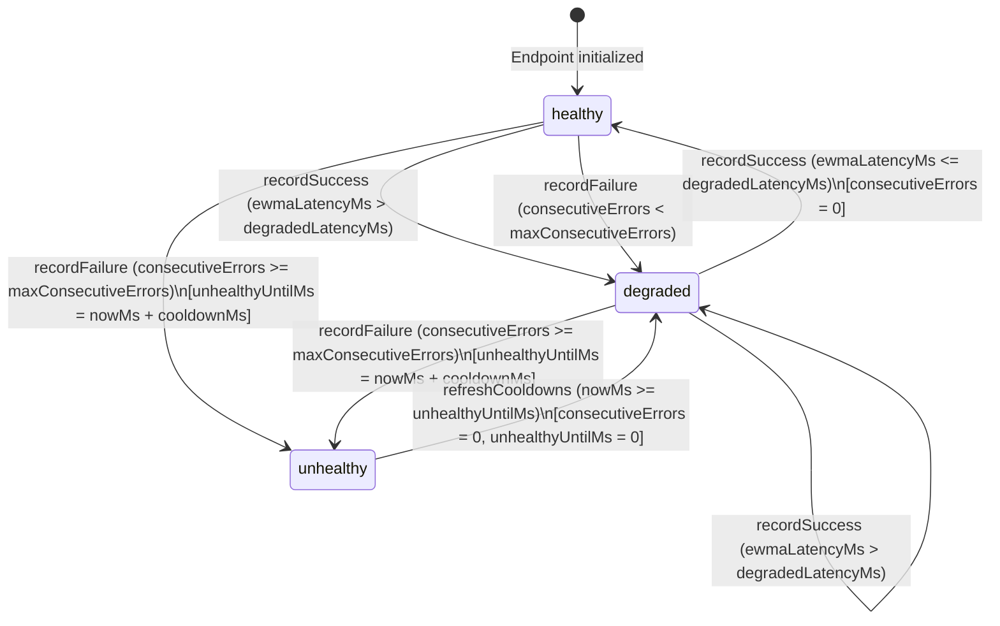
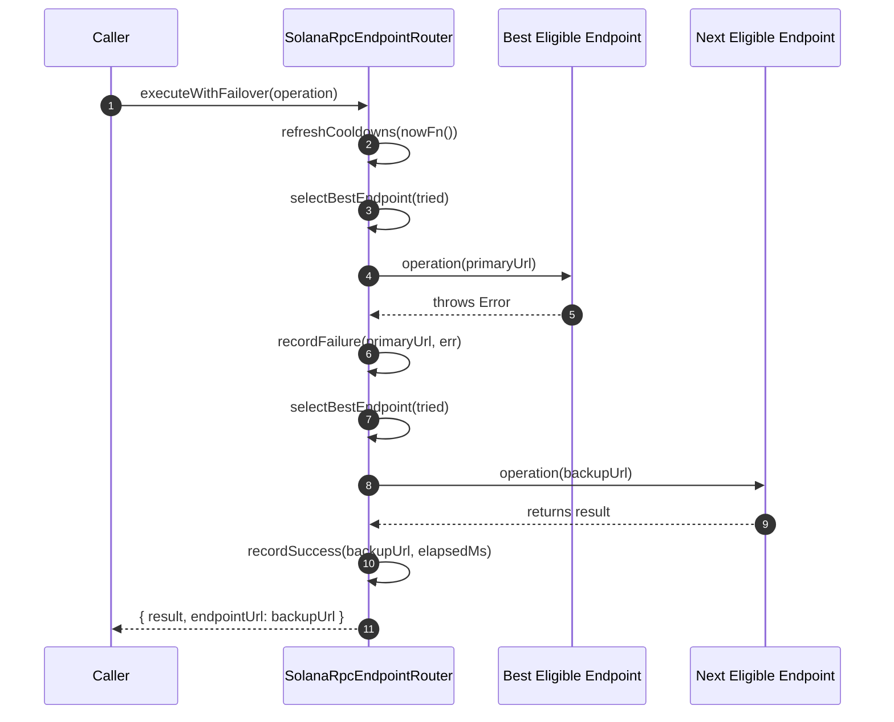

# Solana RPC Endpoint Router & Health Scoring Architecture

This document specifies the architecture, latency-weighted scoring algorithm, circuit-breaking thresholds, and automatic failover behavior of `SolanaRpcEndpointRouter` (`src/lib/solana/rpcEndpointRouter.ts`).

---

## 1. Overview & Motivation

Solana RPC providers experience transient rate limits (`429 Too Many Requests`), upstream outages (`503 Service Unavailable`), and variable geographic latency. `SolanaRpcEndpointRouter` abstracts multi-node RPC routing behind a deterministic, client-side health-scoring engine and failover loop so payment and escrow workflows remain resilient without manual endpoint switching.

### Key Components

| Symbol | Role |
| :--- | :--- |
| `SolanaRpcEndpointRouter` | Maintains per-endpoint health metrics, selects optimal endpoints, and executes operations with automatic failover. |
| `updateEwmaLatency` | Pure helper computing Exponentially Weighted Moving Average (EWMA) latency rounded to 0.1 ms. |
| `AllRpcEndpointsUnavailableError` | Typed error (`code = "ALL_RPC_ENDPOINTS_UNAVAILABLE"`) thrown when zero endpoints are configured or all candidates are `unhealthy`/exhausted. |
| `RpcEndpointMetrics` | Snapshot of per-endpoint status, EWMA latency, error counters, and circuit-breaker cooldown timestamp. |

---

## 2. Endpoint Configuration & Defaults

`SolanaRpcEndpointRouter` deduplicates trimmed URLs from `RpcRouterOptions.endpoints` on construction, ignoring empty strings. Each configured endpoint starts in the `healthy` state with `ewmaLatencyMs = 0`, `consecutiveErrors = 0`, `totalRequests = 0`, `totalErrors = 0`, and `unhealthyUntilMs = 0`.

| Option | Default | Constraint | Description |
| :--- | :--- | :--- | :--- |
| `ewmaAlpha` | `0.3` | `(0, 1]` | Smoothing factor weighting recent latency samples vs. historical EWMA. |
| `degradedLatencyMs` | `450` | `>= 1` | EWMA latency threshold (ms) above which a succeeding endpoint is classified `degraded`. |
| `maxConsecutiveErrors` | `3` | `>= 1` | Consecutive failures required to trip the circuit breaker to `unhealthy`. |
| `cooldownMs` | `15000` | `>= 100` | Duration (ms) an `unhealthy` endpoint remains excluded before half-open recovery. |
| `nowFn` | `Date.now` | `() => number` | Clock source for latency measurement and cooldown expiry evaluation. |

---

## 3. Latency-Weighted Endpoint Scoring

### 3.1 EWMA Latency Calculation

Latency is updated on every successful RPC execution via `updateEwmaLatency(previousEwmaMs, sampleMs, alpha)`:

1. Inputs are sanitized: `safeSample` defaults to `0` if non-finite or negative; `safeAlpha` defaults to `0.3` if outside `(0, 1]`.
2. Cold-start initialization (when `previousEwmaMs` is `undefined`, non-finite, or `<= 0`):
   $$\text{EWMA}_0 = \frac{\text{round}(\text{safeSample} \times 10)}{10}$$
3. Steady-state update:
   $$\text{EWMA}_t = \frac{\text{round}\big((\alpha \cdot \text{safeSample} + (1 - \alpha) \cdot \text{EWMA}_{t-1}) \times 10\big)}{10}$$

### 3.2 Candidate Selection & Ranking (`selectBestEndpoint`)

Before ranking, `refreshCooldowns(nowMs)` transitions any expired `unhealthy` endpoints into `degraded`. Endpoints currently `unhealthy` or present in `excludeUrls` are filtered out. Remaining candidates are sorted lexicographically by the following tuple:

1. **Health Tier**: `healthy` (`0`) strictly precedes `degraded` (`1`).
2. **EWMA Latency**: `ewmaLatencyMs` ascending (lower latency preferred).
3. **Consecutive Errors**: `consecutiveErrors` ascending (fewer recent failures preferred).
4. **Deterministic Tiebreaker**: `a.url.localeCompare(b.url)`.

If no eligible candidates remain, `selectBestEndpoint` returns `null`.

---

## 4. Circuit Breaker & Failover State Transitions

### State Semantics

- **`healthy`**: Eligible for primary routing (`tier 0`). Transitions to `degraded` if EWMA latency exceeds `degradedLatencyMs` or a failure occurs below `maxConsecutiveErrors`.
- **`degraded`**: Eligible for fallback routing (`tier 1`, behind all `healthy` endpoints). Serves both as a high-latency warning state and as the half-open recovery state once an `unhealthy` endpoint's cooldown expires. A fast successful request (`ewmaLatencyMs <= degradedLatencyMs`) restores it to `healthy`.
- **`unhealthy`**: Circuit-broken and excluded from `selectBestEndpoint` until `nowMs >= unhealthyUntilMs`. When cooldown elapses, `refreshCooldowns` resets `consecutiveErrors` and `unhealthyUntilMs` to `0` and promotes the endpoint to `degraded` so it can be probed again.

---

## 5. Automatic Failover Execution (`executeWithFailover`)

`executeWithFailover<T>(operation)` orchestrates resilient RPC calls across configured endpoints:

### Guarantees

- **At-Most-Once Per Invocation**: A `tried` set tracks attempted URLs so a single `executeWithFailover` call never retries the same failing endpoint infinitely.
- **Total Outage Handling**: If `metrics.size === 0` or `selectBestEndpoint(tried)` returns `null`, `executeWithFailover` throws `AllRpcEndpointsUnavailableError` containing `attemptedEndpoints` and the last observed error message.
- **Per-Attempt Latency Measurement**: `startMs = nowFn()` is captured immediately before `operation(chosen.url)` and elapsed time `Math.max(0, nowFn() - startMs)` feeds `recordSuccess` on completion.
