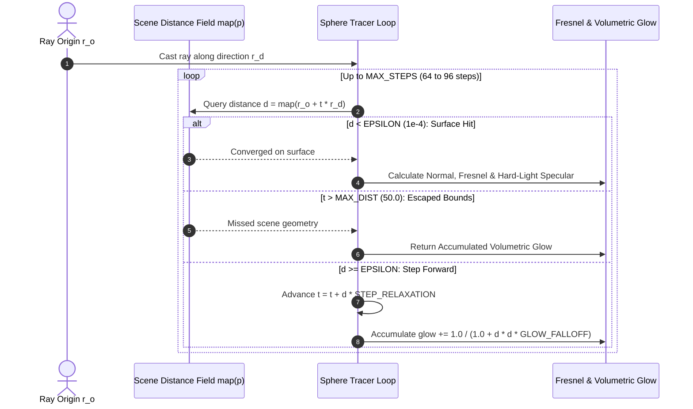

# Signed Distance Field (SDF) Raymarching & Hard-Light Construct Shaders

## 1. Executive Summary & Mathematical Foundation

In WorkSphere's augmented reality spatial experiences and 3D floorplan viewers, procedural geometric constructs (e.g., Green Lantern hard-light power rings, hexagonal forcefields, holographic reticles) require sharp geometric contours, organic shape blending, and internal volumetric energy emission. Traditional polygonal meshes with thousands of vertices incur high rasterization overhead, triangle setup costs, and visible polygon faceting.

**Signed Distance Field (SDF) Raymarching (Sphere Tracing)** evaluates geometry analytically in screen space on the GPU fragment shader. Geometry is represented implicitly as a scalar field describing the shortest Euclidean distance from any spatial point $\mathbf{p} \in \mathbb{R}^3$ to the construct surface $\partial \Omega$:

$$f(\mathbf{p}) = \begin{cases} -d(\mathbf{p}, \partial \Omega) & \text{if } \mathbf{p} \in \text{int}(\Omega) \\ 0 & \text{if } \mathbf{p} \in \partial \Omega \\ +d(\mathbf{p}, \partial \Omega) & \text{if } \mathbf{p} \in \text{ext}(\Omega) \end{cases}$$

Where the distance function satisfies the **Eikonal equation**:

$$\|\nabla f(\mathbf{p})\| = 1 \quad \text{almost everywhere}$$

---

## 2. Raymarching Sphere Tracing Architecture



### 2.1 The Sphere Tracing Loop (GLSL)

Because $f(\mathbf{p})$ defines the radius of a bounding sphere guaranteed to be empty of geometry, the ray can safely advance by distance $d = f(\mathbf{p})$ without risk of overshooting any surface.

```glsl
#define MAX_STEPS 80
#define SURF_DIST 0.0008
#define MAX_DIST  40.0

struct RayHit {
    bool hit;
    float dist;
    vec3 point;
    vec3 normal;
    float glow;
};

// Computes analytic surface normal via tetrahedron gradient differences
vec3 calcNormal(vec3 p) {
    const vec2 e = vec2(0.001, -0.001);
    return normalize(
        e.xyy * mapScene(p + e.xyy) +
        e.yyx * mapScene(p + e.yyx) +
        e.yxy * mapScene(p + e.yxy) +
        e.xxx * mapScene(p + e.xxx)
    );
}

// Primary Sphere Tracing routine with volumetric glow integration
RayHit raymarchConstruct(vec3 ro, vec3 rd, float time) {
    float t = 0.0;
    float accumulatedGlow = 0.0;
    RayHit result;
    result.hit = false;
    result.glow = 0.0;

    for (int i = 0; i < MAX_STEPS; i++) {
        vec3 p = ro + rd * t;
        float d = mapScene(p);

        // Volumetric energy accumulation inversely proportional to surface distance
        accumulatedGlow += 1.0 / (1.0 + d * d * 60.0);

        if (d < SURF_DIST) {
            result.hit = true;
            result.dist = t;
            result.point = p;
            result.normal = calcNormal(p);
            result.glow = accumulatedGlow;
            return result;
        }

        if (t > MAX_DIST) break;
        t += d * 0.95; // 0.95 relaxation factor prevents edge tunneling
    }

    result.dist = t;
    result.glow = accumulatedGlow;
    return result;
}
```

---

## 3. Geometric Primitives (SDF Mathematics & GLSL)

### 3.1 Sphere

A sphere centered at the origin with radius $r$:
$$f_{\text{sphere}}(\mathbf{p}, r) = \|\mathbf{p}\| - r$$

```glsl
float sdSphere(vec3 p, float r) {
    return length(p) - r;
}
```

### 3.2 Box

A 3D cuboid with half-dimensions $\mathbf{b} \in \mathbb{R}^3$:
$$f_{\text{box}}(\mathbf{p}, \mathbf{b}) = \|\max(|\mathbf{p}| - \mathbf{b}, \mathbf{0})\| + \min(\max(p_x - b_x, \max(p_y - b_y, p_z - b_z)), 0)$$

```glsl
float sdBox(vec3 p, vec3 b) {
    vec3 q = abs(p) - b;
    return length(max(q, 0.0)) + min(max(q.x, max(q.y, q.z)), 0.0);
}
```

### 3.3 Hexagonal Prism

A vertical hexagonal prism with radius $h.x$ and half-height $h.y$, ideal for hard-light honeycomb shields:

```glsl
float sdHexPrism(vec3 p, vec2 h) {
    const vec3 k = vec3(-0.8660254, 0.5, 0.57735);
    p = abs(p);
    p.xy -= 2.0 * min(dot(k.xy, p.xy), 0.0) * k.xy;
    vec2 d = vec2(
        length(p.xy - vec2(clamp(p.x, -k.z * h.x, k.z * h.x), h.x)) * sign(p.y - h.x),
        p.z - h.y
    );
    return min(max(d.x, d.y), 0.0) + length(max(d, 0.0));
}
```

### 3.4 Torus

A ring with major radius $t.x$ and tube cross-section radius $t.y$, serving as the foundation for power ring constructs:
$$f_{\text{torus}}(\mathbf{p}, R, r) = \sqrt{(\sqrt{p_x^2 + p_z^2} - R)^2 + p_y^2} - r$$

```glsl
float sdTorus(vec3 p, vec2 t) {
    vec2 q = vec2(length(p.xz) - t.x, p.y);
    return length(q) - t.y;
}
```

---

## 4. Boolean Operators & Smooth Minimum (`smin`)

Rigid constructive solid geometry (CSG) uses $\min$ (union), $\max$ (intersection), and $\max(d_1, -d_2)$ (subtraction). However, Green Lantern hard-light energy manifests organic fusion and fluid surface tension.

### 4.1 Polynomial Smooth Minimum Formulation

The polynomial smooth minimum smoothly blends two distance fields within blending margin $k$:

$$h = \operatorname{clamp}\left(0.5 + 0.5 \cdot \frac{d_2 - d_1}{k}, 0.0, 1.0\right)$$
$$\operatorname{smin}(d_1, d_2, k) = \operatorname{mix}(d_2, d_1, h) - k \cdot h \cdot (1.0 - h)$$

```glsl
float smin(float a, float b, float k) {
    float h = clamp(0.5 + 0.5 * (b - a) / k, 0.0, 1.0);
    return mix(b, a, h) - k * h * (1.0 - h);
}

float smax(float a, float b, float k) {
    float h = clamp(0.5 - 0.5 * (b - a) / k, 0.0, 1.0);
    return mix(b, a, h) + k * h * (1.0 - h);
}

float ssub(float d1, float d2, float k) {
    return smax(d1, -d2, k);
}
```

### 4.2 Composite Hard-Light Power Ring Construct Scene

```glsl
float mapScene(vec3 p) {
    // 1. Primary Outer Power Ring (Torus)
    float ringOuter = sdTorus(p, vec2(1.2, 0.16));

    // 2. Concentric Inner Energy Core (Torus)
    float ringInner = sdTorus(p, vec2(0.75, 0.09));

    // 3. Central Hexagonal Construct Emblem (Hexagonal Prism)
    vec3 hexPos = p;
    hexPos.y -= 0.0;
    float emblem = sdHexPrism(hexPos.xzy, vec2(0.42, 0.12));

    // 4. Smooth fusion of outer ring and inner core
    float construct = smin(ringOuter, ringInner, 0.25);

    // 5. Organic weld with central emblem
    construct = smin(construct, emblem, 0.15);

    return construct;
}
```

---

## 5. Volumetric Glow & Emerald Hard-Light Shading

Once the surface hit or ray miss is determined, shading models solid translucent energy:

$$\mathbf{C}_{\text{final}} = \mathbf{C}_{\text{surface}} + \mathbf{C}_{\text{fresnel}} + \mathbf{C}_{\text{specular}} + \mathbf{C}_{\text{volumetric\_glow}}$$

```glsl
vec3 shadeHardLight(RayHit hit, vec3 ro, vec3 rd, vec3 lightDir) {
    // Emerald Hard-Light Palette
    const vec3 cDeep    = vec3(0.01, 0.08, 0.06); // Dark base
    const vec3 cMid     = vec3(0.06, 0.72, 0.50); // Emerald energy #10b981
    const vec3 cBright  = vec3(0.20, 0.95, 0.68); // Neon caustics #34d399
    const vec3 cCore    = vec3(0.92, 0.99, 0.95); // White-hot core highlight

    vec3 color = cDeep;

    if (hit.hit) {
        vec3 n = hit.normal;
        vec3 v = -rd;

        // Diffuse Lambertian
        float diff = max(dot(n, lightDir), 0.0);

        // Blinn-Phong Specular Hard-Light Highlight
        vec3 h = normalize(lightDir + v);
        float spec = pow(max(dot(n, h), 0.0), 48.0);

        // Fresnel Edge Bloom (Hard-light perimeter glow)
        float fresnel = pow(1.0 - max(dot(v, n), 0.0), 3.0);

        // Subsurface Energy Refraction approximation
        float internalEnergy = pow(clamp(1.0 - hit.dist * 0.08, 0.0, 1.0), 2.0);

        color = mix(cDeep, cMid, diff * 0.6 + 0.4);
        color += cBright * (fresnel * 1.6);
        color += cCore * (spec * 2.2);
        color += cMid * (internalEnergy * 0.35);
    }

    // Add accumulated volumetric glow (visible even in empty space around construct)
    float glowFactor = clamp(hit.glow * 0.015, 0.0, 1.0);
    color += cBright * (glowFactor * 1.4);
    color += cCore * pow(glowFactor, 3.0);

    return color;
}
```

---

## 6. Anti-Aliasing & Screen-Space Derivatives

Raymarched surfaces can exhibit jagged silhouette stair-stepping if edge transitions evaluate abruptly. WorkSphere employs two anti-aliasing techniques:

### 6.1 Derivative-Based Smoothstep Border Blending

Using standard GLSL screen-space derivatives `fwidth()`, geometry silhouettes are smoothed across screen-space pixels:

```glsl
// Analytical distance anti-aliasing on hard borders
float aastep(float threshold, float value) {
    float afwidth = fwidth(value) * 0.7071;
    return smoothstep(threshold - afwidth, threshold + afwidth, value);
}
```

### 6.2 Sub-Pixel Jittered Multi-Sampling (MSAA / FXAA)

For stationary camera viewpoints, camera ray origin coordinates $\mathbf{r}_d$ are jittered across 4 sub-pixel samples using a Halton sequence:

$$\Delta_{\text{subpixel}} \in \left\{\left(-\frac{1}{4}, -\frac{1}{4}\right), \left(\frac{1}{4}, -\frac{1}{4}\right), \left(-\frac{1}{4}, \frac{1}{4}\right), \left(\frac{1}{4}, \frac{1}{4}\right)\right\}$$

---

## 7. Performance Budget & Mobile GPU Optimization

Raymarching is computationally bounded by fragment shader ALU throughput and loop step count. To guarantee 60 FPS on mobile Adreno 600+ and Apple A15+ GPUs, shaders must comply with the following budget:

### 7.1 Optimization Guidelines

1. **Bounding Volume Caching (Bounding Sphere Guard)**:
   ```glsl
   // Fast bounding sphere rejection test before running 80-step loop
   if (sdSphere(p, 2.5) > 0.5 && t > 5.0) {
       t += 0.5; // Coarse step through empty surrounding space
   }
   ```
2. **Early Ray Termination**: Abort marching immediately when $t > \text{MAX\_DIST}$ or when volumetric opacity saturates ($\alpha \ge 0.99$).
3. **Precision Discipline**: Use `mediump float` for colors, lighting vectors, and normalized normals; restrict `highp float` strictly to ray position coordinates $\mathbf{p}$ and marching scalar $t$.
4. **Step Relaxation**: Multiply distance by $0.95$ (overstepping) on simple convex surfaces and clamp maximum iterations to 64 on mobile devices.

### 7.2 Performance Target Matrix

| Metric                  | Mobile Target (AR View)               | Desktop Target (3D Viewer)          |
| :---------------------- | :------------------------------------ | :---------------------------------- |
| **Max Ray Steps**       | $\le 64\text{ steps}$                 | $\le 96\text{ steps}$               |
| **Frame Time ALU Cost** | $\le 3.5\text{ ms}$                   | $\le 1.8\text{ ms}$                 |
| **Normal Calculation**  | 4-tap Tetrahedron                     | 6-tap Central Difference            |
| **Resolution Scaling**  | Dynamic $0.75\times$ to $1.0\times$   | Native $1.0\times$ (DPR 2.0 capped) |
| **VRAM Footprint**      | $0\text{ MB}$ (Analytic, no textures) | $0\text{ MB}$                       |
