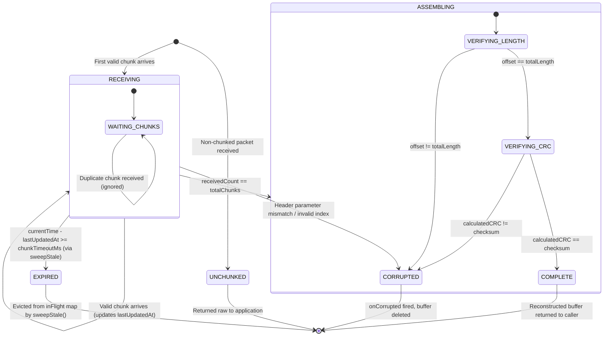

# WebRTC DataChannel Binary Packet Chunking and Reassembly Protocol Specification

**Document Version:** 1.0.0
**Target Module:** `src/lib/webrtc/packetChunker.ts`
**Tracking Issues:** #8010, #7981, #7982
**Test Suite:** `src/__tests__/lib/webrtc/packetChunker.test.ts`
**Applicability:** WebRTC P2P DataChannels, Mesh Networking, Real-Time Collaboration (CRDT / Whiteboard / State Sync)

---

## Notice of Implementation Discrepancies

> [!IMPORTANT]
> The issue title and description reference an expected implementation file `src/core/webrtc/DataChannelChunker.ts` with an assumed 16-byte header.
>
> The codebase implements this protocol in **`src/lib/webrtc/packetChunker.ts`** (committed in `#7982` closing `#7981`).
>
> Key implementation discrepancies against the issue prompt:
> 1. **Canonical File Location:** `src/lib/webrtc/packetChunker.ts` (there is no `src/core/webrtc/DataChannelChunker.ts`).
> 2. **Binary Header Size:** Exactly **24 bytes** (192 bits), not 16 bytes. The header requires 8 bytes for a 64-bit BigInt Message ID, 4 bytes for magic bytes, 4 bytes for chunk/total indexing, 4 bytes for total length, and 4 bytes for CRC32 checksum ($4 + 8 + 2 + 2 + 4 + 4 = 24$ bytes).
> 3. **Length Semantics:** The header encodes `totalLength` (the 32-bit total byte size of the reconstructed message across all chunks), rather than individual per-chunk payload length. Per-chunk payload length is derived from the network buffer slice (`data.byteLength - HEADER_SIZE`).
> 4. **Timeout Semantics:** The reassembly timeout uses a **sliding window** based on `lastUpdatedAt`, refreshed upon every valid chunk arrival (`currentTime - entry.lastUpdatedAt >= threshold`).
> 5. **Eviction / Buffer Bounds:** Message reassembly buffers are keyed in a standard `Map<string, InFlightMessage>` with size limit enforcement per message (`maxMessageSize`, default 16 MB) and periodic or explicit sweep cleanup (`sweepStale()`). There is no LRU count-cap eviction policy across independent message IDs.
>
> This specification documents the **actual code** in `src/lib/webrtc/packetChunker.ts` while detailing both the implemented 24-byte framing protocol and comparing it with theoretical 16-byte compact variants.

---

## 1. Overview

### 1.1 Purpose of Binary Packet Chunking
WebRTC DataChannels operate on top of the Stream Control Transmission Protocol (SCTP), encapsulated within DTLS over UDP (RFC 8831 / RFC 8832). While the WebRTC DataChannel API accepts arbitrarily large `ArrayBuffer` or `Blob` payloads, underlying browser SCTP implementations (e.g., libwebrtc in Chromium, Firefox, Safari) enforce practical limits on individual message transfers.

Attempting to transmit large binary payloads (such as Yjs CRDT document vector snapshots, collaborative whiteboard canvas images, high-resolution vector strokes, or file transfers) exceeding SCTP buffer limits triggers immediate browser `OperationError` exceptions or results in silent connection drops and buffer stalls.

The binary packet chunking protocol implemented in `src/lib/webrtc/packetChunker.ts` solves this problem by:
1. Fragmenting oversized application messages into deterministic slices that comfortably fit within SCTP message boundaries.
2. Affixing a compact, zero-overhead binary header to every transmitted packet slice.
3. Enabling zero-copy, out-of-order reassembly at receiving peers.
4. Validating message integrity through IEEE 802.3 CRC32 checksums before releasing assembled payloads to downstream application consumers.
5. Allowing unchunked legacy or standard messages to bypass chunking logic transparently with zero latency penalty.

### 1.2 Relationship with WebRTC DataChannels and SCTP Transport
WebRTC data channels utilize SCTP over DTLS (port 5000). The SCTP transport layer fragments user messages into DATA chunks matching the network Path MTU (typically 1200–1280 bytes to avoid IP fragmentation).

However, browser user agents maintain internal SCTP send and receive socket buffers (`bufferedAmount`, `maxMessageSize`). Early SCTP implementations capped user messages at 16 KB ($16{,}384$ bytes) or 64 KB ($65{,}536$ bytes). If an application attempts `dataChannel.send(buffer)` with a 5 MB payload:
- libwebrtc attempts user-space buffering; if the channel buffer overflows, the channel abruptly closes or throws an error.
- Interoperability between different browsers (Chromium vs Firefox vs Safari) degrades when large messages cross browser-specific thresholds.

By chunking payloads at the application/library boundary into safe **16 KB** units, `packetChunker.ts` ensures that every single packet passed to `RTCDataChannel.send()` is natively handled without transport-level buffer exhaustion.

### 1.3 Scope and Protocol Limitations
- **Transport Independence:** While optimized for WebRTC DataChannels, the packet format and reassembly engine are pure binary utilities operating on `Uint8Array` / `ArrayBuffer` instances and can operate over WebSockets, WebTransport, or raw sockets.
- **Ordered and Unordered Channels:** The protocol supports both ordered (`ordered: true`) and unordered (`ordered: false`) DataChannels. Out-of-order chunk arrivals are indexed directly into the reassembly slot array.
- **Unreliable / Lossy Modes:** The reassembly engine expects all chunks to eventually arrive. If a chunk is permanently lost (e.g., in partial reliability modes `maxRetransmits: 0`), the incomplete message will stall until swept by `sweepStale()`. It does not include built-in NACK retransmission requests (which are handled at the SCTP or upper application layer).
- **Integrity vs Security:** The 32-bit CRC32 checksum detects transmission corruption, bit-flips, or slice misalignment. It is **not** a cryptographic signature and does not protect against intentional malicious tampering (which is mitigated by DTLS encryption on the WebRTC channel).

---

## 2. Binary Packet Format

### 2.1 Complete 24-Byte (192-Bit) Header Layout
The actual production implementation in `src/lib/webrtc/packetChunker.ts` utilizes a **24-byte (192-bit) binary header** prepended to each chunk payload.

```text
 0                   1                   2                   3
 0 1 2 3 4 5 6 7 8 9 0 1 2 3 4 5 6 7 8 9 0 1 2 3 4 5 6 7 8 9 0 1
+-+-+-+-+-+-+-+-+-+-+-+-+-+-+-+-+-+-+-+-+-+-+-+-+-+-+-+-+-+-+-+-+
|       'W'     |      'C'      |      'H'      |   Version 1   |  Bytes 0 - 3: Magic Header
+-+-+-+-+-+-+-+-+-+-+-+-+-+-+-+-+-+-+-+-+-+-+-+-+-+-+-+-+-+-+-+-+
|                       Message ID (High 32)                    |  Bytes 4 - 7: Msg ID [63:32]
+-+-+-+-+-+-+-+-+-+-+-+-+-+-+-+-+-+-+-+-+-+-+-+-+-+-+-+-+-+-+-+-+
|                       Message ID (Low 32)                     |  Bytes 8 - 11: Msg ID [31:0]
+-+-+-+-+-+-+-+-+-+-+-+-+-+-+-+-+-+-+-+-+-+-+-+-+-+-+-+-+-+-+-+-+
|          Chunk Index          |          Total Chunks         |  Bytes 12 - 15: Index & Count
+-+-+-+-+-+-+-+-+-+-+-+-+-+-+-+-+-+-+-+-+-+-+-+-+-+-+-+-+-+-+-+-+
|                          Total Length                         |  Bytes 16 - 19: Message Bytes
+-+-+-+-+-+-+-+-+-+-+-+-+-+-+-+-+-+-+-+-+-+-+-+-+-+-+-+-+-+-+-+-+
|                         CRC32 Checksum                        |  Bytes 20 - 23: IEEE 802.3 CRC
+-+-+-+-+-+-+-+-+-+-+-+-+-+-+-+-+-+-+-+-+-+-+-+-+-+-+-+-+-+-+-+-+
|                                                               |
|                   Payload Data (Variable Length)              |  Bytes 24+: Slice Payload
|                                                               |
+-+-+-+-+-+-+-+-+-+-+-+-+-+-+-+-+-+-+-+-+-+-+-+-+-+-+-+-+-+-+-+-+
```

### 2.2 Header Byte Map

| Byte Offset | Field Name | Width | Data Type | Endianness | Description |
|---|---|---|---|---|---|
| `0` | `Magic[0]` | 1 byte | `uint8` | N/A | Character `'W'` (`0x57`) |
| `1` | `Magic[1]` | 1 byte | `uint8` | N/A | Character `'C'` (`0x43`) |
| `2` | `Magic[2]` | 1 byte | `uint8` | N/A | Character `'H'` (`0x48`) |
| `3` | `Version` | 1 byte | `uint8` | N/A | Protocol Version: `0x01` |
| `4 - 7` | `msgIdHigh` | 4 bytes | `uint32` | Big-Endian (BE) | High 32 bits of 64-bit numerical Message ID |
| `8 - 11` | `msgIdLow` | 4 bytes | `uint32` | Big-Endian (BE) | Low 32 bits of 64-bit numerical Message ID |
| `12 - 13` | `chunkIndex` | 2 bytes | `uint16` | Big-Endian (BE) | Zero-based index of this chunk ($0 \le i < \text{totalChunks}$) |
| `14 - 15` | `totalChunks` | 2 bytes | `uint16` | Big-Endian (BE) | Total number of chunks in this message ($1 \le N \le 65535$) |
| `16 - 19` | `totalLength` | 4 bytes | `uint32` | Big-Endian (BE) | Total byte size of the reconstructed message payload |
| `20 - 23` | `checksum` | 4 bytes | `uint32` | Big-Endian (BE) | Deterministic IEEE 802.3 CRC32 of full unfragmented payload |
| `24+` | `payload` | Var | `bytes` | Raw | Chunk slice payload data |

### 2.3 Detailed Field Specifications

#### Bytes 0–3: Magic Header (`PACKET_MAGIC_HEADER`)
- **Hex Representation:** `0x57 0x43 0x48 0x01` (`"WCH\x01"`)
- **Meaning:** Discriminator identifying the buffer as an active WorkSphere Chunked Header packet.
- **Validation Behavior:** Evaluated by `isChunkedPacket()`. If any of the first 4 bytes do not match, the packet is flagged as non-chunked and passed directly through to the application without error, ensuring backward compatibility with unchunked protocols.
- **Mandatory/Reserved:** Mandatory.

#### Bytes 4–11: Message ID (`messageId`)
- **Data Type:** 64-bit unsigned integer (split into two 32-bit big-endian words: `msgIdHigh` at offset 4, `msgIdLow` at offset 8).
- **Meaning:** Globally unique or monotonically increasing identifier grouping all chunks belonging to the same logical message.
- **Reconstruction:**
  $$\text{messageId} = (\text{BigInt}(\text{msgIdHigh}) \ll 32\text{n}) \mid \text{BigInt}(\text{msgIdLow})$$
  Exposed as a string in `ChunkHeader.messageId`.
- **Valid Range:** $1$ to $2^{64} - 1$.
- **Validation Behavior:** Used as the lookup key in `PacketReassembler.inFlight`. Mismatched header parameters across chunks with identical `messageId` trigger a corruption event.

#### Bytes 12–13: Chunk Index (`chunkIndex`)
- **Data Type:** 16-bit unsigned integer (`uint16`, Big-Endian).
- **Meaning:** Zero-based sequence number of the chunk.
- **Valid Range:** $0 \le \text{chunkIndex} < \text{totalChunks}$.
- **Validation Behavior:** If $\text{chunkIndex} \ge \text{totalChunks}$, the reassembler immediately fires `onCorrupted` with `"Invalid chunkIndex <X> for totalChunks <Y>"` and discards the chunk without creating or updating a buffer.

#### Bytes 14–15: Total Chunks (`totalChunks`)
- **Data Type:** 16-bit unsigned integer (`uint16`, Big-Endian).
- **Meaning:** The total count of chunk fragments composing the message.
- **Valid Range:** $1 \le \text{totalChunks} \le 65{,}535$.
- **Validation Behavior:** If $\text{totalChunks} == 0$, rejected immediately as corrupted. Must remain strictly identical across all chunks of the same `messageId`.

#### Bytes 16–19: Total Length (`totalLength`)
- **Data Type:** 32-bit unsigned integer (`uint32`, Big-Endian).
- **Meaning:** Exact byte count of the complete reconstructed payload across all chunks.
- **Valid Range:** $0 \le \text{totalLength} \le \text{maxMessageSize}$ (default 16 MB = $16{,}777{,}216$ bytes).
- **Validation Behavior:**
  1. If $\text{totalLength} > \text{maxMessageSize}$, the packet is rejected and any pending buffer for `messageId` is purged.
  2. Upon receiving all chunks, the sum of all slice lengths must equal `totalLength`. If $\sum \text{sliceLen} \ne \text{totalLength}$, an error is emitted.

#### Bytes 20–23: CRC32 Checksum (`checksum`)
- **Data Type:** 32-bit unsigned integer (`uint32`, Big-Endian).
- **Polynomial:** IEEE 802.3 standard standard reversed polynomial `0xEDB88320`.
- **Meaning:** Precomputed CRC32 checksum over the **entire original unfragmented payload**.
- **Validation Behavior:** Verified only once when all $\text{totalChunks}$ have arrived and have been concatenated. If the assembled payload CRC does not equal `checksum`, the assembled data is dropped and `onCorrupted` is invoked.

### 2.4 Structural Comparison: 24-Byte vs Conceptual 16-Byte Layout
The issue description suggested an illustrative 16-byte layout. The table below highlights why the actual implementation requires 24 bytes and where the fields differ:

| Feature | Issue Suggestion (Conceptual 16-Byte) | Implemented Protocol (`packetChunker.ts` 24-Byte) | Rationale |
|---|---|---|---|
| **Magic Header** | 1 byte (`0`) | 4 bytes (`0..3`) | 4-byte ASCII signature (`WCH\x01`) drastically reduces false positive matches against arbitrary application payloads. |
| **Message ID** | 4 bytes (32-bit) | 8 bytes (64-bit) | Prevents counter wrap-around in high-frequency collaboration environments ($>4.29 \times 10^9$ messages). |
| **Chunk Index** | 2 bytes (`uint16`) | 2 bytes (`uint16`) | Identical ($0$ to $65{,}535$). |
| **Total Chunks** | 2 bytes (`uint16`) | 2 bytes (`uint16`) | Identical ($1$ to $65{,}535$). |
| **Length Field** | 2 bytes per-chunk payload length | 4 bytes complete message length (`totalLength`) | Pre-allocates exact destination buffer (`new Uint8Array(entry.totalLength)`) upfront; per-chunk length is implicit from packet size. |
| **CRC32 Checksum**| 4 bytes | 4 bytes | Identical IEEE 802.3 CRC32 algorithm. |
| **Total Header** | **16 Bytes** | **24 Bytes** | Robustness, full 64-bit ID space, versioning, and zero ambiguity. |

---

## 3. Packet Encoding

### 3.1 Input Message Handling
The entry point for fragmentation is:
```typescript
splitIntoChunks(payload: Uint8Array, options?: ChunkerOptions): Uint8Array[]
```
When invoked:
1. **Size Verification:** The input `payload.length` is checked against `maxMessageSize` (default: 16 MB). If exceeded, a `PacketChunkerError` is thrown immediately.
2. **Chunk Size Normalization:** The target `chunkSize` is clamped to at least $\text{HEADER\_SIZE} + 1 = 25$ bytes:
   $$\text{chunkSize} = \max(25, \text{options.chunkSize} \mathbin{??} 16{,}384)$$
3. **Payload Per Chunk:** The maximum payload bytes per individual chunk slice is:
   $$\text{maxPayloadPerChunk} = \text{chunkSize} - \text{HEADER\_SIZE} = \text{chunkSize} - 24$$
4. **Message ID Assignment:** If `options.messageId` is supplied, it is converted to `BigInt(options.messageId)`. Otherwise, the global counter `globalMessageCounter++` is used and incremented atomically.
5. **Checksum Generation:** The entire unfragmented payload is hashed once via `computeCRC32(payload)`.

### 3.2 Mathematical Formulation
For a payload of size $L = \text{totalLength}$ bytes and safe chunk size $C = \text{chunkSize}$:

1. **Payload Capacity:**
   $$S = C - 24$$
2. **Total Chunk Count ($N$):**
   - If $L = 0$: $N = 1$
   - If $L > 0$:
     $$N = \left\lceil \frac{L}{S} \right\rceil = \left\lfloor \frac{L + S - 1}{S} \right\rfloor$$
3. **Indexing Range:**
   $$i \in \{0, 1, 2, \dots, N - 1\}$$
4. **Per-Chunk Byte Offsets:**
   For chunk index $i$:
   $$\text{offset}_{\text{start}}(i) = i \times S$$
   $$\text{offset}_{\text{end}}(i) = \min((i + 1) \times S, L)$$
   $$\text{sliceLen}(i) = \text{offset}_{\text{end}}(i) - \text{offset}_{\text{start}}(i)$$
5. **Total Packet Size:**
   $$\text{packetSize}(i) = 24 + \text{sliceLen}(i)$$

### 3.3 Empty Message Handling (0 Bytes)
When `payload.length === 0`:
- Exactly **1 chunk** ($N = 1$) is created.
- `chunkIndex = 0`, `totalChunks = 1`, `totalLength = 0`.
- CRC32 of an empty byte array is `0x00000000`.
- The emitted chunk consists solely of the 24-byte header with 0 payload bytes.
- The reassembler detects $N = 1$, verifies CRC32 ($0$), and returns `new Uint8Array(0)`.

### 3.4 16-Bit Indexing Limit
If a requested payload and chunk size yield $N > 65{,}535$:
```typescript
if (totalChunks > 65535) {
  throw new PacketChunkerError(
    `Payload requires ${totalChunks} chunks which exceeds 16-bit indexing limit (65535)`
  );
}
```
At the default 16 KB chunk size ($S = 16{,}360$ bytes), $65{,}535$ chunks would accommodate $\approx 1.07\text{ GB}$, well above the 16 MB default maximum message limit.

---

## 4. MTU and Payload Boundaries

### 4.1 Safe Chunk Size (16 KB)
The default configuration constant is:
```typescript
export const DEFAULT_CHUNK_SIZE = 16 * 1024; // 16,384 bytes (16 KB)
```
- **Total Packet Limit vs Payload Limit:** In this implementation, `chunkSize` defines the **total packet limit** (header + payload).
- **Header Overhead:** $24\text{ bytes}$ ($\approx 0.146\%$ overhead at 16 KB).
- **Effective Payload per Chunk:**
  $$\text{maxPayloadPerChunk} = 16{,}384 - 24 = 16{,}360\text{ bytes}$$

### 4.2 SCTP Transport Compatibility
Under RFC 8831 (WebRTC Data Channels):
1. **Path MTU (PMTU):** Typical Ethernet PMTU is 1500 bytes (IPv4/UDP/DTLS/SCTP encapsulation leaves $\approx 1200\text{–}1280$ bytes per SCTP packet). SCTP automatically segments messages larger than PMTU into multiple SCTP DATA chunks.
2. **SCTP Reassembly Buffer:** SCTP stack reassembly buffers in browsers historically defaulted to 64 KB or 16 KB for reliable interleaved transmission. Sending single chunks of 16 KB ensures that intermediate browser buffers are never exhausted, avoiding SCTP-level Head-of-Line (HoL) blocking across distinct DataChannels.
3. **Transport Independence Note:** 16 KB is **not** an Ethernet MTU or IP packet guarantee; it is an application-level safe fragmentation boundary tailored for browser WebRTC SCTP stacks.

---

## 5. Chunk Indexing and Message Identity

### 5.1 Message ID Lifecycle
- `globalMessageCounter`: A module-scoped `bigint` initialized to `1n`.
- For each message fragmented without an explicit ID, `globalMessageCounter++` increments monotonically.
- The 64-bit space guarantees that ID collision will not occur during the lifetime of the application session ($2^{64} \approx 1.84 \times 10^{19}$ values).
- When transmitted, the ID is split:
  ```typescript
  const msgIdHigh = Number((rawMsgId >> 32n) & 0xffffffffn);
  const msgIdLow = Number(rawMsgId & 0xffffffffn);
  ```
  And re-formed on receipt into a decimal string key for `Map<string, InFlightMessage>` lookups:
  ```typescript
  const messageId = ((BigInt(msgIdHigh) << 32n) | BigInt(msgIdLow)).toString();
  ```

### 5.2 Association and In-Flight Buffering
In-flight messages are tracked in `PacketReassembler` via:
```typescript
interface InFlightMessage {
  totalChunks: number;
  totalLength: number;
  checksum: number;
  receivedCount: number;
  chunks: (Uint8Array | undefined)[];
  firstSeenAt: number;
  lastUpdatedAt: number;
}
```
- Chunks are stored in a fixed-length array `chunks` of size `totalChunks`.
- Arrival of chunk $i$ places `payload` at `chunks[chunkIndex]`.

### 5.3 Duplicate and Malformed Index Handling
- **Duplicate Chunks:** If `chunks[chunkIndex]` is already populated, the incoming chunk is ignored without incrementing `receivedCount` or corrupting state:
  ```typescript
  if (!entry.chunks[chunkIndex]) {
    entry.chunks[chunkIndex] = payload;
    entry.receivedCount += 1;
  }
  ```
- **Out-of-Bounds Index:** If $\text{chunkIndex} \ge \text{totalChunks}$, the reassembler calls `onCorrupted` and returns `null`.
- **Mismatched Metadata:** If subsequent chunks for an existing `messageId` arrive with conflicting `totalChunks`, `totalLength`, or `checksum`, the reassembler flags corruption, evicts the entire message buffer from memory, and returns `null`.

---

## 6. Reassembly Protocol

### 6.1 Step-by-Step Ingestion Pipeline
When an application receives binary data from `RTCDataChannel.onmessage`, it feeds the buffer directly into `PacketReassembler.push(data)`.

```mermaid
flowchart TD
    A[Incoming DataChannel Buffer] --> B{isChunkedPacket?}
    B -->|No / Raw Message| C[Return Buffer Unmodified]
    B -->|Yes| D[parseChunkHeader]

    D --> E{Header Valid & totalLength <= maxMessageSize?}
    E -->|No| F[Fire onCorrupted, Evict messageId, Return null]
    E -->|Yes| G{chunkIndex < totalChunks and totalChunks > 0?}

    G -->|No| H[Fire onCorrupted, Return null]
    G -->|Yes| I{InFlight Entry Exists?}

    I -->|No| J[Create InFlightMessage Entry]
    I -->|Yes| K{Header Parameters Match Entry?}

    K -->|No| L[Fire onCorrupted, Evict messageId, Return null]
    K -->|Yes| M[Update lastUpdatedAt]

    J --> N{Slot chunks[chunkIndex] Empty?}
    M --> N

    N -->|Already Filled| O[Ignore Duplicate Chunk]
    N -->|Empty Slot| P[Store Payload in Slot, receivedCount++]

    O --> Q{receivedCount === totalChunks?}
    P --> Q

    Q -->|Incomplete| R[Return null]
    Q -->|Complete| S[Delete messageId from inFlight]

    S --> T[Allocate Assembled Uint8Array]
    T --> U[Concatenate Chunks in Index Order]
    U --> V{Assembled Length === totalLength?}

    V -->|Mismatch| W[Fire onCorrupted, Return null]
    V -->|Match| X[computeCRC32 over Assembled Buffer]

    X --> Y{Calculated CRC === Header Checksum?}
    Y -->|Mismatch| Z[Fire onCorrupted, Return null]
    Y -->|Valid| AA[Return Reconstructed Assembled Buffer]
```

### 6.2 Assembly and Integrity Check
When `receivedCount === totalChunks`:
1. `this.inFlight.delete(messageId)` removes the message immediately, freeing table tracking.
2. A destination buffer is allocated: `const assembled = new Uint8Array(entry.totalLength)`.
3. Chunks are copied in strict sequential order from index $0$ to $N - 1$:
   ```typescript
   let offset = 0;
   for (let i = 0; i < entry.totalChunks; i++) {
     const part = entry.chunks[i];
     assembled.set(part, offset);
     offset += part.length;
   }
   ```
4. If any slot `entry.chunks[i]` is undefined, or if final `offset !== entry.totalLength`, the reassembler emits `onCorrupted` and aborts.
5. The full assembled array is hashed: `const calculatedCRC = computeCRC32(assembled)`.
6. If `calculatedCRC !== entry.checksum`, the buffer is discarded, `onCorrupted` is called, and `null` is returned.
7. If all checks pass, `assembled` is returned to the caller.

---

## 7. Reassembly State Machine

The conceptual states and active transitions governing a message's lifecycle during packet reassembly are detailed below:



### State Definitions

| State | Scope | Description |
|---|---|---|
| `UNCHUNKED` | Ephemeral | Packet lacked magic header; passed through without buffering. |
| `RECEIVING` | In-Flight | Message entry created in `inFlight` map; awaiting missing chunks. |
| `ASSEMBLING`| Ephemeral | All chunks received; concatenating byte slices and verifying CRC32. |
| `COMPLETE` | Terminal | Payload verified; returned synchronously to caller. |
| `CORRUPTED` | Terminal | Checksum mismatch, length violation, or header collision; buffer deleted. |
| `EXPIRED` | Terminal | Message timed out without completion; purged by `sweepStale()`. |

---

## 8. Timeout and Memory Management

### 8.1 Sliding Window Timeout
The reassembler utilizes a **sliding timeout window**:
- Default timeout: `DEFAULT_CHUNK_TIMEOUT_MS = 15000` (15 seconds).
- `entry.firstSeenAt`: Timestamp when chunk 0 or the first arriving chunk was ingested.
- `entry.lastUpdatedAt`: Timestamp updated upon **every** valid chunk arrival belonging to that message.
- A slow or jittery connection that continuously delivers chunks will **not** prematurely time out, provided successive chunks arrive within the sliding `chunkTimeoutMs` threshold.

### 8.2 Garbage Collection via `sweepStale()`
To prevent memory leaks from abandoned messages (e.g., peer disconnects mid-transfer, extreme packet loss):
```typescript
public sweepStale(maxAgeMs?: number): number
```
- **Evaluation:** For each entry in `inFlight`:
  $$\Delta t = \text{currentTime} - \text{entry.lastUpdatedAt}$$
  If $\Delta t \ge \text{threshold}$ (where $\text{threshold} = \text{maxAgeMs} \mathbin{??} \text{this.chunkTimeoutMs}$), the entry is removed from `inFlight`.
- **Return Value:** Returns the number of purged stale messages.
- **Scheduling:** Applications running `PacketReassembler` typically run `sweepStale()` periodically (e.g., via `setInterval(..., 5000)` or during connection maintenance).

### 8.3 Buffer Sizing and Memory Bounds
- Individual message size is strictly capped by `maxMessageSize` (default: 16 MB = $16{,}777{,}216$ bytes).
- Payloads exceeding `maxMessageSize` are rejected before reassembly allocation.
- In-flight messages hold references only to received chunk subarrays; full message buffer allocation occurs only upon full chunk reception.
- Calling `clear()` purges all pending in-flight messages and resets memory immediately.

---

## 9. Error Handling and Edge Cases

| Scenario | Condition | Behavior / Outcome |
|---|---|---|
| **Invalid Magic Byte** | Buffer fails `PACKET_MAGIC_HEADER` match | Packet is treated as raw/unchunked and returned directly to caller. |
| **Truncated Header** | Packet length $< 24$ bytes | Fails magic check; returned directly as raw packet. |
| **Exceeds Max Message Size** | `totalLength > maxMessageSize` | Fires `onCorrupted`, purges `messageId` if present, returns `null`. |
| **Zero Total Chunks** | `totalChunks === 0` | Fires `onCorrupted`, returns `null`. |
| **Chunk Index Out of Bounds** | `chunkIndex >= totalChunks` | Fires `onCorrupted`, returns `null`. |
| **Conflicting Chunk Metadata** | Successive chunk has different `totalChunks`, `totalLength`, or `checksum` | Fires `onCorrupted("Mismatched header parameters across chunks")`, purges message from `inFlight`, returns `null`. |
| **Duplicate Chunks** | Same chunk index arrives multiple times | Ignored cleanly without duplicate slot writes or counter increment. |
| **Out-of-Order Chunks** | Chunks arrive reversed or scrambled | Placed into array by `chunkIndex`; assembled when `receivedCount === totalChunks`. |
| **Corrupted Payload Bytes** | Bit-flip in chunk payload | CRC32 mismatch detected during reassembly; fires `onCorrupted`, returns `null`. |
| **Missing Chunk on Assembly** | Slot in array is `undefined` | Fires `onCorrupted("Missing chunk #X upon completion")`, returns `null`. |
| **Length Mismatch on Assembly**| Concatenated length $\ne$ `totalLength` | Fires `onCorrupted`, returns `null`. |
| **Empty Payload Input** | Input is 0-byte buffer | Generates 1 chunk with 24-byte header; reassembles to empty `Uint8Array(0)`. |
| **Oversized Input Payload** | Payload $> \text{maxMessageSize}$ at sender | `splitIntoChunks` throws `PacketChunkerError`. |
| **Indexing Overflow** | Required chunks $> 65{,}535$ | `splitIntoChunks` throws `PacketChunkerError`. |

---

## 10. Worked Example

### 10.1 Input Message
- **Payload:** 35,000 bytes of binary whiteboard snapshot data.
- **Configured Chunk Size:** 16,384 bytes (`DEFAULT_CHUNK_SIZE`).
- **Header Size:** 24 bytes.
- **Max Payload Per Chunk:** $16{,}384 - 24 = 16{,}360$ bytes.
- **Message ID:** `1001` (`0x00000000000003E9`).

### 10.2 Chunk Calculations
- Total chunks:
  $$N = \left\lceil \frac{35{,}000}{16{,}360} \right\rceil = 3\text{ chunks}$$
- Slices:
  - Chunk 0: Offset 0 to 16,360 (16,360 bytes payload, 16,384 bytes total packet).
  - Chunk 1: Offset 16,360 to 32,720 (16,360 bytes payload, 16,384 bytes total packet).
  - Chunk 2: Offset 32,720 to 35,000 (2,280 bytes payload, 2,304 bytes total packet).
- Checksum: Let hypothetical CRC32 of the 35,000 bytes be `0xA1B2C3D4`.

### 10.3 Header Byte Breakdown for Chunk 1 (Index 1)

```text
Offset  Hex Bytes           Field Name        Value
---------------------------------------------------------------------------------
00..03  57 43 48 01         Magic Header      'W', 'C', 'H', v1
04..07  00 00 00 00         msgIdHigh         0
08..11  00 00 03 E9         msgIdLow          1001
12..13  00 01               chunkIndex        1 (second chunk)
14..15  00 03               totalChunks       3 total chunks
16..19  00 00 88 B8         totalLength       35,000 bytes
20..23  A1 B2 C3 D4         checksum          CRC32 = 0xA1B2C3D4
24..    [16,360 bytes...]   payload           Data slice [16360..32720]
```

### 10.4 Reassembly Sequence
1. Chunk 2 arrives first (out-of-order):
   - Entry created for ID `"1001"`. Slot 2 populated. `receivedCount = 1`. Returns `null`.
2. Chunk 0 arrives:
   - Slot 0 populated. `receivedCount = 2`. Returns `null`.
3. Duplicate Chunk 0 arrives:
   - Slot 0 already populated. Ignored. `receivedCount = 2`. Returns `null`.
4. Chunk 1 arrives:
   - Slot 1 populated. `receivedCount = 3 == totalChunks`.
   - Concatenates slices 0, 1, 2 into a single 35,000-byte buffer.
   - Calculates CRC32: matches `0xA1B2C3D4`.
   - Entry `"1001"` deleted from `inFlight`.
   - Returns 35,000-byte reconstructed `Uint8Array`.

---

## 11. Implementation Reference

The following table provides verified references to the source code implementing the protocol:

| Protocol Feature / Symbol | Implementation Location | Line / Scope |
|---|---|---|
| `PACKET_MAGIC_HEADER` (`0x57, 0x43, 0x48, 0x01`) | `src/lib/webrtc/packetChunker.ts` | Line 15 |
| `HEADER_SIZE` (`24`) | `src/lib/webrtc/packetChunker.ts` | Line 17 |
| `DEFAULT_CHUNK_SIZE` (`16384`) | `src/lib/webrtc/packetChunker.ts` | Line 18 |
| `DEFAULT_CHUNK_TIMEOUT_MS` (`15000`) | `src/lib/webrtc/packetChunker.ts` | Line 19 |
| `DEFAULT_MAX_MESSAGE_SIZE` (`16777216`) | `src/lib/webrtc/packetChunker.ts` | Line 20 |
| `computeCRC32(bytes)` | `src/lib/webrtc/packetChunker.ts` | Lines 25–43 |
| `PacketChunkerError` | `src/lib/webrtc/packetChunker.ts` | Lines 45–50 |
| `isChunkedPacket(data)` | `src/lib/webrtc/packetChunker.ts` | Lines 85–91 |
| `parseChunkHeader(data)` | `src/lib/webrtc/packetChunker.ts` | Lines 96–126 |
| `splitIntoChunks(payload, options)` | `src/lib/webrtc/packetChunker.ts` | Lines 131–200 |
| `PacketReassembler` | `src/lib/webrtc/packetChunker.ts` | Lines 215–370 |
| `PacketReassembler.push(data)` | `src/lib/webrtc/packetChunker.ts` | Lines 235–336 |
| `PacketReassembler.sweepStale(maxAgeMs)` | `src/lib/webrtc/packetChunker.ts` | Lines 342–355 |
| Unit Test Suite | `src/__tests__/lib/webrtc/packetChunker.test.ts` | Lines 1–179 |

---

## 12. Security and Reliability Considerations

### 12.1 Integrity Checking vs Cryptographic Authentication
The protocol uses an IEEE 802.3 CRC32 checksum (`computeCRC32`). CRC32 provides high-speed, hardware-friendly detection of bit errors, truncated streams, or transposition errors. It is **not** cryptographically secure against intentional tampering or collision generation. In WebRTC architectures, confidentiality and authenticity are provided at the transport layer by DTLS (RFC 8827 / RFC 9147). Applications requiring end-to-end payload authenticity across untrusted relays should apply Ed25519 signatures or HMAC-SHA256 at the application layer prior to packet chunking.

### 12.2 Memory Exhaustion Mitigation
Receiving arbitrary chunk streams introduces potential denial-of-service vectors if untrusted peers flood incomplete message IDs:
1. **Message Size Cap:** `totalLength` is validated against `maxMessageSize` (16 MB) immediately upon parsing the header. Any packet advertising a larger message is rejected before memory is allocated.
2. **Delayed Buffer Allocation:** Full assembled buffers (`new Uint8Array(entry.totalLength)`) are allocated **only** when all chunks have arrived (`receivedCount === totalChunks`), preventing pre-allocation memory exhaustion from phantom headers.
3. **Periodic Sweeping:** Applications should invoke `sweepStale()` at regular intervals (e.g., every 5 to 10 seconds) to ensure that orphaned chunks from disconnected peers are evicted within the 15-second window.

### 12.3 Monotonic Counter and ID Collision
- The 64-bit numerical Message ID eliminates wrapping concerns in single-peer sessions.
- In multi-peer mesh networks where multiple peers send chunked messages concurrently, collisions in `inFlight` could conceptually occur if two peers independently choose the same numerical ID and feed into the same `PacketReassembler`.
- **Best Practice:** Maintain an independent `PacketReassembler` instance per `peerId` or per `RTCDataChannel` connection, isolating reassembly state to a single sender context.
