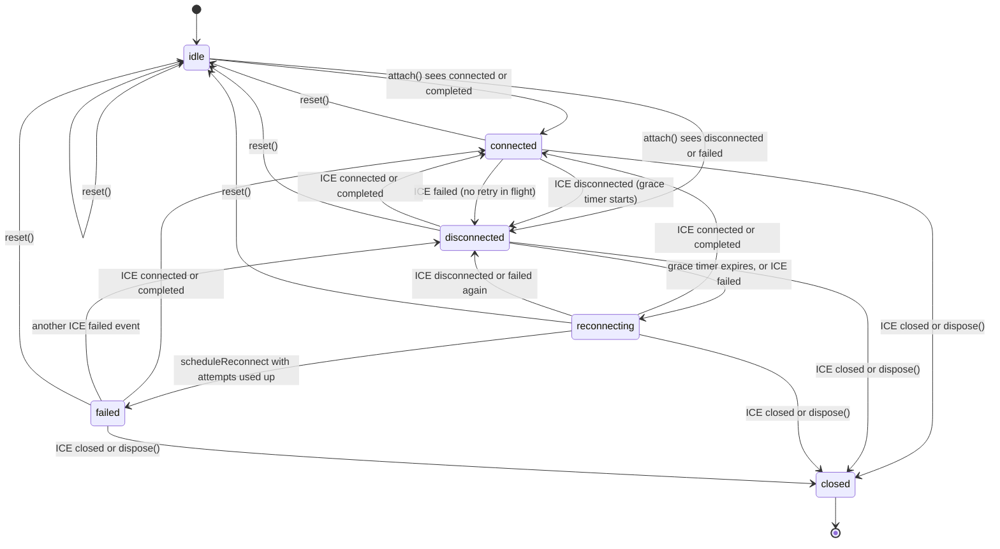

# ICE Reconnect State Machine

This guide documents `ICEReconnectManager`, the class that decides when and how
a WorkSphere `RTCPeerConnection` retries after its ICE connection drops. It
covers the state machine, the backoff schedule, the disconnect grace window,
ICE restarts, fallback ICE servers, the events you can use for telemetry, and
what to check when a peer sits behind a strict NAT or a corporate firewall.

Source files:

- [`src/lib/webrtc/iceReconnectManager.ts`](../../src/lib/webrtc/iceReconnectManager.ts):
  the state machine described here.
- [`src/__tests__/lib/webrtc/iceReconnectManager.test.ts`](../../src/__tests__/lib/webrtc/iceReconnectManager.test.ts):
  Jest coverage for every transition in this guide.
- [`src/hooks/useWebRTCReconnect.ts`](../../src/hooks/useWebRTCReconnect.ts):
  a separate, simpler React hook that also performs ICE restarts. See
  [section 9](#9-how-this-relates-to-the-rest-of-the-webrtc-code).

> **Accuracy note.** This guide describes what the code does today. Three
> things people often expect are not in `ICEReconnectManager`: there is no
> dedicated `RELAY_FALLBACK` state (fallback is a flag set while the manager is
> in `reconnecting`), there is no ICE gathering timeout, and the manager does not
> emit metrics by itself (it emits events you can turn into metrics). Each is
> covered below so you know where the boundary is.

## 1. Defaults at a glance

| Option                     | Default                                                          | Meaning                                                    |
| -------------------------- | ---------------------------------------------------------------- | ---------------------------------------------------------- |
| `baseDelayMs`              | `500`                                                            | Nominal delay before attempt 1                             |
| `maxDelayMs`               | `8000`                                                           | Cap on the nominal delay (before jitter)                   |
| `backoffFactor`            | `2`                                                              | Multiplier applied per attempt                             |
| `jitterRatio`              | `0.3`                                                            | Delay is randomised by plus or minus this fraction         |
| `maxAttempts`              | `5`                                                              | Attempts allowed before the manager gives up               |
| `disconnectGracePeriodMs`  | `3000`                                                           | How long `disconnected` may last before retrying           |
| `fallbackAttemptThreshold` | `2`                                                              | Attempt number at which fallback ICE servers are applied   |
| `fallbackIceServers`       | `stun:stun1.l.google.com:19302`, `stun:stun2.l.google.com:19302` | Servers swapped in by the fallback step                    |
| `enableIceRestart`         | `true`                                                           | Whether each attempt calls `restartIce()` and renegotiates |

`jitterRatio` is clamped to the range 0 to 1 in the constructor.

## 2. State diagram



`closed` is terminal. After `dispose()` all timers and listeners are cleared and
every handler returns immediately.

The diagram shows state names only. The fallback server swap and the ICE restart
both happen inside `reconnecting`, as described in sections 5 and 6.

### State reference

| State          | Meaning                                                                                 |
| -------------- | --------------------------------------------------------------------------------------- |
| `idle`         | Nothing is known yet, or `reset()` was called. `attach()` can move straight out of it.  |
| `connected`    | ICE is `connected` or `completed`. Counters are reset.                                  |
| `disconnected` | ICE reported `disconnected` or `failed` and no retry is currently scheduled or running. |
| `reconnecting` | A retry is scheduled (backoff timer pending) or running (restart and renegotiation).    |
| `failed`       | The retry budget is used up. `onFatalFailure` has fired.                                |
| `closed`       | The connection was closed or the manager was disposed.                                  |

### Transition reference

The manager is driven by two inputs that you forward from the peer connection:
`handleIceConnectionStateChange(state)` and `handleConnectionStateChange(state)`.

| ICE state                | What the manager does                                                                                                             |
| ------------------------ | --------------------------------------------------------------------------------------------------------------------------------- |
| `connected`, `completed` | Clears the grace and retry timers, resets `attemptCount` to 0, clears the fallback flag, moves to `connected`.                    |
| `disconnected`           | Moves to `disconnected` and starts the grace timer (once). If the state is still `disconnected` when it fires, schedules a retry. |
| `failed`                 | Cancels the grace timer and schedules a retry immediately. Duplicate events do not start a second retry.                          |
| `closed`                 | Calls `dispose()`.                                                                                                                |
| `new`, `checking`        | Ignored.                                                                                                                          |

`handleConnectionStateChange` (the aggregate `connectionState`) behaves similarly
for `connected`, `failed` and `closed`, with one difference: on `connected`
it does not clear the fallback flag or the coalesced-retry flag, so prefer
forwarding the ICE connection state. It has no `disconnected` handling.

## 3. Retry schedule

`scheduleReconnect()` runs once per retry. It increments `attemptCount`,
computes a delay, moves to `reconnecting`, fires `onAttempt(attempt, delay)`,
and sets a timer. When the timer fires, `executeReconnectCycle()` runs.

The delay for attempt `n` is:

```text
nominal = min(maxDelayMs, baseDelayMs * backoffFactor^(n - 1))
delay   = max(baseDelayMs, round(nominal + random(-1, 1) * nominal * jitterRatio))
```

With the defaults, measured over 2000 samples per attempt:

| Attempt | Nominal | Observed range (ms) |
| ------: | ------: | ------------------- |
|       1 |     500 | 500 to 650          |
|       2 |    1000 | 701 to 1300         |
|       3 |    2000 | 1401 to 2600        |
|       4 |    4000 | 2801 to 5200        |
|       5 |    8000 | 5602 to 10394       |

Two details are easy to miss:

- Jitter is applied after the cap, so the real delay can exceed `maxDelayMs` by
  up to `jitterRatio` (10400 ms with the defaults).
- The result is floored at `baseDelayMs`, so attempt 1 never goes below 500 ms
  and its jitter is effectively one sided.

When `attemptCount` has already reached `maxAttempts`, the next
`scheduleReconnect()` moves to `failed` and calls every `onFatalFailure`
listener with the final attempt count instead of retrying.

## 4. Disconnect grace period

ICE `disconnected` is often transient: a Wi-Fi roam, a short radio dropout, a
laptop waking up. The manager waits `disconnectGracePeriodMs` (3000 ms) before
treating it as a real failure.

- On `disconnected` the state changes immediately, so UI can show a "connection
  unstable" hint, but no retry is scheduled yet.
- If ICE returns to `connected` or `completed` inside the window, the grace
  timer is cleared and no retry ever happens.
- ICE `failed` skips the grace window entirely.

Verified trace with a 100 ms grace period and a 40 ms outage: the manager moved
`connected` to `disconnected` and back to `connected` with no `onAttempt` event.

## 5. ICE restart, renegotiation and trickle ICE

Each retry cycle does the following, in order, inside `executeReconnectCycle()`:

1. If the fallback has not been applied, `attemptCount >= fallbackAttemptThreshold`,
   and `fallbackIceServers` is not empty, apply the fallback servers
   ([section 6](#6-fallback-ice-servers)).
2. If `enableIceRestart` is true, call `pc.restartIce()` when the browser
   supports it, then fire `onIceRestart` listeners.
3. Await the `renegotiateOffer` callback you passed to `attach()`.

`restartIce()` marks the connection so the next offer carries fresh ICE
credentials. It does not create the offer. Your `renegotiateOffer` callback must
do that and send it through signaling:

```ts
manager.attach(pc, async () => {
  const offer = await pc.createOffer({ iceRestart: true });
  await pc.setLocalDescription(offer);
  signalingSend({ type: "webrtc-signal", kind: "offer", sdp: offer });
});
```

Passing `{ iceRestart: true }` explicitly also covers browsers that lack
`restartIce()`, which the manager silently skips.

Candidates are not handled by the manager. After `setLocalDescription`, the
browser gathers new candidates and your existing `icecandidate` handler should
trickle each one to the remote peer through signaling (in `useWebRTCMesh` these
travel as `ice` signals). A restart therefore ends with ICE checks running on the
new candidate pairs, and success arrives as an ICE `connected` event.

The manager does not wait for that event. `executeReconnectCycle()` returns
`true` as soon as the renegotiation callback resolves, and the state stays
`reconnecting` until ICE reports a new state.

### Failure and overlap handling

- If `restartIce()` or the callback throws, the error is logged with
  `console.warn`, the cycle returns `false`, and one follow-up retry is scheduled.
- Only one cycle can be in flight. A failure event that arrives during a cycle
  sets a single "retry requested" flag instead of starting a second negotiation.
  When the cycle finishes, at most one follow-up retry is scheduled.
- A pending backoff timer counts as the next attempt, so duplicate `failed`
  events do not consume the retry budget.
- `manualReconnect(resetAttempts?)` cancels timers, increments `attemptCount`,
  and runs a cycle immediately. It returns `false` if a cycle is already running.

## 6. Fallback ICE servers

When the threshold is reached (attempt 2 by default), the manager calls
`pc.setConfiguration()` with the existing configuration and
`iceServers` replaced by `fallbackIceServers`, then fires `onFallbackApplied`.
It happens at most once per outage and runs before `restartIce()`, so the next
gathering round uses the new servers.

What this means in practice:

- The built-in fallback list is two public STUN servers. STUN only discovers
  your public address. It cannot relay media, so it will not help peers that
  need a relay (see [section 8](#8-troubleshooting)).
- To get a real relay fallback, pass TURN servers in `fallbackIceServers`. The
  list **replaces** the connection's server list, so include any STUN entries
  you still want.
- The manager changes only `iceServers`. It does not set
  `iceTransportPolicy`, so a relay-only policy has to be configured on the peer
  connection itself.
- The fallback flag clears when ICE reaches `connected` or `completed`, so a
  later outage can apply the fallback again.

```ts
const manager = new ICEReconnectManager({
  fallbackAttemptThreshold: 2,
  fallbackIceServers: [
    { urls: "stun:stun.l.google.com:19302" },
    {
      urls: [
        "turn:turn.example.com:3478?transport=udp",
        "turns:turn.example.com:443?transport=tcp",
      ],
      username: "<short-lived username from your server>",
      credential: "<short-lived credential from your server>",
    },
  ],
});
```

Never commit real TURN credentials. Fetch short-lived ones from your backend and
pass them in at runtime.

## 7. Telemetry

`ICEReconnectManager` has no metrics code of its own. It exposes events and
getters, and you derive metrics from them.

| Hook                 | Fires when                                                          | Useful for                        |
| -------------------- | ------------------------------------------------------------------- | --------------------------------- |
| `onStateChange`      | Every state change                                                  | Outage start and end, UI status   |
| `onAttempt`          | A retry is scheduled (`attempt`, `delayMs`)                         | Attempt counts, backoff delays    |
| `onIceRestart`       | The restart step of a cycle ran (even if `restartIce()` is missing) | Restart counts                    |
| `onFallbackApplied`  | Fallback ICE servers were applied                                   | How often the fallback is needed  |
| `onFatalFailure`     | The retry budget is used up (`finalAttempt`)                        | Permanent failure rate            |
| `getAttemptCount()`  | On demand                                                           | Current attempt number            |
| `isFallbackActive()` | On demand                                                           | Whether the fallback is in effect |

Each `on...` method returns an unsubscribe function. Call it, or `dispose()`,
when the peer goes away.

Example wiring for reconnection duration and a success ratio. `report` stands for
whatever metrics sink your code uses:

```ts
let outageStartedAt: number | null = null;
let recovered = 0;
let gaveUp = 0;

manager.onStateChange((state) => {
  const now = performance.now();

  if (state === "disconnected" || state === "reconnecting") {
    outageStartedAt ??= now;
  } else if (state === "connected" && outageStartedAt !== null) {
    recovered += 1;
    report("ice_reconnect_duration_ms", now - outageStartedAt);
    report("ice_reconnect_success_ratio", recovered / (recovered + gaveUp));
    outageStartedAt = null;
  } else if (state === "failed" && outageStartedAt !== null) {
    gaveUp += 1;
    report("ice_reconnect_success_ratio", recovered / (recovered + gaveUp));
    outageStartedAt = null;
  }
});

manager.onAttempt((attempt, delayMs) =>
  report("ice_reconnect_attempt", attempt, delayMs),
);
manager.onFallbackApplied(() => report("ice_reconnect_fallback_applied", 1));
```

A transient `disconnected` that heals inside the grace window also produces a
`connected` event, so it is counted as a recovery with a short duration. Filter
on `onAttempt` having fired if you only want outages that needed a retry.

## 8. Troubleshooting

### Strict NATs (symmetric NAT, carrier-grade NAT)

Symptoms: connections work on some networks and never on others, restarts keep
ending in `failed`, `onFallbackApplied` fires and nothing changes.

- A symmetric NAT gives each destination a different external port, so the
  address found through STUN is useless to the other peer. Only a relay works.
- The default fallback is STUN only, so on these networks it cannot help. Supply
  a TURN server in `fallbackIceServers` ([section 6](#6-fallback-ice-servers)).
- Check that the TURN credentials are valid and not expired. An auth failure
  looks the same as "no route".
- In `chrome://webrtc-internals`, look at the candidate pairs. If no `relay`
  candidate type appears, the TURN server was never reached or never used.

### Corporate firewalls and UDP blocking

Symptoms: connections fail only on office or campus networks, or work for chat
but not for media.

- Many firewalls block outbound UDP except DNS. Offer TURN over TCP and TLS,
  for example `turns:host:443?transport=tcp`, which looks like ordinary HTTPS.
- Deep packet inspection may still drop non-HTTP traffic on port 443. If TLS on
  443 fails, test a different port the network allows.
- Include both a UDP and a TLS entry so networks that allow UDP take the cheaper
  path.
- App-level state does not depend on WebRTC here. `useWebRTCMesh` keeps chat,
  presence and mute state on the PartyKit WebSocket, so users stay visible even
  when media cannot connect.

### The manager sits in `reconnecting` and never finishes

The manager has no deadline of its own. After a restart it waits for the browser
to report a new ICE state. If ICE stays in `checking`, nothing moves the state
on: no timer is pending and no further attempt is scheduled. This was reproduced
by sending `failed`, then `checking`, then nothing: the state stayed
`reconnecting` indefinitely.

If you need a bound, start your own timeout when `onIceRestart` fires, and call
`manualReconnect()` or surface an error when it expires.

### `onFatalFailure` fires more than once

After the manager reaches `failed`, another ICE `failed` event sends it through
`disconnected` back to `failed` and calls `onFatalFailure` again. Reproduced with
`maxAttempts: 3` and repeated `failed` events: each one fired the callback again.
Make fatal handlers idempotent, or call `dispose()` or `reset()` in the handler.

### Quick checklist

1. Are you forwarding `iceconnectionstatechange` to
   `handleIceConnectionStateChange`? Nothing happens otherwise.
2. Does your `renegotiateOffer` callback create the offer with
   `{ iceRestart: true }` and send it to the remote peer?
3. Does the remote peer answer, and are candidates trickled both ways?
4. Is the fallback list what you expect? Log it from `onFallbackApplied`.
5. Is `maxAttempts` large enough for the network you are testing? With the
   defaults the manager gives up after roughly 15 to 25 seconds of retries,
   not counting time spent inside renegotiation.

## 9. How this relates to the rest of the WebRTC code

- `ICEReconnectManager` is currently exercised by its unit tests only. No hook or
  component in `src` imports it yet.
- `useWebRTCMesh` creates each connection with a single STUN server
  (`stun:stun.l.google.com:19302`) and cleans a peer up when ICE goes
  `disconnected` or `failed`. It does not use this manager.
- `useWebRTCReconnect` is a separate hook that restarts ICE with a simpler
  policy:

| Behaviour           | `ICEReconnectManager`              | `useWebRTCReconnect`                   |
| ------------------- | ---------------------------------- | -------------------------------------- |
| Max attempts        | 5                                  | 3                                      |
| Base delay          | 500 ms                             | 300 ms                                 |
| Jitter              | Yes, plus or minus 30%             | No                                     |
| Grace period        | 3000 ms on `disconnected`          | None, restarts immediately             |
| Fallback servers    | Yes                                | No                                     |
| Network change hook | No                                 | Yes (`navigator.connection`, `online`) |
| Where it runs       | Plain class, framework independent | React hook                             |

Pick one per peer connection. Running both against the same connection would
start two independent restart loops.

## 10. Related reading

- [WebRTC DataChannel packet framing](../architecture/WEBRTC_DATACHANNEL_FRAMING.md)
- [`useWebRTCMesh` architecture notes](../../src/hooks/useWebRTCMesh.ts) (header
  comment, sections 3 and 5)
