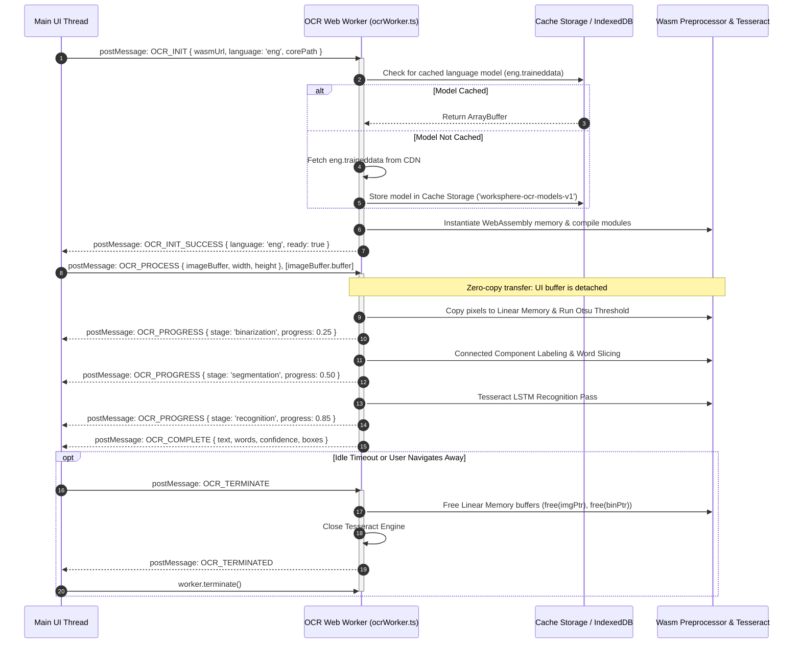

# Tesseract Web Worker Message Protocol & Memory Lifecycle Architecture

This document details the background optical character recognition (OCR) worker architecture in WorkSphere. It covers worker instantiation, the structured clone message protocol (`OCR_INIT` $\to$ `OCR_PROCESS` $\to$ `OCR_PROGRESS` $\to$ `OCR_COMPLETE`), traineddata language model caching via the Cache Storage API / IndexedDB, and memory lifecycle optimizations for low-end mobile devices.

Implemented in:
- **Web Worker Engine:** [`src/workers/ocrWorker.ts`](file:///c:/Users/admin/Desktop/workfere/src/workers/ocrWorker.ts)
- **Amenity Extraction Classifier:** [`src/core/ocr/AmenityClassifier.ts`](file:///c:/Users/admin/Desktop/workfere/src/core/ocr/AmenityClassifier.ts)
- **WASM Preprocessing Pipeline:** [`src/wasm/ocr/image_binarize.c`](file:///c:/Users/admin/Desktop/workfere/src/wasm/ocr/image_binarize.c) & [`src/wasm/ocr/character_segment.c`](file:///c:/Users/admin/Desktop/workfere/src/wasm/ocr/character_segment.c)
- **API Extraction Gateway:** [`src/app/api/venues/ocr/extract/route.ts`](file:///c:/Users/admin/Desktop/workfere/src/app/api/venues/ocr/extract/route.ts)

---

## 1. Executive Summary & Problem Statement

Extracting text from photos of coffee shop menus, venue notices, chalkboard amenity boards, and Wi-Fi cards involves computationally intensive neural network inference (LSTM) and morphological computer vision filters. Executing these operations on the browser main UI thread results in severe consequences:
- **Main Thread Starvation:** Frame rates drop from $60\text{ fps}$ to $< 5\text{ fps}$, causing frozen scroll gestures and unresponsive touch controls.
- **Garbage Collection Pressure:** Loading uncompressed $12\text{MP}$ camera bitmaps ($4000 \times 3000 \times 4\text{ bytes} \approx 48\text{ MB}$) triggers generational garbage collection pauses.
- **Out-of-Memory (OOM) Mobile Crashes:** Low-end mobile devices (e.g. Android devices with $2\text{GB} - 3\text{GB}$ RAM and strict per-tab heap quotas of $256\text{MB} - 512\text{MB}$) crash when Tesseract language models and image buffers coexist in heap memory.

WorkSphere offloads all image filtering, binarization, and Tesseract recognition to a dedicated background **Web Worker (`ocrWorker.ts`)** running WebAssembly with zero main-thread blocking.

```mermaid
flowchart TD
    subgraph MainThread ["Main Browser Thread (UI)"]
        UserCapture["Camera Capture / File Upload"] --> CanvasDownscale["Downscale to Max 1920x1080<br/>Extract Uint8ClampedArray"]
        CanvasDownscale --> PostMsgInit["Worker Pool Manager<br/>postMessage({ type: 'OCR_INIT' })"]
        PostMsgInit --> PostMsgProcess["postMessage({ type: 'OCR_PROCESS' }, [transferable])"]
        WorkerProg["Update Progress Bar UI<br/>onmessage: OCR_PROGRESS"]
        WorkerComp["Populate Amenity Form<br/>onmessage: OCR_COMPLETE"]
    end

    subgraph WebWorker ["Dedicated Web Worker (ocrWorker.ts)"]
        ReceiveInit["Handle OCR_INIT<br/>Fetch / Compile Wasm & Init Engine"] --> CacheCheck{"Traineddata Cached?<br/>(CacheStorage / IDB)"}
        CacheCheck -->|Cache Miss| FetchModel["HTTP Fetch model.traineddata.gz<br/>Decompress to memory"]
        CacheCheck -->|Cache Hit| ReadModel["Read model from CacheStorage"]
        FetchModel --> InitTess["Tesseract Core Instance Ready"]
        ReadModel --> InitTess
        
        InitTess --> ReceiveProcess["Handle OCR_PROCESS"]
        ReceiveProcess --> WasmBinarize["Wasm Preprocessing<br/>Grayscale + Otsu + Median"]
        WasmBinarize --> TessRecognize["Tesseract LSTM OCR Inference<br/>Emit OCR_PROGRESS ticks"]
        TessRecognize --> PostResult["postMessage({ type: 'OCR_COMPLETE', payload })"]
    end

    PostMsgProcess -.->|Transferable Buffer (Zero-Copy)| ReceiveProcess
    TessRecognize -.-> WorkerProg
    PostResult -.-> WorkerComp
```

---

## 2. Worker Lifecycle & Communication Protocol

The communication protocol between the main thread and `ocrWorker.ts` is strictly typed, asynchronous, and asynchronous-message-driven using the structured clone algorithm and transferable objects.

### 2.1 Complete Protocol Sequence



### 2.2 Message Payloads Specification

#### 1. `OCR_INIT` (Main $\to$ Worker)
Initializes the WebAssembly environment and loads language model weights:
```typescript
interface OcrInitMessage {
  type: 'OCR_INIT';
  payload: {
    wasmUrl: string;          // Path to /wasm/image_binarize.wasm
    language: string;         // e.g. 'eng', 'spa', 'deu'
    modelUrl?: string;        // Optional custom traineddata model URL
    tesseractCoreUrl: string; // Path to tesseract-core.wasm
  };
}
```

#### 2. `OCR_PROCESS` (Main $\to$ Worker)
Dispatches image payload to worker. Transferred using **Transferable Objects** to eliminate memory duplication:
```typescript
interface OcrProcessMessage {
  type: 'OCR_PROCESS';
  payload: {
    imageData: Uint8ClampedArray; // RGBA raw pixel array
    width: number;
    height: number;
    jobId: string;
    options?: {
      psm?: number;               // Page segmentation mode (default: 3 = fully automatic)
      dpi?: number;               // Approximate image DPI (default: 300)
    };
  };
}
```

#### 3. `OCR_PROGRESS` (Worker $\to$ Main)
Emits continuous state updates to drive animated progress bars on the frontend:
```typescript
interface OcrProgressMessage {
  type: 'OCR_PROGRESS';
  payload: {
    jobId: string;
    stage: 'preprocessing' | 'binarization' | 'segmentation' | 'recognition';
    progress: number;            // 0.0 to 1.0
    statusText: string;
  };
}
```

#### 4. `OCR_COMPLETE` (Worker $\to$ Main)
Delivers structured recognized text, word coordinates, and confidence metrics:
```typescript
interface OcrCompleteMessage {
  type: 'OCR_COMPLETE';
  payload: {
    jobId: string;
    text: string;
    confidence: number;          // 0 to 100
    boxes: Array<{
      text: string;
      confidence: number;
      bbox: { x0: number; y0: number; x1: number; y1: number };
    }>;
    processingTimeMs: number;
  };
}
```

#### 5. `OCR_ERROR` (Worker $\to$ Main)
Reports non-fatal and fatal exceptions back to error boundaries:
```typescript
interface OcrErrorMessage {
  type: 'OCR_ERROR';
  payload: {
    jobId?: string;
    error: string;
    code: 'WASM_INIT_FAILED' | 'MODEL_FETCH_FAILED' | 'OUT_OF_MEMORY' | 'PROCESSING_FAILED';
  };
}
```

---

## 3. Language Model Caching Strategy (`traineddata`)

Tesseract language model files (`eng.traineddata`) are substantial downloads (fast integer model: $\approx 4.5\text{ MB}$; full model: $\approx 15\text{ MB}$). Downloading this file on every scan is unacceptable in bandwidth-constrained, offline-first coworking venues.

WorkSphere implements a tiered caching hierarchy:

```
┌─────────────────────────────────────────────────────────────┐
│ 1. In-Memory Worker Heap (Uint8Array buffer in module scope)│
├─────────────────────────────────────────────────────────────┤
│ 2. Cache Storage API ('worksphere-ocr-models-v1')           │
├─────────────────────────────────────────────────────────────┤
│ 3. IndexedDB Fallback ('WorkSphereOCRDB' -> 'models')        │
├─────────────────────────────────────────────────────────────┤
│ 4. Network Fetch (CDN with Cache-Control: immutable, 1 year)│
└─────────────────────────────────────────────────────────────┘
```

### Cache Storage Implementation Workflow

```typescript
// Worker model loading routine
async function loadLanguageModel(lang: string, modelUrl: string): Promise<ArrayBuffer> {
  const cacheName = 'worksphere-ocr-models-v1';
  
  // 1. Try Cache Storage API
  if ('caches' in self) {
    const cache = await caches.open(cacheName);
    const cachedResponse = await cache.match(modelUrl);
    if (cachedResponse) {
      return await cachedResponse.arrayBuffer();
    }
    
    // 2. Fetch and store in Cache Storage
    const networkResponse = await fetch(modelUrl);
    if (networkResponse.ok) {
      await cache.put(modelUrl, networkResponse.clone());
      return await networkResponse.arrayBuffer();
    }
  }

  // 3. Fallback to standard network request
  const response = await fetch(modelUrl);
  return await response.arrayBuffer();
}
```

- **Gzip Compression:** Models are stored compressed on origin servers and decompressed via `DecompressionStream('gzip')` inside the worker, saving $60\%$ bandwidth.
- **Cache Eviction Policy:** Unused language models are pruned using an LRU policy if device storage quota is constrained ($> 50\text{MB}$ total offline allocation).

---

## 4. Memory Footprint Optimization for Low-End Mobile Devices

Mobile browsers on budget devices enforce strict memory limits. If a tab exceeds its allocated limit, the operating system silently terminates the tab process. WorkSphere applies four key architectural techniques:

### 4.1 Strict Canvas Resolution Pre-Clamping
Full-resolution smartphone photos ($12\text{MP} - 48\text{MP}$) are never transferred directly to the worker. The main UI thread downscales images onto an offscreen canvas prior to transfer:

$$\text{Scale Factor } s = \min\left(1.0, \; \frac{1920}{\max(\text{width}, \text{height})}\right)$$

- Downscaling a $4000 \times 3000$ image ($12\text{MP}$, $48\text{MB}$ uncompressed) to $1600 \times 1200$ ($1.92\text{MP}$, $7.68\text{MB}$) achieves an **$84\%$ memory reduction** while preserving character clarity for OCR.

### 4.2 Zero-Copy Transferable Objects
Passing large pixel buffers via structured cloning copies memory, doubling peak memory consumption:

```typescript
// BAD: Structured Clone (Duplicates 8MB -> 16MB heap consumption)
worker.postMessage({ type: 'OCR_PROCESS', payload: { imageData } });

// GOOD: Transferable ArrayBuffer (Zero-copy, buffer ownership moved)
const buffer = imageData.data.buffer;
worker.postMessage({ type: 'OCR_PROCESS', payload: { ... } }, [buffer]);
```

When transferred, the buffer on the main thread is cleared (`byteLength === 0`), eliminating memory spikes.

### 4.3 WebAssembly Linear Memory Pre-Allocation & Reuse
In [`src/workers/ocrWorker.ts`](file:///c:/Users/admin/Desktop/workfere/src/workers/ocrWorker.ts#L18-L20):
- Memory is instantiated with an initial page count:
  $$\text{Initial Pages} = 256 \times 64\text{ KB} = 16\text{ MB}$$
- Memory is **not reallocated per frame**. A single contiguous buffer handles the grayscale conversion (`imgPtr = 0`) and Otsu binary output (`binPtr = pixelCount`).
- Reusing memory blocks eliminates V8 garbage collection pauses and prevents heap fragmentation.

### 4.4 Worker Termination & Teardown Lifecycle
Web Workers continue consuming substantial background memory ($20\text{MB} - 40\text{MB}$) if left running after inference completes.

WorkSphere uses an **Inactivity Teardown Timer**:
```typescript
export class OcrWorkerClient {
  private worker: Worker | null = null;
  private idleTimer: NodeJS.Timeout | null = null;
  private readonly IDLE_TIMEOUT_MS = 30000; // 30 seconds

  private resetIdleTimer(): void {
    if (this.idleTimer) clearTimeout(this.idleTimer);
    this.idleTimer = setTimeout(() => {
      this.terminateWorker();
    }, this.IDLE_TIMEOUT_MS);
  }

  public terminateWorker(): void {
    if (this.worker) {
      this.worker.postMessage({ type: 'OCR_TERMINATE' });
      this.worker.terminate();
      this.worker = null;
    }
  }
}
```

If no OCR request occurs within $30$ seconds, the worker is terminated and all associated Wasm linear memory is released back to the operating system.

---

## 5. Security & Isolation Safeguards

1. **Same-Origin Worker Sandbox:** `ocrWorker.ts` runs inside an isolated worker realm without access to `window`, `document`, or DOM elements.
2. **No Network Access in Processing Pass:** During image parsing and binarization, the worker performs zero network requests, preventing data exfiltration of sensitive captured documents (e.g., credit cards, private documents).
3. **CSP Worker-Src Compliance:** Worker instantiation complies with the Content Security Policy header:
   ```http
   Content-Security-Policy: worker-src 'self' blob:; script-src 'self' 'wasm-unsafe-eval';
   ```
