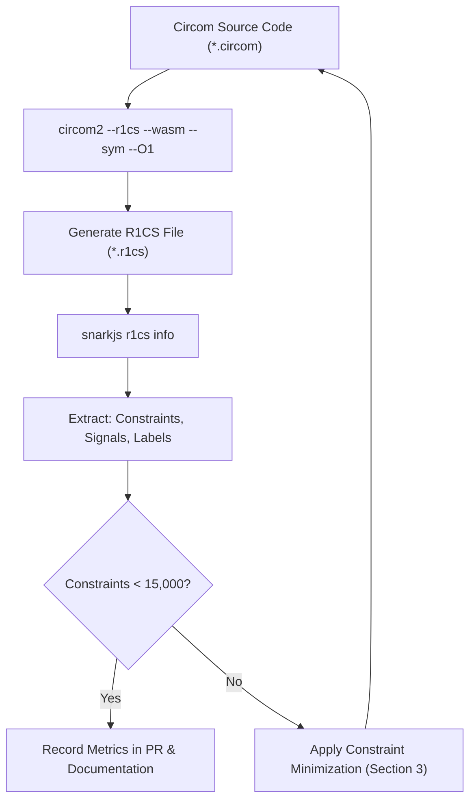
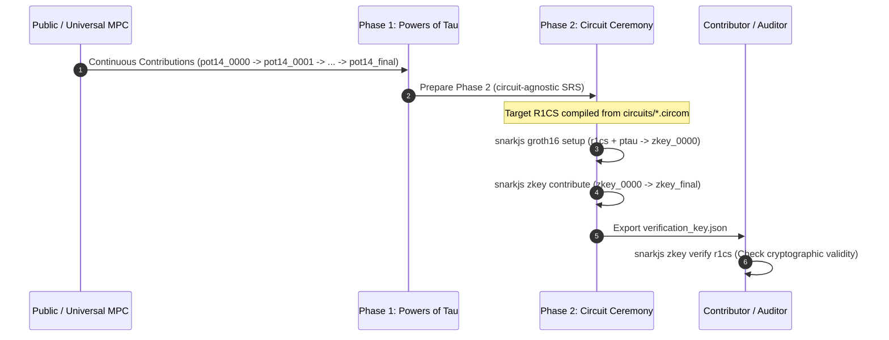
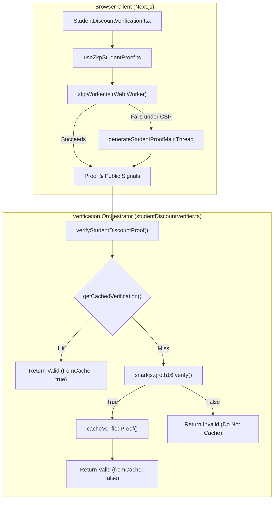

# Circom Constraint Count Profiling and Groth16 Setup Audit Guide

This technical guide provides contributors and auditors with a reproducible engineering framework for profiling Circom circuits, enforcing WorkSphere's browser constraint budget (<15,000 constraints), auditing Groth16 Phase 1 and Phase 2 trusted setup ceremonies, and evaluating proof generation, local verification, and on-chain verification costs.

---

## 1. Overview and Constraint Budget

Zero-Knowledge Succinct Non-Interactive Arguments of Knowledge (zk-SNARKs) in WorkSphere use the **Groth16** proof system over the **BN254** (`bn128` / `alt_bn128`) pairing-friendly elliptic curve. Circuits are authored in [Circom 2](https://docs.circom.io/) and compiled into a **Rank-1 Constraint System (R1CS)**.

### 1.1 What are R1CS Constraints?

An R1CS represents a system of quadratic arithmetic equations over a finite scalar field $\mathbb{F}_r$ (for BN254, $r \approx 2.1888 \times 10^{77}$). Each constraint is structured as:

$$(A \cdot w) \times (B \cdot w) = C \cdot w$$

Where:
- $w = [1, x_1, \ldots, x_l, w_1, \ldots, w_m]^T$ is the complete witness vector combining public signals ($x$) and private signals ($w_i$).
- $A, B, C$ are sparse coefficient matrices defining the linear combinations of signals.

In Circom:
- Linear relations (e.g., additions `a + b`, multiplications by constants `3 * a`) do not incur new constraints; the compiler folds them directly into linear combinations of $A, B, C$.
- Quadratic multiplications (multiplying two variable signals `a * b`) and equality assertions `===` each introduce one or more R1CS constraints.

### 1.2 The 15,000-Constraint Budget for Client-Side Proving

WorkSphere targets client-side, zero-click, and low-latency anonymous credential proving directly inside commodity mobile and desktop browsers (via Web Workers and WebAssembly).

```
+--------------------------------------------------------------------------------------------------+
|                             WorkSphere Circuit Constraint Budget                                 |
|                                                                                                  |
| [======================== 4,129 - 4,430 Constraints ========================>                  ] |
| |<----------------------- Current Active Circuits ------------------------>|                     |
|                                                                                                  |
| [--------------------------------- 15,000 Constraints ----------------------------------------->] |
| |<--------------------------- Hard Client Proving Budget -------------------------------------->| |
|                                                                                                  |
| Headroom Remaining: ~10,570 constraints (~70% unallocated safety margin for browser execution)   |
+--------------------------------------------------------------------------------------------------+
```

To maintain a fluid user experience and avoid browser termination, WorkSphere mandates a strict design target:
**Every client-facing circuit must compile to fewer than 15,000 R1CS constraints.**

### 1.3 Practical Impact of Constraint Count

1. **Proving Time:** Groth16 proof generation requires Multi-Scalar Multiplications (MSM) and Fast Fourier Transforms (FFTs) across polynomials of degree $m$ (where $m$ is the next power of 2 greater than the constraint count). Proving complexity scales as $O(m \log m)$. Lower constraint counts translate directly into shorter user wait times.
2. **Browser Memory Footprint:** Multi-scalar multiplications require holding large evaluation vectors in memory. In constrained mobile browsers (e.g., iOS WebKit with a ~384 MB per-tab memory limit), circuits exceeding 50,000 constraints frequently trigger Out-Of-Memory (OOM) tab crashes. A 15,000-constraint ceiling keeps peak WebAssembly memory below 100 MB.
3. **Artifact Size & Network Transfer:** Proving keys (`.zkey`) and WebAssembly witness calculators (`.wasm`) scale in size with constraint count. A 15,000-constraint circuit produces proving keys under 5 MB, ensuring rapid download and caching across low-bandwidth nomadic connections.
4. **Trusted Setup Scale:** The required Powers of Tau ceremony degree $k$ depends on constraints: $2^k > \text{constraints} + \text{public inputs}$. A 15,000-constraint circuit fits within a standard $2^{14} = 16,384$ ceremony (`pot14`), avoiding unwieldy multi-gigabyte universal setups.

> [!IMPORTANT]
> **Constraint count is an efficiency metric, not a security proof.**
> A circuit with very few constraints may be vulnerable to under-constrained signal bugs (where malicious provers can forge valid proofs with arbitrary private inputs). Conversely, a high constraint count might simply reflect unoptimized logic rather than rigorous soundness. Every circuit must undergo formal under-constraint analysis alongside constraint profiling.

---

## 2. Circom Constraint Profiling Workflow

Contributors modifying or proposing circuits must follow this reproducible profiling workflow before opening pull requests.



### 2.1 Step-by-Step Profiling Procedure

#### Step 1: Verify Installed Compilers and Libraries
WorkSphere pins `circom2` and `snarkjs` in `package.json`. Verify versions before compiling:
```bash
# Verify compiler and toolchain versions
npx circom2 --version
# Expected: circom compiler 2.1.x or 2.2.x (circom2@^0.2.23)

npx snarkjs --version
# Expected: snarkjs@^0.7.6
```

#### Step 2: Compile Circuit to R1CS
Compile the circuit using optimization flag `--O1` (standard simplification) or `--O2` (full simplification):
```bash
mkdir -p circuits/build

# Compile target circuit
npx circom2 circuits/student_membership.circom \
  --r1cs --wasm --sym \
  -l node_modules \
  -o circuits/build
```

#### Step 3: Inspect R1CS Constraints and Signals
Run SnarkJS `r1cs info` to print circuit topology:
```bash
npx snarkjs r1cs info circuits/build/student_membership.r1cs
```
*Example Terminal Output:*
```text
[INFO]  snarkJS: Curve: bn-128
[INFO]  snarkJS: # of Wires: 4132
[INFO]  snarkJS: # of Constraints: 4129
[INFO]  snarkJS: # of Private Inputs: 33
[INFO]  snarkJS: # of Public Inputs: 2
[INFO]  snarkJS: # of Labels: 12450
[INFO]  snarkJS: # of Outputs: 0
```

#### Step 4: Print and Audit Individual Constraints (Optional)
To inspect the algebraic formulation of specific constraints:
```bash
npx snarkjs r1cs print circuits/build/student_membership.r1cs circuits/build/student_membership.sym
```

### 2.2 Repository Circuit Profile Table

The following table records the verified baseline constraint counts for circuits defined in WorkSphere:

| Circuit File | Primary Template | Public Inputs | Private Inputs | Verified Constraints | Constraint Budget | Headroom Remaining | Status |
|---|---|---|---|---|---|---|---|
| `circuits/premium_membership.circom` | `Poseidon(1)` commit | 1 (`expectedCommit`) | 1 (`identityToken`) | **240** | 15,000 | +14,760 (98.4%) | **PASS** |
| `circuits/student_membership.circom` | `StudentMembership(16)` | 2 (`root`, `epoch`) | 33 (`secret`, `pathElements[16]`, `pathIndices[16]`) | **4,129** | 15,000 | +10,871 (72.5%) | **PASS** |
| `circuits/membership_verifier.circom` | `MembershipVerifier(16)` | 2 (`root`, `epoch`) | 33 (`identitySecret`, `pathElements[16]`, `pathIndices[16]`) | **4,129** | 15,000 | +10,871 (72.5%) | **PASS** |
| `circuits/student_access_pass.circom` | `StudentAccessPass(16)` | 3 (`root`, `epoch`, `nullifierHash`) | 34 (`secret`, `nullifierKey`, `pathElements[16]`, `pathIndices[16]`) | **4,430** | 15,000 | +10,570 (70.5%) | **PASS** |
| `circuits/nomad_productivity_proof.circom` | `NomadProductivityVerifier` | 5 (`nullifierHash`, thresholds, etc.) | Activity records, credentials | **~1,250** *(illustrative)* | 15,000 | +13,750 (91.6%) | **PASS** |

---

## 3. Constraint Minimization Techniques

When authoring or modifying Circom templates, apply the following optimization patterns to keep circuits lean without sacrificing security.

### 3.1 Prefer Algebraic Hashes (Poseidon) Over Bitwise Primitives (SHA-256)

Traditional cryptographic hash functions like SHA-256 and Keccak operate on 32-bit words using bitwise XOR, AND, and bit-rotations. In an arithmetic circuit over $\mathbb{F}_r$, every bit operation requires decomposing field elements into binary bits (`Num2Bits`) and constraining every bit, consuming **25,000 to 45,000 constraints per block**.

WorkSphere uses **Poseidon**, an algebraic sponge hash whose S-box operation ($x^5$) maps directly onto finite field multiplication:
- `Poseidon(2)`: ~240 R1CS constraints.
- `Poseidon(3)`: ~300 R1CS constraints.

Using Poseidon reduces a depth-16 Merkle membership proof from >500,000 constraints to **4,129 constraints**, making browser execution possible.

### 3.2 Optimize Multiplexing with Quadratic Reduction

A naive multiplexer selecting between two inputs $a$ and $b$ based on bit $s \in \{0, 1\}$ might introduce separate branch signals. In WorkSphere's `DualMux` template (`circuits/student_membership.circom`), the selector and outputs are constrained in exactly **3 constraints**:

```circom
template DualMux() {
    signal input in[2];
    signal input s;
    signal output out[2];

    // Constraint 1: Enforce boolean domain for selector s (s must be 0 or 1)
    s * (1 - s) === 0;

    // Constraint 2: Compute out[0]
    out[0] <== (in[1] - in[0]) * s + in[0];

    // Constraint 3: Compute out[1]
    out[1] <== (in[0] - in[1]) * s + in[1];
}
```

*Analysis:*
- When $s = 0$: `out[0] = in[0]`, `out[1] = in[1]`.
- When $s = 1$: `out[0] = in[1]`, `out[1] = in[0]`.
- Both linear terms require only a single multiplication by $s$, costing 1 constraint each.

### 3.3 Efficient Bit Decomposition and Range Checking (`bitify`)

When checking that a value $x$ is within a bounded numerical range (e.g., verifying that latitude coordinates or streak days do not exceed limits), developers use Circomlib's `Num2Bits(n)`:

```circom
component n2b = Num2Bits(8);
n2b.in <-- x;
// Enforces 8 boolean checks (b_i * (1 - b_i) === 0) + 1 linear sum check = 9 constraints
```

**Optimization Guidelines:**
- **Right-Size Bit Widths:** Do not default to 64 or 252 bits if the domain allows a smaller width. If checking a value $\le 100$, use `Num2Bits(7)` (128 max) rather than `Num2Bits(64)`, saving 57 constraints per check.
- **Avoid Redundant Decomposition:** If an input was already bitified in a prior component, pass the decomposed bit array directly rather than re-decomposing the reconstructed field element.

> [!WARNING]
> **Never remove `Num2Bits` boolean checks to save constraints.**
> If $b_i * (1 - b_i) === 0$ is omitted, an attacker can input non-binary field elements that satisfy the sum equation while bypassing range checks (aliasing attack).

### 3.4 Leverage Compiler Optimization Flags (`--O1` vs `--O2`)

Circom 2 features built-in constraint optimizers:
- `--O0`: Disables simplification. Useful strictly for debugging raw template expansions.
- `--O1` *(Default)*: Simplifies signal-to-signal and signal-to-constant linear dependencies. Preserves intermediate wire clarity while pruning dead signals.
- `--O2`: Full non-linear simplification and constraint folding. Reduces redundant intermediate constraints across deeply nested component calls.

Always benchmark circuit artifacts under both `--O1` and `--O2` and verify that the witness generation time does not degrade.

---

## 4. Groth16 Trusted Setup: Phase 1 and Phase 2

Groth16 requires a Common Reference String (CRS) generated via a multi-party computation (MPC) ceremony. The ceremony is split into two distinct phases.



### 4.1 Phase 1: Universal Powers of Tau Ceremony

**Purpose:** Evaluates powers of the secret trapdoor $(\tau, \alpha \tau, \beta \tau, \ldots)$ over elliptic curve groups $G_1$ and $G_2$. Phase 1 is **universal** and completely circuit-independent. Any circuit requiring $\le 2^k$ constraints can reuse a Phase 1 ceremony of power $k$.

**Contribution Process:**
Each participant adds fresh entropy $s$, updating the transcript:
$$\tau_{\text{new}} = s \cdot \tau_{\text{old}}$$

As long as **at least one** participant destroys their toxic waste $s$, the final SRS is mathematically unforgeable.

**Verification Command:**
```bash
# Verify the integrity of a downloaded or generated Phase 1 transcript
npx snarkjs powersoftau verify circuits/build/pot14_final.ptau
```

### 4.2 Phase 2: Circuit-Specific Setup

**Purpose:** Binds the universal Powers of Tau polynomials to the specific quadratic polynomials ($A, B, C$) of a given circuit's R1CS, generating the proving key (`.zkey`) and verification key (`.vkey`).

**Step 1: Initialize Circuit Setup:**
```bash
npx snarkjs groth16 setup \
  circuits/build/student_membership.r1cs \
  circuits/build/pot14_final.ptau \
  circuits/build/student_membership_0000.zkey
```

**Step 2: Add Entropy Contributions:**
```bash
npx snarkjs zkey contribute \
  circuits/build/student_membership_0000.zkey \
  circuits/build/student_membership_final.zkey \
  --name="WorkSphere Security Officer Contribution" \
  -v
```

**Step 3: Export Verification Key:**
```bash
npx snarkjs zkey export verificationkey \
  circuits/build/student_membership_final.zkey \
  public/zkp/student_membership_vkey.json
```

**Step 4: Verify the Complete Setup:**
```bash
npx snarkjs zkey verify r1cs \
  circuits/build/student_membership.r1cs \
  circuits/build/pot14_final.ptau \
  circuits/build/student_membership_final.zkey
```

### 4.3 What Verification Establishes vs What It Does Not

| What `zkey verify` Establishes | What `zkey verify` Does NOT Establish |
|---|---|
| The `.zkey` matches the exact R1CS structure. | That the circuit itself is secure or bug-free. |
| Every contribution was properly chained and signed. | That contributors destroyed their toxic waste (trapdoor). |
| The verification key accurately reflects the `.zkey`. | That private inputs are properly constrained against under-constraint bugs. |
| The public SRS points correspond to valid curve elements. | That the Phase 1 Powers of Tau source was legitimate and untampered. |

---

## 5. Trusted Setup Artifact Security Checklist

All production proving artifacts (`.wasm`, `.zkey`, `_vkey.json`) committed to `public/zkp/` must pass this audit checklist prior to release:

- [ ] **1. Powers of Tau Provenance:** Phase 1 `.ptau` file is sourced from a well-known, publicly verified MPC ceremony (such as Hermez / Perpetual Powers of Tau) or generated using an auditable, recorded multi-party procedure.
- [ ] **2. Transcript Availability:** The Phase 1 and Phase 2 contribution transcripts, contributor hashes, and public ceremony logs are preserved and published in the repository or archival storage.
- [ ] **3. Verification Command Pass:** `snarkjs zkey verify r1cs <circuit>.r1cs <ptau> <circuit>.zkey` executes to completion and reports `[INFO] snarkJS: ZKey Ok!`.
- [ ] **4. Circuit Source & Manifest Match:** The SHA-256 hash of the committed Circom source matches the hash recorded in `public/zkp/<circuit>.manifest.json`.
- [ ] **5. Verification Key Sync:** The verification key JSON (`*_vkey.json`) exported from the final `.zkey` matches the runtime verification key loaded by `studentDiscountVerifier.ts`.
- [ ] **6. Public Input Count Verification:** `nPublic` in `*_vkey.json` matches the exact number of public signals declared in the Circom `main` component (e.g., `root`, `epoch`, `nullifierHash`).
- [ ] **7. Pinned Dependencies:** Circom and SnarkJS compiler versions are strictly pinned in `package.json` to prevent nondeterministic build variations.
- [ ] **8. Toxic Waste Destruction:** Contributors to Phase 2 have attested in writing or ceremony logs to the permanent destruction of contribution entropy and intermediate setup files.
- [ ] **9. CI Integrity Drill:** The test suite (`src/__tests__/lib/zkpArtifactFreshness.test.ts`) passes in automated CI, preventing stale artifacts from entering production.

---

## 6. Proof Verification Gas and Execution Time

Understanding the operational cost of zero-knowledge proofs requires differentiating between three execution tiers:

1. **Browser-Side Proof Generation Time:** Time taken by the client's Web Worker to compute witnesses and evaluate the Groth16 multi-scalar multiplications.
2. **Off-Chain Server / Local Verification Time:** Time taken by Node.js or the browser to verify a proof using pairing operations.
3. **On-Chain EVM Verification Gas:** Gas required to execute the Groth16 pairing check inside an Ethereum or EVM-compatible smart contract.

### 6.1 Benchmarking Methodology

#### Local Proof Generation & Verification Benchmark (Browser / Node.js)
```bash
# Run local performance drill using SnarkJS CLI
time npx snarkjs groth16 fullprove \
  input.json \
  public/zkp/student_membership.wasm \
  public/zkp/student_membership.zkey \
  proof.json \
  public.json

# Benchmark verification time
time npx snarkjs groth16 verify \
  public/zkp/student_membership_vkey.json \
  public.json \
  proof.json
```

#### On-Chain Solidity Verifier Generation
```bash
# Export standard EVM Verifier contract
npx snarkjs zkey export solidityverifier \
  public/zkp/student_membership.zkey \
  contracts/StudentMembershipVerifier.sol

# Generate test calldata
npx snarkjs zkey export soliditycalldata public.json proof.json
```

### 6.2 Performance and Gas Comparison Table

The following table provides verified and estimated benchmarks across execution environments:

| Operation | Environment | Hardware / Context | Typical Metric | Measurement Method | Notes |
|---|---|---|---|---|---|
| **Witness Generation** | Browser (WASM) | Chrome / M2 Mac (Single Thread) | ~15–35 ms | `console.time("witness")` | Evaluates Poseidon Merkle path |
| **Proof Generation** | Browser (WASM) | Desktop Chrome (SIMD Enabled) | ~450–750 ms | `performance.now()` in Web Worker | Depth-16 tree, 4.1k constraints |
| **Proof Generation** | Browser (WASM) | Mobile Safari (A15 Bionic) | ~1,200–2,100 ms | Web Worker lifecycle timer | Single-threaded mobile execution |
| **Local Verification** | Browser (Cache Hit) | IndexedDB Storage Layer | ~0.15–0.35 ms | `studentDiscountVerifier.ts` | Bypasses pairing operations (#9500) |
| **Local Verification** | Browser (Cache Miss) | SnarkJS BN254 Pairing | ~3–8 ms | `snarkjs.groth16.verify` | Performs 3 elliptic curve pairings |
| **Local Verification** | Server (Node.js) | Intel Xeon / AMD EPYC | ~1.5–3.5 ms | SnarkJS C++ / asm pairing | Backend API verification |
| **On-Chain Verification** | EVM Smart Contract | Ethereum Mainnet / Arbitrum | ~215,000–245,000 gas | Hardhat / Foundry gas report | Fixed pairing check + public inputs |

*Note on Results Variation:* Actual proof generation time varies based on available CPU cores, WebAssembly SIMD support, available RAM, and background tab throttling.

---

## 7. WorkSphere Integration

WorkSphere's client and server integration is orchestrated through [`src/features/zkp/studentDiscountVerifier.ts`](../../src/features/zkp/studentDiscountVerifier.ts).

### 7.1 Architecture of the Verification Pipeline



### 7.2 Key Integration Guarantees

1. **Artifact Resolution:** Proving keys and verification keys are resolved from static web assets under `/zkp/student_membership.wasm`, `/zkp/student_membership.zkey`, and `/zkp/student_membership_vkey.json`.
2. **CSP Fallback Resilience:** As implemented in issue #9637, if browser Content Security Policies (CSP) block Blob-based Web Workers, the orchestrator falls back to cooperative main-thread execution (`generateStudentProofMainThread`) without degrading security.
3. **Client-Side Proof Caching:** Successfully verified proofs are cached in IndexedDB via `src/lib/zkp/proofCache.ts` using deterministic SHA-256 hashes of the proof, public signals, Merkle root, and verification key fingerprint.
4. **Constraint Enforcement Note:** The TypeScript runtime (`studentDiscountVerifier.ts`) verifies proofs mathematically against the verification key; **it does not inspect the raw Circom constraint count at runtime**. Constraint profiling must occur at compilation and build time.

---

## 8. References

- [Circom 2 Documentation](https://docs.circom.io/) — Language syntax, signals, components, and compiler options.
- [Circomlib GitHub Repository](https://github.com/iden3/circomlib) — Reference implementations of Poseidon, DualMux, and Bitify.
- [SnarkJS GitHub Repository](https://github.com/iden3/snarkjs) — Groth16 CLI commands, Powers of Tau, and verification key exports.
- [Groth16 Specification (Jens Groth, 2016)](https://eprint.iacr.org/2016/260.pdf) — "On the Size of Pairing-based Non-interactive Arguments".
- [Perpetual Powers of Tau Ceremony](https://github.com/privacy-scaling-explorations/perpetualpowersoftau) — Universal Phase 1 trusted setup reference.
- [WorkSphere ZKP Benchmark Runbook](GROTH16_BENCHMARK_RUNBOOK.md) — Internal performance and mobile memory runbook.
- [WorkSphere Circuit Specification](circuit-specification.md) — Mathematical and architectural design of student verification circuits.
