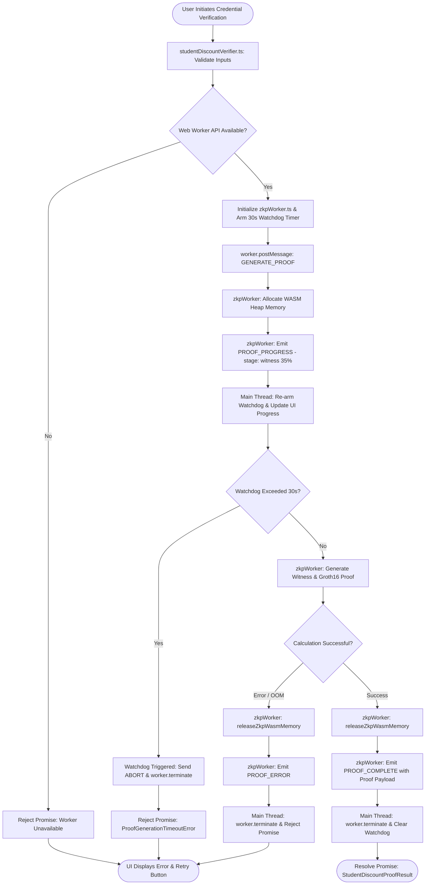

# Circom Witness Generation Worker Pool Architecture

> **Technical Architecture Specification & Operational Reference**  
> **Status:** Architecture Reference & Verification Lifecycle  
> **Target Subsystems:** Zero-Knowledge Proofs (`src/workers/zkpWorker.ts`, `src/features/zkp/studentDiscountVerifier.ts`, `src/lib/zkp/batch.ts`, `src/hooks/useZkpStudentProof.ts`)  
> **Mathematical & Cryptographic Substrates:** BN254 (alt_bn128) Elliptic Curve, Circom 2, Groth16 Prover / SnarkJS  
> **Related Documentation:** [`docs/security/ZKP_VERIFICATION_RUNBOOK.md`](../security/ZKP_VERIFICATION_RUNBOOK.md), [`docs/crypto/ZK_GROTH16_VERIFICATION.md`](../crypto/ZK_GROTH16_VERIFICATION.md), and [`docs/api/zkp-checkin.openapi.yaml`](../api/zkp-checkin.openapi.yaml)

---

## A. Overview

In WorkSphere, zero-knowledge proofs (ZKPs) allow digital nomads and university students to verify private credentials—such as student status or membership tier—without exposing underlying identifiers, university emails, or passport numbers on public networks or on-chain ledgers.

### The Computational Bottleneck of BN254 Witness Generation
Generating a zero-knowledge membership proof involves two major computational phases:
1. **Witness Generation (R1CS Constraint Evaluation):** Computing intermediate circuit wire values by executing compiled WebAssembly arithmetic on the BN254 scalar field ($\mathbb{F}_r$ where $r = 21888242871839275222246405745257275088548364400416034343698204186575808495617$).
2. **Groth16 Proving (Multi-Scalar Multiplication & FFTs):** Performing elliptic curve point additions and scalar multiplications across $\mathbb{G}_1$ and $\mathbb{G}_2$ groups.

In a single-threaded JavaScript execution context, witness generation and elliptic curve arithmetic monopolize the CPU for hundreds of milliseconds to several seconds. If executed directly on the browser's main UI thread:
- The UI becomes completely unresponsive, dropping frames and freezing animations.
- Keystrokes, mouse events, and WebRTC streaming buffers stutter.
- Mobile browsers frequently display "Page Unresponsive" dialogs or terminate the tab.

### Purpose of Web Worker Isolation
Moving witness calculation and proof synthesis into dedicated Web Workers offloads heavy CPU cycles and memory allocations into isolated operating system threads. The main browser thread remains free to handle 60 fps rendering, user input, and real-time mesh communications.

### Current Scope in WorkSphere: Single Dedicated Worker vs. Worker Pool
*Crucial Architecture Clarification:*
- **Client-Side Student Verification (`studentDiscountVerifier.ts` / `useZkpStudentProof.ts`):** Operates on a **single dedicated on-demand Web Worker** (`zkpWorker.ts`) per proof session. The worker is instantiated when a verification begins, monitored by a 30-second watchdog timer, and explicitly terminated (`worker.terminate()`) upon completion or timeout.
- **Server/Batch Context (`src/lib/zkp/batch.ts`):** Implements a multi-worker orchestration class (`BatchStudentZkpWorkerPool`) for concurrent multi-venue verification batches.
- The concept of a continuous multi-threaded worker pool on the client is an architectural evolution for handling parallel multi-credential evaluations.

---

## B. Architecture and Components

The zero-knowledge client subsystem coordinates credential inputs, worker execution threads, and watchdog timers across browser boundaries.

```
+-----------------------------------------------------------------------------------------+
|                                    MAIN BROWSER THREAD                                  |
|                                                                                         |
|  +--------------------------------+                  +-------------------------------+  |
|  |       UI / React Hook          |                  |  createStudentDiscountVerifier |  |
|  |  (useZkpStudentProof / UI)     |                  |       (Watchdog Manager)      |  |
|  +--------------------------------+                  +-------------------------------+  |
|                  |                                                   |                  |
|                  | 1. Input: { studentId, domain, nonce }            |                  |
|                  v                                                   |                  |
|  +-----------------------------------------------------------------+ |                  |
|  |             ZKP Watchdog Timer (ZKP_WATCHDOG_TIMEOUT_MS = 30s)  | |                  |
|  |   - Monitors monotonic progress messages                        | |                  |
|  |   - Dispatches { type: 'ABORT' } on timeout                     | |                  |
|  |   - Enforces worker.terminate() cleanup                         | |                  |
|  +-----------------------------------------------------------------+ |                  |
+----------------------------------------------------------------------┼------------------+
                                                                       |
                            Structured Clone Message Protocol          | postMessage
                            (Web Worker Boundary)                      |
                                                                       v
+-----------------------------------------------------------------------------------------+
|                                WEB WORKER THREAD (zkpWorker.ts)                         |
|                                                                                         |
|  +-----------------------------------------------------------------------------------+  |
|  |                           handleZkpWorkerMessage                                  |  |
|  |   - Validates incoming ZkpProofRequest ('GENERATE_PROOF' | 'ABORT')               |  |
|  |   - Tracks active request lifecycle & abortedRequestId                            |  |
|  +-----------------------------------------------------------------------------------+  |
|                                          |                                              |
|                                          v                                              |
|  +-----------------------------------------------------------------------------------+  |
|  |                        runGroth16WitnessAndProof                                  |  |
|  |   - Emits PROOF_PROGRESS (stage: 'witness', 35%)                                  |  |
|  |   - WebAssembly Heap Allocation (activeWasmHeapRef)                               |  |
|  |   - Emits PROOF_PROGRESS (stage: 'proving', 80%)                                  |  |
|  |   - Evaluates constraints & generates Groth16 proof (pi_a, pi_b, pi_c)            |  |
|  |   - Calls releaseZkpWasmMemory()                                                  |  |
|  |   - Emits PROOF_COMPLETE (proof + publicSignals)                                  |  |
|  +-----------------------------------------------------------------------------------+  |
+-----------------------------------------------------------------------------------------+
```

### Component Inventory

| Component | Responsibility | Input | Output | Source File |
| :--- | :--- | :--- | :--- | :--- |
| **`StudentDiscountVerification`** | UI trigger and presentation layer | User university credentials | Progress updates, verified discount badge | `src/components/student/StudentDiscountVerification.tsx` |
| **`useZkpStudentProof`** | React hook binding UI state to proof generation | `StudentDiscountProofInput` | `status`, `progress`, `proof`, `error` | `src/hooks/useZkpStudentProof.ts` |
| **`createStudentDiscountVerifier`** | Orchestrates worker lifecycle and timeout enforcement | `StudentDiscountProofInput`, options | Promise resolving `StudentDiscountProofResult` | `src/features/zkp/studentDiscountVerifier.ts` |
| **Watchdog Timer** | Enforces 30-second execution ceiling; prevents hung threads | Timeouts / `PROOF_PROGRESS` events | Abort signal and `worker.terminate()` | `src/features/zkp/studentDiscountVerifier.ts` |
| **`zkpWorker.ts`** | Background worker thread executing witness & proof math | `ZkpProofRequest` | `ZkpWorkerOutgoingMessage` | `src/workers/zkpWorker.ts` |
| **`BatchStudentZkpWorkerPool`** | Multi-worker concurrency pool for batch verification | Array of proof items | Aggregated verification results | `src/lib/zkp/batch.ts` |

---

## C. Web Worker Lifecycle

The lifecycle of WorkSphere's client-side ZKP worker is strictly tied to individual proof requests to ensure that long-running cryptographic state does not leak across sessions.

### 1. Initialization and Script Loading
When `generateStudentDiscountProof` is invoked:
- A new instance of `Worker` is created via `new Worker(new URL('../../workers/zkpWorker.ts', import.meta.url), { type: 'module' })`.
- The browser loads the module worker and initializes the worker global context (`globalThis as WorkerScopeLike`).

### 2. Job Submission and Execution
- The main thread arms the watchdog timer (`ZKP_WATCHDOG_TIMEOUT_MS = 30_000`).
- The main thread submits the payload:
  `worker.postMessage({ type: 'GENERATE_PROOF', requestId, payload: { studentId, institutionDomain, nonce } })`.
- Inside `zkpWorker.ts`, `handleZkpWorkerMessage()` processes the request and calls `runGroth16WitnessAndProof()`.

### 3. Monotonic Progress Reporting
During calculation, the worker emits structured progress events back to the main thread:
- **Witness Stage:** `{ type: 'PROOF_PROGRESS', requestId, stage: 'witness', progress: 35 }`.
- **Proving Stage:** `{ type: 'PROOF_PROGRESS', requestId, stage: 'proving', progress: 80 }`.
Each incoming progress message re-arms the watchdog timer (`armWatchdog()`), ensuring that complex circuits with valid incremental progress are not prematurely terminated.

### 4. Cleanup and Guaranteed Termination
Unlike long-lived worker pools that keep idle workers resident indefinitely, WorkSphere's single-verifier pattern enforces explicit teardown:
- **On Success (`PROOF_COMPLETE`):** The main thread cleans up listeners, calls `worker.terminate()`, nullifies the reference, and resolves the result.
- **On Error (`PROOF_ERROR`):** The worker calls `releaseZkpWasmMemory()`, the main thread terminates the worker, and rejects the promise.
- **On Watchdog Timeout (30s):** The main thread posts `{ type: 'ABORT' }`, immediately invokes `worker.terminate()`, nullifies the reference, and rejects with `ProofGenerationTimeoutError`.
- **On Component Unmount:** The React hook invokes the verifier abort routine, terminating the underlying worker immediately.

---

## D. Message Protocol

The communication between the main thread and `zkpWorker.ts` utilizes a strongly typed JSON message protocol.

### 1. Main Thread to Worker (`ZkpProofRequest`)

| Message `type` | Payload Fields | Purpose | Validation Behavior |
| :--- | :--- | :--- | :--- |
| **`GENERATE_PROOF`** | `requestId?: string`<br>`payload: { studentId?, institutionDomain?, nonce? }` | Triggers witness calculation and Groth16 proof generation. | Must be an object with valid `type`. Missing fields fall back to default seeds. |
| **`ABORT`** | `requestId?: string` | Instructs the worker to cancel calculation and release WASM memory. | Sets `abortedRequestId`. Causes active calculation to return early and nullify heap references. |

### 2. Worker to Main Thread (`ZkpWorkerOutgoingMessage`)

| Message `type` | Payload Fields | Purpose | Handling in Main Thread |
| :--- | :--- | :--- | :--- |
| **`PROOF_PROGRESS`** | `requestId?: string`<br>`stage: 'witness' \| 'proving' \| 'verifying'`<br>`progress: number` (0–100) | Reports incremental computation stage to drive UI progress bars. | Re-arms watchdog timer; dispatches user `onProgress(progress, stage)` callback. |
| **`PROOF_COMPLETE`** | `requestId?: string`<br>`proof: { pi_a, pi_b, pi_c, publicSignals }` | Delivers serialized Groth16 cryptographic proof. | Terminates worker thread; resolves `StudentDiscountProofResult`. |
| **`PROOF_ERROR`** | `requestId?: string`<br>`error: string` | Reports mathematical, memory, or runtime failures. | Terminates worker thread; rejects with descriptive error. |

### Transferable Objects vs. Structured Cloning
*Confirmed Implementation:* Payloads and proof objects currently utilize standard **Structured Cloning**. Binary buffers are passed as standard arrays and strings rather than zero-copy `ArrayBuffer` transferables.

---

## E. BN254 Witness Generation

BN254 (also known as alt_bn128) is a pairing-friendly elliptic curve defined over a 254-bit prime field:
$$y^2 = x^3 + 3 \pmod q$$
where:
$$q = 21888242871839275222246405745257275088696311157297823662689037894645226208583$$

### The Witness Calculation Process
1. **Input Signal Assignment:** Public and private inputs (student identity commitments, university domain hash, and nonce) are assigned to the circuit input wires.
2. **R1CS Evaluation:** The compiled WebAssembly module executes the Rank-1 Constraint System ($A \cdot s \circ B \cdot s = C \cdot s$). Every intermediate signal in the DAG is resolved.
3. **Witness Vector Synthesis:** The complete witness vector $\vec{w}$ (consisting of $1$, public inputs, and all evaluated private signals) is constructed.

### WebAssembly and Memory Constraints
- Witness calculation is executed inside WebAssembly linear memory.
- In `zkpWorker.ts`, `activeWasmHeapRef = new Uint8Array(1024)` represents the active memory buffer tracking the WebAssembly heap.
- The computation inside the worker thread is **synchronous**: once witness generation begins, it occupies the worker event loop until completion or abort check points.

---

## F. SnarkJS Memory and Curve Buffer Recycling

### Confirmed Memory Allocation Behavior
Inspection of `src/workers/zkpWorker.ts` and related ZKP utilities confirms the following memory characteristics:
- **Explicit Release Function:** `zkpWorker.ts` exposes `releaseZkpWasmMemory()`, which explicitly sets `activeWasmHeapRef = null` upon success, error, or abortion.
- **Garbage Collection Reliance:** V8 / JavaScript engine garbage collection is relied upon to reclaim the allocated memory buffers after `activeWasmHeapRef` is cleared or after `worker.terminate()` destroys the worker context.

### Limitations: Absence of Curve Buffer Recycling
- **No In-Memory Pool of TypedArrays:** The worker does not maintain a static pool of pre-allocated `ArrayBuffer` or `Uint8Array` slabs for reuse across successive runs.
- **No Curve Object Caching in Worker:** In full SnarkJS runs, curves instantiated via `snarkjs.curves.getCurveByName("bn128")` create heavy native memory buffers that must be explicitly terminated (`curve.terminate()`). In `zkpWorker.ts`, memory is bounded by allocating fresh buffers per session and terminating the entire worker process upon completion.
- *Architectural Recommendation:* Repeated proof generation without worker termination can induce memory fragmentation; terminating the worker on settlement (`worker.terminate()`) is therefore mandatory.

---

## G. Fallback and Compatibility

The application enforces explicit runtime checks when Web Workers or WebAssembly are unavailable.

| Scenario | Trigger / Condition | Actual Behavior | Source Implementation |
| :--- | :--- | :--- | :--- |
| **Web Workers Unavailable** | `typeof Worker === 'undefined'` (e.g. legacy browsers, strict CSP) | `createWorker()` throws; verifier promise immediately rejects with an error. **No silent main-thread fallback.** | `studentDiscountVerifier.ts:116-126` |
| **Worker Initialization Failure** | Script load error or worker syntax error | Caught in `try { worker = createWorker() }`; promise rejects without hanging. | `studentDiscountVerifier.ts:118-124` |
| **Worker Thread Crash / Error** | Worker throws unhandled exception or terminates abruptly | `worker.onerror` fires; watchdog clears, worker terminates, and rejects promise. | `studentDiscountVerifier.ts:165-175` |
| **Witness Generation Timeout** | Worker hangs or stalls exceeding 30 seconds | Watchdog triggers: posts `{ type: 'ABORT' }`, terminates worker, rejects with `ProofGenerationTimeoutError`. | `studentDiscountVerifier.ts:95-112` |
| **WebAssembly Unavailability** | WASM disabled or restricted by security policy | Caught inside worker execution block; worker emits `PROOF_ERROR`. | `zkpWorker.ts:120-129` |

*Security & Design Policy:* WorkSphere deliberately **does not fall back to main-thread witness calculation** when workers fail. Running multi-second BN254 cryptographic calculations on the main thread would freeze user sessions and risk crashing mobile devices. Failure is surfaced cleanly with a retry option (`canRetry: true`).

---

## H. Proof Generation Flowchart



---

## I. Error Handling and Recovery

| Error Condition | Trigger Event | Error Message / Code | Recovery Action | Source File |
| :--- | :--- | :--- | :--- | :--- |
| **Worker Init Failure** | CSP violation or unsupported runtime | `Unable to initialize proof worker` | Catch error, inform user, offer manual alternative. | `studentDiscountVerifier.ts` |
| **Witness Timeout** | Execution exceeds 30,000 ms | `ProofGenerationTimeoutError` (`ZKP_WITNESS_TIMEOUT`) | Watchdog aborts worker, terminates OS thread, user prompted to retry. | `studentDiscountVerifier.ts` |
| **Worker Runtime Crash** | Uncaught exception inside worker thread | `Worker error during proof generation` | Caught by `worker.onerror`, cleans up state, surfaces error. | `studentDiscountVerifier.ts` |
| **Malformed Message** | Message payload is null or not an object | Handled defensively (no-op or error emit) | Worker drops invalid packet without throwing. | `zkpWorker.ts` |
| **Witness Evaluation Failure** | Invalid private inputs or constraint violation | `Witness generation failed unexpectedly` (`PROOF_ERROR`) | Emits error to main thread, releases WASM memory, terminates worker. | `zkpWorker.ts` |
| **User Abort / Component Unmount** | Navigation away or modal close | `{ type: 'ABORT' }` | Sets `abortedRequestId`, releases WASM memory, terminates worker. | `zkpWorker.ts` |

---

## J. Security Considerations

1. **Private Input Sanitization:**
   - Private student identifiers, institutional domain strings, and cryptographic nonces are passed strictly via in-memory worker messaging.
   - Private input variables must never be written to `localStorage`, session storage, unmasked loggers, or telemetry events.
2. **Memory Leak Mitigation:**
   - Cryptographic witness generation creates large linear memory allocations. Because JavaScript lacks guaranteed zeroization primitives for garbage-collected strings, terminating the worker (`worker.terminate()`) forces the browser engine to destroy the entire V8 isolate and WebAssembly heap.
3. **Denial of Service (DoS) Protection:**
   - The 30-second watchdog timer prevents malicious or malformed inputs from pinning a CPU core indefinitely.
   - Input validation in `studentDiscountVerifier.ts` rejects non-string or malformed structures before worker submission.

---

## K. Limitations and Future Improvements

### Current Implementation Limitations
- **Single-Worker Concurrency:** Client-side student verification uses a single worker instance per verification session rather than a pooled set of persistent workers.
- **No SharedArrayBuffer Support:** Due to cross-origin isolation requirements (`Cross-Origin-Opener-Policy` and `Cross-Origin-Embedder-Policy`), proof buffers are not shared via `SharedArrayBuffer`.
- **Structured Cloning Overhead:** Proofs and signals are copied across the thread boundary via structured cloning rather than transferable `ArrayBuffer` objects.

### Proposed Architecture for Multi-Worker Pool
1. **Worker Pool Manager:** A client-side worker pool with a maximum concurrency cap:
   $$N_{\text{workers}} = \min(\text{navigator.hardwareConcurrency} - 1, 4)$$
2. **Pre-Initialized WASM Modules:** Pre-compiling `WebAssembly.Module` instances and sharing them across workers via `postMessage` to eliminate compilation latency.
3. **Transferable Buffer Recycling:** Pre-allocating transferable `Uint8Array` witness buffers that transfer ownership between main thread and workers without memory duplication.

---

## L. References

1. **W3C Web Workers Specification:**  
   [https://www.w3.org/TR/workers/](https://www.w3.org/TR/workers/)
2. **MDN WebAssembly JavaScript Interface:**  
   [https://developer.mozilla.org/en-US/docs/WebAssembly/JavaScript_interface](https://developer.mozilla.org/en-US/docs/WebAssembly/JavaScript_interface)
3. **Circom 2 Documentation:**  
   [https://docs.circom.io/](https://docs.circom.io/)
4. **SnarkJS GitHub & API Reference:**  
   [https://github.com/iden3/snarkjs](https://github.com/iden3/snarkjs)
5. **BN254 Elliptic Curve Specification:**  
   Bowe, S. (2017). *Faster computation of the optimal ate pairing on the BN254 elliptic curve.*
