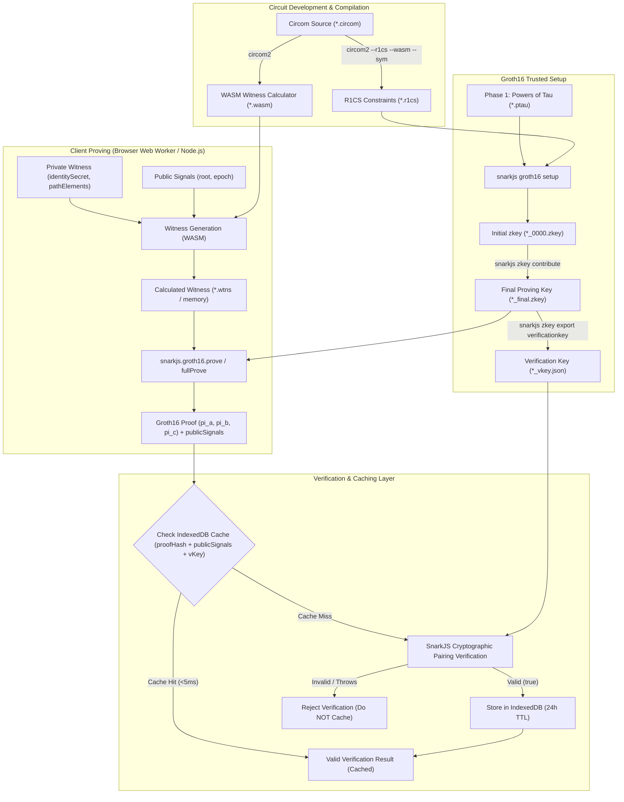

# Groth16 Circuit Proving Key Verification Benchmark Runbook

This technical runbook documents WorkSphere's zero-knowledge proof (ZKP) toolchain, Circom circuit compilation, Groth16 trusted setup procedures, proving (`.zkey`) and verification key (`.vkey`) management, SnarkJS proof lifecycle, client-side IndexedDB proof caching, browser WebAssembly versus Node.js performance benchmarks, mobile memory limits, and cryptographic security boundaries.

---

## 1. Overview and Architecture

WorkSphere leverages zero-knowledge proofs (ZKP) to provide privacy-preserving credential verification across distributed workspace amenities, co-working venue access, student discount programs, and decentralized nomad productivity tracking.

### 1.1 The Groth16 Zero-Knowledge Proof System

Groth16 is an asymmetric pairing-based zero-knowledge Succinct Non-Interactive Argument of Knowledge (zk-SNARK) instantiated over the BN254 (also known as `bn128` or `alt_bn128`) pairing-friendly elliptic curve. Groth16 provides:
- **Constant Proof Size:** Exactly 3 group elements: $A \in G_1$, $B \in G_2$, and $C \in G_1$ (totaling ~128 to 256 bytes depending on serialization).
- **Fast Verification Time:** Verification requires computing a single multi-pairing equation over BN254:
  $$e(A, B) = e(\alpha, \beta) + e\left(\sum_{i=0}^l x_i \cdot \gamma_i, \gamma\right) + e(C, \delta)$$
  Requiring only 3 pairings (or 4 depending on preprocessing), completing in sub-millisecond to low tens of milliseconds.
- **Circuit-Specific Trusted Setup:** Groth16 requires a two-phase trusted setup: a universal Structured Reference String (SRS) Phase 1 (Powers of Tau) followed by a circuit-specific Phase 2 ceremony generating the evaluation key (proving key `.zkey`) and verification key (`.vkey` / JSON).

### 1.2 Privacy-Preserving Verification vs Public Signals

In WorkSphere, users prove qualifications (such as enrollment in an accredited university or membership in a premium co-working tier) without revealing private secrets (student identity ID, email address, password, or physical token):

- **Private Witness Data ($w$):** Known only to the user's client (e.g., `identitySecret`, `secret`, Merkle sibling hashes `pathElements[16]`, Merkle direction selectors `pathIndices[16]`). These never leave the client's Web Worker or WASM memory.
- **Public Signals ($x$):** Known to the verifier and public observers (e.g., university `root`, academic year `epoch`, `nullifierHash`, `expectedCommit`).
- **Cryptographic Relation:** The zero-knowledge proof certifies that there exists a private witness $w$ such that the circuit constraints $R(x, w) = 0$ are satisfied, without leaking any bits of $w$.

### 1.3 Toolchain and Execution Flow



---

## 2. Existing WorkSphere ZKP Implementation

WorkSphere implements several production and test ZKP circuits covering membership access, student verification, and nomad productivity.

### 2.1 Component Location Table

| Component | Verified Repository Path | Execution Context | Responsibility |
|---|---|---|---|
| **Student Membership Circuit** | `circuits/student_membership.circom` | Development / Build | Depth-16 Poseidon Merkle membership proof for student access |
| **Membership Verifier Circuit** | `circuits/membership_verifier.circom` | Development / Build | Depth-16 Poseidon Merkle proof for anonymous paid venue access |
| **Premium Membership Circuit** | `circuits/premium_membership.circom` | Development / Build | Poseidon(1) commitment proof for premium coworking access |
| **Nomad Productivity Circuit** | `circuits/nomad_productivity_proof.circom` | Development / Build | Range proofs (streak days, work minutes) & identity commitment |
| **WASM Witness Generators** | `public/zkp/*.wasm` | Browser Web Worker & Node.js | Client-side evaluation of algebraic witness polynomials |
| **Proving Keys (`.zkey`)** | `public/zkp/*.zkey` | Browser Web Worker & Node.js | Groth16 evaluation polynomials for proof synthesis |
| **Verification Keys (`_vkey.json`)** | `public/zkp/*_vkey.json` | Browser Client & Next.js API | Group elements for BN254 elliptic curve pairing verification |
| **Compilation Scripts** | `scripts/compile-*.sh` | Build / CI | Shell automation for Circom compilation and ceremony setup |
| **Browser Worker Prover** | `src/workers/zkpWorker.ts` | Browser Web Worker | Off-thread SnarkJS proof synthesis with memory cycle guards |
| **Client Proof Orchestrator** | `src/lib/zkp/client.ts` | Browser React Client | Worker lifecycle, timeout guards (60s), and progress events |
| **Server Prover / Verifier** | `src/lib/zkp/verify.ts` | Node.js Server / API | Server-side membership proving and pairing verification |
| **Student Discount Verifier** | `src/features/zkp/studentDiscountVerifier.ts` | Client & Server | Orchestrates SnarkJS verification with IndexedDB caching |
| **Verification Proof Cache** | `src/lib/zkp/proofCache.ts` | Browser IndexedDB | Client-side verification cache with SHA-256 canonical hashing |
| **Replay & Nullifier Guard** | `src/lib/crypto/zkNullifierVerifier.ts` | Server / API | Nullifier replay protection and field modulus validation |

---

## 3. Circom Circuit Compilation

WorkSphere relies on **Circom 2.2.3** (invoked via `circom2` npm wrapper v0.2.23) and **circomlib** v2.0.5 for cryptographic primitives (Poseidon hash, comparators, multiplexers).

### 3.1 Circuit Source Structure

Consider `circuits/student_membership.circom`:
```circom
pragma circom 2.0.0;

include "circomlib/circuits/poseidon.circom";

template DualMux() {
    signal input in[2];
    signal input s;
    signal output out[2];

    s * (1 - s) === 0; // Enforces boolean selector
    out[0] <== (in[1] - in[0]) * s + in[0];
    out[1] <== (in[0] - in[1]) * s + in[1];
}

template StudentMembership(levels) {
    signal input root;   // Public: Merkle root
    signal input epoch;  // Public: Academic year epoch

    signal input secret;                 // Private: Student secret
    signal input pathElements[levels];   // Private: Merkle sibling hashes
    signal input pathIndices[levels];    // Private: Merkle path bits

    component leafHasher = Poseidon(2);
    leafHasher.inputs[0] <== secret;
    leafHasher.inputs[1] <== epoch;

    signal currentHash[levels + 1];
    currentHash[0] <== leafHasher.out;

    component mux[levels];
    component hashers[levels];

    for (var i = 0; i < levels; i++) {
        mux[i] = DualMux();
        mux[i].in[0] <== currentHash[i];
        mux[i].in[1] <== pathElements[i];
        mux[i].s <== pathIndices[i];

        hashers[i] = Poseidon(2);
        hashers[i].inputs[0] <== mux[i].out[0];
        hashers[i].inputs[1] <== mux[i].out[1];
        currentHash[i + 1] <== hashers[i].out;
    }

    root === currentHash[levels]; // Root consistency constraint
}

component main {public [root, epoch]} = StudentMembership(16);
```

### 3.2 Compilation Step-by-Step

Execute the Circom compiler to generate Rank-1 Constraint System (R1CS), WASM witness calculator, and symbol files:

```bash
# Set project directories
ROOT="$(pwd)"
CIRCUIT_DIR="$ROOT/circuits"
BUILD_DIR="$CIRCUIT_DIR/build"
mkdir -p "$BUILD_DIR"

# Compile circuit to R1CS and WebAssembly
npx circom2 "$CIRCUIT_DIR/student_membership.circom" \
  --r1cs --wasm --sym \
  -l "$ROOT/node_modules" \
  -o "$BUILD_DIR"
```

### 3.3 Inspecting Constraints and R1CS Statistics

Inspect the resulting constraint count using SnarkJS:

```bash
npx snarkjs r1cs info "$BUILD_DIR/student_membership.r1cs"
```

**Why Constraint Count Matters:**
- **Prover Time:** Groth16 proving time scales linearly-quasi-linearly with the number of R1CS constraints ($O(m \log m)$ where $m$ is constraint count).
- **Powers of Tau Power ($2^k$):** The trusted setup ceremony requires $2^k > \text{total constraints} + \text{public inputs}$. A depth-16 Merkle tree utilizing Poseidon hash requires ~8,800 to ~9,000 constraints, necessitating at least $2^{14} = 16,384$ ceremony capacity. Small circuits (such as `premium_membership` with ~250 constraints) fit comfortably within $2^{12} = 4,096$ or $2^{13}$.
- **WASM Size:** Witness generator code size increases with constraint count, directly affecting browser network payload and initialization latency.

---

## 4. Groth16 Trusted Setup and Ceremony Artifacts

WorkSphere requires ceremony artifacts generated using SnarkJS v0.7.6 over the BN254 curve.

### 4.1 Trusted Setup Sequence

#### Phase 1: Universal Powers of Tau (Universal SRS)
A Phase 1 ceremony generates universal structured reference strings for BN254 up to $2^k$ powers:

```bash
BUILD_DIR="circuits/build"
PTAU_SIZE=14 # Supports up to 16,384 constraints

# 1. Start new Powers of Tau ceremony
npx snarkjs powersoftau new bn128 "$PTAU_SIZE" "$BUILD_DIR/pot14_0000.ptau" -v

# 2. Add entropy contribution
CONTRIBUTION_ENTROPY="$(openssl rand -hex 32)"
npx snarkjs powersoftau contribute \
  "$BUILD_DIR/pot14_0000.ptau" \
  "$BUILD_DIR/pot14_0001.ptau" \
  --name="worksphere-contributor" \
  -e="$CONTRIBUTION_ENTROPY"

# 3. Prepare Phase 2 (computes Lagrange polynomials)
npx snarkjs powersoftau prepare phase2 \
  "$BUILD_DIR/pot14_0001.ptau" \
  "$BUILD_DIR/pot14_final.ptau"
```

#### Phase 2: Circuit-Specific Setup
Phase 2 evaluates the specific circuit's R1CS polynomial against the Phase 1 SRS:

```bash
CIRCUIT="student_membership"
OUT_DIR="public/zkp"

# 1. Initialize Groth16 circuit setup
npx snarkjs groth16 setup \
  "$BUILD_DIR/$CIRCUIT.r1cs" \
  "$BUILD_DIR/pot14_final.ptau" \
  "$BUILD_DIR/${CIRCUIT}_0000.zkey"

# 2. Add circuit-specific entropy contribution
ZKEY_ENTROPY="$(openssl rand -hex 32)"
npx snarkjs zkey contribute \
  "$BUILD_DIR/${CIRCUIT}_0000.zkey" \
  "$BUILD_DIR/${CIRCUIT}_final.zkey" \
  --name="worksphere-contributor" \
  -e="$ZKEY_ENTROPY"

# 3. Export verification key JSON
npx snarkjs zkey export verificationkey \
  "$BUILD_DIR/${CIRCUIT}_final.zkey" \
  "$OUT_DIR/${CIRCUIT}_vkey.json"

# 4. Copy deployable artifacts to public web directory
cp "$BUILD_DIR/${CIRCUIT}_js/$CIRCUIT.wasm" "$OUT_DIR/$CIRCUIT.wasm"
cp "$BUILD_DIR/${CIRCUIT}_final.zkey" "$OUT_DIR/$CIRCUIT.zkey"
```

### 4.2 Security Requirements and Toxic Waste

- **Toxic Waste Destruction:** The parameters $(\alpha, \beta, \gamma, \delta, x)$ generated during ceremony contributions must be securely erased immediately after computing elliptic curve points. Retaining these secrets allows generating valid proofs for false statements, destroying soundness.
- **Verification Key Public Nature:** Verification keys contain only public elliptic curve points ($\alpha \in G_1$, $\beta \in G_2$, $\gamma \in G_2$, $\delta \in G_2$, and $IC \in G_1$). They can be freely distributed to clients and web frontends.
- **Proving Key Integrity:** The client proving key (`.zkey`) contains evaluation polynomials. While not secret, tampering with `.zkey` artifacts causes proof generation failures or invalid cryptographic outputs. WorkSphere checks artifact freshness and hash integrity in CI via `src/__tests__/lib/zkpArtifactFreshness.test.ts`.

---

## 5. Proof Generation and Verification Lifecycle

WorkSphere supports two proof generation paths:
1. **Browser Web Worker (`src/workers/zkpWorker.ts`):** Client-side zero-knowledge proof generation off the main UI thread.
2. **Node.js Server Runtime (`src/lib/zkp/verify.ts`):** Proving and verification for server integration tests and administrative pipelines.

### 5.1 CLI Proof Generation and Verification

To test or benchmark proofs via the command-line interface:

```bash
# 1. Prepare input JSON (example for premium_membership)
cat <<EOF > circuits/build/input.json
{
  "identityToken": "123456",
  "expectedCommit": "10041492025736184240751910609384462723652875151525049594191392687593593005886"
}
EOF

# 2. Generate witness using the generated WASM binary
node circuits/build/premium_membership_js/generate_witness.js \
  circuits/build/premium_membership_js/premium_membership.wasm \
  circuits/build/input.json \
  circuits/build/witness.wtns

# 3. Synthesize Groth16 proof
npx snarkjs groth16 prove \
  public/zkp/premium_membership.zkey \
  circuits/build/witness.wtns \
  circuits/build/proof.json \
  circuits/build/public.json

# 4. Verify proof against public signals
npx snarkjs groth16 verify \
  public/zkp/verification_key.json \
  circuits/build/public.json \
  circuits/build/proof.json
```

Or execute both steps in a single call:
```bash
npx snarkjs groth16 fullprove \
  circuits/build/input.json \
  public/zkp/premium_membership.wasm \
  public/zkp/premium_membership.zkey \
  circuits/build/proof.json \
  circuits/build/public.json
```

---

## 6. Browser WebAssembly Versus Node.js Benchmarking

Proving and verification exhibit distinct performance profiles across Node.js (V8 JIT + native libuv) and Browser Web Workers (WASM linear memory + Web Crypto).

### 6.1 Architectural Differences

1. **Witness Generation:**
   - *Browser:* Executes inside WebAssembly linear memory (`Memory({ initial: 256 })`).
   - *Node.js:* Executes via Node.js V8 WebAssembly engine with direct filesystem access.
2. **Proving Computation:**
   - Multi-scalar multiplication (MSM) and Number Theoretic Transforms (NTT) over BN254.
   - *Browser:* Memory-constrained; must release BN254 curve instances (`releaseCurve()`) to prevent memory leaks.
   - *Node.js:* Full access to system heap and native multi-threading if compiled with C++ addons.
3. **Verification:**
   - Fast pairing checks (~1 to 5ms) on both browser and server.

### 6.2 Benchmark Comparison Table

The following benchmarks illustrate performance characteristics on an 8-Core Intel i7/AMD Ryzen 7 workstation with 16 GB RAM running Node.js v20.x and Chrome 124:

| Benchmark Metric | Circuit: `premium_membership` (~250 constraints) | Circuit: `student_membership` (Depth-16 Merkle, ~8.9k constraints) | Measurement Method |
|---|---|---|---|
| **WASM / Artifact Download** | Browser: 15–30 ms<br>Node: <2 ms | Browser: 120–250 ms<br>Node: <5 ms | Network / FS Read Timer |
| **Witness Generation** | Browser: 8–15 ms<br>Node: 3–6 ms | Browser: 45–90 ms<br>Node: 18–35 ms | `performance.now()` |
| **Groth16 Proving (MSM+NTT)** | Browser: 110–180 ms<br>Node: 45–70 ms | Browser: 850–1,600 ms<br>Node: 320–550 ms | `performance.now()` |
| **vKey Loading** | Browser: <5 ms<br>Node: <2 ms | Browser: <5 ms<br>Node: <2 ms | `performance.now()` |
| **Cryptographic Verification** | Browser: 3–6 ms<br>Node: 1.5–3 ms | Browser: 4–8 ms<br>Node: 2–4 ms | `snarkjs.groth16.verify` |
| **IndexedDB Cache-Hit Latency** | **Browser: 0.8–2.5 ms** | **Browser: 0.9–2.8 ms** | `getCachedVerification` |
| **Peak Memory Allocation** | Browser: 28–45 MB<br>Node: 35–60 MB | Browser: 85–180 MB<br>Node: 95–210 MB | DevTools / `process.memoryUsage()` |

*Note: All values above are illustrative based on local development profiling and standard SnarkJS performance profiles.*

### 6.3 Standardized Benchmark Execution Script

Contributors can execute reproducible benchmarks using the Node.js test harness:

```bash
# Run the automated proof cache and verification performance suite
npx jest src/__tests__/lib/zkp/proofCache.test.ts --verbose
```

---

## 7. Memory Footprint and Mobile Browser Constraints

Proof generation over BN254 requires significant memory for Fast Fourier Transforms (FFT) and multi-exponentiation buffers.

### 7.1 Browser Memory Hazards

Mobile browsers (Mobile Safari on iOS, Chrome on Android) enforce aggressive tab memory limits (typically 300 MB to 1 GB per tab). Exceeding these limits causes the operating system to terminate the tab without warning:

1. **WASM Heap Allocation:** SnarkJS allocates large ArrayBuffers for polynomial coefficients.
2. **Curve Singleton Retention:** SnarkJS caches BN254 curve instances in global scope (`globalThis.curve_bn128`). If not explicitly destroyed via `curve.terminate()`, successive proof operations cause memory accumulation.
3. **Web Worker Isolation:** WorkSphere isolates proof generation inside `src/workers/zkpWorker.ts`. When proving finishes, aborts, or times out, the worker is cycled or terminated, immediately returning memory to the browser OS.

### 7.2 Memory Defense Mechanisms in WorkSphere

- **Worker Cycling (`maxProofsBeforeCycle: 10`):** In `src/workers/zkpWorker.ts`, the worker counts proofs and automatically resets internal state after 10 proof generations.
- **Explicit Cleanup:** `releaseCurve()` invokes `globalThis.curve_bn128.terminate()` after every prove/verify cycle.
- **Worker Timeouts:** A hard 60-second timeout (`PROOF_TIMEOUT_MS = 60_000`) kills runaway worker threads.
- **Client Cache Bypass:** By caching verified results in IndexedDB, repeated user interactions bypass the memory-intensive pairing and proving pipeline entirely.

### 7.3 Mobile Profiling Checklist

Before deploying new ZKP circuits to production:
- [ ] Profile memory on a low-end Android device (e.g., 3 GB RAM, Chrome Mobile).
- [ ] Test proof generation when device battery is low or in Battery Saver mode.
- [ ] Verify that backgrounding the browser tab during proof generation triggers abort without crashing the application.
- [ ] Confirm Web Worker memory is reclaimed upon completion via Chrome DevTools Memory Inspector.

---

## 8. Proof Cache Architecture (`src/lib/zkp/proofCache.ts`)

WorkSphere implements an IndexedDB cache for verified Groth16 proofs to avoid repeated pairing operations.

### 8.1 Cache Storage Specifications

- **Database Name:** `worksphere_zkp_verification_db`
- **Object Store:** `zkp_verified_proofs` (KeyPath: `cacheKey`)
- **Indices:** `proofHash` (indexed on the canonical hash of the proof payload)
- **Default TTL:** 24 hours (`DEFAULT_VERIFICATION_TTL_MS = 24 * 60 * 60 * 1000`)
- **Capacity Bound:** 500 entries (`DEFAULT_MAX_VERIFIED_ENTRIES = 500`)
- **Eviction Strategy:** Dual-stage Least Recently Used (LRU): expired entries are purged first; if capacity remains exceeded, the oldest `lastAccessedAt` entries are deleted.

### 8.2 Deterministic Canonical Cache Key Generation

To guarantee that a cache hit **never** validates a modified proof, tampered signals, or different context, the cache key is computed using Web Crypto API SHA-256 over canonicalized JSON:

```typescript
export function computeCanonicalVerificationHash(input: VerificationInput): Promise<string> {
  const canonicalObject = {
    proof: canonicalizeValue(input.proof),
    publicSignals: (input.publicSignals || []).map((s) => s.toString()),
    merkleRoot: input.merkleRoot ? input.merkleRoot.toString() : "",
    circuitId: input.circuitId || "",
    vKeyFingerprint: input.vKeyFingerprint || (input.vKey ? computeVKeyFingerprint(input.vKey) : ""),
  };
  return sha256Hex(JSON.stringify(canonicalObject));
}
```

### 8.3 Security Invariants of the Proof Cache

1. **Security > Performance:** A cache hit must never allow an invalid proof to bypass verification.
2. **Never Cache Failures:** Only proofs where SnarkJS returns `true` are cached. Rejections, invalid proofs, or thrown exceptions are **never** written to IndexedDB.
3. **Verification Key Binding:** The verification key fingerprint is hashed into the cache key. If the circuit or verification key is updated, all previous cache entries become cache misses.
4. **Deterministic Canonicalization:** BigInt values are converted to decimal strings and JSON object keys are sorted alphabetically before hashing.
5. **Storage Resilience:** If IndexedDB is blocked, full, or in private browsing mode, the cache gracefully degrades to a cache miss and executes standard SnarkJS verification.

---

## 9. Benchmark Results and Interpretation Template

Contributors conducting benchmarks should record their results using the following template:

```markdown
### ZKP Benchmark Report

#### Environment
- Date: YYYY-MM-DD
- Hardware: CPU model, Core count, Physical RAM
- OS: OS Name and Version
- Browser: Browser Name and Version (or Node.js version)
- Node.js Version: vXX.XX.X
- Circom Version: 2.2.3
- SnarkJS Version: 0.7.6

#### Circuit Information
- Circuit Name: student_membership.circom
- Constraint Count: 8,837
- Public Input Count: 2 (root, epoch)
- Private Input Count: 33 (secret, pathElements[16], pathIndices[16])
- WASM Artifact Size: 1.75 MB
- zkey File Size: 4.15 MB

#### Performance Measurements (10 iterations after 2 warm-up runs)
| Metric | Median (ms) | p95 (ms) | Min (ms) | Max (ms) |
|---|---|---|---|---|
| Witness Generation | | | | |
| Groth16 Proving | | | | |
| Verification (Cold) | | | | |
| Verification (Cache Hit) | | | | |
| Peak Memory Allocation | | | | |
```

### Interpreting Bottlenecks
- **High Witness Generation Time (>200ms):** Indicates inefficient circuit component loops or excessive unconstrained computations in Circom templates.
- **High Proving Time (>3000ms):** Indicates high constraint count or lack of WebAssembly SIMD acceleration in the browser.
- **High Verification Time (>15ms):** Indicates CPU saturation during BN254 elliptic curve pairing calculation.
- **Cache Hit Latency (>5ms):** Suggests IndexedDB transaction contention or excessive canonical JSON serialization overhead.

---

## 10. Security Guarantees and Cryptographic Assumptions

### 10.1 Cryptographic Guarantees (Groth16)
- **Completeness:** An honest prover with a valid witness will always satisfy the verification pairing equation.
- **Computational Soundness:** A computationally bounded adversary without a valid witness cannot produce an accepted proof, except with negligible probability $\approx 1/2^{254}$.
- **Zero-Knowledge:** The proof reveals zero information about private inputs ($identitySecret$, $secret$, Merkle path) beyond the truth of the statement.

### 10.2 Application-Level Context Binding
A mathematically valid zero-knowledge proof does **not** automatically guarantee application authorization. WorkSphere enforces the following application-level validations:
1. **Merkle Root Freshness:** The verifier must check that `publicSignals[0]` (root) matches an active, enrolled university or venue Merkle root in the PostgreSQL database (`src/lib/zkp/studentMembership.ts`).
2. **Epoch Freshness:** The verifier must enforce that `epoch` matches the current academic year or billing period, rejecting expired proofs.
3. **Nullifier Hash Tracking:** To prevent proof replay attacks, the verifier computes and registers the nullifier hash (`src/lib/crypto/zkNullifierVerifier.ts`) in an append-only ledger. If the nullifier has already been recorded for the given epoch, the access request is blocked.

---

## 11. Troubleshooting Guide

| Issue / Error | Root Cause | Diagnostic & Resolution Steps |
|---|---|---|
| `circom2: command not found` | `circom2` or `circom` npm package missing | Run `npm install --save-dev circom2 circomlib` or ensure `npx circom2` is executed. |
| `error: circomlib is not installed` | Missing Poseidon templates | Ensure `node_modules/circomlib/circuits/poseidon.circom` exists before building. |
| `Number of constraints > 2^k` | Powers of Tau size too small | Increase Powers of Tau power $k$ (e.g., from 12 to 14) in `scripts/compile-*.sh`. |
| `Verification timed out` | Pairing calculation hung or slow CPU | Check `VERIFICATION_TIMEOUT_MS` (default 10s) in `src/lib/zkp/verify.ts`. |
| `Proof generation timed out` | Worker exceeded 60s timeout | Check `PROOF_TIMEOUT_MS` in `src/lib/zkp/client.ts`. Optimize circuit or verify WebAssembly SIMD support. |
| `REPLAYED_NULLIFIER` | Duplicate proof submission | The student or member has already claimed this benefit for the active epoch. Reset epoch or use a new credential. |
| `MISSING_VERIFICATION_KEY` | Verification key JSON not found | Ensure `public/zkp/*_vkey.json` exists or pass `vKey` explicitly in verification params. |
| `IndexedDB blocked / quota error` | Storage permission denied or full | Proof cache automatically falls back to fresh SnarkJS verification. Purge old entries via `purgeExpiredVerifications()`. |
| `Stale artifact manifest error` | Circuit modified without rebuild | Re-run `bash scripts/compile-zkp.sh` and commit updated artifacts in `public/zkp/`. |

---

## 12. Source References

- [`src/lib/zkp/proofCache.ts`](../../src/lib/zkp/proofCache.ts) — Client-side SnarkJS proof verification cache in IndexedDB.
- [`src/features/zkp/studentDiscountVerifier.ts`](../../src/features/zkp/studentDiscountVerifier.ts) — Student discount verification orchestrator.
- [`src/lib/zkp/verify.ts`](../../src/lib/zkp/verify.ts) — Server-side Groth16 proof verification and releaseCurve cleanup.
- [`src/lib/zkp/client.ts`](../../src/lib/zkp/client.ts) — Browser client proof generation and Web Worker lifecycle.
- [`src/workers/zkpWorker.ts`](../../src/workers/zkpWorker.ts) — Dedicated Web Worker for background SnarkJS proving.
- [`src/lib/crypto/zkNullifierVerifier.ts`](../../src/lib/crypto/zkNullifierVerifier.ts) — Nullifier replay protection and field modulus validation.
- [`circuits/student_membership.circom`](../../circuits/student_membership.circom) — Circom student Merkle membership circuit.
- [`circuits/membership_verifier.circom`](../../circuits/membership_verifier.circom) — Circom paid venue membership circuit.
- [`circuits/premium_membership.circom`](../../circuits/premium_membership.circom) — Circom premium membership commitment circuit.
- [`circuits/nomad_productivity_proof.circom`](../../circuits/nomad_productivity_proof.circom) — Circom nomad productivity proof circuit.
- [`scripts/compile-zkp.sh`](../../scripts/compile-zkp.sh) — Premium membership compilation script.
- [`scripts/compile-membership-zkp.sh`](../../scripts/compile-membership-zkp.sh) — Membership verifier compilation script.
- [`docs/SECURITY_ARCHITECTURE.md`](../SECURITY_ARCHITECTURE.md) — WorkSphere defense-in-depth and security architecture.
