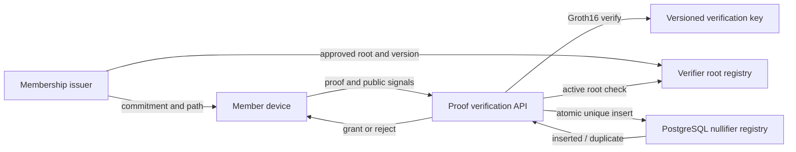
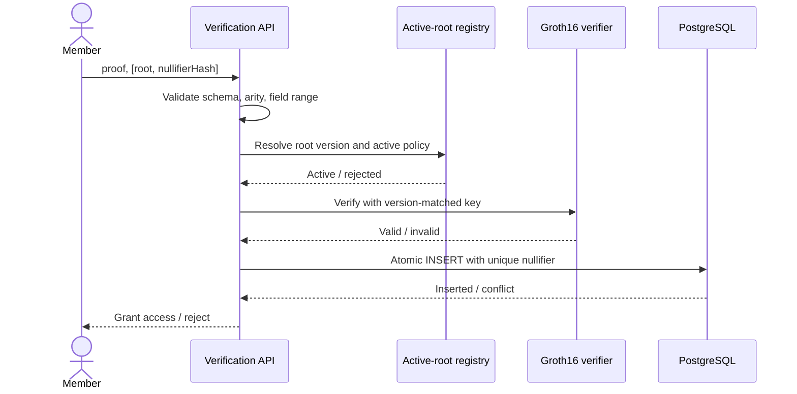

# Zero-Knowledge Membership Circuits and Nullifier Registry Specification

> **Status:** Design specification. This document distinguishes the existing
> WorkSphere implementation from a proposed tier-aware circuit. The proposed
> circuit described below is not implemented by the current membership
> circuits. In particular, do not treat its formulas or CLI workflow as a
> deployed check-in security guarantee.

## 1. Introduction and objectives

This specification describes a design in which a prover can demonstrate
coworking membership without including identity in the proof transcript, how a
membership Merkle tree can represent eligible credentials, and how a verifier
can consume a nullifier at most once per approved policy scope. It does not by
itself guarantee end-to-end anonymity. It also records the current repository
behavior so that a future implementation can be reviewed against a precise
boundary.

The design goals are:

1. Prove knowledge of an enrolled membership credential whose commitment is
   included in a verifier-approved Merkle root.
2. Prove that the credential's private tier is in an issuer-approved set,
   without disclosing which tier when the policy permits that.
3. Derive a deterministic nullifier for the policy's defined spend scope.
4. Verify the proof and consume that nullifier atomically in durable storage.
5. Keep root publication, membership updates, circuit/key versions, and
   revocation policy explicit and auditable.

The current paid-membership circuit proves membership in a root for an epoch;
it has no tier or nullifier signals. The check-in nullifier endpoint and
PostgreSQL model are separate components. See [Implemented vs Proposed](#3-implemented-vs-proposed).

## 2. System architecture and threat model

### 2.1 Architecture boundary

The proposed flow is:



The issuer is responsible for authenticating a membership, selecting its tier,
creating and protecting its secret material, and publishing a commitment in an
approved tree. The member device constructs the witness and proof. The API
validates public inputs, root status and proof, then attempts a single atomic
nullifier insertion before granting access. The API, database, and public
response must not receive the member's identity secret, tier, nonce, or
authentication path.

The diagram is a target architecture, not a claim that the current check-in
API performs every step. The current nullifier endpoint does not itself check
the root against the active root registry.

### 2.2 Threat model and assumptions

Assume a client may choose arbitrary proof bytes and public signals, replay or
race requests, and try to select a stale or unapproved root. The issuer may
make mistakes or be compromised; the database and application may experience
concurrent requests; and proof/key artifacts may be stale or mismatched.

Security depends on all of the following:

- The issuer authenticates membership and publishes only valid commitments.
- The circuit exactly constrains the intended membership and tier relation.
- The circuit, WASM, proving key, verification key, field, Poseidon parameters,
  and public-signal ordering are versioned and kept consistent.
- The verifier accepts only roots authorized for the applicable policy and
  circuit version.
- The nullifier relation binds all context that policy intends to limit.
- Nullifier consumption is durable and has a database-enforced uniqueness
  constraint.
- Secret generation, client storage, transport, access tokens, logs, and
  application side channels do not disclose the witness.

A proof does not by itself establish that the issuer's source data was correct,
that a person is physically present, that a booking is valid, or that a
credential has not been revoked outside the root policy.

## 3. Implemented vs Proposed

The repository has two related but distinct membership flows. File references
below are to files present in this checkout.

| Capability                               | Existing repository behavior                                                                                                                                                                                                                                                                                                                                                                                                  | Proposed in this specification                                                                                                                                          |
| ---------------------------------------- | ----------------------------------------------------------------------------------------------------------------------------------------------------------------------------------------------------------------------------------------------------------------------------------------------------------------------------------------------------------------------------------------------------------------------------- | ----------------------------------------------------------------------------------------------------------------------------------------------------------------------- |
| Paid-membership circuit                  | [`circuits/membership_verifier.circom`](../../circuits/membership_verifier.circom) proves `Poseidon(identitySecret, epoch)` inclusion using a depth-16 path. Public signals are `root, epoch`.                                                                                                                                                                                                                                | A tier-aware commitment and public nullifier, with root and nullifier hash as the public signals.                                                                       |
| Student membership circuit               | [`circuits/student_membership.circom`](../../circuits/student_membership.circom) has the same root/epoch structure and depth 16.                                                                                                                                                                                                                                                                                              | Not the target circuit; the new relation needs an explicit tier and nonce policy.                                                                                       |
| Tier handling                            | No tier input or tier constraint appears in either membership circuit above. The Prisma membership relation does not supply a circuit tier encoding.                                                                                                                                                                                                                                                                          | Private tier checked against a versioned issuer-approved set, e.g. via a constrained one-hot encoding. Exact tier values remain a product/issuer decision.              |
| Nullifier circuit                        | The current paid-membership circuit has no nullifier. [`src/lib/zkp/studentMembership.ts`](../../src/lib/zkp/studentMembership.ts) has a TypeScript helper `Poseidon(secret, nullifierKey, epoch)`, but the checked-in `student_membership.circom` does not constrain that value.                                                                                                                                             | A nullifier derived by a reviewed circuit relation. Lifetime, epoch, or action scope remains a maintainer decision; scoped use requires matching circuit-bound context. |
| Merkle helper                            | [`src/lib/zkp/membershipCircuit.ts`](../../src/lib/zkp/membershipCircuit.ts) and [`src/lib/zkp/studentMembership.ts`](../../src/lib/zkp/studentMembership.ts) implement in-memory depth-16 Poseidon trees, zero hashes, and membership paths.                                                                                                                                                                                 | Versioned root registry and an operational issuer/update/revocation process. No durable membership tree store was found in the inspected paths.                         |
| Root validation                          | [`src/lib/zkp/membershipVerification.ts`](../../src/lib/zkp/membershipVerification.ts) validates root/epoch against configured roots (`MEMBERSHIP_MERKLE_ROOTS`), with production locked when none are configured. The `/api/zkp/membership/verify` route uses this verifier.                                                                                                                                                 | Bind each accepted root to a circuit/key version, policy, activation and retirement status; reject unknown, stale, or revoked roots.                                    |
| Check-in nullifier API                   | [`src/app/api/auth/zkp/verify-nullifier/route.ts`](../../src/app/api/auth/zkp/verify-nullifier/route.ts) expects `[merkleRoot, nullifierHash, venueId, currentEpoch]`, verifies against [`public/zkp/verification_key.json`](../../public/zkp/verification_key.json), then calls the nullifier ledger.                                                                                                                        | Public-signal shape must match the circuit exactly. The API must validate the root and all public context before proof verification and consumption.                    |
| Nullifier storage                        | [`prisma/schema.prisma`](../../prisma/schema.prisma) defines `VenueCheckInNullifier` with unique `(nullifierHash, epoch)`. [`src/lib/zkp/nullifierLedger.ts`](../../src/lib/zkp/nullifierLedger.ts) uses Redis `SET NX` when available and PostgreSQL on Redis errors.                                                                                                                                                        | PostgreSQL unique constraint is the durable source of truth; a Redis cache must not weaken or bypass that guarantee.                                                    |
| Generated artifacts                      | [`public/zkp/`](../../public/zkp/) contains membership verifier WASM/zkey/key artifacts; its manifest identifies `membership_verifier.circom` and circomlib 2.0.5.                                                                                                                                                                                                                                                            | Build, test, hash, and release artifacts for the exact proposed circuit and trusted setup before claiming it is deployed.                                               |
| Membership proof generation/verification | [`src/workers/zkpMembershipWorker.ts`](../../src/workers/zkpMembershipWorker.ts) proves using the membership verifier WASM/zkey and returns `[root, epoch]`. [`src/lib/zkp/membershipVerification.ts`](../../src/lib/zkp/membershipVerification.ts) verifies that two-signal flow with [`membership_verifier_vkey.json`](../../public/zkp/membership_verifier_vkey.json).                                                     | Build, test, hash, and release artifacts for the exact proposed circuit and trusted setup before claiming it is deployed.                                               |
| Standard booking/check-in                | [`src/app/api/venues/[venueId]/check-in/route.ts`](../../src/app/api/venues/[venueId]/check-in/route.ts) uses Clerk authentication and `recordCheckIn`; [`src/app/api/bookings/confirm/route.ts`](../../src/app/api/bookings/confirm/route.ts) creates bookings in a Prisma transaction. Neither route calls the ZKP nullifier endpoint, and no production caller for that endpoint was found in the inspected source search. | Explicitly integrate proof consumption with the intended check-in/booking transaction and document its business invariants.                                             |

[`public/zkp/verification_key.json`](../../public/zkp/verification_key.json)
reports `nPublic: 1`, while the nullifier
route requires four public signals. The membership verifier's
[`membership_verifier_vkey.json`](../../public/zkp/membership_verifier_vkey.json)
reports `nPublic: 2`, matching its `[root, epoch]` circuit interface, not the
nullifier route. The worker's proving
artifacts likewise produce `[root, epoch]`. These artifacts and interfaces are
not interchangeable: the checked-in route/key combination does not establish
a working four-signal nullifier circuit. The similarly named
`StudentClaimNullifier` model in [`prisma/schema.prisma`](../../prisma/schema.prisma)
is separate and does not provide evidence of a matching tier-aware circuit.

## 4. Cryptographic primitives

### 4.1 Circom and R1CS

Circom is a domain-specific language for expressing arithmetic circuits. Its
compiler emits an R1CS relation and witness-generation artifacts. A signal in
Circom is an element of the circuit's scalar field; it is not automatically a
bounded application integer. Boolean and range conditions must be constrained
explicitly.

For a witness vector \(w\) and public instance \(x\), an R1CS constraint has the
form

\[
\langle A_i, w \rangle \cdot \langle B_i, w \rangle
= \langle C_i, w \rangle
\quad\text{in }\mathbb{F}_r.
\]

Circom's `===` adds a constraint; it is not a host-language assertion. All
semantic restrictions (such as a boolean path bit or allowed tier) must be
represented by constraints.

### 4.2 Groth16

Groth16 is a pairing-based preprocessing zk-SNARK. For a fixed circuit, a
prover uses a proving key to produce a compact proof; a verifier uses the
corresponding verification key and public signals. Proof validity is for that
specific circuit/key and public-input order. It does not validate application
policy that is not encoded in the circuit or separately checked by the server.

The standard proof has group elements \(\pi_A \in \mathbb{G}_1\),
\(\pi_B \in \mathbb{G}_2\), and \(\pi_C \in \mathbb{G}_1\). Setup assumptions
and security depend on the structured reference string; see
[Trusted setup](#8-groth16-workflow) and [Security analysis](#11-security-analysis).
At a high level, verification checks the pairing-product equation
\[
\begin{aligned}
e(\pi_A,\pi_B)
&= e(\alpha,\beta)\,e(\operatorname{vk}_x,\gamma)\,e(\pi_C,\delta),\\
\operatorname{vk}_x
&= \operatorname{IC}_0 + \sum_{j=1}^{\ell} x_j\operatorname{IC}_j,
\end{aligned}
\]
where \(x_1,\ldots,x_\ell\) are the public signals and the \(\operatorname{IC}\)
points are part of the verification key. The equation is descriptive; use the
library verifier rather than implementing pairing checks ad hoc.

### 4.3 Poseidon hash

Poseidon is a family of algebraic hash permutations designed for arithmetic
circuits. The repository's Circom circuits include circomlib's
`Poseidon(n)` template, and [`src/lib/zkp/poseidon.ts`](../../src/lib/zkp/poseidon.ts)
implements a TypeScript version for one to three inputs over the BN254 scalar
field. The circuit and off-circuit tree builder must use identical circomlib
version, arity, constants, and input ordering.

This specification uses \(H_k(x_1,\ldots,x_k)\) to mean the exact circomlib
Poseidon instance with \(k\) inputs and the configured field/parameters. It is
notation, not a new hash implementation. Domain tags in the proposed formulas
must be fixed, distinct field constants derived and versioned by the issuer;
do not use ambiguous string concatenation or silently change the tag.

### 4.4 Merkle trees

A binary Merkle tree commits to an ordered set of leaves. A leaf's authentication
path is the sequence of sibling hashes and left/right direction bits needed to
recompute the root. Inclusion proves that a value is in the set committed by
that root; it does not prove that the set or its root was honestly constructed.

### 4.5 Finite-field arithmetic

The existing Poseidon implementation declares the BN254 scalar modulus

\[
r =
21888242871839275222246405745257275088548364400416034343698204186575808495617,
\qquad \mathbb{F}_r = \mathbb{Z}/r\mathbb{Z}.
\]

Circuit addition and multiplication wrap modulo \(r\). An application should
parse external scalar encodings canonically, requiring \(0 \leq x < r\), rather
than treating arbitrary decimal strings as distinct values. The existing
membership input helper normalizes values modulo \(r\); a new API should
review whether that aliasing behavior is acceptable for public signals.

Membership tier is a semantic integer encoded in the field. Its mapping and
allowed set must be fixed by the issuer/circuit version. A field signal alone
does not enforce an integer range or an enum.

### 4.6 Nullifiers

A nullifier is a deterministic public pseudonym for a specific credential and
spend scope. It allows a verifier to recognize a repeated spend without
receiving the credential secret. It is not necessarily unlinkable: if the same
nullifier is reused across contexts, observers can link those presentations.

The circuit proves that the public nullifier follows the specified formula.
It cannot remember previous proofs. Uniqueness across requests is enforced by
state outside the circuit, normally a database unique constraint.

## 5. Circuit input specification

The table below is the proposed interface. The circuit witness also includes
private Merkle siblings and path bits; these are necessary to verify inclusion,
although they are not among the three credential inputs named in the issue.

### 5.1 Private inputs

| Input                                 | Type / encoding                                                | Visibility                | Proposed constraints                                                                                                                                                                                                                                                           | Purpose                                                                                           |
| ------------------------------------- | -------------------------------------------------------------- | ------------------------- | ------------------------------------------------------------------------------------------------------------------------------------------------------------------------------------------------------------------------------------------------------------------------------ | ------------------------------------------------------------------------------------------------- |
| `identitySecret` \(s\)                | Field element in \(\mathbb{F}_r\); canonical external encoding | Private witness           | The circuit sees a field element, not a byte-string encoding. The application must parse a canonical encoding. Require \(s \ne 0\) with an inverse witness \(s \cdot s^{-1}=1\) only if credential policy excludes zero. Generate with a cryptographically secure RNG.         | Secret knowledge bound into the issuer's leaf commitment and nullifier.                           |
| `membershipTier` \(t\)                | Field element encoding an issuer-defined tier                  | Private witness           | Prove membership in the allowed tier set. For allowed values \(a_0,\ldots,a_{m-1}\), use private one-hot bits \(b_j\), constrain \(b_j(b_j-1)=0\), \(\sum_j b_j=1\), and \(t=\sum_j a_jb_j\). Define whether all listed tiers or only tiers at/above a threshold are accepted. | Proves eligibility without exposing the exact tier if the approved set contains multiple tiers.   |
| `nonce` \(n\)                         | Field element in \(\mathbb{F}_r\); semantics undecided         | Private witness           | If it is an enrollment salt, the issuer must bind it to the enrolled leaf and govern its lifetime. If it is a per-presentation challenge, it must be bound to a verifier-known public context; a prover-chosen private value alone provides no freshness.                      | Candidate secret input for a commitment/nullifier relation; meaning requires maintainer approval. |
| `pathElements[0..D-1]`                | \(D\) field elements                                           | Private witness           | Circuit arithmetic treats each value as an element of \(\mathbb{F}_r\). Canonical external encodings, where serialized, are checked at the application boundary rather than by a field equality constraint.                                                                    | Sibling hashes in the Merkle authentication path.                                                 |
| `pathIndices[0..D-1]`                 | \(D\) field elements                                           | Private witness           | For every \(i\), constrain \(b_i(b_i-1)=0\).                                                                                                                                                                                                                                   | Selects left/right ordering at each tree level.                                                   |
| Tier encoding bits `tierBits[0..m-1]` | \(m\) bits                                                     | Private auxiliary witness | Boolean and exactly-one constraints as above.                                                                                                                                                                                                                                  | Implements the finite tier-set check in R1CS.                                                     |

The Circom signal values are field elements, so canonical transport encoding and
integer validation are also required at the application boundary.

### 5.2 Public inputs

| Input                 | Type / encoding                                                | Visibility | Constraints / server checks                                                                                                                                                                                                                                | Purpose                                                                       |
| --------------------- | -------------------------------------------------------------- | ---------- | ---------------------------------------------------------------------------------------------------------------------------------------------------------------------------------------------------------------------------------------------------------- | ----------------------------------------------------------------------------- |
| `root` \(R\)          | Field element in \(\mathbb{F}_r\); canonical external encoding | Public     | Circuit requires the computed path root to equal \(R\). The application must parse a canonical encoding, and the server must independently require \(R\) to be an active, issuer-approved root for the selected policy and compatible circuit/key version. | Identifies the set of enrolled commitments against which inclusion is proved. |
| `nullifierHash` \(N\) | Field element in \(\mathbb{F}_r\); canonical external encoding | Public     | Circuit recomputes \(N\) from the private credential inputs and equates it to this signal. The application validates canonical encoding; the server atomically inserts it under the maintainer-approved uniqueness policy.                                 | Allows duplicate-spend detection without revealing the secret.                |

The issue's requested two-signal order is **`[root, nullifierHash]`**. The
Groth16 verification key must be generated for exactly the selected
public-signal interface. The public root could be used as a scope only if
maintainers approve that policy; other epoch-, venue-, or action-scoped
policies need matching circuit-bound context. See
[Nullifier scope alternatives](#62-nullifier-scope-alternatives). The
maintainer must approve the final interface before artifacts are generated.

## 6. Proposed membership and nullifier relation

Everything in this section is a proposed design, not an existing circuit.
It must be reviewed together with credential issuance, tree construction,
policy, and the database uniqueness key before implementation.

### 6.1 Candidate domain-separated membership commitment

If the issue's `nonce` means a stable, issuer-assigned enrollment salt \(n_e\),
one candidate leaf commitment is
\[
C = H_4(D_M, s, t, n_e) \in \mathbb{F}_r,
\]
where \(D_M \in \mathbb{F}_r\) is a fixed membership domain tag.

The tree builder and circuit must use the exact same tag, input order, Poseidon
arity, and circomlib parameters. The tag must be distinct from all other
protocol domains and fixed for the circuit version; its encoding and value are
not specified here. This candidate formula is not the existing
\(H_2(\text{identitySecret},\text{epoch})\) leaf. If `nonce` instead means a
fresh per-presentation challenge, it cannot be substituted into a static
enrollment leaf without changing the enrollment and tree protocol.

### 6.2 Nullifier scope alternatives

The issue specifies a private `nonce` and public `nullifierHash`, but does not
define whether the nonce is a credential salt or a fresh challenge, or how
many check-ins one credential should permit. The formulas below are alternatives,
not a selected product policy. Let \(D_N\) be a fixed, distinct nullifier
domain tag whose encoding and value must be agreed and versioned.

| Policy option                              | Candidate relation and public context                                                                                                                            | Database uniqueness                                          | Consequence                                                                                                                                                                                                                      |
| ------------------------------------------ | ---------------------------------------------------------------------------------------------------------------------------------------------------------------- | ------------------------------------------------------------ | -------------------------------------------------------------------------------------------------------------------------------------------------------------------------------------------------------------------------------- |
| One check-in for the credential's lifetime | \(N=H_3(D_N,s,n_e)\); public signals remain `[root, N]`. `n_e` must be stable, issuer-controlled, and bound into the enrolled leaf.                              | `UNIQUE(nullifier_hash)`                                     | The same credential cannot check in again at any venue or time. This uses the requested interface but may be too restrictive for coworking.                                                                                      |
| One check-in per root                      | \(N_R=H_4(D_N,s,n_e,R)\); public signals remain `[root, N_R]`.                                                                                                   | `UNIQUE(nullifier_hash)`                                     | Allows a new spend when the root changes. Root updates may occur for membership administration rather than check-in periods, so this is appropriate only if maintainers explicitly define each accepted root as a spend scope.   |
| One check-in per epoch, server-scoped      | Keep \(N=H_3(D_N,s,n_e)\) and `[root, N]`; the server obtains the epoch \(e\) from trusted request context and checks that the root is permitted for that epoch. | `UNIQUE(nullifier_hash, epoch)` (the existing storage key).  | Supports recurring check-ins, but the same proof/nullifier may be accepted once in each epoch. This is intended epoch-scoped reuse, not cryptographic freshness; server-side epoch and root policy must be authoritative.        |
| One check-in per epoch, circuit-bound      | Derive \(N_e=H_4(D_N,s,n_e,e)\) and include the public epoch in the proof, e.g. `[root, N_e, e]`; validate the root/epoch association server-side as well.       | Unique `N_e` (or `(epoch, N_e)`).                            | The nullifier changes by epoch, avoiding reuse of the same public nullifier across epochs. This changes the public-signal contract, requires a four-input hash, and still relies on the server to accept only the current epoch. |
| One check-in per venue/day or action       | Add a public, canonical scope \(q\) (for example an issuer-defined venue/day/action identifier), bind it in the circuit, and derive \(N_q=H_4(D_N,s,n_e,q)\).    | `UNIQUE(scope_id, nullifier_hash)` or unique scoped \(N_q\). | Allows repeated use in distinct scopes. The scope definition, freshness, and proof-to-action binding must be specified.                                                                                                          |

The existing database constraint is `(nullifierHash, epoch)`, which is
epoch-scoped storage behavior. It does not by itself prove that the circuit
binds the nullifier to that epoch. Under the server-scoped option, recurrence
across epochs is intentionally authorized by server policy; an identical proof
can be consumed once in each epoch if its root remains accepted. The
circuit-bound alternative changes the public-signal contract. The existing
nullifier API accepts an epoch signal, but the reviewed membership circuits
and proof artifacts do not implement its four-signal relation.

**Maintainer approval is required** for the check-in policy (lifetime,
per-epoch, or per-action), the meaning/lifecycle of `nonce`, the public-signal
contract, and the matching database uniqueness key. This specification does
not select among them. A private nonce that the prover can choose or change
without an issuer-bound leaf or verifier-known challenge does not prevent
replay.

### 6.3 Membership path and circuit constraints

Let the tree depth be \(D\). Set \(x_0=C\). For each \(i \in \{0,\ldots,D-1\}\),
let \(u_i\) be a sibling and \(b_i \in \{0,1\}\) the private direction bit:

\[
\begin{aligned}
b_i(b_i-1) &= 0,\\
L_i &= (1-b_i)x_i + b_i u_i,\\
R_i &= b_i x_i + (1-b_i)u_i,\\
x_{i+1} &= H_2(L_i,R_i).
\end{aligned}
\]

The final membership constraint is

\[
x_D = R.
\]

For the enrollment-salt candidate and lifetime-use option, the relation is:

\[
\begin{aligned}
C &= H_4(D_M,s,t,n_e),\\
t &\in \mathcal{T}_{\mathrm{allowed}},\\
N &= H_3(D_N,s,n_e),\\
\operatorname{MerkleRoot}(C,\{u_i,b_i\}_{i=0}^{D-1}) &= R.
\end{aligned}
\]

For epoch- or action-scoped policies, replace the nullifier formula and add
the public scope signal and constraints described in
[Nullifier scope alternatives](#62-nullifier-scope-alternatives). The exact
domain-tag values and derivation procedure are intentionally left unresolved.
The current TypeScript `poseidonHash` helper supports only one to three inputs;
the candidate \(H_4\) commitment and scoped nullifier require a reviewed
four-input implementation or another explicitly selected arity, plus
circuit/TypeScript test vectors.

The root's active status, credential revocation policy, nullifier freshness
across invocations, and any venue/booking policy are **not** implied by these
equations. Active tier eligibility is represented by membership in a tree
whose leaves have been issued for valid members and the circuit's tier-set
constraint; the issuer and root registry remain trusted for correct enrollment
and current revocation status.

### 6.4 Nullifier uniqueness is stateful

For the lifetime-use candidate the circuit enforces
\(N=H_3(D_N,s,n_e)\). It has no state and cannot enforce that \(N\) was not used
in another proof. At verification time, a database uniqueness constraint
atomically chooses a winner among concurrent requests. That database property,
not a circuit constraint or a preliminary `SELECT`, provides cross-request
uniqueness. Scoped policies must use the matching constrained public scope and
database key.

## 7. Poseidon Merkle tree

### 7.1 Depth and capacity

The existing paid-membership and student-membership circuits instantiate
`MembershipVerifier(16)` / `StudentMembership(16)`. Their in-memory tree
helpers also default to depth \(16\), giving a maximum of
\(2^{16}=65{,}536\) leaves. This is an observed repository parameter, not a
capacity benchmark. For the proposed circuit, retaining depth \(D=16\) is a
compatibility starting point only; capacity, growth, and constraint cost must
be re-evaluated before release.

### 7.2 Leaf, node, and empty-subtree structure

For the proposed tree, leaves are the candidate commitment \(C\) in
[Candidate domain-separated membership commitment](#61-candidate-domain-separated-membership-commitment).
Every internal node uses ordered binary hashing:

\[
\operatorname{Node}(L,R)=H_2(L,R).
\]

The existing helpers define the empty leaf as \(Z_0=0\) and recursively define
\[
Z_{i+1}=H_2(Z_i,Z_i).
\]
An absent sibling at level \(i\) is represented by \(Z_i\). Tree insertion
order and index assignment must be deterministic and consistent between the
issuer and witness generator.

### 7.3 Root calculation and authentication paths

Starting from a leaf, combine its sibling and direction bit at each level using
the equations in [Membership path and circuit constraints](#63-membership-path-and-circuit-constraints).
After \(D\) hashes, the result must equal the public root. A path has \(D\)
siblings and \(D\) direction bits. A valid path proves inclusion under that
root, but does not attest that the root is current, authorized, or derived from
honest enrollment data.

### 7.4 Updates, revocation, and root versioning

The checked-in helpers build in-memory trees and generate paths; they do not
provide a durable enrollment database or a complete member-revocation
workflow. A production issuer should:

1. Maintain an authoritative credential/enrollment source and deterministic
   tree builder.
2. On enrollment, insert the leaf and publish the resulting root and version.
3. On revocation, remove or replace the leaf, recompute affected ancestors,
   publish a new root, and retire the prior root according to a documented
   grace policy. Append-only trees need a separate revocation mechanism if
   leaves cannot be removed.
4. Persist a root record with at least a monotonically increasing version,
   root value, circuit/verification-key identifier, activation time, retirement
   time, and issuer approval metadata.
5. Ensure proof verification uses a root record that is active at consumption
   time, not merely a root that was once valid.

In the two-public-signal interface the root version is resolved by the server
from the root registry, not proven as a separate public signal. If the same root
value can have multiple policy meanings, add an explicit version or context
signal in a future circuit/API version.

## 8. Groth16 workflow

### 8.1 Artifact pipeline

The repository's [`scripts/compile-membership-zkp.sh`](../../scripts/compile-membership-zkp.sh)
compiles the existing
[`circuits/membership_verifier.circom`](../../circuits/membership_verifier.circom),
generates R1CS/WASM,
performs a Groth16 setup using a local Powers of Tau file, exports the
verification key, and copies artifacts to [`public/zkp/`](../../public/zkp/).
It uses BN254
(`bn128`) and a \(2^{14}\) Powers-of-Tau size for that existing circuit. Its
local contribution workflow is not, by itself, evidence of an independently
audited multi-party ceremony.

The following is a reproducible workflow example for the existing
root/epoch circuit, not the proposed tier/nullifier circuit. It produces
`[root, epoch]` signals and cannot be used with the nullifier endpoint's
four-signal contract. A tier/nullifier implementation needs separately named
source, WASM, zkey, verification key, manifest, and API signal schema. Run this
example from the
repository root in Bash. Choose the Powers-of-Tau exponent only after compiling
the exact circuit and inspecting its constraint count; the existing script's
exponent must not be copied blindly to a changed circuit.

```bash
# 1. Compile source into R1CS, WASM witness generator, and symbols.
npx circom2 circuits/membership_verifier.circom \
  --r1cs --wasm --sym -l node_modules -o circuits/build

# 2. Inspect R1CS dimensions; use them to choose a sufficient power-of-two size.
npx snarkjs r1cs info circuits/build/membership_verifier.r1cs

# 3. Create and contribute to Powers of Tau (example exponent only).
npx snarkjs powersoftau new bn128 14 circuits/build/pot_0000.ptau -v
npx snarkjs powersoftau contribute \
  circuits/build/pot_0000.ptau circuits/build/pot_0001.ptau \
  --name="Contributor 1" -e="$(openssl rand -hex 32)"
npx snarkjs powersoftau prepare phase2 \
  circuits/build/pot_0001.ptau circuits/build/pot_final.ptau

# 4. Circuit-specific Groth16 setup, followed by a fresh contribution.
npx snarkjs groth16 setup \
  circuits/build/membership_verifier.r1cs \
  circuits/build/pot_final.ptau \
  circuits/build/circuit_0000.zkey
npx snarkjs zkey contribute \
  circuits/build/circuit_0000.zkey circuits/build/circuit_final.zkey \
  --name="Circuit contributor" -e="$(openssl rand -hex 32)"
npx snarkjs zkey export verificationkey \
  circuits/build/circuit_final.zkey circuits/build/verification_key.json

# 5. Build a witness and proof from a JSON input matching the circuit signals.
npx snarkjs groth16 fullprove \
  input.json circuits/build/membership_verifier_js/membership_verifier.wasm \
  circuits/build/circuit_final.zkey proof.json public.json

# 6. Verify locally with the exported key and public signals.
npx snarkjs groth16 verify \
  circuits/build/verification_key.json public.json proof.json
```

For production, use a properly reviewed ceremony with independent entropy
contributors and a documented toxic-waste destruction/retention policy.
Download and verify the Powers-of-Tau transcript from a trusted source where
appropriate; check the circuit-specific zkey against the R1CS; protect the
verification key and publish the circuit, dependencies, and artifact hashes
together. A single operator's entropy contribution does not eliminate trust if
that operator can retain toxic waste.

### 8.2 Witness generation and proof verification

`snarkjs.groth16.fullProve` combines witness generation and proof generation
from the WASM and zkey. The verification command checks a proof against the
given verification key and public-signal file. The server must also validate
signal arity, canonical field encoding, root status, circuit version, and
business policy; a successful CLI verification alone does not consume a
nullifier or authorize an application action.

## 9. PostgreSQL nullifier storage

### 9.1 Cryptographic nullifier tree versus database registry

A **cryptographic nullifier tree** is an authenticated Merkle data structure
whose root may be proven in a circuit. Depending on the protocol, it can
represent spent nullifiers and support a zero-knowledge non-membership or
membership proof. No such spent-nullifier Merkle tree was found in the
repository paths inspected for this specification.

A **Poseidon membership tree** commits to enrolled membership leaves and
authentication paths. In this repository it exists as in-memory depth-16
helpers; it is not a spent-nullifier tree.

A **PostgreSQL nullifier registry** is an ordinary durable relational table
that records consumed nullifiers and enforces uniqueness with a database
constraint. It does not produce a Merkle root or cryptographic proof. The
current `VenueCheckInNullifier` model and `nullifierLedger.ts` are this kind of
registry.

These are not interchangeable. The membership tree proves credential
inclusion; the circuit proves how a submitted nullifier is derived; PostgreSQL
determines whether that nullifier has already been consumed. A spent-nullifier
tree is not currently implemented and, if proposed, would need an authenticated
update mechanism and a proof that a nullifier is unspent.

### 9.2 Schema alternatives; maintainer decision required

The schema's unique key must match the maintainer-approved nullifier scope in
[Nullifier scope alternatives](#62-nullifier-scope-alternatives). These are
alternatives, not a selection. Both use a canonical 32-byte big-endian
representation of a field element; reject values outside \([0,r)\) before
storage.

For lifetime one-use, the global option is:

```sql
CREATE TABLE membership_nullifier_registry (
  nullifier_hash BYTEA PRIMARY KEY
    CHECK (octet_length(nullifier_hash) = 32),
  root_version TEXT NOT NULL,
  consumed_at TIMESTAMPTZ NOT NULL DEFAULT clock_timestamp(),
  venue_id TEXT NULL
);
```

For recurring scoped use, one option is:

```sql
CREATE TABLE membership_nullifier_registry (
  scope_id TEXT NOT NULL,
  nullifier_hash BYTEA NOT NULL
    CHECK (octet_length(nullifier_hash) = 32),
  root_version TEXT NOT NULL,
  consumed_at TIMESTAMPTZ NOT NULL DEFAULT clock_timestamp(),
  venue_id TEXT NULL,
  PRIMARY KEY (scope_id, nullifier_hash)
);
```

The scope value and the circuit's public scope signal must have a single
canonical mapping. `PRIMARY KEY` supplies the unique lookup index for its
key; do not add a duplicate index. Store only operationally necessary metadata.
Do not store identity secrets, tier, nonce, authentication paths, or raw proofs.
If venue-level audit is unnecessary, omit `venue_id`. Retention/deletion must
not make a nullifier spendable again within its approved scope. The existing
Prisma table remains a separate `(nullifierHash, epoch)` schema and should not
be presumed compatible with either proposed schema without a migration and
protocol decision.

Do not add a database-only epoch or venue key and claim that the proof is bound
to that scope: a reusable proof can be submitted under a different scope unless
the circuit binds the verifier-approved scope to the nullifier.

### 9.3 Atomic insertion and transaction handling

Use the approved schema's unique constraint as the concurrency arbiter. For
the global option:

```sql
INSERT INTO membership_nullifier_registry
  (nullifier_hash, root_version, venue_id)
VALUES
  ($1, $2, $3)
ON CONFLICT (nullifier_hash) DO NOTHING
RETURNING nullifier_hash;
```

One returned row means this request consumed the nullifier; no row means it
was already consumed. Do not implement this as `SELECT` followed by `INSERT`:
two concurrent requests can both pass the read. A single insert statement is
atomic; if granting access also writes a booking/check-in record, place the
nullifier insert and that record in the same PostgreSQL transaction, and only
return success after commit. For the scoped option, insert `scope_id` as well
and use `ON CONFLICT (scope_id, nullifier_hash) DO NOTHING`. Any conflict or
transaction failure must prevent the success response.

The current Prisma model uses `String` columns and a compound unique constraint
on `(nullifierHash, epoch)`. The current ledger first tries Redis
`SET ... NX` when Redis is configured, and only falls back to PostgreSQL when
Redis errors. It does not atomically write both stores. Consequently, Redis
availability, expiry, failover, and persistence affect the effective ledger;
this is not equivalent to PostgreSQL being the sole durable source of truth.
For a durable guarantee, make PostgreSQL uniqueness authoritative and use
Redis only as an optimization that cannot approve a duplicate PostgreSQL
claim.

### 9.4 Replay and concurrent check-in handling

The proposed verify/consume sequence is:

1. Validate payload structure and canonical scalar encodings.
2. Resolve and validate the active root version and policy.
3. Verify the Groth16 proof against the key assigned to that circuit version.
4. Attempt the unique nullifier insert (and the check-in/booking write in the
   same transaction if applicable).
5. Grant access only after a successful insert and transaction commit.

The unique database key prevents two requests with the same nullifier from
both consuming it, even if they arrive concurrently. A proof may be replayed,
but subsequent requests with the same nullifier are rejected. This does not
prevent replay across contexts unless the circuit binds the context and the
database uniqueness scope matches it.

## 10. Verification workflow

### 10.1 Proposed verifier state machine



### 10.2 Success and failure behavior

| Stage                            | Success                                                                         | Failure                                                                                                 |
| -------------------------------- | ------------------------------------------------------------------------------- | ------------------------------------------------------------------------------------------------------- |
| Request/public signal validation | Continue with exactly `[root, nullifierHash]` in the documented order.          | Reject malformed JSON, wrong arity, non-canonical or out-of-range scalars.                              |
| Root validation                  | Continue only if the root is active for this circuit/key and membership policy. | Reject unknown, retired, revoked, or incompatible roots.                                                |
| Groth16 verification             | Continue only on verifier result `true`.                                        | Reject invalid proof; return a server error if trusted key material or verifier service is unavailable. |
| Nullifier consumption            | Continue only when atomic insert succeeds.                                      | Return conflict for an already-consumed nullifier; return server error for database failure.            |
| Access issuance                  | Commit required business state, then issue a short-lived access token.          | Do not issue a token if any prior step or transaction fails.                                            |

Responses should not echo private witness data or expose whether a particular
identity is enrolled. Rate-limit expensive proof verification, avoid logging
proofs and sensitive request bodies, and make error detail consistent with the
application's privacy policy.

## 11. Security analysis

### 11.1 Double check-in prevention

An atomic unique insert prevents more than one successful consume for the
chosen nullifier key only when all verifiers use the same authoritative
registry. It does not prevent duplicate check-ins if the nullifier is
re-randomized or derived from a prover-chosen fresh value. The circuit must
derive a deterministic nullifier from issuer-controlled credential inputs and
the approved scope, and the database uniqueness key must match that scope.
Reissuing a credential with a new nonce can create a new nullifier; whether
reissuance resets spend eligibility is an issuer/product policy, not a
cryptographic guarantee.

### 11.2 Replay attacks and proof reuse

Groth16 proofs are not one-time tokens. A valid proof can be submitted again;
the nullifier registry rejects it only after the first successful consume.
Proofs may be malleable or independently randomized while preserving the same
public signals, so deduplicate on the canonical nullifier, not proof bytes.
Binding a venue/date/booking/server challenge requires that context to be
constrained by the circuit as a public input or fixed, trusted circuit
parameter.

### 11.3 Identity privacy and linkability

Zero knowledge hides the witness with respect to the proof relation, subject
to the scheme assumptions and correct implementation. It does not hide public
signals, request timing, IP/device metadata, repeated roots, venue access
patterns, or application tokens. If the lifetime-use option is chosen, its stable nullifier is linkable across
presentations, and reuse is rejected; scoped
nullifiers can reduce cross-scope linkability only if scopes are correctly
bound and the issuer avoids cross-scope metadata correlation. Do not promise
absolute anonymity.

### 11.4 Nullifier collisions

The design assumes suitable collision/preimage resistance for the selected
Poseidon parameters and correct canonical field encoding. A hash collision is
not mathematically impossible; it could cause a false duplicate or link
credentials. Distinct domain tags are intended to prevent accidental reuse of
an input relation across protocol purposes, but do not replace cryptanalysis,
parameter review, or correct implementation. No concrete tag derivation or
security analysis for selected tag values is supplied here.

### 11.5 Malicious witnesses and invalid paths

All path direction values must be constrained to bits; all hashes and leaf
inputs must be tied to the expected commitment; and the final root must be
constrained equal to the public root. The existing `MembershipDualMux` includes
the boolean constraint. A malicious prover can still choose arbitrary siblings,
but cannot produce a satisfying path to an accepted root absent a hash/circuit
break or a credential commitment actually present in that root.

### 11.6 Invalid roots, stale roots, and revocation

Proof verification alone accepts any root valid under the circuit. The
verifier must check an authenticated active-root registry and key/circuit
version. Root removal/revocation is only effective after verifiers stop
accepting the old root and caches/replicas have converged. The current
[`membershipVerification.ts`](../../src/lib/zkp/membershipVerification.ts)
implements environment-configured root checks for its `[root, epoch]` circuit
flow; the separate nullifier endpoint does not
perform that check.

### 11.7 Trusted setup compromise

Groth16 requires circuit-specific setup in addition to the universal
Powers-of-Tau phase. If all setup toxic waste is known to an adversary, proof
soundness can be compromised. Use independently contributed and audited
ceremonies, pin transcripts and circuit hashes, protect artifacts, and rotate
keys with explicit circuit-version changes. Local random entropy in a compile
script is not a substitute for a reviewed ceremony.

### 11.8 Race conditions and storage failure

Pre-checking a nullifier with `SELECT` is insufficient; uniqueness must be
enforced by a durable unique constraint and attempted atomically. Redis
`SET NX` is atomic within Redis, but a Redis-only success can be lost across
expiry, persistence, or failover; a Redis-primary/PostgreSQL-fallback design
does not make the stores one transaction. Fail closed if the authoritative
ledger is unavailable.

### 11.9 Front-running

A public proof and nullifier can be copied and submitted by another party
before the member. Atomic uniqueness ensures at most one consumer, not that
the legitimate member wins. If front-running matters, bind a server-issued
challenge, audience, and/or recipient in the proof and verify that binding
before consumption; doing so changes the public interface and the circuit.
Never describe a public nullifier alone as proof of who submitted the request.

## 12. Benchmarks and cost analysis

No performance benchmark was run for this documentation change. There is no
tracked R1CS or benchmark report for the proposed tier/nullifier circuit.
Therefore all performance values below are **Not measured**.

| Metric                              | Result                                    | Reproducible measurement method                                                                                                                                                                                 |
| ----------------------------------- | ----------------------------------------- | --------------------------------------------------------------------------------------------------------------------------------------------------------------------------------------------------------------- |
| Proposed circuit constraint count   | Not measured                              | Compile the exact proposed circuit, then run `npx snarkjs r1cs info <circuit>.r1cs`; record constraints, wires, public/private inputs, compiler/circomlib versions, and source hash.                            |
| Compilation time                    | Not measured                              | Time a clean compile of the pinned circuit/dependencies with a cold and warm cache; report machine/OS/CPU and peak RSS.                                                                                         |
| Witness generation time             | Not measured                              | Run the generated witness WASM against valid and invalid representative inputs; record repeated p50/p95 and peak RSS.                                                                                           |
| Proof generation time               | Not measured                              | Run `snarkjs.groth16.fullProve` with the exact production-sized zkey on documented client/server hardware; report warm/cold timings and memory.                                                                 |
| Verification time                   | Not measured                              | Verify valid and invalid proofs using the production verification key over repeated runs; report p50/p95, concurrency, and CPU environment.                                                                     |
| Verification/proving key sizes      | Not measured for proposed circuit         | Record exact release artifact byte sizes and hashes. Existing `membership_verifier.wasm` and `.zkey` are artifacts for the different root/epoch circuit, not the proposed circuit.                              |
| Memory consumption                  | Not measured                              | Measure peak resident memory during compile, witness generation, proving, and verification separately.                                                                                                          |
| PostgreSQL insertion/lookup latency | Not measured                              | Benchmark the target schema with a representative row count and index/cache state; measure atomic insert success, duplicate conflict, and lookup under concurrent clients using the target PostgreSQL version.  |
| Gas                                 | Not applicable to observed implementation | No membership/nullifier on-chain verifier or transaction path was found in the inspected implementation. Do not report gas unless an on-chain component is added and measured on a named network/configuration. |

For reproducibility, preserve the circuit source hash, compiler and dependency
versions, R1CS dimensions, Powers-of-Tau/zkey identifiers, host specifications,
database version/configuration, workload, repetitions, warm/cold conditions,
and raw results. Do not extrapolate existing artifact sizes or prose claims in
older documents into performance claims for this design.

## 13. Limitations and future improvements

- The proposed tier-aware relation is not implemented; no accepted tier
  encoding or threshold policy is established in the inspected membership
  circuit or schema.
- The issue's two public inputs provide no separate scope signal. A root could
  serve as a scope only if maintainers explicitly align root lifecycle with
  the intended action boundary. Otherwise, recurring server-scoped check-ins
  need trusted server context and a matching database key; cryptographically
  binding venue, booking, day, or challenge scope requires a public scope input
  and matching circuit/API/database design. The lifetime-use option remains
  global and one-time.
- The repository's existing paid-membership circuit, nullifier endpoint,
  verification keys, and public-signal shapes are not presently demonstrated
  to be one compatible protocol.
- Existing tree helpers are in-memory; durable enrollment, root publication,
  membership updates, and revocation require operational design.
- The current nullifier ledger may use Redis as its primary path, with
  PostgreSQL only as fallback. Its consistency and retention policy should be
  reviewed before promising durable replay prevention.
- Root rotation, circuit/key version migration, concurrent check-in semantics,
  and access-token binding need integration tests.
- Issuer compromise, fraudulent enrollment, endpoint metadata, device
  compromise, and availability are outside the protection a ZK proof alone
  can provide.
- Before implementation, define a threat model, tier encoding, nonce
  lifecycle, action scope, root governance, artifact ceremony, and privacy
  retention policy with product/security owners.

## 14. References

### Repository sources

- [`circuits/membership_verifier.circom`](../../circuits/membership_verifier.circom) — current paid-membership circuit.
- [`circuits/student_membership.circom`](../../circuits/student_membership.circom) — current student membership circuit.
- [`src/lib/zkp/membershipCircuit.ts`](../../src/lib/zkp/membershipCircuit.ts) — root/epoch input validation and in-memory membership tree.
- [`src/lib/zkp/studentMembership.ts`](../../src/lib/zkp/studentMembership.ts) — student tree and TypeScript nullifier helper.
- [`src/lib/zkp/poseidon.ts`](../../src/lib/zkp/poseidon.ts) — BN254 field and TypeScript Poseidon implementation.
- [`src/lib/zkp/membershipVerification.ts`](../../src/lib/zkp/membershipVerification.ts) — active-root, epoch, and proof verification logic.
- [`src/lib/zkp/nullifierLedger.ts`](../../src/lib/zkp/nullifierLedger.ts) — Redis/PostgreSQL nullifier ledger.
- [`src/app/api/auth/zkp/verify-nullifier/route.ts`](../../src/app/api/auth/zkp/verify-nullifier/route.ts) — four-signal nullifier API contract.
- [`prisma/schema.prisma`](../../prisma/schema.prisma) — current nullifier registry models and constraints.
- [`prisma/migrations/20261110000000_add_venue_checkin_nullifier/migration.sql`](../../prisma/migrations/20261110000000_add_venue_checkin_nullifier/migration.sql) — PostgreSQL table/index migration.
- [`scripts/compile-membership-zkp.sh`](../../scripts/compile-membership-zkp.sh) — current membership circuit artifact pipeline.

### External references

- [Circom documentation](https://docs.circom.io/) — language, signals, constraints, and compiler.
- [Circom source repository](https://github.com/iden3/circom).
- [circomlib Poseidon circuit source](https://github.com/iden3/circomlib/blob/master/circuits/poseidon.circom).
- [snarkjs repository and CLI documentation](https://github.com/iden3/snarkjs).
- [Groth16, _On the Size of Pairing-based Non-interactive Arguments_](https://eprint.iacr.org/2016/260).
- [Poseidon, _A New Hash Function for Zero-Knowledge Proof Systems_](https://eprint.iacr.org/2019/458).
- [PostgreSQL `INSERT` and `ON CONFLICT`](https://www.postgresql.org/docs/current/sql-insert.html).
- [PostgreSQL constraints, including unique constraints](https://www.postgresql.org/docs/current/ddl-constraints.html).
- [Prisma transactions](https://www.prisma.io/docs/orm/fundamentals/transactions).
