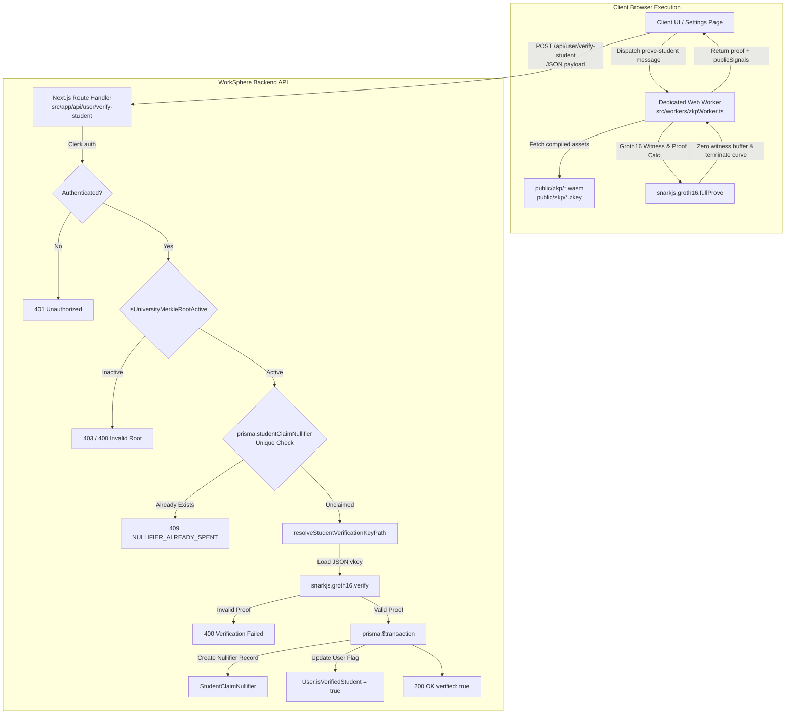
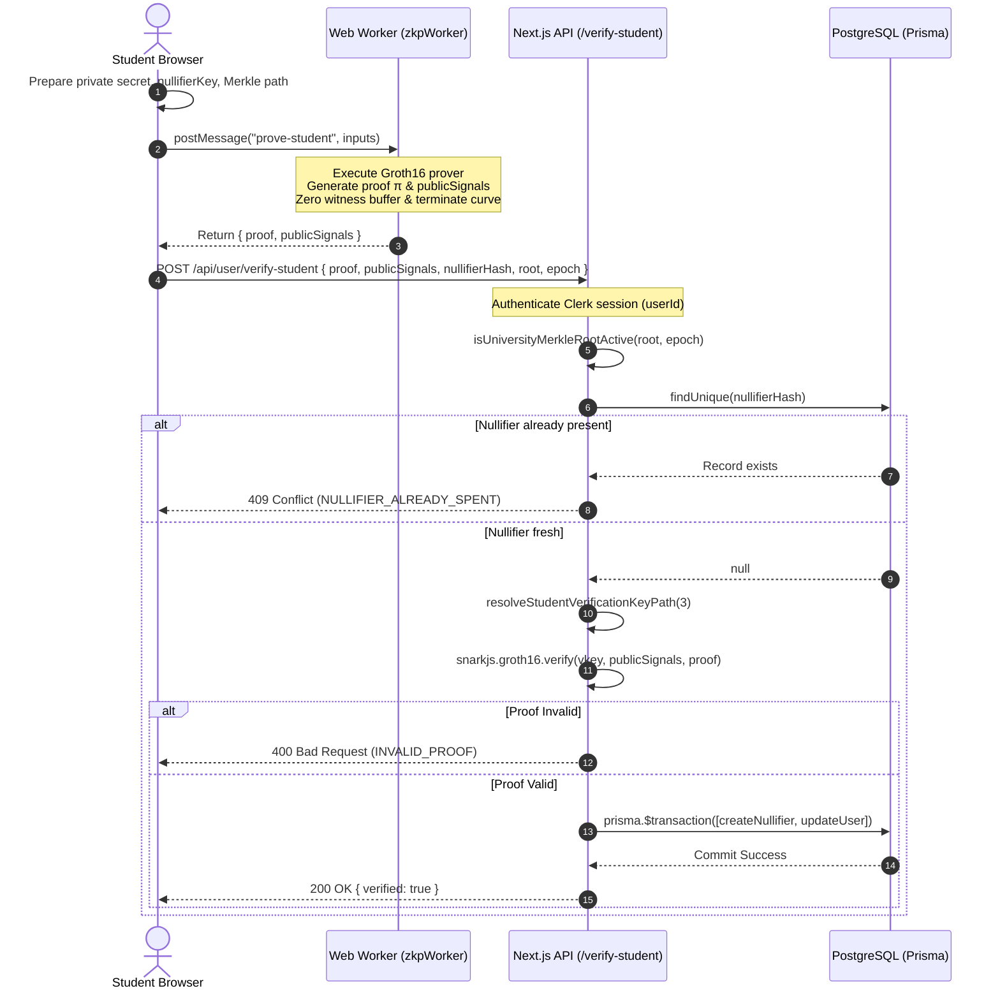

# Student Discount Zero-Knowledge Proof Generation and Verification Guide

## 1. Overview & Privacy Goals

WorkSphere offers verified student discounts and promotional access tiers across participating campus workspaces and cafes. Traditional verification schemes force students to upload student ID cards, sensitive academic transcripts, or personal credentials to third-party databases. This presents significant security, compliance, and privacy risks:
- Exposure of Personally Identifiable Information (PII) such as full names, birth dates, matriculation numbers, and institution IDs.
- Potential tracking and correlation of student workspace usage, movement patterns, and commercial transactions.
- Storage of unencrypted credential documents vulnerable to data breaches.

To eliminate these vulnerabilities, WorkSphere implements a privacy-preserving Zero-Knowledge Proof (ZKP) architecture based on Groth16 zero-knowledge Succinct Non-Interactive Arguments of Knowledge (zk-SNARKs) over the BN128 (alt_bn128) pairing-friendly elliptic curve.

### Privacy and Verifier Guarantees

```
+-----------------------------------------------------------------------------------------+
|                                    PRIVACY BOUNDARY                                     |
|                                                                                         |
|   STUDENT / BROWSER PROVER                              WORKSPHERE VERIFIER / SERVER    |
|                                                                                         |
|   Holds Privately:                                      Learns Only:                    |
|   - Secret identity scalar (`secret`)                   - Proof validity: Valid / Invalid|
|   - Nullifier secret key (`nullifierKey`)               - Merkle root (`root`) is active|
|   - 16-level Merkle audit path (`pathElements`)         - Target epoch (`epoch`) matches|
|   - Merkle path bit indices (`pathIndices`)             - Nullifier hash is unique      |
|                                                                                         |
|   Zero Knowledge Property:                                                              |
|   No student ID, name, institution affiliation, or path position is revealed.           |
+-----------------------------------------------------------------------------------------+
```

1. **Zero-Knowledge Knowledge Assertion:** The student proves they possess a valid credential enrolled in an accredited university's Merkle tree without revealing their private identifier (`secret`), their leaf index, or their authentication Merkle path.
2. **Epoch Scoping:** Proofs are pinned to a specific validity epoch (for example, academic year or semester `epoch: 2026`). A valid proof for epoch 2026 cannot be reused in epoch 2027.
3. **Sybil Resistance & Double-Claim Prevention:** A deterministic nullifier hash is computed from the private secret, nullifier key, and epoch. The server enforces nullifier uniqueness in PostgreSQL, preventing a student from redeeming multiple discounts in the same epoch while preventing the server from linking the nullifier back to the student's physical identity.

---

## 2. Protocol Architecture

The WorkSphere student verification lifecycle spans five main actors:
1. **Client Application (`src/app/`):** Orchestrates credential input, passes jobs to the Web Worker, and submits verification payloads to the API.
2. **Web Worker Prover (`src/workers/zkpWorker.ts`):** Computes Groth16 zk-SNARK proofs off the main UI thread with memory sandboxing, buffer zeroing, and BN128 curve memory reclamation.
3. **Circom Arithmetic Circuits (`circuits/student_membership.circom`, `circuits/student_access_pass.circom`):** Encode R1CS constraint systems for Poseidon hashing and Merkle tree inclusion verification.
4. **Verification Endpoint (`src/app/api/user/verify-student/route.ts`):** Validates Clerk authentication, verifies university Merkle root freshness, checks database nullifiers, and executes SnarkJS cryptographic verification.
5. **PostgreSQL / Prisma Database (`prisma/schema.prisma`):** Enforces atomic nullifier uniqueness and sets user `isVerifiedStudent` status.



---

## 3. Circuit Inputs and Public Signals

WorkSphere supports two Circom circuit variants: the foundational membership circuit (`student_membership.circom`) and the production nullifier-backed access pass circuit (`student_access_pass.circom`).

### Formal Signal Specification

| Signal Name | Circuit Scope | Visibility | Field Type | Semantic Description |
| :--- | :--- | :--- | :--- | :--- |
| `root` | Both | **Public** | $\mathbb{F}_r$ scalar | Root hash of the 16-level Poseidon Merkle tree published by accredited universities. |
| `epoch` | Both | **Public** | $\mathbb{F}_r$ scalar | Time-bounded credential epoch (e.g., `2026`). Prevents cross-epoch replay. |
| `nullifierHash` | Access Pass | **Public** | $\mathbb{F}_r$ scalar | Deterministic hash binding the secret, nullifier key, and epoch: $\text{Poseidon}(\text{secret}, \text{nullifierKey}, \text{epoch})$. |
| `secret` | Both | **Private** | $\mathbb{F}_r$ scalar | Student private secret scalar acting as the pre-image of the membership leaf. |
| `nullifierKey` | Access Pass | **Private** | $\mathbb{F}_r$ scalar | Prover-specific private salt ensuring nullifiers cannot be brute-forced from public roots. |
| `pathElements[16]` | Both | **Private** | Array[16] $\mathbb{F}_r$ | Sibling hashes along the Merkle inclusion audit path from leaf to root. |
| `pathIndices[16]` | Both | **Private** | Array[16] $\{0, 1\}$ | Binary routing bits ($0 = \text{current node is left}$, $1 = \text{current node is right}$). |

### Hiding Private Pre-images and Modulo Arithmetic

All circuit arithmetic operates over the scalar field $\mathbb{F}_r$ of the BN128 curve:
$$r = 21888242871839275222246405745257275088548364400416034343698204186575808495617$$

Private inputs never leave the client's Web Worker execution context. Before serialization to JSON, all big integer field elements are stringified as decimal strings to prevent JavaScript 64-bit IEEE-754 floating-point truncation.

---

## 4. Circom Circuit Architecture

### `student_membership.circom` (2 Public Signals)

The foundational membership circuit verifies that a student leaf is a member of an active Merkle root for a given epoch:

```circom
pragma circom 2.0.0;

include "../node_modules/circomlib/circuits/poseidon.circom";
include "../node_modules/circomlib/circuits/mux1.circom";

template StudentMembership(levels) {
    // Public Inputs
    signal input root;
    signal input epoch;

    // Private Inputs
    signal input secret;
    signal input pathElements[levels];
    signal input pathIndices[levels];

    // Compute Leaf Hash = Poseidon(secret, epoch)
    component leafHasher = Poseidon(2);
    leafHasher.inputs[0] <== secret;
    leafHasher.inputs[1] <== epoch;

    // Verify 16-level Merkle Path using DualMux & Poseidon(2)
    signal currentHash[levels + 1];
    currentHash[0] <== leafHasher.out;

    component mux[levels];
    component hashers[levels];

    for (var i = 0; i < levels; i++) {
        mux[i] = DualMux();
        mux[i].in[0] <== currentHash[i];
        mux[i].in[1] <== pathElements[i];
        mux[i].s <== pathIndices[i];

        hashers[i] = Poseidon(2);
        hashers[i].inputs[0] <== mux[i].out[0];
        hashers[i].inputs[1] <== mux[i].out[1];

        currentHash[i + 1] <== hashers[i].out;
    }

    // Constrain computed root to equal public root
    root === currentHash[levels];
}

component main {public [root, epoch]} = StudentMembership(16);
```

### `student_access_pass.circom` (3 Public Signals)

The production access pass circuit extends membership verification by producing a verifiable `nullifierHash`:

```circom
pragma circom 2.0.0;

include "../node_modules/circomlib/circuits/poseidon.circom";
include "../node_modules/circomlib/circuits/mux1.circom";

template StudentAccessPass(levels) {
    // Public Signals (3)
    signal input root;
    signal input epoch;
    signal input nullifierHash;

    // Private Signals
    signal input secret;
    signal input nullifierKey;
    signal input pathElements[levels];
    signal input pathIndices[levels];

    // 1. Enforce nullifier derivation constraint:
    // nullifierHash === Poseidon(secret, nullifierKey, epoch)
    component nullHasher = Poseidon(3);
    nullHasher.inputs[0] <== secret;
    nullHasher.inputs[1] <== nullifierKey;
    nullHasher.inputs[2] <== epoch;
    nullifierHash === nullHasher.out;

    // 2. Compute Leaf Hash: Poseidon(secret, epoch)
    component leafHasher = Poseidon(2);
    leafHasher.inputs[0] <== secret;
    leafHasher.inputs[1] <== epoch;

    // 3. Merkle inclusion tree traversal
    signal currentHash[levels + 1];
    currentHash[0] <== leafHasher.out;

    component mux[levels];
    component hashers[levels];

    for (var i = 0; i < levels; i++) {
        mux[i] = DualMux();
        mux[i].in[0] <== currentHash[i];
        mux[i].in[1] <== pathElements[i];
        mux[i].s <== pathIndices[i];

        hashers[i] = Poseidon(2);
        hashers[i].inputs[0] <== mux[i].out[0];
        hashers[i].inputs[1] <== mux[i].out[1];

        currentHash[i + 1] <== hashers[i].out;
    }

    root === currentHash[levels];
}

component main {public [root, epoch, nullifierHash]} = StudentAccessPass(16);
```

### Poseidon Hash Construction & DualMux Multiplexing

- **DualMux Primitive:** Employs the arithmetic multiplexer from `circomlib` to order sibling nodes without conditional branches:
  $$\text{out}[0] = \text{in}[0] + s \cdot (\text{in}[1] - \text{in}[0])$$
  $$\text{out}[1] = \text{in}[1] - s \cdot (\text{in}[1] - \text{in}[0])$$
  When $s = 0$, $(\text{out}[0], \text{out}[1]) = (\text{in}[0], \text{in}[1])$. When $s = 1$, the positions swap.
- **Tree Capacity:** With tree depth $L = 16$, a single university Merkle root accommodates up to $2^{16} = 65,536$ active enrolled students.

---

## 5. Groth16 Mathematics on BN128

The Groth16 zero-knowledge argument system uses pairing-friendly elliptic curve groups $(\mathbb{G}_1, \mathbb{G}_2, \mathbb{G}_T)$ with bilinear map $e: \mathbb{G}_1 \times \mathbb{G}_2 \to \mathbb{G}_T$.

### Verification Pairing Equation

Given proof $\pi = (A \in \mathbb{G}_1, B \in \mathbb{G}_2, C \in \mathbb{G}_1)$ and verification key:
$$VK = (\alpha \in \mathbb{G}_1, \beta \in \mathbb{G}_2, \gamma \in \mathbb{G}_2, \delta \in \mathbb{G}_2, \{IC_i \in \mathbb{G}_1\}_{i=0}^l)$$
where $l$ is the number of public signals, the verifier computes the public input accumulator $vk_x \in \mathbb{G}_1$:
$$vk_x = IC_0 + \sum_{i=1}^l x_i \cdot IC_i$$
The verifier checks whether the following pairing equality holds:
$$e(A, B) = e(\alpha, \beta) \cdot e(vk_x, \gamma) \cdot e(C, \delta)$$

In WorkSphere, this check is executed server-side via `snarkjs.groth16.verify(vKey, publicSignals, proof)`.

---

## 6. Browser-Side SnarkJS Proving Pipeline

To maintain 60 FPS UI performance, proof generation is offloaded to a dedicated Web Worker (`src/workers/zkpWorker.ts`).

### Worker Lifecycle and Memory Management

Generating Groth16 proofs in WebAssembly requires substantial linear memory allocation. Without careful lifecycle controls, repeated proofs lead to heap fragmentation and browser tab crashes. The WorkSphere worker enforces:
1. **Explicit Memory Bounding:** Proving requests execute sequentially within bounded memory pools.
2. **Buffer Sanitization (`releaseWitnessBuffer`):** The calculated witness buffer (`wtns.data`) is explicitly zeroed with `fill(0)` immediately after proof synthesis to prevent secret leakage in browser heap dumps.
3. **Elliptic Curve Cleanup (`terminateCurveBn128`):** The internal `snarkjs.bn128` curve singleton is explicitly terminated after proof generation.
4. **Periodic Worker Recycling:** The worker tracks cumulative proof executions (`proofCount`). After 10 proofs, the worker signals recycling to release V8 WebAssembly memory spaces.

```typescript
// Pattern used in src/workers/zkpWorker.ts
async function executeBoundedGroth16Proof(circuitName: string, inputs: Record<string, unknown>) {
    const wasmPath = `/zkp/${circuitName}.wasm`;
    const zkeyPath = `/zkp/${circuitName}.zkey`;

    // 1. Compute witness and generate proof
    const { proof, publicSignals } = await snarkjs.groth16.fullProve(
        inputs,
        wasmPath,
        zkeyPath
    );

    // 2. Sanitize and release curve resources
    if (globalThis.curve_bn128?.terminate) {
        await globalThis.curve_bn128.terminate();
    }

    return { proof, publicSignals };
}
```

### Worker Messaging Contract

- **Inbound Event:**
  ```json
  {
    "type": "prove-student",
    "circuit": "student_access_pass",
    "inputs": {
      "root": "0x12a3...",
      "epoch": 2026,
      "nullifierHash": "0x09b1...",
      "secret": "112233...",
      "nullifierKey": "445566...",
      "pathElements": ["0x...", "..."],
      "pathIndices": [0, 1, 0, 0, 1, 0, 1, 1, 0, 0, 0, 1, 0, 1, 0, 0]
    }
  }
  ```
- **Outbound Event:**
  ```json
  {
    "type": "proof-result",
    "status": "ready",
    "proof": {
      "pi_a": ["...", "...", "1"],
      "pi_b": [["...", "..."], ["...", "..."], ["1", "0"]],
      "pi_c": ["...", "...", "1"],
      "protocol": "groth16",
      "curve": "bn128"
    },
    "publicSignals": [
      "13524...", // root
      "2026",     // epoch
      "89412..."  // nullifierHash
    ]
  }
  ```

---

## 7. Compilation and Setup Tutorial

The cryptographic assets are compiled using `circom` (v2.0.0+) and `snarkjs` (v0.7.0+), automated by `scripts/compile-student-access-pass-zkp.sh`.

### Step-by-Step Compilation Workflow

```bash
#!/usr/bin/env bash
set -euo pipefail

mkdir -p build/zkp public/zkp

# 1. Compile Circom Circuit to R1CS, WASM, and SYM
echo "Compiling student_access_pass.circom..."
circom2 circuits/student_access_pass.circom \
  --r1cs \
  --wasm \
  --sym \
  -o build/zkp

# 2. Powers of Tau Phase 1 Ceremony (bn128, 2^14 constraints)
echo "Generating Phase 1 Powers of Tau..."
snarkjs powersoftau new bn128 14 build/zkp/pot14_0000.ptau -v
snarkjs powersoftau contribute build/zkp/pot14_0000.ptau build/zkp/pot14_0001.ptau \
  --name="WorkSphere Phase 1 Entropy" -v -e="entropy_seed_string"
snarkjs powersoftau prepare phase2 build/zkp/pot14_0001.ptau build/zkp/pot14_final.ptau -v

# 3. Groth16 Circuit-Specific Phase 2 Setup
echo "Generating circuit zkey..."
snarkjs groth16 setup \
  build/zkp/student_access_pass.r1cs \
  build/zkp/pot14_final.ptau \
  build/zkp/student_access_pass_0000.zkey

# 4. Contribute Phase 2 Ceremony Entropy
snarkjs zkey contribute \
  build/zkp/student_access_pass_0000.zkey \
  build/zkp/student_access_pass.zkey \
  --name="WorkSphere Phase 2 Setup" -v -e="additional_entropy_token"

# 5. Export Verification Key
echo "Exporting verification key..."
snarkjs zkey export verification_key \
  build/zkp/student_access_pass.zkey \
  public/zkp/student_access_pass_vkey.json

# 6. Stage Client Assets in public/zkp
cp build/zkp/student_access_pass_js/student_access_pass.wasm public/zkp/
cp build/zkp/student_access_pass.zkey public/zkp/

echo "ZK compilation completed successfully."
```

---

## 8. Verification Key Structure & Resolver

The verification key resolver in `src/lib/zkp/studentVerificationKey.ts` dynamically routes keys based on public signal arity:

```typescript
export function resolveStudentVerificationKeyPath(
  publicSignalCount: number,
  paths: StudentVerificationKeyPaths = DEFAULT_KEY_PATHS,
  exists: (targetPath: string) => boolean = existsSync
): string {
  let targetPath: string;

  if (publicSignalCount === 1) {
    targetPath = paths.legacyVerificationKey;
  } else if (publicSignalCount === 2) {
    targetPath = paths.membershipVerificationKey;
  } else if (publicSignalCount === 3) {
    targetPath = paths.accessPassVerificationKey;
  } else {
    throw new Error(
      `Unsupported public signals count: ${publicSignalCount}. Expected 1, 2, or 3.`
    );
  }

  if (!exists(targetPath)) {
    throw new Error(`Verification key file does not exist at: ${targetPath}`);
  }

  return targetPath;
}
```

### Verification Key Structure (`public/zkp/student_access_pass_vkey.json`)

```json
{
  "protocol": "groth16",
  "curve": "bn128",
  "nPublic": 3,
  "vk_alpha_1": [
    "17705494191632005477478065529452097722288006527581137021669931885918731006126",
    "5948347895057636601449070868774797171638302196627063428987019688320499092823",
    "1"
  ],
  "vk_beta_2": [
    ["...", "..."],
    ["...", "..."],
    ["1", "0"]
  ],
  "vk_gamma_2": [
    ["...", "..."],
    ["...", "..."],
    ["1", "0"]
  ],
  "vk_delta_2": [
    ["...", "..."],
    ["...", "..."],
    ["1", "0"]
  ],
  "vk_alphabeta_12": [],
  "IC": [
    ["...", "...", "1"], // IC[0]: Constant term
    ["...", "...", "1"], // IC[1]: Linear coefficient for root
    ["...", "...", "1"], // IC[2]: Linear coefficient for epoch
    ["...", "...", "1"]  // IC[3]: Linear coefficient for nullifierHash
  ]
}
```

---

## 9. Server-Side Verification API

### Endpoint Specification

- **Path:** `POST /api/user/verify-student`
- **Authentication:** Required via Clerk Session (`await auth()`).
- **Content-Type:** `application/json`

### Request Payload

```json
{
  "proof": {
    "pi_a": ["201648...", "158931...", "1"],
    "pi_b": [
      ["891234...", "189230..."],
      ["491028...", "789123..."],
      ["1", "0"]
    ],
    "pi_c": ["178923...", "198421...", "1"],
    "protocol": "groth16",
    "curve": "bn128"
  },
  "publicSignals": [
    "149203948102938401928301928301928301928301928301928301928301928",
    "2026",
    "839102938401928301928301928301928301928301928301928301928301928"
  ],
  "nullifierHash": "839102938401928301928301928301928301928301928301928301928301928",
  "root": "149203948102938401928301928301928301928301928301928301928301928",
  "epoch": 2026
}
```

### Response Status Codes

| Status Code | Code / Error Identifier | Description |
| :--- | :--- | :--- |
| `200 OK` | `{ success: true, verified: true }` | Proof valid, nullifier recorded, student status updated. |
| `400 Bad Request` | `INVALID_INPUT` / `INVALID_PROOF` | Malformed JSON body, mismatched signals, or cryptographic verification failure. |
| `401 Unauthorized` | `UNAUTHORIZED` | Missing or invalid Clerk authentication session. |
| `403 Forbidden` | `INACTIVE_ROOT` | Merkle root is expired, unaccredited, or not active for the specified epoch. |
| `409 Conflict` | `NULLIFIER_ALREADY_SPENT` | Nullifier hash has already been registered in the database for this epoch. |
| `500 Server Error` | `INTERNAL_ERROR` | Missing server verification key asset or database transaction error. |

---

## 10. Nullifier Generation & Duplicate-Claim Prevention

To prevent duplicate discount claims without compromising user privacy, the protocol relies on deterministic nullifier derivation and PostgreSQL database constraints.

### Database Schema (`prisma/schema.prisma`)

```prisma
model StudentClaimNullifier {
  id            String   @id @default(cuid())
  nullifierHash String   @unique
  epoch         Int      @default(2026)
  claimedAt     DateTime @default(now())

  @@index([nullifierHash])
}
```

### Atomic Database Transaction

In `src/app/api/user/verify-student/route.ts`, verification completion executes within a Prisma interactive transaction. If two concurrent requests attempt to submit the same `nullifierHash`, the unique constraint triggers a PostgreSQL `P2002` error, ensuring atomic isolation:

```typescript
try {
  await prisma.$transaction([
    prisma.studentClaimNullifier.create({
      data: {
        nullifierHash,
        epoch: parsedEpoch,
      },
    }),
    prisma.user.update({
      where: { id: userId },
      data: { isVerifiedStudent: true },
    }),
  ]);
} catch (error) {
  if (error instanceof Prisma.PrismaClientKnownRequestError && error.code === 'P2002') {
    return NextResponse.json(
      { error: 'Student discount already claimed for this epoch', code: 'NULLIFIER_ALREADY_SPENT' },
      { status: 409 }
    );
  }
  throw error;
}
```

---

## 11. End-to-End Verification Lifecycle



---

## 12. Security & Privacy Considerations

1. **Replay Protection across Epochs:** The `epoch` signal ensures that proofs cannot be replayed across academic terms.
2. **Side-Channel & Heap Dumping Mitigation:** In client environments where multiple browser extensions run, witness buffers containing raw secrets are scrubbed using `buffer.fill(0)` immediately after witness creation.
3. **Cryptographic Setup Assumptions:** Groth16 requires a trusted setup ceremony. Compromise of the Powers of Tau toxic waste ($\tau, \alpha, \beta, \gamma, \delta$) would allow forging proofs of false statements. WorkSphere utilizes Phase 1 Hermez ptau ceremonies combined with custom phase 2 entropy contributions.
4. **Client-Side Trust Boundary:** The server never trusts client-supplied validation claims. All public signals extracted from the request are checked directly against the proof using the pinned server verification key.

---

## 13. Configuration and Artifacts Reference

| Artifact Description | Repository Path | Public Signals | Target Scope |
| :--- | :--- | :--- | :--- |
| **Membership Circuit** | `circuits/student_membership.circom` | 2 (`[root, epoch]`) | Inclusion assertion |
| **Access Pass Circuit** | `circuits/student_access_pass.circom` | 3 (`[root, epoch, nullifierHash]`) | Production discount pass |
| **Membership WASM** | `public/zkp/student_membership.wasm` | 2 | Client prover runtime |
| **Membership ZKey** | `public/zkp/student_membership.zkey` | 2 | Client proving parameters |
| **Access Pass WASM** | `public/zkp/student_access_pass.wasm` | 3 | Client prover runtime |
| **Access Pass ZKey** | `public/zkp/student_access_pass.zkey` | 3 | Client proving parameters |
| **Access Pass VKey** | `public/zkp/student_access_pass_vkey.json` | 3 | Server Groth16 verifier |
| **Compilation Script** | `scripts/compile-student-access-pass-zkp.sh` | - | Pipeline build script |
| **VKey Resolver** | `src/lib/zkp/studentVerificationKey.ts` | 1, 2, 3 | Dynamic key routing |
| **Verification Route** | `src/app/api/user/verify-student/route.ts` | - | Next.js API handler |
| **Prover Worker** | `src/workers/zkpWorker.ts` | - | Background thread prover |

---

## 14. Implementation Gaps and Design Differences

When comparing the initial specification proposals in Issue #9346 with the actual WorkSphere codebase, several technical differences must be recognized:

1. **University Identity & Credential Attestation:**
   - *Issue Proposal:* Suggested verifying a university digital signature (`universitySigningKey`, ECDSA/EdDSA) directly inside the Circom circuit.
   - *Actual Implementation:* The Circom circuit does **not** perform in-circuit asymmetric signature verification (which is computationally expensive in R1CS). Instead, university accreditation is established via Merkle tree root registration. Universities publish active Merkle roots of enrolled student hashes (`DEFAULT_ACTIVE_CAMPUS_ROOTS`), and the server validates `isUniversityMerkleRootActive(root, epoch)`.
2. **Private Identity Model:**
   - *Issue Proposal:* Named inputs `studentId` and `salt`.
   - *Actual Implementation:* The circuits standardize on field elements `secret` and `nullifierKey`. The student leaf is defined as $\text{Poseidon}(\text{secret}, \text{epoch})$, and the nullifier is defined as $\text{Poseidon}(\text{secret}, \text{nullifierKey}, \text{epoch})$.
3. **Database Nullifier Persistence:**
   - *Issue Proposal:* Conceptual storage of nullifier tokens.
   - *Actual Implementation:* Production PostgreSQL schema implements `model StudentClaimNullifier` with `@unique` index on `nullifierHash` and Prisma interactive transaction handling with `P2002` conflict checks.

---

## 15. Source References

- `circuits/student_membership.circom` — Merkle membership verification circuit.
- `circuits/student_access_pass.circom` — Nullifier-backed access pass verification circuit.
- `scripts/compile-student-access-pass-zkp.sh` — Circuit compilation and setup pipeline.
- `src/lib/zkp/studentVerificationKey.ts` — Dynamic verification key routing.
- `src/workers/zkpWorker.ts` — Dedicated client-side Groth16 Web Worker.
- `src/app/api/user/verify-student/route.ts` — Next.js verification endpoint and Prisma transaction handler.
- `prisma/schema.prisma` — Database schema for `StudentClaimNullifier` and `User`.
